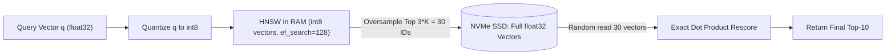
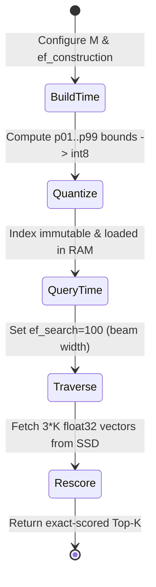
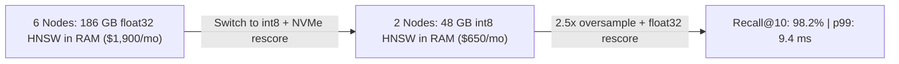

# Vector Index Tuning: HNSW M, ef_search & int8 Quantisation

> **Prerequisites:** [Lesson 09: Vector Search Fundamentals](../09-vector-search-fundamentals/README.md).  
> **Estimated Reading Time:** 24–28 minutes  
> **Target Audience:** Engineers optimizing production vector search clusters for lower RAM cost, faster index builds, and strict latency/recall SLAs.  
> **Free PDF Notes:** [Download SD-P-010.pdf](https://backendroadmap.com/notes/system-design/SD-P-010.pdf)

> [!NOTE]
> **In one line:** HNSW performance is governed by three knobs—**$M$** (graph connectivity/RAM), **`ef_construction`** (build-time quality), and **`ef_search`** (query-time beam width)—while **scalar (`int8`) and binary quantisation** slash memory by **$4\times$ to $32\times$** and recover nearly 100% of lost accuracy via **oversampling + full-precision rescoring**.

> [!TIP]
> **The Golden Rule:** Start with `M = 16`, `ef_construction = 100–200`, and tune `ef_search` dynamically at query time to hit your Recall@10 target. When RAM is the bottleneck, enable **`int8` scalar quantisation** with `1.5x–2x` oversampling and rescore from `float32` on disk—cutting RAM by $4\times$ with $< 0.5\%$ recall drop.

---

## 1. What Vector Index Tuning Is, and What It Isn't

You deployed a 20M-vector HNSW index with `float32` embeddings (`d = 1536`). It consumes 135 GB of RAM, takes 6 hours to rebuild, and costs $1,800/month. By tuning `M`, `ef_construction`, `ef_search`, and applying `int8` scalar quantisation with disk rescoring, you drop RAM to 34 GB ($4\times$ cheaper) while keeping Recall@10 at 98% and $p_{99}$ latency under 12 ms.

| Term | Precise Meaning | Example |
| :--- | :--- | :--- |
| **`M`** | Max bi-directional edges per node in upper HNSW layers (`2M` in Layer 0) | `M = 16` (default), `32` (high recall) |
| **`ef_construction`** | Dynamic candidate list size during index build | `100–200` (build-time only) |
| **`ef_search`** | Dynamic beam width during query traversal ($\ge K$) | `64` (fast), `256` (high recall) |
| **Scalar Quantisation (`int8`)** | Compressing each `float32` (4 B) dimension into an `int8` (1 B) bucket | $4\times$ RAM reduction, $< 1\%$ recall loss |
| **Binary Quantisation (BQ)** | Compressing each dimension to 1 bit (`sign(x)`) | $32\times$ RAM reduction, needs rescoring |
| **Product Quantisation (PQ)** | Splitting vector into sub-vectors and replacing each with a codebook ID | $16\times\text{–}64\times$ compression |
| **Oversampling + Rescore** | Fetch $R \times K$ quantized candidates, rescore exact `float32` from NVMe | Recovers 98–99% recall |
| **Not** | Tuning `ef_search` to fix a bad embedding model | Index tuning only recovers *exact $k$-NN* |

### Why It Matters
1. **RAM is the #1 cost driver** in vector search; quantisation directly cuts cluster bill by $2\times\text{–}4\times$.
2. **`ef_search` is a live runtime dial:** You can adjust latency vs. recall per query without reindexing.
3. **Oversampling + rescoring** decouples fast quantized graph traversal in RAM from high-precision scoring on NVMe SSDs.

---

## 2. Anatomy: Two-Stage Quantized Search with Disk Rescoring



| Quantisation Method | Bytes per 1536-d Vector | Compression | Standalone Recall@10 | With $3\times$ Rescore |
| :--- | :---: | :---: | :---: | :---: |
| **`float32` (Baseline)** | `6,144 B` | $1\times$ | $98.5\%$ | — |
| **`float16`** | `3,072 B` | $2\times$ | $98.4\%$ | $98.5\%$ |
| **`int8` (Scalar)** | `1,536 B` (+8 B min/max) | $4\times$ | $96.5\text{–}97.8\%$ | **$98.4\%$** |
| **Binary (1-bit)** | `192 B` | $32\times$ | $65\text{–}80\%$ | **$94\text{–}96\%$** (with $10\times$ oversample) |

> [!WARNING]
> **Binary quantisation (`1-bit`) fails on low-dimensional vectors ($d < 512$) or uncentered embeddings.** It relies on high-dimensional concentration of measure ($d \ge 1024$, e.g., `text-embedding-3-large` or OpenAI `1536-d`) and *always* requires $5\times\text{–}10\times$ oversampling + `float32` rescoring.

---

## 3. Mathematical Model: Scalar Quantisation, HNSW Memory & Rescore I/O

**Min-Max `int8` Scalar Quantisation.** Given per-dimension (or global) bounds $[v_{\min}, v_{\max}]$, map float $x$ to signed/unsigned 8-bit integer $q \in [0, 255]$:

$$q = \text{round}\left( \frac{\text{clip}(x, v_{\min}, v_{\max}) - v_{\min}}{v_{\max} - v_{\min}} \cdot 255 \right)$$

Usually $v_{\min}, v_{\max}$ are chosen at the **1st and 99th percentiles** (quantile clipping) so extreme outlier dimensions do not crush the dynamic range of normal values.

**Memory Savings Formula.** With $N$ vectors, dimension $d$, HNSW degree $M$, and bytes per dimension $b \in \{4, 2, 1, 0.125\}$:

$$\text{RAM} \approx N \cdot \left( b \cdot d + 8M \cdot 1.1 \right)$$

For $N = 20{,}000{,}000$, $d = 1536$, $M = 16$:
- **`float32` ($b=4$):** $20\text{M} \times (6144 + 141) \approx 125.7\text{ GB}$
- **`int8` ($b=1$):** $20\text{M} \times (1536 + 141) \approx 33.5\text{ GB}$ (**$3.75\times$ total RAM reduction**, even including the HNSW graph!)

**Rescoring I/O Budget.** Oversampling by factor $R = 3$ for $K = 10$ means reading $30$ full `float32` vectors ($30 \times 6\text{ KB} = 180\text{ KB}$) from NVMe SSD. At $100\text{ }\mu\text{s}$ per NVMe random read (parallelized via `io_uring`), 30 reads finish in $< 0.5\text{ ms}$.

---

## 4. Metrics & Percentiles

| Metric | Meaning | Alert when |
| :--- | :--- | :--- |
| **Recall@10 vs Exact** | Accuracy after quantisation + rescore | $< 0.95$ |
| **Query $p_{99}$ latency** | Combined HNSW + NVMe rescore time | $> 25\text{ ms}$ |
| **Graph build time** | Time to index/merge a segment (`ef_construction`) | Exceeds indexing SLA |
| **RAM / Vector ratio** | Total bytes in RAM per indexed vector | $> 2\times$ target budget |
| **Rescore disk IOPS** | NVMe random reads per second during rescoring | $> 70\%$ of SSD IOPS limit |

### Worked Example (`ef_search` vs. Latency & Recall)
On a 10M-vector `int8` HNSW index ($d = 768$, $M = 16$, `ef_construction = 128`):
- `ef_search = 32`: **2.1 ms** $p_{99}$, **91.2% Recall@10**
- `ef_search = 64`: **3.8 ms** $p_{99}$, **95.6% Recall@10**
- `ef_search = 128`: **7.2 ms** $p_{99}$, **98.1% Recall@10**
- `ef_search = 256`: **14.5 ms** $p_{99}$, **99.0% Recall@10**

Notice the diminishing returns: doubling `ef_search` from 128 to 256 doubles latency (+7.3 ms) for only +0.9% recall.

---

## 5. Compounding & Failure Modes: Over-Tuning Traps

| Failure Mode | Trigger | Compounding Effect |
| :--- | :--- | :--- |
| **Oversized `M` ($M = 64$)** | Chasing 99.9% recall via massive degree | Graph RAM doubles, build time triples, CPU cache misses spike |
| **High `ef_construction` ($500+$)** | Set blindly during bulk ingestion | Segment merges stall for hours; write throughput collapses $5\times$ |
| **Binary Quantisation without Rescore** | Returning raw Hamming-distance top-10 | Recall@10 drops to 65%, ruining RAG answer quality |
| **Outlier clipping failure** | Using absolute `min/max` instead of `p01/p99` | One outlier dimension forces 99% of values into 5 `int8` buckets |

---

## 6. Numbers Every Engineer Must Know

| Item | Typical | Implication |
| :--- | :---: | :--- |
| Standard `M` range | `16` (balanced) to `32` (high $d$/recall) | Rarely need `M > 48` |
| Standard `ef_construction` | `100–200` | Must be $\ge 2 \cdot M$; higher slows indexing linearly |
| Standard `ef_search` | `64–128` | Runtime knob; must be $\ge K$ |
| `int8` RAM reduction | `~3.5x–4x` (including graph) | Best default quantisation for $d \ge 384$ |
| Binary quantisation reduction | `~20x–32x` | Only viable for $d \ge 1024$ + $5\times\text{–}10\times$ rescore |
| Oversampling factor $R$ | `2x–3x` (`int8`), `5x–10x` (binary) | Cheap when full vectors live on NVMe |

---

## 7. Protocol Deep Dive: Build-Time vs. Query-Time Parameter Control



| Question | Answer |
| :--- | :--- |
| **Can I change `M` or `ef_construction` without reindexing?** | **No.** Both shape the immutable graph edges on disk/RAM; changing them requires rebuilding/merging segments. |
| **Can I change `ef_search` per query?** | **Yes.** `ef_search` only controls the runtime priority queue size. You can use `ef_search=40` for autocomplete and `ef_search=200` for high-stakes RAG. |
| **Why does `int8` need `1%` quantile clipping?** | Embedding models occasionally emit extreme values in 1–2 dimensions. Clipping at `[p01, p99]` preserves full 8-bit resolution for the dense body of the distribution. |
| **How does SIMD accelerate `int8`?** | Modern CPUs (AVX-512 VNNI / ARM NEON dotprod) compute 4x more `int8` multiply-adds per cycle than `float32`, making distance math faster too. |

**When not to quantise:** If your total dataset fits in $< 8\text{ GB}$ RAM as `float32` or `float16`, skip `int8`/binary quantisation complexity and keep full precision.

---

## 8. Hierarchical Budgets & Design Rules

| Slice | Rule | Control |
| :--- | :--- | :--- |
| Graph degree `M` | Default `16`; bump to `32` only if $d \ge 1536$ or recall stalls | Index mapping (`index_options.m`) |
| Build beam `ef_construction` | `100` for fast ingestion; `200` for static read-heavy indexes | Index mapping (`ef_construction`) |
| Search beam `ef_search` | Start at `64`; sweep `[32, 64, 128, 256]` against Recall@10 | Query parameter (`num_candidates` / `ef`) |
| Quantisation | `int8` by default above 5M vectors; `binary` only if $d \ge 1024$ | `int8_hnsw` / `bbq_hnsw` |
| Rescoring | Oversample `2x–3x` (`int8`) or `5x–10x` (binary) from NVMe | Two-stage rescore config |
| Bounds calibration | Clip outliers at `0.99` quantile, not raw `min/max` | `quantile: 0.99` |

---

## 9. Top Mitigations

1. **Sweep `ef_search` offline** to plot the Recall@10 vs. $p_{99}$ latency knee before choosing production defaults.
2. **Use `int8` scalar quantisation** as your first memory optimization—nearly lossless with $2\times$ rescoring.
3. **Always pair binary quantisation with $5\times\text{–}10\times$ oversampling + `float32` rescoring**.
4. **Keep `M = 16` unless benchmarks prove higher `M` is needed**, avoiding unnecessary RAM and build-time bloat.
5. **Clip quantisation bounds at the 99th percentile** so rare outlier dimensions don't destroy precision.
6. **Tune `ef_construction` down (`64–100`) for streaming/write-heavy indexes** to prevent merge-thread starvation.

---

## 10. Production Reference: Halving Search Cluster Cost with `int8` + Rescore

**Scenario:** A semantic document search platform held 40M `1024-dim` `float32` vectors (`164 GB` raw + `22 GB` HNSW = `186 GB` RAM) across six `r6i.2xlarge` nodes. Memory growth forced an expensive scale-out.



- **Root Cause of Cost:** Keeping full `float32` vectors in RAM for graph traversal wasted 75% of memory bandwidth and heap.
- **Fix:** Migrated the index to `int8_hnsw` (`M=16`, `ef_construction=128`, `ef_search=96`) with `2.5x` oversampling and `float32` rescoring from local NVMe. Cluster size dropped from 6 nodes to 2 nodes, Recall@10 stayed at `98.2%` (vs `98.4%` baseline), and $p_{99}$ latency actually *improved* from `14 ms` to `9.4 ms` due to better CPU L3 cache locality.

---

## 11. Multi-Language Production Code Tabs

`int8` scalar quantizer/dequantizer with quantile clipping and two-stage oversampled rescoring in Go, TypeScript, Python, and C#.

````carousel
```go
// Go: int8 scalar quantisation + two-stage float32 rescoring.
package vectortune

import (
	"math"
	"sort"
)

type Quantizer struct {
	Min, Scale float32
}

func NewQuantizer(minVal, maxVal float32) Quantizer {
	return Quantizer{Min: minVal, Scale: (maxVal - minVal) / 255.0}
}

func (q Quantizer) Encode(vec []float32) []uint8 {
	out := make([]uint8, len(vec))
	for i, x := range vec {
		v := (x - q.Min) / q.Scale
		if v < 0 {
			v = 0
		} else if v > 255 {
			v = 255
		}
		out[i] = uint8(math.Round(float64(v)))
	}
	return out
}

func QuantizedDot(a, b []uint8) int64 {
	var sum int64
	for i := range a {
		sum += int64(a[i]) * int64(b[i])
	}
	return sum
}

func RescoreTopK(queryF32 []float32, candidates []string, fullStore map[string][]float32, k int) []string {
	type pair struct {
		id    string
		score float32
	}
	scored := make([]pair, 0, len(candidates))
	for _, id := range candidates {
		var s float32
		vec := fullStore[id]
		for i := range queryF32 {
			s += queryF32[i] * vec[i]
		}
		scored = append(scored, pair{id, s})
	}
	sort.Slice(scored, func(i, j int) bool { return scored[i].score > scored[j].score })
	out := make([]string, 0, k)
	for i := 0; i < k && i < len(scored); i++ {
		out = append(out, scored[i].id)
	}
	return out
}
```
<!-- slide -->
```typescript
// TypeScript: int8 scalar quantizer + oversampled exact rescore.
export class ScalarQuantizer {
  private readonly scale: number;
  constructor(private readonly min: number, max: number) {
    this.scale = (max - min) / 255;
  }

  encode(vec: number[]): Uint8Array {
    const out = new Uint8Array(vec.length);
    for (let i = 0; i < vec.length; i++) {
      const q = Math.round((vec[i] - this.min) / this.scale);
      out[i] = Math.max(0, Math.min(255, q));
    }
    return out;
  }
}

export function rescoreTopK(
  query: number[],
  candidateIds: string[],
  fullVectors: Map<string, number[]>,
  k: number
): string[] {
  return candidateIds
    .map((id) => {
      const v = fullVectors.get(id)!;
      let score = 0;
      for (let i = 0; i < query.length; i++) score += query[i] * v[i];
      return { id, score };
    })
    .sort((a, b) => b.score - a.score)
    .slice(0, k)
    .map((x) => x.id);
}
```
<!-- slide -->
```python
# Python: int8 scalar quantiser with p01/p99 clipping & two-stage rescore (stdlib only).
def fit_quantile_bounds(vectors: list[list[float]], clip: float = 0.01) -> tuple[float, float]:
    vals = sorted(x for v in vectors for x in v)
    lo_idx = int(len(vals) * clip)
    hi_idx = min(len(vals) - 1, int(len(vals) * (1.0 - clip)))
    return vals[lo_idx], vals[hi_idx]

def quantize_int8(vec: list[float], vmin: float, vmax: float) -> list[int]:
    scale = (vmax - vmin) / 255.0 if vmax > vmin else 1.0
    return [max(0, min(255, round((x - vmin) / scale))) for x in vec]

def two_stage_search(
    query: list[float],
    q_store: dict[str, list[int]],
    full_store: dict[str, list[float]],
    vmin: float,
    vmax: float,
    k: int = 10,
    oversample: int = 3,
) -> list[str]:
    q_query = quantize_int8(query, vmin, vmax)
    # Stage 1: fast int8 scan (simulating HNSW traversal)
    stage1 = sorted(
        ((sum(a * b for a, b in zip(q_query, qv)), doc_id) for doc_id, qv in q_store.items()),
        reverse=True,
    )[: k * oversample]
    # Stage 2: exact float32 rescore on oversampled candidates
    stage2 = sorted(
        ((sum(a * b for a, b in zip(query, full_store[doc_id])), doc_id) for _, doc_id in stage1),
        reverse=True,
    )
    return [doc_id for _, doc_id in stage2[:k]]
```
<!-- slide -->
```csharp
// C#: int8 scalar quantizer and two-stage float32 rescoring.
using System;
using System.Collections.Generic;
using System.Linq;

public sealed class ScalarQuantizer
{
    private readonly float _min;
    private readonly float _scale;

    public ScalarQuantizer(float min, float max)
    {
        _min = min;
        _scale = (max - min) / 255f;
    }

    public byte[] Encode(float[] vec)
    {
        var outBytes = new byte[vec.Length];
        for (int i = 0; i < vec.Length; i++)
        {
            int q = (int)Math.Round((vec[i] - _min) / _scale);
            outBytes[i] = (byte)Math.Clamp(q, 0, 255);
        }
        return outBytes;
    }

    public static List<string> RescoreTopK(
        float[] query, IEnumerable<string> candidates, IReadOnlyDictionary<string, float[]> fullStore, int k)
    {
        return candidates
            .Select(id =>
            {
                var v = fullStore[id];
                float dot = 0;
                for (int i = 0; i < query.Length; i++) dot += query[i] * v[i];
                return (Id: id, Score: dot);
            })
            .OrderByDescending(x => x.Score)
            .Take(k)
            .Select(x => x.Id)
            .ToList();
    }
}
```
````

---

## 12. Hands-On CLI Verification Workflows

Configure `int8_hnsw` in Elasticsearch and run a runtime `num_candidates` (`ef_search`) query:

```bash
# 1. Create an int8-quantized HNSW index in Elasticsearch
curl -X PUT "http://localhost:9200/docs_int8" -H "Content-Type: application/json" -d '{
  "mappings": {
    "properties": {
      "embedding": {
        "type": "dense_vector",
        "dims": 768,
        "index": true,
        "similarity": "dot_product",
        "index_options": {
          "type": "int8_hnsw",
          "m": 16,
          "ef_construction": 128
        }
      }
    }
  }
}'

# 2. Query with runtime ef_search (num_candidates = 100 for k = 10)
curl -s -X POST "http://localhost:9200/docs_int8/_search" -H "Content-Type: application/json" -d '{
  "knn": {
    "field": "embedding",
    "query_vector": [0.01, -0.02, "..."],
    "k": 10,
    "num_candidates": 100
  }
}'
```

Compare `float32` vs `int8` vs `binary` memory in Python:

```bash
python3 -c '
N, D, M = 20_000_000, 1536, 16
for name, b in [("float32", 4), ("float16", 2), ("int8", 1), ("binary", 0.125)]:
    gb = N * (b * D + 8 * M * 1.1) / (1024**3)
    print(f"{name:8s}: {gb:6.2f} GB")
'
```

---

## 13. Common Mistakes to Avoid

1. **Cranking `M` to 64+**, doubling graph memory and slowing builds for negligible recall gain.
2. **Setting `ef_search < k`**, which is invalid or forces truncation before finding $K$ neighbors.
3. **Enabling Binary Quantisation without rescoring**, tanking Recall@10 by 20–30%.
4. **Using raw `min`/`max` instead of `p01`/`p99` quantile clipping** for `int8` quantisation.
5. **Running `ef_construction=500` on a live streaming index**, causing merge-thread starvation.
6. **Forgetting to benchmark `int8` + rescore against `float32` exact $k$-NN** before rollout.
7. **Storing full `float32` vectors in RAM when using `int8`**, defeating the memory savings.

---

## 14. Key Terms Glossary

| Key Term | Definition |
| :--- | :--- |
| **`M`** | Maximum number of bi-directional edges per node in upper HNSW layers (`2M` in Layer 0). |
| **`ef_construction`** | Beam width used while inserting vectors during index construction. |
| **`ef_search`** | Runtime beam width controlling how many candidates HNSW explores per query. |
| **Scalar Quantisation (`int8`)** | Mapping 32-bit floats to 8-bit integers for $4\times$ memory savings. |
| **Binary Quantisation (BQ)** | Compressing each vector dimension to a single sign bit ($32\times$ compression). |
| **Product Quantisation (PQ)** | Splitting vectors into sub-vectors quantized via $k$-means codebooks. |
| **Oversampling** | Fetching $R \times K$ candidates from the fast quantized index before rescoring. |
| **Rescoring** | Recomputing exact `float32` distances on the oversampled candidate set. |
| **Quantile Clipping** | Ignoring extreme outlier values (e.g., top/bottom 1%) when fitting `int8` bounds. |
| **Asymmetric Distance** | Comparing an unquantized `float32` query against quantized database vectors. |

---

## 15. System Design Interview Questions & Answers

### Basic Conceptual Questions

<details>
<summary><strong>Q1: Explain the three main HNSW parameters: M, ef_construction, and ef_search. [BASIC]</strong></summary>

**Answer:**
- `M`: Max neighbors per node in upper layers (`2M` in Layer 0). Controls graph density, RAM, and build time.
- `ef_construction`: Search beam width during index building. Higher values create a better-connected graph at the cost of slower indexing.
- `ef_search`: Search beam width at query time. Higher values explore more candidates, increasing Recall@K and latency linearly.
</details>

<details>
<summary><strong>Q2: Which HNSW parameters can be changed at query time vs. requiring a full reindex? [BASIC]</strong></summary>

**Answer:**
`ef_search` (called `num_candidates` in Elasticsearch) can be changed per query at runtime. `M` and `ef_construction` are baked into the graph topology and require reindexing or segment rebuilding to change.
</details>

<details>
<summary><strong>Q3: How does int8 scalar quantisation work and how much RAM does it save? [BASIC]</strong></summary>

**Answer:**
It maps each `float32` (4 bytes) dimension linearly into an 8-bit integer `[0, 255]` (1 byte) using `[min, max]` bounds, cutting vector memory by $4\times$. Including the HNSW graph edges, total RAM drops by roughly $3.5\times$.
</details>

<details>
<summary><strong>Q4: Why do we use oversampling and rescoring with quantized indexes? [BASIC]</strong></summary>

**Answer:**
Quantisation introduces small rounding errors that can swap the order of close neighbors. Fetching $2\times\text{–}3\times$ more candidates (`30` instead of `10`) from the fast quantized index in RAM, then rescoring those 30 using exact `float32` vectors stored on NVMe SSD, recovers almost 100% of exact recall.
</details>

### Scenario-Based Architecture Questions

<details>
<summary><strong>Q5: Your HNSW index build takes 8 hours and starves query CPU. What do you tune? [SCENARIO]</strong></summary>

**Answer:**
Lower `ef_construction` (e.g., from 400 down to 100–128) and ensure `M` isn't oversized (use 16 instead of 48). Isolate heavy index builds onto dedicated indexing nodes (or build offline and swap segments/snapshots) so graph construction doesn't compete with live query threads.
</details>

<details>
<summary><strong>Q6: You need to cut vector search RAM by 75% without losing more than 1% Recall@10. What is your plan? [SCENARIO]</strong></summary>

**Answer:**
Enable `int8` scalar quantisation with `0.99` quantile clipping, keep the `int8` HNSW graph in RAM ($4\times$ smaller vectors), store full `float32` vectors on NVMe SSD, and configure `2.5x` oversampling + exact rescoring at query time.
</details>

<details>
<summary><strong>Q7: An AI team wants to use 1-bit Binary Quantisation for 384-dim embeddings. Should you approve it? [SCENARIO]</strong></summary>

**Answer:**
No—push back with data. Binary quantisation loses significant angular precision on low-dimensional vectors ($d = 384$). It works well at $d \ge 1024\text{–}1536$ with $5\times\text{–}10\times$ oversampling + rescoring. For $d = 384$, `int8` already fits comfortably in RAM with $< 1\%$ recall loss.
</details>

<details>
<summary><strong>Q8: How do you handle two user tiers: free users (50 ms SLA) and enterprise RAG (99% recall SLA)? [SCENARIO]</strong></summary>

**Answer:**
Use the exact same HNSW index, but vary `ef_search` per request tier: pass `ef_search=48` for free-tier queries (fast, ~93% recall) and `ef_search=200` + `3x` rescoring for enterprise RAG queries (higher compute, ~99% recall).
</details>

### Advanced & Tricky Interview Questions

<details>
<summary><strong>Q9: Why does scalar quantisation use quantile clipping (e.g., p01–p99) instead of absolute min/max? [TRICKY]</strong></summary>

**Answer:**
Transformer embeddings often have a few "rogue" dimensions with values like `12.0` while 99% of values lie in `[-0.5, 0.5]`. Using absolute min/max stretches the 256 `int8` buckets across `[-12, 12]`, squeezing 99% of data into just ~10 buckets and destroying precision. Clipping at `p01/p99` preserves full 8-bit resolution.
</details>

<details>
<summary><strong>Q10: Why can int8 quantisation actually make HNSW queries FASTER than float32 even in RAM? [TRICKY]</strong></summary>

**Answer:**
Two reasons: (1) $4\times$ smaller vectors fit $4\times$ better in CPU L2/L3 caches, slashing DRAM stalls during random HNSW hops; (2) AVX-512 VNNI / NEON `int8` SIMD instructions process more dimensions per CPU cycle than `float32`.
</details>

<details>
<summary><strong>Q11: What is Asymmetric Distance Computation (ADC) in Product Quantisation? [TRICKY]</strong></summary>

**Answer:**
Instead of quantizing the query vector (which adds error), ADC keeps the query in `float32`, precomputes a small lookup table of distances between each query sub-vector and all codebook centroids, and scores each database vector by summing $M$ table lookups—achieving fast, higher-accuracy scoring.
</details>

<details>
<summary><strong>Q12: Why does increasing M beyond 32 sometimes hurt query latency? [TRICKY]</strong></summary>

**Answer:**
At every hop in HNSW, the engine evaluates distances to all $M$ (or $2M$) neighbors of the current node. Doubling $M$ doubles the number of distance computations and memory fetches per hop, which can increase latency even if the path takes slightly fewer hops.
</details>

---

## 16. One-Page Master Cheat Sheet

```
+---------------------------------------------------------------------------------------------------------+
|                    VECTOR INDEX TUNING — MASTER CHEAT SHEET                                             |
+---------------------------------------------------------------------------------------------------------+
| 1. HNSW KNOBS:                                                                                          |
|    - M (16-32): Graph edges/node. Fixed at build time. Controls RAM & build speed.                      |
|    - ef_construction (100-200): Build-time beam. Fixed at build time. Higher = slower build.            |
|    - ef_search (64-256): Query-time beam. Tunable live! Higher = higher recall & higher latency.        |
+---------------------------------------------------------------------------------------------------------+
| 2. QUANTISATION:                                                                                        |
|    - int8 (Scalar): 4x smaller vectors, < 1% recall drop. Always clip bounds at p01/p99!                |
|    - Binary (1-bit): 32x smaller, ONLY for d >= 1024 + mandatory 5x-10x oversample & float32 rescore.   |
+---------------------------------------------------------------------------------------------------------+
| 3. TWO-STAGE PATTERN: Traverse int8 HNSW in RAM -> fetch 2x-3x float32 vectors from NVMe -> rescore.    |
+---------------------------------------------------------------------------------------------------------+
```

---

## Further Reading & Sources

- Elasticsearch Engineering, [Int8 Scalar Quantisation & BBQ in Lucene](https://www.elastic.co/search-labs/blog/scalar-quantization-in-lucene).
- Qdrant Documentation, [Quantization: Scalar, Binary & Product](https://qdrant.tech/documentation/guides/quantization/).
- HNSWLib Benchmarks, [ANN-Benchmarks: Recall vs QPS](https://ann-benchmarks.com/).

---

## Free PDF Notes

[SD-P-010.pdf](https://backendroadmap.com/notes/system-design/SD-P-010.pdf)

---

## Next

Continue with [Lesson 11: Hybrid Search: BM25 + Vectors with Reciprocal Rank Fusion](../11-hybrid-search/README.md): Combining lexical BM25 and semantic vectors with RRF and cross-encoder rerankers.
