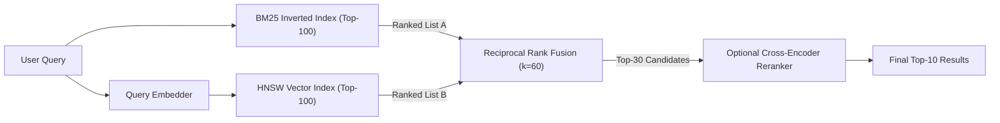
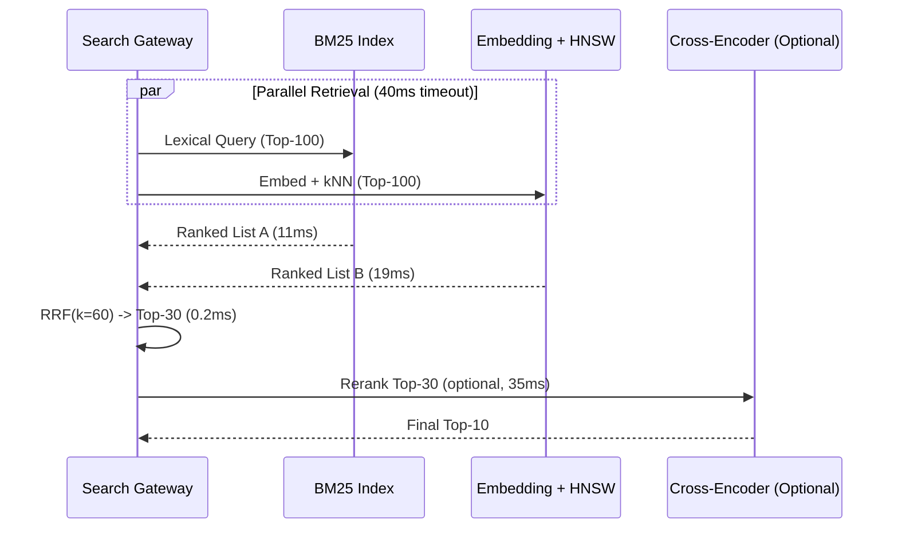
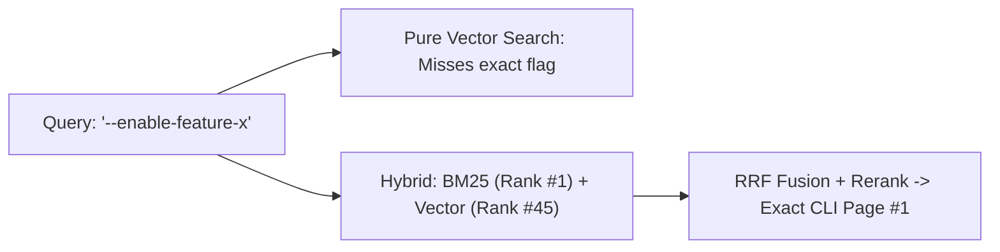

# Hybrid Search: BM25 + Vectors with Reciprocal Rank Fusion

> **Prerequisites:** [Lesson 10: Vector Index Tuning](../10-vector-index-tuning/README.md).  
> **Estimated Reading Time:** 24–28 minutes  
> **Target Audience:** Search and RAG engineers building high-precision retrieval systems that handle both exact keywords and semantic intent.  
> **Free PDF Notes:** [Download SD-P-011.pdf](https://backendroadmap.com/notes/system-design/SD-P-011.pdf)

> [!NOTE]
> **In one line:** Lexical **BM25** excels at exact IDs, SKUs, and rare terms, while **dense vectors** excel at synonyms and conceptual intent. **Hybrid search** runs both in parallel and merges their ranked lists using **Reciprocal Rank Fusion (RRF)**—a rank-only formula immune to incompatible score scales—optionally followed by a **cross-encoder reranker** on the top 20–50 hits.

> [!TIP]
> **The Golden Rule:** Never add raw BM25 scores (`0..45+`) directly to Cosine similarity scores (`0..1`). Use **Reciprocal Rank Fusion (RRF)** with $k = 60$ as your zero-tuning baseline, and only add a cross-encoder reranker on the top 25–50 candidates when relevance gains justify an extra 30–80 ms.

---

## 1. What Hybrid Search Is, and What It Isn't

A user searches `"error 502 nginx upstream timeout"`. Pure vector search returns general articles about "load balancer health checks" while missing the exact `"502"` page. Conversely, when a user searches `"how to stop server from dropping idle clients"`, BM25 misses `"keepalive_timeout"` because none of those exact words appear. Hybrid search captures **both** by running lexical and vector retrieval side-by-side and fusing the results.

| Term | Precise Meaning | Example |
| :--- | :--- | :--- |
| **BM25 (Lexical)** | Probabilistic term-frequency / inverse-document-frequency ranking | Exact match on `SKU-9921`, `502` |
| **Dense Retrieval (ANN)** | Semantic similarity in learned embedding space | `"quiet hotel"` $\leftrightarrow$ `"peaceful resort"` |
| **Hybrid Search** | Parallel execution of lexical + vector retrievers merged into one list | BM25 Top-100 + kNN Top-100 |
| **Score Normalization** | Rescaling heterogeneous scores (min-max, z-score) before weighted sum | $\alpha \cdot \text{norm}(S_{\text{lex}}) + (1-\alpha)\cdot \text{norm}(S_{\text{vec}})$ |
| **RRF (Reciprocal Rank Fusion)** | Rank-only fusion: $\sum_i \frac{1}{k + r_i(d)}$, ignoring raw scores | $k = 60$ standard constant |
| **Cross-Encoder Reranker** | Transformer scoring `(query, doc)` jointly for top-50 candidates | `bge-reranker-large` / Cohere Rerank |
| **Not** | Running vector search first and only using BM25 as a tie-breaker | True hybrid runs both independently |

### Why It Matters
1. **Neither retriever dominates all queries:** Benchmarks (BEIR, MTEB) consistently show hybrid retrieval outperforms BM25-only and vector-only by 5–15% nDCG@10.
2. **Score scales are incompatible:** BM25 is unbounded $[0, \infty)$ and query-dependent; Cosine is bounded $[-1, 1]$. Naive linear addition breaks silently.
3. **RRF is zero-calibration:** It requires no training data or per-query score normalization to deliver strong out-of-the-box fusion.

---

## 2. Anatomy: Parallel Retrieval, RRF Fusion & Cross-Encoder Rerank



| Fusion Method | Needs Calibration? | Handles Outliers? | Latency | Best For |
| :--- | :---: | :---: | :---: | :--- |
| **Linear Sum (Min-Max)** | **Yes** ($\alpha$ weight + min/max) | Poor (1 outlier skews min-max) | $< 0.1\text{ ms}$ | Tuned domain-specific weights |
| **Z-Score Normalization** | Moderate | Better | $< 0.2\text{ ms}$ | Homogeneous query distributions |
| **RRF ($k = 60$)** | **No** (rank-only) | **Excellent** | $< 0.2\text{ ms}$ | General-purpose hybrid search |
| **Cross-Encoder Rerank** | No | **Best** (deep attention) | $30\text{–}100\text{ ms}$ (GPU) | RAG, high-value top-10 precision |

> [!WARNING]
> **Beware of min-max normalization on single-result or low-spread lists.** If BM25 returns 100 docs with tightly clustered scores `[12.1, 12.0, ..., 11.8]`, min-max stretches `11.8` to `0.0` and `12.1` to `1.0`—exaggerating noise. RRF avoids this trap completely by using only ordinal ranks.

---

## 3. Mathematical Model: RRF Formula, Weights & Rerank Latency

**Reciprocal Rank Fusion (Cormack et al., 2009).** For a document $d$ appearing at 1-indexed rank $r_i(d)$ in retriever $i$ (or omitted if not in retriever $i$'s top-$M$):

$$\text{RRF}(d) = \sum_{i \in \{\text{BM25}, \text{Vec}\}} \frac{w_i}{k + r_i(d)}$$

With standard unweighted RRF ($w_i = 1, k = 60$):
- **Rank 1 in both:** $\frac{1}{61} + \frac{1}{61} = 0.03279$
- **Rank 1 in BM25, absent in Vector:** $\frac{1}{61} + 0 = 0.01639$
- **Rank 5 in both:** $\frac{1}{65} + \frac{1}{65} = 0.03077$ (beats a doc that is #1 in only one retriever!)

Notice why $k = 60$ works: it dampens the impact of rank 1 vs. rank 2 ($1/61$ vs $1/62$) so that documents appearing near the top of **both** lists beat a document that spiked to #1 in only one list.

**Total Hybrid Latency Budget.** Because BM25 and Vector HNSW execute in parallel:

$$T_{\text{hybrid}} = \max(T_{\text{BM25}}, T_{\text{embed}} + T_{\text{HNSW}}) + T_{\text{RRF}} + T_{\text{rerank}}(C)$$

With $T_{\text{BM25}} = 12\text{ ms}$, $T_{\text{embed}} = 15\text{ ms}$, $T_{\text{HNSW}} = 6\text{ ms}$, $T_{\text{RRF}} = 0.2\text{ ms}$, and $T_{\text{rerank}}(30) = 45\text{ ms}$:
- Without reranker: $\max(12, 21) + 0.2 = 21.2\text{ ms}$.
- With reranker ($C=30$): $21.2 + 45 = 66.2\text{ ms}$.

---

## 4. Metrics & Percentiles

| Metric | Meaning | Alert when |
| :--- | :--- | :--- |
| **nDCG@10** | Graded ranking quality of top 10 results | Drops vs. single-retriever baseline |
| **MRR (Mean Reciprocal Rank)** | How high the first relevant doc ranks | Drops $> 2\%$ on golden query set |
| **Retriever overlap @ 50** | % of docs found by both BM25 and Vector | $< 5\%$ (retrievers disagreeing wildly) |
| **Hybrid $p_{99}$ latency** | Slowest parallel branch + fusion (+ rerank) | Exceeds SLA (e.g., $> 50\text{ ms}$ no-rerank) |
| **Branch timeout / partial rate** | Queries where BM25 or Vector timed out | $> 0.5\%$ (degrades to single-branch) |

### Worked Example (RRF Fusion Scoring)
Suppose BM25 returns `[D1, D2, D3]` and Vector returns `[D3, D4, D1]` with $k = 60$:
- **D1:** $\frac{1}{60+1} + \frac{1}{60+3} = 0.01639 + 0.01587 = \mathbf{0.03226}$ (Rank 1)
- **D3:** $\frac{1}{60+3} + \frac{1}{60+1} = 0.01587 + 0.01639 = \mathbf{0.03226}$ (Tied Rank 1)
- **D2:** $\frac{1}{60+2} = 0.01613$ (Rank 3)
- **D4:** $\frac{1}{60+2} = 0.01613$ (Tied Rank 3)

D1 and D3—which appeared in *both* retrievers—clearly outrank D2 and D4, which appeared in only one.

---

## 5. Compounding & Failure Modes: Timeout Cascading & Reranker Bottlenecks

| Failure Mode | Trigger | Compounding Effect |
| :--- | :--- | :--- |
| **Sequential Execution** | Calling BM25, waiting, then calling Vector | Doubles tail latency ($T_{\text{BM25}} + T_{\text{Vec}}$) unnecessarily |
| **Reranking Too Many Docs** | Passing Top-200 docs to a cross-encoder | GPU inference spikes to 400+ ms, timing out requests |
| **Missing Branch Fallback** | Embedding service goes down $\to$ whole search fails `500` | Should degrade gracefully to BM25-only! |
| **Shard-Level RRF Bias** | Running RRF independently per shard without `rank_window_size` | Top-10 per shard misses global rank alignment |

---

## 6. Numbers Every Engineer Must Know

| Item | Typical | Implication |
| :--- | :---: | :--- |
| Standard RRF constant $k$ | `60` | Proven robust across BEIR/TREC benchmarks |
| `rank_window_size` per branch | `50–100` | Too small (`10`) misses cross-list overlap |
| Cross-encoder candidate count | `20–50` docs | Beyond 50 docs gives diminishing nDCG for high GPU cost |
| Cross-encoder GPU latency (25 docs) | `25–60 ms` | Too slow for 20 ms typeahead; ideal for RAG/deep search |
| Graceful degradation | BM25-only fallback | Keeps search 100% available if embedding API fails |

---

## 7. Protocol Deep Dive: Parallel Scatter, Graceful Degradation & RRF



| Question | Answer |
| :--- | :--- |
| **What happens if the Embedding/Vector branch times out?** | Return the BM25-only ranked list immediately instead of failing the search request. |
| **Can you weight BM25 vs. Vector in RRF?** | Yes: $\text{RRF}(d) = \frac{w_{\text{lex}}}{k + r_{\text{lex}}} + \frac{w_{\text{vec}}}{k + r_{\text{vec}}}$, e.g. $w_{\text{lex}}=1.2, w_{\text{vec}}=0.8$ for SKU-heavy catalogs. |
| **Why is a cross-encoder more accurate than bi-encoder vectors?** | A bi-encoder compresses query and doc separately into single vectors (no token-level interaction). A cross-encoder runs full self-attention across `[query; doc]` pairs together. |
| **Why not use a cross-encoder for first-stage retrieval?** | Running a transformer over 10M documents per query would take hours; it only scales to the top 20–50 candidates. |

**When not to use Hybrid Search:** If your corpus is purely structured logs/metrics or exact SKU lookups where semantic paraphrasing adds noise, stick to pure BM25 + filters.

---

## 8. Hierarchical Budgets & Design Rules

| Slice | Rule | Control |
| :--- | :--- | :--- |
| Execution | Always run BM25 and Vector branches in parallel | `errgroup` / `Promise.allSettled` |
| Resilience | Degrade to BM25-only if embedding/ANN branch errors | Per-branch circuit breaker & 50 ms timeout |
| Fusion | Default to RRF ($k = 60$, window $= 100$) | No raw score addition |
| Reranking | Cap cross-encoder input at 25–50 docs; skip on high load | Shed reranker first under CPU/GPU pressure |
| Evaluation | Track nDCG@10 on both keyword and semantic query slices | Separate golden test sets per query type |

---

## 9. Top Mitigations

1. **Run BM25 and Vector retrieval concurrently** so latency is $\max(T_1, T_2)$ rather than $T_1 + T_2$.
2. **Use RRF ($k=60$) instead of raw score addition** to eliminate scale mismatch bugs.
3. **Set `rank_window_size` to `50–100`** per retriever so RRF has enough overlap to work.
4. **Implement graceful fallback to BM25-only** if the embedding model or vector index times out.
5. **Cap cross-encoder reranking at 25–50 candidates** and shed it automatically under high load.
6. **Evaluate on segmented query sets** (exact SKU/entity queries vs. natural-language queries) to tune weights safely.

---

## 10. Production Reference: Fixing "Zero-Overlap" Exact-Match Queries in RAG

**Incident:** An enterprise documentation RAG assistant used pure dense vector search. Engineers complained that searching specific error flags like `--enable-feature-x` or HTTP code `429` returned generic architecture docs instead of the exact CLI reference page.



- **Root Cause:** The dense embedding model tokenized `--enable-feature-x` into subwords with diluted semantic meaning, ranking unrelated "configuration" docs higher.
- **Fix:** Added a BM25 inverted index alongside HNSW, fused Top-100 from each via RRF ($k=60$), and added a 25-doc cross-encoder reranker. Exact-flag MRR jumped from `0.31` to `0.92` while natural-language nDCG@10 also improved by `+6%`.

---

## 11. Multi-Language Production Code Tabs

Reciprocal Rank Fusion (RRF) with optional per-retriever weights in Go, TypeScript, Python, and C#.

````carousel
```go
// Go: Weighted Reciprocal Rank Fusion (RRF) across arbitrary ranked lists.
package hybrid

import "sort"

type RankedList struct {
	DocIDs []string
	Weight float64
}

type FusedResult struct {
	DocID string
	Score float64
}

func RRF(lists []RankedList, k int, topN int) []FusedResult {
	scores := make(map[string]float64)
	for _, list := range lists {
		w := list.Weight
		if w == 0 {
			w = 1.0
		}
		for rank, id := range list.DocIDs {
			scores[id] += w / float64(k+rank+1) // 1-indexed rank
		}
	}
	results := make([]FusedResult, 0, len(scores))
	for id, s := range scores {
		results = append(results, FusedResult{DocID: id, Score: s})
	}
	sort.Slice(results, func(i, j int) bool { return results[i].Score > results[j].Score })
	if len(results) > topN {
		results = results[:topN]
	}
	return results
}
```
<!-- slide -->
```typescript
// TypeScript: Reciprocal Rank Fusion (RRF) with optional weights.
export interface RankedList {
  docIds: string[];
  weight?: number;
}

export interface FusedResult {
  docId: string;
  score: number;
}

export function reciprocalRankFusion(
  lists: RankedList[],
  k = 60,
  topN = 10
): FusedResult[] {
  const scores = new Map<string, number>();
  for (const { docIds, weight = 1.0 } of lists) {
    docIds.forEach((id, idx) => {
      const prev = scores.get(id) ?? 0;
      scores.set(id, prev + weight / (k + idx + 1));
    });
  }
  return Array.from(scores.entries())
    .map(([docId, score]) => ({ docId, score }))
    .sort((a, b) => b.score - a.score)
    .slice(0, topN);
}
```
<!-- slide -->
```python
# Python: Reciprocal Rank Fusion (RRF) with weights & worked test (stdlib only).
from collections import defaultdict

def rrf(ranked_lists: list[list[str]], weights: list[float] | None = None, k: int = 60, top_n: int = 10):
    scores: dict[str, float] = defaultdict(float)
    w_list = weights or [1.0] * len(ranked_lists)
    for docs, w in zip(ranked_lists, w_list):
        for rank, doc_id in enumerate(docs, start=1):
            scores[doc_id] += w / (k + rank)
    return sorted(scores.items(), key=lambda x: x[1], reverse=True)[:top_n]

if __name__ == "__main__":
    bm25 = ["D1", "D2", "D3"]
    vec = ["D3", "D4", "D1"]
    fused = rrf([bm25, vec], k=60, top_n=4)
    assert {d for d, _ in fused[:2]} == {"D1", "D3"}
```
<!-- slide -->
```csharp
// C#: Weighted Reciprocal Rank Fusion (RRF).
using System.Collections.Generic;
using System.Linq;

public sealed record FusedResult(string DocId, double Score);

public static class HybridFusion
{
    public static List<FusedResult> Rrf(
        IEnumerable<(IReadOnlyList<string> Docs, double Weight)> lists, int k = 60, int topN = 10)
    {
        var scores = new Dictionary<string, double>();
        foreach (var (docs, weight) in lists)
        {
            for (int i = 0; i < docs.Count; i++)
            {
                scores.TryGetValue(docs[i], out double curr);
                scores[docs[i]] = curr + weight / (k + i + 1);
            }
        }
        return scores
            .Select(kv => new FusedResult(kv.Key, kv.Value))
            .OrderByDescending(r => r.Score)
            .Take(topN)
            .ToList();
    }
}
```
````

---

## 12. Hands-On CLI Verification Workflows

Run native Hybrid Search with RRF in Elasticsearch 8.x+ and verify RRF math in Python:

```bash
# Elasticsearch native RRF hybrid query (BM25 + kNN)
curl -s -X POST "http://localhost:9200/docs_hybrid/_search" -H "Content-Type: application/json" -d '{
  "retriever": {
    "rrf": {
      "retrievers": [
        { "standard": { "query": { "match": { "body": "error 502 upstream timeout" } } } },
        { "knn": { "field": "embedding", "query_vector": [0.02, -0.01, "..."], "k": 50, "num_candidates": 100 } }
      ],
      "rank_window_size": 50,
      "rank_constant": 60
    }
  },
  "size": 10
}'
```

Verify RRF score behavior in Python:

```bash
python3 -c '
k = 60
both_rank_5 = 1/(k+5) + 1/(k+5)
one_rank_1 = 1/(k+1)
print(f"Both rank 5: {both_rank_5:.5f} > One rank 1: {one_rank_1:.5f}")
'
```

---

## 13. Common Mistakes to Avoid

1. **Adding raw BM25 and Cosine scores together**, letting BM25 (`0–50`) completely drown out Cosine (`0–1`).
2. **Running BM25 and Vector search sequentially**, doubling search latency.
3. **Setting `rank_window_size` equal to `size=10`**, leaving too few overlapping documents for RRF to fuse.
4. **Failing the entire request if the embedding service times out**, instead of falling back to BM25-only.
5. **Sending 200+ candidates to a cross-encoder**, blowing the latency budget.
6. **Using min-max normalization on small result sets**, amplifying noise when scores are tightly clustered.
7. **Evaluating hybrid search without separate lexical and semantic query slices** in your test suite.

---

## 14. Key Terms Glossary

| Key Term | Definition |
| :--- | :--- |
| **Hybrid Search** | Combining lexical (BM25) and semantic (vector) retrieval into a single ranked output. |
| **BM25** | Best Matching 25 lexical ranking function based on term frequency, IDF, and doc length. |
| **Reciprocal Rank Fusion (RRF)** | Score-agnostic rank fusion summing $1/(k + \text{rank})$ across retrievers. |
| **Rank Constant ($k$)** | Smoothing constant in RRF (typically 60) controlling top-rank dominance. |
| **`rank_window_size`** | Number of top candidates fetched from each retriever before RRF merging. |
| **Bi-Encoder** | Embedding model encoding query and document independently for fast ANN search. |
| **Cross-Encoder** | Reranking model encoding `(query, doc)` jointly for high-precision top-K ordering. |
| **Score Normalization** | Rescaling heterogeneous scores (min-max, z-score) to a common range. |
| **nDCG@K** | Normalized Discounted Cumulative Gain measuring graded relevance in top-$K$. |
| **Graceful Degradation** | Falling back to BM25-only if the vector/embedding branch fails or times out. |

---

## 15. System Design Interview Questions & Answers

### Basic Conceptual Questions

<details>
<summary><strong>Q1: Why combine BM25 and Vector search instead of using vectors alone? [BASIC]</strong></summary>

**Answer:**
Dense vectors capture synonyms and intent well, but often blur exact identifiers (SKUs, error codes, proper nouns, rare jargon). BM25 excels at exact lexical matches. Combining both yields higher recall and precision across all query types.
</details>

<details>
<summary><strong>Q2: Why can't you just add BM25 and Cosine similarity scores? [BASIC]</strong></summary>

**Answer:**
BM25 scores are unbounded ($[0, \infty)$) and vary wildly by query length and term rarity, whereas Cosine similarity is bounded in $[-1, 1]$ (often clustered in $[0.7, 0.9]$). Direct addition lets BM25 dominate unpredictably.
</details>

<details>
<summary><strong>Q3: How does Reciprocal Rank Fusion (RRF) work? [BASIC]</strong></summary>

**Answer:**
RRF ignores raw scores and uses only each document's 1-based rank $r_i$ in each retriever: $\sum_i \frac{1}{k + r_i}$ (typically $k=60$). Documents appearing near the top of multiple retrievers accumulate higher fused scores.
</details>

<details>
<summary><strong>Q4: What is the difference between a bi-encoder and a cross-encoder? [BASIC]</strong></summary>

**Answer:**
A bi-encoder embeds queries and documents independently into vectors, enabling sub-10 ms ANN search across millions of docs. A cross-encoder processes `(query, doc)` together with full token-level attention, making it far more accurate but only fast enough to rerank the top 20–50 candidates.
</details>

### Scenario-Based Architecture Questions

<details>
<summary><strong>Q5: Design a hybrid search pipeline for an e-commerce catalog with 20M products and a 40 ms p99 budget. [SCENARIO]</strong></summary>

**Answer:**
Run BM25 (`multi_match` on title/brand/SKU) and `int8` HNSW vector search in parallel with a 30 ms branch timeout. Fetch `rank_window_size = 60` from each, fuse with RRF ($k = 60$, $< 1\text{ ms}$), and return Top-20. Skip cross-encoder reranking on the main search path (or reserve it for low-QPS natural-language queries) to stay under 40 ms.
</details>

<details>
<summary><strong>Q6: Your embedding API has a 1-second outage. What happens to hybrid search? [SCENARIO]</strong></summary>

**Answer:**
If architected properly with parallel branches, per-branch timeouts (30–50 ms), and circuit breakers, the search gateway catches the embedding failure and returns the BM25-only ranked list seamlessly—maintaining 100% availability with slightly lower semantic recall.
</details>

<details>
<summary><strong>Q7: Exact SKU searches like "A100-80GB" are still slightly outranked by vector-heavy semantic matches in RRF. How do you fix this? [SCENARIO]</strong></summary>

**Answer:**
Either (1) apply weighted RRF giving BM25 higher weight ($w_{\text{lex}} = 1.5, w_{\text{vec}} = 0.8$), or (2) add a lightweight query classifier/regex: when a query matches an exact SKU/code pattern, route directly to BM25/keyword match or boost exact-match fields.
</details>

<details>
<summary><strong>Q8: You add a cross-encoder reranker and p99 latency jumps from 22 ms to 180 ms. How do you optimize it? [SCENARIO]</strong></summary>

**Answer:**
Reduce the candidate window passed to the reranker from e.g. 100 down to 20–30, truncate document passages to the first 256–512 tokens, deploy the reranker on GPU with `fp16`/ONNX batching, and add a load-shedding bypass if queue depth exceeds 20 ms.
</details>

### Advanced & Tricky Interview Questions

<details>
<summary><strong>Q9: Why does RRF use k = 60 instead of k = 0 or k = 1? [TRICKY]</strong></summary>

**Answer:**
With $k = 0$, rank 1 gets `1.0` and rank 2 gets `0.5`—a massive gap that lets a single #1 outlier dominate everything. $k = 60$ flattens the top of the curve (`1/61 = 0.0164` vs `1/62 = 0.0161`), rewarding documents that consistently appear across multiple retrievers while still preserving rank order.
</details>

<details>
<summary><strong>Q10: How does distributed RRF work when an index has 10 shards? [TRICKY]</strong></summary>

**Answer:**
Each shard cannot just return its local Top-10 fused results, because shard-level BM25 IDF and vector distributions differ. The coordinating node must gather the top `rank_window_size` (e.g., 50–100) from *each* retriever globally (or per shard using global IDF) and compute RRF on the merged global ranks.
</details>

<details>
<summary><strong>Q11: When does min-max or z-score normalization outperform RRF? [TRICKY]</strong></summary>

**Answer:**
RRF throws away score magnitude—it treats a narrow margin (`0.91` vs `0.90`) the same as a cliff (`0.95` vs `0.10`). When you have labeled training data to fit optimal linear weights and scores are well-behaved (e.g., using Convex Combination with theoretical bounds or z-score), score-based fusion can beat RRF by 1–2% nDCG.
</details>

<details>
<summary><strong>Q12: Can you use SPLADE (sparse neural vectors) instead of BM25 in hybrid search? [TRICKY]</strong></summary>

**Answer:**
Yes. Learned sparse models like SPLADE expand documents with weighted synonyms into a sparse inverted index, solving vocabulary mismatch while keeping exact-term matching. However, SPLADE still misses exact unseen SKUs/part numbers that weren't in its tokenizer vocabulary, so BM25 remains essential for arbitrary codes.
</details>

---

## 16. One-Page Master Cheat Sheet

```
+---------------------------------------------------------------------------------------------------------+
|                    HYBRID SEARCH (BM25 + VECTORS + RRF) — MASTER CHEAT SHEET                            |
+---------------------------------------------------------------------------------------------------------+
| 1. WHY HYBRID: BM25 wins on exact IDs/SKUs/rare terms; Vectors win on synonyms/intent. Together: +10%   |
|    nDCG@10 over either alone.                                                                           |
+---------------------------------------------------------------------------------------------------------+
| 2. NEVER ADD RAW SCORES: BM25 [0..inf) != Cosine [-1..1].                                               |
|    Use RRF: score(d) = sum( w_i / (k + rank_i(d)) ), default k = 60, rank_window_size = 50-100.         |
+---------------------------------------------------------------------------------------------------------+
| 3. ARCHITECTURE: Run BM25 & Vector in PARALLEL -> RRF (<1 ms) -> Optional Cross-Encoder (Top 25-50).    |
+---------------------------------------------------------------------------------------------------------+
| 4. RESILIENCE: Per-branch timeout + circuit breaker -> degrade to BM25-only if embedding/ANN fails.     |
+---------------------------------------------------------------------------------------------------------+
```

---

## Further Reading & Sources

- Cormack, Clarke, Buettcher, *Reciprocal Rank Fusion outperforms Condorcet and individual Rank Learning Methods* (SIGIR 2009).
- Elasticsearch Documentation, [RRF Retriever & Hybrid Search](https://www.elastic.co/guide/en/elasticsearch/reference/current/rrf.html).
- Thakur et al., *BEIR: A Heterogeneous Benchmark for Zero-shot Evaluation of Information Retrieval Models* (NeurIPS 2021).

---

## Free PDF Notes

[SD-P-011.pdf](https://backendroadmap.com/notes/system-design/SD-P-011.pdf)

---

## Next

Continue with [Lesson 12: Search Scaling: Replicas, Routing & Caching to 10,000 QPS](../12-search-scaling/README.md): Scaling search clusters with shard sizing, replica fan-out, routing keys, and multi-tier caching.
