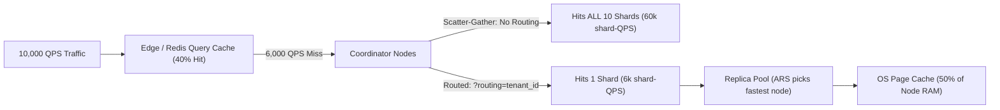
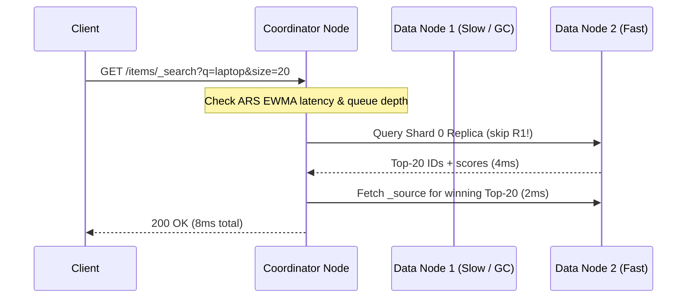
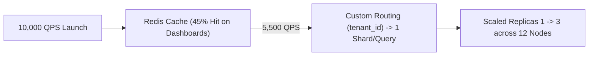

# Search Scaling: Replicas, Routing & Caching to 10,000 QPS

> **Prerequisites:** [Lesson 11: Hybrid Search](../11-hybrid-search/README.md).  
> **Estimated Reading Time:** 25–28 minutes  
> **Target Audience:** Staff/principal and senior backend engineers scaling Elasticsearch/OpenSearch clusters from 100 QPS to 10,000+ QPS under strict tail-latency SLAs.  
> **Free PDF Notes:** [Download SD-P-012.pdf](https://backendroadmap.com/notes/system-design/SD-P-012.pdf)

> [!NOTE]
> **In one line:** Scaling search to 10,000+ QPS requires **decoupling data size from QPS**: size **primary shards** for storage and indexing throughput (`10–50 GB` per shard), add **replicas** to scale read QPS linearly, use **document routing** (`?routing=tenant_id`) to eliminate scatter-gather fan-out, and absorb hot queries with **multi-tier caching** (CDN/Redis + shard request cache + OS page cache).

> [!TIP]
> **The Golden Rule:** **Shards scale data volume; replicas scale read QPS; routing kills fan-out.** Never over-shard (each shard adds heap, file descriptors, and tail-latency fan-out), always pin hot indexes in the OS page cache, and use `preference` or `adaptive_replica_selection` so slow nodes don't poison $p_{99}$.

---

## 1. What Search Scaling Is, and What It Isn't

Your search cluster handles 500 QPS comfortably on 3 nodes with 10 primary shards and 1 replica. Marketing launches a major campaign, and traffic surges to 10,000 QPS. Adding more *primary shards* makes things **worse**—every query now scatters to 30 shards instead of 10, multiplying coordinator CPU and tail latency. Scaling search requires understanding how shards, replicas, routing, and caches interact.

| Term | Precise Meaning | Example |
| :--- | :--- | :--- |
| **Primary Shard** | Independent Lucene index holding a subset of documents | 10 primary shards = 10% of docs each |
| **Replica Shard** | Full copy of a primary shard for HA and read scaling | `number_of_replicas: 3` = 4 total copies |
| **Scatter-Gather** | Coordinator queries 1 copy of *every* primary shard, then merges Top-K | 10 shards = 10 sub-queries per search |
| **Custom Routing** | Hashing a key (`tenant_id`) so all its docs live on 1 shard | `?routing=acme` hits 1 shard, not 10 |
| **Shard Request Cache** | Caches aggregated/count responses per shard, invalidated on refresh | Great for `size=0` facets/dashboards |
| **Node Query Cache** | Caches compiled filter bitsets (`term`, `range`) in JVM heap | Speeds up `filter` clauses across queries |
| **OS Page Cache** | Linux kernel caching Lucene disk segments in free RAM | Crucial: keeps disk reads at 0 |
| **Not** | Giving Elasticsearch JVM heap 90% of machine RAM | Leave 50% RAM for OS page cache! |

### Why It Matters
1. **Scatter-gather amplifies tail latency:** Querying $S$ shards means your $p_{99}$ is governed by the *slowest* of $S$ shards.
2. **Replicas multiply read throughput:** Each replica set adds an independent copy of the data that can serve queries concurrently.
3. **Caching is the cheapest scaling lever:** By Zipf's law, the top 10–20% of search queries often drive 50–70% of traffic.

---

## 2. Anatomy: Scatter-Gather vs. Routed Queries & Multi-Tier Caching



| Scaling Lever | What It Scales | Cost / Tradeoff |
| :--- | :--- | :--- |
| **Add Primary Shards** | Max corpus size & write throughput | Increases scatter-gather fan-out & $p_{99}$ |
| **Add Replica Shards** | Read QPS & fault tolerance | Multiplies storage + indexing CPU (every write hits all replicas) |
| **Custom Routing** | Cuts shard QPS by $S\times$ | Risk of hot-shard skew if one tenant is 50% of traffic |
| **Redis / Edge Cache** | Cuts cluster QPS by 30–70% | Stale up to cache TTL (e.g., 30–60 s) |
| **Dedicated Coordinators** | Prevents scatter-gather merge OOM on data nodes | Extra stateless nodes |

> [!WARNING]
> **Never allocate more than 50% of node RAM (and never $> 30\text{–}32\text{ GB}$) to the Elasticsearch JVM heap.** Lucene relies on the **OS Page Cache** (outside the JVM heap) to memory-map inverted indexes and FSTs. Starving the OS page cache forces real disk reads on every query, collapsing throughput.

---

## 3. Mathematical Model: Shard QPS, Tail-Latency Fan-Out & Cache Savings

**Cluster Shard-QPS Load.** If external search traffic is $Q_{\text{ext}}$, cache hit rate is $h \in [0, 1)$, each uncached query hits $F$ shards ($F = S$ for scatter-gather, $F = 1$ for routed), and each shard query takes $t_{\text{shard}}$ CPU-seconds:

$$Q_{\text{shard-total}} = Q_{\text{ext}} \cdot (1 - h) \cdot F, \qquad \text{Cores}_{\text{needed}} \approx Q_{\text{shard-total}} \cdot t_{\text{shard}}$$

**Worked Numerical Example (10,000 QPS):**
- $Q_{\text{ext}} = 10{,}000\text{ QPS}$, $S = 10$ shards, $t_{\text{shard}} = 4\text{ ms} = 0.004\text{ s}$ CPU time.
- **No cache, scatter-gather ($h = 0, F = 10$):** $Q_{\text{shard-total}} = 100{,}000\text{ shard-QPS}$ $\rightarrow$ $400$ CPU cores needed!
- **With 50% Redis cache + routing ($h = 0.5, F = 1$):** $Q_{\text{shard-total}} = 5{,}000\text{ shard-QPS}$ $\rightarrow$ **$20$ CPU cores needed** ($20\times$ fewer nodes!).

**Tail-Latency Amplification (Order Statistics).** If a single shard has $p_{99}$ probability $0.99$ of finishing within $T$, then querying $S$ independent shards concurrently has probability $0.99^S$ that *all* $S$ finish within $T$:

$$P(\max_{i=1..S} T_i \le T) = (0.99)^S$$

For $S = 20$ shards: $0.99^{20} = 0.818$. Your 99th-percentile shard latency becomes an **82nd-percentile** user latency (18% of requests hit the tail)!

---

## 4. Metrics & Percentiles

| Metric | Meaning | Alert when |
| :--- | :--- | :--- |
| **Search $p_{99}$ latency** | End-to-end coordinator response time | Exceeds SLA (e.g., $> 80\text{ ms}$) |
| **Search threadpool queue / rejections** | Queued or dropped queries on data nodes | `rejected > 0` (immediate overload) |
| **OS Page Cache hit / disk I/O** | Real disk reads per second during queries | High `iowait` (> 5–10%) |
| **JVM GC pause & Old Gen %** | Stop-the-world pauses & heap pressure | Old Gen $> 75\%$ after GC |
| **Hot-shard CPU skew** | Max shard CPU / median shard CPU | $> 2.0\times$ (unbalanced routing) |
| **Cache hit ratio** | Redis + Shard Request Cache hit % | Sudden drop (TTL expiry / stampede) |

### Worked Example (Replica Sizing for 10,000 QPS)
Suppose 50% of 10,000 QPS is absorbed by Redis, leaving 5,000 QPS hitting a 10-shard scatter-gather index (`50,000 shard-QPS`).
- A single 16-vCPU data node comfortably serves ~2,500 shard-QPS at $< 30\text{ ms}$ $p_{99}$ (leaving 30% CPU headroom for indexing/merges).
- Total data nodes needed: $50{,}000 / 2{,}500 = 20$ nodes.
- With 10 primary shards, setting **`number_of_replicas: 1`** gives 20 total shards (1 shard per node), or **`number_of_replicas: 3`** (40 shards across 20 nodes, 2 shards/node) for higher HA.

---

## 5. Compounding & Failure Modes: Over-Sharding, Hot Shards & Oversharded Fan-Out

| Failure Mode | Trigger | Compounding Effect |
| :--- | :--- | :--- |
| **Over-Sharding** | Creating 100 shards for a 20 GB index | 100x scatter-gather overhead, huge JVM heap for segment metadata, tiny segments |
| **Hot-Tenant Routing Skew** | Routing all docs by `tenant_id` when 1 tenant = 40% of traffic | One shard hits 100% CPU while 9 shards sit idle |
| **Deep Pagination (`from=50000`)** | Coordinator fetches `50,010 * S` docs from all shards to sort & discard | Coordinator JVM OOMs (`Result window is too large`) |
| **Search Threadpool Saturation** | Slow regex/wildcard query blocks search threads | Threadpool queue fills $\to$ `429 EsRejectedExecutionException` |

---

## 6. Numbers Every Engineer Must Know

| Item | Typical | Implication |
| :--- | :---: | :--- |
| Target shard size | `10–50 GB` per shard | Too small = overhead; too large = slow recovery/rebalance |
| Max shards per GB of JVM heap | `<= 20` shards/GB | 30 GB heap $\to$ max ~600 shards per node |
| JVM Heap rule of thumb | `50%` of RAM, max `30–32 GB` | Compressed OOPs break above ~32 GB; rest goes to OS page cache |
| Deep pagination limit | `from + size <= 10,000` | Use `search_after` + `pit` for deeper scrolling |
| Replica write tax | `1x` primary + `R` replicas | Every document is indexed $1 + R$ times |
| Adaptive Replica Selection (ARS) | Enabled by default (ES 7+) | Routes away from slow/GC-pausing nodes automatically |

---

## 7. Protocol Deep Dive: Adaptive Replica Selection & `search_after` Pagination



| Question | Answer |
| :--- | :--- |
| **Why does ES do two phases (`query_then_fetch`)?** | Phase 1 fetches only `(doc_id, sort_score)` from all $S$ shards (tiny payload). Phase 2 fetches full `_source` JSON only for the winning Top-$K$ documents. |
| **How do you solve deep pagination without OOM?** | Use `search_after` with a Point-in-Time (`_pit`) cursor, which uses keyset pagination (`O(1)` memory) instead of `from + size` (`O(from)`). |
| **How do you fix a hot tenant under custom routing?** | Use **shard partitioning / salted routing** (e.g., `routing = tenant_id + "_" + (hash % 3)`) for mega-tenants, or give mega-tenants their own dedicated index. |
| **When do you need dedicated Coordinator nodes?** | When heavy aggregations, large `size`, or 50+ shard fan-outs consume significant merge CPU/heap on data nodes. |

**When not to use Custom Routing:** If 90% of queries are global (cross-tenant) or your shard count is small ($\le 3\text{–}5$ shards), custom routing adds complexity and skew risk for minimal gain.

---

## 8. Hierarchical Budgets & Design Rules

| Slice | Rule | Control |
| :--- | :--- | :--- |
| Shard sizing | `10–50 GB` per shard; `<= 20` shards per GB heap | Index templates & ILM rollover |
| Memory split | `50%` JVM heap (capped at `31 GB`), `50%` OS page cache | `ES_JAVA_OPTS="-Xms31g -Xmx31g"` |
| Read scaling | Add replicas (`R`) proportional to read QPS | `index.number_of_replicas` |
| Fan-out control | Use `?routing=<key>` for tenant-scoped; salt mega-tenants | Custom routing + `routing.required` |
| Caching | Redis/CDN for exact hot queries; Shard Request Cache for aggs | `request_cache: true` + jittered TTL |
| Pagination | Cap `from + size <= 10,000`; use `search_after` + `pit` | API gateway validation |

---

## 9. Top Mitigations

1. **Size shards to 10–50 GB**—avoid both 100 tiny shards and 500 GB monoliths.
2. **Cap JVM heap at 31 GB** and leave at least 50% of host RAM for the OS page cache.
3. **Add replica shards to scale read QPS** while keeping primary shard count fixed.
4. **Use custom routing (`?routing=tenant_id`)** for multi-tenant search, with salting or dedicated indexes for whale tenants.
5. **Put a Redis / CDN query cache in front of head queries** to cut 30–70% of cluster load.
6. **Replace `from`/`size` deep pagination with `search_after` + Point-in-Time (`_pit`)**.
7. **Enable Adaptive Replica Selection (ARS)** and set strict query timeouts (`timeout=100ms`) + `max_concurrent_shard_requests` to prevent noisy neighbors.

---

## 10. Production Reference: Surviving a 10x Traffic Spike Without Re-Sharding

**Scenario:** A SaaS analytics search platform ran 12 primary shards (`400 GB` total) with 1 replica across 6 nodes at 1,200 QPS. Ahead of a product launch projected at 10,000 QPS, the team avoided a risky full reindex by combining three levers:



- **Action 1 (Caching):** Cached top dashboard/facet queries in Redis for 30 s with `singleflight`, absorbing 45% of QPS.
- **Action 2 (Replicas):** Increased `number_of_replicas` from `1` to `3` and added 6 data nodes + 2 dedicated coordinators (no reindex required!).
- **Action 3 (Pagination & Guardrails):** Blocked `from > 5000` at the API gateway and enabled `adaptive_replica_selection`. The cluster held `p99 = 38 ms` throughout the 10,000 QPS peak.

---

## 11. Multi-Language Production Code Tabs

Salted tenant routing key generator + `singleflight`/coalesced query cache key builder in Go, TypeScript, Python, and C#.

````carousel
```go
// Go: Salted tenant routing (prevents whale-tenant hot shards) + query cache key.
package searchscale

import (
	"crypto/sha256"
	"encoding/hex"
	"fmt"
	"hash/fnv"
)

func RoutingKey(tenantID, docID string, megaTenantBuckets int) string {
	if megaTenantBuckets <= 1 {
		return tenantID
	}
	h := fnv.New32a()
	_, _ = h.Write([]byte(docID))
	bucket := int(h.Sum32()) % megaTenantBuckets
	return fmt.Sprintf("%s_%d", tenantID, bucket)
}

func QueryCacheKey(index, routing, normalizedQuery string) string {
	sum := sha256.Sum256([]byte(index + "|" + routing + "|" + normalizedQuery))
	return "sq:" + hex.EncodeToString(sum[:16])
}
```
<!-- slide -->
```typescript
// TypeScript: Salted routing key + deterministic query cache key.
import { createHash } from "crypto";

export function computeRoutingKey(
  tenantId: string,
  docId: string,
  megaTenantBuckets = 1
): string {
  if (megaTenantBuckets <= 1) return tenantId;
  const hash = createHash("md5").update(docId).digest().readUInt32BE(0);
  return `${tenantId}_${hash % megaTenantBuckets}`;
}

export function queryCacheKey(index: string, routing: string, queryJson: string): string {
  const digest = createHash("sha256")
    .update(`${index}|${routing}|${queryJson}`)
    .digest("hex")
    .slice(0, 32);
  return `sq:${digest}`;
}
```
<!-- slide -->
```python
# Python: Salted routing + capacity & tail-latency fan-out simulator (stdlib only).
import hashlib

def routing_key(tenant_id: str, doc_id: str, buckets: int = 1) -> str:
    if buckets <= 1:
        return tenant_id
    h = int.from_bytes(hashlib.md5(doc_id.encode()).digest()[:4], "big")
    return f"{tenant_id}_{h % buckets}"

def estimate_cluster(qps: int, cache_hit: float, shards: int, routed: bool, shard_cpu_ms: float = 4.0):
    miss_qps = qps * (1.0 - cache_hit)
    fanout = 1 if routed else shards
    shard_qps = miss_qps * fanout
    cores_needed = shard_qps * (shard_cpu_ms / 1000.0)
    p99_survival = 0.99 ** fanout
    return dict(shard_qps=int(shard_qps), cores_needed=round(cores_needed, 1), all_shards_under_p99=round(p99_survival, 3))

if __name__ == "__main__":
    assert estimate_cluster(10_000, 0.0, 10, False)["shard_qps"] == 100_000
    assert estimate_cluster(10_000, 0.5, 10, True)["shard_qps"] == 5_000
```
<!-- slide -->
```csharp
// C#: Salted tenant routing key & SHA-256 query cache key.
using System;
using System.Security.Cryptography;
using System.Text;

public static class SearchScalingHelper
{
    public static string RoutingKey(string tenantId, string docId, int megaTenantBuckets = 1)
    {
        if (megaTenantBuckets <= 1) return tenantId;
        uint hash = BitConverter.ToUInt32(MD5.HashData(Encoding.UTF8.GetBytes(docId)), 0);
        return $"{tenantId}_{hash % (uint)megaTenantBuckets}";
    }

    public static string QueryCacheKey(string index, string routing, string normalizedQuery)
    {
        byte[] hash = SHA256.HashData(Encoding.UTF8.GetBytes($"{index}|{routing}|{normalizedQuery}"));
        return "sq:" + Convert.ToHexString(hash[..16]).ToLowerInvariant();
    }
}
```
````

---

## 12. Hands-On CLI Verification Workflows

Inspect shard sizes, threadpool rejections, and scale replicas live on Elasticsearch/OpenSearch:

```bash
# 1. Check shard sizes and primary/replica distribution
curl -s "http://localhost:9200/_cat/shards?v&h=index,shard,prirep,state,docs,store,node"

# 2. Check search threadpool active, queued, and rejected counts
curl -s "http://localhost:9200/_cat/thread_pool/search?v&h=node_name,active,queue,rejected"

# 3. Dynamically scale replicas from 1 to 3 (zero downtime, zero reindex)
curl -X PUT "http://localhost:9200/products/_settings" \
  -H "Content-Type: application/json" -d '{ "index": { "number_of_replicas": 3 } }'

# 4. Run a routed query hitting only 1 shard
curl -s "http://localhost:9200/products/_search?routing=tenant_42" \
  -H "Content-Type: application/json" -d '{ "query": { "match": { "title": "laptop" } } }'
```

---

## 13. Common Mistakes to Avoid

1. **Adding more primary shards to scale read QPS**, which increases scatter-gather fan-out and worsens $p_{99}$.
2. **Giving Elasticsearch JVM heap $> 32\text{ GB}$ or $> 50\%$ of RAM**, starving the OS page cache and breaking Compressed OOPs.
3. **Over-sharding** (e.g., 50 shards for 5 GB of data), wasting heap and amplifying tail latency.
4. **Using `from` + `size` for deep pagination**, triggering `O(from * shards)` memory spikes on coordinator nodes.
5. **Routing all docs of a massive whale tenant to 1 shard** without salting (`tenant_0..N`).
6. **Ignoring `search` threadpool `rejected` metrics** until users see HTTP 429 outages.
7. **Caching search queries without jittered TTLs**, causing synchronized cache stampedes.

---

## 14. Key Terms Glossary

| Key Term | Definition |
| :--- | :--- |
| **Primary Shard** | Partition of an index storing a subset of documents; fixed at index creation. |
| **Replica Shard** | Full copy of a primary shard providing high availability and read QPS scaling. |
| **Scatter-Gather** | Coordinator broadcasting a query to all shards and merging their top-$K$ results. |
| **Custom Routing** | Directing indexing and queries to a single shard using a routing key (`?routing=`). |
| **OS Page Cache** | Host RAM managed by the OS kernel to cache Lucene segments off-heap. |
| **Compressed OOPs** | JVM pointer compression active up to ~31–32 GB heap. |
| **Shard Request Cache** | Per-shard cache for `size=0` aggregations and count queries. |
| **Adaptive Replica Selection** | Routing queries to the fastest, least-loaded replica copy of each shard. |
| **`search_after` + `_pit`** | Stateless cursor pagination avoiding deep `from`/`size` memory blowups. |
| **Salted Routing** | Splitting a hot tenant across $B$ shards using `tenant_id + "_" + hash(doc) % B`. |

---

## 15. System Design Interview Questions & Answers

### Basic Conceptual Questions

<details>
<summary><strong>Q1: How do primary shards vs. replica shards scale a search cluster? [BASIC]</strong></summary>

**Answer:**
Primary shards partition data to scale **storage volume and write throughput**. Replica shards copy primary shards to scale **read QPS and high availability**. Adding replicas scales read capacity without increasing scatter-gather fan-out.
</details>

<details>
<summary><strong>Q2: Why should JVM heap be capped at 50% of RAM and <= 31–32 GB? [BASIC]</strong></summary>

**Answer:**
Lucene relies heavily on the OS page cache (off-heap) to keep inverted indexes and FSTs in memory; starving it forces disk reads. Additionally, above ~32 GB, the JVM loses Compressed OOPs (32-bit object pointers), wasting memory and slowing GC.
</details>

<details>
<summary><strong>Q3: What is scatter-gather and why does it hurt p99 latency? [BASIC]</strong></summary>

**Answer:**
The coordinator sends the query to every shard in the index and waits for all to respond before merging Top-$K$. Because the total latency equals the *maximum* of $S$ shard latencies, even a 1% slow shard hits $1 - 0.99^S$ of all requests (e.g., 18% of requests for 20 shards).
</details>

<details>
<summary><strong>Q4: What is the ideal size of a single search shard? [BASIC]</strong></summary>

**Answer:**
Typically **10 GB to 50 GB**. Smaller shards waste JVM heap and increase fan-out; much larger shards take too long to recover, rebalance, or merge.
</details>

### Scenario-Based Architecture Questions

<details>
<summary><strong>Q5: Your cluster is at 1,000 QPS and needs to reach 10,000 QPS next month without reindexing. What do you do? [SCENARIO]</strong></summary>

**Answer:**
1. Add a Redis/CDN query cache with `singleflight` for hot/repeat queries (cuts 30–60% of load).
2. Increase `number_of_replicas` dynamically and add data nodes so more shard copies serve reads concurrently.
3. Add dedicated coordinator nodes if merge CPU is high, and ensure Adaptive Replica Selection is enabled.
</details>

<details>
<summary><strong>Q6: You have 5,000 B2B tenants in one index with 20 shards. How do you cut shard CPU by 20x? [SCENARIO]</strong></summary>

**Answer:**
Use **custom routing** (`?routing=tenant_id`) at both index time and query time. Each tenant's documents land on a single shard, so queries hit 1 shard instead of scattering across all 20—cutting shard-level QPS by $20\times$.
</details>

<details>
<summary><strong>Q7: One "whale" tenant generates 40% of all data and traffic, overloading its routed shard. How do you fix it? [SCENARIO]</strong></summary>

**Answer:**
Use **salted routing** for whale tenants (e.g., `tenant_id + "_" + (hash(doc_id) % 4)`), spreading that tenant across 4 shards and querying those 4 routing keys in parallel—or isolate whale tenants into their own dedicated index.
</details>

<details>
<summary><strong>Q8: Users scraping page 500 (`from=10000, size=20`) are crashing coordinator nodes with OOM. Fix it. [SCENARIO]</strong></summary>

**Answer:**
`from=10000` forces every shard to score and return 10,020 docs to the coordinator. Enforce `from + size <= 2000` at the API gateway, and switch deep pagination/exports to `search_after` with a Point-in-Time (`_pit`) cursor.
</details>

### Advanced & Tricky Interview Questions

<details>
<summary><strong>Q9: Why does adding replicas eventually stop scaling writes—and actually hurt them? [TRICKY]</strong></summary>

**Answer:**
Every write must be indexed on the primary shard *and* replicated and indexed independently on all $R$ replica shards. Doubling replicas doubles total indexing CPU across the cluster, leaving less CPU for search threads and triggering more frequent segment merges.
</details>

<details>
<summary><strong>Q10: How does `query_then_fetch` save network bandwidth during scatter-gather? [TRICKY]</strong></summary>

**Answer:**
In Phase 1 (`query`), each of the $S$ shards only returns the top $K$ `(doc_id, score)` pairs—not the full JSON documents. The coordinator merges the $S \times K$ IDs, picks the global top $K$, and in Phase 2 (`fetch`) retrieves `_source` JSON only for those $K$ winning documents.
</details>

<details>
<summary><strong>Q11: Why can't you change the number of primary shards on an existing index? [TRICKY]</strong></summary>

**Answer:**
Document-to-shard placement is computed via `hash(_routing) % number_of_primary_shards`. Changing the primary shard count invalidates where every existing document lives, so it requires `_reindex` (or `_split`/`_shrink` into a new index) and an alias swap.
</details>

<details>
<summary><strong>Q12: A node has 64 GB RAM, 32 GB JVM heap, and 100 GB of index data. Performance is fine at 500 QPS, then collapses at 2,000 QPS. Why? [TRICKY]</strong></summary>

**Answer:**
Only 32 GB of RAM is left for the OS page cache, which cannot hold the hot working set of the 100 GB index. At 2,000 QPS, cache misses trigger random disk reads, saturating SSD IOPS and spiking `iowait` across all search threads. Fix by scaling out nodes so the hot index fits in the aggregate OS page cache.
</details>

---

## 16. One-Page Master Cheat Sheet

```
+---------------------------------------------------------------------------------------------------------+
|                    SEARCH SCALING TO 10,000 QPS — MASTER CHEAT SHEET                                    |
+---------------------------------------------------------------------------------------------------------+
| 1. SHARDS vs REPLICAS:                                                                                  |
|    - Primary Shards (10-50 GB each): Scale DATA SIZE & WRITES. Fixed at creation; don't over-shard!     |
|    - Replicas: Scale READ QPS & HA. Tunable live; every replica adds 1x write/indexing CPU.             |
+---------------------------------------------------------------------------------------------------------+
| 2. MEMORY SPLIT: 50% JVM Heap (MAX 31 GB for Compressed OOPs) + 50% OS Page Cache (for Lucene files).   |
+---------------------------------------------------------------------------------------------------------+
| 3. FAN-OUT & SKEW: Custom routing (?routing=tenant_id) turns S-shard scatter into 1-shard lookup.       |
|    Salt mega-tenants (tenant_0..N) to avoid hot shards.                                                 |
+---------------------------------------------------------------------------------------------------------+
| 4. CACHING & PAGINATION: Redis/CDN + singleflight for head queries (30-70% offload).                    |
|    Never use deep from/size (>10k); use search_after + _pit.                                            |
+---------------------------------------------------------------------------------------------------------+
```

---

## Further Reading & Sources

- Elasticsearch Documentation, [Size your shards](https://www.elastic.co/guide/en/elasticsearch/reference/current/size-your-shards.html) & [Tune for search speed](https://www.elastic.co/guide/en/elasticsearch/reference/current/tune-for-search-speed.html).
- Jeffrey Dean & Luiz André Barroso, *The Tail at Scale* (Communications of the ACM, 2013) — explains why scatter-gather amplifies $p_{99}$.
- OpenSearch Documentation, [Adaptive Replica Selection & Search After](https://opensearch.org/docs/latest/).

---

## Free PDF Notes

[SD-P-012.pdf](https://backendroadmap.com/notes/system-design/SD-P-012.pdf)

---

## Next

Continue with [Track: Real-Time and Data](../../17-realtime-and-data/README.md): Chat routing, presence, notifications, feeds, and top-K patterns.
