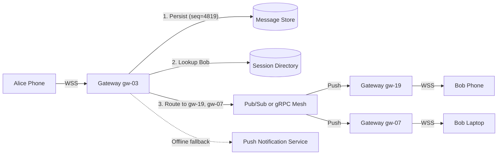
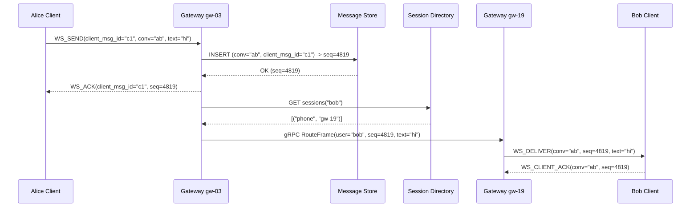
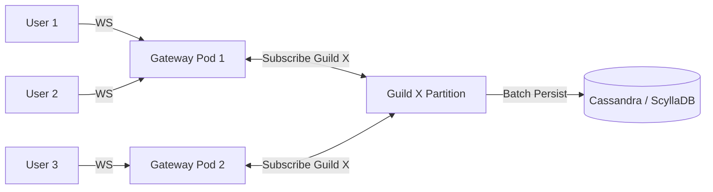

# Real-Time Messaging: Routing Chat Across WebSocket Servers

> **Prerequisites:** [Track 16, Lesson 12: Search Scaling](../../16-search/12-search-scaling/README.md).  
> **Estimated Reading Time:** 24–28 minutes  
> **Target Audience:** Backend and distributed systems engineers designing WhatsApp/Slack/Discord-scale chat, live collaboration, or bidirectional event gateways, and candidates asked "Design a real-time chat system."  
> **Free PDF Notes:** [Download SD-Q-001.pdf](https://backendroadmap.com/notes/system-design/SD-Q-001.pdf)

> [!NOTE]
> **In one line:** A single WebSocket gateway cannot hold millions of concurrent TCP connections, so chat must be **statefully terminated** at edge gateway nodes and **statelessly routed** across a session directory + pub/sub backbone, with durable per-conversation storage and monotonic sequence numbers guaranteeing ordered, zero-loss delivery across reconnects.

> [!TIP]
> **The Golden Rule:** Separate **connection state** (which gateway holds Alice's socket) from **message state** (what Alice's conversations contain). Gateways are ephemeral routers; the message log is the source of truth.

---

## 1. What Real-Time Messaging Is, and What It Isn't

Alice opens Slack on her phone and sends `"deploying v2.4"` to Bob. Alice's TCP connection terminates on `gw-03` in `us-east-1a`, while Bob's phone holds a persistent WebSocket to `gw-19` in `us-east-1b` — and Bob's laptop is connected to `gw-07` in `eu-west-1`. `gw-03` has no direct TCP socket to Bob. Without a routing layer, `gw-03` cannot deliver the frame.

| Term | Precise Meaning | Example |
| :--- | :--- | :--- |
| **WebSocket (WS)** | Full-duplex, persistent TCP framing protocol upgraded from HTTP/1.1 (`101 Switching Protocols`) | `wss://edge.chat.io/v1/ws` |
| **Gateway (Edge Node)** | Stateful server holding $50\text{k}\text{–}500\text{k}$ open sockets; handles TLS, heartbeats, framing | Envoy / Go / Netty WS pod |
| **Session Directory** | Low-latency lookup mapping `user_id -> [(device_id, gateway_id)]` | Redis Cluster / etcd / Cassandra |
| **Pub/Sub Backbone** | Internal message bus routing frames from sender's gateway to recipient's gateway(s) | Redis Pub/Sub, NATS, Kafka, gRPC mesh |
| **Message Sequence ID** | Per-conversation monotonically increasing ID (or Snowflake) used for ordering and gap detection | `conv_id + seq_id = 4819` |
| **Sync / Catch-up API** | HTTP/gRPC endpoint returning messages `seq > last_acked_seq` after a disconnect | `GET /messages?after_seq=4810` |
| **Not** | A pure stateless REST API or an in-memory-only broadcast | Reloading a pod must never lose messages |

### Why It Matters
1. Unlike stateless HTTP APIs behind an L7 load balancer, **WebSockets are long-lived stateful connections**: you cannot round-robin a server-to-client push.
2. **Multi-device sync, offline delivery, and ordering** are where 80% of interview candidates fail — routing a live packet is the easy 20%.
3. Understanding socket memory, file descriptors, heartbeats, and thundering-herd reconnects separates production-ready designs from toy diagrams.

---

## 2. Anatomy: Cross-Gateway Chat Routing



When `gw-03` receives a message from Alice:
1. **Persist first (or via async durable log with ack):** Assign a per-conversation sequence number (`seq = 4819`) and write to the message store so a crash never drops an acknowledged message.
2. **Acknowledge Alice:** Send `ACK(client_msg_id, seq=4819)` back over Alice's WebSocket so her UI switches from "sending" to "sent".
3. **Route to online devices:** Query the session directory for Bob's active `(device_id, gateway_id)` pairs (or publish to Bob's gateway-routed topic) and forward the frame to `gw-19` and `gw-07`.
4. **Offline fallback:** If Bob has zero active sessions (or fails to ack within a grace window), enqueue a mobile push notification (APNs/FCM).

| Transport Option | Latency | Overhead | Direction | Best Used For |
| :--- | :--- | :--- | :--- | :--- |
| **WebSockets** | Sub-10 ms | 2–14 byte frame header | Bidirectional | Chat, gaming, collaborative editing |
| **Server-Sent Events (SSE)** | Sub-10 ms | HTTP chunked text | Server $\to$ Client only | Live feeds, stock tickers, AI streaming |
| **HTTP Long Polling** | 50–200 ms | Full HTTP headers per poll | Simulated push | Legacy firewalls blocking WS |
| **QUIC / WebTransport** | Sub-10 ms | Zero HoL blocking per stream | Bidirectional | Unstable mobile networks |

> [!WARNING]
> **Never use Redis Pub/Sub as your message store.** Pub/Sub is fire-and-forget: if `gw-19` disconnects for 200 ms or Bob's phone enters a tunnel, published messages vanish forever. Always persist to a durable log/database before or in parallel with live routing, and let clients catch up using `last_acked_seq`.

---

## 3. Mathematical Model: Connections, Memory, and Routing Fan-Out

**Gateway Memory & Socket Capacity.** Each WebSocket consumes kernel socket buffers (`rmem` + `wmem`) plus application-level read/write buffers and TLS state. With tuned Linux defaults ($\approx 40\text{ KB}$ per idle connection):

$$M_{\text{gateway}} = N_{\text{conns}} \times (M_{\text{kernel}} + M_{\text{TLS}} + M_{\text{app}})$$

For $N_{\text{conns}} = 200{,}000$ connections per node at $40\text{ KB/conn}$:

$$M_{\text{gateway}} = 200{,}000 \times 40\text{ KB} = 8\text{ GB RAM}$$

**Cluster Sizing.** To hold $50{,}000{,}000$ concurrent users (average $1.4$ devices/user $= 70{,}000{,}000$ sockets) with $N_{\text{conns}} = 200{,}000$ per gateway and $25\%$ headroom for rolling deploys:

$$N_{\text{gateways}} = \left\lceil \frac{70{,}000{,}000}{200{,}000 \times 0.75} \right\rceil = \left\lceil 466.7 \right\rceil = 467\text{ gateway nodes}$$

**Group Chat Routing Fan-Out.** In a 1-on-1 chat, 1 inbound message produces $d_{\text{recipient}}$ gateway hops ($d \approx 1.4$). In a group of $G$ members, each with $d$ devices, total outbound WebSocket frames per message is:

$$F_{\text{outbound}} = (G - 1) \times d$$

If $G = 500$ members and $d = 1.4$, 1 message generates $499 \times 1.4 \approx 699$ WebSocket frames across potentially hundreds of gateways. Coalescing by destination gateway (`Map<gateway_id, List<user_id>>`) cuts inter-gateway RPCs from $699$ down to at most $N_{\text{gateways}}$ (typically $< 100$ batch RPCs).

---

## 4. Metrics & Percentiles

| Metric | Meaning | Alert when |
| :--- | :--- | :--- |
| **E2E Delivery Latency $p_{99}$** | Time from sender `WS_SEND` to recipient `WS_RECV` | $> 250\text{ ms}$ intra-region |
| **Active Connections / Gateway** | Open FDs vs `ulimit -n` and RAM ceiling | $> 80\%$ of node budget |
| **Reconnect Rate (conns/sec)** | Rate of TLS + WS handshakes per second | $> 5\times$ baseline (thundering herd) |
| **Session Directory Lookup $p_{99}$** | Time to resolve `user_id -> gateway_id` | $> 5\text{ ms}$ |
| **Outbox / Routing Lag** | Delay between DB commit and gateway push | $> 100\text{ ms}$ |
| **Dropped / Unacked Frames** | Messages sent over WS without client `ACK` | Rising $> 2\%$ (zombie sockets) |

### Worked Example (50M Concurrent Users, 500K Msg/sec)
Suppose peak traffic hits $500{,}000$ messages/sec across $70\text{M}$ open sockets.
- **Session Directory QPS:** $500{,}000$ lookups/sec (plus $\sim 100{,}000$ heartbeats/sec if TTL is 700s, or batched). A 16-shard Redis cluster handles $\sim 1.6\text{M}$ ops/sec easily at $< 1\text{ ms}$.
- **Gateway Network Egress:** Average message payload is $512\text{ B}$. At $1.4\times$ device fan-out, total egress is $500{,}000 \times 1.4 \times 512\text{ B} = 358.4\text{ MB/s}$ ($\approx 2.87\text{ Gbps}$) cluster-wide, or only $\sim 6.1\text{ Mbps}$ per gateway across 467 nodes.
- **Reconnect Storm:** If 10% of gateways (47 nodes $\approx 7\text{M}$ sockets) crash simultaneously, $7\text{M}$ clients reconnect. Without jitter, TLS handshakes ($1\text{ ms}$ CPU each) require $7{,}000\text{ CPU-seconds}$ instantly, melting the auth & gateway tiers. Exponential backoff + jitter spreads recovery over $60\text{–}120\text{ s}$.

---

## 5. Compounding & Failure Modes

What happens when a gateway node dies or a client's mobile network flaps?

| Failure Mode | Naive Design Behavior | Production Behavior |
| :--- | :--- | :--- |
| **Gateway crash (200k sockets)** | Clients retry every 1s $\to$ TLS CPU 100% $\to$ cascading outage | Decorrelated jitter backoff ($1\text{s} \to 32\text{s}$) + L4 NLB health drain |
| **Zombie TCP connection** | OS waits 2 hours for TCP keepalive; messages silently dropped | App-level `PING/PONG` every 30s; close after 2 missed pongs |
| **Out-of-order delivery** | Network jitter reorders frames `seq=10` before `seq=9` | Client buffers & renders by `seq_id`; requests gap fill if `seq > expected` |
| **Duplicate delivery** | Client retries send after Wi-Fi drop before receiving `ACK` | Server deduplicates by `(sender_id, client_msg_id)` idempotency key |
| **Hot group (10k+ members)** | Synchronous loop on gateway blocks event loop for 500 ms | Offload fan-out $> 100$ members to async worker pool + gateway batching |

---

## 6. Numbers Every Engineer Must Know

| Item | Typical | Implication |
| :--- | :---: | :--- |
| **OS File Descriptor Limit (`nofile`)** | Default 1,024; tuned 1,048,576 | Must raise `fs.file-max`, `somaxconn`, and `ulimit -n` |
| **Memory per idle WebSocket** | $20\text{–}60\text{ KB}$ (kernel + TLS + app) | 1M sockets $\approx 20\text{–}60\text{ GB}$ RAM |
| **Ephemeral port limit (client-to-backend)** | 65,535 per `(src_ip, dst_ip, dst_port)` | Use multiple backend VIPs or internal IP aliases for gateway-to-mesh |
| **TLS handshake CPU cost** | $0.5\text{–}2\text{ ms}$ per full handshake | Terminate TLS at L4/L7 edge or use TLS session resumption |
| **WS ping/pong interval** | 25–45 seconds | Keeps NAT/cellular carrier tables alive (often 60s timeout) |
| **Single Go/Netty/Envoy gateway** | $100\text{k}\text{–}500\text{k}$ concurrent WS | Epoll/kqueue event loop scales $O(1)$ per active event |

---

## 7. Protocol Deep Dive: Send, Persist, Route, and Reconnect Sync



| Question | Answer |
| :--- | :--- |
| **Why `client_msg_id` (UUIDv4/ULID)?** | Enables idempotent retries when Alice's Wi-Fi drops before `WS_ACK` arrives. |
| **Why not route before DB persist?** | If `gw-03` crashes after pushing to Bob but before persisting, Alice thinks it failed while Bob saw a phantom message. |
| **How does Bob recover missed messages?** | On reconnect, Bob sends `SYNC(conv="ab", after_seq=4810)`; gateway/API fetches `seq > 4810` from DB. |
| **Direct Gateway-to-Gateway gRPC vs Pub/Sub?** | Direct gRPC mesh avoids broker hop latency; Pub/Sub (NATS/Kafka) simplifies discovery when gateways scale dynamically. |

**When NOT to use WebSockets:**
- One-way server-to-browser updates (live scores, LLM token streaming): use **SSE** — it works over standard HTTP/2 multiplexing with automatic browser reconnect and `Last-Event-ID`.
- Infrequent updates ($< 1$ per minute) on battery-constrained devices: use **APNs/FCM push notifications** instead of holding a persistent socket.

---

## 8. Hierarchical Budgets & Design Rules

| Slice | Rule | Control |
| :--- | :--- | :--- |
| **Socket Lifecycle** | Bound connections per pod; drain gracefully on SIGTERM | `max_conns` + `GOAWAY`/WS Close `1001` with jitter |
| **Session Directory** | Store `(user_id, device_id) -> gateway_id` with TTL | Refresh on WS heartbeat; delete on clean disconnect |
| **Ordering** | Per-conversation monotonic `seq_id` | Partition DB/sequencer by `conversation_id` |
| **Idempotency** | Deduplicate writes on `(conversation_id, client_msg_id)` | Unique index or 24h Redis dedup cache |
| **Backpressure** | Bound per-socket outbound send buffer | Drop slow/dead consumer sockets after buffer threshold |
| **Group Fan-out** | Batch frames per destination gateway | Group recipients by `gateway_id` before RPC |
| **Reconnects** | Never retry immediately in a tight loop | Truncated exponential backoff + full jitter |

---

## 9. Top Mitigations

1. **Coalesce group fan-out by destination gateway** so a 500-user room sends $\le N_{\text{gateways}}$ internal RPCs instead of 500.
2. **Persist before or atomically with routing** (or via transactional outbox) so delivered messages never vanish on history reload.
3. **Use application-level heartbeats (30s)** with missed-pong eviction to reap zombie sockets and keep mobile NAT mappings open.
4. **Implement graceful connection draining**: during deploys, send WS Close `1001` (`Going Away`) with random delay over 60s so clients reconnect smoothly.
5. **Bound per-connection outbound queues** (e.g., 256 frames); if a slow client fills the buffer, close the socket and force a `SYNC` catch-up on reconnect.
6. **Enforce idempotent message writes** using `client_msg_id` so client retries never create duplicate chat bubbles.
7. **Partition large channels** (e.g., Twitch/Discord 100k-viewer rooms) using dedicated fan-out pub/sub workers rather than inline gateway loops.

---

## 10. Production Reference: Slack & Discord Gateway Architecture

Discord famously scaled to **millions of concurrent WebSocket connections** and **hundreds of thousands of events per second** by separating stateful **Gateway** nodes (Elixir/Rust) from **Guild (Server)** actors and a **Session/Routing** layer:

- **Problem:** A naive pub/sub broadcast across all gateways wastes $O(N_{\text{gateways}})$ bandwidth, while a single-threaded gateway loop stalls when a large server sends a message.
- **Architecture:** Each chat room/guild is owned by a single partitioned **Guild Process** (consistent-hashed). Gateways subscribe to guild topics only for guilds that have at least one online user connected to *that* gateway.
- **Lessons from SEV-1 Outages:** During mass reconnects (e.g., Cloudflare or backbone blips), simultaneous `IDENTIFY` payloads overwhelmed the session directory and database. Discord solved this with **Identify Bucket Rate Limiting** (`max_concurrency` tokens per shard) and client-side jittered backoff.



---

## 11. Multi-Language Production Code Tabs

A complete, runnable-shape **Cross-Gateway Chat Router** showing session lookup, idempotent sequence assignment, gateway-batched fan-out, and offline fallback.

````carousel
```go
// Go: Cross-gateway router with gateway-coalesced fan-out and idempotent seq assignment.
package main

import (
	"context"
	"fmt"
	"sync"
)

type Session struct {
	DeviceID  string
	GatewayID string
}

type Message struct {
	ConvID      string
	ClientMsgID string
	SenderID    string
	Body        string
	SeqID       int64
}

type Router struct {
	mu       sync.Mutex
	seqs     map[string]int64
	dedup    map[string]int64
	sessions map[string][]Session // userID -> active sessions
}

func NewRouter() *Router {
	return &Router{
		seqs:     make(map[string]int64),
		dedup:    make(map[string]int64),
		sessions: make(map[string][]Session),
	}
}

func (r *Router) SendMessage(ctx context.Context, msg Message, recipients []string) (int64, error) {
	r.mu.Lock()
	dedupKey := msg.ConvID + ":" + msg.ClientMsgID
	if existingSeq, ok := r.dedup[dedupKey]; ok {
		r.mu.Unlock()
		return existingSeq, nil // idempotent retry
	}
	r.seqs[msg.ConvID]++
	msg.SeqID = r.seqs[msg.ConvID]
	r.dedup[dedupKey] = msg.SeqID

	// Coalesce recipients by destination gateway to minimize inter-gateway RPCs.
	byGateway := make(map[string][]string)
	var offlineUsers []string
	for _, uid := range recipients {
		sess := r.sessions[uid]
		if len(sess) == 0 {
			offlineUsers = append(offlineUsers, uid)
			continue
		}
		for _, s := range sess {
			byGateway[s.GatewayID] = append(byGateway[s.GatewayID], uid)
		}
	}
	r.mu.Unlock()

	for gwID, uids := range byGateway {
		fmt.Printf("[gRPC -> %s] deliver seq=%d to %v\n", gwID, msg.SeqID, uids)
	}
	for _, uid := range offlineUsers {
		fmt.Printf("[Push Queue] notify offline user=%s seq=%d\n", uid, msg.SeqID)
	}
	return msg.SeqID, nil
}
```
<!-- slide -->
```typescript
// TypeScript: Cross-gateway WebSocket router with idempotency and gateway batching.
interface Session {
  deviceId: string;
  gatewayId: string;
}

interface ChatMessage {
  convId: string;
  clientMsgId: string;
  senderId: string;
  body: string;
  seqId?: number;
}

export class ChatRouter {
  private seqs = new Map<string, number>();
  private dedup = new Map<string, number>();
  private sessions = new Map<string, Session[]>();

  registerSession(userId: string, session: Session): void {
    const list = this.sessions.get(userId) ?? [];
    this.sessions.set(userId, [...list.filter(s => s.deviceId !== session.deviceId), session]);
  }

  async routeMessage(msg: ChatMessage, recipients: string[]): Promise<number> {
    const key = `${msg.convId}:${msg.clientMsgId}`;
    const existing = this.dedup.get(key);
    if (existing !== undefined) return existing;

    const seqId = (this.seqs.get(msg.convId) ?? 0) + 1;
    this.seqs.set(msg.convId, seqId);
    this.dedup.set(key, seqId);

    const byGateway = new Map<string, string[]>();
    const offline: string[] = [];

    for (const uid of recipients) {
      const userSessions = this.sessions.get(uid) ?? [];
      if (userSessions.length === 0) {
        offline.push(uid);
        continue;
      }
      for (const s of userSessions) {
        const batch = byGateway.get(s.gatewayId) ?? [];
        batch.push(uid);
        byGateway.set(s.gatewayId, batch);
      }
    }

    for (const [gwId, uids] of byGateway) {
      console.log(`[gRPC -> ${gwId}] seq=${seqId} recipients=${uids.join(",")}`);
    }
    for (const uid of offline) {
      console.log(`[Push Queue] offline user=${uid} seq=${seqId}`);
    }
    return seqId;
  }
}
```
<!-- slide -->
```python
# Python: Gateway sizing, fan-out calculator, and cross-gateway router (stdlib only).
from collections import defaultdict
from dataclasses import dataclass


@dataclass(frozen=True)
class Session:
    device_id: str
    gateway_id: str


class ChatRouter:
    def __init__(self) -> None:
        self.seqs: dict[str, int] = defaultdict(int)
        self.dedup: dict[str, int] = {}
        self.sessions: dict[str, list[Session]] = defaultdict(list)

    def send(self, conv_id: str, client_msg_id: str, recipients: list[str]) -> dict:
        key = f"{conv_id}:{client_msg_id}"
        if key in self.dedup:
            return {"seq_id": self.dedup[key], "deduplicated": True}

        self.seqs[conv_id] += 1
        seq_id = self.seqs[conv_id]
        self.dedup[key] = seq_id

        by_gateway: dict[str, list[str]] = defaultdict(list)
        offline: list[str] = []
        for uid in recipients:
            if not self.sessions[uid]:
                offline.append(uid)
            else:
                for s in self.sessions[uid]:
                    by_gateway[s.gateway_id].append(uid)

        return {
            "seq_id": seq_id,
            "deduplicated": False,
            "gateway_batches": dict(by_gateway),
            "offline_push": offline,
        }


def cluster_sizing(users: int, devices_per_user: float = 1.4, conns_per_gw: int = 200_000, headroom: float = 0.75) -> int:
    import math
    total_sockets = users * devices_per_user
    return math.ceil(total_sockets / (conns_per_gw * headroom))
```
<!-- slide -->
```csharp
// C#: Cross-gateway router with ConcurrentDictionary idempotency and gateway batching.
using System.Collections.Concurrent;

public sealed record Session(string DeviceId, string GatewayId);
public sealed record ChatMessage(string ConvId, string ClientMsgId, string SenderId, string Body);

public sealed class ChatRouter
{
    private readonly ConcurrentDictionary<string, long> _seqs = new();
    private readonly ConcurrentDictionary<string, long> _dedup = new();
    private readonly ConcurrentDictionary<string, List<Session>> _sessions = new();

    public long RouteMessage(ChatMessage msg, IEnumerable<string> recipients)
    {
        string key = $"{msg.ConvId}:{msg.ClientMsgId}";
        if (_dedup.TryGetValue(key, out long existingSeq))
            return existingSeq;

        long seqId = _seqs.AddOrUpdate(msg.ConvId, 1, (_, current) => current + 1);
        _dedup.TryAdd(key, seqId);

        var byGateway = new Dictionary<string, List<string>>();
        var offline = new List<string>();

        foreach (string uid in recipients)
        {
            if (!_sessions.TryGetValue(uid, out var list) || list.Count == 0)
            {
                offline.Add(uid);
                continue;
            }
            foreach (var s in list)
            {
                if (!byGateway.TryGetValue(s.GatewayId, out var batch))
                    byGateway[s.GatewayId] = batch = new List<string>();
                batch.Add(uid);
            }
        }

        foreach (var (gwId, uids) in byGateway)
            Console.WriteLine($"[gRPC -> {gwId}] seq={seqId} users={string.Join(",", uids)}");

        return seqId;
    }
}
```
````

---

## 12. Hands-On CLI Verification Workflows

Verify OS socket limits and test WebSocket/routing capacity locally:

```bash
# 1. Check Linux file descriptor and socket backlog limits on a gateway host
ulimit -n
sysctl net.core.somaxconn net.ipv4.tcp_rmem net.ipv4.tcp_wmem

# 2. Inspect active WebSocket connections on port 443
ss -s
ss -tan state established '( dport = :443 or sport = :443 )' | wc -l

# 3. Verify Redis session directory lookup latency
redis-cli --latency -h 127.0.0.1 -p 6379

# 4. Run Python cluster sizing verification
python -c "import math; print('Gateways needed:', math.ceil(50_000_000 * 1.4 / (200_000 * 0.75)))"
```

---

## 13. Common Mistakes to Avoid

1. **Treating WebSockets like stateless HTTP** and assuming an L7 load balancer can route server-initiated pushes.
2. **Using Redis Pub/Sub without a durable message store**, causing silent message loss on brief disconnects.
3. **Using wall-clock timestamps (`Date.now()`) for message ordering** instead of per-conversation sequence IDs.
4. **Skipping `client_msg_id` deduplication**, creating duplicate messages on flaky mobile retries.
5. **Reconnecting without jitter** after a gateway restart, triggering a thundering-herd TLS meltdown.
6. **Ignoring kernel `ulimit -n` and `somaxconn`**, capping a 64 GB gateway at 1,024 connections.
7. **Looping synchronously per recipient in large group chats**, blocking the gateway event loop.
8. **Forgetting zombie socket eviction**, leaking memory and dropping messages into dead TCP half-open connections.

---

## 14. Key Terms Glossary

| Key Term | Definition |
| :--- | :--- |
| **WebSocket Gateway** | Stateful edge server terminating TLS and holding persistent client sockets. |
| **Session Directory** | Distributed key-value store mapping `user_id` to active `(device_id, gateway_id)` pairs. |
| **Sequence ID (`seq_id`)** | Per-conversation monotonically increasing integer used for ordering and gap recovery. |
| **Idempotency Key (`client_msg_id`)** | Client-generated UUID preventing duplicate message creation on retries. |
| **Gateway Coalescing** | Grouping recipient deliveries by destination `gateway_id` to reduce internal RPCs. |
| **Thundering Herd** | Simultaneous client reconnect storm overwhelming TLS/auth after a gateway failure. |
| **Zombie Socket** | Half-open TCP connection where the client vanished without sending a TCP `FIN`. |
| **Catch-up Sync** | Client fetching missed messages (`seq > last_acked_seq`) over HTTP/WS after reconnect. |
| **Heartbeat (`PING/PONG`)** | Periodic lightweight frame verifying liveness and keeping carrier NAT tables open. |
| **Backpressure** | Bounding outbound per-socket buffers and disconnecting slow consumers to protect RAM. |

---

## 15. System Design Interview Questions & Answers

### Basic Conceptual Questions

<details>
<summary><strong>Q1: Why can't you just put a standard HTTP load balancer in front of WebSocket servers and broadcast? [BASIC]</strong></summary>

**Answer:**
HTTP load balancers route inbound client requests, not server-initiated pushes. Because Alice is connected to `gw-03` and Bob is connected to `gw-19`, `gw-03` has no socket to Bob. You need a session directory (or pub/sub routing layer) to discover `gw-19` and forward the frame internally.
</details>

<details>
<summary><strong>Q2: WebSockets vs Server-Sent Events (SSE) vs Long Polling — when do you pick each? [BASIC]</strong></summary>

**Answer:**
Use **WebSockets** for low-latency bidirectional traffic (chat, multiplayer games). Use **SSE** for server-to-client-only streams (stock tickers, live sports, AI token streaming) because it works cleanly over HTTP/2. Use **Long Polling** only as a fallback when corporate proxies block WebSockets.
</details>

<details>
<summary><strong>Q3: How do you guarantee message ordering in a chat conversation? [BASIC]</strong></summary>

**Answer:**
Never rely on client or gateway wall-clock timestamps due to clock skew. Assign a monotonically increasing `seq_id` per `conversation_id` at a single sequencer/partition (e.g., Cassandra/DynamoDB conditional counter or Kafka partition). Clients render in `seq_id` order and request gap-fills if a sequence number is skipped.
</details>

<details>
<summary><strong>Q4: What happens when a user is offline? [BASIC]</strong></summary>

**Answer:**
The message is still persisted to the message store with its `seq_id`. When the session directory returns zero active gateways for the recipient, the router enqueues a mobile push notification (APNs/FCM). When the user comes back online, their client sends `SYNC(after_seq)` to fetch all missed messages.
</details>

### Scenario-Based Architecture Questions

<details>
<summary><strong>Q5: How do you size WebSocket gateways for 50 million concurrent users? [SCENARIO]</strong></summary>

**Answer:**
Assuming 1.4 devices per user ($70\text{M}$ sockets) and $\sim 40\text{ KB}$ RAM per socket (kernel buffers + TLS + app state), each 16 GB gateway safely holds $\sim 200{,}000$ connections ($8\text{ GB}$ socket overhead + app headroom). With 25% rolling-deploy headroom, you need $\lceil 70\text{M} / (200\text{k} \times 0.75) \rceil \approx 467$ gateway nodes.
</details>

<details>
<summary><strong>Q6: A user sends a message, their Wi-Fi drops before receiving the ACK, and the app retries. How do you prevent duplicates? [SCENARIO]</strong></summary>

**Answer:**
The client attaches a `client_msg_id` (UUID/ULID) generated once when the user hits Send. The server checks an idempotency store (unique constraint on `(conv_id, client_msg_id)` or Redis cache). On retry, the server skips re-persisting/re-routing and simply returns the already-assigned `seq_id` in `WS_ACK`.
</details>

<details>
<summary><strong>Q7: How do you support multi-device sync (phone + laptop + web) cleanly? [SCENARIO]</strong></summary>

**Answer:**
The session directory stores a list of `(device_id, gateway_id)` per `user_id` instead of a single gateway. When Alice sends a message from her phone, the router also fans it out to Alice's other active devices (laptop/web) so all her screens stay in sync. Read receipts (`last_read_seq`) are synced the same way.
</details>

<details>
<summary><strong>Q8: A gateway pod crashes, dropping 200,000 connections instantly. What happens next? [SCENARIO]</strong></summary>

**Answer:**
If all 200k clients reconnect immediately, TLS handshakes and auth lookups will overload the remaining gateways. Clients must use **truncated exponential backoff with full jitter** (e.g., random delay in $[0, \min(30\text{s}, 2^{\text{attempt}})]$), spreading the 200k reconnects over 30–60 seconds while session TTLs expire stale entries.
</details>

### Advanced & Tricky Interview Questions

<details>
<summary><strong>Q9: How do you handle a group chat with 10,000 members without melting the gateways? [TRICKY]</strong></summary>

**Answer:**
Do not resolve 10,000 sessions inline on the sender's gateway. Offload large-group fan-out to an async fan-out worker pool (or dedicated room actor), coalesce recipients by destination `gateway_id` so each gateway receives at most one batch RPC, and for massive broadcast channels ($> 100\text{k}$ users), have gateways subscribe to a channel topic rather than per-user routing.
</details>

<details>
<summary><strong>Q10: Why shouldn't you use Kafka with 1 topic per user or 1 partition per chat? [TRICKY]</strong></summary>

**Answer:**
Kafka clusters have practical limits on total partitions (typically tens to low hundreds of thousands per cluster due to ZooKeeper/KRaft metadata and file handles). Creating 50M topics or partitions will crash the broker. Instead, partition by `hash(conversation_id) % N_partitions` (e.g., 4,096 partitions) or route live frames over an in-memory gRPC/NATS mesh.
</details>

<details>
<summary><strong>Q11: What is a zombie WebSocket connection and how do you detect it? [TRICKY]</strong></summary>

**Answer:**
When a phone loses signal or enters airplane mode, it cannot send a TCP `FIN`. The gateway's OS keeps the socket open until TCP keepalive fires (default 2 hours on Linux). Fix this with application-level `PING/PONG` heartbeats every 30 seconds; if 2 consecutive pongs are missed (60s), the gateway closes the socket and removes the session entry.
</details>

<details>
<summary><strong>Q12: What if the Message Store write succeeds, but the gateway crashes before pushing to the Pub/Sub mesh? [TRICKY]</strong></summary>

**Answer:**
This is the classic dual-write problem. Either publish via a **Transactional Outbox / CDC** stream from the message store so the router reliably picks up every committed message, or have the client retry on missing `WS_ACK` (using `client_msg_id` idempotency) while the recipient catches up via `SYNC` on next poll/reconnect.
</details>

---

## 16. One-Page Master Cheat Sheet

```
+---------------------------------------------------------------------------------------------------------+
|                  REAL-TIME MESSAGING (CROSS-GATEWAY CHAT) — MASTER CHEAT SHEET                          |
+---------------------------------------------------------------------------------------------------------+
| 1. CORE SPLIT: Stateful Gateways (hold sockets) + Session Directory (user -> gw) + Durable Message Log. |
+---------------------------------------------------------------------------------------------------------+
| 2. SIZING: ~40 KB/socket -> 200k conns/node (8 GB RAM). 50M users * 1.4 devices = ~467 gateways.        |
+---------------------------------------------------------------------------------------------------------+
| 3. SEND FLOW: WS_SEND -> Persist (assign seq_id, dedup client_msg_id) -> WS_ACK -> Lookup -> Route.     |
+---------------------------------------------------------------------------------------------------------+
| 4. ORDERING & SYNC: Per-conversation monotonic seq_id. Reconnect sends SYNC(after_seq) to fill gaps.    |
+---------------------------------------------------------------------------------------------------------+
| 5. GROUP FAN-OUT: Coalesce recipients by destination gateway_id; offload >100-member rooms to workers.  |
+---------------------------------------------------------------------------------------------------------+
| 6. RELIABILITY: 30s PING/PONG reaps zombie sockets; exponential backoff + jitter prevents TLS storms.     |
+---------------------------------------------------------------------------------------------------------+
```

---

## Further Reading & Sources

- Discord Engineering, [How Discord Stores Trillions of Messages](https://discord.com/blog/how-discord-stores-trillions-of-messages) and Gateway architecture notes.
- Slack Engineering, [Flannel: An Application-Level Edge Cache to Make Slack Scale](https://slack.engineering/flannel-an-application-level-edge-cache-to-make-slack-scale/).
- Martin Kleppmann, *Designing Data-Intensive Applications*, Chapter 11 ("Stream Processing" & messaging).
- IETF RFC 6455, [The WebSocket Protocol](https://datatracker.ietf.org/doc/html/rfc6455).

---

## Free PDF Notes

[SD-Q-001.pdf](https://backendroadmap.com/notes/system-design/SD-Q-001.pdf)

---

## Next

Continue with [Lesson 02: Presence & Online Status: Heartbeats, TTL Keys & Fan-Out](../02-presence-online-status/README.md).
