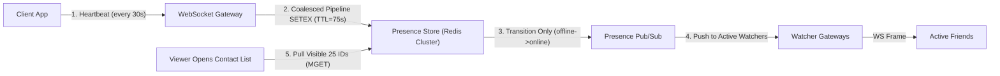
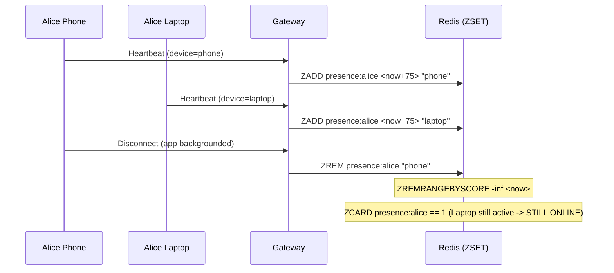
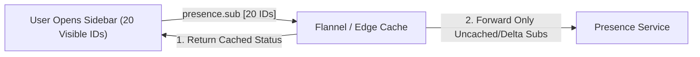

# Presence & Online Status: Heartbeats, TTL Keys & Fan-Out

> **Prerequisites:** [Lesson 01: Real-Time Messaging](../01-real-time-messaging/README.md).  
> **Estimated Reading Time:** 22–26 minutes  
> **Target Audience:** Backend engineers designing green-dot indicators, "Last seen 2m ago", or typing indicators at scale, and candidates asked "How do you scale online presence for 100M users?"  
> **Free PDF Notes:** [Download SD-Q-002.pdf](https://backendroadmap.com/notes/system-design/SD-Q-002.pdf)

> [!NOTE]
> **In one line:** Presence is **ephemeral, high-churn state** driven by periodic heartbeats and expiring **TTL keys** (e.g., Redis `SETEX`), where **pull-on-view / lazy fan-out** replaces blind push-to-all-friends so a celebrity coming online does not trigger a $100{,}000\times$ broadcast storm.

> [!TIP]
> **The Golden Rule:** Never broadcast every heartbeat to every friend. Broadcast only **state transitions** (`offline -> online`) to **currently active watchers**, and use **on-demand pull** for everyone else.

---

## 1. What Presence Is, and What It Isn't

You open WhatsApp or Slack and immediately see a green dot next to 15 coworkers and `"Last seen today at 14:22"` under a friend's name. If 100 million users send a heartbeat every 10 seconds, that is **10 million writes per second**. If each user has 300 friends and every heartbeat fans out to all 300, that is **3 billion presence events per second** — 1,000x larger than the actual chat traffic!

| Term | Precise Meaning | Example |
| :--- | :--- | :--- |
| **Heartbeat** | Lightweight periodic ping from client $\to$ gateway proving liveness | `PING` every 30s |
| **TTL Key** | Key-value record that auto-expires if not refreshed within $T$ seconds | `SET presence:u42 "online" EX 60` |
| **State Transition** | Moving between `offline`, `online`, `away`, `dnd` | Only emit events on change |
| **Push Presence** | Server pushes `user_online` events to subscribed friends over WS | Good for small teams ($< 200$ friends) |
| **Pull / Lazy Presence** | Client queries presence only for contacts currently visible on screen | `MGET presence:u1 ... presence:u25` |
| **Last Seen** | Persisted timestamp updated on disconnect or throttled heartbeat | `last_seen_at = 1732512000` |
| **Not** | Durable transactional data or a guaranteed real-time lock | A 10–30s lag is acceptable UX |

### Why It Matters
1. **Presence traffic dwarfs message traffic**: users send a few messages per hour, but heartbeats fire continuously while the app is open.
2. **Naive fan-out causes $O(N \times F)$ storms**: a user with 5,000 friends flapping on a subway Wi-Fi connection can saturate a pub/sub cluster.
3. Interviewers love presence questions because they test **TTL design, hysteresis (anti-flapping), pub/sub fan-out limits, and push vs pull trade-offs**.

---

## 2. Anatomy: Heartbeat, TTL Store, and Hybrid Fan-Out



How the two paths work together:
1. **Write Path (Heartbeats + TTL):** Every 30s, the client sends a heartbeat over its existing WebSocket (or HTTP if WS-less). The gateway coalesces heartbeats and runs pipelined Redis `SETEX presence:<user_id> 75 <status_json>`. If the user's status *changed* from `offline` to `online`, only then is a transition event published.
2. **Read Path (Pull on View):** When Bob opens his chat list showing 20 contacts, his client issues `GET /presence?ids=u1..u20` (backed by a single Redis `MGET` or local gateway cache). Zero background fan-out needed for the other 480 offline/unviewed friends.
3. **Live Updates (Scoped Push):** For the 20 contacts currently visible in Bob's viewport (or active Slack channel), Bob's client subscribes to their presence transitions.

| Strategy | Write Load | Read/Fan-out Load | Staleness | Best For |
| :--- | :--- | :--- | :--- | :--- |
| **Push to All Friends** | Low | $O(\text{friends} \times \text{churn})$ — huge | $< 1\text{ s}$ | Small workspaces ($< 100$ users) |
| **Pure Pull (Polling)** | $O(N / T_{\text{hb}})$ | $O(\text{viewers} / T_{\text{poll}})$ | $10\text{–}30\text{ s}$ | Large consumer social networks |
| **Hybrid (Pull + Scoped Push)** | $O(N / T_{\text{hb}})$ | $O(\text{active\_watchers})$ | $< 2\text{ s}$ | WhatsApp, Slack, Discord |

> [!WARNING]
> **Never write `last_seen` to a primary SQL database on every heartbeat.** 10M heartbeats/sec will instantly destroy PostgreSQL/MySQL with row-lock and WAL amplification. Keep live presence in Redis/memory with TTLs, and flush `last_seen` to durable storage **only on disconnect** (or throttled to once every 5 minutes).

---

## 3. Mathematical Model: Heartbeat QPS, Memory, and Fan-Out Savings

**1. Heartbeat Write QPS.** With $N_{\text{online}}$ concurrent users and heartbeat interval $T_{\text{hb}}$:

$$Q_{\text{hb}} = \frac{N_{\text{online}}}{T_{\text{hb}}}$$

For $N_{\text{online}} = 60{,}000{,}000$ users:
- At $T_{\text{hb}} = 5\text{ s}$: $Q_{\text{hb}} = 12{,}000{,}000\text{ writes/sec}$ (expensive!).
- At $T_{\text{hb}} = 30\text{ s}$: $Q_{\text{hb}} = 2{,}000{,}000\text{ writes/sec}$ (6x cheaper!).
- With **piggybacked heartbeats** (any sent chat message/typing event resets the 30s timer) + gateway batching (100 keys per Redis pipeline), Redis command round-trips drop by another $10\text{–}50\times$.

**2. Memory Footprint.** Each Redis entry `presence:<user_id>` stores `{status, last_seen, device_count}` ($\approx 64\text{ B}$ payload + $\sim 64\text{ B}$ Redis dict/robj overhead $= 128\text{ B}$):

$$M_{\text{presence}} = 60{,}000{,}000 \times 128\text{ B} = 7.68\text{ GB RAM}$$

A modest 3-shard Redis Cluster (each shard 16 GB RAM) holds all 60M online users in memory with 2x headroom.

**3. Fan-Out Reduction (Naive Push vs Scoped Push).** Suppose each user has $F = 300$ friends, $20\%$ are online, and only $V = 15$ friends actually have that user visible on screen right now. If $5\%$ of users flap status per minute ($3{,}000{,}000\text{ transitions/min} = 50{,}000\text{/sec}$):
- **Naive Push to online friends:** $50{,}000 \times (300 \times 0.20) = 3{,}000{,}000\text{ WS pushes/sec}$.
- **Scoped Push to active viewers ($V=15$):** $50{,}000 \times 15 = 750{,}000\text{ WS pushes/sec}$ ($4\times$ lower), and for celebrities with $F = 100{,}000$ followers, **capping push or switching to pull-only** prevents $100{,}000\times$ amplification.

---

## 4. Metrics & Percentiles

| Metric | Meaning | Alert when |
| :--- | :--- | :--- |
| **Heartbeat Write QPS** | Redis `SETEX` / `HSET` rate | $> 75\%$ of shard CPU/ops budget |
| **Presence Lookup $p_{99}$** | Latency of batched `MGET` | $> 5\text{ ms}$ |
| **Status Flap Rate** | `online <-> offline` transitions/min per user | $> 5\text{/min}$ (indicates TTL too tight) |
| **False-Offline Rate** | Users marked offline while WS is still open | $> 0.5\%$ (TTL $<$ heartbeat + jitter) |
| **Pub/Sub Fan-Out Lag** | Delay from status change to watcher WS push | $> 2\text{ s}$ |
| **Redis Memory Fragmentation** | `used_memory_rss / used_memory` | $> 1.5$ (TTL churn fragmentation) |

### Worked Example (TTL Sizing & Anti-Flapping)
Suppose the client sends a heartbeat every $T_{\text{hb}} = 30\text{ s}$ with $\pm 3\text{ s}$ jitter.
- **Wrong TTL ($30\text{ s}$):** Any 1-second network hiccup causes the key to expire before the next heartbeat arrives, flipping the user `offline -> online` every 30 seconds!
- **Correct TTL ($2.5 \times T_{\text{hb}} = 75\text{ s}$):** Tolerates **2 missed heartbeats** ($\sim 60\text{ s}$) before marking the user offline.
- **Grace Period on Disconnect:** When a WebSocket closes cleanly (or drops), do not immediately flip to `offline` if the user is switching from Wi-Fi to 5G. Wait **10–15 seconds** (grace TTL) before publishing `offline` so brief network handoffs stay invisible to friends.

---

## 5. Compounding & Failure Modes

| Failure Mode | What Breaks | Mitigation |
| :--- | :--- | :--- |
| **Subway / Elevator Flapping** | User goes `online <-> offline` 20 times in 5 min $\to$ pub/sub storm | 15s disconnect grace period + hysteresis cooldown |
| **Multi-Device Conflict** | Phone closes app (`offline`), but Laptop is still active | Store per-device TTLs (`HSET` or `ZSET` of devices); user is online if $\ge 1$ device is active |
| **Celebrity Presence Storm** | Account with 500k followers toggles online | Disable push fan-out for accounts with $> 1{,}000$ followers; pull-only with 30s cache |
| **Redis Shard Failure** | 1/3 of online users suddenly appear offline | Replicated Redis shards + client heartbeats naturally rebuild state within 30s |
| **Redis Keyspace Notification Overhead** | Enabling `__keyevent@0__:expired` on 60M keys burns Redis CPU | Avoid Redis expiry callbacks at high scale; let pull/lazy-check or gateway timers handle expiry |

---

## 6. Numbers Every Engineer Must Know

| Item | Typical | Implication |
| :--- | :---: | :--- |
| **Heartbeat interval** | $25\text{–}30\text{ s}$ | Balances battery/bandwidth vs staleness |
| **Presence TTL** | $2\text{–}2.5 \times$ heartbeat ($60\text{–}75\text{ s}$) | Absorbs 1–2 dropped packets without false offline |
| **Disconnect grace window** | $10\text{–}15\text{ s}$ | Prevents Wi-Fi $\to$ LTE handoff flicker |
| **Typing indicator TTL** | $3\text{–}5\text{ s}$ (ephemeral, never persisted) | Auto-clears if sender crashes mid-sentence |
| **Single Redis core throughput** | $\sim 80\text{k}\text{–}120\text{k}$ ops/sec (pipelined higher) | 2M hb/s needs $\sim 16\text{–}24$ Redis shards (or pipelining) |
| **Visible contact list size** | $15\text{–}30$ rows per screen | Pull/subscribe only to visible IDs, not all 500 friends |

---

## 7. Protocol Deep Dive: Multi-Device Presence with Redis Sorted Sets

A common trap is storing a single boolean `presence:alice = online`. If Alice has both her **Phone** and **Laptop** open, and she locks her Phone, a naive disconnect handler sets `presence:alice = offline` even though she is still typing on her Laptop!



| Question | Answer |
| :--- | :--- |
| **Why a Redis `ZSET` (`score = expires_at`)?** | Each member is a `device_id` with its own expiry timestamp. Pruning expired devices is `ZREMRANGEBYSCORE key -inf now`, and `ZCARD > 0` means the user is online. |
| **How do you expire the whole `ZSET`?** | Always follow `ZADD` with `EXPIRE key 90` so completely offline users consume zero Redis RAM. |
| **What about privacy ("Hide Online Status")?** | Enforce privacy at the **read/publish layer**: if `privacy.show_online == false`, return `offline` / `last_seen: hidden` regardless of the underlying heartbeat. |

**When NOT to use real-time push presence:**
- In asynchronous forums, email, or massive follower graphs ($> 1{,}000$ followers): push presence wastes bandwidth and adds zero value. Use lazy pull with a 30–60s CDN/Redis cache.

---

## 8. Hierarchical Budgets & Design Rules

| Slice | Rule | Control |
| :--- | :--- | :--- |
| **Heartbeat Rate** | Never faster than 20–30s on mobile | Server-pushed config (`hb_interval_s`) |
| **TTL Ratio** | `TTL >= 2.5 * hb_interval` | Prevents packet-loss flapping |
| **Write Coalescing** | Gateways batch heartbeats into Redis pipelines | Flush every 100–250 ms |
| **Multi-Device** | Track per-device expiry, not single user flag | Redis `ZSET` or `HSET` per `user_id` |
| **Fan-Out Cap** | Never push presence to $> 500$ watchers | Switch high-degree users to pull-only |
| **Durable Writes** | Never write heartbeats to SQL | Flush `last_seen` only on disconnect / 5m throttle |
| **Privacy** | Filter before push and before pull response | Central `PresencePolicy` check |

---

## 9. Top Mitigations

1. **Piggyback heartbeats on active traffic**: if a user sends a message or typing event, reset their local heartbeat timer so active users don't send redundant pings.
2. **Batch Redis updates at the gateway**: instead of 200k individual `SETEX` calls, buffer heartbeats for 200 ms and send a single Redis pipeline.
3. **Publish transitions only**: check if `was_online == false` before emitting a pub/sub event; steady-state heartbeats (`online -> online`) emit zero pub/sub messages.
4. **Use a 15-second disconnect grace window** to absorb mobile Wi-Fi/cellular handoffs without notifying friends.
5. **Scope subscriptions to the visible viewport**: the client only subscribes to the 20 contacts currently rendered on screen, unsubscribing on scroll/close.
6. **Cap push fan-out for celebrities/large channels** and fall back to cached pull (`GET /presence?ids=...`).

---

## 10. Production Reference: Slack's Presence Scaling Journey

Early Slack pushed every user's presence change (`online`, `away`, `active`) to **every member of the workspace** upon connect and on every transition.
- **The Crash:** As enterprise workspaces grew to **50,000+ users**, a single morning login spike (e.g., 9:00 AM EST) generated $50{,}000 \times 50{,}000 = 2.5\text{ billion}$ presence payloads, saturating gateway memory and client CPUs.
- **The Fix (Lazy / Scoped Presence):** Slack switched to **query-on-demand + scoped subscriptions**:
  1. On initial connect, clients receive **zero** bulk presence lists.
  2. The UI sends `presence.query` / `presence.sub` **only for the user IDs currently visible** in the sidebar or active channel.
  3. Presence servers store state in memory/Redis and emit updates only to active subscribers of those specific IDs.



---

## 11. Multi-Language Production Code Tabs

A **Multi-Device Presence Tracker** using per-device TTLs, transition-only event emission, and batched `MGET`-style lookup.

````carousel
```go
// Go: Multi-device presence store with TTL pruning and transition-only notifications.
package main

import (
	"fmt"
	"sync"
	"time"
)

type PresenceStore struct {
	mu      sync.Mutex
	ttl     time.Duration
	devices map[string]map[string]time.Time // userID -> deviceID -> expiresAt
}

func NewPresenceStore(ttl time.Duration) *PresenceStore {
	return &PresenceStore{
		ttl:     ttl,
		devices: make(map[string]map[string]time.Time),
	}
}

// Heartbeat returns true only if the user transitioned from offline -> online.
func (p *PresenceStore) Heartbeat(userID, deviceID string, now time.Time) (becameOnline bool) {
	p.mu.Lock()
	defer p.mu.Unlock()

	wasOnline := p.pruneAndCountLocked(userID, now) > 0
	if p.devices[userID] == nil {
		p.devices[userID] = make(map[string]time.Time)
	}
	p.devices[userID][deviceID] = now.Add(p.ttl)

	if !wasOnline {
		fmt.Printf("[Event] user=%s transitioned offline -> online\n", userID)
		return true
	}
	return false
}

func (p *PresenceStore) IsOnline(userID string, now time.Time) bool {
	p.mu.Lock()
	defer p.mu.Unlock()
	return p.pruneAndCountLocked(userID, now) > 0
}

func (p *PresenceStore) pruneAndCountLocked(userID string, now time.Time) int {
	devs := p.devices[userID]
	for devID, exp := range devs {
		if !exp.After(now) {
			delete(devs, devID)
		}
	}
	return len(devs)
}
```
<!-- slide -->
```typescript
// TypeScript: Multi-device TTL presence manager with batched pull and transition events.
export class PresenceService {
  private devices = new Map<string, Map<string, number>>();

  constructor(private readonly ttlMs = 75_000) {}

  heartbeat(userId: string, deviceId: string, nowMs = Date.now()): boolean {
    const wasOnline = this.prune(userId, nowMs) > 0;
    let userDevs = this.devices.get(userId);
    if (!userDevs) {
      userDevs = new Map<string, number>();
      this.devices.set(userId, userDevs);
    }
    userDevs.set(deviceId, nowMs + this.ttlMs);

    if (!wasOnline) {
      console.log(`[Transition] ${userId}: offline -> online`);
      return true;
    }
    return false;
  }

  getBatchStatus(userIds: string[], nowMs = Date.now()): Record<string, "online" | "offline"> {
    const result: Record<string, "online" | "offline"> = {};
    for (const uid of userIds) {
      result[uid] = this.prune(uid, nowMs) > 0 ? "online" : "offline";
    }
    return result;
  }

  private prune(userId: string, nowMs: number): number {
    const userDevs = this.devices.get(userId);
    if (!userDevs) return 0;
    for (const [devId, exp] of userDevs) {
      if (exp <= nowMs) userDevs.delete(devId);
    }
    if (userDevs.size === 0) this.devices.delete(userId);
    return userDevs.size;
  }
}
```
<!-- slide -->
```python
# Python: Multi-device TTL presence tracker + QPS/RAM sizing calculator (stdlib only).
import time


class PresenceTracker:
    def __init__(self, ttl_s: int = 75) -> None:
        self.ttl_s = ttl_s
        self.devices: dict[str, dict[str, float]] = {}

    def _prune(self, user_id: str, now: float) -> int:
        devs = self.devices.get(user_id)
        if not devs:
            return 0
        expired = [d for d, exp in devs.items() if exp <= now]
        for d in expired:
            del devs[d]
        if not devs:
            del self.devices[user_id]
            return 0
        return len(devs)

    def heartbeat(self, user_id: str, device_id: str, now: float | None = None) -> bool:
        now = now or time.time()
        was_online = self._prune(user_id, now) > 0
        self.devices.setdefault(user_id, {})[device_id] = now + self.ttl_s
        return not was_online  # True only on offline -> online transition

    def batch_status(self, user_ids: list[str], now: float | None = None) -> dict[str, str]:
        now = now or time.time()
        return {uid: ("online" if self._prune(uid, now) > 0 else "offline") for uid in user_ids}


def presence_sizing(online_users: int, hb_interval_s: int = 30, bytes_per_entry: int = 128) -> dict:
    return {
        "heartbeat_qps": round(online_users / hb_interval_s),
        "ram_gb": round((online_users * bytes_per_entry) / (1024 ** 3), 2),
    }
```
<!-- slide -->
```csharp
// C#: Multi-device presence service with TTL pruning and transition detection.
using System.Collections.Concurrent;

public sealed class PresenceService
{
    private readonly TimeSpan _ttl;
    private readonly ConcurrentDictionary<string, Dictionary<string, DateTimeOffset>> _devices = new();

    public PresenceService(TimeSpan ttl) => _ttl = ttl;

    public bool Heartbeat(string userId, string deviceId, DateTimeOffset? now = null)
    {
        var ts = now ?? DateTimeOffset.UtcNow;
        var map = _devices.GetOrAdd(userId, _ => new Dictionary<string, DateTimeOffset>());

        lock (map)
        {
            PruneLocked(map, ts);
            bool wasOnline = map.Count > 0;
            map[deviceId] = ts + _ttl;
            return !wasOnline; // true if offline -> online transition
        }
    }

    public Dictionary<string, bool> BatchIsOnline(IEnumerable<string> userIds, DateTimeOffset? now = null)
    {
        var ts = now ?? DateTimeOffset.UtcNow;
        var result = new Dictionary<string, bool>();
        foreach (var uid in userIds)
        {
            if (!_devices.TryGetValue(uid, out var map)) { result[uid] = false; continue; }
            lock (map)
            {
                PruneLocked(map, ts);
                result[uid] = map.Count > 0;
            }
        }
        return result;
    }

    private static void PruneLocked(Dictionary<string, DateTimeOffset> map, DateTimeOffset now)
    {
        foreach (var kv in map.Where(x => x.Value <= now).ToList())
            map.Remove(kv.Key);
    }
}
```
````

---

## 12. Hands-On CLI Verification Workflows

Test Redis ZSET-based multi-device presence and verify sizing math:

```bash
# 1. Simulate multi-device heartbeat in Redis using ZSET (score = unix expiry timestamp)
NOW=$(date +%s)
EXP=$((NOW + 75))
redis-cli ZADD presence:alice $EXP "phone"
redis-cli ZADD presence:alice $EXP "laptop"
redis-cli EXPIRE presence:alice 90

# 2. Prune expired devices and check if Alice is online (ZCARD > 0)
redis-cli ZREMRANGEBYSCORE presence:alice -inf $NOW
redis-cli ZCARD presence:alice

# 3. Simulate phone disconnect; laptop keeps Alice online
redis-cli ZREM presence:alice "phone"
redis-cli ZCARD presence:alice

# 4. Run Python sizing check for 60M online users
python -c "u=60_000_000; print({'hb_qps': u//30, 'ram_gb': round(u*128/1024**3, 2)})"
```

---

## 13. Common Mistakes to Avoid

1. **Broadcasting every heartbeat** instead of only state transitions (`offline -> online`).
2. **Writing `last_seen` to PostgreSQL/MySQL on every heartbeat**, causing massive IOPS/WAL saturation.
3. **Setting `TTL == heartbeat_interval`** (e.g., both 30s), causing constant false-offline flapping on 1-second network jitter.
4. **Pushing presence updates to all 500+ friends** instead of scoping push to currently visible/subscribed watchers.
5. **Tracking a single boolean per user** instead of per-device TTLs, breaking multi-device (Phone + Laptop) status.
6. **Forgetting a disconnect grace period** (10–15s) during mobile Wi-Fi $\to$ 5G handoffs.
7. **Relying on Redis keyspace expiry notifications** at 50M+ scale instead of lazy pruning / pull.

---

## 14. Key Terms Glossary

| Key Term | Definition |
| :--- | :--- |
| **Heartbeat** | Periodic lightweight client signal proving the session is still alive. |
| **TTL (Time-To-Live)** | Automatic expiration window after which an unrefreshed presence key disappears. |
| **State Transition** | A change in status (`offline -> online`), as opposed to a steady-state renewal. |
| **Scoped Push** | Pushing presence updates only to viewers who currently have that user in view. |
| **Pull-on-View** | Fetching presence via batched `MGET` only when a user opens a contact list. |
| **Hysteresis / Grace Window** | Waiting 10–15s after disconnect before marking offline to prevent flapping. |
| **Multi-Device ZSET** | Redis Sorted Set storing `device_id -> expiry_ts` so one device closing doesn't hide another. |
| **Last Seen** | Durable timestamp flushed on disconnect or throttled intervals (e.g., every 5m). |
| **Typing Indicator** | Ultra-short TTL (3–5s) ephemeral presence event sent only to active chat participants. |
| **Privacy Filter** | Read/publish-time rule masking `online` / `last_seen` for users who opt out. |

---

## 15. System Design Interview Questions & Answers

### Basic Conceptual Questions

<details>
<summary><strong>Q1: How does a basic presence system detect that a user is online vs offline? [BASIC]</strong></summary>

**Answer:**
The client sends a periodic heartbeat (e.g., every 30 seconds) to the server, which sets a TTL key in Redis (`SETEX presence:user_id 75 online`). As long as heartbeats arrive, the TTL resets. If the client crashes or loses internet, heartbeats stop and the key expires after 75 seconds, marking the user offline.
</details>

<details>
<summary><strong>Q2: Why should the TTL be 2–2.5x the heartbeat interval? [BASIC]</strong></summary>

**Answer:**
If `TTL == heartbeat_interval` (both 30s), any minor network jitter or packet loss causes the key to expire a moment before the next heartbeat arrives, flipping the user `offline -> online` repeatedly. A $2.5\times$ TTL (75s) tolerates 2 missed heartbeats cleanly.
</details>

<details>
<summary><strong>Q3: Why not store live presence in a relational database like PostgreSQL? [BASIC]</strong></summary>

**Answer:**
60M online users with 30s heartbeats generate 2M writes/sec. A relational DB will bottleneck on disk WAL writes, B-tree index updates, and row locks. Presence is ephemeral state that belongs in an in-memory store like Redis, flushing `last_seen` to durable DB only on disconnect or every few minutes.
</details>

<details>
<summary><strong>Q4: How do typing indicators differ from online presence? [BASIC]</strong></summary>

**Answer:**
Typing indicators are scoped strictly to the active `conversation_id`, never persisted to any database, and use a very short TTL (3–5 seconds) or client-side timeout so they clear automatically if the sender stops typing or loses connectivity.
</details>

### Scenario-Based Architecture Questions

<details>
<summary><strong>Q5: A user has 500 friends. How do you avoid broadcasting 500 messages every time they connect? [SCENARIO]</strong></summary>

**Answer:**
Use **hybrid pull + scoped push**: when a user opens their app, they pull presence (`MGET`) only for the ~20 contacts visible on screen and subscribe to transitions for those 20 IDs. Only friends who are *both* online and actively viewing that user receive a push.
</details>

<details>
<summary><strong>Q6: Alice is logged in on her Laptop and Phone. She closes her Phone app — how do you prevent her from appearing offline? [SCENARIO]</strong></summary>

**Answer:**
Track presence **per `(user_id, device_id)`** rather than a single user flag. Using a Redis `ZSET` (`presence:alice`) where each member is `device_id` and its score is `expires_at`, closing the Phone only removes `"phone"`. `ZCARD > 0` (Laptop remains) keeps Alice online.
</details>

<details>
<summary><strong>Q7: A user rides a subway and their connection drops and reconnects 10 times in 3 minutes. How do you stop status flickering? [SCENARIO]</strong></summary>

**Answer:**
Apply a **disconnect grace period (10–15 seconds)** before publishing an `offline` transition, plus **hysteresis** (suppress repeated transition broadcasts if a user flipped more than $N$ times in the last minute).
</details>

<details>
<summary><strong>Q8: How do you size Redis for 60 million concurrent online users? [SCENARIO]</strong></summary>

**Answer:**
At 30s heartbeats, write load is $60\text{M} / 30 = 2\text{M ops/sec}$. With gateway-side pipelining (batching 100 heartbeats per call), that's ~20k pipelined calls/sec across ~16–24 Redis shards. Memory at 128 bytes/entry is $60\text{M} \times 128\text{ B} \approx 7.68\text{ GB}$, which fits easily across those shards.
</details>

### Advanced & Tricky Interview Questions

<details>
<summary><strong>Q9: How do you handle presence for a celebrity with 5 million followers? [TRICKY]</strong></summary>

**Answer:**
Disable push fan-out entirely for accounts exceeding a watcher threshold (e.g., $> 1{,}000$ followers). Followers fall back to **pull-on-view** backed by a 30-second CDN/edge cache so 5M viewers hit the edge cache rather than Redis or pub/sub.
</details>

<details>
<summary><strong>Q10: Why is Redis Keyspace Expiration Notification (`__keyevent@0__:expired`) dangerous for presence at scale? [TRICKY]</strong></summary>

**Answer:**
Redis expires keys lazily on access or via a background probabilistic sweep (active expire). Relying on keyspace notifications for 60M keys adds CPU overhead, is **not guaranteed to fire at exact TTL**, and can cause bursty single-threaded CPU stalls when thousands of keys expire together.
</details>

<details>
<summary><strong>Q11: How do you enforce "Hide my online status" without breaking the internal heartbeat? [TRICKY]</strong></summary>

**Answer:**
Keep heartbeats running internally (needed for message routing and session liveness), but apply a **privacy policy check** at the presence read API and before emitting pub/sub transitions. If `show_presence == false`, return `offline` / `hidden` to external viewers.
</details>

<details>
<summary><strong>Q12: What happens if a Redis presence shard restarts and loses its in-memory keys? [TRICKY]</strong></summary>

**Answer:**
Because presence is ephemeral and clients send heartbeats every 30s, the shard **self-heals within one heartbeat cycle (30s)** without needing complex recovery. Use Redis replication (primary + replica) if you want zero-blip failover, and never block chat delivery on presence lookup failures.
</details>

---

## 16. One-Page Master Cheat Sheet

```
+---------------------------------------------------------------------------------------------------------+
|                    PRESENCE & ONLINE STATUS — MASTER CHEAT SHEET                                        |
+---------------------------------------------------------------------------------------------------------+
| 1. WRITE PATH: Client heartbeat every 30s -> Gateway coalesces -> Redis SETEX/ZADD with TTL = 75s.      |
+---------------------------------------------------------------------------------------------------------+
| 2. SIZING: 60M online / 30s = 2M writes/sec; 60M * 128B = 7.68 GB RAM. Never write heartbeats to SQL.   |
+---------------------------------------------------------------------------------------------------------+
| 3. FAN-OUT: Emit events ONLY on state transitions (offline -> online). Pull-on-view for visible 20 IDs.  |
+---------------------------------------------------------------------------------------------------------+
| 4. ANTI-FLAPPING: TTL = 2.5 * heartbeat; 15s disconnect grace period; cap push for celebrities (>1k).   |
+---------------------------------------------------------------------------------------------------------+
| 5. MULTI-DEVICE: Use Redis ZSET (member=device_id, score=expires_at). Online if ZCARD > 0.              |
+---------------------------------------------------------------------------------------------------------+
| 6. LAST SEEN: Flush to durable DB only on disconnect (or throttled 5m), filtered by privacy settings.   |
+---------------------------------------------------------------------------------------------------------+
```

---

## Further Reading & Sources

- Slack Engineering, [Flannel: An Application-Level Edge Cache](https://slack.engineering/flannel-an-application-level-edge-cache-to-make-slack-scale/) (lazy presence subscriptions).
- Redis Documentation, [Sorted Sets (`ZSET`)](https://redis.io/docs/latest/develop/data-types/sorted-sets/) and [Key Expiration](https://redis.io/docs/latest/commands/expire/).
- Martin Kleppmann, *Designing Data-Intensive Applications*, Chapter 11 (ephemeral vs durable state).

---

## Free PDF Notes

[SD-Q-002.pdf](https://backendroadmap.com/notes/system-design/SD-Q-002.pdf)

---

## Next

Continue with [Lesson 03: Notification Systems: Preferences, Templates & No Duplicates](../03-notification-systems/README.md).
