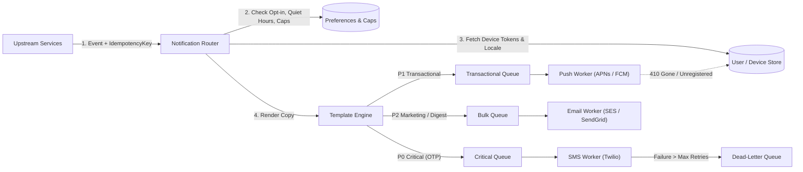
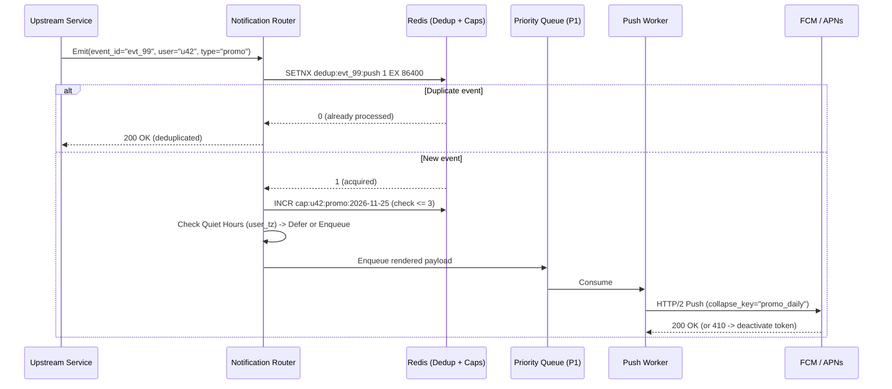
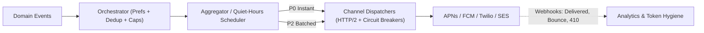

# Notification Systems: Preferences, Templates & No Duplicates

> **Prerequisites:** [Lesson 02: Presence & Online Status](../02-presence-online-status/README.md).  
> **Estimated Reading Time:** 24–28 minutes  
> **Target Audience:** Backend engineers building multi-channel alert pipelines (APNs, FCM, SMS, Email, In-App), and candidates asked "Design a scalable notification system."  
> **Free PDF Notes:** [Download SD-Q-003.pdf](https://backendroadmap.com/notes/system-design/SD-Q-003.pdf)

> [!NOTE]
> **In one line:** A production notification system is a **decoupled, priority-queued delivery pipeline** that resolves user preferences, frequency caps, and templates *before* dispatching to isolated per-channel workers (Push, SMS, Email), using **idempotency keys** so retries never spam the user twice.

> [!TIP]
> **The Golden Rule:** **Never share one queue across channels or priorities.** An overloaded email provider or promotional blast must never delay a 2FA OTP SMS by even 100 milliseconds.

---

## 1. What a Notification System Is, and What It Isn't

When a user places an order, receives a 2FA code, or gets mentioned in a comment, your backend must deliver the right message on the right channel (iOS APNs, Android FCM, Email, SMS, or In-App) in the user's locale — without sending duplicates, waking them at 3:00 AM, or letting a marketing campaign block password resets.

| Term | Precise Meaning | Example |
| :--- | :--- | :--- |
| **Notification Event** | Domain trigger emitted by an upstream service | `OrderShipped(order_id=99, user_id=42)` |
| **Preference & Policy Engine** | Checks opt-ins, quiet hours, and frequency caps before sending | "No promo push between 22:00–08:00" |
| **Template Engine** | Renders localized copy from `template_id + locale + variables` | `"Your order #99 shipped!"` (en-US) |
| **Priority Queues** | Separate queues for `critical` (OTP), `transactional`, and `marketing` | P0 OTP bypasses P2 digests |
| **Channel Worker** | Isolated adapter for APNs, FCM, SendGrid, Twilio, or WebSocket | Retries with backoff + circuit breaker |
| **Idempotency / Dedup Key** | Unique key preventing duplicate sends on queue redelivery | `notif:order_shipped:99:email` |
| **Not** | A synchronous `send_email()` call inside checkout or a single cron job | Provider timeouts must never fail checkout |

### Why It Matters
1. **Third-party providers (Twilio, SendGrid, APNs, FCM) are slow and unreliable**: 200–2,000 ms latency, rate limits, and partial outages are normal.
2. **Duplicate notifications destroy user trust**: receiving 3 identical "Payment Charged" SMS messages or 50 "Someone liked your post" pings causes immediate uninstalls.
3. **Priority isolation** (OTP vs Marketing) and **observability** (delivery receipts, bounce handling, invalid token pruning) are core interview differentiators.

---

## 2. Anatomy: End-to-End Multi-Channel Pipeline



Key architectural boundaries:
1. **Upstream decoupling:** Services emit a lightweight semantic event (`event_id`, `user_id`, `template_id`, `vars`, `priority`) — never raw HTML or SMS text.
2. **Pre-dispatch filtering:** The router checks user preferences (channel opt-out, quiet hours), deduplication (`SETNX dedup:<event_id>:<channel>`), and frequency caps (max 3 marketing pushes/day).
3. **Channel & Priority Isolation:** Separate Kafka topics or SQS queues per `(priority, channel)` so a Twilio rate-limit never starves APNs, and a 5M-user promo blast never delays a 2FA OTP.
4. **Feedback Loops:** Workers process provider webhooks/responses: invalid push tokens (`410 Unregistered` from APNs/FCM) are pruned immediately; email hard bounces suppress future sends.

| Channel | Typical Latency | Cost / Msg | Max Payload | Failure Handling |
| :--- | :--- | :--- | :--- | :--- |
| **APNs / FCM (Mobile Push)** | $50\text{–}300\text{ ms}$ | Free | 4 KB | Prune `410/NotRegistered` tokens |
| **SMS (Twilio / SNS)** | $500\text{–}3{,}000\text{ ms}$ | $\$0.005\text{–}\$0.08$ | 160 GSM chars | Multi-provider failover (Twilio $\to$ Vonage) |
| **Email (SES / SendGrid)** | $200\text{–}2{,}000\text{ ms}$ | $\$0.0001$ | MBs (HTML) | Honor hard bounces & List-Unsubscribe |
| **In-App (WS / Inbox)** | $< 50\text{ ms}$ | Infra only | Flexible JSON | Persist to user inbox table + WS push |

> [!WARNING]
> **At-least-once queues + retries = guaranteed duplicates without idempotency.** If a Push worker sends to FCM, crashes before committing the Kafka offset, and another worker picks up the message, the user gets notified twice unless you enforce a distributed dedup check (`SETNX` with 24h TTL or unique DB constraint) before calling the provider.

---

## 3. Mathematical Model: Throughput, Provider Rate Limits, and Token Churn

**1. Peak Throughput & Worker Concurrency (Little's Law).** Suppose a breaking-news or flash-sale event triggers $N = 10{,}000{,}000$ push notifications that must be delivered within $T = 300\text{ s}$ (5 minutes):

$$\lambda_{\text{target}} = \frac{10{,}000{,}000}{300\text{ s}} \approx 33{,}333\text{ notifications/sec}$$

If each HTTP/2 call to APNs/FCM takes $W = 100\text{ ms}$ ($0.1\text{ s}$) on average (without batching), Little's Law ($L = \lambda \times W$) tells us the required in-flight concurrent requests:

$$L = 33{,}333 \times 0.1\text{ s} = 3{,}334\text{ concurrent in-flight requests}$$

With **FCM multicast batching** (500 tokens per HTTP request at $W = 150\text{ ms}$):

$$\lambda_{\text{HTTP}} = \frac{33{,}333}{500} \approx 67\text{ req/sec}, \qquad L = 67 \times 0.15 = 10\text{ concurrent connections!}$$

**2. SMS Cost & Failover Economics.** Sending $1{,}000{,}000$ SMS/day at $\$0.01\text{/msg}$ costs $\$10{,}000\text{/day}$ ($\$300{,}000\text{/month}$). Shifting non-urgent alerts from SMS to Push/In-App (and only falling back to SMS for critical 2FA/security) cuts messaging spend by $> 80\%$.

**3. Notification Coalescing (Digest Compression).** If a viral post gets $K = 5{,}000$ likes in 10 minutes, coalescing likes into `"Alice and 4,999 others liked your post"` reduces $5{,}000$ pushes down to $\le 3$ batched notifications (e.g., at $t=0$, $t=2\text{ m}$, $t=10\text{ m}$).

---

## 4. Metrics & Percentiles

| Metric | Meaning | Alert when |
| :--- | :--- | :--- |
| **OTP / P0 Delivery Latency $p_{99}$** | Event created $\to$ provider `200 OK` | $> 3\text{ s}$ |
| **Queue Lag (by Priority)** | Oldest unprocessed message age | P0 $> 5\text{ s}$; P1 $> 60\text{ s}$ |
| **Provider Error Rate (5xx / 429)** | Rate-limit or gateway failures per vendor | $> 1\%$ for 2 min (trigger failover) |
| **Duplicate Suppression Rate** | `%` of events caught by dedup cache | Sudden spike (upstream retry bug) |
| **Token Invalidation Rate** | APNs `410` / FCM `NotRegistered` responses | $> 5\%$ (stale token cleanup needed) |
| **Email Bounce / Spam Rate** | Hard bounces + user spam complaints | Bounce $> 2\%$ or Spam $> 0.1\%$ |

### Worked Example (Priority Starvation vs Isolation)
Suppose a marketing team schedules a 5,000,000-email newsletter at 10:00 AM, and SendGrid caps you at $2{,}000\text{ emails/sec}$.
- **Shared Queue:** The 5M emails take $5{,}000{,}000 / 2{,}000 = 2{,}500\text{ s}$ ($\approx 41.6\text{ minutes}$) to drain. Every password reset and order confirmation queued after 10:00 AM waits **41 minutes**!
- **Isolated Priority Queues (`P0_OTP`, `P1_TX`, `P2_BULK`):** Workers drain `P0` first, `P1` second, and `P2` only when higher queues are empty (or via dedicated worker pools with separate SendGrid sub-accounts/IPs). Password resets stay under **500 ms**.

---

## 5. Compounding & Failure Modes

| Failure Mode | Root Cause | Production Mitigation |
| :--- | :--- | :--- |
| **Thundering Retry Loop** | Provider returns `429 Too Many Requests`; workers retry immediately | Respect `Retry-After` header + exponential backoff + token-bucket rate limiter |
| **Quiet Hours Violation** | User in Tokyo gets US-East promo push at 3:00 AM | Store `timezone` per user; defer non-P0 notifications to `next_08:00_local` in a delayed queue |
| **Zombie Device Tokens** | User uninstalls app; server keeps pushing to dead token | Listen for `410 Unregistered` and mark `token.active = false` immediately |
| **Viral Alert Flood** | Celebrity post generates 100k "liked your post" events/min | Sliding-window aggregator coalesces `(user_id, post_id, type)` into digest |
| **Single SMS Vendor Outage** | Twilio US-East has a 20-minute 503 outage | Circuit breaker trips at 5% error rate and routes P0 SMS to secondary vendor (Vonage/AWS SNS) |

---

## 6. Numbers Every Engineer Must Know

| Item | Typical | Implication |
| :--- | :---: | :--- |
| **FCM multicast batch size** | Up to 500 tokens / request | Cuts HTTP overhead by $500\times$ for broadcasts |
| **APNs connection model** | Persistent HTTP/2 multiplexed streams | Reuse long-lived connections; never open TLS per push |
| **2FA OTP expiration** | $5\text{–}10\text{ minutes}$ | P0 SLO must deliver in $< 5\text{ s}$ or user retries |
| **Dedup window TTL** | $24\text{–}72\text{ hours}$ in Redis + DB audit | Absorbs delayed DLQ replays without duplicates |
| **Email spam complaint threshold** | $< 0.1\%$ (1 in 1,000) | Exceeding this tanks domain IP reputation (Gmail/Yahoo block) |
| **SMS GSM-7 segment limit** | 160 chars (70 chars if Unicode/emoji) | One emoji splits 1 SMS into 3 billed segments! |

---

## 7. Protocol Deep Dive: Idempotency, Frequency Capping & Quiet Hours



| Question | Answer |
| :--- | :--- |
| **What if `SETNX` succeeds, but the router crashes before `Enqueue`?** | Use a **pending/sent two-state key** (or transactional outbox): only mark `SENT` after enqueue/provider ack, or let the worker check `dedup` with a short lease (`60s` processing lock $\to$ `86400s` sent). |
| **What is `collapse_key` / `apns-collapse-id`?** | A provider-level dedup key: if a user's phone is offline and 5 updates arrive, APNs/FCM replaces the old queued notification with the latest one instead of flooding the lock screen. |
| **How do you handle "Mark as Read" across devices?** | Persist in-app notifications in a `user_notifications` table and push `notif_read(id)` over WebSocket to clear badges on all devices. |

**When NOT to use this full pipeline:**
- For real-time chat typing indicators or ephemeral live-cursor updates: those belong in your WebSocket gateway, not a durable notification pipeline with templates and email fallbacks.

---

## 8. Hierarchical Budgets & Design Rules

| Slice | Rule | Control |
| :--- | :--- | :--- |
| **Priority Isolation** | Separate queues/workers for P0 (OTP), P1 (Tx), P2 (Bulk) | Never share worker pools or vendor rate limits |
| **Idempotency** | Require `event_id` on every API/event call | Atomic `SETNX` + DB unique log |
| **Preferences** | Always check opt-in + quiet hours before dispatch | P0 security/OTP overrides marketing opt-outs |
| **Frequency Capping** | Bound promo pushes per user per day/hour | Redis `INCR` + `EXPIRE` sliding/fixed counter |
| **Template Governance** | Versioned templates with strict variable schemas | Reject missing variables before queueing |
| **Vendor Resilience** | Circuit breaker + multi-provider failover for SMS/Email | Auto-route P0 SMS on $> 2\%$ vendor 5xx |
| **Token Hygiene** | Prune `410/NotRegistered` tokens immediately | Async token cleanup queue |

---

## 9. Top Mitigations

1. **Enforce an idempotency key per `(event_id, channel, user_id)`** so at-least-once retries never double-send.
2. **Isolate queues by priority and channel** (`p0.sms`, `p1.push`, `p2.email`) to eliminate head-of-line blocking.
3. **Coalesce high-frequency social events** (likes, follows) in a 30–120s aggregation window before sending.
4. **Use APNs/FCM `collapse_id`** so offline devices wake up to 1 fresh notification instead of 20 stale ones.
5. **Implement timezone-aware quiet hours** by scheduling deferred P1/P2 notifications into a delayed queue (`deliver_at`).
6. **Maintain separate IP pools / sub-accounts** for transactional vs marketing emails so promo spam complaints never hurt password-reset deliverability.
7. **Deactivate invalid device tokens on `410` responses** to avoid wasting 20–30% of push bandwidth on uninstalled apps.

---

## 10. Production Reference: Airbnb & Uber Notification Architecture

Large consumer platforms (Airbnb's *Hermes*, Uber's *Push Platform*) follow a strict **3-tier pipeline**:
- **Ingestion & Orchestration:** Receives domain events, validates schemas, resolves user preferences/locale, and computes frequency caps.
- **Aggregation & Scheduling:** Holds non-urgent events in a short window (e.g., 60s) to merge `"3 new messages"` and defers notifications that land in a user's quiet hours.
- **Channel Dispatchers & Feedback:** Stateless worker pools maintain persistent HTTP/2 pools to APNs/FCM and circuit-broken connections to multiple SMS/Email vendors, feeding delivery receipts and bounce events back to an analytics & token-hygiene topic.



---

## 11. Multi-Language Production Code Tabs

A **Notification Dispatcher** implementing idempotency deduplication, frequency capping, quiet-hours check, and template rendering.

````carousel
```go
// Go: Notification router with idempotency, frequency cap, quiet hours, and template rendering.
package main

import (
	"fmt"
	"strings"
	"sync"
	"time"
)

type Priority int

const (
	P0Critical Priority = iota
	P1Transactional
	P2Marketing
)

type UserPref struct {
	AllowMarketing bool
	QuietStartHour int // e.g., 22
	QuietEndHour   int // e.g., 8
	UTCOffsetHours int
}

type NotificationReq struct {
	EventID    string
	UserID     string
	Channel    string // "push", "sms", "email"
	Priority   Priority
	Template   string
	Vars       map[string]string
}

type Dispatcher struct {
	mu       sync.Mutex
	dedup    map[string]bool
	dailyCap map[string]int
}

func NewDispatcher() *Dispatcher {
	return &Dispatcher{dedup: make(map[string]bool), dailyCap: make(map[string]int)}
}

func (d *Dispatcher) Dispatch(req NotificationReq, pref UserPref, nowUTC time.Time) string {
	d.mu.Lock()
	defer d.mu.Unlock()

	dedupKey := fmt.Sprintf("%s:%s:%s", req.EventID, req.UserID, req.Channel)
	if d.dedup[dedupKey] {
		return "SKIPPED_DUPLICATE"
	}

	if req.Priority == P2Marketing {
		if !pref.AllowMarketing {
			return "SKIPPED_OPT_OUT"
		}
		localHour := (nowUTC.Hour() + pref.UTCOffsetHours + 24) % 24
		if localHour >= pref.QuietStartHour || localHour < pref.QuietEndHour {
			return "DEFERRED_QUIET_HOURS"
		}
		capKey := fmt.Sprintf("%s:%s", req.UserID, nowUTC.Format("2006-01-02"))
		if d.dailyCap[capKey] >= 3 {
			return "SKIPPED_FREQ_CAP"
		}
		d.dailyCap[capKey]++
	}

	body := req.Template
	for k, v := range req.Vars {
		body = strings.ReplaceAll(body, "{{"+k+"}}", v)
	}
	d.dedup[dedupKey] = true
	return fmt.Sprintf("SENT[%s]: %s", req.Channel, body)
}
```
<!-- slide -->
```typescript
// TypeScript: Idempotent notification router with quiet hours and frequency capping.
type Priority = "P0_CRITICAL" | "P1_TRANSACTIONAL" | "P2_MARKETING";

interface UserPref {
  allowMarketing: boolean;
  quietStartHour: number;
  quietEndHour: number;
  utcOffsetHours: number;
}

interface NotificationRequest {
  eventId: string;
  userId: string;
  channel: "push" | "sms" | "email";
  priority: Priority;
  template: string;
  vars: Record<string, string>;
}

export class NotificationDispatcher {
  private dedup = new Set<string>();
  private dailyCap = new Map<string, number>();

  dispatch(req: NotificationRequest, pref: UserPref, nowUtc = new Date()): string {
    const dedupKey = `${req.eventId}:${req.userId}:${req.channel}`;
    if (this.dedup.has(dedupKey)) return "SKIPPED_DUPLICATE";

    if (req.priority === "P2_MARKETING") {
      if (!pref.allowMarketing) return "SKIPPED_OPT_OUT";
      const localHour = (nowUtc.getUTCHours() + pref.utcOffsetHours + 24) % 24;
      if (localHour >= pref.quietStartHour || localHour < pref.quietEndHour) {
        return "DEFERRED_QUIET_HOURS";
      }
      const capKey = `${req.userId}:${nowUtc.toISOString().slice(0, 10)}`;
      const count = this.dailyCap.get(capKey) ?? 0;
      if (count >= 3) return "SKIPPED_FREQ_CAP";
      this.dailyCap.set(capKey, count + 1);
    }

    const rendered = req.template.replace(/\{\{(\w+)\}\}/g, (_, k) => req.vars[k] ?? "");
    this.dedup.add(dedupKey);
    return `SENT[${req.channel}]: ${rendered}`;
  }
}
```
<!-- slide -->
```python
# Python: Idempotent notification dispatcher + Little's Law worker sizer (stdlib only).
from dataclasses import dataclass
from datetime import datetime, timezone


@dataclass
class UserPref:
    allow_marketing: bool = True
    quiet_start: int = 22
    quiet_end: int = 8
    utc_offset: int = 0


class NotificationDispatcher:
    def __init__(self, max_daily_promo: int = 3) -> None:
        self.max_daily_promo = max_daily_promo
        self.dedup: set[str] = set()
        self.daily_cap: dict[str, int] = {}

    def dispatch(
        self,
        event_id: str,
        user_id: str,
        channel: str,
        priority: str,
        template: str,
        vars_dict: dict[str, str],
        pref: UserPref,
        now_utc: datetime | None = None,
    ) -> str:
        now_utc = now_utc or datetime.now(timezone.utc)
        dedup_key = f"{event_id}:{user_id}:{channel}"
        if dedup_key in self.dedup:
            return "SKIPPED_DUPLICATE"

        if priority == "P2_MARKETING":
            if not pref.allow_marketing:
                return "SKIPPED_OPT_OUT"
            local_hour = (now_utc.hour + pref.utc_offset) % 24
            if local_hour >= pref.quiet_start or local_hour < pref.quiet_end:
                return "DEFERRED_QUIET_HOURS"
            cap_key = f"{user_id}:{now_utc.strftime('%Y-%m-%d')}"
            if self.daily_cap.get(cap_key, 0) >= self.max_daily_promo:
                return "SKIPPED_FREQ_CAP"
            self.daily_cap[cap_key] = self.daily_cap.get(cap_key, 0) + 1

        body = template.format(**vars_dict)
        self.dedup.add(dedup_key)
        return f"SENT[{channel}]: {body}"


def littles_law_concurrency(total_msgs: int, window_s: int, avg_latency_s: float, batch_size: int = 1) -> float:
    req_per_sec = (total_msgs / batch_size) / window_s
    return round(req_per_sec * avg_latency_s, 2)
```
<!-- slide -->
```csharp
// C#: Thread-safe notification dispatcher with idempotency, quiet hours, and frequency capping.
using System.Collections.Concurrent;

public enum Priority { P0Critical, P1Transactional, P2Marketing }
public sealed record UserPref(bool AllowMarketing, int QuietStartHour, int QuietEndHour, int UtcOffsetHours);
public sealed record NotificationReq(
    string EventId, string UserId, string Channel, Priority Priority, string Template, Dictionary<string, string> Vars);

public sealed class NotificationDispatcher
{
    private readonly ConcurrentDictionary<string, byte> _dedup = new();
    private readonly ConcurrentDictionary<string, int> _dailyCap = new();

    public string Dispatch(NotificationReq req, UserPref pref, DateTimeOffset? now = null)
    {
        var utc = now ?? DateTimeOffset.UtcNow;
        string dedupKey = $"{req.EventId}:{req.UserId}:{req.Channel}";
        if (_dedup.ContainsKey(dedupKey)) return "SKIPPED_DUPLICATE";

        if (req.Priority == Priority.P2Marketing)
        {
            if (!pref.AllowMarketing) return "SKIPPED_OPT_OUT";
            int localHour = (utc.Hour + pref.UtcOffsetHours + 24) % 24;
            if (localHour >= pref.QuietStartHour || localHour < pref.QuietEndHour)
                return "DEFERRED_QUIET_HOURS";

            string capKey = $"{req.UserId}:{utc:yyyy-MM-dd}";
            int count = _dailyCap.AddOrUpdate(capKey, 1, (_, c) => c + 1);
            if (count > 3) return "SKIPPED_FREQ_CAP";
        }

        string body = req.Template;
        foreach (var (k, v) in req.Vars)
            body = body.Replace("{{" + k + "}}", v);

        _dedup.TryAdd(dedupKey, 1);
        return $"SENT[{req.Channel}]: {body}";
    }
}
```
````

---

## 12. Hands-On CLI Verification Workflows

Verify idempotent deduplication, priority queue lag, and Little's Law concurrency math:

```bash
# 1. Test atomic Redis dedup + daily frequency cap
redis-cli SET dedup:evt_99:u42:push 1 EX 86400 NX   # Returns OK (first time)
redis-cli SET dedup:evt_99:u42:push 1 EX 86400 NX   # Returns (nil) (duplicate blocked!)
redis-cli INCR cap:u42:promo:2026-11-25             # Frequency cap counter

# 2. Check Kafka lag separately for P0 vs P2 consumer groups
kafka-consumer-groups.sh --bootstrap-server localhost:9092 --describe --group notif-p0-sms
kafka-consumer-groups.sh --bootstrap-server localhost:9092 --describe --group notif-p2-email

# 3. Verify Little's Law concurrency for 10M pushes in 300s (single vs 500-token batch)
python -c "print('Unbatched:', round(10_000_000/300*0.1), 'Batched(500):', round((10_000_000/500)/300*0.15, 2))"
```

---

## 13. Common Mistakes to Avoid

1. **Sharing one queue for OTPs and marketing blasts**, causing password resets to wait 40 minutes behind newsletters.
2. **Calling Twilio/SendGrid synchronously inside the checkout API**, failing orders when a vendor has a 3-second blip.
3. **Omitting idempotency keys**, sending duplicate "Card Charged" alerts on every consumer retry.
4. **Ignoring device token invalidation (`410 Gone`)**, wasting 30% of push capacity on uninstalled apps.
5. **Sending marketing pushes in UTC** instead of the user's local timezone (waking users at 3:00 AM).
6. **Using one shared email IP for transactional and promotional mail**, letting promo spam reports block OTP emails.
7. **Sending raw un-templated strings from upstream services**, making localization and copy updates impossible without code deploys.

---

## 14. Key Terms Glossary

| Key Term | Definition |
| :--- | :--- |
| **APNs / FCM** | Apple Push Notification service / Firebase Cloud Messaging for iOS and Android push. |
| **Idempotency Key** | Unique `(event_id, user_id, channel)` identifier preventing duplicate sends on retries. |
| **Priority Isolation** | Separate queues and worker pools for Critical (P0), Transactional (P1), and Marketing (P2). |
| **Frequency Capping** | Rate-limiting non-critical notifications per user per day/hour to prevent fatigue. |
| **Quiet Hours** | Deferring non-critical alerts during the user's local nighttime hours. |
| **Collapse Key** | Provider token instructing APNs/FCM to overwrite older queued pushes when offline. |
| **Template Engine** | Service rendering localized notification copy from `template_id + locale + variables`. |
| **Token Hygiene** | Pruning dead push tokens whenever APNs/FCM returns `410 Unregistered`. |
| **Coalescing / Digest** | Merging bursts of similar events (`"Alice and 49 others liked..."`) into one alert. |
| **Hard Bounce** | Permanent email delivery failure (invalid address) requiring immediate suppression. |

---

## 15. System Design Interview Questions & Answers

### Basic Conceptual Questions

<details>
<summary><strong>Q1: Why shouldn't the Order Service call SendGrid or Twilio directly during checkout? [BASIC]</strong></summary>

**Answer:**
External providers have high latency (200–2,000 ms), strict rate limits, and occasional outages. Calling them synchronously slows down or fails checkout. Instead, publish a `NotificationEvent` to a durable queue (via outbox) and let isolated workers handle delivery asynchronously.
</details>

<details>
<summary><strong>Q2: How do you prevent duplicate notifications in an at-least-once queue? [BASIC]</strong></summary>

**Answer:**
Require every event to carry a deterministic `event_id` (e.g., `order_shipped:99`). Before calling the external provider, workers atomically check and set `dedup:<event_id>:<user_id>:<channel>` in Redis (`SET ... NX EX 86400`) or a unique DB constraint. Retries see the key and skip sending.
</details>

<details>
<summary><strong>Q3: What is the role of a Notification Template Engine? [BASIC]</strong></summary>

**Answer:**
It decouples copywriting and localization from backend services. Upstream services emit `{template_id: "order_shipped", locale: "fr-FR", vars: {id: "99"}}`, and the template engine renders the right subject/body for Email, SMS, or Push without requiring upstream code changes.
</details>

<details>
<summary><strong>Q4: How do you handle uninstalled apps in a mobile push system? [BASIC]</strong></summary>

**Answer:**
When APNs returns `410 Unregistered` or FCM returns `NotRegistered`, the push worker immediately emits a token-invalidation event to mark `device_token.active = false` in the Device Store so future broadcasts skip dead tokens.
</details>

### Scenario-Based Architecture Questions

<details>
<summary><strong>Q5: A marketing blast of 5 million emails delays 2FA OTP emails by 30 minutes. How do you fix this? [SCENARIO]</strong></summary>

**Answer:**
Enforce **strict priority isolation**: split queues/topics into `P0_CRITICAL` (OTP/security), `P1_TRANSACTIONAL`, and `P2_MARKETING`, with dedicated worker pools and separate SendGrid/SES IP pools/sub-accounts. P0 traffic never shares a queue or rate-limit bucket with P2.
</details>

<details>
<summary><strong>Q6: How do you deliver 10 million breaking-news push notifications within 5 minutes? [SCENARIO]</strong></summary>

**Answer:**
Use **FCM/APNs batching** (e.g., 500 tokens per FCM multicast request), keep persistent HTTP/2 connection pools open to APNs, shard the target user list across parallel workers, and pre-render the template once instead of 10M times. Per Little's Law, 500-token batching drops required concurrency from ~3,334 connections to ~10.
</details>

<details>
<summary><strong>Q7: A user's post goes viral and receives 50,000 likes in 5 minutes. How do you avoid sending 50,000 pushes? [SCENARIO]</strong></summary>

**Answer:**
Route social engagement events through a **sliding-window aggregator** keyed by `(recipient_id, post_id, event_type)`. Hold after the first alert for 60–120 seconds, count incoming likes, and emit one coalesced notification: `"Bob and 1,420 others liked your post"`.
</details>

<details>
<summary><strong>Q8: How do you implement "Do Not Disturb / Quiet Hours" for a global user base? [SCENARIO]</strong></summary>

**Answer:**
Store each user's IANA timezone (e.g., `Asia/Tokyo`). When a `P2` (or non-urgent `P1`) notification arrives during local quiet hours (22:00–08:00), compute `next_08:00_local_utc` and place it into a **delayed scheduling queue** (e.g., Redis ZSET poller or SQS delay) rather than dropping or sending immediately.
</details>

### Advanced & Tricky Interview Questions

<details>
<summary><strong>Q9: What if Redis `SETNX` succeeds, the worker crashes, and the message is redelivered? Wouldn't `SETNX` block the retry and drop the notification? [TRICKY]</strong></summary>

**Answer:**
Yes — if you set the permanent dedup key *before* calling the provider! Use a **two-phase dedup state**: acquire a short lease (`PROCESSING` with 60s TTL) before calling the provider, and upgrade it to `SENT` (24h TTL) *after* receiving `200 OK`. If the worker crashes mid-call, the 60s lease expires and the retry proceeds.
</details>

<details>
<summary><strong>Q10: Your primary SMS provider (Twilio) starts returning 503s for 20% of OTPs. What happens? [TRICKY]</strong></summary>

**Answer:**
A **circuit breaker** per `(provider, region)` monitors the 5xx/timeout rate. When it exceeds a threshold (e.g., 5% over 30s), the SMS worker automatically fails over P0 OTP traffic to a pre-warmed secondary provider (e.g., Vonage or AWS SNS) while probing Twilio with canary traffic.
</details>

<details>
<summary><strong>Q11: Why can a single emoji in an SMS triple your Twilio bill? [TRICKY]</strong></summary>

**Answer:**
Standard GSM-7 encoding allows 160 characters per SMS segment. Including a single non-GSM character (like an emoji or certain accented letters) forces **UCS-2/UTF-16 encoding**, which drops the limit to **70 characters per segment** (67 for multi-part), splitting a 140-character message into 3 billed SMS segments.
</details>

<details>
<summary><strong>Q12: How do you guarantee a user doesn't receive a "New Message" push if they are already actively looking at that chat on their laptop? [TRICKY]</strong></summary>

**Answer:**
Check the **Presence / Active-Focus state** before dispatching mobile push: if the user has an active WebSocket session focused on that `conversation_id` (or acked the WS frame within a 3-second grace window), suppress the mobile push notification.
</details>

---

## 16. One-Page Master Cheat Sheet

```
+---------------------------------------------------------------------------------------------------------+
|                    NOTIFICATION SYSTEMS — MASTER CHEAT SHEET                                            |
+---------------------------------------------------------------------------------------------------------+
| 1. PIPELINE: Event -> Prefs & Quiet Hours -> Freq Cap -> Template -> Priority Queue -> Channel Worker.  |
+---------------------------------------------------------------------------------------------------------+
| 2. PRIORITY ISOLATION: Never mix P0 (OTP), P1 (Tx), and P2 (Marketing) in one queue or email IP pool.   |
+---------------------------------------------------------------------------------------------------------+
| 3. NO DUPLICATES: Two-phase dedup key (60s PROCESSING lease -> 24h SENT) on (event_id, user, channel).  |
+---------------------------------------------------------------------------------------------------------+
| 4. SCALE MATH: 10M pushes / 300s = 33.3k/s. FCM 500-token batching drops concurrency from 3,334 to ~10. |
+---------------------------------------------------------------------------------------------------------+
| 5. HYGIENE &UX: Prune 410 tokens; coalesce viral likes; use collapse_id; defer P2 during quiet hours.   |
+---------------------------------------------------------------------------------------------------------+
| 6. RESILIENCE: Circuit breakers + multi-vendor failover for P0 SMS; DLQ for poison payloads.            |
+---------------------------------------------------------------------------------------------------------+
```

---

## Further Reading & Sources

- Firebase Cloud Messaging, [Send messages to multiple devices (Multicast)](https://firebase.google.com/docs/cloud-messaging/send-message#send-messages-to-multiple-devices).
- Apple Developer Documentation, [Sending Notification Requests to APNs (HTTP/2)](https://developer.apple.com/documentation/usernotifications/sending-notification-requests-to-apns).
- Airbnb Engineering, *Hermes: Scaling Notification Delivery at Airbnb*.
- Alex Xu, *System Design Interview — An Insider's Guide*, Chapter 10 ("Design a Notification System").

---

## Free PDF Notes

[SD-Q-003.pdf](https://backendroadmap.com/notes/system-design/SD-Q-003.pdf)

---

## Next

Continue with [Lesson 04: Feed Generation: Candidates, Ranking, Blending & Cursors](../04-feed-generation/README.md).
