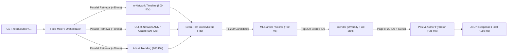
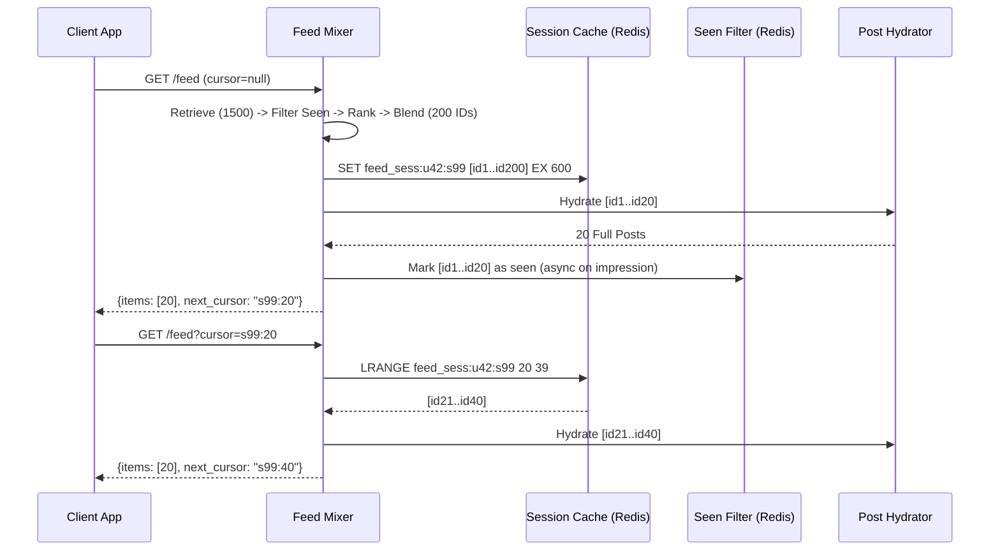
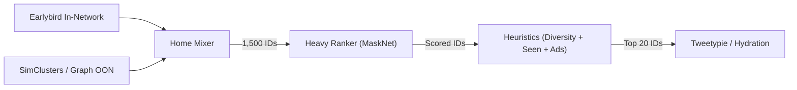

# Feed Generation: Candidates, Ranking, Blending & Cursors

> **Prerequisites:** [Lesson 03: Notification Systems](../03-notification-systems/README.md).  
> **Estimated Reading Time:** 24–28 minutes  
> **Target Audience:** Backend and ML-infra engineers designing Twitter/X, Instagram, LinkedIn, or TikTok home feeds, and candidates asked "Design a personalized news feed."  
> **Free PDF Notes:** [Download SD-Q-004.pdf](https://backendroadmap.com/notes/system-design/SD-Q-004.pdf)

> [!NOTE]
> **In one line:** Modern feed generation is a **multi-stage funnel** — **Candidate Retrieval** (10,000s $\to$ 1,000s), **Scoring & Ranking** (1,000s $\to$ 100s), **Blending & Deduplication** (diversity, ads, seen-post filtering), and **Hydration** (top 20) — paginated via **opaque cursor tokens** rather than `OFFSET` so new posts never cause duplicates or skipped items.

> [!TIP]
> **The Golden Rule:** **Rank IDs first, hydrate objects last.** Never fetch full post payloads, media URLs, and author profiles for 2,000 candidates when the user will only scroll through the top 20.

---

## 1. What Feed Generation Is, and What It Isn't

When Alice opens LinkedIn or X, her feed is no longer a simple `SELECT * FROM posts ORDER BY created_at DESC LIMIT 20`. It combines posts from people she follows (**in-network**), recommended viral posts (**out-of-network**), sponsored posts (**ads**), and "People You May Know" cards — all scored in under **200 ms**, without repeating posts she saw 5 minutes ago.

| Term | Precise Meaning | Example |
| :--- | :--- | :--- |
| **Candidate Generation** | Fast, coarse retrieval from multiple sources (follow graph, vector/ANN, trending) | 1,500 candidate `post_id`s |
| **Feature Hydration** | Fetching author/post/user engagement features for scoring | Author affinity, post CTR, age |
| **Ranking / Scoring** | Lightweight heuristic or ML model predicting $P(\text{like}), P(\text{comment}), P(\text{dwell})$ | Score $= w_1 P(\text{click}) + w_2 P(\text{reply})$ |
| **Blending & Diversity** | Re-ordering to enforce rules (max 2 posts/author, inject 1 ad every 5 items) | Business rules + diversity |
| **Post Hydration** | Fetching full text, media CDN URLs, like counts for the final page | Top 20 `post_id`s only |
| **Cursor Pagination** | Stateless or server-cached token encoding `(last_score, last_id)` or `session_id + idx` | `?cursor=eyJzIjowLjg0LCJpZCI6OTF9` |
| **Not** | `SQL OFFSET/LIMIT` on a live, mutating timeline | `OFFSET 20` shifts when new posts arrive |

### Why It Matters
1. **Latency budget is tight (150–250 ms p99)**: running a heavy ML model over 100,000 posts inline is impossible; you need a funnel.
2. **Seen-post filtering & cursor stability** are where ranked feeds break in production (users hate seeing the same post twice on scroll).
3. Separating **retrieval, ranking, blending, and hydration** lets ML teams iterate on models without rewriting storage or APIs.

---

## 2. Anatomy: The 4-Stage Feed Funnel



Walkthrough of a single request:
1. **Parallel Candidate Retrieval (30 ms):** Query 3–4 independent sources concurrently with strict timeouts. If Out-of-Network ANN times out at 40 ms, degrade gracefully and serve In-Network only.
2. **Pre-Rank Filtering (5 ms):** Remove blocked/muted authors, NSFW policy violations, and `post_id`s already in the user's **Seen Filter** (e.g., Redis Bloom filter or 7-day `ZSET`).
3. **Scoring & Ranking (60 ms):** Fetch compact feature vectors for the ~1,200 remaining candidates and score them in a batched inference call (ONNX/TensorRT/Triton).
4. **Blending & Page Caching (10 ms):** Enforce diversity (e.g., no more than 2 consecutive posts from the same author), insert ad slots at positions 4 and 12, store the ranked list of 200 IDs in a short-lived **Feed Session Cache** (`TTL = 10 min`), and return the top 20.
5. **Hydration (25 ms):** Batch-fetch full post bodies, media metadata, and author profiles from Redis/DB **only for the 20 returned IDs**.

| Pagination Approach | Pros | Cons | Best Used For |
| :--- | :--- | :--- | :--- |
| **`OFFSET / LIMIT`** | Simple SQL | Shifts on inserts; $O(N)$ scan | Admin tables only — **never feeds** |
| **Keyset (`created_at, id`)** | $O(\log N)$, zero drift | Chronological feeds only | Reverse-chronological timelines |
| **Ranked Session Cursor** | Stable ranked pages, fast `scroll` | Needs 5–10m Redis session cache | ML-ranked feeds (X, LinkedIn, IG) |

> [!WARNING]
> **Never use keyset `(score, id)` against a live re-scoring model for page 2.** Because time-decay lowers every post's score between page 1 and page 2, re-ranking on every scroll shifts items across page boundaries, causing duplicates and missing posts. Cache the ranked `post_id` list (e.g., top 200 IDs) in Redis keyed by `feed_session_id` and paginate with an index cursor!

---

## 3. Mathematical Model: Funnel Reduction, Latency Budget & Time-Decay Scoring

**1. Hydration Bandwidth Savings.** Suppose a candidate pool has $C = 1{,}500$ posts, each full post payload is $4\text{ KB}$, and a page size is $P = 20$ posts:
- **Hydrate before rank:** $1{,}500 \times 4\text{ KB} = 6\text{ MB}$ transferred & deserialized per feed load. At $50{,}000\text{ QPS}$, that's **$300\text{ GB/s}$** of internal network traffic!
- **Rank IDs (8 bytes each) then hydrate top 20:**
  - Ranking transfer: $1{,}500 \times 8\text{ B} = 12\text{ KB}$
  - Hydration transfer: $20 \times 4\text{ KB} = 80\text{ KB}$
  - Total: **$92\text{ KB}$ per request** — a **$65\times$ reduction** in internal bandwidth!

**2. Heuristic / First-Pass Ranking Formula (Gravity Time-Decay).** Before or alongside neural rankers, feeds use a time-decayed engagement score:

$$\text{Score}(p, u) = \frac{\text{Affinity}(u, \text{author}_p) \times (1 + w_L L + w_C C + w_S S)}{(t_{\text{now}} - t_p + 2)^\gamma}$$

Where $L, C, S$ are likes, comments, and shares; $w_C > w_L$ (comments weight higher than likes); and $\gamma \approx 1.5\text{–}1.8$ is the gravity decay exponent.

**3. Parallel Latency Budget.** Total latency is the **critical path** (max of parallel branches + sequential stages), not the sum of all retrievers:

$$T_{\text{total}} = \max(T_{\text{in-net}}, T_{\text{out-net}}, T_{\text{ads}}) + T_{\text{filter}} + T_{\text{rank}} + T_{\text{blend}} + T_{\text{hydrate}}$$

With $\max(30, 35, 20) + 5 + 60 + 10 + 25 = 165\text{ ms}$.

---

## 4. Metrics & Percentiles

| Metric | Meaning | Alert when |
| :--- | :--- | :--- |
| **Feed API $p_{99}$ Latency** | End-to-end `GET /feed` response time | $> 300\text{ ms}$ |
| **Candidate Recall Count** | Candidates returned per source before rank | Drops $< 50$ (empty feed risk) |
| **Fallback / Degradation Rate** | `%` of requests where ML ranker or ANN timed out | $> 1\%$ |
| **Seen-Post Duplicate Rate** | `%` of impressions already seen by user in 24h | $> 0.5\%$ |
| **Hydration Cache Hit Rate** | `%` of top-20 posts served from Redis vs DB | $< 90\%$ |
| **Scroll Depth / Engagement CTR** | Avg pages scrolled & meaningful interactions | Drops $> 5\%$ (ranking regression) |

### Worked Example (Graceful Degradation Under Load)
Suppose at peak traffic ($80{,}000\text{ QPS}$), the GPU ML Ranker cluster saturates and its $p_{99}$ spikes from $60\text{ ms}$ to $400\text{ ms}$.
- **Without timeout/fallback:** Feed Mixer threads block for 400 ms; connection pools exhaust; site goes down.
- **With 80 ms hedged timeout + fallback:** At 80 ms, the Mixer cancels the ML Ranker call and falls back to the **heuristic time-decay score** (computed in $< 2\text{ ms}$ on CPU) over the In-Network candidates. Users still get a fast, relevant feed in $< 150\text{ ms}$ while GPU pods autoscale.

---

## 5. Compounding & Failure Modes

| Failure Mode | Symptom | Mitigation |
| :--- | :--- | :--- |
| **Filter-After-Rank Exhaustion** | User follows 500 people, already saw all 200 cached posts $\to$ empty feed | Over-fetch candidates ($3\times\text{–}5\times$) and filter seen posts *before* final truncation |
| **Echo Chamber / Same-Author Flood** | One prolific news account takes 12 of the top 20 slots | Blending rule: author-diversity penalty ($0.5\times$ per repeat) or hard cap ($\le 2$ per page) |
| **Cold Start (New User)** | User follows 0 accounts $\to$ empty In-Network candidates | Fallback candidate source: geo-trending + onboarding topic picks |
| **Cold Cache Hydration Stampede** | Viral post expires from Redis; 50k feeds hit DB simultaneously | Singleflight coalescing + jittered TTL + local in-process LRU for hot posts |
| **Stale Cursor Session** | User scrolls 4 hours later; `feed_session_id` expired in Redis | If cursor session expired, seamlessly start a fresh ranked session (filtered by Seen Bloom Filter) |

---

## 6. Numbers Every Engineer Must Know

| Item | Typical | Implication |
| :--- | :---: | :--- |
| **Candidate funnel ratio** | $10{,}000 \to 1{,}500 \to 200 \to 20$ | Never run heavy ML on $> 2{,}000$ items inline |
| **Feed E2E latency SLO** | $150\text{–}250\text{ ms}$ ($p_{99}$) | Each stage gets a strict $20\text{–}60\text{ ms}$ timeout |
| **Seen-post Bloom filter size** | $\sim 1\text{–}2\text{ KB}$ per user (1,000–2,000 IDs at 1% FP) | 100M active users $\approx 100\text{–}200\text{ GB}$ RAM |
| **Ranked session cache TTL** | $5\text{–}15\text{ minutes}$ | Keeps page 2–10 consistent without stale news |
| **Ad load ratio** | 1 ad per 5–8 organic posts | Injected during Blending, not Ranking |
| **Hydration batch size** | 20–25 `post_id`s per page | Single Redis `MGET` ($< 2\text{ ms}$) |

---

## 7. Protocol Deep Dive: Ranked Cursor Pagination & Seen-Post Filtering



| Question | Answer |
| :--- | :--- |
| **Why mark posts as seen on *client impression* rather than *API fetch*?** | If you mark all 20 fetched posts as seen immediately, but the user closes the app after viewing only 3 posts, posts 4–20 vanish forever! Emit lightweight impression beacons as posts enter the viewport. |
| **What if the user pulls-to-refresh?** | Passing `cursor=null` (or `refresh=true`) bypasses the cached `feed_session_id`, runs a fresh candidate + rank pass, and filters out already-seen IDs. |
| **How do you sign/protect cursors?** | Encode `{session_id, offset}` as Base64 + HMAC (or opaque UUID) so clients cannot forge offsets or inspect internal scores. |

**When NOT to use a multi-stage ML funnel:**
- Chronological audit logs, inbox threads, or small communities ($< 100$ posts/day): simple keyset pagination (`WHERE (created_at, id) < (?, ?) ORDER BY created_at DESC LIMIT 20`) is cheaper, deterministic, and easier to debug.

---

## 8. Hierarchical Budgets & Design Rules

| Slice | Rule | Control |
| :--- | :--- | :--- |
| **Candidate Sources** | Query all sources in parallel with hard timeouts (35 ms) | Degrade gracefully if OON/ANN fails |
| **Seen Filtering** | Filter before ranking/truncation; mark seen on impression | Rolling 7-day Bloom filter or Redis `ZSET` |
| **Ranking Budget** | Cap ML inference batch at $\le 1{,}500$ candidates | Fallback to CPU time-decay on GPU timeout |
| **Blending** | Apply author-diversity cap & ad slots post-ranking | Deterministic rules engine |
| **Pagination** | Cache ranked `post_id` list per session (TTL 10m) | Opaque cursor `{session_id, offset}` |
| **Hydration** | Hydrate only the final 20 IDs via batched `MGET` | Singleflight + hot-post local LRU |
| **Cold Start** | Always have a non-empty fallback candidate source | Geo-trending + topic picks |

---

## 9. Top Mitigations

1. **Rank IDs first, hydrate last** to cut internal network bandwidth by $50\times\text{–}65\times$.
2. **Enforce strict per-stage timeouts with fallbacks** so an ML Ranker slowdown degrades quality slightly instead of failing `GET /feed`.
3. **Use a Ranked Session Cache (`TTL = 10m`) + opaque cursor** so scrolling to page 2 never duplicates or skips items due to score drift.
4. **Apply author-diversity decay during Blending** (e.g., multiply score by $0.6^k$ for a user's $k$-th post in the feed) so one prolific poster doesn't dominate.
5. **Track seen posts via client impression beacons** rather than API-fetch time so unread posts aren't prematurely hidden.
6. **Pre-warm hot/celebrity post hydration in a local LRU cache** to prevent Redis hot-key saturation.

---

## 10. Production Reference: X (Twitter) Open-Sourced Home Mixer

X's open-sourced *Home Mixer* architecture exemplifies this exact 4-stage pipeline:
- **Candidate Sources:** *In-Network* (`Earlybird` / Thunder) + *Out-of-Network* (`UTEG` graph traversal + `SimClusters` embedding ANN), pulling ~1,500 candidates in parallel.
- **Heavy Ranker:** A MaskNet neural network predicting probabilities for 10 engagement actions (like, reply, retweet, video watch, report, negative feedback) combined into a weighted score.
- **Heuristics & Blending:** Filters out previously seen tweets, enforces author diversity, balances in-network vs out-of-network ratio, and interleaves ads.
- **Hydration & Serving:** Hydrates the final page of tweet objects and media only after blending.



---

## 11. Multi-Language Production Code Tabs

A **Feed Funnel Engine** demonstrating candidate merging, seen-post filtering, gravity time-decay scoring, author-diversity blending, and cursor pagination.

````carousel
```go
// Go: Multi-stage feed funnel (dedup, seen-filter, time-decay rank, diversity blend, cursor).
package main

import (
	"fmt"
	"math"
	"sort"
)

type Candidate struct {
	PostID     string
	AuthorID   string
	Affinity   float64
	Likes      int
	Comments   int
	AgeHours   float64
	Score      float64
}

func GenerateFeed(
	candidates []Candidate,
	seen map[string]bool,
	maxPerAuthor int,
	offset int,
	limit int,
) ([]Candidate, int) {
	// 1. Deduplicate & filter already-seen posts
	unique := make(map[string]Candidate)
	for _, c := range candidates {
		if seen[c.PostID] {
			continue
		}
		if _, exists := unique[c.PostID]; !exists {
			// 2. Time-decay gravity score (comments weighted 3x likes)
			eng := 1.0 + float64(c.Likes)*1.0 + float64(c.Comments)*3.0
			c.Score = (c.Affinity * eng) / math.Pow(c.AgeHours+2.0, 1.6)
			unique[c.PostID] = c
		}
	}

	scored := make([]Candidate, 0, len(unique))
	for _, c := range unique {
		scored = append(scored, c)
	}
	sort.Slice(scored, func(i, j int) bool { return scored[i].Score > scored[j].Score })

	// 3. Blending: enforce maxPerAuthor diversity cap
	authorCounts := make(map[string]int)
	blended := make([]Candidate, 0, len(scored))
	for _, c := range scored {
		if authorCounts[c.AuthorID] >= maxPerAuthor {
			continue
		}
		authorCounts[c.AuthorID]++
		blended = append(blended, c)
	}

	// 4. Cursor slice
	if offset >= len(blended) {
		return nil, -1
	}
	end := offset + limit
	if end > len(blended) {
		end = len(blended)
	}
	nextOffset := end
	if nextOffset >= len(blended) {
		nextOffset = -1
	}
	return blended[offset:end], nextOffset
}

func main() {
	cands := []Candidate{
		{PostID: "p1", AuthorID: "a1", Affinity: 2.0, Likes: 50, Comments: 10, AgeHours: 1},
		{PostID: "p2", AuthorID: "a1", Affinity: 2.0, Likes: 40, Comments: 5, AgeHours: 1},
		{PostID: "p3", AuthorID: "a1", Affinity: 2.0, Likes: 30, Comments: 2, AgeHours: 1},
		{PostID: "p4", AuthorID: "a2", Affinity: 1.5, Likes: 20, Comments: 8, AgeHours: 2},
	}
	page, next := GenerateFeed(cands, map[string]bool{}, 2, 0, 3)
	fmt.Printf("Page size=%d, nextCursorOffset=%d\n", len(page), next)
}
```
<!-- slide -->
```typescript
// TypeScript: Feed funnel with seen filtering, time-decay scoring, diversity blending, and cursor.
export interface Candidate {
  postId: string;
  authorId: string;
  affinity: number;
  likes: number;
  comments: number;
  ageHours: number;
  score?: number;
}

export function generateFeed(
  candidates: Candidate[],
  seenIds: Set<string>,
  maxPerAuthor = 2,
  offset = 0,
  limit = 20
): { items: Candidate[]; nextCursor: number | null } {
  const unique = new Map<string, Candidate>();
  for (const c of candidates) {
    if (seenIds.has(c.postId) || unique.has(c.postId)) continue;
    const engagement = 1 + c.likes + c.comments * 3;
    const score = (c.affinity * engagement) / Math.pow(c.ageHours + 2, 1.6);
    unique.set(c.postId, { ...c, score });
  }

  const ranked = [...unique.values()].sort((a, b) => (b.score ?? 0) - (a.score ?? 0));

  const authorCount = new Map<string, number>();
  const blended: Candidate[] = [];
  for (const c of ranked) {
    const cnt = authorCount.get(c.authorId) ?? 0;
    if (cnt >= maxPerAuthor) continue;
    authorCount.set(c.authorId, cnt + 1);
    blended.push(c);
  }

  const items = blended.slice(offset, offset + limit);
  const nextCursor = offset + items.length < blended.length ? offset + items.length : null;
  return { items, nextCursor };
}
```
<!-- slide -->
```python
# Python: Multi-stage feed funnel + hydration bandwidth savings calculator (stdlib only).
from collections import defaultdict
from dataclasses import dataclass


@dataclass
class Candidate:
    post_id: str
    author_id: str
    affinity: float
    likes: int
    comments: int
    age_hours: float


def rank_and_blend(
    candidates: list[Candidate],
    seen_ids: set[str],
    max_per_author: int = 2,
    offset: int = 0,
    limit: int = 20,
) -> dict:
    unique: dict[str, tuple[float, Candidate]] = {}
    for c in candidates:
        if c.post_id in seen_ids or c.post_id in unique:
            continue
        engagement = 1.0 + c.likes + 3.0 * c.comments
        score = (c.affinity * engagement) / ((c.age_hours + 2.0) ** 1.6)
        unique[c.post_id] = (score, c)

    ranked = sorted(unique.values(), key=lambda x: x[0], reverse=True)

    author_counts: dict[str, int] = defaultdict(int)
    blended: list[tuple[float, Candidate]] = []
    for score, c in ranked:
        if author_counts[c.author_id] >= max_per_author:
            continue
        author_counts[c.author_id] += 1
        blended.append((score, c))

    page = blended[offset : offset + limit]
    next_cursor = offset + len(page) if offset + len(page) < len(blended) else None
    return {
        "items": [{"post_id": c.post_id, "score": round(s, 3)} for s, c in page],
        "next_cursor": next_cursor,
    }


def bandwidth_savings(candidates: int = 1500, page_size: int = 20, payload_kb: int = 4) -> dict:
    naive_kb = candidates * payload_kb
    funnel_kb = (candidates * 8) / 1024 + page_size * payload_kb
    return {"naive_kb": naive_kb, "funnel_kb": round(funnel_kb, 1), "ratio": round(naive_kb / funnel_kb, 1)}
```
<!-- slide -->
```csharp
// C#: Feed funnel with seen filtering, gravity scoring, author diversity cap, and cursor paging.
public sealed record Candidate(
    string PostId, string AuthorId, double Affinity, int Likes, int Comments, double AgeHours);

public static class FeedGenerator
{
    public static (List<Candidate> Items, int? NextCursor) Generate(
        IEnumerable<Candidate> candidates,
        HashSet<string> seenIds,
        int maxPerAuthor = 2,
        int offset = 0,
        int limit = 20)
    {
        var scored = candidates
            .Where(c => !seenIds.Contains(c.PostId))
            .DistinctBy(c => c.PostId)
            .Select(c =>
            {
                double eng = 1.0 + c.Likes + c.Comments * 3.0;
                double score = (c.Affinity * eng) / Math.Pow(c.AgeHours + 2.0, 1.6);
                return (Candidate: c, Score: score);
            })
            .OrderByDescending(x => x.Score);

        var authorCounts = new Dictionary<string, int>();
        var blended = new List<Candidate>();
        foreach (var (c, _) in scored)
        {
            authorCounts.TryGetValue(c.AuthorId, out int count);
            if (count >= maxPerAuthor) continue;
            authorCounts[c.AuthorId] = count + 1;
            blended.Add(c);
        }

        var page = blended.Skip(offset).Take(limit).ToList();
        int? nextCursor = offset + page.Count < blended.Count ? offset + page.Count : null;
        return (page, nextCursor);
    }
}
```
````

---

## 12. Hands-On CLI Verification Workflows

Test ranked session cursor storage in Redis and verify hydration bandwidth savings:

```bash
# 1. Simulate caching a ranked 200-ID feed session in Redis (TTL 600s)
redis-cli RPUSH feed_sess:u42:s99 p101 p205 p309 p412 p555 p678
redis-cli EXPIRE feed_sess:u42:s99 600

# 2. Fetch page 1 (0..2) and page 2 (3..5) cleanly with zero score-drift duplicates
redis-cli LRANGE feed_sess:u42:s99 0 2
redis-cli LRANGE feed_sess:u42:s99 3 5

# 3. Verify Rank-First-Hydrate-Last bandwidth savings
python -c "naive=1500*4; opt=(1500*8)/1024 + 20*4; print(f'Naive: {naive} KB vs Funnel: {opt:.1f} KB ({naive/opt:.1f}x)')"
```

---

## 13. Common Mistakes to Avoid

1. **Using `SQL OFFSET / LIMIT` for feed pagination**, causing duplicate or skipped posts whenever new items arrive.
2. **Hydrating full post payloads before ranking**, wasting $50\times\text{–}65\times$ internal network bandwidth.
3. **Re-ranking the live candidate pool on page 2**, causing time-decay score drift across pages.
4. **Marking all 20 fetched posts as seen immediately** instead of on client viewport impression.
5. **Omitting author-diversity rules**, allowing one prolific account to monopolize the entire screen.
6. **Running without per-source timeouts/fallbacks**, letting an Out-of-Network ANN hiccup crash the whole feed.
7. **Forgetting cold-start fallbacks** for new users who follow zero accounts.

---

## 14. Key Terms Glossary

| Key Term | Definition |
| :--- | :--- |
| **Candidate Generation** | Fast coarse retrieval pulling ~1,000–2,000 `post_id`s from multiple sources. |
| **In-Network / Out-of-Network** | Posts from followed accounts vs recommended posts from the wider platform. |
| **Heavy Ranker** | ML model scoring candidates on predicted engagement probabilities ($P(\text{like}), P(\text{reply})$). |
| **Blending** | Post-ranking stage applying diversity rules, frequency caps, and ad-slot insertion. |
| **Hydration** | Batch-fetching full post text, media URLs, and author metadata for the final page only. |
| **Seen Filter** | Per-user Bloom filter or Redis `ZSET` tracking recently viewed `post_id`s. |
| **Ranked Session Cache** | Short-lived Redis list holding top $N$ ranked `post_id`s for stable cursor paging. |
| **Opaque Cursor** | Encoded pagination token (`session_id:offset` or keyset) preventing client tampering. |
| **Gravity Time-Decay** | Formula dividing engagement score by $(\text{age} + 2)^\gamma$ so fresh posts surface. |
| **Cold Start** | Serving relevant feeds to new users with empty follow graphs via trending/topic fallbacks. |

---

## 15. System Design Interview Questions & Answers

### Basic Conceptual Questions

<details>
<summary><strong>Q1: Why is feed generation split into Candidate Retrieval, Ranking, Blending, and Hydration? [BASIC]</strong></summary>

**Answer:**
Running a complex ML model and fetching full 4 KB post payloads for 100,000 posts in $< 200\text{ ms}$ is impossible. Splitting into a funnel narrows $10{,}000 \to 1{,}500$ cheap IDs, scores them in one batch, applies business/diversity rules, and hydrates only the final 20 posts.
</details>

<details>
<summary><strong>Q2: Why shouldn't you use `OFFSET` / `LIMIT` for feed pagination? [BASIC]</strong></summary>

**Answer:**
In a live feed, new posts are constantly inserted at the top (or scores decay). `OFFSET 20` on page 2 shifts by $K$ items if $K$ new posts arrived while the user read page 1, causing the user to see duplicate posts from page 1. Use keyset cursors for chronological feeds or a Ranked Session Cache for ML feeds.
</details>

<details>
<summary><strong>Q3: What happens during Blending that doesn't happen in Ranking? [BASIC]</strong></summary>

**Answer:**
Ranking scores each post independently for relevance. Blending looks at the **list as a whole**: it enforces author diversity (e.g., max 2 posts per author per page), balances In-Network vs Out-of-Network ratios, and injects ads or "Suggested Users" cards at fixed slots.
</details>

<details>
<summary><strong>Q4: Why do we hydrate posts last instead of right after Candidate Generation? [BASIC]</strong></summary>

**Answer:**
Hydrating 1,500 candidates at 4 KB each transfers 6 MB per request ($300\text{ GB/s}$ at 50k QPS). Passing 8-byte `post_id`s through ranking and hydrating only the final 20 posts transfers $\sim 92\text{ KB}$ — a $65\times$ bandwidth reduction.
</details>

### Scenario-Based Architecture Questions

<details>
<summary><strong>Q5: Your ML Ranker GPU cluster slows down from 50 ms to 500 ms during a traffic spike. How do you keep `GET /feed` under 200 ms? [SCENARIO]</strong></summary>

**Answer:**
Put a strict 75 ms timeout on the ML Ranker call. If it times out, the Feed Mixer degrades gracefully to a fast CPU heuristic score (time-decayed affinity + engagement) over the In-Network candidates, keeping latency under 150 ms.
</details>

<details>
<summary><strong>Q6: Users complain that when they scroll to page 2 of their ranked feed, they see posts from page 1 again. Why, and how do you fix it? [SCENARIO]</strong></summary>

**Answer:**
Because time-decay or live engagement updates changed scores between the page 1 and page 2 requests, shifting items across the boundary. Fix this by caching the top 200 ranked `post_id`s in Redis (`feed_sess:<uid>:<sid>`, TTL 10 min) on page 1 and serving page 2+ as slices from that frozen session list.
</details>

<details>
<summary><strong>Q7: A user follows 500 accounts, but has already seen all 200 recent posts. How do you prevent an empty feed? [SCENARIO]</strong></summary>

**Answer:**
Over-fetch candidates ($3\times\text{–}5\times$) and apply the Seen Filter *before* truncating, and always include an **Out-of-Network / Trending** candidate source in parallel so the feed gracefully backfills with high-quality recommendations when In-Network is exhausted.
</details>

<details>
<summary><strong>Q8: How do you track "seen posts" for 100M daily active users without blowing up database writes? [SCENARIO]</strong></summary>

**Answer:**
Clients batch lightweight impression beacons (e.g., every 10s or on scroll pause) rather than firing per-post HTTP calls. The backend stores a rolling 7-day per-user **Bloom filter** or capped Redis `ZSET` (last 2,000 seen `post_id`s), consuming $\sim 1\text{–}2\text{ KB}$ per user in Redis.
</details>

### Advanced & Tricky Interview Questions

<details>
<summary><strong>Q9: Why mark posts as "seen" on client impression rather than when `GET /feed` returns them? [TRICKY]</strong></summary>

**Answer:**
A page returns 20 posts, but a user often reads 3 and closes the app. If all 20 were marked seen on API return, posts 4–20 would be permanently suppressed without ever being viewed. Client-side viewport impression beacons ensure only actually viewed posts are filtered out.
</details>

<details>
<summary><strong>Q10: How do you prevent a viral celebrity post from causing a Redis hot-key outage during Hydration? [TRICKY]</strong></summary>

**Answer:**
Use **singleflight request coalescing** on hydrator pods + a short-lived **in-process local LRU cache** (e.g., 5–10s TTL) for hot `post_id`s. That way 50,000 concurrent feed loads read the viral post from local pod RAM instead of hammering one Redis shard.
</details>

<details>
<summary><strong>Q11: How do you balance In-Network (followed) vs Out-of-Network (recommended) posts when their raw ML scores aren't directly comparable? [TRICKY]</strong></summary>

**Answer:**
Normalize/calibrate scores per source or use **slot-based / ratio blending** (e.g., reserve 70% of slots for In-Network and 30% for Out-of-Network), or train a single unified Heavy Ranker with `is_in_network` as a feature calibrated on the same engagement objective.
</details>

<details>
<summary><strong>Q12: What happens if the user's Ranked Session Cache expires while they are idle for 20 minutes and then scroll? [TRICKY]</strong></summary>

**Answer:**
If `LRANGE` returns empty (TTL expired), the Feed Mixer transparently treats it as a fresh feed generation pass (fetching new candidates, filtering by the Seen Bloom Filter so they don't repeat what they already scrolled, and creating a new `feed_session_id`), returning seamless results.
</details>

---

## 16. One-Page Master Cheat Sheet

```
+---------------------------------------------------------------------------------------------------------+
|                    FEED GENERATION (CANDIDATES, RANKING, BLENDING, CURSORS) — CHEAT SHEET               |
+---------------------------------------------------------------------------------------------------------+
| 1. 4-STAGE FUNNEL: Candidates (1,500) -> Seen Filter -> ML Rank (200) -> Blend (20) -> Hydrate (20).    |
+---------------------------------------------------------------------------------------------------------+
| 2. GOLDEN RULE: Rank IDs first, hydrate full payloads last (cuts internal bandwidth ~65x).              |
+---------------------------------------------------------------------------------------------------------+
| 3. LATENCY BUDGET: Parallel retrieval (35 ms) + Filter (5 ms) + Rank (60 ms) + Blend/Hydrate (35 ms).   |
+---------------------------------------------------------------------------------------------------------+
| 4. PAGINATION: Never SQL OFFSET. Use keyset (chronological) or Ranked Session Cache + opaque cursor.    |
+---------------------------------------------------------------------------------------------------------+
| 5. SEEN FILTER: Rolling 7-day Bloom filter / ZSET updated via client viewport impression beacons.       |
+---------------------------------------------------------------------------------------------------------+
| 6. RESILIENCE: Hard timeouts + CPU time-decay fallback if GPU ranker stalls; local LRU for hot posts.   |
+---------------------------------------------------------------------------------------------------------+
```

---

## Further Reading & Sources

- X (Twitter) Engineering, [Twitter's Recommendation Algorithm (Home Mixer)](https://blog.x.com/engineering/en_us/topics/open-source/2023/twitter-recommendation-algorithm).
- Instagram Engineering, *Powered by AI: Instagram's Explore & Feed Recommender System*.
- Eugene Yan, [System Design for Recommendations and Search](https://eugeneyan.com/writing/system-design-for-discovery/) (Retrieval, Ranking, Re-ranking).

---

## Free PDF Notes

[SD-Q-004.pdf](https://backendroadmap.com/notes/system-design/SD-Q-004.pdf)

---

## Next

Continue with [Lesson 05: Fan-Out on Write vs Read: Push, Pull & the Celebrity Problem](../05-fan-out-on-write-vs-read/README.md).
