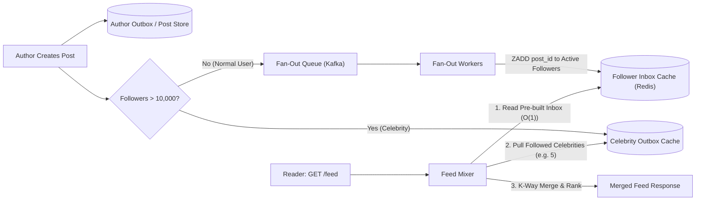
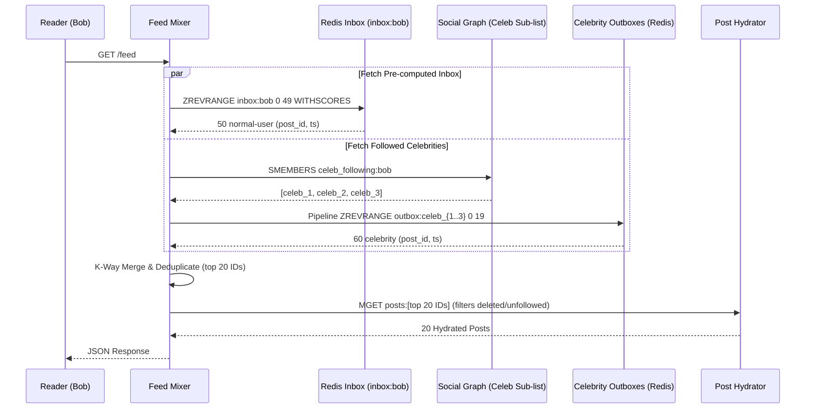
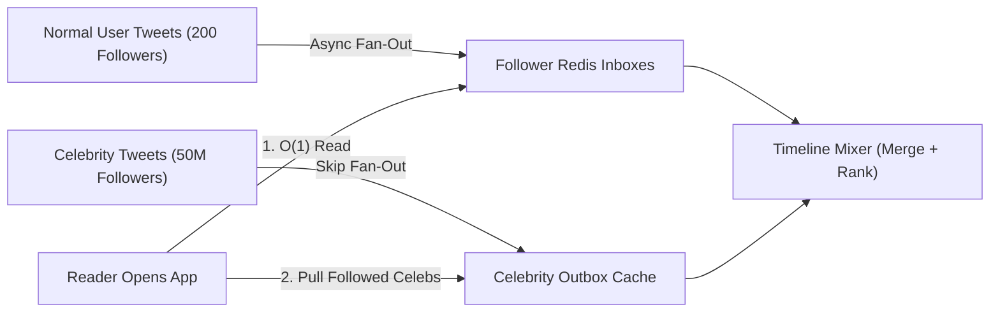

# Fan-Out on Write vs Read: Push, Pull & the Celebrity Problem

> **Prerequisites:** [Lesson 04: Feed Generation](../04-feed-generation/README.md).  
> **Estimated Reading Time:** 24–28 minutes  
> **Target Audience:** Backend engineers designing social timelines, activity feeds, or pub/sub distribution, and candidates asked "How do you solve the celebrity problem in Twitter/Instagram?"  
> **Free PDF Notes:** [Download SD-Q-005.pdf](https://backendroadmap.com/notes/system-design/SD-Q-005.pdf)

> [!NOTE]
> **In one line:** **Fan-out on write (Push)** pre-computes every follower's inbox at post time for $O(1)$ ultra-fast reads, while **Fan-out on read (Pull)** merges followed authors at query time; real systems use a **hybrid** that pushes normal users ($< 10\text{k}$ followers) and pulls celebrities ($> 10\text{k}$ followers) so one celebrity tweet doesn't trigger 50 million writes.

> [!TIP]
> **The Golden Rule:** Push for the **long tail** (99.9% of users have $< 1\text{k}$ followers); pull for the **heavy head** (celebrities with millions of followers). Never pay $O(\text{followers})$ write amplification for inactive or massive accounts.

---

## 1. What Fan-Out on Write vs Read Is, and What It Isn't

When a normal user with 200 followers posts a photo, pushing that `post_id` into 200 Redis timeline lists takes $< 1\text{ ms}$ and makes their followers' feed loads instantaneous. When Cristiano Ronaldo (600M followers) or Taylor Swift (100M followers) posts, pushing to 100M timelines takes minutes, saturates Redis/Kafka, and wastes RAM on 70M dormant followers who won't even open the app today.

| Term | Precise Meaning | Example |
| :--- | :--- | :--- |
| **Fan-out on Write (Push)** | On `CreatePost`, async workers insert `(post_id, ts)` into every follower's pre-computed feed cache | Normal user $\to$ 200 Redis `ZADD`s |
| **Fan-out on Read (Pull)** | On `GetFeed`, query the user's followed authors' outboxes and $K$-way merge at read time | Merge top 20 from 500 followed users |
| **Hybrid Fan-out** | Push posts from normal users into follower caches; pull celebrity posts at read time and merge | Twitter/X, Instagram, Facebook |
| **Celebrity / Hot-Key Threshold** | Follower count cutoff $T_{\text{celeb}}$ (e.g., $10\text{k}\text{–}50\text{k}$) switching an author from Push to Pull | `if follower_count > 10_000: pull_only` |
| **Active-Only Push** | Optimization: only push to followers active in the last $D$ days (e.g., 7–14 days) | Skip dormant/churned accounts |
| **Not** | A binary choice where you must pick 100% Push or 100% Pull | Hybrid dominates every large social graph |

### Why It Matters
1. **The Celebrity Problem** is the single most famous power-law bottleneck in system design interviews.
2. Knowing the exact **read vs write QPS crossover math** lets you justify *why* and *where* to set the celebrity threshold.
3. Handling **unfollows, deletes, privacy changes, and inactive-user eviction** cleanly separates senior designs from textbook sketches.

---

## 2. Anatomy: Push, Pull, and the Hybrid Merge



How the **Hybrid** path works:
1. **Write Path:** Every post is always written to the author's durable **Outbox** (`author_posts:<author_id>`).
   - If `follower_count <= 10,000`: enqueue a fan-out job. Workers look up **active** followers and `ZADD` `(ts, post_id)` into each follower's Redis inbox (`inbox:<follower_id>`, capped at ~800 entries).
   - If `follower_count > 10,000`: **skip fan-out**. The post stays in the celebrity's cached outbox.
2. **Read Path:** When Bob opens his feed:
   - Fetch his pre-computed `inbox:bob` from Redis (contains all normal-user posts in $O(1)$).
   - Intersect Bob's following list with known celebrities (usually only 2–15 accounts) and fetch their recent outboxes via `MGET` / pipeline.
   - Perform a fast in-memory **$K$-way merge** (or pass into the ML Ranker from Lesson 04).

| Dimension | Fan-Out on Write (Push) | Fan-Out on Read (Pull) | Hybrid |
| :--- | :--- | :--- | :--- |
| **Read Latency** | $O(1)$ — 1 Redis read ($\sim 2\text{ ms}$) | $O(F_{\text{following}})$ — slow for heavy followers | $O(1 + C_{\text{celebs}})$ ($\sim 5\text{–}10\text{ ms}$) |
| **Write Amplification** | $O(F_{\text{followers}})$ — catastrophic for celebs | $O(1)$ — 1 DB write | Bounded by $T_{\text{celeb}}$ |
| **Wasted Work on Inactive Users** | High (unless filtered to active-only) | Zero | Low (active-only push + celeb pull) |
| **Unfollow / Delete Cleanup** | Hard (must purge from $F$ inboxes or filter on read) | Instant (author outbox updated once) | Easy for celebs; lazy-filter for normal |

> [!WARNING]
> **Beware the "Heavy Follower" on Pull!** Even in Hybrid mode, if a user follows **5,000 celebrities** (e.g., a journalist account), pulling 5,000 celebrity outboxes on every `GET /feed` will blow your latency budget. Cap followed-celebrity fan-in (e.g., sample top 50 by affinity or pre-merge celebrity buckets) and cache the merged result.

---

## 3. Mathematical Model: Write Amplification vs Read Amplification

Let:
- $U = 300{,}000{,}000$ total users, with $D = 100{,}000{,}000$ Daily Active Users (DAU).
- Average posts/sec: $\lambda_w = 5{,}000\text{ posts/sec}$.
- Average feed reads/sec: $\lambda_r = 250{,}000\text{ reads/sec}$ (50:1 read-to-write ratio).
- Median follower count $F_{\text{med}} = 150$, but a celebrity has $F_{\text{celeb}} = 50{,}000{,}000$.

**1. Pure Push Cost (with a single celebrity post):**
- Normal posts: $5{,}000 \times 150 = 750{,}000\text{ Redis writes/sec}$ (easily handled by ~15 Redis shards).
- 1 Celebrity post ($50\text{M}$ followers): **$50{,}000{,}000$ writes**! At $500{,}000\text{ writes/sec}$ capacity, that single tweet takes **$100\text{ seconds}$** to fan out, starving all normal users behind it in the queue.

**2. Pure Pull Cost (reading 300 followed accounts per feed load):**
- Every `GET /feed` fetches 300 author outboxes:

$$Q_{\text{pull}} = 250{,}000 \times 300 = 75{,}000{,}000\text{ outbox reads/sec}$$

That is **$100\times$ more read ops** than pure push writes!

**3. Hybrid Cost (Threshold $T_{\text{celeb}} = 10{,}000$, active-only push to $33\%$ DAU):**
- **Write side:** Max fan-out per post is $10{,}000 \times 0.33 = 3{,}300$ writes. Average is $150 \times 0.33 \approx 50$ writes $\implies 5{,}000 \times 50 = 250{,}000\text{ writes/sec}$ (3x cheaper than naive push, zero celebrity spikes!).
- **Read side:** Average user follows $\sim 5$ celebrities $\implies 250{,}000 \times (1\text{ inbox} + 5\text{ celebs}) = 1{,}500{,}000\text{ reads/sec}$ ($50\times$ cheaper than pure pull!).

**4. Inbox Memory Budget.** Storing 800 `(post_id, timestamp)` pairs per DAU in Redis (`16 bytes` payload + `~48 B` ZSET node $\approx 64\text{ B}$/entry):

$$M_{\text{inbox}} = 100{,}000{,}000 \times 800 \times 64\text{ B} \approx 5.12\text{ TB RAM}$$

Only caching inboxes for **30-day active users** (and capping at 400–800 IDs) keeps memory bounded instead of storing 300M dead accounts.

---

## 4. Metrics & Percentiles

| Metric | Meaning | Alert when |
| :--- | :--- | :--- |
| **Fan-Out Lag $p_{99}$** | Time from `CreatePost` to last active follower's inbox write | $> 5\text{ s}$ (queue saturation) |
| **Write Amplification Factor** | Ratio of inbox writes to `CreatePost` calls | $> 1{,}000\times$ (celeb threshold too high) |
| **Feed Read $p_{99}$** | Time to fetch inbox + merge celebrity outboxes | $> 40\text{ ms}$ |
| **Inbox Cache Hit Rate** | `%` of DAU with warm pre-computed Redis inbox | $< 95\%$ (rebuild-on-read spike) |
| **Deleted/Unfollowed Leak Rate** | `%` of read items belonging to deleted/unfollowed authors | $> 0.1\%$ |

### Worked Example (Choosing the Celebrity Threshold $T_{\text{celeb}}$)
Suppose your fan-out worker pool can sustain $500{,}000\text{ Redis ZADD/sec}$, and your SLO requires any normal post to finish fan-out within $2\text{ seconds}$:
- If an account has $50{,}000$ active followers, one post consumes $50{,}000 / 500{,}000 = 100\text{ ms}$ of the entire cluster. Two such posts/sec = 20% of cluster capacity.
- Setting $T_{\text{celeb}} = 10{,}000$ total followers ($\approx 3{,}300$ active followers) caps any single post's fan-out at **$6.6\text{ ms}$**, guaranteeing no single user can cause head-of-line blocking.

---

## 5. Compounding & Failure Modes

| Failure Mode | What Breaks | Mitigation |
| :--- | :--- | :--- |
| **Viral User Crosses Threshold Mid-Day** | Account grows from 9k to 500k followers during a viral event | Dynamically check `follower_count` (or fan-out rate) on publish; auto-promote to Pull |
| **Dormant User Wakes Up** | User returns after 6 months; their Redis inbox was evicted | On inbox cache miss, run a 1-time **Pull backfill** from followed authors and repopulate inbox |
| **Post Delete / Account Ban** | Deleted `post_id` remains in 10,000 follower inboxes | Don't fan-out deletes; filter `post.deleted == true` during Hydration (Lesson 04) |
| **Unfollow Ghosting** | Bob unfollows Alice, but Alice's old posts are still in Bob's inbox | Either `ZREM` Alice's recent IDs asynchronously on unfollow, or filter against Bob's `following_set` on read |
| **Fan-Out Queue Head-of-Line Blocking** | One 9,999-follower account slows down 50-follower accounts | Shard fan-out workers into `small_fanout` ($< 500$) and `medium_fanout` ($500\text{–}10\text{k}$) queues |

---

## 6. Numbers Every Engineer Must Know

| Item | Typical | Implication |
| :--- | :---: | :--- |
| **Celebrity threshold ($T_{\text{celeb}}$)** | $10{,}000\text{–}50{,}000$ followers | Covers $\sim 99.9\%$ of users via Push, $0.1\%$ via Pull |
| **Inbox ZSET cap per user** | $400\text{–}800$ `post_id`s | Trim with `ZREMRANGEBYRANK 0 -801` after `ZADD` |
| **Active-follower cutoff** | Last $7\text{–}30$ days active | Cuts fan-out writes and Redis RAM by $60\%\text{–}70\%$ |
| **Redis pipeline batch size** | $100\text{–}500$ `ZADD`s per shard call | Reduces network RTTs by $100\times$ during fan-out |
| **Average celebrities followed** | $3\text{–}15$ per user | Small enough to merge in $< 5\text{ ms}$ on read |
| **Social graph power-law** | Top $0.1\%$ users hold $> 50\%$ of edges | Why pure Push always fails at scale |

---

## 7. Protocol Deep Dive: Active-Only Push + Read-Time $K$-Way Merge



| Question | Answer |
| :--- | :--- |
| **How do you store `celeb_following:bob` separately?** | Maintain a small secondary set `celeb_following:<uid>` updated only when Bob follows/unfollows a user with `is_celebrity == true`. Read-time lookup is $O(1)$ without scanning all 500 followed accounts! |
| **What if Bob's `inbox:bob` is empty (cache miss or returning dormant user)?** | Trigger a synchronous **Pull fallback** across Bob's non-celeb following list (or top 100 by affinity), populate `inbox:bob` asynchronously, and return the merged result. |
| **How do you handle a user who becomes a celebrity *after* Bob followed them?** | Run a background migration job when an account crosses $T_{\text{celeb}}$: flip `is_celebrity = true` and backfill `celeb_following` for their followers. |

**When NOT to use Fan-Out on Write:**
- **Strictly private or complex ACL feeds** (e.g., enterprise permissions where a document's visibility changes per-group): pre-computing inboxes risks leaking revoked permissions. Use Pull + permission-checked search/index instead.
- **High-churn, low-read logs** (e.g., IoT telemetry): Push wastes massive write bandwidth if nobody is reading.

---

## 8. Hierarchical Budgets & Design Rules

| Slice | Rule | Control |
| :--- | :--- | :--- |
| **Thresholding** | Switch Push $\to$ Pull at $T_{\text{celeb}} \in [10\text{k}, 50\text{k}]$ | Dynamic check on `CreatePost` |
| **Active-Only Push** | Skip followers inactive $> 14\text{–}30$ days | Filter via `last_active_at` index; backfill on return |
| **Inbox Bounding** | Cap every Redis inbox `ZSET` at $\le 800$ items | `ZREMRANGEBYRANK key 0 -801` + `EXPIRE 30d` |
| **Worker Isolation** | Separate small vs medium fan-out queues | Prevents 9k-follower posts from delaying 50-follower posts |
| **Celebrity Fan-In Cap** | Bound read-time celebrity pulls (e.g., top 50 by affinity) | Protects `GET /feed` $p_{99}$ for heavy-follower accounts |
| **Delete / Unfollow** | Never fan-out deletes; filter at Hydration / read time | Keeps write path $O(1)$ for deletes |

---

## 9. Top Mitigations

1. **Adopt Hybrid Fan-out** ($T_{\text{celeb}} = 10\text{k}\text{–}50\text{k}$) to eliminate $O(50\text{M})$ celebrity write storms.
2. **Push only to recently active followers** (e.g., active in last 14 days), cutting Redis RAM and fan-out writes by $> 60\%$.
3. **Maintain a dedicated `celeb_following:<uid>` set** so the read path doesn't scan 1,000 normal friends to find 5 celebrities.
4. **Backfill on cache miss** when a dormant user returns after their 30-day inbox TTL expired.
5. **Batch Redis fan-out writes with pipelining** grouped by Redis hash-slot/shard to cut network round-trips by $100\times$.
6. **Filter deleted posts and unfollowed authors during Hydration**, avoiding expensive $O(F)$ inbox scrub jobs.

---

## 10. Production Reference: Twitter/X & Instagram Hybrid Timelines

Twitter's classic timeline architecture (documented by Raffi Krikorian and later updated in Home Mixer) is the canonical real-world reference for Hybrid Fan-out:
- **Early Pure-Push Era:** Twitter initially pushed *every* tweet into every follower's Redis inbox (`Timeline Service`). When celebrities with 30M+ followers tweeted, fan-out queues backed up for minutes — causing replies to arrive *before* the original tweet!
- **The Hybrid Fix:** Tweets from high-follower accounts bypass the fan-out daemon entirely. Instead, the `Timeline Mixer` pulls recent tweets from followed celebrities' user-timelines (`Earlybird` / outbox cache) at read time and merges them with the reader's pre-computed Redis inbox.
- **Instagram** uses the same hybrid split for its Home Feed, additionally filtering out inactive followers (> 30 days) during push fan-out to save storage and write IOPS.



---

## 11. Multi-Language Production Code Tabs

A **Hybrid Fan-Out Engine** implementing threshold routing (`Push` vs `Pull`), active-only follower filtering, bounded inbox trimming, and read-time $K$-way merge.

````carousel
```go
// Go: Hybrid Fan-Out engine (Push for normal users, Pull for celebrities + K-way merge).
package main

import (
	"fmt"
	"sort"
)

type PostRef struct {
	PostID    string
	AuthorID  string
	Timestamp int64
}

type HybridFeedService struct {
	celebThreshold int
	maxInboxSize   int
	followers      map[string][]string  // author -> active followers
	celebFollowing map[string][]string  // reader -> followed celebrities
	inboxes        map[string][]PostRef // reader -> pre-computed normal posts
	celebOutboxes  map[string][]PostRef // celeb -> recent posts
}

func NewHybridFeedService(celebThreshold, maxInbox int) *HybridFeedService {
	return &HybridFeedService{
		celebThreshold: celebThreshold,
		maxInboxSize:   maxInbox,
		followers:      make(map[string][]string),
		celebFollowing: make(map[string][]string),
		inboxes:        make(map[string][]PostRef),
		celebOutboxes:  make(map[string][]PostRef),
	}
}

func (s *HybridFeedService) PublishPost(post PostRef, totalFollowerCount int) string {
	if totalFollowerCount > s.celebThreshold {
		// Fan-out on Read (Pull): write once to celebrity outbox.
		s.celebOutboxes[post.AuthorID] = append([]PostRef{post}, s.celebOutboxes[post.AuthorID]...)
		return "PULL_OUTBOX"
	}
	// Fan-out on Write (Push): write to active followers' bounded inboxes.
	for _, fid := range s.followers[post.AuthorID] {
		inbox := append([]PostRef{post}, s.inboxes[fid]...)
		if len(inbox) > s.maxInboxSize {
			inbox = inbox[:s.maxInboxSize]
		}
		s.inboxes[fid] = inbox
	}
	return fmt.Sprintf("PUSHED_TO_%d", len(s.followers[post.AuthorID]))
}

func (s *HybridFeedService) GetFeed(readerID string, limit int) []PostRef {
	merged := append([]PostRef{}, s.inboxes[readerID]...)
	for _, cid := range s.celebFollowing[readerID] {
		merged = append(merged, s.celebOutboxes[cid]...)
	}
	sort.Slice(merged, func(i, j int) bool { return merged[i].Timestamp > merged[j].Timestamp })
	if len(merged) > limit {
		return merged[:limit]
	}
	return merged
}
```
<!-- slide -->
```typescript
// TypeScript: Hybrid Fan-Out (Push normal users to active followers, Pull celebrities on read).
interface PostRef {
  postId: string;
  authorId: string;
  timestamp: number;
}

export class HybridFeedEngine {
  private inboxes = new Map<string, PostRef[]>();
  private celebOutboxes = new Map<string, PostRef[]>();

  constructor(private readonly celebThreshold = 10_000, private readonly maxInbox = 800) {}

  publishPost(
    post: PostRef,
    totalFollowers: number,
    activeFollowers: string[]
  ): "PULL_OUTBOX" | "PUSH_INBOX" {
    if (totalFollowers > this.celebThreshold) {
      const box = this.celebOutboxes.get(post.authorId) ?? [];
      box.unshift(post);
      this.celebOutboxes.set(post.authorId, box.slice(0, this.maxInbox));
      return "PULL_OUTBOX";
    }

    for (const fid of activeFollowers) {
      const inbox = this.inboxes.get(fid) ?? [];
      inbox.unshift(post);
      if (inbox.length > this.maxInbox) inbox.length = this.maxInbox;
      this.inboxes.set(fid, inbox);
    }
    return "PUSH_INBOX";
  }

  getFeed(readerId: string, followedCelebs: string[], limit = 20): PostRef[] {
    const merged: PostRef[] = [...(this.inboxes.get(readerId) ?? [])];
    for (const cid of followedCelebs) {
      merged.push(...(this.celebOutboxes.get(cid) ?? []));
    }
    return merged.sort((a, b) => b.timestamp - a.timestamp).slice(0, limit);
  }
}
```
<!-- slide -->
```python
# Python: Hybrid Fan-Out engine + Push/Pull QPS cost simulator (stdlib only).
from collections import defaultdict
from dataclasses import dataclass
import heapq


@dataclass(order=False)
class PostRef:
    post_id: str
    author_id: str
    ts: int


class HybridFeed:
    def __init__(self, celeb_threshold: int = 10_000, max_inbox: int = 800) -> None:
        self.celeb_threshold = celeb_threshold
        self.max_inbox = max_inbox
        self.inboxes: dict[str, list[PostRef]] = defaultdict(list)
        self.celeb_outboxes: dict[str, list[PostRef]] = defaultdict(list)

    def publish(self, post: PostRef, follower_count: int, active_followers: list[str]) -> str:
        if follower_count > self.celeb_threshold:
            box = self.celeb_outboxes[post.author_id]
            box.insert(0, post)
            del box[self.max_inbox :]
            return "PULL_OUTBOX"
        for fid in active_followers:
            inbox = self.inboxes[fid]
            inbox.insert(0, post)
            del inbox[self.max_inbox :]
        return f"PUSH_{len(active_followers)}"

    def get_feed(self, reader_id: str, followed_celebs: list[str], limit: int = 20) -> list[PostRef]:
        # K-way merge using heapq.merge on pre-sorted descending lists
        sources = [self.inboxes[reader_id]] + [self.celeb_outboxes[c] for c in followed_celebs]
        merged = heapq.merge(*sources, key=lambda p: -p.ts)
        return [next(merged) for _ in range(limit) if merged]  # simplified; use itertools.islice


def compare_qps(posts_s: int = 5000, reads_s: int = 250_000, avg_followers: int = 150, avg_celebs: int = 5) -> dict:
    pure_push_writes = posts_s * avg_followers
    pure_pull_reads = reads_s * avg_followers
    hybrid_writes = int(posts_s * avg_followers * 0.33)  # active-only 33%
    hybrid_reads = reads_s * (1 + avg_celebs)
    return {
        "pure_push_writes_s": pure_push_writes,
        "pure_pull_reads_s": pure_pull_reads,
        "hybrid_writes_s": hybrid_writes,
        "hybrid_reads_s": hybrid_reads,
    }
```
<!-- slide -->
```csharp
// C#: Hybrid Fan-Out service with bounded Redis-style inboxes and celebrity pull merge.
public sealed record PostRef(string PostId, string AuthorId, long Timestamp);

public sealed class HybridFeedService
{
    private readonly int _celebThreshold;
    private readonly int _maxInbox;
    private readonly Dictionary<string, List<PostRef>> _inboxes = new();
    private readonly Dictionary<string, List<PostRef>> _celebOutboxes = new();

    public HybridFeedService(int celebThreshold = 10_000, int maxInbox = 800)
    {
        _celebThreshold = celebThreshold;
        _maxInbox = maxInbox;
    }

    public string Publish(PostRef post, int totalFollowers, IEnumerable<string> activeFollowers)
    {
        if (totalFollowers > _celebThreshold)
        {
            if (!_celebOutboxes.TryGetValue(post.AuthorId, out var box))
                _celebOutboxes[post.AuthorId] = box = new List<PostRef>();
            box.Insert(0, post);
            if (box.Count > _maxInbox) box.RemoveRange(_maxInbox, box.Count - _maxInbox);
            return "PULL_OUTBOX";
        }

        foreach (string fid in activeFollowers)
        {
            if (!_inboxes.TryGetValue(fid, out var inbox))
                _inboxes[fid] = inbox = new List<PostRef>();
            inbox.Insert(0, post);
            if (inbox.Count > _maxInbox) inbox.RemoveRange(_maxInbox, inbox.Count - _maxInbox);
        }
        return "PUSH_INBOX";
    }

    public List<PostRef> GetFeed(string readerId, IEnumerable<string> followedCelebs, int limit = 20)
    {
        var merged = new List<PostRef>();
        if (_inboxes.TryGetValue(readerId, out var inbox)) merged.AddRange(inbox);
        foreach (string cid in followedCelebs)
            if (_celebOutboxes.TryGetValue(cid, out var box)) merged.AddRange(box);

        return merged.OrderByDescending(p => p.Timestamp).Take(limit).ToList();
    }
}
```
````

---

## 12. Hands-On CLI Verification Workflows

Test bounded Redis ZSET inboxes, trimming, and Hybrid QPS math:

```bash
# 1. Simulate pushing a post to a follower's bounded Redis inbox (keep latest 800)
redis-cli ZADD inbox:bob 1732512001 "post_991"
redis-cli ZREMRANGEBYRANK inbox:bob 0 -801
redis-cli EXPIRE inbox:bob 2592000

# 2. Read top 20 from inbox + celebrity outbox
redis-cli ZREVRANGE inbox:bob 0 19 WITHSCORES
redis-cli ZREVRANGE outbox:celeb_1 0 19 WITHSCORES

# 3. Compare Pure Push vs Pure Pull vs Hybrid QPS in Python
python -c "p,r,f,c=5000,250000,150,5; print({'pure_push_w':p*f, 'pure_pull_r':r*f, 'hybrid_w':int(p*f*0.33), 'hybrid_r':r*(1+c)})"
```

---

## 13. Common Mistakes to Avoid

1. **Using pure Fan-Out on Write for all users**, causing 50M-write queues whenever a celebrity posts.
2. **Using pure Fan-Out on Read for all users**, causing $O(\text{following})$ scatter-gather reads on every `GET /feed`.
3. **Pushing to all followers including 2-year dormant accounts**, wasting 60%–70% of fan-out writes and Redis RAM.
4. **Never trimming follower inbox ZSETs**, letting Redis memory grow unboundedly.
5. **Scanning all 500 followed users on read just to find 5 celebrities**, instead of maintaining a dedicated `celeb_following:<uid>` set.
6. **Fanning out deletes across 50,000 inboxes**, instead of filtering deleted posts lazily during Hydration.
7. **Forgetting a backfill path** when a dormant user's Redis inbox expires and they return to the app.

---

## 14. Key Terms Glossary

| Key Term | Definition |
| :--- | :--- |
| **Fan-Out on Write (Push)** | Pre-populating followers' feed caches asynchronously when a post is created. |
| **Fan-Out on Read (Pull)** | Querying followed authors' outboxes and merging them at feed-read time. |
| **Hybrid Fan-Out** | Pushing normal users' posts while pulling celebrities' posts at read time. |
| **Celebrity Problem** | Power-law write amplification when high-follower accounts trigger massive fan-outs. |
| **Write Amplification** | Ratio of total cache/DB writes triggered per single logical `CreatePost`. |
| **Active-Only Push** | Restricting push fan-out to followers active within the last 7–30 days. |
| **Inbox Cap / Trim** | Bounding each user's Redis feed list (e.g., 800 IDs) via `ZREMRANGEBYRANK`. |
| **$K$-Way Merge** | Combining $K$ pre-sorted lists (inbox + celebrity outboxes) in $O(N \log K)$ time. |
| **Inbox Backfill** | Rebuilding an expired/missing inbox via a one-time Pull when a dormant user returns. |
| **Heavy Follower** | Reader following thousands of celebrities, requiring a fan-in cap at read time. |

---

## 15. System Design Interview Questions & Answers

### Basic Conceptual Questions

<details>
<summary><strong>Q1: What is the difference between Fan-Out on Write and Fan-Out on Read? [BASIC]</strong></summary>

**Answer:**
**Fan-Out on Write (Push)** pre-computes each follower's feed cache when a post is published, giving $O(1)$ ultra-fast reads at the cost of $O(\text{followers})$ write amplification. **Fan-Out on Read (Pull)** writes once to the author's outbox and merges followed authors' posts at read time, giving $O(1)$ writes but slower $O(\text{following})$ reads.
</details>

<details>
<summary><strong>Q2: What is the "Celebrity Problem" in social feed design? [BASIC]</strong></summary>

**Answer:**
Social graphs follow a power-law distribution: 99.9% of users have a few hundred followers, while celebrities have tens of millions. Under pure Fan-Out on Write, one celebrity post triggers 50 million inbox writes, saturating queues and delaying normal users' posts for minutes.
</details>

<details>
<summary><strong>Q3: How does Hybrid Fan-Out solve the Celebrity Problem? [BASIC]</strong></summary>

**Answer:**
Set a follower threshold (e.g., 10,000 followers). Posts from normal users ($\le 10\text{k}$) are pushed to their active followers' Redis inboxes. Posts from celebrities ($> 10\text{k}$) skip fan-out and stay in the celebrity's outbox; at read time, the Feed Mixer merges the reader's inbox with the few celebrities they follow.
</details>

<details>
<summary><strong>Q4: Why should you cap each follower's Redis inbox (e.g., at 800 post IDs)? [BASIC]</strong></summary>

**Answer:**
Most users never scroll past a few hundred posts in a session. Without a cap (`ZREMRANGEBYRANK 0 -801`), active accounts accumulate tens of thousands of historical IDs in Redis RAM. If a user scrolls deeper than 800 items, the API falls back to Pull/DB pagination.
</details>

### Scenario-Based Architecture Questions

<details>
<summary><strong>Q5: A user has 50 million followers, 70% of whom haven't opened the app in 6 months. How do you optimize Push? [SCENARIO]</strong></summary>

**Answer:**
First, a 50M-follower account belongs on **Pull** (Hybrid). Second, for normal users (say 8,000 followers), implement **Active-Only Push**: only fan out to followers who were active in the last 14–30 days. If a dormant user returns, run a one-time Pull backfill to rebuild their inbox.
</details>

<details>
<summary><strong>Q6: When a user unfollows someone or an author deletes a post, how do you remove it from follower feeds? [SCENARIO]</strong></summary>

**Answer:**
Avoid $O(\text{followers})$ delete fan-outs. For **deletes**, mark `deleted = true` in the Post Store/cache and filter it out during Hydration (Lesson 04). For **unfollows**, either remove that author's IDs lazily during read-time filtering against `following_set` or run a small async cleanup on the single unfollower's inbox.
</details>

<details>
<summary><strong>Q7: How do you find which celebrities a user follows on read without scanning all 1,000 accounts they follow? [SCENARIO]</strong></summary>

**Answer:**
Maintain a separate, compact Redis set `celeb_following:<user_id>` updated whenever the user follows/unfollows a celebrity (or when an account is promoted past $T_{\text{celeb}}$). Most users follow 2–15 celebrities, so `SMEMBERS` + pipelined `ZREVRANGE` takes $< 3\text{ ms}$.
</details>

<details>
<summary><strong>Q8: A normal user with 9,000 followers goes viral and gains 200,000 followers in an hour. How does your system adapt? [SCENARIO]</strong></summary>

**Answer:**
Check `follower_count > T_celeb` dynamically at publish time (not a stale static flag). Once they cross 10,000, new posts automatically route to `PULL_OUTBOX`, and a background job migrates their followers' `celeb_following` sets.
</details>

### Advanced & Tricky Interview Questions

<details>
<summary><strong>Q9: What happens if a user follows 5,000 celebrities in a Hybrid architecture? [TRICKY]</strong></summary>

**Answer:**
That user hits the **Heavy Follower** edge case: pulling 5,000 celebrity outboxes per `GET /feed` degrades read latency. Cap the read-time celebrity pull (e.g., top 50–100 followed celebrities ranked by recent user affinity) or pre-compute a short-lived merged cache for that heavy-follower account.
</details>

<details>
<summary><strong>Q10: How does ML ranking (Lesson 04) interact with Fan-Out on Write? [TRICKY]</strong></summary>

**Answer:**
Fan-Out on Write only populates the **In-Network Candidate Pool** (e.g., 800 recent `post_id`s in Redis) — it does *not* pre-rank the feed! At read time, the Feed Mixer grabs those 800 IDs in $O(1)$, merges them with celebrity outboxes and Out-of-Network ANN candidates, and passes the combined pool to the Heavy Ranker.
</details>

<details>
<summary><strong>Q11: Why can't you just shard fan-out workers by `author_id`? [TRICKY]</strong></summary>

**Answer:**
If you shard by `author_id`, a single 9,999-follower author lands on one worker and blocks other authors on that shard. Instead, split large fan-out jobs into **follower-list chunks** (e.g., 500 followers per task) so 20 workers process one 10k-follower post in parallel in $< 20\text{ ms}$.
</details>

<details>
<summary><strong>Q12: How do you handle celebrity hot-key contention when 10 million readers simultaneously pull Cristiano Ronaldo's outbox? [TRICKY]</strong></summary>

**Answer:**
Replicate hot celebrity outboxes across multiple Redis read replicas (or shard-replicated keys `outbox:celeb_1:0..N`), and cache celebrity outboxes in each **Feed Mixer pod's in-process memory** for 3–5 seconds. 10M reads then hit local pod RAM instead of a single Redis shard.
</details>

---

## 16. One-Page Master Cheat Sheet

```
+---------------------------------------------------------------------------------------------------------+
|                    FAN-OUT ON WRITE VS READ (HYBRID) — MASTER CHEAT SHEET                               |
+---------------------------------------------------------------------------------------------------------+
| 1. PUSH (Write): O(1) reads, O(F) writes. Fails on celebrities (1 post = 50M writes = queue stall).     |
+---------------------------------------------------------------------------------------------------------+
| 2. PULL (Read): O(1) writes, O(F) reads. Fails at high read QPS (250k reads * 300 = 75M reads/sec).     |
+---------------------------------------------------------------------------------------------------------+
| 3. HYBRID: Push if followers <= 10k (to active-only followers); Pull if > 10k via celeb_following set.  |
+---------------------------------------------------------------------------------------------------------+
| 4. INBOX BUDGET: Cap Redis ZSET at 800 IDs (ZREMRANGEBYRANK 0 -801) + 30d TTL; backfill on miss.        |
+---------------------------------------------------------------------------------------------------------+
| 5. DELETES & UNFOLLOWS: Never fan-out deletes; filter lazily during Hydration / read-time merge.        |
+---------------------------------------------------------------------------------------------------------+
| 6. HOT KEYS: Cache celebrity outboxes in Feed Mixer local RAM (3-5s TTL) + cap heavy-follower fan-in.   |
+---------------------------------------------------------------------------------------------------------+
```

---

## Further Reading & Sources

- Raffi Krikorian (Twitter Engineering), *Timelines at Scale* (QCon SF — canonical Hybrid Fan-out talk).
- Martin Kleppmann, *Designing Data-Intensive Applications*, Chapter 1 ("Twitter's Home Timelines" case study).
- Alex Xu, *System Design Interview — An Insider's Guide*, Chapter 11 ("Design a News Feed System").

---

## Free PDF Notes

[SD-Q-005.pdf](https://backendroadmap.com/notes/system-design/SD-Q-005.pdf)

---

## Next

Continue with [Lesson 06: Batch Processing: MapReduce, Spark, Airflow & Safe Reruns](../06-batch-processing/README.md).
