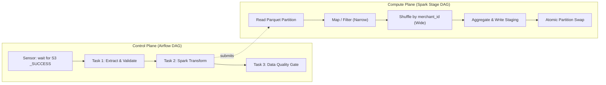
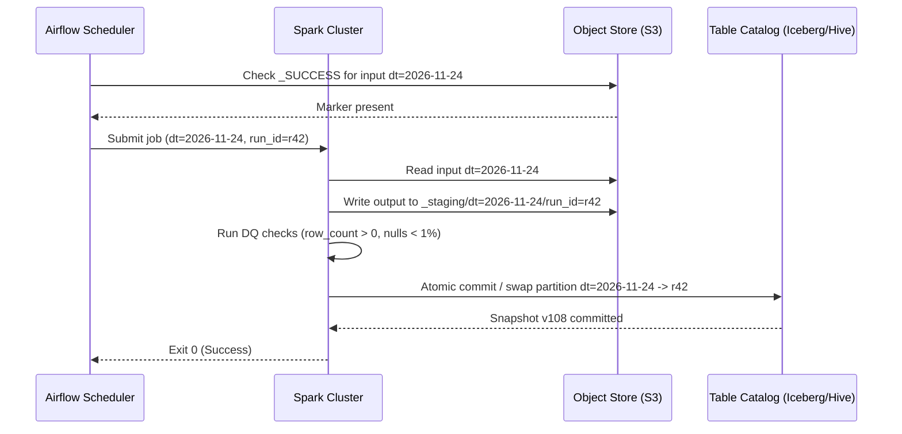
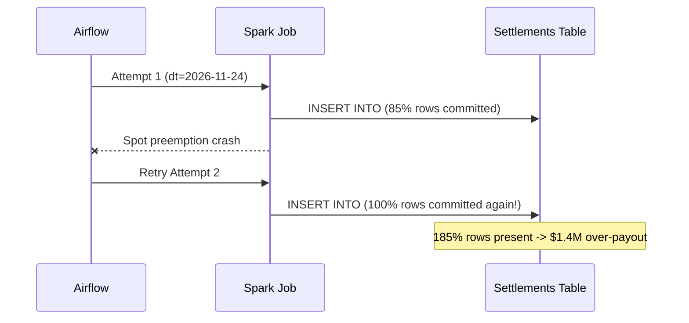

# Batch Processing: MapReduce, Spark, Airflow & Safe Reruns

> **Prerequisites:** [Lesson 05: Fan-Out on Write vs Read](../05-fan-out-on-write-vs-read/README.md).  
> **Estimated Reading Time:** 24–28 minutes  
> **Target Audience:** Backend and data engineers designing offline analytics, billing, ML feature generation, or backfill jobs, and candidates asked "how do you process 100 TB of daily logs reliably and idempotently?"  
> **Free PDF Notes:** [Download SD-Q-006.pdf](https://backendroadmap.com/notes/system-design/SD-Q-006.pdf)

> [!NOTE]
> **In one line:** Batch processing reads **bounded** datasets on a schedule (hourly, daily) to produce **high-throughput, deterministic** outputs. MapReduce proved you can parallelize across commodity disks; Spark moved intermediate stages into memory (DAG execution); Airflow orchestrates dependencies; and **partitioned, idempotent overwrites** ensure a failed job at 03:00 AM can be rerun safely without duplicating revenue or corrupting tables.

> [!TIP]
> **The Golden Rule:** Never mutate or append blindly in a batch job. Make every task a **pure function of its input partition** writing to a **staging prefix** and atomically swapping (or `INSERT OVERWRITE`ing) the target partition, so reruns and backfills are 100% idempotent.

---

## 1. What Batch Processing Is, and What It Isn't

Every night at 00:15 UTC, an e-commerce platform must compute yesterday's gross merchandise value (GMV) by merchant, reconcile Stripe payouts, and generate ML fraud features from 12 TB of raw clickstream and order logs. Running this over an OLTP Postgres database would saturate IOPS and lock rows for hours; running it as a real-time stream is unnecessary because finance closes books once a day and needs **complete, reconciled** numbers.

| Term | Precise Meaning | Example |
| :--- | :--- | :--- |
| **Bounded dataset** | Input with a fixed, known start and end (e.g., `dt=2026-11-24`) | Yesterday's S3 Parquet files |
| **Throughput-first** | Optimized for bytes/sec and cost/TB, not sub-second latency | 12 TB scanned in 18 minutes |
| **MapReduce** | Two-phase disk-backed shuffle model (map, sort/shuffle, reduce) | Hadoop MR reading/writing HDFS |
| **DAG engine (Spark)** | Multi-stage in-memory directed acyclic graph avoiding intermediate disk writes | Spark SQL / DataFrames |
| **Orchestrator (Airflow)** | Scheduler + dependency graph (DAG) + retry/backfill control plane | Airflow triggering Spark jobs |
| **Shuffle** | Network-wide all-to-all data redistribution by join/group key | Repartitioning 4 TB by `merchant_id` |
| **Idempotent rerun** | Re-executing a job for the same partition produces the exact same output | Atomic partition overwrite |
| **Not** | A substitute for low-latency alerting or OLTP point lookups | Fraud blocking in <50 ms |

### Why It Matters
1. Batch systems power billing, financial reporting, search index builds, and ML training — bugs here silently corrupt money or models.
2. Interviews test whether you understand **data skew, shuffle bottlenecks, OOMs, and safe backfills**, not just "use Spark."
3. Orchestration (Airflow/Dagster) and compute (Spark/Trino) are separate concerns; mixing them up is a classic architectural mistake.

---

## 2. Anatomy: MapReduce vs Spark DAG vs Airflow Control Plane



In **MapReduce**, every Map-Reduce pair writes its output to distributed disk (HDFS) with 3x replication before the next job can read it. A 5-step pipeline pays 5x disk-and-network serialization overhead. **Spark** compiles the entire multi-step query into a single DAG of **narrow transformations** (pipelined in memory on the same executor, like `filter` and `map`) separated by **wide transformations** (shuffle boundaries like `groupBy` or `join`). **Airflow** never touches the 12 TB of data; it only manages schedules, dependencies, SLAs, retries, and backfills.

| Dimension | Hadoop MapReduce | Apache Spark | Airflow / Dagster |
| :--- | :--- | :--- | :--- |
| **Role** | Compute engine | Compute engine | Workflow orchestrator |
| **Intermediate storage** | Replicated HDFS disk per step | Memory + local spill on shuffle | Metadata DB (Postgres) |
| **Iteration / multi-hop** | 10–100x slower (disk I/O) | Fast (in-memory RDD/DataFrame) | N/A (triggers external jobs) |
| **Failure recovery** | Re-run failed map/reduce task | Lineage recomputation of lost partition | Task retry with exponential backoff |
| **Primary bottleneck** | Disk & serialization | Shuffle network, GC, data skew | Scheduler DB & worker slots |

> [!WARNING]
> **Never process data inside Airflow workers.** Airflow workers are lightweight Python processes meant to trigger Spark/EMR/BigQuery jobs and poll for completion. Loading a 5 GB CSV into Pandas inside an Airflow task will OOM-kill the worker and destabilize the scheduler.

---

## 3. Mathematical Model: Shuffle Volume, Skew & Backfill Time

**Total Job Wall-Clock Time.** A Spark stage with $N$ partitions across $W$ executor slots, where each task takes $t_{\text{task}}$ and the shuffle transfers $V_{\text{shuffle}}$ bytes over aggregate cluster network bandwidth $B_{\text{net}}$, runs in:

$$T_{\text{stage}} \approx \left\lceil \frac{N}{W} \right\rceil \cdot t_{\text{task}} + \frac{V_{\text{shuffle}}}{B_{\text{net}}} + t_{\text{straggler}}$$

**The Straggler / Skew Law.** If 99% of keys have 10 MB per partition ($t_{\text{task}} = 2\text{ s}$), but one hot key (`merchant_id = NULL` or Amazon) has 40 GB in a single partition, that single reducer takes:

$$t_{\text{skew}} = \frac{40{,}000\text{ MB}}{5\text{ MB/s}} = 8{,}000\text{ s} \approx 2.2\text{ hours}$$

Even if you add 1,000 more executors, $W$ cannot parallelize a single key's partition — 999 executors sit idle waiting for 1 task (the **99% complete, stuck for 2 hours** syndrome).

**Backfill Drain Time.** Suppose a bug affected 30 days of historical data. Each day's batch takes $T_{\text{day}} = 20\text{ min}$ on a standard cluster, and you can run $C = 5$ days concurrently without saturating the warehouse or S3 rate limits:

$$T_{\text{backfill}} = \left\lceil \frac{30}{5} \right\rceil \times 20\text{ min} = 6 \times 20\text{ min} = 120\text{ min (2 hours)}$$

If daily production jobs also need the cluster, reserve capacity so backfills do not breach today's SLA.

---

## 4. Metrics & Percentiles

| Metric | Meaning | Alert when |
| :--- | :--- | :--- |
| **Job duration $p_{95}$ / SLA miss** | Time from scheduled start to `_SUCCESS` | Exceeds 70% of SLA window (e.g., >4h for 6h SLA) |
| **Shuffle spill (memory vs disk)** | Bytes spilled to disk during sort/hash agg | Disk spill > 10% of input size |
| **Task duration skew ratio** | $\max(t_{\text{task}}) / \text{median}(t_{\text{task}})$ | Ratio > 5x (indicates hot key skew) |
| **GC time %** | Time spent in JVM garbage collection | > 10% of task CPU time |
| **Small file count** | Number of output files per partition | > 1,000 files < 16 MB each |
| **Data quality gate failure** | Row count / null % / sum deviation vs baseline | Deviation > 5% or schema mismatch |

### Worked Example (12 TB Daily Clickstream)
Suppose 12 TB of raw JSON logs arrive daily in 120,000 small files (100 MB each). Reading 120,000 files from S3 at 5 ms `LIST`/`HEAD` overhead per file wastes $120{,}000 \times 5\text{ ms} = 600\text{ s}$ of serial driver metadata time before a byte is read. Converting to Parquet (columnar + Snappy compression) shrinks 12 TB JSON to **2.4 TB Parquet** (5x compression). With 100 executors (4 cores each = 400 slots) reading 256 MB Parquet row groups ($\approx 9{,}600$ tasks) at 200 MB/s per executor:
- Compute waves: $\lceil 9{,}600 / 400 \rceil = 24$ waves $\times 1.28\text{ s} \approx 31\text{ s}$ read + transform.
- Wide shuffle of 800 GB across 10 Gbps NICs per node (100 GB/s cluster bisection): $\approx 8\text{ s}$ network + spill.
- Total end-to-end job: **~12 minutes** instead of 4+ hours on raw JSON.

---

## 5. Compounding & Failure Modes

What happens when a daily batch job fails halfway through or hits data skew?

| Failure Mode | Naive Design Result | Safe / Resilient Design Result |
| :--- | :--- | :--- |
| **Mid-job crash + rerun** | `INSERT INTO` appends partial rows + full rerun = **1.6x duplicate revenue** | Write to `_staging/{run_id}`, validate, atomic partition swap = **0 duplicates** |
| **Hot key (`NULL` user_id)** | 1 executor OOMs at 99% after 90 min; job retries 3x and fails SLA | Salting (`concat(key, '_', rand() % 16)`) spreads 40 GB across 16 tasks = **11 min total** |
| **Small-file explosion** | 50,000 1 MB files/day; downstream Presto/Trino query takes **45 min** just opening files | `COALESCE` / compaction to 128–256 MB files; query drops to **42 seconds** |
| **Late-arriving upstream** | 00:15 UTC job runs on incomplete S3 prefix; silently drops 15% of West Coast orders | Upstream writes `_SUCCESS` marker; Airflow Sensor waits + SLA alert if missing by 01:00 |

---

## 6. Numbers Every Engineer Must Know

| Item | Typical | Implication |
| :--- | :---: | :--- |
| Optimal Parquet file size | 128 MB – 512 MB | Avoids S3 `LIST`/open overhead and enables predicate pushdown |
| Spark partition target | 128 MB – 200 MB per task | Keeps JVM heap safe and tasks 10–60 s long |
| Parquet vs raw JSON ratio | 4x – 8x smaller | Columnar encoding + dictionary/Snappy compression |
| S3 `PUT`/`GET` rate limit | 3,500 PUT / 5,500 GET per prefix/sec | Partitioning by `dt=YYYY-MM-DD/hr=HH` spreads load |
| Shuffle network cost | 2x – 5x slowest phase | Use broadcast join when small table < 10–100 MB |
| Airflow scheduler heartbeat | 5 – 30 seconds | Not designed for sub-second or high-frequency triggers |

---

## 7. Protocol / Mechanism Deep Dive: Safe Idempotent Partition Overwrite



| Question | Answer |
| :--- | :--- |
| **What if Spark crashes before `Atomic commit`?** | Readers still see the previous snapshot (or nothing); staging files are garbage-collected |
| **What if Airflow retries the exact same task?** | A new `run_id=r43` writes to `_staging/.../r43` and atomically replaces the pointer — zero duplicates |
| **Why not `DELETE` then `INSERT` on S3?** | S3 has no multi-file transaction; readers querying between `DELETE` and `INSERT` see empty data |
| **How do modern lakehouses solve this?** | Apache Iceberg / Delta Lake track active Parquet files in an atomic metadata manifest |

**When NOT to use batch processing.** Do not use batch when users or systems need results in seconds (fraud scoring, live inventory, real-time leaderboards), or when total data fits in a single Postgres table (< 50 GB) where a simple indexed SQL query finishes in 2 seconds.

---

## 8. Hierarchical Budgets & Design Rules

| Slice | Rule | Control |
| :--- | :--- | :--- |
| **Idempotency** | Every job is a pure function of `(logical_date, input_partition)` | Atomic partition overwrite / Iceberg `REPLACE` |
| **Orchestration** | Airflow schedules & monitors; never runs heavy compute | `SparkSubmitOperator` / `KubernetesPodOperator` |
| **Skew & Joins** | Broadcast small tables (< 50 MB); salt skewed keys | Spark AQE (`spark.sql.adaptive.enabled=true`) |
| **File Layout** | Target 128–256 MB Parquet files; partition by date, not high-cardinality ID | Compaction job or `REPARTITION` before write |
| **Data Quality** | Fail fast before publishing if row count or invariants break | Write-Audit-Publish (WAP) pattern |
| **Backfill Safety** | Bound concurrency and separate backfill queue from prod SLA queue | Airflow pools (`max_active_runs`) |
| **Schema Evolution** | Enforce contracts at ingestion; never silently drop columns | Schema registry / Iceberg schema enforcement |

---

## 9. Top Mitigations

1. **Adopt Write-Audit-Publish (WAP):** Write to a staging branch/prefix, run row-count and null assertions, and only then atomically swap the production partition.
2. **Enable Adaptive Query Execution (AQE):** Let Spark dynamically coalesce small shuffle partitions and split skewed partitions at runtime.
3. **Use Broadcast Hash Joins for dimension tables:** If `merchants` is 20 MB and `orders` is 4 TB, broadcasting `merchants` eliminates the 4 TB shuffle entirely.
4. **Compact small files regularly:** Run a nightly compaction or use Iceberg `rewrite_data_files` to merge thousands of 1 MB files into 256 MB Parquet files.
5. **Pass `logical_date` (`ds`) explicitly:** Never call `SELECT * WHERE date = CURRENT_DATE()` inside a batch query — it breaks backfills when you rerun last month's dates.
6. **Isolate backfill pools:** Cap `max_active_runs=3` on heavy DAGs so a 90-day backfill doesn't starve today's SLA jobs.
7. **Set deterministic timeouts and `_SUCCESS` sensors:** Fail loudly if upstream data is late rather than publishing an empty partition.

---

## 10. Production Reference / War Story: The $1.4M Duplicate Payout Incident

A fintech payments team ran a nightly Spark job to aggregate daily merchant settlements and append them to a `settlements` table. The job used `INSERT INTO settlements SELECT ... WHERE created_at >= yesterday`.

- **The Incident (SEV-1):** At 02:14 UTC, a spot-instance preemption killed 12 executors 85% of the way through the write phase. Airflow automatically retried the task. Because the first attempt had already committed 85% of the rows without a partition cleanup, the retry appended all 100% again. At 06:00 UTC, the payout service wired **$1.4M in duplicate settlements** to merchants.
- **Root Cause:** Non-idempotent `INSERT INTO` append combined with `CURRENT_DATE`-relative filtering and no staging/atomic swap.



- **The Fix:** Switched to **Write-Audit-Publish** on Apache Iceberg (`INSERT OVERWRITE` on `settlement_date = '{{ ds }}'`), added a unique-key assertion (`COUNT(*) == COUNT(DISTINCT settlement_id)`) before publishing, and made the downstream payout service check an idempotency key (`merchant_id + settlement_date`).

---

## 11. Multi-Language Production Code Tabs

A minimal **idempotent, salted batch aggregator** demonstrating partition-keyed staging, atomic swap, and key-salting to eliminate hot-key skew.

````carousel
```go
// Go: Idempotent partitioned batch processor with key salting and atomic staging swap.
package main

import (
	"fmt"
	"hash/fnv"
	"os"
	"path/filepath"
)

type Order struct {
	MerchantID string
	AmountCents int64
}

func saltKey(key string, saltBuckets int, seq int) string {
	h := fnv.New32a()
	_, _ = h.Write([]byte(key))
	bucket := (int(h.Sum32()) + seq) % saltBuckets
	return fmt.Sprintf("%s#%d", key, bucket)
}

func RunIdempotentBatch(partitionDate string, orders []Order, outDir string) error {
	// 1. Map + Salt phase: spread hot merchants across 4 virtual buckets
	partial := make(map[string]int64)
	for i, o := range orders {
		sk := saltKey(o.MerchantID, 4, i)
		partial[sk] += o.AmountCents
	}

	// 2. Reduce phase: strip salt and combine totals
	finalTotals := make(map[string]int64)
	for sk, amt := range partial {
		var merchant string
		for idx := len(sk) - 1; idx >= 0; idx-- {
			if sk[idx] == '#' {
				merchant = sk[:idx]
				break
			}
		}
		finalTotals[merchant] += amt
	}

	// 3. Write-Audit-Publish: write to staging file, then atomic rename
	staging := filepath.Join(outDir, fmt.Sprintf(".staging-%s.csv", partitionDate))
	target := filepath.Join(outDir, fmt.Sprintf("dt=%s.csv", partitionDate))

	f, err := os.Create(staging)
	if err != nil {
		return err
	}
	for m, total := range finalTotals {
		if _, err := fmt.Fprintf(f, "%s,%d\n", m, total); err != nil {
			_ = f.Close()
			return err
		}
	}
	if err := f.Close(); err != nil {
		return err
	}
	return os.Rename(staging, target) // Atomic on POSIX filesystems
}
```
<!-- slide -->
```typescript
// TypeScript: Idempotent partitioned batch job with Write-Audit-Publish (WAP) semantics.
import * as fs from "fs/promises";
import * as path from "path";

interface Order {
  merchantId: string;
  amountCents: number;
}

export async function runIdempotentBatch(
  partitionDate: string,
  orders: Order[],
  outDir: string
): Promise<void> {
  // 1. Deterministic aggregation for the exact partitionDate
  const totals = new Map<string, number>();
  for (const o of orders) {
    totals.set(o.merchantId, (totals.get(o.merchantId) ?? 0) + o.amountCents);
  }

  // 2. Write to isolated staging path
  const stagingPath = path.join(outDir, `.staging-${partitionDate}.json`);
  const targetPath = path.join(outDir, `dt=${partitionDate}.json`);

  const payload = Array.from(totals.entries()).map(([merchantId, amountCents]) => ({
    partitionDate,
    merchantId,
    amountCents,
  }));

  // 3. Audit gate: fail before touching production target
  if (payload.some((r) => r.amountCents < 0)) {
    throw new Error("DQ Gate failed: negative merchant settlement");
  }

  await fs.writeFile(stagingPath, JSON.stringify(payload, null, 2), "utf8");

  // 4. Atomic publish (safe to rerun infinitely)
  await fs.rename(stagingPath, targetPath);
}
```
<!-- slide -->
```python
# Python: Spark-style salting + Write-Audit-Publish simulation (stdlib only).
from collections import defaultdict
import json
import os


def run_salted_batch(partition_date: str, orders: list[dict], out_dir: str, salt_buckets: int = 4) -> dict:
    """Simulates a two-stage salted aggregation + atomic partition swap."""
    # Stage 1: Map with salt to prevent single-reducer skew on hot merchants
    salted_agg = defaultdict(int)
    for idx, order in enumerate(orders):
        salted_key = (order["merchant_id"], idx % salt_buckets)
        salted_agg[salted_key] += order["amount_cents"]

    # Stage 2: Final reduce across salted buckets
    final_totals = defaultdict(int)
    for (merchant_id, _bucket), cents in salted_agg.items():
        final_totals[merchant_id] += cents

    # Audit Gate: verify no negative totals and non-empty result
    assert all(v >= 0 for v in final_totals.values()), "DQ failure: negative total"

    # Write-Audit-Publish: stage then atomic os.replace
    os.makedirs(out_dir, exist_ok=True)
    staging = os.path.join(out_dir, f".staging_{partition_date}.json")
    target = os.path.join(out_dir, f"dt={partition_date}.json")
    with open(staging, "w", encoding="utf-8") as f:
        json.dump({"dt": partition_date, "totals": dict(final_totals)}, f)
    os.replace(staging, target)
    return dict(final_totals)
```
<!-- slide -->
```csharp
// C#: Idempotent batch partition writer with Write-Audit-Publish and atomic move.
using System;
using System.Collections.Generic;
using System.IO;
using System.Text.Json;

public sealed record OrderRecord(string MerchantId, long AmountCents);

public static class BatchProcessor
{
    public static void RunIdempotentBatch(string partitionDate, IEnumerable<OrderRecord> orders, string outDir)
    {
        var totals = new Dictionary<string, long>();
        foreach (var order in orders)
        {
            totals[order.MerchantId] = totals.GetValueOrDefault(order.MerchantId) + order.AmountCents;
        }

        // Audit gate before publishing
        foreach (var kvp in totals)
        {
            if (kvp.Value < 0)
                throw new InvalidOperationException($"DQ failed for {kvp.Key}: negative total");
        }

        Directory.CreateDirectory(outDir);
        string staging = Path.Combine(outDir, $".staging-{partitionDate}.json");
        string target = Path.Combine(outDir, $"dt={partitionDate}.json");

        File.WriteAllText(staging, JsonSerializer.Serialize(totals));
        File.Move(staging, target, overwrite: true); // Atomic swap on same volume
    }
}
```
````

---

## 12. Hands-On CLI Verification Workflows

Test idempotent batch reruns and Spark/Airflow diagnostics locally:

```bash
# 1. Verify idempotent Python batch rerun produces identical output on repeated runs
python -c "
from collections import defaultdict
orders = [{'merchant_id': 'amazon', 'amount_cents': 500}, {'merchant_id': 'amazon', 'amount_cents': 700}]
# Run twice; output hash must be identical
import hashlib, json
res = {m: sum(o['amount_cents'] for o in orders if o['merchant_id'] == m) for m in set(o['merchant_id'] for o in orders)}
print(hashlib.sha256(json.dumps(res, sort_keys=True).encode()).hexdigest())
"

# 2. Airflow: test a single task for a specific logical date without triggering downstream
airflow tasks test daily_settlements compute_totals 2026-11-24

# 3. Airflow: safely backfill a 7-day range with bounded concurrency
airflow dags backfill daily_settlements --start-date 2026-11-18 --end-date 2026-11-24

# 4. Spark: submit with Adaptive Query Execution (AQE) and skew join handling enabled
spark-submit \
  --conf spark.sql.adaptive.enabled=true \
  --conf spark.sql.adaptive.skewJoin.enabled=true \
  --conf spark.sql.shuffle.partitions=400 \
  daily_settlements.py --date 2026-11-24
```

---

## 13. Common Mistakes to Avoid

1. **Using `INSERT INTO` instead of `INSERT OVERWRITE` / partition replace**, causing duplicate rows on every retry.
2. **Using `CURRENT_DATE()` inside SQL**, which makes historical backfills compute today's data instead of `logical_date`.
3. **Running Pandas/compute inside Airflow workers**, exhausting scheduler/worker memory.
4. **Ignoring data skew (`NULL` or hot keys)**, leaving 999 executors idle while 1 task OOMs.
5. **Writing thousands of tiny 1 MB files to S3**, crippling downstream query planners.
6. **Skipping `_SUCCESS` markers or sensors**, silently processing incomplete upstream drops.
7. **Unbounded backfills**, starving production SLA queues and overwhelming target warehouses.

---

## 14. Key Terms Glossary

| Key Term | Definition |
| :--- | :--- |
| **Bounded dataset** | Input data with a fixed, finite start and end boundary. |
| **MapReduce** | Disk-backed two-phase distributed compute model (Map, Shuffle, Reduce). |
| **DAG (Directed Acyclic Graph)** | Execution graph of stages/tasks with dependencies and no cycles. |
| **Narrow vs Wide transformation** | Pipelined partition-local op vs cross-network shuffle op. |
| **Data skew** | Uneven key distribution causing one partition/task to be orders of magnitude larger. |
| **Salting** | Adding a random suffix to hot keys to spread aggregation across multiple reducers. |
| **Broadcast join** | Replicating a small table to all executors to avoid shuffling a large table. |
| **Write-Audit-Publish (WAP)** | Writing to staging, running quality checks, then atomically swapping to prod. |
| **Idempotent rerun** | Re-executing a job for a partition produces the exact same state without duplicates. |
| **Backfill** | Reprocessing historical partitions after a bug fix or schema change. |

---

## 15. System Design Interview Questions & Answers

### Basic Conceptual Questions

<details>
<summary><strong>Q1: Why did Spark largely replace Hadoop MapReduce? [BASIC]</strong></summary>

**Answer:**
MapReduce writes every intermediate stage to replicated HDFS disk (3x network + disk I/O), making multi-stage pipelines and iterative ML slow. Spark compiles multi-step queries into a DAG, keeps intermediate data in memory across narrow transformations, and only spills/shuffles at wide boundaries — often 10–100x faster.
</details>

<details>
<summary><strong>Q2: What is the difference between Airflow and Spark? [BASIC]</strong></summary>

**Answer:**
Airflow is a **control-plane orchestrator** (schedules DAGs, manages dependencies, retries, and alerts). Spark is a **data-plane compute engine** (reads terabytes from S3, shuffles, joins, writes Parquet). Airflow triggers Spark; it should never process gigabytes of data itself.
</details>

<details>
<summary><strong>Q3: What makes a batch job idempotent? [BASIC]</strong></summary>

**Answer:**
Running it $N$ times for the same `logical_date` yields the exact same output as running it once. You achieve this by reading an immutable input partition, writing to an isolated staging location, and performing an atomic partition overwrite (or Iceberg snapshot swap).
</details>

<details>
<summary><strong>Q4: What is the difference between narrow and wide transformations? [BASIC]</strong></summary>

**Answer:**
A narrow transformation (`map`, `filter`) processes each input partition independently with no network transfer. A wide transformation (`groupByKey`, `join`, `repartition`) requires an all-to-all **shuffle** across the network so matching keys land on the same executor.
</details>

### Scenario-Based Architecture Questions

<details>
<summary><strong>Q5: Your Spark job hits 99% completion in 5 minutes, then hangs for 2 hours and OOMs. What happened and how do you fix it? [SCENARIO]</strong></summary>

**Answer:**
Classic **data skew**: one key (often `NULL`, `""`, or a whale customer) has millions of rows concentrated in a single reducer partition. Fix it by: (1) filtering or separating `NULL` keys before the join/groupBy, (2) enabling Spark AQE skew-join optimization, (3) **salting** the hot key (`key + "_" + rand(0..N)`) for a two-stage aggregation, or (4) using a broadcast join if the other side is small.
</details>

<details>
<summary><strong>Q6: You need to backfill 90 days of daily aggregations after fixing a bug, without breaking today's SLA. How do you design it? [SCENARIO]</strong></summary>

**Answer:**
First, verify the job is parameterized by `logical_date` (`{{ ds }}`) and uses atomic partition overwrites. Second, isolate the backfill in a separate compute cluster or Airflow resource pool with bounded concurrency (e.g., `max_active_runs=4`) so it doesn't starve today's production jobs. Third, disable downstream alerting/webhooks during historical runs if they trigger customer-facing notifications.
</details>

<details>
<summary><strong>Q7: Upstream drops 50,000 tiny 200 KB JSON files into S3 every hour. Downstream queries take 30 minutes. What do you change? [SCENARIO]</strong></summary>

**Answer:**
This is the **small-file problem** — metadata `LIST`/`OPEN` calls dominate runtime. Add an hourly compaction job (or Iceberg `rewrite_data_files`) that merges small JSONs into **128–256 MB Parquet files** partitioned by `dt=YYYY-MM-DD/hr=HH`. Query time typically drops by 10–50x.
</details>

<details>
<summary><strong>Q8: How do you ensure a batch job never runs on half-written upstream data? [SCENARIO]</strong></summary>

**Answer:**
Never trigger purely on wall-clock time (`00:05 UTC`). Have the upstream writer emit a `_SUCCESS` marker (or commit an Iceberg snapshot) only after all files are flushed. The downstream Airflow DAG uses a Sensor to wait for `_SUCCESS` with a timeout and SLA alert if it hasn't arrived by the cutoff.
</details>

### Advanced & Tricky Interview Questions

<details>
<summary><strong>Q9: Why does `DELETE FROM table WHERE dt = '2026-11-24'` followed by `INSERT` fail in S3-backed data lakes? [TRICKY]</strong></summary>

**Answer:**
Object stores like S3 are not transactional databases. Between the `DELETE` and the completion of the `INSERT`, concurrent readers see missing or partial data. If the job crashes mid-`INSERT`, the partition is corrupted. Use an open table format (**Apache Iceberg** or **Delta Lake**) that performs atomic metadata-pointer swaps, or Write-Audit-Publish via staging prefixes.
</details>

<details>
<summary><strong>Q10: Explain `reduceByKey` vs `groupByKey` in Spark/MapReduce. Why does `groupByKey` cause OOMs? [TRICKY]</strong></summary>

**Answer:**
`groupByKey` shuffles **every raw record** across the network and buffers the entire value list in memory on the reducer before aggregating. `reduceByKey` (or map-side combiners) performs a **local pre-aggregation** on each mapper before the shuffle, shrinking network traffic and reducer memory by orders of magnitude.
</details>

<details>
<summary><strong>Q11: How do you handle late-arriving data in a daily batch pipeline? [TRICKY]</strong></summary>

**Answer:**
Two standard patterns: (1) **Lookback window:** Each daily run recomputes the last $K$ days (e.g., `dt - 3` to `dt`) via partition overwrite to absorb late mobile/offline events; or (2) **Incremental merge (`MERGE INTO`):** Upsert late records by event ID into the target Iceberg/Delta partitions while tracking `updated_at`.
</details>

<details>
<summary><strong>Q12: When would you replace a Spark cluster with a single-node DuckDB or Postgres batch job? [TRICKY]</strong></summary>

**Answer:**
When the daily working set is **under 100–500 GB**. Distributed shuffle and JVM startup overhead in Spark can take 2–5 minutes before doing useful work; a single beefy machine running DuckDB over Parquet scans tens of GB/sec with zero network shuffle, often finishing faster and at 1/10th the cloud cost.
</details>

---

## 16. One-Page Master Cheat Sheet

```
+---------------------------------------------------------------------------------------------------------+
|                    BATCH PROCESSING — MASTER CHEAT SHEET                                                |
+---------------------------------------------------------------------------------------------------------+
| 1. BOUNDED & THROUGHPUT-FIRST: Fixed partitions (dt=YYYY-MM-DD), optimized for $/TB, not sub-sec.       |
+---------------------------------------------------------------------------------------------------------+
| 2. PLANES: Airflow = control plane (schedule, retry, backfill). Spark = data plane (compute, shuffle).  |
+---------------------------------------------------------------------------------------------------------+
| 3. SAFE RERUNS (WAP): Read immutable partition -> Write _staging -> DQ Assert -> Atomic Swap.           |
|    Never use `INSERT INTO` append or `CURRENT_DATE()` in batch SQL.                                     |
+---------------------------------------------------------------------------------------------------------+
| 4. PERFORMANCE KILLERS:                                                                                 |
|    - Skew (1 hot key stalls 999 executors) -> Salt keys or enable Spark AQE skewJoin.                   |
|    - Small files (<16 MB) -> Compact to 128-256 MB Parquet.                                             |
|    - Wide shuffles -> Use map-side combiners (`reduceByKey`) & broadcast small tables (<50 MB).         |
+---------------------------------------------------------------------------------------------------------+
| 5. BACKFILLS: Parameterize by `logical_date`; cap concurrency so backfills never starve prod SLAs.      |
+---------------------------------------------------------------------------------------------------------+
```

---

## Further Reading & Sources

- Martin Kleppmann, *Designing Data-Intensive Applications*, Chapter 10, "Batch Processing".
- Jeffrey Dean & Sanjay Ghemawat, *MapReduce: Simplified Data Processing on Large Clusters* (Google, OSDI 2004).
- Matei Zaharia et al., *Resilient Distributed Datasets: A Fault-Tolerant Abstraction for In-Memory Cluster Computing* (Spark, NSDI 2012).
- Maxime Beauchemin, *Functional Data Engineering — A Modern Paradigm for Batch Data Processing* (Write-Audit-Publish & idempotent partitions).

---

## Free PDF Notes

[SD-Q-006.pdf](https://backendroadmap.com/notes/system-design/SD-Q-006.pdf)

---

## Next

Continue with [Lesson 07: Stream Processing: Event Time, Windows & Watermarks](../07-stream-processing/README.md).
