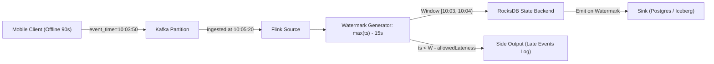
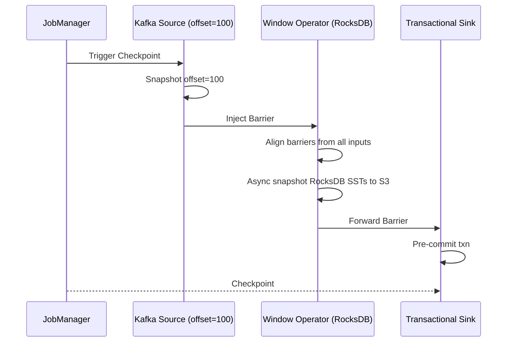
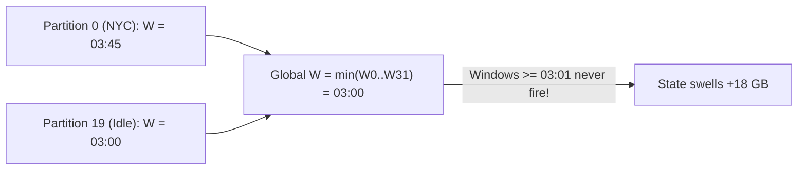

# Stream Processing: Event Time, Windows & Watermarks

> **Prerequisites:** [Lesson 06: Batch Processing: MapReduce, Spark, Airflow & Safe Reruns](../06-batch-processing/README.md).  
> **Estimated Reading Time:** 24–28 minutes  
> **Target Audience:** Backend and data engineers building real-time fraud detection, live analytics, billing meters, or CEP pipelines, and candidates asked "how do you handle out-of-order events in a 5-minute window?"  
> **Free PDF Notes:** [Download SD-Q-007.pdf](https://backendroadmap.com/notes/system-design/SD-Q-007.pdf)

> [!NOTE]
> **In one line:** Stream processing computes over **unbounded** event logs continuously. Because networks delay packets and mobile phones go offline, events arrive out of order — so you must separate **event time** (when it happened) from **processing time** (when the server saw it), bound lateness with **watermarks**, and checkpoint state for **exactly-once** recovery.

> [!TIP]
> **The Golden Rule:** Always window by **event time**, not processing time, if correctness matters. Use a **watermark** to trade latency for completeness, and route events arriving after `allowedLateness` to a **side output** rather than silently dropping them.

---

## 1. What Stream Processing Is, and What It Isn't

A mobile ride-hailing app emits trip telemetry every 5 seconds. A user enters a tunnel at `10:03:50`, loses LTE for 90 seconds, and reconnects at `10:05:20`, flushing buffered events from `10:03:50`–`10:04:55`. If your Flink job counts rides per minute using **processing time** (the server's wall clock), those `10:03` rides are wrongly billed to `10:05`, and a replay of yesterday's Kafka topic would collapse 24 hours of events into 10 minutes.

| Term | Precise Meaning | Example |
| :--- | :--- | :--- |
| **Unbounded stream** | Continuous, never-ending sequence of events | Kafka `clickstream` topic |
| **Event time** | Timestamp embedded in the event when it occurred on the client/source | `occurred_at = 10:03:50` |
| **Processing time** | Wall-clock time on the stream worker when it reads the record | `server_now = 10:05:20` |
| **Window** | Finite time bucket over an unbounded stream | Tumbling 1-min, Sliding, Session |
| **Watermark ($W(t)$)** | Heuristic assertion: "no more events with event time $< W(t)$ are expected" | $W = \max(\text{event\_time}) - 15\text{ s}$ |
| **Allowed lateness** | Grace period after watermark passes during which a window stays open for updates | `+60 s` late-event updates |
| **State backend** | Local key-value store (e.g., RocksDB) holding window accumulators | Per-key counts & timers |
| **Checkpoint** | Consistent distributed snapshot of offsets + RocksDB state | Chandy-Lamport barriers in Flink |
| **Not** | Simply a fast `while True` loop reading Kafka without state or time semantics | Stateless consumer script |

### Why It Matters
1. Real-time fraud, surge pricing, IoT anomaly detection, and live billing all require stateful aggregation over out-of-order streams.
2. Replaying a Kafka topic with processing-time windows produces completely wrong historical metrics; event-time + watermarks make live and replay runs **deterministic**.
3. Interviewers probe **window types, watermark trade-offs, state size explosion, and exactly-once checkpointing**.

---

## 2. Anatomy: Event Time vs Processing Time & Watermark Progress



Every event carries `event_time`. As events flow through a partition, the **Watermark Generator** tracks the maximum `event_time` seen so far and emits a monotonically increasing watermark $W = T_{\max} - \delta$ (where $\delta$ is bounded out-of-orderness, e.g., 15 seconds). When $W$ crosses a window's end boundary (e.g., `10:04:00`), the operator triggers and emits the window result.

| Window Type | Behavior | Typical Use Case |
| :--- | :--- | :--- |
| **Tumbling** | Fixed-size, non-overlapping (`[10:00, 10:05)`, `[10:05, 10:10)`) | Per-minute metrics, billing rollups |
| **Sliding (Hopping)** | Fixed-size with smaller slide (`size=5m, slide=1m`) | Moving averages, 5-min error rate |
| **Session** | Dynamic size closed after an inactivity gap (e.g., 30 min idle) | User clickstream sessions |
| **Global** | Single window for all time, triggered by custom count/timer | Per-user lifetime counter |

> [!WARNING]
> **An idle partition stalls the global watermark!** An operator's watermark is $\min(\text{watermark across all upstream partitions})$. If 1 of 32 Kafka partitions receives zero traffic for 10 minutes, its watermark stays frozen and **every window across all 32 partitions stops firing**. Always configure `withIdleness(Duration.ofSeconds(30))` so idle partitions are excluded from the min calculation.

---

## 3. Mathematical Model: Watermark Latency, State Size & Throughput

**Watermark Lag vs Completeness.** With bounded out-of-orderness $\delta$ and window size $L$, the minimum end-to-end emission latency for the earliest event in a window is:

$$T_{\text{emit}} = L + \delta + t_{\text{compute}}$$

Increasing $\delta$ (e.g., from 5 s to 60 s) captures more late events, but delays every window emission by an extra 55 seconds and increases in-flight state.

**State Memory / Disk Footprint.** Suppose you track a **sliding window** of size $L = 1\text{ hour}$ sliding every $S = 1\text{ minute}$ across $K = 5{,}000{,}000$ active users, where each user-pane state is $B = 128\text{ bytes}$:

$$\text{Panes per key} = \frac{L}{S} = \frac{60\text{ min}}{1\text{ min}} = 60$$

$$\text{Total State} = 5{,}000{,}000 \times 60 \times 128\text{ bytes} = 38.4\text{ GB}$$

If you also retain `allowedLateness = 30 min`, state grows by another 50% to **57.6 GB**, which exceeds typical JVM heap and must live in **RocksDB** (SSD-backed) with incremental checkpointing.

---

## 4. Metrics & Percentiles

| Metric | Meaning | Alert when |
| :--- | :--- | :--- |
| **Watermark lag** | `processing_time - current_watermark` | Grows unboundedly (indicates idle partition or backpressure) |
| **Late event drop rate** | Events arriving after `watermark + allowedLateness` | > 0.5% of total traffic |
| **Checkpoint duration $p_{99}$** | Time to snapshot state + barriers across all tasks | Approaches `checkpoint_interval` (causes backpressure) |
| **Consumer lag** | `latest_offset - committed_offset` per partition | Sustained growth (throughput < arrival rate) |
| **RocksDB state size** | Total bytes in local state per task manager | > 75% of local NVMe/SSD capacity |
| **Backpressure ratio** | Fraction of time output buffers are full | > 20% sustained |

### Worked Example (50,000 events/s Fraud Velocity Counter)
A payment gateway processes $\lambda = 50{,}000\text{ tx/s}$, counting failed cards over a 10-minute sliding window (1-minute slide) with $\delta = 10\text{ s}$ watermark delay and `allowedLateness = 60 s`.
- **Distinct cards in 10 min:** $K \approx 4{,}000{,}000$.
- **Pane count:** $10 / 1 = 10$ panes per card (using incremental pane aggregation, not storing raw events!).
- **State size:** $4\text{M} \times 10 \times 64\text{ B} = 2.56\text{ GB}$ across 16 task managers ($\approx 160\text{ MB}$ each — fits easily in RocksDB).
- **Checkpoint:** Incremental RocksDB checkpoint every 30 s uploads only dirty SST files ($\approx 80\text{ MB}$) to S3 in **< 1.5 seconds**.

---

## 5. Compounding & Failure Modes

| Failure Mode | What Happens | Mitigation |
| :--- | :--- | :--- |
| **Unaligned / giant state** | Storing raw event lists in a 1-hour window ($50\text{k/s} \times 3600\text{s} = 180\text{M}$ events) | Use **incremental aggregation** (`AggregateFunction` storing only `sum, count`) |
| **Idle Kafka partition** | 1 quiet shard freezes $\min(\text{watermark})$ for the whole job | Enable **watermark idleness** (`30s` timeout) |
| **Checkpoint timeout loop** | Backpressure delays checkpoint barriers -> checkpoint times out -> job restarts -> more lag | Enable **unaligned checkpoints** and scale out partitions |
| **Zombie / duplicate writes** | Task restarts after writing to sink but before checkpoint commits | Use **idempotent upserts** or **two-phase commit (2PC)** sinks |

---

## 6. Numbers Every Engineer Must Know

| Item | Typical | Implication |
| :--- | :---: | :--- |
| Tumbling window latency | $L + \delta$ (seconds to minutes) | Sub-second needs per-event CEP, not large windows |
| Incremental RocksDB checkpoint | 0.5 – 5 seconds | Enables 100 GB+ state without pausing the stream |
| Flink / Kafka Streams throughput | 50k – 500k events/s per node | Network + RocksDB IOPS are the usual ceilings |
| Watermark out-of-orderness ($\delta$) | 5 – 30 seconds (server), minutes (mobile) | Mobile apps need `allowedLateness` + side outputs |
| Exactly-once end-to-end overhead | ~10–25% latency/CPU | Requires transactional sink (Kafka 2PC / Iceberg) |

---

## 7. Protocol / Mechanism Deep Dive: Chandy-Lamport Checkpointing (Exactly-Once)



| Question | Answer |
| :--- | :--- |
| **How does Flink achieve exactly-once internal state?** | **Asynchronous barrier snapshotting** (Chandy-Lamport): barriers flow inline with data; when an operator receives barriers from all inputs, it snapshots state |
| **What happens on a worker crash?** | All operators rewind to the last completed checkpoint (#42), restoring RocksDB state and Kafka offsets together |
| **Does Kafka-to-Flink-to-HTTP give exactly-once?** | **No.** External HTTP APIs aren't transactional; you get **at-least-once** at the sink, so the receiver must be idempotent |
| **Why do barriers align?** | If Input A is faster than Input B, the operator buffers A's post-barrier events until B's barrier arrives so the snapshot represents a consistent cut |

**When NOT to use stream processing.** Do not use Flink/Kafka Streams for simple stateless transformations (just use a stateless consumer), or for 24-hour global joins over 50 TB where a nightly Spark batch job is 10x cheaper and simpler to operate.

---

## 8. Hierarchical Budgets & Design Rules

| Slice | Rule | Control |
| :--- | :--- | :--- |
| **Time Semantics** | Use event time for correctness; processing time only for monitoring | `WatermarkStrategy.forBoundedOutOfOrderness` |
| **Idle Sources** | Never let an empty partition freeze the global watermark | `.withIdleness(Duration.ofSeconds(30))` |
| **State Design** | Store partial aggregates (`sum`, `count`), never raw event lists | `AggregateFunction` + `StateTtlConfig` |
| **Late Data** | Bound lateness and capture late stragglers in a side output | `allowedLateness` + `.sideOutputLateData()` |
| **Checkpointing** | Interval = 30–60 s; timeout < 2x interval; incremental RocksDB | Alert on `checkpointDuration > 0.7 * interval` |
| **Sink Delivery** | Idempotent upsert (PK) or 2PC transactional sink | Never blind `INSERT` on replay |
| **State TTL** | Expire abandoned session/user keys to prevent OOM | `StateTtlConfig.newBuilder(Time.days(7))` |

---

## 9. Top Mitigations

1. **Use incremental aggregation** (`ReduceFunction` / `AggregateFunction`) instead of `ProcessWindowFunction` buffering raw events.
2. **Configure watermark idleness** on every multi-partition Kafka source.
3. **Set State TTL** on keyed state so inactive users don't accumulate in RocksDB forever.
4. **Route post-lateness events to a side output** (e.g., an S3 dead-letter topic) for reconciliation in batch.
5. **Make sinks idempotent** using deterministic keys (`window_start + entity_id`) so replays and at-least-once retries never double-count.
6. **Tune RocksDB & incremental checkpoints** on local NVMe SSDs; avoid spinning disks for large state.
7. **Cap parallelism to partition count:** 64 Flink slots reading a 16-partition Kafka topic leaves 48 slots idle.

---

## 10. Production Reference / War Story: The Frozen Watermark Outage

A ride-sharing marketplace ran a Flink job computing 1-minute surge-pricing windows across 32 Kafka partitions partitioned by `city_id`.

- **The Incident (SEV-1):** At 03:00 AM local time, `city_id=reykjavik` (mapped to Partition 19) had zero ride requests for 45 minutes. Because Flink's global watermark equals $\min(W_0, W_1, \dots, W_{31})$, Partition 19's watermark stayed at `03:00`. All 31 other cities — including New York and London — **stopped emitting surge-pricing updates for 45 minutes**, and RocksDB state swelled by 18 GB holding unclosed windows.
- **Root Cause:** Missing `withIdleness` configuration on the Kafka source; one quiet partition blocked global watermark progression.



- **The Fix:** Added `.withIdleness(Duration.ofSeconds(30))` to the watermark strategy, added an alert on `watermark_lag > 60s`, and configured `StateTtlConfig` for safety.

---

## 11. Multi-Language Production Code Tabs

A self-contained **event-time tumbling window engine** with bounded out-of-orderness watermarks, `allowedLateness`, and a late-event side output.

````carousel
```go
// Go: Event-time tumbling window processor with watermark and late-event side output.
package main

import "fmt"

type Event struct {
	Key       string
	EventTime int64 // epoch seconds
	Value     int64
}

type WindowProcessor struct {
	windowSizeSec    int64
	maxOutOfOrderSec int64
	allowedLateSec   int64
	maxEventTime     int64
	watermark        int64
	windows          map[int64]map[string]int64 // windowStart -> key -> sum
	emitted          map[int64]bool
	SideOutput       []Event
}

func NewWindowProcessor(winSec, outOfOrderSec, lateSec int64) *WindowProcessor {
	return &WindowProcessor{
		windowSizeSec:    winSec,
		maxOutOfOrderSec: outOfOrderSec,
		allowedLateSec:   lateSec,
		windows:          make(map[int64]map[string]int64),
		emitted:          make(map[int64]bool),
	}
}

func (wp *WindowProcessor) Process(e Event) []string {
	if e.EventTime > wp.maxEventTime {
		wp.maxEventTime = e.EventTime
		wp.watermark = wp.maxEventTime - wp.maxOutOfOrderSec
	}

	winStart := (e.EventTime / wp.windowSizeSec) * wp.windowSizeSec
	winEnd := winStart + wp.windowSizeSec

	// Drop to side output if past watermark + allowedLateness
	if winEnd+wp.allowedLateSec < wp.watermark {
		wp.SideOutput = append(wp.SideOutput, e)
		return nil
	}

	if wp.windows[winStart] == nil {
		wp.windows[winStart] = make(map[string]int64)
	}
	wp.windows[winStart][e.Key] += e.Value

	// Emit windows closed by the advancing watermark (or updated during allowedLateness)
	var out []string
	for ws, counts := range wp.windows {
		we := ws + wp.windowSizeSec
		if wp.watermark >= we {
			for k, v := range counts {
				out = append(out, fmt.Sprintf("win=[%d,%d) key=%s sum=%d late_update=%v", ws, we, k, v, wp.emitted[ws]))
			}
			wp.emitted[ws] = true
			if wp.watermark >= we+wp.allowedLateSec {
				delete(wp.windows, ws) // purge expired state
			}
		}
	}
	return out
}
```
<!-- slide -->
```typescript
// TypeScript: Event-time tumbling window with watermark, allowedLateness & side output.
export interface StreamEvent {
  key: string;
  eventTimeSec: number;
  value: number;
}

export class EventTimeWindowEngine {
  private maxEventTime = 0;
  private watermark = 0;
  private windows = new Map<number, Map<string, number>>();
  private emitted = new Set<number>();
  public readonly sideOutput: StreamEvent[] = [];

  constructor(
    private readonly windowSizeSec: number,
    private readonly maxOutOfOrderSec: number,
    private readonly allowedLateSec: number
  ) {}

  process(ev: StreamEvent): Array<{ windowStart: number; key: string; sum: number; isLateUpdate: boolean }> {
    if (ev.eventTimeSec > this.maxEventTime) {
      this.maxEventTime = ev.eventTimeSec;
      this.watermark = this.maxEventTime - this.maxOutOfOrderSec;
    }

    const winStart = Math.floor(ev.eventTimeSec / this.windowSizeSec) * this.windowSizeSec;
    const winEnd = winStart + this.windowSizeSec;

    if (winEnd + this.allowedLateSec < this.watermark) {
      this.sideOutput.push(ev); // Too late: route to side output
      return [];
    }

    if (!this.windows.has(winStart)) this.windows.set(winStart, new Map());
    const bucket = this.windows.get(winStart)!;
    bucket.set(ev.key, (bucket.get(ev.key) ?? 0) + ev.value);

    const results: Array<{ windowStart: number; key: string; sum: number; isLateUpdate: boolean }> = [];
    for (const [ws, counts] of this.windows.entries()) {
      const we = ws + this.windowSizeSec;
      if (this.watermark >= we) {
        for (const [key, sum] of counts.entries()) {
          results.push({ windowStart: ws, key, sum, isLateUpdate: this.emitted.has(ws) });
        }
        this.emitted.add(ws);
        if (this.watermark >= we + this.allowedLateSec) {
          this.windows.delete(ws);
        }
      }
    }
    return results;
  }
}
```
<!-- slide -->
```python
# Python: Event-time tumbling window with watermarks, allowedLateness, and side output.
from collections import defaultdict


class EventTimeWindowEngine:
    def __init__(self, window_s=60, out_of_order_s=15, allowed_lateness_s=30):
        self.window_s = window_s
        self.out_of_order_s = out_of_order_s
        self.allowed_lateness_s = allowed_lateness_s
        self.max_ts = 0
        self.watermark = 0
        self.windows = defaultdict(lambda: defaultdict(int))
        self.emitted = set()
        self.side_output = []

    def process(self, key: str, event_time: int, value: int):
        if event_time > self.max_ts:
            self.max_ts = event_time
            self.watermark = self.max_ts - self.out_of_order_s

        win_start = (event_time // self.window_s) * self.window_s
        win_end = win_start + self.window_s

        if win_end + self.allowed_lateness_s < self.watermark:
            self.side_output.append((key, event_time, value))
            return []

        self.windows[win_start][key] += value

        emitted_now = []
        for ws in sorted(list(self.windows.keys())):
            we = ws + self.window_s
            if self.watermark >= we:
                for k, total in self.windows[ws].items():
                    emitted_now.append((ws, we, k, total, ws in self.emitted))
                self.emitted.add(ws)
                if self.watermark >= we + self.allowed_lateness_s:
                    del self.windows[ws]  # Purge expired window state
        return emitted_now
```
<!-- slide -->
```csharp
// C#: Event-time tumbling window engine with watermarks and side output.
using System;
using System.Collections.Generic;

public sealed record StreamEvent(string Key, long EventTimeSec, long Value);
public sealed record WindowResult(long WindowStart, long WindowEnd, string Key, long Sum, bool IsLateUpdate);

public sealed class EventTimeWindowEngine
{
    private readonly long _windowSec, _outOfOrderSec, _allowedLateSec;
    private long _maxEventTime, _watermark;
    private readonly Dictionary<long, Dictionary<string, long>> _windows = new();
    private readonly HashSet<long> _emitted = new();
    public List<StreamEvent> SideOutput { get; } = new();

    public EventTimeWindowEngine(long windowSec, long outOfOrderSec, long allowedLateSec)
    {
        _windowSec = windowSec;
        _outOfOrderSec = outOfOrderSec;
        _allowedLateSec = allowedLateSec;
    }

    public List<WindowResult> Process(StreamEvent ev)
    {
        if (ev.EventTimeSec > _maxEventTime)
        {
            _maxEventTime = ev.EventTimeSec;
            _watermark = _maxEventTime - _outOfOrderSec;
        }

        long winStart = (ev.EventTimeSec / _windowSec) * _windowSec;
        long winEnd = winStart + _windowSec;

        if (winEnd + _allowedLateSec < _watermark)
        {
            SideOutput.Add(ev);
            return new();
        }

        if (!_windows.TryGetValue(winStart, out var bucket))
            _windows[winStart] = bucket = new();
        bucket[ev.Key] = bucket.GetValueOrDefault(ev.Key) + ev.Value;

        var results = new List<WindowResult>();
        foreach (var ws in new List<long>(_windows.Keys))
        {
            long we = ws + _windowSec;
            if (_watermark >= we)
            {
                foreach (var kv in _windows[ws])
                    results.Add(new WindowResult(ws, we, kv.Key, kv.Value, _emitted.Contains(ws)));
                _emitted.Add(ws);
                if (_watermark >= we + _allowedLateSec)
                    _windows.Remove(ws);
            }
        }
        return results;
    }
}
```
````

---

## 12. Hands-On CLI Verification Workflows

```bash
# 1. Verify watermark + late-event side output behavior with Python
python -c "
from collections import defaultdict
# Simulate events: [0..60) window, watermark lag=10s, allowed_lateness=20s
# Event at t=50 arrives first, then t=75 pushes watermark to 65 (closes [0,60)),
# then late event t=55 arrives (within lateness -> updates), then t=95 pushes watermark to 85 -> t=10 goes to side output
print('t=75 -> watermark=65 -> closes [0,60); t=55 -> late update; t=10 after wm=85 -> side output')
"

# 2. Flink CLI: inspect running jobs and checkpoint health
flink list -r
curl -s http://localhost:8081/jobs/<job_id>/checkpoints | jq '.latest.completed.end_to_end_duration'

# 3. Kafka: check consumer group lag for your stream processor
kafka-consumer-groups.sh --bootstrap-server localhost:9092 --describe --group flink-fraud-window
```

---

## 13. Common Mistakes to Avoid

1. **Windowing by processing time**, corrupting results during replays or network delays.
2. **Forgetting watermark idleness**, letting one quiet partition stall the entire cluster.
3. **Buffering raw events in window state** instead of incremental aggregation, causing RocksDB/heap OOMs.
4. **Omitting `StateTtlConfig`**, causing unbounded state growth over months.
5. **Silently dropping late events** instead of routing them to a side output for audit/reconciliation.
6. **Using non-idempotent sinks** with at-least-once delivery, causing double-counted metrics on restart.
7. **Setting checkpoint interval too tight** (e.g., 1 s on 50 GB state), causing permanent checkpoint backpressure.

---

## 14. Key Terms Glossary

| Key Term | Definition |
| :--- | :--- |
| **Unbounded stream** | Continuous, infinite sequence of events. |
| **Event time** | Timestamp when the event actually occurred at the source. |
| **Processing time** | Wall-clock time when the stream processor observes the event. |
| **Watermark** | Monotonic timestamp assertion that no earlier events are expected. |
| **Tumbling window** | Fixed-size, non-overlapping time bucket. |
| **Sliding window** | Overlapping fixed-size window advancing by a smaller slide interval. |
| **Session window** | Dynamic window closed after a period of inactivity. |
| **Allowed lateness** | Grace period after watermark where late events still update a closed window. |
| **Side output** | Secondary stream for events arriving after `allowedLateness` expires. |
| **Checkpoint barrier** | Special marker injected into streams to coordinate distributed state snapshots. |

---

## 15. System Design Interview Questions & Answers

### Basic Conceptual Questions

<details>
<summary><strong>Q1: What is the difference between event time and processing time? [BASIC]</strong></summary>

**Answer:**
**Event time** is when the event happened on the client/device; **processing time** is when the stream worker reads it. Processing time is simpler and lower-latency, but breaks whenever events are delayed or when you replay historical Kafka topics. Event time gives deterministic, reproducible results.
</details>

<details>
<summary><strong>Q2: What is a watermark in stream processing? [BASIC]</strong></summary>

**Answer:**
A watermark $W(t)$ is a monotonically increasing timestamp that tells window operators: "We believe all events with `event_time < W(t)` have arrived, so you can trigger and emit windows ending at or before $W(t)$." It is the knob trading **latency** (small lag) against **completeness** (waiting for late events).
</details>

<details>
<summary><strong>Q3: Compare tumbling, sliding, and session windows. [BASIC]</strong></summary>

**Answer:**
**Tumbling:** fixed, non-overlapping buckets (e.g., every 1 min). **Sliding:** overlapping buckets (e.g., 5-min window every 1 min) for moving averages. **Session:** variable-length buckets per key that close after an inactivity gap (e.g., 30 min of no clicks).
</details>

<details>
<summary><strong>Q4: What happens to events that arrive after the watermark passes? [BASIC]</strong></summary>

**Answer:**
If they arrive within `allowedLateness`, the window (still retained in state) updates and emits a correction to the sink (requiring an idempotent/upsert sink). If they arrive after `allowedLateness`, they are routed to a **side output** (dead-letter/reconciliation log) rather than silently dropped.
</details>

### Scenario-Based Architecture Questions

<details>
<summary><strong>Q5: A mobile app buffers events offline for up to 10 minutes. How do you design the 1-minute analytics pipeline? [SCENARIO]</strong></summary>

**Answer:**
Do not set watermark delay $\delta = 10\text{ min}$ — that delays all live dashboards by 10 minutes. Instead, set $\delta = 15\text{ s}$ for fast initial dashboard updates, set `allowedLateness = 15 min` so buffered mobile events update the 1-minute buckets via **idempotent upserts** (e.g., Postgres/ClickHouse `ReplacingMergeTree`), and send >15-min stragglers to a side output for nightly batch reconciliation.
</details>

<details>
<summary><strong>Q6: Your Flink job's windows stopped firing at 02:00 AM even though traffic is flowing on most partitions. Why? [SCENARIO]</strong></summary>

**Answer:**
An **idle partition** is freezing the global watermark, which is $\min(\text{partition watermarks})$. One quiet Kafka partition with no new events holds its watermark at 02:00 AM, blocking all downstream windows. Fix by enabling watermark idleness detection (`.withIdleness(30s)`).
</details>

<details>
<summary><strong>Q7: Your 1-hour sliding window (1-minute slide) is causing RocksDB disk exhaustion. How do you fix it? [SCENARIO]</strong></summary>

**Answer:**
First, ensure you use **incremental aggregation** (`AggregateFunction` storing only `sum, count`) rather than storing raw events. Second, use **panes** (pre-aggregate 1-minute tumbling panes and combine 60 panes on emit) instead of duplicating each event into 60 separate window buckets. Third, add `StateTtlConfig` to expire dead keys.
</details>

<details>
<summary><strong>Q8: How do you achieve end-to-end exactly-once processing from Kafka to Postgres? [SCENARIO]</strong></summary>

**Answer:**
Inside Flink, Chandy-Lamport checkpointing snapshots Kafka offsets and RocksDB state together for internal exactly-once. For the Postgres sink, either use a **two-phase commit (2PC)** sink or (more commonly in practice) **idempotent upserts** keyed by `(window_start, entity_id)` so replaying post-crash uncommitted records overwrites cleanly without duplicates.
</details>

### Advanced & Tricky Interview Questions

<details>
<summary><strong>Q9: Why can't you just use a stateless Kafka consumer to count "failed logins in the last 5 minutes"? [TRICKY]</strong></summary>

**Answer:**
A stateless consumer has no durable local state or event-time clock. If the consumer crashes at minute 4, in-memory counters vanish. If you store counters in Redis with `TTL=5m`, you get processing-time windows that break on consumer lag spikes or topic replays. A stateful stream processor (Flink/Kafka Streams) checkpoints state + offsets atomically and windows by event time.
</details>

<details>
<summary><strong>Q10: Explain aligned vs unaligned checkpoints in Flink. When do you need unaligned? [TRICKY]</strong></summary>

**Answer:**
In **aligned checkpoints**, when a fast input's barrier arrives before a slow input's barrier, the operator buffers the fast input until all barriers align. Under heavy **backpressure**, barriers queue behind thousands of buffered records and checkpoints time out. **Unaligned checkpoints** let barriers overtake in-flight buffers and include those buffered records in the snapshot, completing checkpoints in seconds even under severe backpressure.
</details>

<details>
<summary><strong>Q11: How do you perform a stream-to-stream join (e.g., ad impression + ad click within 30 minutes)? [TRICKY]</strong></summary>

**Answer:**
Use an **interval join** keyed by `ad_id` (or `impression_id`). Both streams are buffered in RocksDB keyed state with event-time timers. When an impression arrives at $t$, it probes the click state for $[t, t + 30\text{m}]$; when a click arrives at $t_c$, it probes impression state for $[t_c - 30\text{m}, t_c]$. Once the watermark passes $t + 30\text{m}$, the state is evicted.
</details>

<details>
<summary><strong>Q12: What is the difference between micro-batch (Spark Structured Streaming) and continuous operator (Flink) models? [TRICKY]</strong></summary>

**Answer:**
Spark Structured Streaming groups incoming events into small discrete batches (e.g., every 500 ms–5 s) scheduled by a central driver, giving ~1–5 s latency and unified Spark SQL APIs. Flink processes events **record-by-record** in long-lived pipelined operators, achieving **10–50 ms** latency and native Chandy-Lamport checkpointing.
</details>

---

## 16. One-Page Master Cheat Sheet

```
+---------------------------------------------------------------------------------------------------------+
|                    STREAM PROCESSING — MASTER CHEAT SHEET                                               |
+---------------------------------------------------------------------------------------------------------+
| 1. TIME: Event time (when it happened) vs Processing time (server clock). Always use event time for     |
|    correctness and deterministic replays.                                                               |
+---------------------------------------------------------------------------------------------------------+
| 2. WATERMARK: W(t) = max(event_time) - delta. Fires windows when W(t) >= window_end.                    |
|    Watch out: 1 idle partition freezes global min(W) -> enable `withIdleness(30s)`!                     |
+---------------------------------------------------------------------------------------------------------+
| 3. WINDOWS: Tumbling (fixed), Sliding (overlapping), Session (inactivity gap).                          |
|    Late data: inside `allowedLateness` -> upsert update; past `allowedLateness` -> Side Output.         |
+---------------------------------------------------------------------------------------------------------+
| 4. STATE & CHECKPOINTS: Keep partial aggregates in RocksDB (never raw lists) + State TTL.               |
|    Chandy-Lamport barriers snapshot Kafka offsets + RocksDB state together for exactly-once.            |
+---------------------------------------------------------------------------------------------------------+
| 5. SINKS: Use 2PC or idempotent upserts keyed by (window_start, entity_id).                             |
+---------------------------------------------------------------------------------------------------------+
```

---

## Further Reading & Sources

- Tyler Akidau, Slava Chernyak, Reuven Lax, *Streaming Systems* (O'Reilly, Chapter 2–3: "Watermarks & Windows").
- Martin Kleppmann, *Designing Data-Intensive Applications*, Chapter 11, "Stream Processing".
- Apache Flink Documentation, *Timely Stream Processing & Checkpointing* (nightlies.apache.org/flink).
- Leslie Lamport & K. Mani Chandy, *Distributed Snapshots: Determining Global States of Distributed Systems* (1985).

---

## Free PDF Notes

[SD-Q-007.pdf](https://backendroadmap.com/notes/system-design/SD-Q-007.pdf)

---

## Next

Continue with [Lesson 08: Lambda vs Kappa Architecture: Batch + Speed Layers or Replay](../08-lambda-vs-kappa-architecture/README.md).
