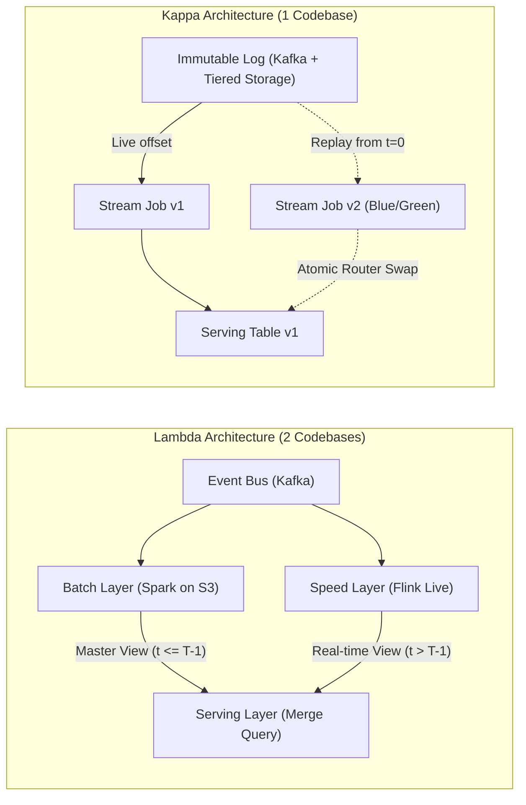
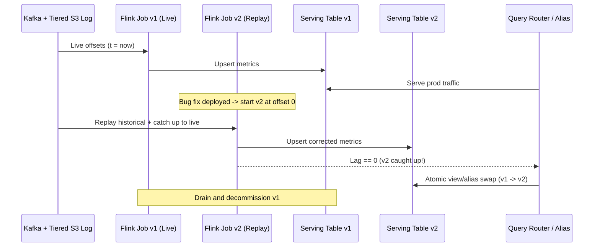
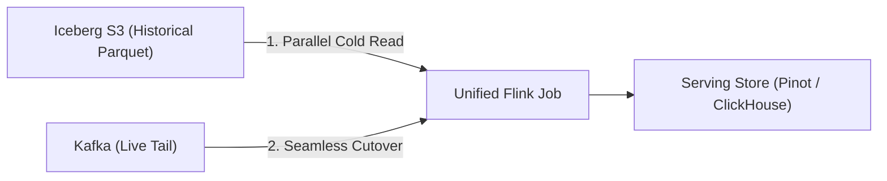

# Lambda vs Kappa Architecture: Batch + Speed Layers or Replay

> **Prerequisites:** [Lesson 07: Stream Processing: Event Time, Windows & Watermarks](../07-stream-processing/README.md).  
> **Estimated Reading Time:** 22–26 minutes  
> **Target Audience:** Backend and data architects choosing between dual-pipeline Lambda and stream-first Kappa topologies, and candidates asked "how do you serve both sub-second dashboards and 100% accurate historical numbers?"  
> **Free PDF Notes:** [Download SD-Q-008.pdf](https://backendroadmap.com/notes/system-design/SD-Q-008.pdf)

> [!NOTE]
> **In one line:** **Lambda Architecture** runs two separate pipelines — a **Batch Layer** (accurate, high-latency) and a **Speed Layer** (fast, approximate) — merged at query time in a Serving Layer. **Kappa Architecture** eliminates the Batch Layer and maintains a single **stream-processing** codebase that handles both live traffic and historical **replay** from an immutable log (Kafka/Pulsar) or lakehouse.

> [!TIP]
> **The Golden Rule:** Default to **Kappa** (or a **Unified Engine** like Flink/Spark on Iceberg) if your logic can be expressed as a stream and you can retain/replay the event log. Choose **Lambda** only when batch requires complex global joins/ML models that cannot run in a stream, and accept the tax of maintaining two codebases.

---

## 1. What Lambda and Kappa Are, and What They Aren't

An ad-tech platform needs two things from its impression & click events: (1) real-time pacing dashboards updated every 5 seconds so advertisers don't overspend budgets, and (2) 100% reconciled monthly invoices that survive late mobile events, deduplication, and fraud-bot filtering. Early distributed systems couldn't guarantee exactness in real-time streams, so **Nathan Marz** proposed **Lambda** (2011). Later, **Jay Kreps** argued (**Kappa**, 2014) that maintaining two pipelines in two languages (Spark + Storm/Flink) doubles bugs and ops overhead — instead, keep one stream processor and **replay** the immutable Kafka log whenever logic changes.

| Term | Precise Meaning | Example |
| :--- | :--- | :--- |
| **Lambda Architecture** | Dual-path topology: immutable Batch Layer + low-latency Speed Layer merged in Serving Layer | Spark nightly + Flink live -> Pinot/Druid |
| **Batch Layer** | Recomputes master dataset from scratch (or partitions) for eventual exactness | Nightly Spark job on S3 Parquet |
| **Speed Layer** | Processes only recent delta events in real time for low latency | Flink 5-second tumbling windows |
| **Serving Layer** | Query engine merging batch views (historical) and real-time views (today) | Apache Druid / Pinot / ClickHouse |
| **Kappa Architecture** | Single stream-first pipeline reading an immutable, replayable event log | Kafka (infinite/tiered) + Flink -> Serving DB |
| **Log Replay** | Resetting consumer group offsets to `earliest` (or timestamp) to recompute state | Re-running Flink v2 from `t=0` into new table |
| **Dual-codebase tax** | Subtle metric drift when Batch (SQL) and Speed (Java/Scala) diverge | "Why does today's graph not match yesterday's?" |
| **Not** | A debate about Kafka vs Spark; it is about **one codebase vs two** and **how you backfill** | Architecture topology, not a single tool |

### Why It Matters
1. "How do you combine real-time metrics with historical accuracy?" is a top-10 senior system design question.
2. Knowing **when Kappa's replay breaks** (e.g., 50 TB 2-year replay taking weeks, or non-deterministic external lookups) separates real architects from buzzword repeaters.
3. Modern **Lakehouse + Unified Engines** (Flink/Spark + Iceberg) blur the line by letting one codebase read both historical Parquet and live Kafka.

---

## 2. Anatomy: Lambda vs Kappa Topologies



In **Lambda**, the Serving Layer stitches together Batch View ($t \le T_{\text{cutoff}}$) and Speed View ($t > T_{\text{cutoff}}$) at query time. Once the nightly Batch job finishes for day $D$, the Serving Layer discards Speed View for day $D$. In **Kappa**, there is only one Flink job writing to `metrics_v1`. When a bug is found or a new metric is added, you deploy `Flink Job v2` reading from offset `0` of the immutable log into `metrics_v2`, wait for it to catch up to live head, atomically flip the API/view alias from `v1` to `v2`, and decommission `v1`.

| Dimension | Lambda Architecture | Kappa Architecture |
| :--- | :--- | :--- |
| **Codebases** | 2 (Batch + Speed, often different engines/languages) | 1 (Stream engine handles live + replay) |
| **Logic drift risk** | High (subtle differences in null handling, joins, timezones) | Zero (same binary runs live and replay) |
| **Backfill / Recompute** | Fast parallel batch scan over S3 Parquet | Replay Kafka from `t=0` (can be slow if years of data) |
| **Infra cost** | Higher steady-state (2 clusters) | Burst cost during parallel `v1 + v2` replay |
| **Best fit** | Complex global ML/graph batch + simple live counters | Event-driven aggregations, CDC, stateful streams |

> [!WARNING]
> **Watch out for non-deterministic Kappa replays!** If your stream job calls an external HTTP enrichment API (e.g., `GET /exchange-rate/USD-EUR` or `GET /user-tier`) *during* processing, replaying 6 months of Kafka today will fetch **today's** exchange rate instead of the rate on the day the transaction occurred. For deterministic replays, **embed immutable context in the event** at ingestion time or use **event-time temporal table joins**.

---

## 3. Mathematical Model: Serving Merge, Replay Time & Storage Cost

**Lambda Query Merge.** A query over $[t_{\text{start}}, t_{\text{end}}]$ splits at the batch watermark $T_{\text{batch}}$:

$$Q(t_{\text{start}}, t_{\text{end}}) = \text{BatchView}(t_{\text{start}}, T_{\text{batch}}) \;\cup\; \text{SpeedView}(T_{\text{batch}}, t_{\text{end}})$$

**Kappa Replay Catch-Up Time.** Suppose an immutable topic holds $V_{\text{hist}}$ bytes of historical events (say, 30 days at $R_{\text{in}} = 50\text{ MB/s} \implies V_{\text{hist}} = 129.6\text{ TB}$). If the replay cluster (`v2`) can process at $R_{\text{replay}} = 500\text{ MB/s}$ (10x live rate), the net catch-up rate is $R_{\text{replay}} - R_{\text{in}} = 450\text{ MB/s}$, so the time for `v2` to reach the live head is:

$$T_{\text{catchup}} = \frac{V_{\text{hist}}}{R_{\text{replay}} - R_{\text{in}}} = \frac{129{,}600\text{ s} \times 50\text{ MB/s}}{450\text{ MB/s}} = 14{,}400\text{ s} = 4\text{ hours}$$

During those 4 hours, you pay for **2x stream compute** (`v1` + `v2`) and **2x serving storage** (`table_v1` + `table_v2`). If $V_{\text{hist}}$ is 3 years (4.7 PB) and $R_{\text{replay}}$ is capped by Kafka partition count (say 32 partitions $\times$ 20 MB/s = 640 MB/s), replay takes **~90 days** — which is why pure Kafka-only Kappa breaks at multi-year scale without **tiered storage** or **hybrid Iceberg backfill**.

---

## 4. Metrics & Percentiles

| Metric | Meaning | Alert when |
| :--- | :--- | :--- |
| **Batch-vs-Speed drift %** | `abs(batch_total - speed_total) / batch_total` (Lambda) | > 0.5% (indicates logic divergence) |
| **Batch cutoff lag** | `now - T_batch` (how old the Speed layer window is) | > 2x scheduled batch interval |
| **Replay catch-up ETA** | `remaining_lag_bytes / (replay_rate - ingest_rate)` (Kappa) | Exceeds deployment/maintenance window |
| **Serving query $p_{99}$** | Latency merging Batch + Speed views | > SLO (e.g., > 200 ms for live dashboards) |
| **Log retention headroom** | Oldest offset age vs required replay window | Retention < max bug-discovery window |

### Worked Example (100k events/s Ad-Tech Impressions)
An ad network ingests $100{,}000\text{ events/s}$ ($\approx 50\text{ MB/s}$ compressed).
- **Lambda:** Flink processes live 10-second windows into Redis/Pinot (Speed Layer). Nightly Spark scans 4.3 TB/day on S3 in 25 minutes and overwrites Pinot's offline segments. **Drift risk:** Spark's SQL `COUNT(DISTINCT user_id)` is exact, while Flink uses HyperLogLog (0.8% error), causing advertisers to see a sudden drop at 02:00 UTC when Batch replaces Speed.
- **Kappa:** Kafka with S3 Tiered Storage retains 90 days (388 TB). Flink uses HyperLogLog everywhere. When a bot-filtering rule changes, `Flink v2` replays 30 days (130 TB) across 64 partitions at 600 MB/s, catching up in **~2.7 hours** with zero Batch/Speed drift.

---

## 5. Compounding & Failure Modes

| Failure Mode | Lambda Impact | Kappa Impact |
| :--- | :--- | :--- |
| **Bug in aggregation logic** | Fix in **two** places (Spark SQL + Flink Java); risk of fixing one and forgetting the other | Fix in **one** place; blue/green replay `v2` |
| **3-year historical recompute** | Fast: Spark reads columnar Parquet in parallel (minutes–hours) | **Slow/Painful:** Serialized by Kafka partition count unless reading from Iceberg/tiered storage |
| **Batch job fails for 3 days** | Speed layer must retain >3 days of state or serving queries show a gap | N/A (no batch layer; single stream keeps running) |
| **Non-deterministic enrichment** | Batch can join historical dimension snapshots easily | Stream replay hits live APIs unless events carry snapshot values |

---

## 6. Numbers Every Engineer Must Know

| Item | Typical | Implication |
| :--- | :---: | :--- |
| Kafka partition read ceiling | ~20–50 MB/s per consumer | Replay throughput = `partitions × 30 MB/s` |
| Tiered storage (Kafka + S3) | ~$0.023/GB-month vs $0.10+/GB EBS | Makes 90–365 day Kappa log retention affordable |
| Batch-Speed drift tolerance | < 0.1% – 0.5% | Higher drift breaks customer trust in dashboards |
| Blue/Green Kappa overhead | 2x compute + 2x sink storage during replay | Budget burst quota for schema/logic migrations |
| Unified engine (Flink Batch+Stream) | 1 codebase, 2 execution modes | Modern "Kappa++" using Iceberg for cold + Kafka for hot |

---

## 7. Protocol / Mechanism Deep Dive: Blue/Green Kappa Replay



| Question | Answer |
| :--- | :--- |
| **Why write to `Table v2` instead of overwriting `Table v1` in place?** | Overwriting `v1` mixes old-logic and new-logic rows during the 4-hour replay, corrupting live dashboards |
| **How does the Query Router swap atomically?** | Via a database view (`CREATE OR REPLACE VIEW metrics AS SELECT * FROM metrics_v2`), DynamoDB/Redis pointer, or Pinot table alias |
| **What if `v2` needs to join with a dimension table?** | Use a **compacted Kafka topic** (CDC) or **Iceberg temporal table** so historical lookups match the state at `event_time` |
| **How do you speed up Kappa replays?** | Use **Apache Iceberg / Paimon** as the cold historical source + **Kafka** for the tail (Hybrid Source), bypassing Kafka partition limits |

**When NOT to use Lambda or Kappa.** If a 15-minute delay is acceptable, **just use Batch** (1 pipeline, 1/5th the cost and complexity). If you don't need historical recomputation at all (e.g., ephemeral 5-minute rate limiting), **just use a simple Speed/Stream job** without long log retention.

---

## 8. Hierarchical Budgets & Design Rules

| Slice | Rule | Control |
| :--- | :--- | :--- |
| **Default Choice** | Start with pure Batch if 15m+ latency is fine; Kappa if <1m is required | Avoid Lambda unless forced by batch-only ML/joins |
| **Determinism** | Embed immutable attributes in events at ingestion; no live HTTP calls in replay | Schema contract + CDC compacted topics |
| **Partitioning** | Size Kafka partitions for **replay** throughput, not just live ingest | `partitions >= target_replay_MBs / 30` |
| **Serving Swap** | Never mutate live serving tables during a Kappa replay | Blue/green `table_v1 -> table_v2` alias swap |
| **Lambda Reconciliation** | If using Lambda, reconcile Speed vs Batch daily with automated diff alerts | Alert if `drift > 0.5%` |
| **Log Retention** | Retain raw events in Tiered Storage / S3 longer than max bug-discovery time | 90–365 days in S3 Parquet/Tiered Kafka |

---

## 9. Top Mitigations

1. **Eliminate dual codebases where possible:** Use SQL/Flink/Beam unified APIs or Kappa so one logic definition serves live and replay.
2. **Enable Kafka Tiered Storage (or S3 sink + HybridSource):** Don't store 100 TB of replay history on expensive broker EBS volumes.
3. **Always run Kappa replays Blue/Green:** Write to `v2`, verify row counts and invariants, then atomically swap the serving alias.
4. **Over-partition Kafka topics slightly for replay headroom:** 8 partitions might handle 50 MB/s live, but 64 partitions let you replay 8x faster.
5. **Version your Kafka consumer groups and sink tables:** Include `v1`/`v2` in group IDs and table names so rollbacks are instant.
6. **If using Lambda, make the Batch cutoff explicit:** Tag every Serving Layer query with `T_batch` so users never see double-counted boundary minutes.

---

## 10. Production Reference / War Story: LinkedIn's Shift from Lambda to Kappa

In 2014, Jay Kreps (LinkedIn) published *Questioning the Lambda Architecture* after LinkedIn experienced the operational pain of maintaining duplicate Hadoop MapReduce (Batch) and Samza/Storm (Speed) pipelines for identical metrics.

- **The Problem:** Every time product managers changed a business rule (e.g., how bot clicks or "profile view" sessions were defined), engineers had to implement the change twice — once in Pig/Hive/Spark and once in Java stream code. Subtle semantic differences (timezone boundaries, null handling, late-event cutoffs) caused **persistent 2–5% discrepancies** between real-time counters and next-day reports, triggering constant engineering investigations.
- **The Solution (Kappa):** LinkedIn standardized on **Kafka** as an immutable, partitioned log with long retention and **Samza/Flink** as the single stream processing layer. Reprocessing meant spinning up a second job instance from offset 0 into a new output table and swapping traffic once caught up.
- **Modern Evolution (Kappa++ / Unified):** Today, Uber, Netflix, and ByteDance pair **Apache Iceberg / Hudi** (columnar S3) with **Flink HybridSource**: Flink reads historical months from Parquet at high parallelism, then seamlessly transitions to Kafka at the exact cutoff timestamp — giving **Kappa's single codebase** with **Batch's fast columnar replay**.



---

## 11. Multi-Language Production Code Tabs

A **Lambda Query Merger** vs **Kappa Blue/Green Alias Router** showing how the serving layer handles cutoff boundaries and atomic swaps.

````carousel
```go
// Go: Lambda Serving Merger (Batch + Speed) & Kappa Blue/Green Router.
package main

import (
	"fmt"
	"sync/atomic"
)

type MetricStore interface {
	QuerySum(startEpoch, endEpoch int64) int64
}

// LambdaMerger stitches BatchView (<= cutoff) and SpeedView (> cutoff).
type LambdaMerger struct {
	BatchView   MetricStore
	SpeedView   MetricStore
	BatchCutoff int64
}

func (l *LambdaMerger) Query(start, end int64) int64 {
	var total int64
	if start <= l.BatchCutoff {
		bEnd := end
		if bEnd > l.BatchCutoff {
			bEnd = l.BatchCutoff
		}
		total += l.BatchView.QuerySum(start, bEnd)
	}
	if end > l.BatchCutoff {
		sStart := start
		if sStart <= l.BatchCutoff {
			sStart = l.BatchCutoff + 1
		}
		total += l.SpeedView.QuerySum(sStart, end)
	}
	return total
}

// KappaRouter atomically swaps active serving table pointer (v1 -> v2) after replay catches up.
type KappaRouter struct {
	active atomic.Pointer[MetricStore]
}

func (k *KappaRouter) Swap(next MetricStore) { k.active.Store(&next) }
func (k *KappaRouter) Query(start, end int64) int64 {
	s := *k.active.Load()
	return s.QuerySum(start, end)
}

func init() { _ = fmt.Sprint }
```
<!-- slide -->
```typescript
// TypeScript: Lambda boundary merger and Kappa atomic blue/green router.
export interface MetricView {
  querySum(startSec: number, endSec: number): number;
}

export class LambdaServingLayer {
  constructor(
    private batchView: MetricView,
    private speedView: MetricView,
    private batchCutoffSec: number
  ) {}

  query(startSec: number, endSec: number): number {
    let sum = 0;
    if (startSec <= this.batchCutoffSec) {
      sum += this.batchView.querySum(startSec, Math.min(endSec, this.batchCutoffSec));
    }
    if (endSec > this.batchCutoffSec) {
      sum += this.speedView.querySum(Math.max(startSec, this.batchCutoffSec + 1), endSec);
    }
    return sum;
  }
}

export class KappaServingRouter {
  constructor(private activeView: MetricView) {}

  atomicSwap(replayedV2: MetricView, lagBytes: number): void {
    if (lagBytes > 0) throw new Error("Cannot swap before v2 catches up to live head");
    this.activeView = replayedV2;
  }

  query(startSec: number, endSec: number): number {
    return this.activeView.querySum(startSec, endSec);
  }
}
```
<!-- slide -->
```python
# Python: Lambda merge + Kappa replay catch-up time estimator (stdlib only).
def lambda_query(batch_buckets: dict, speed_buckets: dict, batch_cutoff: int, start: int, end: int) -> int:
    """Merge Batch (t <= batch_cutoff) and Speed (t > batch_cutoff) without double counting."""
    total = 0
    for t in range(start, end + 1):
        if t <= batch_cutoff:
            total += batch_buckets.get(t, 0)
        else:
            total += speed_buckets.get(t, 0)
    return total


def kappa_replay_eta_hours(history_days: int, ingest_mb_s: float, replay_mb_s: float) -> float:
    """Estimate hours for Kappa v2 replay job to catch up to live head."""
    if replay_mb_s <= ingest_mb_s:
        return float("inf")
    total_hist_mb = history_days * 86400 * ingest_mb_s
    catchup_s = total_hist_mb / (replay_mb_s - ingest_mb_s)
    return round(catchup_s / 3600.0, 2)
```
<!-- slide -->
```csharp
// C#: Lambda Serving Merger and Kappa Atomic Blue/Green Router.
using System;
using System.Threading;

public interface IMetricView
{
    long QuerySum(long startSec, long endSec);
}

public sealed class LambdaServingLayer
{
    private readonly IMetricView _batch, _speed;
    private readonly long _cutoff;

    public LambdaServingLayer(IMetricView batch, IMetricView speed, long cutoff) =>
        (_batch, _speed, _cutoff) = (batch, speed, cutoff);

    public long Query(long startSec, long endSec)
    {
        long total = 0;
        if (startSec <= _cutoff)
            total += _batch.QuerySum(startSec, Math.Min(endSec, _cutoff));
        if (endSec > _cutoff)
            total += _speed.QuerySum(Math.Max(startSec, _cutoff + 1), endSec);
        return total;
    }
}

public sealed class KappaServingRouter
{
    private IMetricView _active;
    public KappaServingRouter(IMetricView initial) => _active = initial;

    public void AtomicSwap(IMetricView v2) => Interlocked.Exchange(ref _active, v2);
    public long Query(long startSec, long endSec) => _active.QuerySum(startSec, endSec);
}
```
````

---

## 12. Hands-On CLI Verification Workflows

```bash
# 1. Estimate Kappa replay catch-up time for 30 days @ 50 MB/s ingest and 500 MB/s replay
python -c "
hist_days, ingest, replay = 30, 50.0, 500.0
eta_h = (hist_days * 86400 * ingest) / (replay - ingest) / 3600
print(f'Catch-up ETA: {eta_h:.2f} hours')
"

# 2. Kafka: reset a new blue/green consumer group (v2) to a specific timestamp for replay
kafka-consumer-groups.sh --bootstrap-server localhost:9092 \
  --group metrics-processor-v2 --topic impressions \
  --reset-offsets --to-datetime 2026-10-25T00:00:00.000 --execute

# 3. Monitor v2 replay lag until it hits 0 before swapping the serving alias
kafka-consumer-groups.sh --bootstrap-server localhost:9092 --describe --group metrics-processor-v2
```

---

## 13. Common Mistakes to Avoid

1. **Building Lambda by default** when a single stream or a 15-minute micro-batch pipeline would suffice.
2. **Overwriting the live serving table during a Kappa replay**, mixing `v1` and `v2` results for users.
3. **Making live external HTTP calls inside a Kappa stream**, breaking determinism on replay.
4. **Under-partitioning Kafka**, capping replay speed to a few MB/s so 30-day replays take days.
5. **Forgetting to test Batch-vs-Speed drift** in Lambda, letting silent 5% discrepancies linger for months.
6. **Storing years of raw events on Kafka EBS disks** instead of Tiered Storage or Iceberg/Parquet.
7. **Double-counting the Batch/Speed boundary** in Lambda serving queries (`<= cutoff` vs `>= cutoff`).

---

## 14. Key Terms Glossary

| Key Term | Definition |
| :--- | :--- |
| **Lambda Architecture** | Dual-pipeline pattern combining a Batch Layer, Speed Layer, and Serving Layer. |
| **Batch Layer** | Recomputes exact master views over immutable historical datasets. |
| **Speed Layer** | Processes recent delta events with low latency, trading some exactness. |
| **Serving Layer** | Merges Batch and Speed views at query time. |
| **Kappa Architecture** | Single stream-processing pipeline using an immutable, replayable log. |
| **Log Replay** | Re-reading historical offsets from `t=0` with updated code (`v2`). |
| **Blue/Green Replay** | Running `v2` into a separate table and swapping the alias once caught up. |
| **Tiered Storage** | Offloading older Kafka segments to S3/GCS while keeping offset semantics. |
| **HybridSource** | Reading cold history from Iceberg/Parquet, then seamlessly tailing Kafka. |
| **Logic Drift** | Divergence in metric values between separate Batch and Speed codebases. |

---

## 15. System Design Interview Questions & Answers

### Basic Conceptual Questions

<details>
<summary><strong>Q1: What is the core difference between Lambda and Kappa architecture? [BASIC]</strong></summary>

**Answer:**
**Lambda** maintains **two** separate pipelines (a Batch Layer for accuracy and a Speed Layer for low latency) merged in a Serving Layer. **Kappa** removes the Batch Layer and uses **one** stream-processing codebase that handles both live events and historical recomputation via log replay.
</details>

<details>
<summary><strong>Q2: Why did Nathan Marz invent the Lambda architecture? [BASIC]</strong></summary>

**Answer:**
In 2011, stream engines (like early Storm) lacked strong fault-tolerance, event-time watermarks, and exactly-once state. Lambda provided human-fault-tolerant, 100% accurate batch recomputation while still giving sub-second approximate dashboards via the Speed Layer.
</details>

<details>
<summary><strong>Q3: How do you deploy a bug fix or schema change in Kappa without downtime? [BASIC]</strong></summary>

**Answer:**
Run a **blue/green replay**: start `Job v2` with a new consumer group from offset `0` (or the relevant timestamp), writing to `serving_table_v2`. Once `v2` catches up to the live head (lag = 0), atomically flip the query router/view from `v1` to `v2` and tear down `v1`.
</details>

<details>
<summary><strong>Q4: When is neither Lambda nor Kappa needed? [BASIC]</strong></summary>

**Answer:**
When 15–60 minute latency is acceptable (use pure **Batch** — far simpler and cheaper), or when you only need ephemeral real-time counters without historical recomputation (use a single **Stream** job).
</details>

### Scenario-Based Architecture Questions

<details>
<summary><strong>Q5: Your company runs Lambda, and finance complains that live dashboard revenue differs from next-day reports by 3%. Why and how do you fix it? [SCENARIO]</strong></summary>

**Answer:**
This is **Batch-vs-Speed logic drift** (e.g., different timezone cutoffs, duplicate handling, or HyperLogLog vs exact count). Short-term: add automated daily drift monitoring and unify SQL/business logic via a shared library or SQL engine. Long-term: migrate to **Kappa** or a unified **Flink + Iceberg** pipeline so one codebase computes both.
</details>

<details>
<summary><strong>Q6: You need to replay 2 years of clickstream data (500 TB) in a Kappa architecture, but Kafka only retains 14 days. What do you do? [SCENARIO]</strong></summary>

**Answer:**
Pure Kafka-only Kappa fails here. Use either **Kafka Tiered Storage** (offloading segments to S3) or a **HybridSource** pattern (Flink reads 2 years of historical Parquet from S3/Iceberg in parallel, then seamlessly switches to Kafka for the last 14 days).
</details>

<details>
<summary><strong>Q7: In Lambda, how does the Serving Layer avoid double-counting or missing events at the boundary between Batch and Speed? [SCENARIO]</strong></summary>

**Answer:**
Tag every Batch run with an explicit event-time watermark `T_batch` (e.g., `2026-11-24T23:59:59Z`). Serving queries strictly read `BatchView` for `event_time <= T_batch` and `SpeedView` for `event_time > T_batch`. Once the batch run for day $D$ completes, the SpeedView partitions for day $D$ are dropped.
</details>

<details>
<summary><strong>Q8: Your Kappa replay `v2` is reading at 40 MB/s while live traffic is 35 MB/s. How long will a 30-day replay take? [SCENARIO]</strong></summary>

**Answer:**
Net catch-up speed is only $40 - 35 = 5\text{ MB/s}$, which is $7\times$ slower than live ingest! Replaying 30 days will take $30 \times 7 = 210\text{ days}$. You must increase Kafka partitions and consumer parallelism so replay throughput is $5\text{–}10\times$ live ingest, or read cold history from columnar Parquet.
</details>

### Advanced & Tricky Interview Questions

<details>
<summary><strong>Q9: What breaks determinism during a Kappa log replay? [TRICKY]</strong></summary>

**Answer:**
Three things: (1) calling external mutable APIs/DBs during stream processing (you get *today's* user tier instead of the tier at event time), (2) using **processing time** instead of **event time** windows, and (3) non-deterministic side effects (e.g., sending emails during replay). Fix by embedding context at ingest, using temporal table joins, and gating external side effects.
</details>

<details>
<summary><strong>Q10: Why is Kafka partition count a bottleneck for Kappa replays, and how does Iceberg solve it? [TRICKY]</strong></summary>

**Answer:**
Kafka's parallelism is strictly capped by partition count (16 partitions = max 16 parallel readers per group), and events are row-oriented. **Apache Iceberg** stores data in columnar Parquet files on S3; a replay engine can split 10,000 Parquet files across 500 workers with predicate/column pushdown, replaying months in minutes.
</details>

<details>
<summary><strong>Q11: Can you implement Lambda using a single engine like Spark (Batch + Structured Streaming)? [TRICKY]</strong></summary>

**Answer:**
Yes — this is often called **Unified Lambda** or **Medallion Streaming**. You share the same Spark DataFrame transformation code between a continuous streaming job (writing to a fast serving table) and a nightly batch job (reconciling/compacting Iceberg tables), eliminating the two-language drift problem while keeping batch's efficiency.
</details>

<details>
<summary><strong>Q12: How do you handle GDPR "Right to be Forgotten" deletes in a Kappa immutable log? [TRICKY]</strong></summary>

**Answer:**
You cannot easily delete a single user's old events inside an append-only log. Standard solutions: (1) **Crypto-shredding** — encrypt each user's PII with a per-user KMS key and delete the key on erasure, rendering historical log events unreadable; or (2) **Log compaction** by `user_id` with tombstones (only works for state logs, not raw event logs).
</details>

---

## 16. One-Page Master Cheat Sheet

```
+---------------------------------------------------------------------------------------------------------+
|                    LAMBDA VS KAPPA ARCHITECTURE — MASTER CHEAT SHEET                                    |
+---------------------------------------------------------------------------------------------------------+
| 1. LAMBDA: Batch Layer (exact, slow) + Speed Layer (fast, approx) -> Merged in Serving Layer.           |
|    Pro: fast columnar backfills. Con: 2 codebases, logic drift, 2x ops.                                 |
+---------------------------------------------------------------------------------------------------------+
| 2. KAPPA: Single Stream Layer + Immutable Replayable Log.                                               |
|    Pro: 1 codebase, zero drift. Con: replay speed capped by partitions; needs Tiered Storage/Iceberg.   |
+---------------------------------------------------------------------------------------------------------+
| 3. BLUE/GREEN REPLAY: Deploy v2 at offset 0 -> write to table_v2 -> wait lag=0 -> atomic alias swap.    |
+---------------------------------------------------------------------------------------------------------+
| 4. DETERMINISM: Never call live HTTP APIs during stream processing; use event time + embedded context.  |
+---------------------------------------------------------------------------------------------------------+
| 5. MODERN CONVERGENCE: Flink HybridSource (Iceberg cold + Kafka hot) gives 1 codebase + fast replay.    |
+---------------------------------------------------------------------------------------------------------+
```

---

## Further Reading & Sources

- Nathan Marz & James Warren, *Big Data: Principles and Best Practices of Scalable Real-Time Data Systems* (Lambda Architecture).
- Jay Kreps, *Questioning the Lambda Architecture* (O'Reilly Radar, 2014 — Kappa Architecture).
- Martin Kleppmann, *Designing Data-Intensive Applications*, Chapter 11 & 12 ("Stream Processing" & "The Future of Data Systems").
- Apache Flink Documentation, *Hybrid Source* (combining bounded Iceberg/S3 with unbounded Kafka).

---

## Free PDF Notes

[SD-Q-008.pdf](https://backendroadmap.com/notes/system-design/SD-Q-008.pdf)

---

## Next

Continue with [Lesson 09: Data Pipelines: ETL vs ELT, Lakehouse & Medallion Layers](../09-data-pipelines/README.md).
