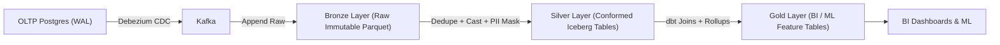
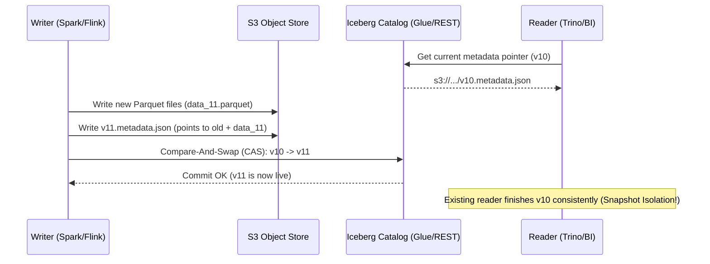
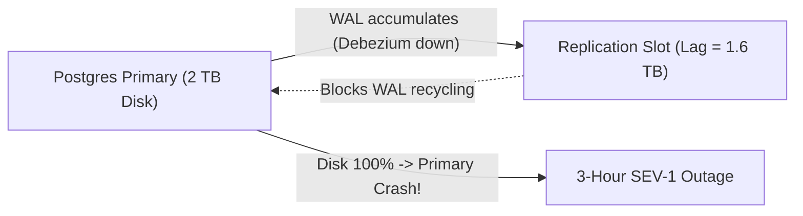

# Data Pipelines: ETL vs ELT, Lakehouse & Medallion Layers

> **Prerequisites:** [Lesson 08: Lambda vs Kappa Architecture: Batch + Speed Layers or Replay](../08-lambda-vs-kappa-architecture/README.md).  
> **Estimated Reading Time:** 24–28 minutes  
> **Target Audience:** Backend and data platform engineers designing company-wide data warehouses, CDC ingestion, and analytics lakes, and candidates asked "how do you design a modern data pipeline from OLTP Postgres to BI dashboards?"  
> **Free PDF Notes:** [Download SD-Q-009.pdf](https://backendroadmap.com/notes/system-design/SD-Q-009.pdf)

> [!NOTE]
> **In one line:** **ETL** transforms data *before* loading into a rigid warehouse; **ELT** lands raw data cheaply in cloud storage/warehouses first and transforms it in-place with SQL (dbt). A **Lakehouse** (Iceberg/Delta over S3 Parquet) combines data-lake economics with warehouse ACID transactions, organized into **Bronze (raw), Silver (cleaned), and Gold (aggregated)** Medallion layers.

> [!TIP]
> **The Golden Rule:** Always preserve an **immutable Bronze layer** of raw events/CDC so you can fix downstream transformation bugs without re-extracting from production OLTP databases. Never let BI tools query raw Bronze directly.

---

## 1. What Data Pipelines, ELT, and Lakehouses Are, and What They Aren't

A SaaS startup starts with Metabase querying a Postgres read replica directly. At 500 GB, analytical `GROUP BY` queries thrash the buffer pool, stall customer-facing reads, and break whenever a backend engineer renames a column. Moving to an analytical pipeline decouples OLTP from OLAP — but **how** you move and structure that data determines whether your analytics team ships in hours or spends months fighting broken schemas.

| Term | Precise Meaning | Example |
| :--- | :--- | :--- |
| **ETL (Extract-Transform-Load)** | Transform in an external engine (Spark/Informatica) *before* writing to target | Legacy on-prem warehouse ingestion |
| **ELT (Extract-Load-Transform)** | Land raw data into warehouse/lake first; transform via SQL/dbt inside the engine | Fivetran/Debezium -> Snowflake/Iceberg -> dbt |
| **CDC (Change Data Capture)** | Streaming row-level inserts/updates/deletes from OLTP WAL/binlog | Debezium reading Postgres WAL -> Kafka |
| **Data Lake** | Cheap object storage (S3) of raw Parquet/JSON files; no ACID transactions | S3 buckets + Hive Metastore |
| **Data Warehouse** | Managed, ACID-compliant columnar engine with coupled or decoupled storage | Snowflake, BigQuery, Redshift |
| **Lakehouse** | Open table format (**Iceberg / Delta**) adding ACID, time travel & schema evolution on S3 | S3 Parquet + Apache Iceberg + Trino/Spark |
| **Medallion (Bronze/Silver/Gold)** | Three-tier data refinement: Raw -> Cleansed/Conformed -> Business Aggregates | `bronze.orders_raw` -> `gold.daily_gmv` |
| **Not** | A replacement for OLTP point queries or sub-10ms user-facing APIs | Serving user profile pages from Iceberg |

### Why It Matters
1. Every scaling backend eventually needs an analytical plane without hurting OLTP latency.
2. **CDC + ELT + Lakehouse** is the modern industry standard; interviewers expect you to know why WAL-based CDC beats `SELECT * WHERE updated_at > last_run`.
3. Medallion architecture prevents "spaghetti SQL" and isolates upstream schema breaks in Bronze/Silver.

---

## 2. Anatomy: Modern CDC + ELT Lakehouse (Medallion Architecture)



In a modern Lakehouse pipeline:
1. **Extract & Load (CDC):** Debezium tails Postgres's Write-Ahead Log (WAL) with near-zero impact on OLTP queries and streams row changes to Kafka, which lands into **Bronze** (append-only, raw JSON/Parquet with ingestion metadata).
2. **Transform (ELT via dbt/Spark):**
   - **Bronze $\rightarrow$ Silver:** Deduplicate CDC events by primary key + `lsn` (log sequence number), cast types, enforce schema contracts, and mask PII.
   - **Silver $\rightarrow$ Gold:** Join normalized Silver tables into wide, business-ready star schemas (`fact_orders`, `dim_merchants`) and pre-aggregated KPIs (`daily_revenue`).

| Dimension | ETL | ELT | Lakehouse (Iceberg/Delta) |
| :--- | :--- | :--- | :--- |
| **Transform location** | Mid-tier cluster before load | Inside target warehouse/lakehouse | Inside compute engine (Spark/Trino/DuckDB) |
| **Raw data retention** | Often discarded after transform | Stored in raw schema | Stored in Bronze on cheap S3 ($0.023/GB) |
| **Schema change agility** | Fragile (pipeline breaks before load) | High (land raw, fix SQL transform) | High (schema evolution in Iceberg metadata) |
| **Storage lock-in** | High (proprietary warehouse) | Medium–High (Snowflake/BigQuery) | Low (open Parquet + Iceberg on your S3) |

> [!WARNING]
> **Never use polling `SELECT * FROM orders WHERE updated_at > ?` for production CDC!** Polling misses hard `DELETE`s, misses updates sharing the same timestamp, and hammers the OLTP database index during large backfills. Always use **log-based CDC** (Postgres WAL / MySQL binlog) or an append-only outbox.

---

## 3. Mathematical Model: Storage Amplification, Compaction & Cost

**Medallion Storage Amplification.** If raw Bronze data is $V_{\text{raw}}$ per day (say 500 GB/day compressed Parquet), Silver is deduplicated/typed ($0.8 \times V_{\text{raw}}$), and Gold aggregates are much smaller ($0.1 \times V_{\text{raw}}$), total daily storage added across all 3 layers is:

$$V_{\text{total}} = V_{\text{Bronze}} + V_{\text{Silver}} + V_{\text{Gold}} = (1.0 + 0.8 + 0.1)\,V_{\text{raw}} = 1.9\,V_{\text{raw}}$$

At 500 GB/day over 365 days: $1.9 \times 0.5\text{ TB} \times 365 = 346.75\text{ TB/year}$. On S3 ($23/TB-month), average annual storage cost is only **~$4,000/month** — whereas keeping 347 TB inside a proprietary warehouse at $40/TB-month + compute credits costs $14,000+/month for storage alone.

**Iceberg Snapshot / Small-File Overhead.** If CDC flushes micro-batches every 1 minute (1,440 commits/day), each commit creates small Parquet files and a new metadata manifest. Without compaction, reading 30 days scans $30 \times 1{,}440 = 43{,}200$ tiny files. Running hourly compaction merges 60 files into 1–2 files of 256 MB, cutting file open overhead by **30x–60x**.

---

## 4. Metrics & Percentiles

| Metric | Meaning | Alert when |
| :--- | :--- | :--- |
| **Data freshness (E2E lag)** | `now - max(source_commit_ts)` in Gold | Exceeds SLA (e.g., > 15 min for near-RT, > 2h for batch) |
| **CDC replication slot lag** | Unconsumed WAL bytes on OLTP Postgres | > 10 GB (risks filling OLTP primary disk!) |
| **dbt test failure rate** | `unique`, `not_null`, `accepted_values` failures | Any failure in Silver/Gold blocks publish |
| **Iceberg snapshot count** | Unexpired metadata snapshots on a table | > 1,000 (slows query planning) |
| **Warehouse query $p_{95}$** | BI dashboard query latency against Gold | > 5 seconds (needs clustering/Z-order) |

### Worked Example (10M Orders/Day SaaS Platform)
A SaaS platform processes 10M order mutations/day (~20 GB/day raw CDC).
- **Bronze:** Debezium + Kafka Connect writes 20 GB/day to S3 Iceberg `bronze.orders_cdc` every 2 minutes.
- **Silver:** Incremental `MERGE INTO silver.orders` runs every 15 minutes using the latest `lsn` per `order_id`, keeping `silver.orders` at ~1.2 TB total (3 years).
- **Gold:** `dbt` builds `gold.daily_merchant_kpis` (50 MB/day) with `unique` and `not_null` tests.
- **Cost:** S3 storage for all 3 layers (~3 TB) is **~$70/month**; Trino/DuckDB spot compute is **~$400/month**.

---

## 5. Compounding & Failure Modes

| Failure Mode | What Happens | Mitigation |
| :--- | :--- | :--- |
| **Abandoned Debezium connector** | Postgres retains WAL segments forever; **OLTP primary disk hits 100% and crashes** | Monitor `pg_replication_slots` lag & set `max_slot_wal_keep_size` |
| **Upstream schema change (`ALTER TABLE`)** | Downstream `INSERT` fails or shifts columns silently | Schema Registry + Bronze `variant`/JSON payload + Iceberg schema evolution |
| **Duplicate CDC events on restart** | At-least-once Debezium emits same `lsn` twice -> double-counted Gold revenue | Deduplicate in Silver (`ROW_NUMBER() OVER (PARTITION BY id ORDER BY lsn DESC) = 1`) |
| **Uncompacted Iceberg CDC tables** | 50,000 tiny delete-files (MoR) slow reads by 20x | Schedule `rewrite_data_files` + `expire_snapshots` daily |

---

## 6. Numbers Every Engineer Must Know

| Item | Typical | Implication |
| :--- | :---: | :--- |
| S3 object storage cost | ~$23 / TB-month | Cheap enough to keep raw Bronze forever |
| Iceberg metadata planning | 10–100 ms per query | Degrades if thousands of uncompacted snapshots/files accumulate |
| CDC end-to-end latency | 1–10 seconds (WAL to Kafka) | Near-real-time without impacting OLTP read replicas |
| Parquet compression ratio | 4x–8x vs CSV/JSON | Always land/compact to Parquet + ZSTD/Snappy |
| `dbt` incremental vs full refresh | 10x–100x faster on large tables | Use `is_incremental()` with lookback window for late rows |

---

## 7. Protocol / Mechanism Deep Dive: Iceberg ACID Snapshot & Time Travel



| Question | Answer |
| :--- | :--- |
| **How does Iceberg give ACID on S3 without locks?** | Optimistic concurrency via **Compare-And-Swap (CAS)** on the catalog's metadata pointer (`v10 -> v11`). Readers never see partial writes |
| **What is Time Travel?** | Querying `SELECT * FROM silver.orders FOR SYSTEM_TIME AS OF '2026-11-24 00:00:00'` reads `v10.metadata.json` directly |
| **Copy-on-Write (CoW) vs Merge-on-Read (MoR)?** | **CoW** rewrites the whole Parquet file on `UPDATE/DELETE` (fast reads, slower writes). **MoR** writes a tiny delete file (fast CDC writes, slower reads until compacted) |
| **What happens to deleted data?** | Files remain on S3 for time travel until `expire_snapshots()` + `remove_orphan_files()` run |

**When NOT to use a Lakehouse.** If your entire company data is < 50 GB and you already use Postgres/BigQuery with 3 analysts, setting up Kafka + Debezium + Spark + Iceberg is massive over-engineering. Start with managed ELT (or a Postgres read replica + dbt) until scale demands it.

---

## 8. Hierarchical Budgets & Design Rules

| Slice | Rule | Control |
| :--- | :--- | :--- |
| **Ingestion** | Use log-based CDC (WAL/binlog) or event streams; never poll OLTP tables | Alert on Postgres `wal_keep_size` / slot lag |
| **Bronze** | Append-only, raw, immutable, partitioned by `ingest_date` | Never update/delete Bronze; 0 business logic |
| **Silver** | Deduplicated (`lsn`), typed, PII-masked, 3NF/conformed | `dbt` `unique` + `not_null` tests |
| **Gold** | Star schema / wide marts optimized for BI & ML | Clustered/Z-ordered by query filter columns |
| **Maintenance** | Compact small files and expire old Iceberg snapshots | Scheduled `rewrite_data_files` + `expire_snapshots` |
| **Contracts** | Enforce schema & SLAs at producer boundary | Schema Registry / data contracts |

---

## 9. Top Mitigations

1. **Cap Postgres CDC replication slot retention** (`max_slot_wal_keep_size`) so a dead Debezium connector cannot fill the OLTP primary disk.
2. **Deduplicate CDC streams in Silver** using `(primary_key, lsn)` because at-least-once delivery is the norm.
3. **Mask or tokenize PII in Silver**, not Gold, so analysts and ML engineers never accidentally query raw emails/SSNs.
4. **Use Merge-on-Read (MoR) for high-frequency CDC upserts**, paired with scheduled compaction to keep read latency fast.
5. **Run `dbt test` as a blocking gate** before swapping/publishing Gold tables (Write-Audit-Publish).
6. **Partition by coarse time (`day`/`month`)**, not `user_id`, to avoid millions of tiny S3 prefixes.
7. **Expire Iceberg snapshots regularly** (e.g., keep 7 days) so metadata planning stays under 100 ms.

---

## 10. Production Reference / War Story: The Replication Slot Disk-Full Outage

A B2B SaaS company deployed Debezium to stream Postgres `orders` and `invoices` into their Snowflake/S3 Bronze layer.

- **The Incident (SEV-1):** On Friday night, a routine network ACL change blocked Debezium from reaching Kafka. The connector crashed and stayed down over the weekend. Because Postgres's logical replication slot (`debezium_slot`) was still active and unconsumed, Postgres **refused to vacuum or recycle WAL segments**. By Sunday at 14:00 UTC, the 2 TB NVMe volume on the primary OLTP database hit **100% disk**, crashing Postgres and taking down the entire SaaS product for 3 hours.
- **Root Cause:** Unbounded Postgres replication slot retention + no alert on `pg_wal_lsn_diff`.



- **The Fix:** Set `max_slot_wal_keep_size = 50GB` in `postgresql.conf` (if Debezium lags > 50 GB, Postgres drops the slot to save OLTP, and Debezium triggers an automatic snapshot recovery), and added PagerDuty alerts at 10 GB WAL lag.

---

## 11. Multi-Language Production Code Tabs

A **Medallion CDC Deduplicator & Compactor** (Bronze raw CDC events $\rightarrow$ Silver deduplicated latest state, handling out-of-order `lsn` and `DELETE` tombstones).

````carousel
```go
// Go: Bronze-to-Silver CDC deduplication (keeps latest LSN per primary key, handles deletes).
package main

type CDCEvent struct {
	ID      string
	LSN     int64  // Log Sequence Number (monotonically increasing)
	Op      string // "c" (create), "u" (update), "d" (delete)
	Payload map[string]any
}

func BronzeToSilver(bronze []CDCEvent) map[string]map[string]any {
	latest := make(map[string]CDCEvent)
	for _, ev := range bronze {
		prev, exists := latest[ev.ID]
		if !exists || ev.LSN > prev.LSN {
			latest[ev.ID] = ev
		}
	}

	silver := make(map[string]map[string]any)
	for id, ev := range latest {
		if ev.Op == "d" {
			continue // Tombstone: exclude deleted rows from current Silver snapshot
		}
		silver[id] = ev.Payload
	}
	return silver
}
```
<!-- slide -->
```typescript
// TypeScript: Bronze CDC stream -> deduplicated Silver state with PII masking.
export interface CdcRecord {
  id: string;
  lsn: number;
  op: "c" | "u" | "d";
  email?: string;
  amountCents: number;
}

export function buildSilverSnapshot(bronzeEvents: CdcRecord[]): Map<string, { id: string; emailHash: string; amountCents: number }> {
  const latestById = new Map<string, CdcRecord>();
  for (const ev of bronzeEvents) {
    const cur = latestById.get(ev.id);
    if (!cur || ev.lsn > cur.lsn) {
      latestById.set(ev.id, ev);
    }
  }

  const silver = new Map<string, { id: string; emailHash: string; amountCents: number }>();
  for (const [id, ev] of latestById.entries()) {
    if (ev.op === "d") continue; // Apply delete tombstone
    silver.set(id, {
      id,
      emailHash: ev.email ? `sha256:${ev.email.length}` : "redacted", // Mask PII in Silver
      amountCents: ev.amountCents,
    });
  }
  return silver;
}
```
<!-- slide -->
```python
# Python: Bronze -> Silver CDC deduplication + Gold aggregation (stdlib only).
import hashlib
from collections import defaultdict


def bronze_to_silver(bronze_events: list[dict]) -> dict[str, dict]:
    """Deduplicate raw CDC events by (id, lsn), apply deletes, and mask PII."""
    latest = {}
    for ev in bronze_events:
        eid = ev["id"]
        if eid not in latest or ev["lsn"] > latest[eid]["lsn"]:
            latest[eid] = ev

    silver = {}
    for eid, ev in latest.items():
        if ev["op"] == "d":
            continue
        email = ev.get("email", "")
        silver[eid] = {
            "id": eid,
            "merchant_id": ev["merchant_id"],
            "amount_cents": int(ev["amount_cents"]),
            "email_hash": hashlib.sha256(email.encode()).hexdigest()[:16],
        }
    return silver


def silver_to_gold_gmv(silver_rows: dict[str, dict]) -> dict[str, int]:
    """Aggregate Silver rows into Gold merchant GMV table."""
    gmv = defaultdict(int)
    for row in silver_rows.values():
        gmv[row["merchant_id"]] += row["amount_cents"]
    return dict(gmv)
```
<!-- slide -->
```csharp
// C#: Bronze-to-Silver CDC deduplication with LSN ordering and delete handling.
using System.Collections.Generic;

public sealed record CdcEvent(string Id, long Lsn, string Op, string MerchantId, long AmountCents);
public sealed record SilverOrder(string Id, string MerchantId, long AmountCents);

public static class MedallionPipeline
{
    public static Dictionary<string, SilverOrder> BronzeToSilver(IEnumerable<CdcEvent> bronze)
    {
        var latest = new Dictionary<string, CdcEvent>();
        foreach (var ev in bronze)
        {
            if (!latest.TryGetValue(ev.Id, out var prev) || ev.Lsn > prev.Lsn)
                latest[ev.Id] = ev;
        }

        var silver = new Dictionary<string, SilverOrder>();
        foreach (var (id, ev) in latest)
        {
            if (ev.Op == "d") continue;
            silver[id] = new SilverOrder(id, ev.MerchantId, ev.AmountCents);
        }
        return silver;
    }
}
```
````

---

## 12. Hands-On CLI Verification Workflows

```bash
# 1. Postgres: check CDC replication slot WAL lag (prevent disk-full SEV-1!)
psql -c "SELECT slot_name, active, pg_size_pretty(pg_wal_lsn_diff(pg_current_wal_lsn(), restart_lsn)) AS wal_lag FROM pg_replication_slots;"

# 2. dbt: run Silver & Gold models and enforce data quality tests
dbt run --select silver+ gold+
dbt test --select silver+ gold+

# 3. Iceberg / Spark SQL: compact small CDC files and expire snapshots older than 7 days
spark-sql -e "
CALL catalog.system.rewrite_data_files(table => 'silver.orders');
CALL catalog.system.expire_snapshots(table => 'silver.orders', older_than => TIMESTAMP '2026-11-18 00:00:00');
"
```

---

## 13. Common Mistakes to Avoid

1. **Polling OLTP databases with `SELECT * WHERE updated_at > ?`**, missing hard deletes and hammering production indexes.
2. **Leaving Postgres replication slots unbounded**, risking 100% disk crash when Debezium stops.
3. **Letting BI dashboards query raw Bronze tables**, causing slow scans and broken queries on every schema tweak.
4. **Skipping CDC deduplication in Silver**, double-counting rows when Debezium restarts at-least-once.
5. **Running Iceberg without periodic compaction**, accumulating 100k+ tiny files and delete manifests.
6. **Storing unmasked PII in Gold**, exposing customer emails/phones to every BI user.
7. **Building a full Lakehouse for < 50 GB of data**, adding operational complexity for zero benefit.

---

## 14. Key Terms Glossary

| Key Term | Definition |
| :--- | :--- |
| **ETL** | Extract, Transform in an external cluster, then Load into target warehouse. |
| **ELT** | Extract and Load raw data first, then Transform in-place using SQL/dbt. |
| **CDC (Change Data Capture)** | Streaming row-level changes from an OLTP database's transaction log (WAL/binlog). |
| **Lakehouse** | Architecture combining S3 data-lake storage with ACID warehouse table formats. |
| **Apache Iceberg / Delta Lake** | Open table formats providing ACID snapshots, time travel, and schema evolution on Parquet. |
| **Bronze Layer** | Immutable, append-only raw landing zone preserving source fidelity. |
| **Silver Layer** | Deduplicated, typed, PII-masked, conformed operational tables. |
| **Gold Layer** | Business-level star schemas and pre-aggregated tables for BI/ML. |
| **Copy-on-Write vs Merge-on-Read** | Rewriting files on update (fast reads) vs writing delta delete files (fast writes). |
| **Data Contract** | Formal schema, SLA, and semantic agreement between data producers and consumers. |

---

## 15. System Design Interview Questions & Answers

### Basic Conceptual Questions

<details>
<summary><strong>Q1: What is the difference between ETL and ELT, and why did ELT win? [BASIC]</strong></summary>

**Answer:**
**ETL** transforms data in a separate cluster before loading it into a warehouse; **ELT** loads raw data first and transforms it inside the warehouse/lakehouse using SQL (e.g., dbt). ELT won because cloud object storage (S3) and elastic warehouses (Snowflake/BigQuery) made storing raw data cheap, and keeping raw data lets you fix bugs or build new metrics without re-extracting from source systems.
</details>

<details>
<summary><strong>Q2: Explain the Bronze, Silver, and Gold Medallion layers. [BASIC]</strong></summary>

**Answer:**
**Bronze:** raw, immutable, append-only ingestion history. **Silver:** cleaned, deduplicated, typed, and PII-masked conformed tables. **Gold:** business-level aggregations and star schemas optimized for BI dashboards and ML features.
</details>

<details>
<summary><strong>Q3: What is a Data Lakehouse, and what problem does it solve? [BASIC]</strong></summary>

**Answer:**
A Lakehouse (using **Apache Iceberg** or **Delta Lake** over S3 Parquet) solves the trade-off between **Data Lakes** (cheap S3 storage, no ACID, corrupt partial writes, no updates/deletes) and **Data Warehouses** (ACID, fast SQL, but expensive proprietary storage lock-in).
</details>

<details>
<summary><strong>Q4: Why is log-based CDC (Debezium) preferred over SQL polling? [BASIC]</strong></summary>

**Answer:**
Log-based CDC reads Postgres WAL or MySQL binlog sequentially with minimal OLTP impact, captures **hard `DELETE`s** and intermediate updates, and preserves exact commit order (`lsn`). SQL polling misses deletes and stresses OLTP indexes.
</details>

### Scenario-Based Architecture Questions

<details>
<summary><strong>Q5: Your analytics team's BI queries run directly on production Postgres read replicas and are causing customer timeouts. Design the replacement. [SCENARIO]</strong></summary>

**Answer:**
Decouple OLTP from OLAP using **Debezium CDC -> Kafka -> S3 Iceberg (Bronze)**. Schedule `dbt` / Spark every 15–60 minutes to deduplicate into **Silver** and build **Gold** star schemas. Point BI tools (Metabase/Looker) at a Trino/ClickHouse/Snowflake engine querying Gold. Zero analytical load hits OLTP Postgres.
</details>

<details>
<summary><strong>Q6: A backend team renames `user_id` to `account_id` in Postgres, breaking 12 downstream BI dashboards. How do you prevent this? [SCENARIO]</strong></summary>

**Answer:**
Enforce **Data Contracts** in CI/Schema Registry so breaking column renames are blocked or versioned. In the Medallion architecture, **Silver** acts as an anti-corruption layer: it maps both old and new fields (`COALESCE(account_id, user_id) AS user_id`) so **Gold** and BI dashboards never break.
</details>

<details>
<summary><strong>Q7: Your Iceberg CDC table receives 500 updates/sec, and within a week Trino queries slow from 2s to 90s. Why? [SCENARIO]</strong></summary>

**Answer:**
High-frequency CDC upserts create thousands of tiny Parquet data files and Merge-on-Read delete files, plus hundreds of snapshots. Schedule automated **compaction** (`rewrite_data_files`) to merge small files into 128–256 MB Parquet files and **snapshot expiration** (`expire_snapshots`) to prune old metadata.
</details>

<details>
<summary><strong>Q8: How do you handle GDPR deletion in a Medallion Lakehouse? [SCENARIO]</strong></summary>

**Answer:**
Run an Iceberg `DELETE FROM ... WHERE user_id = ?` across Silver and Gold, then run `rewrite_data_files` and `expire_snapshots` so the physical Parquet bytes containing the user's PII are purged from S3. For immutable Bronze, either apply the same purge or use **crypto-shredding** (per-user encryption keys).
</details>

### Advanced & Tricky Interview Questions

<details>
<summary><strong>Q9: How does Apache Iceberg achieve ACID transactions on S3 when S3 has no multi-object transactions? [TRICKY]</strong></summary>

**Answer:**
Iceberg writes new Parquet files and a new metadata JSON file (`v11.metadata.json`) immutably to S3 first, then performs an atomic **Compare-And-Swap (CAS)** on the central Catalog (e.g., AWS Glue, Hive, or REST Catalog) to swap the table pointer from `v10` to `v11`. Readers only ever see complete snapshots.
</details>

<details>
<summary><strong>Q10: What happens to your OLTP Postgres database if Debezium is down for 48 hours? [TRICKY]</strong></summary>

**Answer:**
Postgres holds onto all unconsumed WAL segments for the replication slot, which can fill the primary disk and crash the database. Mitigate by setting `max_slot_wal_keep_size` in Postgres, alerting on WAL lag, and having a runbook to re-snapshot if the slot is invalidated.
</details>

<details>
<summary><strong>Q11: Compare Copy-on-Write (CoW) vs Merge-on-Read (MoR) in Iceberg/Delta. [TRICKY]</strong></summary>

**Answer:**
**CoW** rewrites the entire affected Parquet file on every update/delete — fast reads, high write amplification. **MoR** appends small position/equality delete files — fast streaming CDC writes, slower reads until background compaction merges them. Use **CoW** for hourly/daily batch and **MoR** for minute-level streaming CDC.
</details>

<details>
<summary><strong>Q12: Why should Bronze tables preserve `lsn` and `op` instead of just the latest row state? [TRICKY]</strong></summary>

**Answer:**
Because at-least-once delivery and out-of-order replays happen. Without `lsn` (monotonically increasing log position) and `op` (`c/u/d`), Silver cannot tell whether an `UPDATE` happened before or after a `DELETE`, leading to "zombie" resurrected rows.
</details>

---

## 16. One-Page Master Cheat Sheet

```
+---------------------------------------------------------------------------------------------------------+
|                    DATA PIPELINES (ETL/ELT, LAKEHOUSE & MEDALLION) — MASTER CHEAT SHEET                 |
+---------------------------------------------------------------------------------------------------------+
| 1. ETL vs ELT: ELT lands raw data cheaply first, then transforms in-place with SQL (dbt/Spark).         |
+---------------------------------------------------------------------------------------------------------+
| 2. INGESTION: Use log-based CDC (Debezium WAL/binlog), never SQL polling. Cap Postgres WAL slot size!   |
+---------------------------------------------------------------------------------------------------------+
| 3. MEDALLION:                                                                                           |
|    - Bronze: Immutable raw append-only (with lsn, op, ingest_ts).                                       |
|    - Silver: Deduplicated (by lsn), typed, PII-masked, conformed.                                       |
|    - Gold:   Business star schemas & pre-aggregated BI/ML marts.                                        |
+---------------------------------------------------------------------------------------------------------+
| 4. LAKEHOUSE (Iceberg/Delta): S3 Parquet + atomic Catalog CAS -> ACID, Time Travel, Schema Evolution.   |
|    MoR for fast CDC writes + scheduled compaction (`rewrite_data_files`) + `expire_snapshots`.          |
+---------------------------------------------------------------------------------------------------------+
```

---

## Further Reading & Sources

- Martin Kleppmann, *Designing Data-Intensive Applications*, Chapter 11 ("Change Data Capture") & Chapter 12.
- Databricks / Apache Iceberg Documentation, *Medallion Architecture & Iceberg Table Spec* (iceberg.apache.org).
- Debezium Documentation, *PostgreSQL Connector & Replication Slot Management* (debezium.io).
- Tristan Handy (dbt Labs), *How to Structure Your dbt Projects* (Staging/Silver/Mart/Gold patterns).

---

## Free PDF Notes

[SD-Q-009.pdf](https://backendroadmap.com/notes/system-design/SD-Q-009.pdf)

---

## Next

Continue with [Lesson 10: Time-Series Data: Rollups, Retention & Cardinality at 1M pts/s](../10-time-series-data/README.md).
