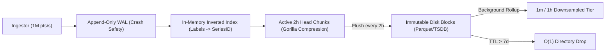
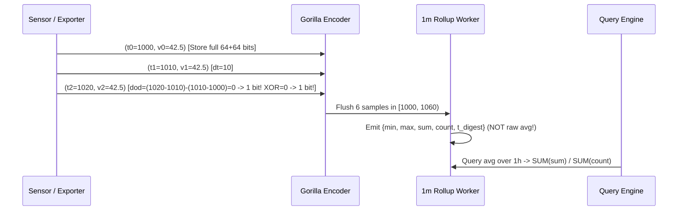
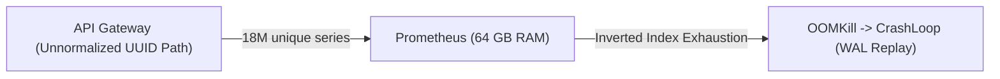

# Time-Series Data: Rollups, Retention & Cardinality at 1M pts/s

> **Prerequisites:** [Lesson 09: Data Pipelines: ETL vs ELT, Lakehouse & Medallion Layers](../09-data-pipelines/README.md).  
> **Estimated Reading Time:** 24–28 minutes  
> **Target Audience:** Backend and observability engineers designing metrics platforms (Prometheus, VictoriaMetrics, InfluxDB, TimescaleDB), IoT telemetry ingestors, and candidates asked "how do you ingest 1M metrics/sec and survive high-cardinality tags?"  
> **Free PDF Notes:** [Download SD-Q-010.pdf](https://backendroadmap.com/notes/system-design/SD-Q-010.pdf)

> [!NOTE]
> **In one line:** Time-series databases (TSDBs) optimize for **append-heavy, immutable `(timestamp, value)` streams** grouped by **series labels**. At 1M pts/s, B-trees collapse under random I/O — TSDBs survive via **LSM-like time-partitioned chunks**, **delta-of-delta + XOR compression** (~1.4 bytes/sample), **automated downsampling rollups**, and strict **cardinality budgets** so an unbounded tag (like `user_id`) never OOMs the inverted index.

> [!TIP]
> **The Golden Rule:** Never put unbounded values (`user_id`, `request_id`, `ip_address`, `trace_id`) into TSDB metric labels. Cardinality multiplies across tag combinations — store bounded dimensions in your TSDB and unbounded IDs in **logs or traces** (ClickHouse / Tempo).

---

## 1. What Time-Series Data Is, and What It Isn't

A fleet of 100,000 servers and IoT sensors emits CPU, memory, and latency gauges every 10 seconds — **1,000,000 data points per second**. If you insert 1M rows/sec into a standard Postgres B-tree table with secondary indexes on `(metric, host, region, ts)`, every insert updates multiple random B-tree pages, exhausting disk IOPS within minutes and burning 40+ bytes per sample. A purpose-built **TSDB** turns random writes into sequential memory appends, compresses each 16-byte `(int64 ts, float64 val)` down to **1.4 bytes**, and drops old data in $O(1)$ by deleting expired time-chunk directories.

| Term | Precise Meaning | Example |
| :--- | :--- | :--- |
| **Data point / Sample** | Immutable `(timestamp, float64 value)` pair | `(1732512000, 0.742)` |
| **Time series** | Metric name + sorted set of `key=value` tag pairs | `http_reqs{service="api",status="500"}` |
| **Cardinality** | Number of **active unique series** (distinct label combinations) | 100 services × 50 hosts × 5 codes = 25,000 |
| **Inverted index** | Maps `tag=value` $\rightarrow$ posting list of series IDs in RAM | `service="api"` $\rightarrow$ `[s1, s2, ...]` |
| **Chunk / Block** | Compressed columnar buffer of samples for one series over a time window | 2-hour Prometheus TSDB block |
| **Delta-of-delta + XOR** | Gorilla compression: encodes regular timestamps in 1 bit & steady floats in 1–2 bits | 16 bytes $\rightarrow$ ~1.37 bytes/sample |
| **Downsampling / Rollup** | Pre-aggregating fine raw points (10s) into coarse summaries (1m, 1h) | `avg`, `max`, `p99` (via HdrHistogram/t-digest) |
| **Retention policy** | Dropping expired time blocks by deleting whole partition directories | Raw: 7d, 1m rollup: 90d, 1h: 2y |
| **Not** | An OLTP database for random row updates or unbounded high-cardinality joins | Updating a user's billing address |

### Why It Matters
1. Observability (Prometheus/Datadog/Grafana), IoT, and financial tick systems all hit **100k–10M pts/s** write rates.
2. **Cardinality explosion** is the #1 cause of TSDB outages — a single careless `user_id` tag can OOM a 128 GB Prometheus instance in 5 minutes.
3. Rollups + tiered retention cut storage costs by **10x–50x** while keeping 1-year dashboard queries under 200 ms.

---

## 2. Anatomy: TSDB Write Path, Inverted Index & Tiered Rollups



On write:
1. The ingestor appends the batch to a sequential **WAL** for crash durability.
2. It hashes the sorted label set (`metric + tags`). If it's an existing series, it appends `(ts, val)` to the in-memory **Head Chunk**; if it's a **new** series, it allocates a SeriesID and updates the **Inverted Index** in RAM.
3. Because timestamps arrive in roughly regular intervals (e.g., every 10 s) and values change smoothly, **Gorilla compression** shrinks 16 bytes/sample to **~1.4 bytes/sample**.
4. Every 2 hours, immutable blocks flush to disk/S3, and background workers compute **1m and 1h rollups** (`min`, `max`, `sum`, `count`, `t-digest`). Expiring 7-day-old raw data simply `rm -rf`s the block directory — **zero `DELETE` tombstones or vacuuming**.

| Storage Engine | Write Pattern | Compression | Delete Old Data |
| :--- | :--- | :--- | :--- |
| **B-Tree (Vanilla Postgres)** | Random page I/O + WAL | ~40–80 bytes/row | Expensive `DELETE` + `VACUUM` |
| **TSDB (Prometheus/VM/Timescale)** | Sequential WAL + RAM Head | ~1.2–2.0 bytes/sample | $O(1)$ drop time-partition/block |

> [!WARNING]
> **Beware the Cartesian Cardinality Trap!** Adding just 3 innocent-looking labels — `pod_id` (500) $\times$ `http_path` (200) $\times$ `user_id` (100,000) — creates $10{,}000{,}000{,}000$ ($10^{10}$) potential series. Even if only 1% are active (100M series), at ~1 KB of RAM per active series metadata + index, your TSDB needs **100 GB of RAM** before storing a single data point!

---

## 3. Mathematical Model: Ingestion Bandwidth, Compression & Rollup Savings

**Raw vs Compressed Storage at 1M pts/s.** At $\lambda = 1{,}000{,}000\text{ pts/s}$:
- Uncompressed `(int64 ts, float64 val)` = $16\text{ bytes/sample} \implies 16\text{ MB/s} \approx 1.38\text{ TB/day}$.
- With **Gorilla compression** ($B_c \approx 1.4\text{ bytes/sample}$):

$$\text{Compressed Ingest} = 10^6 \times 1.4\text{ B/s} = 1.4\text{ MB/s} \approx 121\text{ GB/day}$$

**Active Memory for Cardinality $C$.** Each active series needs a Head Chunk buffer ($\approx 1\text{ KB}$) plus inverted index postings ($\approx 0.5\text{ KB}$), so RAM scales linearly with **active cardinality $C$**, *not* just write rate $\lambda$:

$$\text{RAM}_{\text{TSDB}} \approx C \times 1.5\text{ KB}$$

For $C = 10{,}000{,}000$ active series: $\text{RAM} \approx 15\text{ GB}$. For $C = 100{,}000{,}000$: $\text{RAM} \approx 150\text{ GB}$ (OOM on a 64 GB node).

**Rollup & Retention Storage Savings.** Suppose you retain:
- **Raw (10 s):** 7 days $\times 121\text{ GB/day} = 847\text{ GB}$.
- **1-minute rollup** ($6\times$ fewer points, storing 4 aggregates: `min, max, sum, count` $\implies \frac{4}{6} = 0.67\times$ raw): 90 days $\times 81\text{ GB/day} \approx 7.3\text{ TB}$ (or $1.8\text{ TB}$ if only `avg`+`max`).
- **1-hour rollup** ($360\times$ fewer points): 730 days $\times 1.35\text{ GB/day} \approx 985\text{ GB}$.
- Keeping **raw 10 s for 2 years** would cost $730 \times 121\text{ GB} = \mathbf{88.3\text{ TB}}$ — rollups cut 2-year storage by **~10x–30x** and make 1-year queries scan $360\times$ fewer points.

---

## 4. Metrics & Percentiles

| Metric | Meaning | Alert when |
| :--- | :--- | :--- |
| **Active series count (Cardinality)** | Total unique label sets in the current head block | > 70% of node RAM budget |
| **Series churn rate** | New series created per minute (e.g., ephemeral K8s pods) | Sustained spike (causes index bloat) |
| **Ingest rate (samples/s)** | Points/sec accepted by write path | Approaches shard CPU/WAL limit |
| **WAL replay time** | Time to recover head block after crash | > 2–5 minutes (blocks restart) |
| **Query samples scanned** | Points touched per dashboard query | > 10M samples/query (needs rollup!) |
| **Dropped samples (rate-limited)** | Points rejected due to per-tenant cardinality cap | > 0 (page owning team) |

### Worked Example (1M pts/s Fleet Telemetry)
You ingest 1M pts/s across 2,000,000 active series ($C = 2\text{M}$) with 10-second scrape intervals.
- **Sharding:** Partition by `hash(metric_name, sorted_labels) % 16` across 16 ingest shards. Each shard handles **62,500 pts/s** and **125,000 active series** ($\approx 190\text{ MB}$ head RAM per shard — super comfortable).
- **Compression:** Gorilla delta-of-delta + XOR reduces 16 MB/s raw stream to **1.4 MB/s** across the cluster (87.5 KB/s per shard).
- **Query:** A 90-day dashboard automatically routes to the **1-hour rollup tier**, scanning $90 \times 24 = 2{,}160$ points per series instead of $777{,}600$ raw points — finishing in **15 ms** instead of 8 seconds.

---

## 5. Compounding & Failure Modes

| Failure Mode | What Happens | Mitigation |
| :--- | :--- | :--- |
| **Unbounded label (`user_id`, `uuid`)** | Active series jumps from 2M to 80M -> Inverted index OOMs TSDB | Enforce **relabel drop rules** + per-tenant cardinality limits |
| **Ephemeral K8s pod churn** | Rolling deploy creates 50k new `pod_name` series every hour -> index bloats | Drop `pod_uid` / aggregate at service level; compact index blocks |
| **Averaging averages in rollups** | `avg(1h)` computed from `avg(1m)` gives **wrong math** when sample counts differ | Store **`sum` and `count`** in rollups; compute `sum / count` at query time! |
| **Averaging percentiles (`p99`)** | `avg(p99_1m)` is mathematically meaningless | Store **t-digest / HdrHistogram** sketches or bucketed histograms (`le`) |

---

## 6. Numbers Every Engineer Must Know

| Item | Typical | Implication |
| :--- | :---: | :--- |
| Gorilla compressed sample | 1.2 – 1.8 bytes/point | ~10x smaller than raw `(int64, float64)` |
| RAM per active time series | ~1 – 2 KB (chunk + index) | 10M active series $\approx$ 15 GB RAM |
| Single-node Prometheus limit | ~500k–1M pts/s, ~10M active series | Shard/federate or use VictoriaMetrics/Mimir beyond this |
| TSDB block flush interval | 2 hours (Prometheus default) | Balances WAL recovery time vs block compaction |
| Dashboard query point budget | < 1,000–2,000 points per pixel/panel | Use rollups for > 6h time ranges |

---

## 7. Protocol / Mechanism Deep Dive: Gorilla Delta-of-Delta & Rollup Algebra



| Question | Answer |
| :--- | :--- |
| **How does Gorilla encode timestamps in 1 bit?** | **Delta-of-delta:** $D = (t_n - t_{n-1}) - (t_{n-1} - t_{n-2})$. If intervals are regular (10s, 10s, 10s), $D = 0$, encoded as a single `0` bit! |
| **How does Gorilla encode float values?** | **XOR** with previous value (`v_n ^ v_{n-1}`). If unchanged, XOR is `0` (1 bit); if slightly changed, leading/trailing zeros are shared |
| **Why store `(sum, count)` instead of `avg` in rollups?** | Because `avg` is **non-associative**: if minute 1 has 10 samples and minute 2 has 1 sample, `(avg1 + avg2)/2` is wrong; `(sum1+sum2)/(count1+count2)` is exact |
| **How do you roll up `p99` latency accurately?** | Store mergeable **HDR Histograms / t-digest** or Prometheus `histogram_quantile` cumulative buckets (`le`), never average `p99`s |

**When NOT to use a TSDB.** Do not use a TSDB for high-cardinality event logs (`user_id`, `trace_id`, `error_message` -> use ClickHouse/Elasticsearch/Loki), or for transactional data requiring updates/joins across entities (use Postgres).

---

## 8. Hierarchical Budgets & Design Rules

| Slice | Rule | Control |
| :--- | :--- | :--- |
| **Label Hygiene** | Only bounded dimensions (`service`, `region`, `status`) in metric tags | Relabeling allowlists; reject `user_id`/`uuid` at ingest |
| **Per-Tenant Limits** | Cap max active series & samples/sec per team/tenant | Return `429` or drop excess series with alert |
| **Rollup Math** | Store `min`, `max`, `sum`, `count`, and `histogram/t-digest` | Never average `avg` or `p99` across rollups |
| **Tiered Retention** | Raw (10s) = 7–14d; 1m = 90d; 1h = 2y | Automated block drop ($O(1)$ directory delete) |
| **Sharding** | Consistent-hash by `(metric_name, labels)` across ingestors | Keeps all samples for a series on one shard |
| **Query Routing** | Auto-select coarsest rollup tier that satisfies requested step | Query planner rewrites `step >= 1h` to `1h` table |

---

## 9. Top Mitigations

1. **Enforce strict label allowlists** at the collector/agent so `user_id`, `url_with_id`, or `trace_id` never enter the TSDB.
2. **Normalize HTTP paths** (`/users/12345` $\rightarrow$ `/users/:id`) before emitting metrics.
3. **Set per-tenant `max_active_series` quotas** so one misbehaving service cannot OOM the shared TSDB cluster.
4. **Compute rollups using associative monoids** (`sum`, `count`, `min`, `max`, `t-digest`), never `avg(avg)` or `avg(p99)`.
5. **Drop expired data by whole time-partition/block**, never row-level SQL `DELETE`.
6. **Pre-aggregate high-churn pod metrics** at the edge or recording rules if K8s pods churn every few minutes.
7. **Downsample automatically at query time** based on the dashboard's time range (`7d` $\rightarrow$ `5m` rollup).

---

## 10. Production Reference / War Story: The `http_path` Cardinality Explosion

An e-commerce backend added a Prometheus counter `http_requests_total{method, path, status}` to their API gateway.

- **The Incident (SEV-1):** A new endpoint `/orders/{order_uuid}/receipt` was deployed without route-template normalization, so the raw URL `/orders/9f8a.../receipt` was passed as the `path` label. Within 40 minutes, **18 million unique series** were created. Prometheus's in-memory inverted index grew to 64 GB, triggered an **OOMKill**, entered a crash-loop replaying a 12 GB WAL, and blinded all production alerting for 2 hours during peak traffic.
- **Root Cause:** Unbounded UUID values in a metric label caused Cartesian cardinality explosion in the RAM inverted index.



- **The Fix:** Normalized routes to `/orders/:order_id/receipt` at the gateway, added a Prometheus `metric_relabel_configs` rule dropping any `path` matching a UUID regex, set `max_series_per_metric` limits, and moved per-request URL debugging to **structured logs** in ClickHouse.

---

## 11. Multi-Language Production Code Tabs

A **Gorilla Delta-of-Delta Timestamp Encoder** + **Associative Rollup Aggregator** (`min`, `max`, `sum`, `count`) demonstrating why TSDBs compress so well and how rollups stay mathematically exact.

````carousel
```go
// Go: Delta-of-delta timestamp compression check & associative TSDB rollup bucket.
package main

type RollupBucket struct {
	WindowStart int64
	Min, Max    float64
	Sum         float64
	Count       int64
}

func MergeRollups(a, b RollupBucket) RollupBucket {
	if a.Count == 0 {
		return b
	}
	if b.Count == 0 {
		return a
	}
	minVal := a.Min
	if b.Min < minVal {
		minVal = b.Min
	}
	maxVal := a.Max
	if b.Max > maxVal {
		maxVal = b.Max
	}
	return RollupBucket{
		WindowStart: a.WindowStart,
		Min:         minVal,
		Max:         maxVal,
		Sum:         a.Sum + b.Sum,
		Count:       a.Count + b.Count, // Exact avg = Sum / Count
	}
}

// DeltaOfDelta returns 0 when timestamps arrive at a steady interval (encodes in 1 bit!).
func DeltaOfDelta(tPrev2, tPrev1, tCurr int64) int64 {
	return (tCurr - tPrev1) - (tPrev1 - tPrev2)
}
```
<!-- slide -->
```typescript
// TypeScript: Associative TSDB Rollup + Gorilla Delta-of-Delta estimator.
export interface Rollup {
  min: number;
  max: number;
  sum: number;
  count: number;
}

export function addSample(r: Rollup | undefined, val: number): Rollup {
  if (!r) return { min: val, max: val, sum: val, count: 1 };
  return {
    min: Math.min(r.min, val),
    max: Math.max(r.max, val),
    sum: r.sum + val,
    count: r.count + 1,
  };
}

export function mergeRollups(a: Rollup, b: Rollup): Rollup {
  return {
    min: Math.min(a.min, b.min),
    max: Math.max(a.max, b.max),
    sum: a.sum + b.sum,
    count: a.count + b.count,
  };
}

export function avgFromRollup(r: Rollup): number {
  return r.count === 0 ? 0 : r.sum / r.count; // Never average pre-computed averages!
}
```
<!-- slide -->
```python
# Python: Gorilla delta-of-delta bit-cost simulator & associative rollup merger (stdlib only).
def estimate_gorilla_bits(timestamps: list[int], values: list[float]) -> int:
    """Estimate compressed bits using Gorilla delta-of-delta (timestamps) + XOR (values)."""
    if not timestamps:
        return 0
    bits = 64 + 64  # First (ts, val) stored uncompressed
    for i in range(1, len(timestamps)):
        dod = 0 if i < 2 else (timestamps[i] - timestamps[i - 1]) - (timestamps[i - 1] - timestamps[i - 2])
        bits += 1 if dod == 0 else (14 if abs(dod) <= 64 else 36)
        bits += 1 if values[i] == values[i - 1] else 20  # 1 bit if unchanged, ~20 bits for small XOR
    return bits


def merge_rollups(rollups: list[dict]) -> dict:
    """Exact associative merge of 1m rollups into 1h rollup."""
    return {
        "min": min(r["min"] for r in rollups),
        "max": max(r["max"] for r in rollups),
        "sum": sum(r["sum"] for r in rollups),
        "count": sum(r["count"] for r in rollups),
    }
```
<!-- slide -->
```csharp
// C#: Associative TSDB Rollup Bucket (min/max/sum/count) for exact downsampling.
using System;

public readonly record struct RollupBucket(double Min, double Max, double Sum, long Count)
{
    public double Avg => Count == 0 ? 0.0 : Sum / Count;

    public static RollupBucket FromSample(double v) => new(v, v, v, 1);

    public static RollupBucket Merge(RollupBucket a, RollupBucket b)
    {
        if (a.Count == 0) return b;
        if (b.Count == 0) return a;
        return new RollupBucket(
            Math.Min(a.Min, b.Min),
            Math.Max(a.Max, b.Max),
            a.Sum + b.Sum,
            a.Count + b.Count
        );
    }
}
```
````

---

## 12. Hands-On CLI Verification Workflows

```bash
# 1. Verify Gorilla compression ratio on 3,600 10-second samples (10 hours)
python -c "
ts = [1732512000 + i * 10 for i in range(3600)]
vals = [42.5 if i % 5 != 0 else 42.6 for i in range(3600)]
raw_bytes = len(ts) * 16
# Steady 10s interval -> dod=0 (1 bit/ts); mostly unchanged XOR -> ~5 bits/val avg
print(f'Raw: {raw_bytes} B ({raw_bytes/len(ts):.1f} B/pt) vs Gorilla ~{int(len(ts)*1.4)} B (1.4 B/pt)')
"

# 2. Prometheus TSDB: inspect top 10 highest-cardinality metric names & label pairs
curl -s http://localhost:9090/api/v1/status/tsdb | jq '.data.seriesCountByMetricName[:10]'

# 3. TimescaleDB: verify continuous aggregate (rollup) & automatic retention drop policy
psql -c "SELECT hypertable_name, total_bytes FROM timescaledb_information.hypertables;"
```

---

## 13. Common Mistakes to Avoid

1. **Putting `user_id`, `request_id`, or unnormalized URLs in metric labels**, triggering cardinality OOMs.
2. **Storing `avg` instead of `(sum, count)` in rollups**, producing mathematically wrong averages on uneven traffic.
3. **Averaging `p99` values across 1-minute buckets** instead of merging `t-digest` or `le` histogram buckets.
4. **Using SQL `DELETE FROM metrics WHERE ts < ...`** instead of dropping time-partitioned blocks/hypertable chunks.
5. **Inserting 1M pts/s into a B-tree table with 5 secondary indexes**, saturating disk IOPS.
6. **Keeping 10-second raw resolution for 2 years**, paying 20x unnecessary storage and slowing 1-year queries.
7. **Forgetting per-tenant cardinality quotas**, letting one noisy team crash a shared observability cluster.

---

## 14. Key Terms Glossary

| Key Term | Definition |
| :--- | :--- |
| **Time series** | Sequence of `(timestamp, value)` points sharing a metric name and label set. |
| **Cardinality** | Count of unique active time series (distinct label combinations). |
| **Inverted index** | In-memory mapping from `label=value` to matching series IDs. |
| **Gorilla compression** | Delta-of-delta timestamp + XOR float encoding (~1.4 bytes/sample). |
| **Head block** | Active in-memory chunk buffer receiving live appends before flushing to disk. |
| **Downsampling / Rollup** | Pre-aggregating fine-grained points (10s) into coarse intervals (1m, 1h). |
| **Associative monoid** | Aggregates (`sum`, `count`, `min`, `max`, `t-digest`) that merge cleanly across rollups. |
| **Retention policy** | Automated $O(1)$ deletion of expired time-partition blocks. |
| **Series churn** | Rate at which old series stop and new series appear (e.g., K8s pod restarts). |
| **t-digest / HdrHistogram** | Mergeable sketch data structures for accurate quantile (`p99`) rollups. |

---

## 15. System Design Interview Questions & Answers

### Basic Conceptual Questions

<details>
<summary><strong>Q1: Why do standard relational databases (B-trees) struggle at 1M time-series points/sec? [BASIC]</strong></summary>

**Answer:**
B-trees perform random page I/O to update indexes on every insert, causing severe write amplification and buffer-pool thrashing at 1M pts/s. TSDBs append sequentially to a WAL + in-memory chunks, compress points to ~1.4 bytes each, and drop old data in $O(1)$ by deleting whole time-block directories instead of expensive `DELETE` + `VACUUM`.
</details>

<details>
<summary><strong>Q2: What is cardinality, and why is it the #1 enemy of TSDBs? [BASIC]</strong></summary>

**Answer:**
Cardinality is the number of **unique active series** (unique combinations of metric name + label values). Unlike raw write throughput, every active series consumes ~1–2 KB of **RAM** in the inverted index and head block. A high-cardinality tag like `user_id` multiplies series count by millions and OOMs the TSDB.
</details>

<details>
<summary><strong>Q3: How does Gorilla compression shrink 16 bytes/sample down to ~1.4 bytes? [BASIC]</strong></summary>

**Answer:**
It uses **delta-of-delta** encoding for timestamps (when intervals are steady like 10s, 10s, 10s, the delta-of-delta is `0`, stored in 1 bit) and **XOR** encoding for float64 values (if the metric is unchanged, XOR is `0` = 1 bit; if it changes slightly, leading/trailing zeros are shared).
</details>

<details>
<summary><strong>Q4: Why do TSDBs use rollups and tiered retention? [BASIC]</strong></summary>

**Answer:**
Users rarely need 10-second granularity for a 1-year-old graph, and scanning 3 million raw points per series per dashboard query is too slow. Rollups (`1m`, `1h`) cut storage by 10x–30x and keep long-range dashboard queries under 100 ms.
</details>

### Scenario-Based Architecture Questions

<details>
<summary><strong>Q5: Design a metrics platform ingesting 1M pts/s across 5M active series with 90-day retention and <200ms dashboard queries. [SCENARIO]</strong></summary>

**Answer:**
1. **Ingest & Shard:** Consistent-hash series by `(metric, sorted_labels)` across 16 ingestor shards (~62.5k pts/s and 312k series each).
2. **Storage:** Each shard writes to a WAL + Gorilla-compressed 2h head chunks, flushing immutable Parquet/TSDB blocks to S3.
3. **Rollups & Retention:** Background workers downsample 10s raw (keep 7d) $\rightarrow$ 1m rollups (`min, max, sum, count, t-digest`, keep 90d) $\rightarrow$ 1h rollups (keep 2y).
4. **Query Router:** Route `range <= 6h` to raw, `<= 14d` to 1m, `> 14d` to 1h so every panel scans < 2,000 points/series.
</details>

<details>
<summary><strong>Q6: A developer adds `user_id` as a Prometheus label and crashes the monitoring stack. How do you fix it? [SCENARIO]</strong></summary>

**Answer:**
Immediately add a `metric_relabel_configs` rule to drop `user_id` (or drop the offending metric) so Prometheus recovers. Long-term: enforce label allowlists and per-tenant cardinality caps at the ingest gateway, and direct engineers to **ClickHouse / structured logs** for per-user debugging.
</details>

<details>
<summary><strong>Q7: Your 1-hour rollup table stores `avg_latency`, and PMs notice the daily average doesn't match the raw data. Why? [SCENARIO]</strong></summary>

**Answer:**
`avg` is not associative across uneven sample counts (e.g., 10,000 requests at noon vs 10 requests at 3 AM). You must store **`sum` and `count`** in the 1m and 1h rollup tables and compute `SUM(sum) / SUM(count)` at query time.
</details>

<details>
<summary><strong>Q8: How do you delete expired 7-day-old raw metrics without hurting live 1M pts/s ingestion? [SCENARIO]</strong></summary>

**Answer:**
Partition storage into immutable time blocks (e.g., 2-hour or 1-day directories). Expiring data older than 7 days is an $O(1)$ metadata/directory deletion (`rm -rf block_2026_11_17`), causing zero B-tree fragmentation, zero `VACUUM` overhead, and zero impact on live writes.
</details>

### Advanced & Tricky Interview Questions

<details>
<summary><strong>Q9: How do you compute accurate `p99` latency in a downsampled 1-hour rollup? [TRICKY]</strong></summary>

**Answer:**
You cannot average `p99` values. Instead, store a **mergeable sketch** such as **t-digest**, **DDSketch**, or **HdrHistogram** (or cumulative Prometheus histogram buckets `le`) in each 1-minute rollup, merge those sketches into the 1-hour rollup, and extract `p99` at query time.
</details>

<details>
<summary><strong>Q10: What is "series churn" in Kubernetes, and why does it hurt even if instantaneous active series is low? [TRICKY]</strong></summary>

**Answer:**
If K8s autoscaling or rolling deployments create and destroy 50,000 pods per hour, the *instantaneous* active series is 50k, but over a 2-hour block the **inverted index** must index $2 \times 50\text{k} = 100\text{k}$ distinct `pod_name` series — and over 24 hours, 1.2M series! Mitigate by aggregating at the `deployment` level or dropping `pod_uid` labels.
</details>

<details>
<summary><strong>Q11: Why would you choose ClickHouse over Prometheus/VictoriaMetrics for high-cardinality analytics? [TRICKY]</strong></summary>

**Answer:**
TSDBs keep an inverted index of all series in RAM, which breaks above ~50M–100M series. **ClickHouse** uses a sorted columnar `MergeTree` on disk with sparse primary indexes and ZSTD compression — it has no per-series RAM index, so it handles **billions** of `user_id`/`trace_id` combinations effortlessly, at the cost of slightly higher query latency (50–300 ms vs 5–20 ms).
</details>

<details>
<summary><strong>Q12: How do you handle out-of-order late samples in a Gorilla-compressed TSDB? [TRICKY]</strong></summary>

**Answer:**
Classic Gorilla assumes monotonically increasing timestamps per series. Modern TSDBs (Prometheus v2.39+ OOO chunks, VictoriaMetrics) maintain a separate **out-of-order (OOO) buffer** in memory that merges/sorts late samples into a dedicated OOO chunk on compaction without corrupting the fast-path Gorilla append buffer.
</details>

---

## 16. One-Page Master Cheat Sheet

```
+---------------------------------------------------------------------------------------------------------+
|                    TIME-SERIES DATA AT 1M PTS/S — MASTER CHEAT SHEET                                    |
+---------------------------------------------------------------------------------------------------------+
| 1. WHY TSDB: Sequential WAL + RAM Head Chunks + Gorilla compression (~1.4 B/pt) + O(1) block drops.     |
|    1M pts/s raw = 16 MB/s (1.38 TB/day) -> Gorilla compressed = 1.4 MB/s (121 GB/day).                  |
+---------------------------------------------------------------------------------------------------------+
| 2. CARDINALITY IS KING: RAM ~ Active_Series * 1.5 KB.                                                   |
|    NEVER put user_id / request_id / raw URLs in TSDB labels! Use ClickHouse/logs for unbounded IDs.     |
+---------------------------------------------------------------------------------------------------------+
| 3. ROLLUPS & RETENTION: Raw (10s) 7d -> 1m 90d -> 1h 2y (cuts 2-year storage 10x-30x).                  |
|    Store associative monoids: min, max, sum, count, t-digest/HDR. NEVER average `avg` or `p99`!         |
+---------------------------------------------------------------------------------------------------------+
| 4. SHARDING: Consistent-hash by (metric + labels) across shards; cap per-tenant active series.          |
+---------------------------------------------------------------------------------------------------------+
```

---

## Further Reading & Sources

- Tuomas Pelkonen et al., *Gorilla: A Fast, Scalable, In-Memory Time Series Database* (Facebook, VLDB 2015).
- Fabian Reinartz, *Writing a Time Series Database from Scratch* (Prometheus TSDB v3 block & WAL architecture).
- Martin Kleppmann, *Designing Data-Intensive Applications*, Chapter 3 ("Storage and Retrieval" — LSM-trees & columnar compression).
- VictoriaMetrics & TimescaleDB Engineering Blogs, *High Cardinality & Continuous Aggregates*.

---

## Free PDF Notes

[SD-Q-010.pdf](https://backendroadmap.com/notes/system-design/SD-Q-010.pdf)

---

## Next

Continue with [Lesson 11: Geospatial Indexing: Geohash, Quadtree, S2 & H3](../11-geospatial-indexing/README.md).
