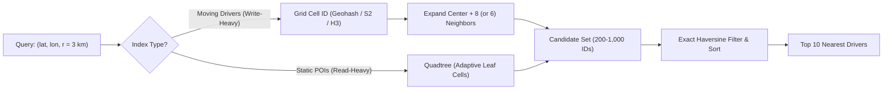
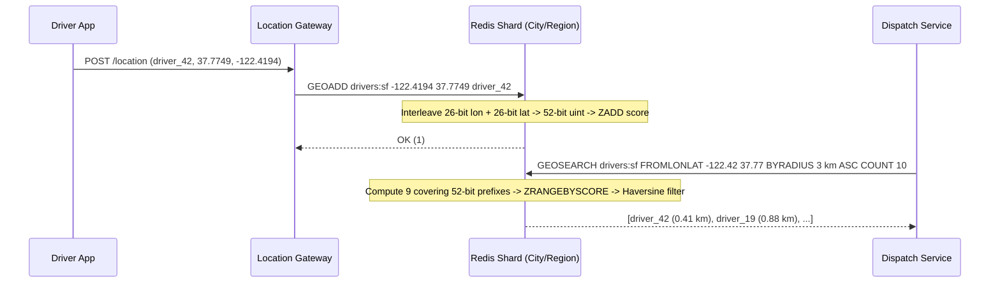
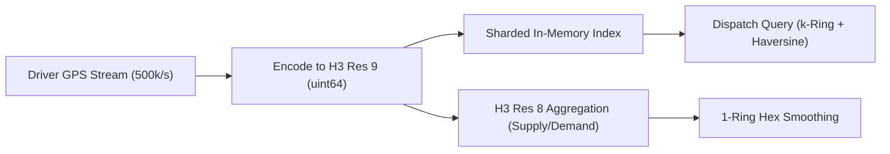

# Geospatial Indexing: Geohash, Quadtree, S2 & H3

> **Prerequisites:** [Lesson 10: Time-Series Data](../10-time-series-data/README.md) · [Track Overview](../README.md).  
> **Estimated Reading Time:** 24–28 minutes  
> **Target Audience:** Backend engineers building ride-hailing, food delivery, or proximity search ("nearby drivers/restaurants"), and candidates asked "how do you index 100M moving locations and query within 5 km?"  
> **Free PDF Notes:** [Download SD-Q-011.pdf](https://backendroadmap.com/notes/system-design/SD-Q-011.pdf)

> [!NOTE]
> **In one line:** Two-dimensional coordinates `(lat, lon)` cannot be range-queried efficiently with a single B-tree index; geospatial indexes map 2D space onto **1D space-filling curves** (Geohash, S2, H3) or **adaptive trees** (Quadtree, R-tree) so "find within $r$ km" becomes a handful of fast prefix or cell lookups.

> [!TIP]
> **The Golden Rule:** For **static/skewed POIs** (restaurants, landmarks), use a **Quadtree** or **PostGIS R-tree**. For **high-write moving entities** (1M drivers updating every 4 s), use **Geohash / S2 / H3** in Redis or in-memory shards—never update a global B-tree or R-tree 250,000 times per second.

---

## 1. What Geospatial Indexing Is, and What It Isn't

Suppose you run a ride-hailing dispatch service with 2 million active drivers sending `(driver_id, lat, lon)` every 4 seconds (500,000 writes/s). A rider opens the app at `(37.7749, -122.4194)` and asks: *"Find the 10 nearest available drivers within 3 km."*

If you store `(lat, lon)` in a relational database with two separate B-tree indexes, the database can filter `lat BETWEEN 37.748 AND 37.802` (say, 40,000 rows in a dense city) and then scan all 40,000 rows to check `lon`, or intersect two huge index scans. A single B-tree sorts by one dimension at a time—it has no concept of 2D locality.

| Term | Precise Meaning | Example |
| :--- | :--- | :--- |
| **Geohash** | Base-32 string encoding interleaved lat/lon bits on a Z-order curve | `9q8yyk8` (~153 m × 153 m cell) |
| **Quadtree** | In-memory tree recursively splitting 2D space into 4 quadrants until leaf capacity $C$ | Yelp / Uber early POI index |
| **Google S2** | Spherical geometry projecting the Earth onto 6 cube faces + Hilbert curve (64-bit `uint64`) | Google Maps, Uber (legacy) |
| **Uber H3** | Hierarchical hexagonal grid on an icosahedron; 16 resolutions, uniform neighbor distance | Uber surge pricing, spatial ML |
| **R-tree / GiST** | Disk-based balanced tree grouping bounding boxes (MBRs) | PostGIS `GEOGRAPHY` index |
| **Not** | Exact Euclidean distance on a flat plane | Earth is an oblate spheroid; use Haversine for final sort |

### Why It Matters
1. "Design Uber / Grab / Yelp / Tinder" is one of the top 5 system design interview questions, and the spatial index is the core data-structure decision.
2. Choosing between **read-optimized** (Quadtree) and **write-optimized** (Geohash/S2/H3 in Redis or partitioned memory) determines whether your system survives 500k location updates/s.
3. Every grid system has **boundary and distortion traps** (Z-order jumps, antimeridian wrap, pole distortion, square vs hexagon neighbor distances) that interviewers probe directly.

---

## 2. Anatomy: Geohash (Z-Order) vs Quadtree vs S2 vs H3



A geospatial query is always a **two-phase filter-and-refine pipeline**:
1. **Coarse Filter (Index):** Map `(lat, lon)` and radius $r$ to a small set of covering cells or tree leaves. This runs in $O(1)$ or $O(\log N)$ and eliminates 99.99% of the planet.
2. **Exact Refine (Haversine):** Compute exact great-circle distance only on the candidates inside those cells, discard false positives outside radius $r$, and sort.

| Index | Space Partition | Write Cost | Neighbor Uniformity | Best For |
| :--- | :--- | :--- | :--- | :--- |
| **Geohash** | Rectangles (Z-order curve) | $O(1)$ hash/ZSET update | Poor (4 edge + 4 corner distances differ; Z-jumps) | Redis `GEOADD`, simple prefix queries |
| **Quadtree** | Adaptive 4-way squares | $O(\log N)$ + tree locks/rebalance | Variable leaf sizes | Static POIs (restaurants, ATMs) |
| **S2** | Cube faces + Hilbert curve (`uint64`) | $O(1)$ bit-interleave | Good (Hilbert preserves locality) | Arbitrary polygons, geofencing, exact cell coverings |
| **H3** | Icosahedron hexagons (`uint64`) | $O(1)$ lookup | **Optimal** (all 6 neighbors equidistant) | Ride-hailing supply/demand, surge, k-ring smoothing |
| **R-tree (PostGIS)** | Overlapping Minimum Bounding Rectangles | $O(\log N)$ disk page splits | N/A | Complex polygons, SQL joins, moderate write rate |

> [!WARNING]
> **The Geohash Boundary Trap:** Two points 10 meters apart across the equator or prime meridian (e.g., `7zzzzz` and `ebpbpb`) share **zero** Geohash prefix characters! Always query the **center cell plus all 8 surrounding neighbors** (9 cells total), never just the center prefix.

---

## 3. Mathematical Model: Bit Interleaving, Cell Sizing & Haversine

**Geohash Precision.** A Geohash of length $L$ base-32 characters encodes $5L$ bits: $\lceil 5L/2 \rceil$ longitude bits and $\lfloor 5L/2 \rfloor$ latitude bits. Because Earth's circumference is $C \approx 40{,}075\text{ km}$, each bit halves the interval:

$$\Delta\text{lat} = \frac{180^\circ}{2^{b_{\text{lat}}}}, \qquad \Delta\text{lon} = \frac{360^\circ}{2^{b_{\text{lon}}}}$$

For $L = 6$ ($30$ bits: $15$ lat, $15$ lon):
- $\Delta\text{lat} = 180 / 2^{15} \approx 0.00549^\circ \approx 0.61\text{ km}$
- $\Delta\text{lon}$ at equator $= 360 / 2^{15} \approx 0.01099^\circ \approx 1.22\text{ km}$

**Redis `GEOADD` Trick.** Redis does not invent a new data structure—it encodes `(lat, lon)` into a **52-bit Geohash integer** (26 bits lat, 26 bits lon) and stores it as the score in a standard **Sorted Set (`ZSET`)**! A 52-bit integer fits losslessly in an IEEE-754 `double` (53-bit significand). `GEOSEARCH` computes the 9 covering 52-bit Geohash ranges and runs `ZRANGEBYSCORE` on each.

**Exact Refine (Haversine Formula).** Given two points $(\phi_1, \lambda_1)$ and $(\phi_2, \lambda_2)$ in radians and Earth radius $R = 6{,}371\text{ km}$:

$$a = \sin^2\!\left(\frac{\Delta\phi}{2}\right) + \cos(\phi_1)\cos(\phi_2)\sin^2\!\left(\frac{\Delta\lambda}{2}\right), \qquad d = 2R\arcsin(\sqrt{a})$$

**Write Throughput Sizing.** With $N = 2{,}000{,}000$ active drivers updating every $\Delta t = 4\text{ s}$:

$$Q_{\text{write}} = \frac{2{,}000{,}000}{4\text{ s}} = 500{,}000\text{ updates/s}$$

Each update payload is ~64 bytes (`driver_id` 16 B + `lat` 8 B + `lon` 8 B + `ts` 8 B + overhead 24 B):
- Network ingress: $500{,}000 \times 64\text{ B} = 32\text{ MB/s}$ ($256\text{ Mbps}$).
- Total active index RAM: $2\text{M} \times 128\text{ B} \approx 256\text{ MB}$ — fits in a single server's RAM, though sharded across 8–16 Redis/in-memory nodes for CPU and NIC headroom!

---

## 4. Metrics & Percentiles

| Metric | Meaning | Alert when |
| :--- | :--- | :--- |
| **Spatial query latency $p_{99}$** | Time for cell expansion + candidate fetch + Haversine sort | $> 20\text{ ms}$ (dispatch SLO) |
| **Location update lag $p_{99}$** | Time from driver GPS ping to index visibility | $> 2\text{ s}$ (stale driver positions) |
| **Candidates per query** | Number of entities returned by coarse cells before Haversine | $> 5{,}000$ (cell too large; CPU spike) |
| **Zero-result rate** | Radius queries returning 0 candidates before fallback | $> 5\%$ (needs adaptive radius expansion) |
| **Shard hot-spot ratio** | Max QPS on busiest city shard / median shard QPS | $> 4\times$ (Tokyo/NYC skewing hash shard) |

### Worked Example (San Francisco Dispatch)
A rider at `(37.7749, -122.4194)` requests drivers within $r = 2\text{ km}$.
1. **Cell selection:** Precision-6 Geohash (`9q8yyk`) has height $0.61\text{ km}$ and width $\approx 0.96\text{ km}$ at $37.77^\circ$ N ($\cos 37.77^\circ \approx 0.79$). A $3\times 3$ grid covers $\approx 1.83\text{ km} \times 2.88\text{ km}$. To guarantee covering $r = 2\text{ km}$, we either use precision-5 (`9q8yy`, $4.89\text{ km} \times 3.86\text{ km}$) or a 2-ring of precision-6 cells (25 cells).
2. **Candidate fetch:** Fetching the 9 precision-5/6 cells returns 340 active drivers in $1.2\text{ ms}$.
3. **Haversine filter:** Computing Haversine on 340 points takes $< 0.05\text{ ms}$; 112 drivers are within $2.0\text{ km}$. We return the top 10.

---

## 5. Compounding & Failure Modes: Skew, Grid Distortion & Stale Reads

1. **Metropolitan Hot-Spotting:** If you shard Redis by `city_id` or top-level Geohash prefix, Manhattan or Jakarta saturates one shard while rural shards sit at 2% CPU.
2. **High-Latitude Longitude Collapse:** At the equator, $1^\circ$ longitude is $111.3\text{ km}$; at Oslo ($60^\circ\text{ N}$), $\cos(60^\circ) = 0.5$, so $1^\circ$ longitude is $55.6\text{ km}$. Fixed-degree Geohash rectangles become skinny slivers near the poles. **S2** (cube projection) and **H3** (icosahedron) keep cell areas bounded within a narrow ratio globally.
3. **Quadtree Lock Contention:** Updating a moving driver in an unbalanced Quadtree requires deleting from old leaf, inserting into new leaf, and potentially splitting/merging nodes—causing write-lock contention under 500k writes/s.
4. **H3/S2 Cell-Edge Discontinuity:** For surge pricing, if a rider stands 5 meters across a square cell border from a cluster of drivers, a naive per-cell count sees 0 drivers. **H3 hexagons** have 6 equidistant neighbors and smooth spatial convolutions ($k$-ring averaging) naturally.

---

## 6. Numbers Every Engineer Must Know

| Item | Typical | Implication |
| :--- | :---: | :--- |
| Earth radius $R$ / circumference | $6{,}371\text{ km}$ / $40{,}075\text{ km}$ | $1^\circ\text{ lat} \approx 111.32\text{ km}$ everywhere |
| Geohash len 5 / 6 / 7 cell size | $4.9\text{ km}$ / $1.2\text{ km}$ / $153\text{ m}$ | Len 5–6 for city search; len 7–8 for pickup spot |
| H3 Res 7 / Res 8 / Res 9 edge | $1.22\text{ km}$ / $461\text{ m}$ / $174\text{ m}$ | Res 8–9 is standard for ride-hailing dispatch & surge |
| Redis `GEOADD` memory per member | ~96–128 bytes (skiplist + dict) | 10M drivers $\approx 1.2\text{ GB}$ RAM |
| Redis `GEOSEARCH` latency (1M pts) | $0.5\text{–}3\text{ ms}$ | Sub-5 ms p99 easily achievable |
| Haversine CPU cost | ~50 ns per pair | 10,000 candidates = 0.5 ms in Go/C++/Rust |

---

## 7. Protocol / Mechanism Deep Dive: Redis `ZSET` 52-Bit Geohash Encoding



| Question | Answer |
| :--- | :--- |
| **How does Redis store 2D points in a 1D `ZSET`?** | It interleaves 26 bits of longitude and 26 bits of latitude into a 52-bit integer score. |
| **Why 52 bits?** | Redis `ZSET` scores are IEEE-754 64-bit floats, which have 53 bits of exact integer precision. |
| **How do we expire offline drivers?** | `ZSET` members don't have per-member TTLs! Store `last_seen` in a companion hash/key or run a periodic `ZREM` sweeper, or shard `ZSET`s by time-bucket. |
| **What if a city exceeds 1 Redis core (~80k ops/s)?** | Shard drivers into $K$ virtual buckets per city (`drivers:sf:0..15` by `hash(driver_id) % 16`) and scatter-gather `GEOSEARCH` across the 16 shards in parallel. |

**When NOT to use Geohash/Redis:** When you need **polygon containment** (e.g., *"is this address inside delivery zone Polygon A?"*), **spatial joins** between two tables, or **exact persistent geometry**—use **PostGIS (R-tree/GiST)** or **S2 Polygon Coverings**.

---

## 8. Hierarchical Budgets & Design Rules

| Slice | Rule | Control |
| :--- | :--- | :--- |
| **Precision selection** | Match cell width to $0.5\times\text{–}1\times$ query radius | Config per use case (city vs street) |
| **Boundary safety** | Always query center + 8 neighbors (or $k$-ring) | Unit test across equator & antimeridian |
| **Write path** | In-memory (`ZSET` / partitioned map); never disk B-tree per GPS ping | Async flush to cold store for trip history |
| **Stale eviction** | Evict drivers with no ping in $> 30\text{ s}$ | Background `ZREM` sweeper or ring-buffer TTL |
| **Hot-city sharding** | Partition dense cities by `hash(entity_id) % K` | Scatter-gather read across $K$ shards |
| **Fallback radius** | Expand $r \to 2r \to 4r$ if candidates $< K$ | Capped at max service radius (e.g. 15 km) |

---

## 9. Top Mitigations

1. **Always query neighbor cells** (9 cells for Geohash, 7 for H3 1-ring) to eliminate edge discontinuities.
2. **Scatter-gather shard dense cities** by `entity_id` hash rather than sub-cells, preventing hot-spots on downtown cells.
3. **Use adaptive radius expansion** ($1\text{ km} \to 3\text{ km} \to 8\text{ km}$) in sparse suburbs so queries don't return empty lists.
4. **Filter stale entities** via a periodic sweeper or `last_updated` timestamp check during Haversine refinement.
5. **Throttle/deduplicate GPS pings** on the client or gateway (e.g., ignore if moved $< 10\text{ m}$ and $< 4\text{ s}$ elapsed).
6. **Use H3 or S2 instead of Geohash** when global area uniformity (poles vs equator) or hexagon neighbor symmetry matters.
7. **Keep exact Haversine in the refine step**—never trust cell membership alone for distance ordering.

---

## 10. Production Reference: Uber's Migration from Geohash/S2 to H3

In Uber's early architecture, ride-hailing dispatch and surge pricing relied on **Geohash** and later **Google S2** cells. Both are rectangular/quadrilateral grids, which caused two concrete production issues:
- **Unequal neighbor distances:** A square cell has 4 edge neighbors at distance $d$ and 4 diagonal neighbors at distance $\sqrt{2}\,d \approx 1.414\,d$. Smoothing surge multipliers across neighbors distorted pricing at corners.
- **Varying cell areas:** Across latitudes, Geohash rectangles stretched and shrank, making city-to-city ML features incomparable.

Uber built and open-sourced **H3** (Hierarchical Spatial Index):
- Projects the globe onto a **20-face icosahedron** and subdivides each face into **hexagons** (with 12 pentagons at icosahedron vertices).
- Every hexagon has **6 equidistant neighbors**, making $k$-ring spatial smoothing ($k=1, 2$) mathematically isotropic.
- Resolution 8 ($\sim 0.74\text{ km}^2$) and Resolution 9 ($\sim 0.11\text{ km}^2$) became the standard unit for supply/demand heatmaps, ETAs, and dynamic pricing.



---

## 11. Multi-Language Production Code Tabs

A complete, dependency-free **Geohash encoder + 8-neighbor expansion + Haversine filter** in Go, TypeScript, Python, and C#.

````carousel
```go
// Go: Geohash encode + Haversine distance (stdlib only).
package main

import (
	"fmt"
	"math"
)

const base32 = "0123456789bcdefghjkmnpqrstuvwxyz"

func EncodeGeohash(lat, lon float64, precision int) string {
	latMin, latMax := -90.0, 90.0
	lonMin, lonMax := -180.0, 180.0
	var hash []byte
	isLon := true
	bit, ch := 0, 0

	for len(hash) < precision {
		if isLon {
			mid := (lonMin + lonMax) / 2
			if lon >= mid {
				ch = (ch << 1) | 1
				lonMin = mid
			} else {
				ch <<= 1
				lonMax = mid
			}
		} else {
			mid := (latMin + latMax) / 2
			if lat >= mid {
				ch = (ch << 1) | 1
				latMin = mid
			} else {
				ch <<= 1
				latMax = mid
			}
		}
		isLon = !isLon
		bit++
		if bit == 5 {
			hash = append(hash, base32[ch])
			bit, ch = 0, 0
		}
	}
	return string(hash)
}

func HaversineKm(lat1, lon1, lat2, lon2 float64) float64 {
	const R = 6371.0
	dLat := (lat2 - lat1) * math.Pi / 180
	dLon := (lon2 - lon1) * math.Pi / 180
	a := math.Sin(dLat/2)*math.Sin(dLat/2) +
		math.Cos(lat1*math.Pi/180)*math.Cos(lat2*math.Pi/180)*
			math.Sin(dLon/2)*math.Sin(dLon/2)
	return 2 * R * math.Asin(math.Sqrt(a))
}

func main() {
	fmt.Println("SF Geohash(6):", EncodeGeohash(37.7749, -122.4194, 6))
	fmt.Printf("SF->Oakland: %.2f km\n", HaversineKm(37.7749, -122.4194, 37.8044, -122.2712))
}
```
<!-- slide -->
```typescript
// TypeScript: Geohash encoder + Haversine filter.
const BASE32 = "0123456789bcdefghjkmnpqrstuvwxyz";

export function encodeGeohash(lat: number, lon: number, precision = 6): string {
  let [latMin, latMax] = [-90, 90];
  let [lonMin, lonMax] = [-180, 180];
  let hash = "";
  let isLon = true;
  let bit = 0;
  let ch = 0;

  while (hash.length < precision) {
    if (isLon) {
      const mid = (lonMin + lonMax) / 2;
      if (lon >= mid) { ch = (ch << 1) | 1; lonMin = mid; }
      else { ch <<= 1; lonMax = mid; }
    } else {
      const mid = (latMin + latMax) / 2;
      if (lat >= mid) { ch = (ch << 1) | 1; latMin = mid; }
      else { ch <<= 1; latMax = mid; }
    }
    isLon = !isLon;
    if (++bit === 5) {
      hash += BASE32[ch];
      bit = 0;
      ch = 0;
    }
  }
  return hash;
}

export function haversineKm(lat1: number, lon1: number, lat2: number, lon2: number): number {
  const R = 6371;
  const toRad = (d: number) => (d * Math.PI) / 180;
  const dLat = toRad(lat2 - lat1);
  const dLon = toRad(lon2 - lon1);
  const a =
    Math.sin(dLat / 2) ** 2 +
    Math.cos(toRad(lat1)) * Math.cos(toRad(lat2)) * Math.sin(dLon / 2) ** 2;
  return 2 * R * Math.asin(Math.sqrt(a));
}
```
<!-- slide -->
```python
# Python: Geohash encode/decode + 9-cell neighbor expansion + Haversine.
import math

BASE32 = "0123456789bcdefghjkmnpqrstuvwxyz"
DECODE_MAP = {c: i for i, c in enumerate(BASE32)}

def encode_geohash(lat: float, lon: float, precision: int = 6) -> str:
    lat_min, lat_max = -90.0, 90.0
    lon_min, lon_max = -180.0, 180.0
    out, is_lon, bit, ch = [], True, 0, 0
    while len(out) < precision:
        if is_lon:
            mid = (lon_min + lon_max) / 2
            if lon >= mid: ch = (ch << 1) | 1; lon_min = mid
            else: ch <<= 1; lon_max = mid
        else:
            mid = (lat_min + lat_max) / 2
            if lat >= mid: ch = (ch << 1) | 1; lat_min = mid
            else: ch <<= 1; lat_max = mid
        is_lon = not is_lon
        bit += 1
        if bit == 5:
            out.append(BASE32[ch])
            bit = ch = 0
    return "".join(out)

def decode_bbox(gh: str):
    lat_min, lat_max = -90.0, 90.0
    lon_min, lon_max = -180.0, 180.0
    is_lon = True
    for c in gh:
        val = DECODE_MAP[c]
        for mask in (16, 8, 4, 2, 1):
            if is_lon:
                mid = (lon_min + lon_max) / 2
                if val & mask: lon_min = mid
                else: lon_max = mid
            else:
                mid = (lat_min + lat_max) / 2
                if val & mask: lat_min = mid
                else: lat_max = mid
            is_lon = not is_lon
    return (lat_min, lat_max, lon_min, lon_max)

def neighbors_9(gh: str) -> list[str]:
    lat_min, lat_max, lon_min, lon_max = decode_bbox(gh)
    dlat, dlon = lat_max - lat_min, lon_max - lon_min
    clat, clon = (lat_min + lat_max) / 2, (lon_min + lon_max) / 2
    cells = []
    for dy in (-1, 0, 1):
        for dx in (-1, 0, 1):
            nlat = max(-89.9999, min(89.9999, clat + dy * dlat))
            nlon = ((clon + dx * dlon + 180.0) % 360.0) - 180.0
            cells.append(encode_geohash(nlat, nlon, len(gh)))
    return list(dict.fromkeys(cells))

def haversine_km(lat1: float, lon1: float, lat2: float, lon2: float) -> float:
    R = 6371.0
    p1, p2 = math.radians(lat1), math.radians(lat2)
    dp, dl = math.radians(lat2 - lat1), math.radians(lon2 - lon1)
    a = math.sin(dp / 2) ** 2 + math.cos(p1) * math.cos(p2) * math.sin(dl / 2) ** 2
    return 2 * R * math.asin(math.sqrt(a))
```
<!-- slide -->
```csharp
// C#: Geohash encoder + Haversine distance.
using System;
using System.Text;

public static class GeoIndex
{
    private const string Base32 = "0123456789bcdefghjkmnpqrstuvwxyz";

    public static string EncodeGeohash(double lat, double lon, int precision = 6)
    {
        double latMin = -90, latMax = 90, lonMin = -180, lonMax = 180;
        var sb = new StringBuilder(precision);
        bool isLon = true;
        int bit = 0, ch = 0;

        while (sb.Length < precision)
        {
            if (isLon)
            {
                double mid = (lonMin + lonMax) / 2;
                if (lon >= mid) { ch = (ch << 1) | 1; lonMin = mid; }
                else { ch <<= 1; lonMax = mid; }
            }
            else
            {
                double mid = (latMin + latMax) / 2;
                if (lat >= mid) { ch = (ch << 1) | 1; latMin = mid; }
                else { ch <<= 1; latMax = mid; }
            }
            isLon = !isLon;
            if (++bit == 5)
            {
                sb.Append(Base32[ch]);
                bit = ch = 0;
            }
        }
        return sb.ToString();
    }

    public static double HaversineKm(double lat1, double lon1, double lat2, double lon2)
    {
        const double R = 6371.0;
        double dLat = (lat2 - lat1) * Math.PI / 180.0;
        double dLon = (lon2 - lon1) * Math.PI / 180.0;
        double a = Math.Pow(Math.Sin(dLat / 2), 2) +
                   Math.Cos(lat1 * Math.PI / 180.0) * Math.Cos(lat2 * Math.PI / 180.0) *
                   Math.Pow(Math.Sin(dLon / 2), 2);
        return 2 * R * Math.Asin(Math.Sqrt(a));
    }
}
```
````

---

## 12. Hands-On CLI Verification Workflows

Verify Geohash encoding, 9-cell neighbor expansion, and Haversine distance locally with Python:

```bash
python -c "
import math
# Verify SF (37.7749, -122.4194) to Oakland (37.8044, -122.2712)
R = 6371.0
p1, p2 = math.radians(37.7749), math.radians(37.8044)
dp, dl = math.radians(37.8044 - 37.7749), math.radians(-122.2712 - (-122.4194))
a = math.sin(dp/2)**2 + math.cos(p1)*math.cos(p2)*math.sin(dl/2)**2
print(f'SF -> Oakland: {2*R*math.asin(math.sqrt(a)):.2f} km')
"
```

Verify Redis `GEOADD` / `GEOSEARCH` / `ZSCORE` (52-bit Geohash internals) using `redis-cli`:

```bash
# Add drivers to a Redis ZSET-backed geo index
redis-cli GEOADD drivers:sf -122.4194 37.7749 driver_1 -122.4089 37.7855 driver_2

# Inspect the underlying 52-bit Geohash integer score
redis-cli ZSCORE drivers:sf driver_1

# Query nearest drivers within 3 km, sorted ascending with distances
redis-cli GEOSEARCH drivers:sf FROMLONLAT -122.4150 37.7800 BYRADIUS 3 km WITHDIST ASC COUNT 10
```

---

## 13. Common Mistakes to Avoid

1. **Querying only the center Geohash cell** without its 8 neighbors (misses drivers 5 meters across a boundary).
2. **Using two separate B-tree indexes on `(lat, lon)`** in SQL for high-QPS proximity search.
3. **Updating a global Quadtree or R-tree** at 500,000 GPS pings/s (lock contention and node splits kill throughput).
4. **Assuming Redis `GEOADD` supports per-driver TTL** (`ZSET` members do not expire automatically; you must sweep stale drivers).
5. **Sharding Redis by Geohash prefix** (creates massive hot-spots in downtown NYC/Tokyo while rural shards sit idle).
6. **Ignoring latitude cosine distortion** when sizing Geohash longitude widths at high latitudes (e.g., Oslo vs Singapore).
7. **Skipping the exact Haversine refine step** and ranking results purely by cell distance.

---

## 14. Key Terms Glossary

| Key Term | Definition |
| :--- | :--- |
| **Geohash** | Base-32 string encoding interleaved latitude/longitude bits on a Z-order curve. |
| **Z-order curve (Morton code)** | Bit-interleaving mapping 2D coordinates to 1D; has occasional spatial jumps. |
| **Hilbert curve** | Continuous space-filling curve preserving 2D locality better than Z-order (used in S2). |
| **Quadtree** | In-memory tree recursively splitting 2D space into 4 quadrants up to leaf capacity. |
| **Google S2** | Spherical geometry library projecting Earth onto 6 cube faces + Hilbert curve (`uint64`). |
| **Uber H3** | Hierarchical hexagonal spatial index on an icosahedron with 6 equidistant neighbors. |
| **R-tree / GiST** | Disk-based balanced tree indexing Minimum Bounding Rectangles (PostGIS). |
| **Haversine formula** | Great-circle distance formula between two `(lat, lon)` points on a sphere. |
| **Filter-and-refine** | Two-phase spatial query: fast coarse cell lookup followed by exact distance sort. |
| **Antimeridian** | The $\pm 180^\circ$ longitude line where coordinates wrap around the globe. |

---

## 15. System Design Interview Questions & Answers

### Basic Conceptual Questions

<details>
<summary><strong>Q1: Why can't we just use two B-tree indexes on `lat` and `lon` in Postgres? [BASIC]</strong></summary>

**Answer:**
A B-tree sorts along one dimension. Filtering `lat BETWEEN a AND b` still scans every row in that latitude band across the entire globe's longitudes (tens of thousands of rows in a city), and intersecting two large B-tree scans is slow. Space-filling curves or R-trees preserve 2D locality in a single index.
</details>

<details>
<summary><strong>Q2: What is a Geohash and how does its precision work? [BASIC]</strong></summary>

**Answer:**
A Geohash interleaves latitude and longitude bits into a base-32 string (5 bits per character). Each extra character refines the bounding box by a factor of 4x–8x in area. Length 5 is ~4.9 km, length 6 is ~1.2 km, and length 7 is ~153 m.
</details>

<details>
<summary><strong>Q3: How does a Quadtree differ from Geohash? [BASIC]</strong></summary>

**Answer:**
Geohash uses a fixed, uniform grid (O(1) math, great for writes). A Quadtree adapts to data density—splitting dense cities into tiny leaves and keeping oceans as huge leaves—making it great for read-heavy static POIs, but expensive to rebalance under heavy writes.
</details>

<details>
<summary><strong>Q4: Why do we still need Haversine if we already have Geohash or H3? [BASIC]</strong></summary>

**Answer:**
Grid cells are approximations (rectangles or hexagons). A point in a neighbor cell might be outside radius $r$, and points inside the same cell aren't ordered by distance. You use the grid to fetch ~200–500 candidates, then run exact Haversine to filter and sort.
</details>

### Scenario-Based Architecture Questions

<details>
<summary><strong>Q5: Design the location index for 2M active drivers updating every 4 seconds (500k writes/s). [SCENARIO]</strong></summary>

**Answer:**
Use an in-memory store (Redis `GEOADD` or partitioned Go/Rust services) keyed by city/region and sharded by `hash(driver_id) % K`. Updates are O(1) ZSET/map overwrites (500k/s across 16 shards = ~31k writes/s per shard). Reads scatter-gather across the $K$ shards in parallel, run 9-cell/k-ring lookup + Haversine, and return top 10 in < 10 ms.
</details>

<details>
<summary><strong>Q6: A rider is 10 meters from the border of a Geohash cell, and the nearest driver is just across the border. What happens? [SCENARIO]</strong></summary>

**Answer:**
If you only query the rider's cell, you miss the driver completely. You must always compute and query the **center cell plus all 8 surrounding neighbors** (9 cells total), then filter by exact Haversine distance.
</details>

<details>
<summary><strong>Q7: You're building Yelp (50M static restaurants, 100k reads/s, 10 writes/s). What index do you pick? [SCENARIO]</strong></summary>

**Answer:**
A **Quadtree** (sharded by region or replicated in-memory across read replicas) or **PostGIS R-tree**. Because writes are tiny (10/s), tree rebalancing is negligible, and adaptive leaf sizes guarantee every leaf holds ~50–100 restaurants whether in Manhattan or rural Montana.
</details>

<details>
<summary><strong>Q8: How do you handle sparse areas where a 3 km radius returns 0 drivers? [SCENARIO]</strong></summary>

**Answer:**
Use **adaptive radius expansion**: start at $r = 2\text{ km}$ (precision 6); if $< K$ drivers are found, expand to $r = 5\text{ km}$ (precision 5) or $r = 15\text{ km}$ (precision 4), capped at a maximum dispatch radius.
</details>

### Advanced & Tricky Interview Questions

<details>
<summary><strong>Q9: Why did Uber choose H3 hexagons over Geohash rectangles and S2 squares? [TRICKY]</strong></summary>

**Answer:**
Squares have two neighbor types: 4 edge neighbors at distance $d$ and 4 corner neighbors at $\sqrt{2}\,d$, which distorts spatial smoothing (surge pricing, heatmaps). Hexagons have **6 equidistant neighbors** and uniform area across latitudes via icosahedron projection.
</details>

<details>
<summary><strong>Q10: How does Redis `GEOADD` actually work under the hood, and what is its biggest operational gotcha? [TRICKY]</strong></summary>

**Answer:**
Redis encodes `(lat, lon)` into a 52-bit Geohash integer and stores it as the score in a standard `ZSET`. The biggest gotcha is that **`ZSET` members cannot have individual TTLs**—if a driver goes offline without sending a disconnect, they remain in the index forever unless you run a background `ZREM` sweeper or check a companion `last_seen` key.
</details>

<details>
<summary><strong>Q11: If you shard your spatial index by Geohash prefix, what breaks? [TRICKY]</strong></summary>

**Answer:**
Severe **hot-spotting**: downtown NYC or Tokyo will melt one shard while 90% of shards sit empty. Instead, shard by **coarse region/country** for isolation, and within hot cities shard by `hash(entity_id) % K` with parallel scatter-gather reads.
</details>

<details>
<summary><strong>Q12: How do you query across the antimeridian ($\pm 180^\circ$ longitude) or near the poles? [TRICKY]</strong></summary>

**Answer:**
At $\pm 180^\circ$, naive bounding boxes wrap around the whole globe (`lon_min > lon_max`). You must normalize neighbor longitudes modulo $360^\circ$ (or split bounding boxes at $\pm 180^\circ$). Near poles, Geohash longitude width collapses; use **S2** or **H3** which project onto 3D polyhedra without polar singularities.
</details>

---

## 16. One-Page Master Cheat Sheet

```
+---------------------------------------------------------------------------------------------------------+
|                    GEOSPATIAL INDEXING — MASTER CHEAT SHEET                                             |
+---------------------------------------------------------------------------------------------------------+
| 1. TWO-PHASE PIPELINE: Coarse Index (Geohash / Quadtree / S2 / H3) -> Exact Refine (Haversine sort).    |
+---------------------------------------------------------------------------------------------------------+
| 2. CHOOSE BY WORKLOAD:                                                                                  |
|    - Static POIs (Yelp): Quadtree or PostGIS R-tree (adaptive to density, slow writes).                 |
|    - Moving Entities (Uber, 500k/s): Geohash / S2 / H3 in Redis or sharded RAM (O(1) overwrites).       |
+---------------------------------------------------------------------------------------------------------+
| 3. BOUNDARY RULE: Always query center + 8 neighbors (Geohash) or k-ring (H3). Never 1 cell alone!       |
+---------------------------------------------------------------------------------------------------------+
| 4. REDIS GEO: 52-bit Geohash score in a ZSET. No per-member TTL -> build a stale-driver sweeper!        |
+---------------------------------------------------------------------------------------------------------+
| 5. SHARDING: Never shard by Geohash prefix (NYC melts 1 shard). Shard hot cities by hash(id) % K.       |
+---------------------------------------------------------------------------------------------------------+
| 6. H3 ADVANTAGE: Hexagons have 6 equidistant neighbors & uniform area -> ideal for surge & ML grids.      |
+---------------------------------------------------------------------------------------------------------+
```

---

## Further Reading & Sources

- Uber Engineering, [H3: Uber's Hexagonal Hierarchical Spatial Index](https://www.uber.com/blog/h3/).
- Google S2 Geometry Library, [S2 Cells & Hilbert Curve Architecture](https://s2geometry.io/devguide/s2cell_hierarchy).
- Redis Documentation, [`GEOADD` & `GEOSEARCH` Internals](https://redis.io/docs/latest/commands/geoadd/).
- Martin Kleppmann, *Designing Data-Intensive Applications*, Chapter 3 ("Storage and Retrieval" — B-trees, multi-column & spatial indexes).

---

## Free PDF Notes

[SD-Q-011.pdf](https://backendroadmap.com/notes/system-design/SD-Q-011.pdf)

---

## Next

Continue with [Lesson 12: Leaderboards & Ranking: Redis Sorted Sets for 100M Players](../12-leaderboards-ranking/README.md).
