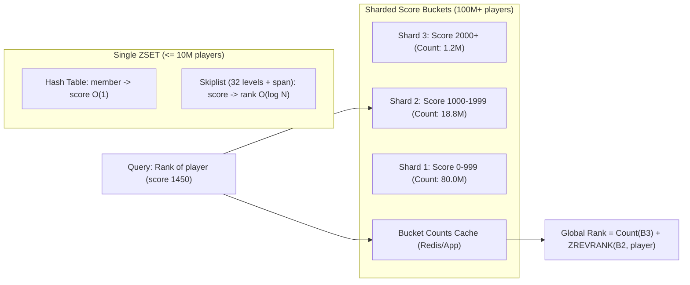
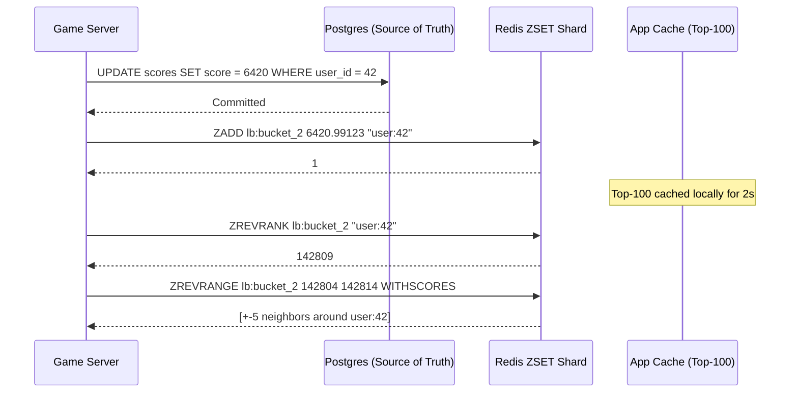
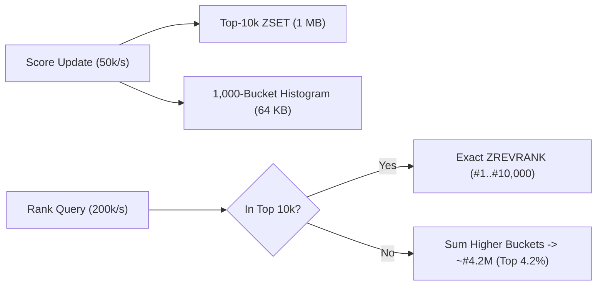

# Leaderboards & Ranking: Redis Sorted Sets for 100M Players

> **Prerequisites:** [Lesson 11: Geospatial Indexing](../11-geospatial-indexing/README.md) · [Track Overview](../README.md).  
> **Estimated Reading Time:** 24–28 minutes  
> **Target Audience:** Backend engineers building gaming rankings, fitness streaks, or live creator charts, and candidates asked "design a real-time global leaderboard for 100 million users."  
> **Free PDF Notes:** [Download SD-Q-012.pdf](https://backendroadmap.com/notes/system-design/SD-Q-012.pdf)

> [!NOTE]
> **In one line:** A relational `ORDER BY score DESC` collapses under millions of rows and frequent updates; a **Redis Sorted Set (`ZSET`)** combines a **skiplist** and a **hash table** to give $O(\log N)$ score updates, $O(\log N)$ rank lookups, and $O(\log N + K)$ top-$K$ queries—while **100M+ players** require **score-bucket sharding** or **approximate quantile trees** so memory and single-threaded CPU don't bottleneck.

> [!TIP]
> **The Golden Rule:** For $\le 10\text{M}$ active players, a single Redis `ZSET` is unbeatable ($< 1\text{ GB}$ RAM, $< 2\text{ ms}$ p99). At $100\text{M}+$ players, **never put all 100M in one `ZSET`**: split by **score-range buckets** (exact rank) or **region/league shards** (e.g., Top 1,000 exact + approximate percentile for the tail).

---

## 1. What a Real-Time Leaderboard Is, and What It Isn't

Consider a mobile game with 100 million total players and 10 million daily active players (DAU). Every match completion updates a player's score (~50,000 writes/s). Players open the leaderboard tab (~200,000 reads/s) to see:
1. **Top 100** global players.
2. **My exact rank** (e.g., *"You are #4,812,903"*).
3. **Neighbors around me** ($\pm 5$ players above and below my rank).

In PostgreSQL/MySQL, `SELECT user_id, score FROM scores ORDER BY score DESC LIMIT 100` with a B-tree index is fast for Top 100, **but** finding *"what is my exact rank?"* requires `SELECT COUNT(*) FROM scores WHERE score > my_score`, which scans millions of index entries ($O(N)$) on every page load!

| Term | Precise Meaning | Example |
| :--- | :--- | :--- |
| **Redis `ZSET`** | Dual-indexed structure: Hash Table (`member -> score`) + Skiplist (`score -> member`) | `ZADD lb 1500 player_42` |
| **Skiplist** | Probabilistic multi-level linked list supporting $O(\log N)$ search and rank calculation via span pointers | Redis `zskiplist` (max 32 levels) |
| **Tie-breaking** | Deterministic ordering when two players have the same integer score | Composite score: `(score << 20) \| (MAX_TS - ts)` |
| **Score-bucket sharding** | Partitioning players by score intervals (`0–999`, `1000–1999`) to bound `ZSET` size | Exact rank = sum of higher buckets + local `ZREVRANK` |
| **Approximate rank** | Exact `ZSET` for Top 10k; histogram/quantile bucket for the 99.99% tail | *"Top 12%"* or *"~#4.8M"* |
| **Not** | A durable primary database | Persist scores to Postgres/DynamoDB; `ZSET` is a rebuildable read/rank index |

### Why It Matters
1. "Design a gaming leaderboard" tests whether you understand **why SQL `COUNT(*)` fails for rank lookups** and how **skiplist span pointers** solve it in $O(\log N)$.
2. At 100M users, a single Redis node hits both **RAM limits (~10 GB)** and **single-core CPU limits (~80k–100k ops/s)**—knowing how to shard a `ZSET` (and why `hash(user_id) % K` *fails* for global rank!) separates senior candidates from mid-level ones.
3. Tie-breaking, seasonal resets, and write-heavy bursts require careful composite-key design.

---

## 2. Anatomy: Skiplist + Hash Table vs Score-Bucket Sharding



Inside a single Redis `ZSET`, **two** structures are maintained in sync:
- **Dict (Hash Table):** Maps `member -> score` in $O(1)$ so `ZSCORE` is instant and `ZADD` knows the old score before repositioning.
- **Skiplist:** Stores nodes sorted by `(score, member)` with forward pointers and **span** (how many nodes each express-lane pointer jumps over). Summing spans along the search path gives `ZRANK` / `ZREVRANK` in **$O(\log N)$** without scanning!

> [!WARNING]
> **Never shard a global leaderboard by `hash(user_id) % K`!** If you hash-shard 100M players across 10 Redis nodes, finding a player's global rank requires querying *all 10 shards* with `ZCOUNT` on every single read, turning 200k reads/s into 2M Redis ops/s. Always shard by **score range** (or use a **Top-K + Histogram** hybrid).

---

## 3. Mathematical Model: Memory, Operations & Tie-Breaking

**Memory per `ZSET` Entry.** Each entry in a Redis `ZSET` allocates:
- `dictEntry` + `robj` key (~48 bytes + member string length, say 16 bytes = 64 B)
- `zskiplistNode` (16 B header + average $1/(1-p) = 1.33$ level pointers at $p=0.25$, ~32 B)
- Total: **~96–112 bytes per player**.

For $N = 100{,}000{,}000$ players:

$$\text{RAM}_{\text{total}} \approx 10^8 \times 105\text{ bytes} \approx 10.5\text{ GB}$$

Plus 30% allocator/replication overhead $\approx 14\text{ GB}$—fitting across 4–8 Redis shards of 4 GB each, or a single 32 GB node (though CPU-bound on 1 thread!).

**Time Complexity.**
- `ZADD lb score player`: $O(\log N)$ ($\log_2(10^8) \approx 26.6$ comparisons).
- `ZREVRANK lb player`: $O(\log N)$.
- `ZREVRANGE lb 0 99`: $O(\log N + 100)$.

**Lossless Tie-Breaking in IEEE-754 `double`.** Redis `ZSET` scores are 64-bit floats with **53 bits of exact integer precision** ($2^{53} - 1 \approx 9 \times 10^{15}$). To rank higher score first, and **earlier achiever** first on ties:

$$\text{composite\_score} = (\text{score} \ll 21) \;|\; (T_{\max} - t_{\text{epoch}})$$

Wait—check the bit budget!
- **32 bits** for `score` (up to $4.29 \times 10^9$).
- **21 bits** for inverted relative seconds within a season ($2^{21} \approx 2.09 \times 10^6\text{ s} \approx 24.2\text{ days}$; or use 20 bits for 12 days, or 25 bits for 1 year if `score` fits in 28 bits $\le 268\text{M}$).
- Total: $32 + 21 = 53$ bits—**zero floating-point rounding loss**!

---

## 4. Metrics & Percentiles

| Metric | Meaning | Alert when |
| :--- | :--- | :--- |
| **`ZSET` command latency $p_{99}$** | Time for `ZADD` / `ZREVRANK` / `ZREVRANGE` | $> 3\text{ ms}$ (blocking main Redis thread) |
| **Redis single-core CPU %** | Main event-loop utilization | $> 70\%$ (latency spikes exponentially near 100%) |
| **Top-bucket skew** | Fraction of active writes hitting the highest score bucket | $> 40\%$ on one shard (sub-split that bucket!) |
| **DB-to-Redis lag** | Delay between match result commit and `ZADD` | $> 5\text{ s}$ |
| **Memory fragmentation ratio** | `used_memory_rss / used_memory` | $> 1.5$ (active defrag or restart needed) |

### Worked Example (100M Players, Score-Bucket Sharded)
Suppose 100M players have scores in $[0, 100{,}000]$ following a power-law distribution:
- **Bucket 0 (`0–999`):** 75M players (rarely updated; cold)
- **Bucket 1 (`1000–4999`):** 20M players
- **Bucket 2 (`5000–19999`):** 4.5M players
- **Bucket 3 (`20000+`):** 500k players (top competitive tier; 60% of writes)

To find the rank of `player_X` with score `6,420` (in Bucket 2):
1. App reads cached `ZCARD(Bucket 3) = 500,000` (updated every 1s or via delta counter).
2. App calls `ZREVRANK(Bucket 2, player_X)` $\to$ `142,809` (0-indexed).
3. Global rank $= 500{,}000 + 142{,}809 + 1 = \mathbf{642{,}810}$.
4. Top 100 global query? Just `ZREVRANGE(Bucket 3, 0, 99)`—**1 shard, 0.3 ms**!

---

## 5. Compounding & Failure Modes: Hot Top-100 Reads, Player Migrations & Resets

1. **Top-100 Read Stampede:** 200,000 reads/s all hitting `ZREVRANGE lb 0 99` on one Redis primary will saturate its single thread. **Fix:** Cache the Top 100 in **application memory / CDN / Redis read replicas** with a 1–5 second TTL.
2. **Cross-Bucket Player Migration:** When `player_X` crosses from `4,990` (Bucket 1) to `5,020` (Bucket 2), you must **atomically remove** from Bucket 1 (`ZREM`) and **add** to Bucket 2 (`ZADD`). If `ZREM` succeeds and `ZADD` fails, the player vanishes! Always execute via an idempotent **Lua script** (if on same cluster slot) or **outbox/retry** backed by the source-of-truth DB.
3. **Midnight Season Reset Stampede:** Deleting a 100M-key `ZSET` with `DEL` blocks Redis for **several seconds** (freezing the entire cluster!). Always use **`UNLINK`** (async background free) or **rotate keys by season** (`lb:2026-W47` $\to$ `lb:2026-W48`).
4. **Score Skew in Power-Law Games:** 80% of players might cluster in `0–100` points. Fixed-width buckets (e.g., width 1,000) put 80M players in Bucket 0! Use **quantile-based bucket boundaries** (tighter buckets where density is highest).

---

## 6. Numbers Every Engineer Must Know

| Item | Typical | Implication |
| :--- | :---: | :--- |
| Memory per `ZSET` member | ~105 bytes | 10M users $\approx 1.05\text{ GB}$; 100M $\approx 10.5\text{ GB}$ |
| Single Redis core throughput | ~80k–100k `ZADD`/`ZREVRANK`/s | Shard above ~50k ops/s for p99 headroom |
| `ZADD` / `ZREVRANK` at $N=10\text{M}$ | $< 0.2\text{ ms}$ | $\log_2(10^7) \approx 23$ skiplist hops |
| `DEL` on 10M-item `ZSET` | $1\text{–}3\text{ s}$ blocking | **Always** use `UNLINK` or key rotation |
| IEEE-754 `double` exact integer bits | $53\text{ bits}$ ($\approx 9 \times 10^{15}$) | Pack `(score, inverted_ts)` inside 53 bits |
| Top-100 cache TTL | $1\text{–}5\text{ s}$ | Cuts Top-100 Redis read QPS by 99.9% |

---

## 7. Protocol / Mechanism Deep Dive: Score Update & Neighbor Query



| Question | Answer |
| :--- | :--- |
| **What if Redis crashes and loses RAM?** | Rebuild the `ZSET` from Postgres/DynamoDB via batch `ZADD` pipelines (500k items/s per pipeline). |
| **How do we get `+-5` neighbors around a player?** | Call `ZREVRANK` to get `r`, then `ZREVRANGE key max(0, r-5) (r+5) WITHSCORES`. |
| **Can we use `ZRANGE` with `REV` in modern Redis?** | Yes—since Redis 6.2, `ZRANGE key start stop REV WITHSCORES` replaces `ZREVRANGE`. |
| **What if we only need exact Top 10k and approximate tail rank?** | Keep 1 tiny `ZSET` for Top 10k (`1 MB` RAM) + a 1,000-bucket **count histogram** for everyone else. |

**When NOT to use a `ZSET`:** When you need **multi-criteria filtering** (e.g., *"Top 100 players in Europe who use Character X and joined this month"*). A `ZSET` only sorts by one scalar score—use **Elasticsearch / ClickHouse / Postgres** for ad-hoc filtered rankings.

---

## 8. Hierarchical Budgets & Design Rules

| Slice | Rule | Control |
| :--- | :--- | :--- |
| **Source of truth** | Durable DB (Postgres/DynamoDB) owns scores; Redis is an index | Async rebuild script tested monthly |
| **Top-K reads** | Never hit Redis directly for Top-100 on every page load | 1–5 s in-memory/CDN cache + read replicas |
| **Tie-breaking** | Pack `(score, inverted_timestamp)` into $\le 53$ bits | Unit test for float precision loss |
| **Sharding** | Shard by **score-range buckets** or **Top-K + Histogram** | Never hash-shard global leaderboards |
| **Key lifecycle** | Rotate keys per season (`lb:2026-W47`) | Use `UNLINK`, never `DEL`, on old keys |
| **Batching** | Pipeline `ZADD` updates when ingesting match batches | 100–500 commands per pipeline |

---

## 9. Top Mitigations

1. **Cache Top-100** in app memory or read replicas with a 1–5 s TTL to absorb 99% of read traffic.
2. **Use `UNLINK` instead of `DEL`** (or rotate seasonal key names) to avoid multi-second Redis freezes.
3. **Pack tie-breakers within 53 bits** so IEEE-754 `double` never rounds away the timestamp bits.
4. **Use score-range sharding or Top-K + Histogram** above 10M players to bound memory and CPU per shard.
5. **Maintain a durable DB + rebuild pipeline** so Redis restarts never permanently lose player rankings.
6. **Sub-split hot score buckets** (e.g., competitive tier) and cache bucket cardinalities (`ZCARD`) every 1 s.

---

## 10. Production Reference: Top-K + Histogram Hybrid at 100M+ Scale

Large-scale gaming platforms (e.g., League/Clash-style seasonal ladders) rarely maintain a single 100M-node skiplist for exact rank #48,129,402. Nobody cares whether they are #48,129,402 or #48,129,510—they care about **exact Top 10,000** and **accurate percentile / approximate rank** in the tail.

- **Tier 1 (Exact Top 10,000):** One tiny Redis `ZSET` capped at 10,000 entries (`ZREMRANGEBYRANK lb:top10k 0 -10001`). Takes **1 MB RAM**, serves Top 100 in **0.1 ms**.
- **Tier 2 (Tail Histogram):** A Redis Hash `lb:hist` with 1,000 score buckets (e.g., `bucket_id = score / 100`). Updating a score is `HINCRBY lb:hist old_b -1` + `HINCRBY lb:hist new_b 1`.
- **Rank Query:** If in Top 10k, return exact `ZREVRANK`. Otherwise, sum the histogram buckets above `my_bucket` ($O(1000)$ in memory, $< 0.05\text{ ms}$) to return *"Top 4.2% (~#4,210,000)"*.



---

## 11. Multi-Language Production Code Tabs

A **53-bit tie-breaking score encoder** + **Score-Bucketed Leaderboard** in Go, TypeScript, Python, and C#.

````carousel
```go
// Go: 53-bit lossless tie-breaker + score-bucketed rank calculator.
package main

import (
	"fmt"
	"sort"
)

const maxSeasonSec = (1 << 21) - 1 // ~24.2 days in seconds (21 bits)

// EncodeScore packs 32-bit score + 21-bit inverted timestamp into 53 exact float64 bits.
func EncodeScore(score uint32, seasonOffsetSec uint32) float64 {
	invTs := uint64(maxSeasonSec - (seasonOffsetSec & maxSeasonSec))
	packed := (uint64(score) << 21) | invTs
	return float64(packed)
}

type Bucket struct {
	MinScore int
	Players  map[string]int
}

type ShardedLeaderboard struct{ Buckets []*Bucket }

func (lb *ShardedLeaderboard) Rank(player string, score int) int {
	higher := 0
	var target *Bucket
	for _, b := range lb.Buckets {
		if score < b.MinScore {
			higher += len(b.Players)
		} else if target == nil || b.MinScore > target.MinScore {
			target = b
		}
	}
	scores := make([]int, 0, len(target.Players))
	for _, s := range target.Players {
		scores = append(scores, s)
	}
	sort.Slice(scores, func(i, j int) bool { return scores[i] > scores[j] })
	for i, s := range scores {
		if s == score {
			return higher + i + 1
		}
	}
	return -1
}

func main() {
	fmt.Printf("Encoded(1500, t=100): %.0f\n", EncodeScore(1500, 100))
	fmt.Printf("Encoded(1500, t=200): %.0f (lower -> earlier wins)\n", EncodeScore(1500, 200))
}
```
<!-- slide -->
```typescript
// TypeScript: 53-bit tie-breaker + Top-K & Histogram hybrid.
const MAX_SEASON_SEC = (1 << 21) - 1;

export function encodeScore(score: number, seasonOffsetSec: number): number {
  const invTs = BigInt(MAX_SEASON_SEC - (seasonOffsetSec & MAX_SEASON_SEC));
  const packed = (BigInt(score) << 21n) | invTs;
  return Number(packed); // Exact in IEEE-754 double up to 2^53 - 1
}

export class HistogramLeaderboard {
  private buckets = new Map<number, number>();
  private total = 0;

  constructor(private bucketWidth = 100) {}

  update(oldScore: number | null, newScore: number): void {
    if (oldScore !== null) {
      const ob = Math.floor(oldScore / this.bucketWidth);
      this.buckets.set(ob, (this.buckets.get(ob) ?? 0) - 1);
      this.total--;
    }
    const nb = Math.floor(newScore / this.bucketWidth);
    this.buckets.set(nb, (this.buckets.get(nb) ?? 0) + 1);
    this.total++;
  }

  approxRank(score: number): { rank: number; percentile: number } {
    const myB = Math.floor(score / this.bucketWidth);
    let higher = 0;
    for (const [b, cnt] of this.buckets) {
      if (b > myB) higher += cnt;
    }
    const rank = higher + 1;
    return { rank, percentile: Number(((rank / Math.max(1, this.total)) * 100).toFixed(2)) };
  }
}
```
<!-- slide -->
```python
# Python: 53-bit tie-breaking encoder + Score-Bucketed Leaderboard simulation.
MAX_SEASON_SEC = (1 << 21) - 1  # 2,097,151 s (~24.2 days)

def encode_score(score: int, season_offset_sec: int) -> float:
    """Pack 32-bit score + 21-bit inverted timestamp into 53 exact float bits."""
    inv_ts = MAX_SEASON_SEC - (season_offset_sec & MAX_SEASON_SEC)
    return float((score << 21) | inv_ts)

def decode_score(packed: float) -> tuple[int, int]:
    val = int(packed)
    score = val >> 21
    season_offset_sec = MAX_SEASON_SEC - (val & MAX_SEASON_SEC)
    return score, season_offset_sec

class BucketedLeaderboard:
    def __init__(self, thresholds=(0, 1000, 5000, 20000)):
        self.thresholds = sorted(thresholds)
        self.buckets = {t: {} for t in self.thresholds}

    def _bucket_for(self, score: int) -> int:
        return max(t for t in self.thresholds if t <= score)

    def upsert(self, player: str, score: int) -> None:
        for b in self.buckets.values():
            b.pop(player, None)
        self.buckets[self._bucket_for(score)][player] = score

    def rank(self, player: str) -> int:
        for t in self.thresholds:
            if player in self.buckets[t]:
                my_b, my_s = t, self.buckets[t][player]
                break
        else:
            return -1
        higher = sum(len(self.buckets[t]) for t in self.thresholds if t > my_b)
        local_ahead = sum(1 for s in self.buckets[my_b].values() if s > my_s)
        return higher + local_ahead + 1
```
<!-- slide -->
```csharp
// C#: 53-bit lossless tie-breaker + Histogram rank estimator.
using System;
using System.Collections.Generic;

public sealed class LeaderboardHelper
{
    private const int MaxSeasonSec = (1 << 21) - 1;

    public static double EncodeScore(uint score, uint seasonOffsetSec)
    {
        ulong invTs = (ulong)(MaxSeasonSec - (int)(seasonOffsetSec & MaxSeasonSec));
        ulong packed = ((ulong)score << 21) | invTs;
        return (double)packed;
    }

    private readonly Dictionary<int, long> _buckets = new();
    private long _total;
    private readonly int _width;

    public LeaderboardHelper(int bucketWidth = 100) => _width = bucketWidth;

    public void Update(int? oldScore, int newScore)
    {
        if (oldScore.HasValue)
        {
            int ob = oldScore.Value / _width;
            _buckets[ob] = _buckets.GetValueOrDefault(ob) - 1;
            _total--;
        }
        int nb = newScore / _width;
        _buckets[nb] = _buckets.GetValueOrDefault(nb) + 1;
        _total++;
    }

    public long ApproxRank(int score)
    {
        int myB = score / _width;
        long higher = 0;
        foreach (var (b, cnt) in _buckets)
            if (b > myB) higher += cnt;
        return higher + 1;
    }
}
```
````

---

## 12. Hands-On CLI Verification Workflows

Verify 53-bit tie-breaking and bucketed rank in Python:

```bash
python -c "
MAX_S = (1 << 21) - 1
def enc(s, t): return float((s << 21) | (MAX_S - t))
print('Earlier player (1500, t=10):', enc(1500, 10))
print('Later player   (1500, t=20):', enc(1500, 20))
assert enc(1500, 10) > enc(1500, 20), 'Earlier achiever must rank higher!'
print('Tie-breaker assertion passed.')
"
```

Verify Redis `ZSET` leaderboard commands with `redis-cli`:

```bash
# Add/update player scores
redis-cli ZADD lb:2026-W47 1500 "alice" 2400 "bob" 1500 "charlie" 3100 "dave"

# Top 3 players (highest score first)
redis-cli ZRANGE lb:2026-W47 0 2 REV WITHSCORES

# Exact 0-indexed rank of alice (descending)
redis-cli ZREVRANK lb:2026-W47 "alice"

# Async non-blocking delete at end of season
redis-cli UNLINK lb:2026-W46
```

---

## 13. Common Mistakes to Avoid

1. **Using SQL `COUNT(*) WHERE score > my_score`** for rank lookups at scale ($O(N)$ scan per request).
2. **Sharding a global leaderboard by `hash(user_id) % K`** (forces scatter-gather `ZCOUNT` across every shard on every rank read).
3. **Using `DEL` on a 50M-member `ZSET`** at midnight season reset (blocks Redis for seconds; use `UNLINK` or key rotation).
4. **Packing $> 53$ bits into a Redis `ZSET` score** (IEEE-754 `double` silently rounds away the low bits, breaking tie-breakers).
5. **Hitting Redis directly for Top-100** on every home-screen load instead of caching Top-100 for 1–5 s.
6. **Treating Redis as the sole source of truth** with no durable database to rebuild from after a cluster failure.
7. **Using fixed-width score buckets** on a power-law score distribution (80% of players land in Bucket 0).

---

## 14. Key Terms Glossary

| Key Term | Definition |
| :--- | :--- |
| **Redis `ZSET`** | Sorted Set combining a hash table and a skiplist for $O(\log N)$ rank and range ops. |
| **Skiplist** | Multi-level linked list with express-lane span pointers enabling $O(\log N)$ rank queries. |
| **`ZREVRANK` / `ZREVRANGE`** | Commands returning 0-indexed descending rank / top-$K$ slice. |
| **Tie-breaking** | Encoding `(score, inverted_timestamp)` in 53 bits so earlier achievers win ties. |
| **Score-bucket sharding** | Partitioning a `ZSET` by score intervals so global rank = higher bucket counts + local rank. |
| **Top-K + Histogram** | Hybrid design: exact `ZSET` for Top 10k, bucket counts for approximate tail rank. |
| **`UNLINK`** | Non-blocking Redis command that reclaims memory asynchronously on a background thread. |
| **Scatter-gather** | Querying all shards and merging results—fatal for global rank if sharded by `user_id`. |

---

## 15. System Design Interview Questions & Answers

### Basic Conceptual Questions

<details>
<summary><strong>Q1: Why is a Redis Sorted Set (`ZSET`) better than a SQL table for leaderboards? [BASIC]</strong></summary>

**Answer:**
SQL can fetch Top 100 quickly with a B-tree index, but finding a user's exact rank requires `COUNT(*) WHERE score > my_score` ($O(N)$). A Redis `ZSET` uses a skiplist with span pointers, giving $O(\log N)$ for both updates (`ZADD`) and rank lookups (`ZREVRANK`).
</details>

<details>
<summary><strong>Q2: What data structures are inside a Redis `ZSET`? [BASIC]</strong></summary>

**Answer:**
A **hash table** (`member -> score` in $O(1)$) and a **skiplist** (`score -> member` in $O(\log N)$ with span counters for rank). Both are updated together on every `ZADD`.
</details>

<details>
<summary><strong>Q3: How do you fetch the 5 players above and 5 players below a user? [BASIC]</strong></summary>

**Answer:**
First call `ZREVRANK lb user_id` to get rank `r` in $O(\log N)$, then call `ZRANGE lb max(0, r-5) (r+5) REV WITHSCORES` in $O(\log N + 11)$.
</details>

<details>
<summary><strong>Q4: How do you break ties fairly when two players have the exact same score? [BASIC]</strong></summary>

**Answer:**
Pack `(score << 21) | (MAX_TS - timestamp)` into a 53-bit integer (exact in IEEE-754 `double`). The player who reached the score *earlier* gets a larger inverted timestamp and ranks higher.
</details>

### Scenario-Based Architecture Questions

<details>
<summary><strong>Q5: How do you scale a global leaderboard to 100M players? [SCENARIO]</strong></summary>

**Answer:**
At 100M players (~10.5 GB), a single `ZSET` hits RAM and single-core CPU limits. Use **score-bucket sharding** (partition by score ranges, cache higher bucket `ZCARD` counts) for exact ranks, or a **Top-10k `ZSET` + 1,000-bucket histogram** if approximate tail ranks ("Top 4.2%") are acceptable.
</details>

<details>
<summary><strong>Q6: 200,000 users/s open the Top-100 tab. How do you protect Redis? [SCENARIO]</strong></summary>

**Answer:**
Cache the Top-100 result in application memory (or CDN/read replicas) with a 1–5 second TTL. That reduces 200k Redis `ZRANGE` calls/s to 1 call/s per app instance.
</details>

<details>
<summary><strong>Q7: Your Redis leaderboard cluster loses all data in a power failure. What happens? [SCENARIO]</strong></summary>

**Answer:**
Because scores are durably persisted in Postgres/DynamoDB on every match completion, we spin up fresh Redis nodes and run a parallel batch job using Redis pipelining (`ZADD`) to rebuild the `ZSET` from the database in minutes.
</details>

<details>
<summary><strong>Q8: How do you run weekly/monthly seasonal leaderboards without downtime at midnight? [SCENARIO]</strong></summary>

**Answer:**
Key rotation: write new week's scores to `lb:2026-W48` starting at `00:00:00 UTC`, keep `lb:2026-W47` read-only for 24h to display final results, and later reclaim it with `UNLINK` (never `DEL`).
</details>

### Advanced & Tricky Interview Questions

<details>
<summary><strong>Q9: Why does sharding a `ZSET` by `hash(user_id) % K` fail for global leaderboards? [TRICKY]</strong></summary>

**Answer:**
To find a player's global rank, you'd have to query `ZCOUNT lb my_score +inf` on *all $K$ shards* on every rank read, and to get Top 100 you'd have to fetch Top 100 from all $K$ shards and merge-sort. Score-range sharding keeps Top 100 on 1 shard and rank queries on 1 shard + cached counts.
</details>

<details>
<summary><strong>Q10: What happens if a player's score crosses a bucket boundary in score-bucket sharding? [TRICKY]</strong></summary>

**Answer:**
You must remove them from the old bucket (`ZREM`) and add them to the new bucket (`ZADD`). If these aren't atomic (different Redis shards), a crash in between could duplicate or lose the player. Mitigate by having a durable DB source of truth + idempotent reconciliation or Lua script if co-located.
</details>

<details>
<summary><strong>Q11: Why is 53 bits the magic limit for Redis `ZSET` composite scores? [TRICKY]</strong></summary>

**Answer:**
Redis stores `ZSET` scores as C `double` (IEEE-754 64-bit float), which has 1 sign bit, 11 exponent bits, and **52 explicit + 1 implicit = 53 significand bits**. Integers $> 2^{53}$ lose low-order precision, corrupting the timestamp tie-breaker.
</details>

<details>
<summary><strong>Q12: How do you handle "Friends Leaderboard" for a user with 500 friends out of 100M players? [TRICKY]</strong></summary>

**Answer:**
Do not build a `ZSET` per user (100M `ZSET`s = massive overhead). Instead, fetch the user's 500 friend IDs, issue a pipelined `ZMSCORE lb friend_1 ... friend_500` (or batch `HMGET scores:hash ...`), and sort those 500 scores in application memory in $< 0.2\text{ ms}$.
</details>

---

## 16. One-Page Master Cheat Sheet

```
+---------------------------------------------------------------------------------------------------------+
|                    LEADERBOARDS & RANKING — MASTER CHEAT SHEET                                          |
+---------------------------------------------------------------------------------------------------------+
| 1. WHY ZSET: Hash table (O(1) score) + Skiplist w/ spans (O(log N) ZREVRANK). SQL COUNT(*) is O(N).     |
+---------------------------------------------------------------------------------------------------------+
| 2. MEMORY & CPU: ~105 B/player (10M = 1 GB, 100M = 10.5 GB). 1 Redis core = ~80k-100k ops/s.            |
+---------------------------------------------------------------------------------------------------------+
| 3. 100M+ SCALING: NEVER hash-shard by user_id!                                                          |
|    - Exact rank: Score-range buckets + cached higher-bucket ZCARD counts.                               |
|    - Approximate tail: Top-10k ZSET (1 MB) + 1,000-bucket histogram ("Top 4.2%").                       |
+---------------------------------------------------------------------------------------------------------+
| 4. TIE-BREAKING: Pack (score << 21) | (MAX_TS - ts) inside 53 bits (IEEE-754 double exact limit).       |
+---------------------------------------------------------------------------------------------------------+
| 5. OPS RULES: Cache Top-100 for 1-5s; rotate keys per season; use UNLINK (never DEL); keep DB backup.   |
+---------------------------------------------------------------------------------------------------------+
```

---

## Further Reading & Sources

- Redis Documentation, [Sorted Sets (`ZSET`) & `ZREVRANK` Internals](https://redis.io/docs/latest/develop/data-types/sorted-sets/).
- Redis Source (`src/t_zset.c`), [`zskiplist` Span Pointer Implementation](https://github.com/redis/redis/blob/unstable/src/t_zset.c).
- Alex Xu, *System Design Interview — An Insider's Guide, Vol. 2*, Chapter 8 ("Real-Time Gaming Leaderboard").
- Martin Kleppmann, *Designing Data-Intensive Applications*, Chapter 3 ("Storage and Retrieval").

---

## Free PDF Notes

[SD-Q-012.pdf](https://backendroadmap.com/notes/system-design/SD-Q-012.pdf)

---

## Next

Continue with [Lesson 13: Counting at Scale: Sharded Counters, Write-Behind & HyperLogLog](../13-counting-at-scale/README.md).
