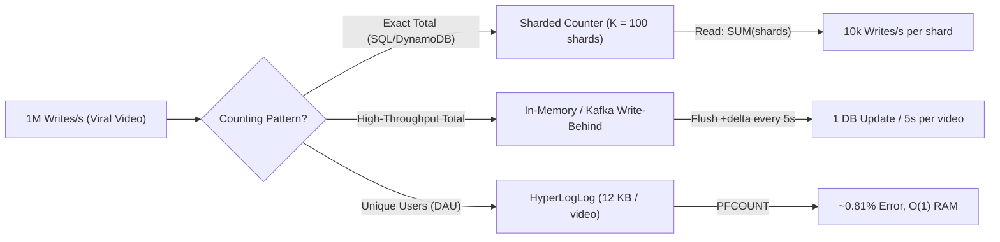
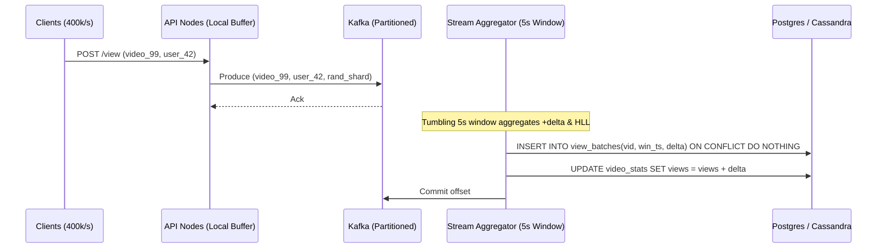
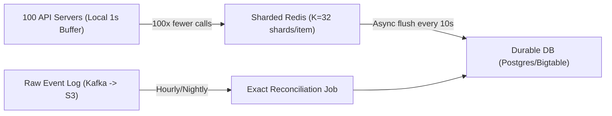

# Counting at Scale: Sharded Counters, Write-Behind & HyperLogLog

> **Prerequisites:** [Lesson 12: Leaderboards & Ranking](../12-leaderboards-ranking/README.md) · [Track Overview](../README.md).  
> **Estimated Reading Time:** 24–28 minutes  
> **Target Audience:** Backend engineers building YouTube view counts, viral tweet likes, or unique-visitor analytics, and candidates asked "how do you count 1 million likes/views per second without melting the database?"  
> **Free PDF Notes:** [Download SD-Q-013.pdf](https://backendroadmap.com/notes/system-design/SD-Q-013.pdf)

> [!NOTE]
> **In one line:** A single `UPDATE posts SET likes = likes + 1` serializes every concurrent writer behind **one row lock**, collapsing at ~1,000–3,000 writes/s; scaling to 1M+ increments/s requires **sharded counters** (splitting 1 row into $K$ independent sub-rows), **write-behind batching** (aggregating in memory/Redis/Kafka before flushing), or **HyperLogLog** when you need *unique* counts (`COUNT(DISTINCT user_id)`) in 12 KB of RAM.

> [!TIP]
> **The Golden Rule:** Separate **total event counting** (likes, views $\to$ sharded counters + write-behind batching) from **unique entity counting** (DAU, unique viewers $\to$ HyperLogLog). Never hold a relational row lock on a viral item's counter.

---

## 1. What Counting at Scale Is, and What It Isn't

When a celebrity posts a video or tweet, 500,000 users/s tap "Like" or start watching simultaneously. If your backend executes:
```sql
UPDATE videos SET view_count = view_count + 1 WHERE id = 'vid_99';
```
Postgres/MySQL acquires an **exclusive row lock** on `vid_99`. Every other concurrent transaction queues behind that lock. Even if the disk is an NVMe SSD, lock contention, MVCC dead-tuple bloat (or InnoDB redo-log serialization) caps a single hot row at ~1,000–3,000 updates/s—causing connection pool exhaustion and site-wide cascading failure.

| Term | Precise Meaning | Example |
| :--- | :--- | :--- |
| **Hot-row contention** | Thousands of transactions serialized on a single DB row lock | Viral tweet `likes` row |
| **Sharded counter** | Splitting 1 logical counter into $K$ physical sub-counters (`id:0 .. id:K-1`); sum on read | `likes:vid_99:shard_7` |
| **Write-behind (write-back)** | Absorbing increments in fast RAM/local buffer/Kafka and flushing deltas periodically | Flush `SUM(+delta)` every 5 s |
| **HyperLogLog (HLL)** | Probabilistic distinct counter using 16,384 6-bit registers ($\sim 12\text{ KB}$, $0.81\%$ error) | `PFADD viewers:vid_99 user_42` |
| **Idempotent like** | Preventing one user from liking twice (requires storing `(user_id, item_id)` state) | Likes table / Redis Set / Roaring Bitmap |
| **Not** | A single atomic `INCR` on one Redis key for everything | One Redis core still caps at ~100k `INCR`/s |

### Why It Matters
1. "Design YouTube View Counter" or "Design Twitter Likes" is a classic interview staple testing **lock contention, write amplification, and eventual consistency**.
2. Knowing the difference between **total count** (commutative `+1` $\to$ sharded/batched) and **unique count** (`COUNT(DISTINCT)` $\to$ HyperLogLog) prevents $O(N)$ memory blowups.
3. Write-behind introduces **crash-loss trade-offs** that you must bound with durable logs (Kafka/WAL) or explicit product SLAs.

---

## 2. Anatomy: Single Row vs Sharded Counter vs Write-Behind + HLL



| Pattern | Max Write Throughput | Read Cost | Memory / Storage | Consistency |
| :--- | :--- | :--- | :--- | :--- |
| **Single DB Row** | ~1k–3k/s (lock-bound) | $O(1)$ | 1 row | Strong (ACID) |
| **Sharded Counter ($K$ shards)** | $K \times 2\text{k/s}$ | $O(K)$ `SUM` (cacheable) | $K$ rows per hot item | Strong per shard, eventual read if cached |
| **Write-Behind (Local/Kafka)** | Millions/s (memory-bound) | $O(1)$ from DB/cache | Buffer RAM / Kafka topic | Eventual (1–10 s lag) |
| **HyperLogLog (Unique)** | Millions/s (sharded) | $O(1)$ (`PFCOUNT`) | **12 KB** fixed for $10^9+$ uniques | Probabilistic ($\pm 0.81\%$) |

> [!WARNING]
> **Write-Behind Crash Loss Trap:** If an app server buffers `+50,000` likes in local process RAM and crashes before the 5-second flush, those 50,000 likes vanish permanently. For **views** (analytics), small loss on crash is acceptable; for **billing/ad-impressions**, buffer in **Kafka** (durable log) and aggregate in Flink/Kafka Streams before writing to the DB.

---

## 3. Mathematical Model: Lock Contention, Sharding Factor & HLL Error

**Little's Law on a Single Row Lock.** If each `UPDATE` holds a row lock for $t_{\text{hold}} = 0.5\text{ ms}$ (including WAL/commit), the theoretical ceiling on 1 row is:

$$\mu_{\max} = \frac{1}{0.0005\text{ s}} = 2{,}000\text{ updates/s}$$

Above $\lambda = 2{,}000\text{ req/s}$, queue depth grows without bound and p99 latency explodes.

**Sharding Factor $K$.** To absorb $\lambda = 200{,}000\text{ writes/s}$ on one viral item with $\le 50\%$ lock utilization ($\mu_{\text{safe}} = 1{,}000\text{ writes/s}$ per shard):

$$K = \left\lceil \frac{200{,}000}{1{,}000} \right\rceil = 200\text{ shards}$$

On write, pick `shard = rand(0, K-1)` and increment `(item_id, shard)`. On read, compute `SUM(count)` across the $K$ shards—and cache that sum for 1–2 seconds!

**Write-Behind Amplification Reduction.** With 1M views/s across 100 app servers, each server aggregates deltas locally in a hash map and flushes every $\Delta t = 5\text{ s}$:
- Without batching: $1{,}000{,}000\text{ DB writes/s}$.
- With 5 s batching on 100 servers: $100 / 5 = \mathbf{20\text{ DB writes/s}}$ per viral video (a **$50{,}000\times$ write reduction**!).

**HyperLogLog (HLL) Standard Error.** HLL hashes each `user_id` into a 64-bit integer, uses the first $p$ bits to pick one of $m = 2^p$ registers, and stores the **maximum number of leading zeros** $\rho$ observed in the remaining bits. Using harmonic mean across $m$ registers, the relative standard error is:

$$\sigma_{\text{HLL}} \approx \frac{1.04}{\sqrt{m}}$$

In Redis, $p = 14 \implies m = 2^{14} = 16{,}384$ registers, each 6 bits wide:
- **Memory:** $16{,}384 \times 6\text{ bits} = 12{,}288\text{ bytes} = \mathbf{12\text{ KB}}$ (even for $10^9$ unique users!).
- **Standard Error:** $1.04 / \sqrt{16{,}384} = 1.04 / 128 = \mathbf{0.81\%}$.

---

## 4. Metrics & Percentiles

| Metric | Meaning | Alert when |
| :--- | :--- | :--- |
| **Row-lock wait time $p_{99}$** | Time waiting on DB `UPDATE` row locks | $> 5\text{ ms}$ (hot item needs sharding) |
| **Write-behind flush lag** | Age of oldest unflushed delta in buffer/Kafka | $> 15\text{ s}$ (DB falling behind) |
| **Dropped-delta rate** | Increments lost on OOM/timeout | $> 0$ for billing; $> 0.1\%$ for views |
| **Read cache hit ratio** | Fraction of counter reads served from cache | $< 95\%$ during viral traffic |
| **HLL merge latency** | Time to `PFMERGE` across daily/regional HLLs | $> 10\text{ ms}$ (offload to async worker) |

### Worked Example (Viral Launch: 400k Views/s + Unique Viewers)
A product launch video receives **400,000 views/s** from **12M unique users** over 10 minutes:
1. **Total Views (Write-Behind via Kafka + Flink):** 200 API nodes publish lightweight view events to a Kafka topic partitioned by `(video_id, rand() % 64)`. A Flink window aggregates counts every 5 seconds and issues 64 batched `UPDATE`s to Postgres/Cassandra—total DB load is **12.8 writes/s** instead of 400,000/s.
2. **Unique Viewers (HyperLogLog):** Storing 12M `user_id`s (16 B each) in a Redis `SET` would take **~500 MB** for *one video*. Instead, a single Redis HLL (`PFADD`) takes **12 KB** ($41{,}000\times$ smaller) and reports `12,048,000` ($\pm 0.81\%$).

---

## 5. Compounding & Failure Modes: Hot Shards, Double Counting & Sparse-to-Dense

1. **Fixed $K$ Wastes Reads on Cold Items:** If 99.9% of videos get 1 view/day, giving every video 100 DB counter shards multiplies storage by $100\times$ and turns every cold read into 100 rows. **Fix:** Use **adaptive sharding**—start with $K = 1$, and auto-expand to $K = 64$ or $256$ only when a video's QPS crosses a threshold.
2. **At-Least-Once Double Counting:** If a Kafka consumer crashes after writing `+5,000` to Postgres but before committing its Kafka offset, replaying the batch adds `+5,000` again! **Fix:** Use **windowed idempotency keys** (`(video_id, partition_id, window_end_ts)`) in an `INSERT ... ON CONFLICT DO NOTHING` ledger, or accept $\pm 0.01\%$ drift for non-financial counters.
3. **Like Toggle Race Condition:** A user clicks Like, then Unlike 50 ms later. If two different shards or async workers process them out of order, the count could end up wrong or negative. **Fix:** Deduplicate per `(user_id, item_id)` in the source-of-truth `likes` table/cache, and clamp display counts at $\ge 0$.
4. **Redis HLL Sparse Representation:** Redis stores small HLLs in a **sparse** encoding (hundreds of bytes) and promotes to **dense** (12 KB) only above ~3,000 uniques—so 10M cold videos don't all consume 12 KB each!

---

## 6. Numbers Every Engineer Must Know

| Item | Typical | Implication |
| :--- | :---: | :--- |
| Single Postgres/MySQL row `UPDATE` ceiling | $1{,}000\text{–}3{,}000\text{/s}$ | Lock contention caps viral rows |
| Single Redis `INCR` key ceiling | $\sim 80\text{k–}100\text{k/s}$ | Single-threaded; shard above 50k/s |
| Redis HyperLogLog dense memory | **12 KB** ($16{,}384 \times 6\text{ bits}$) | Counts up to $2^{64}$ uniques in constant RAM |
| Redis HyperLogLog standard error | **0.81%** ($1.04/\sqrt{16{,}384}$) | Unacceptable for billing; ideal for analytics/DAU |
| Exact `SET` of 10M `user_id`s (Redis) | $\sim 500\text{–}700\text{ MB}$ | $40{,}000\times$ larger than HLL |
| Write-behind flush interval | $1\text{–}10\text{ s}$ | Trades 1–10 s staleness for $1000\times$ fewer DB writes |

---

## 7. Protocol / Mechanism Deep Dive: Write-Behind + Idempotent Flush



| Question | Answer |
| :--- | :--- |
| **Why not just `INCR` in Redis and `GET` on read?** | One hot key in Redis still hits 1 CPU core (~100k ops/s max), and Redis RAM isn't durable without AOF `fsync=always` (which slows it down). |
| **How do you merge daily HLLs into a 30-day MAU?** | `PFMERGE mau_key day_1 day_2 ... day_30`! HLLs are **mergeable** (element-wise `max` of the 16,384 registers) with zero extra error! |
| **Can you check if `user_42` is in an HLL?** | **No!** HLL only estimates cardinality (`COUNT(DISTINCT)`), not membership. Use a **Bloom Filter** or **Set** for membership. |

**When NOT to use Sharded/Write-Behind/HLL:** Never use eventual write-behind or HLL for **financial balances, inventory stock, or ad-billing** where every single unit must be exact and strongly consistent.

---

## 8. Hierarchical Budgets & Design Rules

| Slice | Rule | Control |
| :--- | :--- | :--- |
| **Hot-row threshold** | Never exceed ~500 `UPDATE`s/s on one DB row | Auto-shard or route to write-behind |
| **Shard count $K$** | Size $K = \lceil \text{peak\_wps} / 500 \rceil$; start at $K=1$ for cold items | Adaptive shard table / config |
| **Durability vs Speed** | Use Kafka/WAL buffer if losing 5 s of counts is unacceptable | Durable stream + 5 s tumbling window |
| **Unique counts** | Use HLL when $\pm 0.81\%$ error is acceptable | `PFADD` + `PFMERGE` for rollups |
| **Read path** | Cache `SUM(shards)` for 1–5 s | Never `SUM` 200 shards on every page view |
| **Bot / abuse filtering** | Deduplicate `(user_id, video_id, time_bucket)` before counting | Rate limit + Bloom/sliding window |

---

## 9. Top Mitigations

1. **Shard hot counters** into $K$ sub-rows and cache the `SUM` on the read path for 1–5 s.
2. **Batch increments via write-behind** (in-memory for best-effort views, Kafka + Flink for durable counts).
3. **Use HyperLogLog** instead of `COUNT(DISTINCT)` or Redis `SET`s for unique viewers/DAU (12 KB fixed RAM).
4. **Use `PFMERGE`** to compute weekly/monthly unique rollups from daily HLLs without storing raw user IDs.
5. **Attach window idempotency keys** to write-behind DB flushes so consumer retries don't double-count.
6. **Start cold items at $K=1$** and dynamically expand $K$ only for viral items.

---

## 10. Production Reference: Distributed Counter Sharding at Scale

High-traffic social platforms (e.g., Twitter/X likes, YouTube views, Firebase Distributed Counters) combine three layers so no single database row or cache key melts during a viral spike:
- **Layer 1 (Edge/App Aggregation):** Each API instance keeps a thread-safe map `local_counts[item_id] += 1` and flushes non-zero deltas every 1–2 seconds.
- **Layer 2 (Sharded Redis / Memcached):** Writes land on `counter:{item_id}:{rand(0..K-1)}` ($K=16$ to $128$ for viral items). Reads fetch `MGET` across the $K$ shards and cache the sum for 2 seconds.
- **Layer 3 (Durable Async Flush + Reconciliation):** A background worker drains deltas into Postgres/Bigtable/Cassandra, and an offline Spark/Flink job reconciles raw event logs overnight to correct any drift or bot inflation.



---

## 11. Multi-Language Production Code Tabs

A **Sharded Counter + Write-Behind Buffer + HyperLogLog Register Estimator** in Go, TypeScript, Python, and C#.

````carousel
```go
// Go: Thread-safe Sharded Counter + Write-Behind Flusher (stdlib only).
package main

import (
	"fmt"
	"math/rand"
	"sync"
	"sync/atomic"
)

type ShardedCounter struct {
	shards []atomic.Int64
}

func NewShardedCounter(k int) *ShardedCounter {
	return &ShardedCounter{shards: make([]atomic.Int64, k)}
}

func (c *ShardedCounter) Incr(delta int64) {
	idx := rand.Intn(len(c.shards))
	c.shards[idx].Add(delta)
}

func (c *ShardedCounter) Sum() int64 {
	var total int64
	for i := range c.shards {
		total += c.shards[i].Load()
	}
	return total
}

type WriteBehindBuffer struct {
	mu     sync.Mutex
	counts map[string]int64
}

func NewWriteBehindBuffer() *WriteBehindBuffer {
	return &WriteBehindBuffer{counts: make(map[string]int64)}
}

func (w *WriteBehindBuffer) Add(id string, delta int64) {
	w.mu.Lock()
	w.counts[id] += delta
	w.mu.Unlock()
}

func (w *WriteBehindBuffer) Drain() map[string]int64 {
	w.mu.Lock()
	out := w.counts
	w.counts = make(map[string]int64)
	w.mu.Unlock()
	return out
}

func main() {
	c := NewShardedCounter(16)
	for i := 0; i < 1000; i++ {
		c.Incr(1)
	}
	fmt.Println("Sharded sum:", c.Sum())
}
```
<!-- slide -->
```typescript
// TypeScript: Sharded Counter + Write-Behind Flusher.
export class ShardedCounter {
  private shards: number[];

  constructor(private k = 16) {
    this.shards = new Array(k).fill(0);
  }

  incr(delta = 1): void {
    const idx = Math.floor(Math.random() * this.k);
    this.shards[idx] += delta;
  }

  sum(): number {
    return this.shards.reduce((acc, v) => acc + v, 0);
  }
}

export class WriteBehindBuffer {
  private pending = new Map<string, number>();

  add(itemId: string, delta = 1): void {
    this.pending.set(itemId, (this.pending.get(itemId) ?? 0) + delta);
  }

  drain(): Map<string, number> {
    const batch = this.pending;
    this.pending = new Map();
    return batch; // Flush to DB in one batched UPDATE per itemId
  }
}
```
<!-- slide -->
```python
# Python: Minimal HyperLogLog (m = 2^p registers) + Sharded Counter.
import hashlib
import math
import random

class ShardedCounter:
    def __init__(self, k: int = 16):
        self.shards = [0] * k

    def incr(self, delta: int = 1) -> None:
        self.shards[random.randrange(len(self.shards))] += delta

    def total(self) -> int:
        return sum(self.shards)

class HyperLogLog:
    def __init__(self, p: int = 10):  # m = 1024 registers (~3.25% err); Redis uses p=14 (16384)
        self.p = p
        self.m = 1 << p
        self.registers = [0] * self.m
        self.alpha = 0.7213 / (1 + 1.079 / self.m)

    def add(self, item: str) -> None:
        h = int.from_bytes(hashlib.sha256(item.encode()).digest()[:8], "big")
        idx = h >> (64 - self.p)
        rem = (h << self.p) & ((1 << 64) - 1)
        # Count leading zeros + 1 in remaining (64 - p) bits
        rho = (64 - self.p) - rem.bit_length() + 1 if rem else (64 - self.p) + 1
        if rho > self.registers[idx]:
            self.registers[idx] = rho

    def count(self) -> int:
        z = sum(2.0 ** (-r) for r in self.registers)
        est = self.alpha * (self.m ** 2) / z
        if est <= 2.5 * self.m:
            zeros = self.registers.count(0)
            if zeros > 0:
                est = self.m * math.log(self.m / zeros)
        return int(est)
```
<!-- slide -->
```csharp
// C#: Thread-safe Sharded Counter + Write-Behind Batcher.
using System;
using System.Collections.Concurrent;
using System.Threading;

public sealed class ShardedCounter
{
    private readonly long[] _shards;

    public ShardedCounter(int k = 16) => _shards = new long[k];

    public void Incr(long delta = 1)
    {
        int idx = Random.Shared.Next(_shards.Length);
        Interlocked.Add(ref _shards[idx], delta);
    }

    public long Sum()
    {
        long total = 0;
        for (int i = 0; i < _shards.Length; i++)
            total += Interlocked.Read(ref _shards[i]);
        return total;
    }
}

public sealed class WriteBehindBatcher
{
    private readonly ConcurrentDictionary<string, long> _pending = new();

    public void Add(string itemId, long delta = 1) =>
        _pending.AddOrUpdate(itemId, delta, (_, cur) => cur + delta);

    public (string Id, long Delta)[] Drain()
    {
        var keys = _pending.Keys;
        var batch = new System.Collections.Generic.List<(string, long)>();
        foreach (var k in keys)
            if (_pending.TryRemove(k, out var val))
                batch.Add((k, val));
        return batch.ToArray();
    }
}
```
````

---

## 12. Hands-On CLI Verification Workflows

Verify HyperLogLog accuracy vs exact cardinality in Python:

```bash
python -c "
import hashlib, math
p, m = 14, 1 << 14
regs = [0] * m
for i in range(100_000):
    h = int.from_bytes(hashlib.blake2b(f'user_{i % 50000}'.encode(), digest_size=8).digest(), 'big')
    idx = h >> (64 - p)
    rem = (h << p) & ((1 << 64) - 1)
    rho = (64 - p) - rem.bit_length() + 1 if rem else (64 - p) + 1
    if rho > regs[idx]: regs[idx] = rho
alpha = 0.7213 / (1 + 1.079 / m)
est = alpha * (m ** 2) / sum(2.0 ** (-r) for r in regs)
print(f'Exact: 50,000 | HLL Estimate: {int(est):,} | Error: {abs(est - 50000)/50000:.2%}')
"
```

Verify Redis HyperLogLog (`PFADD`, `PFCOUNT`, `PFMERGE`) with `redis-cli`:

```bash
# Track unique viewers on two days
redis-cli PFADD views:day1 user_1 user_2 user_3 user_1
redis-cli PFADD views:day2 user_2 user_4 user_5

# Approximate unique counts
redis-cli PFCOUNT views:day1
redis-cli PFCOUNT views:day2

# Merge across days without storing raw user IDs
redis-cli PFMERGE views:week1 views:day1 views:day2
redis-cli PFCOUNT views:week1
```

---

## 13. Common Mistakes to Avoid

1. **Running `UPDATE table SET count = count + 1` on a single hot row** under viral traffic (lock contention kills the DB).
2. **Storing 50M `user_id`s in a Redis `SET`** just to compute `SCARD` (uses ~2.5 GB instead of 12 KB with HLL).
3. **Buffering write-behind deltas only in process RAM** for billing/financial counters (process crash = permanent data loss).
4. **Sharding every cold item into 100 DB rows** upfront ($100\times$ read/storage waste; adaptively shard only hot items).
5. **Forgetting to cache `SUM(shards)`** on the read path (10k reads/s $\times$ 100 shards = 1M DB reads/s).
6. **Using HyperLogLog for membership checks** (*"has user X seen this?"*—HLL cannot answer membership; use Bloom/Set).
7. **Replaying Kafka write-behind batches without idempotency keys**, causing double-counting on consumer restarts.

---

## 14. Key Terms Glossary

| Key Term | Definition |
| :--- | :--- |
| **Hot-row contention** | Serialization of concurrent `UPDATE`s behind a single database row lock. |
| **Sharded counter** | Logical counter split into $K$ independent sub-rows; writes pick random shard, reads sum. |
| **Write-behind (write-back)** | Buffering increments in memory/stream and flushing aggregated deltas periodically. |
| **HyperLogLog (HLL)** | Probabilistic distinct-count sketch using 12 KB for $0.81\%$ standard error. |
| **`PFADD` / `PFCOUNT` / `PFMERGE`** | Redis HyperLogLog commands for adding, estimating cardinality, and merging sketches. |
| **Write amplification** | Ratio of physical storage/DB writes to logical application events. |
| **Adaptive sharding** | Starting counters at $K=1$ and expanding $K$ only when write rate exceeds a threshold. |
| **Harmonic mean** | Reciprocal of the arithmetic mean of reciprocals; used by HLL to suppress outlier registers. |

---

## 15. System Design Interview Questions & Answers

### Basic Conceptual Questions

<details>
<summary><strong>Q1: Why does `UPDATE posts SET likes = likes + 1` fail at scale? [BASIC]</strong></summary>

**Answer:**
Every concurrent transaction must acquire an exclusive row lock on that single row. With ~0.5 ms lock hold time, a single row caps at ~2,000 updates/s. Above that, requests queue, connection pools exhaust, and the database stalls.
</details>

<details>
<summary><strong>Q2: How does a sharded counter solve hot-row contention? [BASIC]</strong></summary>

**Answer:**
Instead of 1 row for `vid_99`, you create $K$ rows `(vid_99, 0)` through `(vid_99, K-1)`. Each write picks a random shard `rand(0, K-1)` and increments it, multiplying write capacity by $K\times$. Reads compute `SUM(count)` across the $K$ shards (and cache the sum).
</details>

<details>
<summary><strong>Q3: What is write-behind caching, and when is it safe? [BASIC]</strong></summary>

**Answer:**
Increments are absorbed in fast memory (or a durable stream like Kafka) and flushed in batches every few seconds (`SET count = count + batch_delta`). It is safe when 1–10 s of eventual consistency is fine (e.g., view counts, likes), and unsafe for financial ledgers unless backed by a durable WAL/outbox.
</details>

<details>
<summary><strong>Q4: What problem does HyperLogLog solve? [BASIC]</strong></summary>

**Answer:**
Estimating `COUNT(DISTINCT user_id)` (e.g., unique viewers or DAU) in **constant 12 KB memory** with **0.81% standard error**, instead of storing millions of user IDs in a hash set.
</details>

### Scenario-Based Architecture Questions

<details>
<summary><strong>Q5: Design a YouTube view counter handling 1M views/s on a viral music video. [SCENARIO]</strong></summary>

**Answer:**
Ingest view events into **Kafka** (partitioned by `(video_id, rand() % N)` to avoid hot partitions). A **Flink/stream processor** aggregates counts in 5-second tumbling windows and flushes batched deltas to Cassandra/Postgres (reducing 1M writes/s to ~20 writes/s). Reads hit a 2-second CDN/Redis cache. Track *unique* viewers in parallel with **HyperLogLog** (`12 KB`).
</details>

<details>
<summary><strong>Q6: You have 100M videos, but only 100 are viral at any time. How do you avoid wasting 100x storage on sharded counters? [SCENARIO]</strong></summary>

**Answer:**
Use **adaptive sharding**: every video starts with $K = 1$ shard. When a video's write rate crosses a threshold (e.g., 200 writes/s), dynamically increase its shard count $K$ (e.g., $1 \to 16 \to 128$) via a metadata config, and let the reader sum all existing shards for that `video_id`.
</details>

<details>
<summary><strong>Q7: How do you compute unique visitors for "Last 7 Days" and "Last 30 Days" without storing raw user IDs? [SCENARIO]</strong></summary>

**Answer:**
Maintain one HyperLogLog per day (`hll:2026-11-25`, 12 KB each). To get 7-day or 30-day uniques, run **`PFMERGE`** across the daily HLL keys—taking the element-wise maximum of each register—and read `PFCOUNT` in $< 1\text{ ms}$ with no loss of accuracy beyond the 0.81% bound.
</details>

<details>
<summary><strong>Q8: A user complains their "Like" count dropped after clicking Like, Refresh, Like. Why? [SCENARIO]</strong></summary>

**Answer:**
Eventual consistency between the write-behind buffer (5 s flush lag) and the read cache. Mitigate with **read-your-own-writes**: optimistically update the client UI immediately, and store the user's own `liked = true` state in a fast per-user store so refreshes show the heart icon lit even before the global count catches up.
</details>

### Advanced & Tricky Interview Questions

<details>
<summary><strong>Q9: How do you prevent double-counting when a Kafka write-behind consumer crashes mid-flush? [TRICKY]</strong></summary>

**Answer:**
Attach a deterministic **window idempotency key** `(video_id, partition_id, window_end_ts)` to each aggregated delta. On flush, execute `INSERT INTO view_batches ... ON CONFLICT DO NOTHING` and only apply `UPDATE views = views + delta` in the same transaction if the insert succeeded.
</details>

<details>
<summary><strong>Q10: Why can't you decrement or delete an item from a HyperLogLog? [TRICKY]</strong></summary>

**Answer:**
Each HLL register only stores the **maximum** leading-zero count $\rho$ seen so far (`reg[i] = max(reg[i], rho)`). Because `max` is not invertible, removing one element doesn't tell you what the second-largest $\rho$ was. If you need deletions/expirations, use time-bucketed HLLs and `PFMERGE` the active window.
</details>

<details>
<summary><strong>Q11: Why does Redis HLL only take ~12 KB for 1B users, yet 10M cold videos don't take 120 GB? [TRICKY]</strong></summary>

**Answer:**
Redis uses a **sparse representation** for HLLs with few unique elements (storing only non-zero registers as run-length-encoded bytes, often 50–300 bytes) and only promotes to the fixed 12 KB **dense** 16,384-register array once cardinality exceeds ~3,000.
</details>

<details>
<summary><strong>Q12: How do you enforce "one like per user" at 500k likes/s without a single-row lock? [TRICKY]</strong></summary>

**Answer:**
Shard the **user-item relation** (`likes(user_id, item_id)`) by `hash(user_id, item_id)` across a distributed KV store (DynamoDB/Cassandra/sharded Postgres)—that write has **zero hot-row contention** because each `(user_id, item_id)` pair is unique! Only after that insert succeeds (returning `inserted=true`) do you emit `+1` to the sharded/write-behind counter.
</details>

---

## 16. One-Page Master Cheat Sheet

```
+---------------------------------------------------------------------------------------------------------+
|                    COUNTING AT SCALE — MASTER CHEAT SHEET                                               |
+---------------------------------------------------------------------------------------------------------+
| 1. HOT-ROW CEILING: 1 SQL row caps at ~1k-3k UPDATEs/s (lock-bound). 1 Redis INCR caps at ~100k/s.      |
+---------------------------------------------------------------------------------------------------------+
| 2. SHARDED COUNTERS: Split 1 row into K shards; write to rand(0..K-1), read SUM(shards) + 2s cache.     |
|    Start cold items at K=1; adaptively expand K only for viral items.                                   |
+---------------------------------------------------------------------------------------------------------+
| 3. WRITE-BEHIND: Buffer in RAM (best-effort) or Kafka+Flink (durable), flush +delta every 5s.           |
|    Use window idempotency keys (item_id, partition, window_ts) to prevent replay double-counting.       |
+---------------------------------------------------------------------------------------------------------+
| 4. UNIQUE COUNTS (HLL): HyperLogLog = 12 KB fixed RAM, 0.81% std error, mergeable via PFMERGE.          |
|    Cannot delete or test membership! Always pair with Bloom/Set if membership is needed.                |
+---------------------------------------------------------------------------------------------------------+
```

---

## Further Reading & Sources

- Redis Documentation, [HyperLogLog (`PFADD`, `PFCOUNT`, `PFMERGE`)](https://redis.io/docs/latest/develop/data-types/probabilistic/hyperloglogs/).
- Flajolet et al., [*HyperLogLog: the analysis of a near-optimal cardinality estimation algorithm*](https://algo.inria.fr/flajolet/Publications/FlFuGaMe07.pdf) (2007).
- Google Cloud / Firebase, [Distributed Counters Pattern](https://firebase.google.com/docs/firestore/solutions/counters).
- Martin Kleppmann, *Designing Data-Intensive Applications*, Chapter 11 & 12 ("Stream Processing" & "The Future of Data Systems").

---

## Free PDF Notes

[SD-Q-013.pdf](https://backendroadmap.com/notes/system-design/SD-Q-013.pdf)

---

## Next

Continue with [Lesson 14: Probabilistic Data Structures: Bloom, Cuckoo, HLL & Count-Min](../14-probabilistic-data-structures/README.md).
