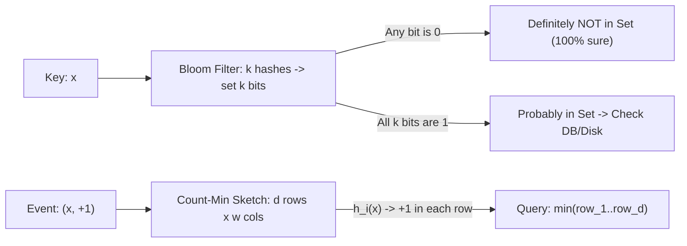
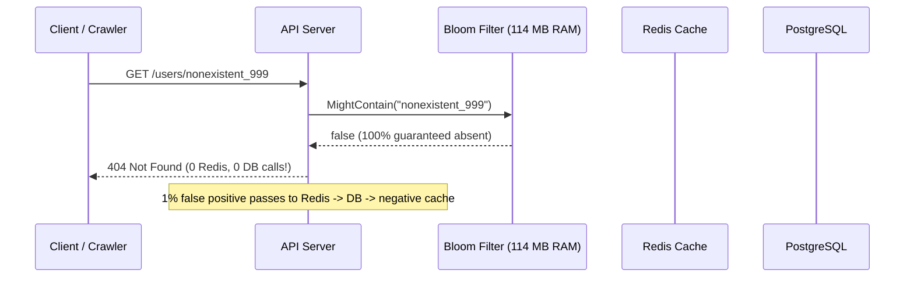
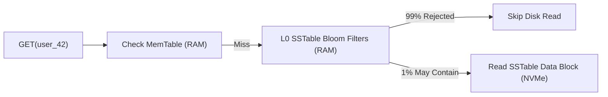

# Probabilistic Data Structures: Bloom, Cuckoo, HLL & Count-Min

> **Prerequisites:** [Lesson 13: Counting at Scale](../13-counting-at-scale/README.md) · [Track Overview](../README.md).  
> **Estimated Reading Time:** 25–30 minutes  
> **Target Audience:** Backend engineers protecting databases from cache penetration, filtering malicious URLs, or tracking stream frequencies in bounded RAM, and candidates asked "how do you check 1 billion items in 1 GB of RAM?"  
> **Free PDF Notes:** [Download SD-Q-014.pdf](https://backendroadmap.com/notes/system-design/SD-Q-014.pdf)

> [!NOTE]
> **In one line:** Probabilistic data structures trade a tiny, mathematically bounded error (false positives or $\epsilon$-approximation) for **$O(1)$ time and $10\times\text{–}1000\times$ less memory** than exact hash sets or maps—**Bloom/Cuckoo** answer *"is $x$ in the set?"*, **HyperLogLog** answers *"how many uniques?"*, and **Count-Min Sketch** answers *"how frequent is $x$?"*.

> [!TIP]
> **The Golden Rule:** Never use a probabilistic structure when a **false positive** or **approximation** violates correctness (e.g., auth checks, financial balances). Use them as **fast front-end filters** (reject 99% of non-existent keys before hitting disk/DB) or **bounded-RAM telemetry sketches**.

---

## 1. What Probabilistic Data Structures Are, and What They Aren't

Imagine your URL shortener or user-registration service has 1 billion existing keys. Every request for a non-existent key bypasses Redis (cache miss) and hits PostgreSQL—a classic **cache penetration** attack or crawler storm. Storing 1 billion 16-byte keys in an exact HashSet takes **~32–50 GB** of RAM. A **Bloom filter** with a 1% false-positive rate stores all 1 billion keys in **~1.14 GB** ($\approx 9.6$ bits/key) and rejects 99% of invalid lookups in **50 nanoseconds**.

| Structure | Question Answered | Error Type | Supports Delete? | Typical Memory (1B items) |
| :--- | :--- | :--- | :--- | :--- |
| **Bloom Filter** | *"Is $x$ in set $S$?"* | False positives ($p$); **0% false negatives** | No (standard) | ~1.14 GB ($p=1\%$) |
| **Cuckoo Filter** | *"Is $x$ in set $S$?"* | False positives ($p$); **0% false negatives** | **Yes** (fingerprint swap) | ~0.95–1.2 GB ($p=1\%$) |
| **HyperLogLog (HLL)** | *"How many unique items?"* | Relative std error ($\pm 0.81\%$) | No | **12 KB** (fixed!) |
| **Count-Min Sketch (CMS)** | *"Frequency of item $x$?"* | Overestimates only ($\le \hat{f} \le f + \epsilon N$) | Decrement if non-negative | Few MBs (width $w \times$ depth $d$) |
| **Not** | Exact storage of keys/values | You cannot iterate or retrieve original keys from any of these | N/A | N/A |

### Why It Matters
1. **SSTable / LSM-tree read amplification:** RocksDB, Cassandra, and LevelDB embed a **Bloom filter** in every SSTable so point reads skip 99% of disk files that don't contain the key.
2. **Cache penetration defense:** A Bloom filter in front of Redis/DB blocks DDoS storms of random non-existent IDs.
3. **Stream analytics in fixed RAM:** Count-Min Sketch + HLL let you track frequencies and cardinalities over billions of events inside a single 64 MB container.

---

## 2. Anatomy: Bit Array vs Cuckoo Buckets vs 2D Sketch Grid



- **Bloom Filter:** An $m$-bit array initialized to 0 with $k$ independent hash functions. `Add(x)` sets bits $h_1(x)\dots h_k(x)$ to 1. `Contains(x)` returns `true` iff all $k$ bits are 1. Bits can collide across keys, causing **false positives**, never false negatives.
- **Cuckoo Filter:** A hash table of buckets storing short **fingerprints** (e.g., 8–12 bits). Each key has two candidate buckets $i_1 = h(x)$ and $i_2 = i_1 \oplus h(\text{fp})$. If full, it kicks out an existing fingerprint to its alternate bucket (cuckoo hashing). Supports **`Delete(x)`** cleanly!
- **Count-Min Sketch:** A $d \times w$ matrix of counters. `Add(x)` increments `grid[i][h_i(x)]` for all $i \in [0, d)$. `Estimate(x)` returns **`min_i grid[i][h_i(x)]`**. Because collisions only *add* positive noise, taking the `min` minimizes overestimation.

> [!WARNING]
> **Bloom Filter Saturation Trap:** If you size a Bloom filter for $n = 10\text{M}$ items and insert $50\text{M}$ items, the bit array fills toward 100% ones and the false-positive rate explodes toward 100%—rendering the filter useless! Always monitor fill ratio and use **Scalable Bloom Filters** (chaining new filters) or rebuild when $n$ approaches capacity.

---

## 3. Mathematical Model: Optimal Sizing Formulas

**1. Bloom Filter Sizing.** Given target capacity $n$ and false-positive probability $p$:

$$m = -\frac{n \ln p}{(\ln 2)^2} \approx 1.44\,n\log_2\!\left(\frac{1}{p}\right), \qquad k = \frac{m}{n}\ln 2 \approx 0.693\,\frac{m}{n}$$

**Worked Example ($n = 100{,}000{,}000$ keys, $p = 0.01$):**
- Bits per element: $m/n \approx 1.44 \times \log_2(100) \approx 1.44 \times 6.644 \approx \mathbf{9.58\text{ bits/key}}$.
- Total bits $m = 958{,}505{,}838\text{ bits} \approx \mathbf{114.3\text{ MB}}$!
- Optimal hash functions: $k = \lceil 0.693 \times 9.58 \rceil = \mathbf{7\text{ hashes}}$.
- For $p = 0.001$ ($0.1\%$): $m/n \approx 14.38\text{ bits/key} \approx 171.4\text{ MB}$, $k = 10$.

**2. Count-Min Sketch Sizing.** Given additive error tolerance $\varepsilon$ (fraction of total stream count $N$) and failure probability $\delta$:

$$w = \left\lceil \frac{e}{\varepsilon} \right\rceil, \qquad d = \left\lceil \ln\!\left(\frac{1}{\delta}\right) \right\rceil$$

With probability $\ge 1 - \delta$, the estimate $\hat{f}(x)$ satisfies:

$$f(x) \le \hat{f}(x) \le f(x) + \varepsilon N$$

**Worked Example ($\varepsilon = 0.001$, $\delta = 0.01$):**
- Width $w = \lceil 2.718 / 0.001 \rceil = \mathbf{2{,}719}$ counters per row.
- Depth $d = \lceil \ln(100) \rceil = \mathbf{5}$ rows.
- Total memory (4-byte `uint32` counters): $2{,}719 \times 5 \times 4\text{ B} = \mathbf{54.4\text{ KB}}$!

---

## 4. Metrics & Percentiles

| Metric | Meaning | Alert when |
| :--- | :--- | :--- |
| **Bloom bit saturation** | Fraction of bits set to `1` | $> 55\%$ (FP rate rising above target $p$) |
| **Observed FP rate** | `(Bloom=true AND DB=miss) / Bloom=true` | $> 2 \times p_{\text{target}}$ |
| **Cuckoo load factor** | Occupied fingerprint slots / total slots | $> 90\%$ (insertions may fail/evict) |
| **CMS saturation / overflow** | Max counter approaching `uint32` max | $> 80\%$ of counter width (use `uint64` or reset) |
| **SSTable disk reads saved** | `Bloom_rejects / total_point_lookups` | $< 90\%$ (misconfigured $m/n$) |

### Worked Example (RocksDB / Cassandra SSTable Filter)
A database has 10 SSTables on disk, each holding 10M keys with a 10-bit/key Bloom filter ($p \approx 0.8\%$, 12 MB per SSTable).
- A point lookup for a non-existent key checks all 10 Bloom filters in RAM ($10 \times 50\text{ ns} = 0.5\text{ }\mu\text{s}$).
- Expected disk seeks: $10 \times 0.008 = \mathbf{0.08\text{ disk seeks}}$ instead of 10 disk seeks ($125\times$ faster!).

---

## 5. Compounding & Failure Modes: Deletions, Hash Correlation & Resizing

1. **Deleting from a Standard Bloom Filter Corrupts Other Keys:** Clearing a bit to `0` for `key_A` may silently clear a bit shared by `key_B`, introducing **false negatives** (violating Bloom's core guarantee!). **Fix:** Use a **Cuckoo Filter** (or **Counting Bloom Filter**, 4 bits/counter, though $4\times$ larger) whenever deletions are required.
2. **Double-Hashing Trick Saves CPU:** Computing 7 independent cryptographic hashes (`SHA-256`) per key is slow. **Kirsch-Mitzenmacher** proved you only need **two** fast non-cryptographic hashes ($h_1, h_2$, e.g., MurmurHash3 / xxHash) to generate $k$ hashes: $g_i(x) = (h_1(x) + i \cdot h_2(x)) \bmod m$, with identical asymptotic FP rate!
3. **Count-Min Sketch Overestimation on Zipfian Tails:** On skewed streams, heavy hitters collide with mice (rare items), inflating mice counts. **Conservative Update** (only incrementing counters equal to the current minimum) cuts overestimation error significantly.

---

## 6. Numbers Every Engineer Must Know

| Item | Typical | Implication |
| :--- | :---: | :--- |
| Bloom filter @ 1% FP | **9.6 bits/item** ($k=7$) | 1B items $\approx 1.14\text{ GB}$ |
| Bloom filter @ 0.1% FP | **14.4 bits/item** ($k=10$) | 1B items $\approx 1.7\text{ GB}$ |
| Cuckoo filter @ 1% FP | **~10–12 bits/item** | Smaller than Bloom below $p < 3\%$, AND supports `Delete` |
| HyperLogLog (Redis) | **12 KB** ($0.81\%$ std err) | Constant RAM for $10^9+$ uniques |
| Count-Min Sketch ($\varepsilon=10^{-3}, \delta=1\%$) | **~55 KB** | Constant RAM for stream frequencies |
| Hash function speed (xxHash64) | $\sim 10+\text{ GB/s}$ ($< 10\text{ ns}$/key) | Use Kirsch-Mitzenmacher $h_1 + i \cdot h_2$ |

---

## 7. Protocol / Mechanism Deep Dive: Cache Penetration Defense



| Question | Answer |
| :--- | :--- |
| **When must we update the Bloom filter?** | On every new `INSERT` into the DB (or via CDC/Debezium stream) so new valid keys never get false-negatives! |
| **What if a user is deleted from the DB?** | Standard Bloom filters can't delete; either use a **Cuckoo Filter** or accept a tiny extra FP rate until periodic nightly rebuild. |
| **Where does the Bloom filter live?** | In **Redis (`RedisBloom` `BF.ADD` / `BF.EXISTS`)** for shared state, or **replicated in app RAM** for zero-network-hop filtering. |

**When NOT to use Probabilistic Structures:** Never use a Bloom filter as the *sole* check for **password/token validation, financial deduplication, or access control**—a 1% false positive means 1% of invalid tokens or duplicate payments would slip through if you don't verify against an exact store.

---

## 8. Hierarchical Budgets & Design Rules

| Slice | Rule | Control |
| :--- | :--- | :--- |
| **Capacity headroom** | Size Bloom $m$ for $1.5\times\text{–}2\times$ expected $n$ | Alert at 55% bit saturation |
| **Deletions needed?** | Choose **Cuckoo Filter**, never standard Bloom | Test `Delete` + `Contains` |
| **Hash function** | Use fast non-crypto hash (xxHash / Murmur3) + $h_1 + i \cdot h_2$ | Never SHA-256 in hot loops |
| **New-item sync** | Update filter *before* or *atomically via CDC* with DB insert | Prevents false negatives on fresh keys |
| **CMS counter width** | Use `uint64` or periodic window reset if $N > 2^{32}$ | Prevent silent integer overflow |
| **Negative caching** | Pair Bloom with short-TTL negative cache in Redis | Absorbs the 1% Bloom false positives |

---

## 9. Top Mitigations

1. **Put a Bloom or Cuckoo filter in front of Redis/DB** to block cache-penetration attacks.
2. **Use Kirsch-Mitzenmacher double hashing** ($h_1 + i \cdot h_2$) for fast $k$-probe computation.
3. **Choose Cuckoo filters** when items are frequently deleted (e.g., active session IDs or revoked tokens).
4. **Use Scalable Bloom Filters** or periodic rebuilds so growing datasets don't saturate bit arrays.
5. **Sync filter additions via CDC** or write-through so newly created keys never suffer false negatives.
6. **Combine CMS + Min-Heap** (next lesson) to turn approximate frequencies into an exact Top-$K$ Heavy Hitters tracker.

---

## 10. Production Reference: RocksDB / Cassandra SSTable Bloom Filters

Every LSM-tree storage engine (RocksDB, LevelDB, Apache Cassandra, Pebble) writes immutable sorted files called **SSTables** to disk. A single database may have dozens of SSTables across levels $L_0 \dots L_6$. Without a filter, a `GET(key)` for a missing key would have to binary-search the index block of **every** SSTable on disk.

- **How it works:** When an SSTable is flushed from MemTable to disk, the engine builds a **10-bit/key Bloom filter** (~1% FP rate) and stores it in the SSTable's filter block (pinned in RAM).
- **Result:** On `GET(key)`, RocksDB checks the in-memory Bloom filter of each candidate SSTable in ~30 ns. 99% of non-matching SSTables are skipped with **zero disk I/O**.



---

## 11. Multi-Language Production Code Tabs

A complete **Bloom Filter (Kirsch-Mitzenmacher double hashing)** + **Count-Min Sketch** in Go, TypeScript, Python, and C#.

````carousel
```go
// Go: Bloom Filter (Kirsch-Mitzenmacher) + Count-Min Sketch (stdlib only).
package main

import (
	"fmt"
	"hash/fnv"
	"math"
)

type BloomFilter struct {
	bits []uint64
	m, k uint64
}

func NewBloomFilter(n int, fpRate float64) *BloomFilter {
	m := uint64(math.Ceil(-float64(n) * math.Log(fpRate) / (math.Ln2 * math.Ln2)))
	k := uint64(math.Max(1, math.Round(float64(m)/float64(n)*math.Ln2)))
	return &BloomFilter{bits: make([]uint64, (m+63)/64), m: m, k: k}
}

func hashes(key string) (uint64, uint64) {
	h1 := fnv.New64a()
	h1.Write([]byte(key))
	a := h1.Sum64()
	h2 := fnv.New64()
	h2.Write([]byte(key))
	b := h2.Sum64() | 1
	return a, b
}

func (bf *BloomFilter) Add(key string) {
	h1, h2 := hashes(key)
	for i := uint64(0); i < bf.k; i++ {
		pos := (h1 + i*h2) % bf.m
		bf.bits[pos/64] |= 1 << (pos % 64)
	}
}

func (bf *BloomFilter) MightContain(key string) bool {
	h1, h2 := hashes(key)
	for i := uint64(0); i < bf.k; i++ {
		pos := (h1 + i*h2) % bf.m
		if (bf.bits[pos/64] & (1 << (pos % 64))) == 0 {
			return false
		}
	}
	return true
}

func main() {
	bf := NewBloomFilter(10000, 0.01)
	bf.Add("user:42")
	fmt.Println("user:42?", bf.MightContain("user:42"), "user:99?", bf.MightContain("user:99"))
}
```
<!-- slide -->
```typescript
// TypeScript: Bloom Filter + Count-Min Sketch.
export class BloomFilter {
  private bits: Uint8Array;
  readonly m: number;
  readonly k: number;

  constructor(n: number, fpRate = 0.01) {
    this.m = Math.ceil((-n * Math.log(fpRate)) / (Math.LN2 ** 2));
    this.k = Math.max(1, Math.round((this.m / n) * Math.LN2));
    this.bits = new Uint8Array(Math.ceil(this.m / 8));
  }

  private hashPair(key: string): [number, number] {
    let h1 = 2166136261;
    let h2 = 0x9e3779b9;
    for (let i = 0; i < key.length; i++) {
      const c = key.charCodeAt(i);
      h1 = Math.imul(h1 ^ c, 16777619) >>> 0;
      h2 = Math.imul(h2 ^ c, 2246822519) >>> 0;
    }
    return [h1, h2 | 1];
  }

  add(key: string): void {
    const [h1, h2] = this.hashPair(key);
    for (let i = 0; i < this.k; i++) {
      const pos = (h1 + i * h2) % this.m;
      this.bits[pos >> 3] |= 1 << (pos & 7);
    }
  }

  mightContain(key: string): boolean {
    const [h1, h2] = this.hashPair(key);
    for (let i = 0; i < this.k; i++) {
      const pos = (h1 + i * h2) % this.m;
      if ((this.bits[pos >> 3] & (1 << (pos & 7))) === 0) return false;
    }
    return true;
  }
}
```
<!-- slide -->
```python
# Python: Bloom Filter + Count-Min Sketch (stdlib only).
import hashlib
import math

class BloomFilter:
    def __init__(self, n: int, fp_rate: float = 0.01):
        self.m = math.ceil(-n * math.log(fp_rate) / (math.log(2) ** 2))
        self.k = max(1, round((self.m / n) * math.log(2)))
        self.bits = bytearray((self.m + 7) // 8)

    def _hashes(self, key: str) -> tuple[int, int]:
        d = hashlib.blake2b(key.encode(), digest_size=16).digest()
        h1 = int.from_bytes(d[:8], "big")
        h2 = int.from_bytes(d[8:], "big") | 1
        return h1, h2

    def add(self, key: str) -> None:
        h1, h2 = self._hashes(key)
        for i in range(self.k):
            pos = (h1 + i * h2) % self.m
            self.bits[pos >> 3] |= 1 << (pos & 7)

    def might_contain(self, key: str) -> bool:
        h1, h2 = self._hashes(key)
        for i in range(self.k):
            pos = (h1 + i * h2) % self.m
            if not (self.bits[pos >> 3] & (1 << (pos & 7))):
                return False
        return True

class CountMinSketch:
    def __init__(self, eps: float = 0.001, delta: float = 0.01):
        self.w = math.ceil(math.e / eps)
        self.d = math.ceil(math.log(1 / delta))
        self.grid = [[0] * self.w for _ in range(self.d)]

    def _idx(self, row: int, key: str) -> int:
        d = hashlib.blake2b(f"{row}:{key}".encode(), digest_size=8).digest()
        return int.from_bytes(d, "big") % self.w

    def add(self, key: str, count: int = 1) -> None:
        for r in range(self.d):
            self.grid[r][self._idx(r, key)] += count

    def estimate(self, key: str) -> int:
        return min(self.grid[r][self._idx(r, key)] for r in range(self.d))
```
<!-- slide -->
```csharp
// C#: Bloom Filter with Kirsch-Mitzenmacher double hashing.
using System;
using System.Collections;

public sealed class BloomFilter
{
    private readonly BitArray _bits;
    public int M { get; }
    public int K { get; }

    public BloomFilter(int n, double fpRate = 0.01)
    {
        M = (int)Math.Ceiling(-n * Math.Log(fpRate) / (Math.Log(2) * Math.Log(2)));
        K = Math.Max(1, (int)Math.Round((double)M / n * Math.Log(2)));
        _bits = new BitArray(M);
    }

    private static (uint H1, uint H2) HashPair(string key)
    {
        uint h1 = 2166136261u, h2 = 0x9e3779b9u;
        foreach (char c in key)
        {
            h1 = (h1 ^ c) * 16777619u;
            h2 = (h2 ^ c) * 2246822519u;
        }
        return (h1, h2 | 1u);
    }

    public void Add(string key)
    {
        var (h1, h2) = HashPair(key);
        for (int i = 0; i < K; i++)
            _bits[(int)((h1 + (ulong)i * h2) % (uint)M)] = true;
    }

    public bool MightContain(string key)
    {
        var (h1, h2) = HashPair(key);
        for (int i = 0; i < K; i++)
            if (!_bits[(int)((h1 + (ulong)i * h2) % (uint)M)]) return false;
        return true;
    }
}
```
````

---

## 12. Hands-On CLI Verification Workflows

Verify Bloom Filter sizing and empirical false-positive rate in Python:

```bash
python -c "
import math, hashlib
n, p = 10_000, 0.01
m = math.ceil(-n * math.log(p) / (math.log(2) ** 2))
k = round((m / n) * math.log(2))
bits = bytearray((m + 7) // 8)
def hashes(s):
    d = hashlib.blake2b(s.encode(), digest_size=16).digest()
    return int.from_bytes(d[:8], 'big'), int.from_bytes(d[8:], 'big') | 1
for i in range(n):
    h1, h2 = hashes(f'in:{i}')
    for j in range(k):
        pos = (h1 + j * h2) % m
        bits[pos >> 3] |= 1 << (pos & 7)
fps = sum(
    all((bits[((h1 + j*h2) % m) >> 3] & (1 << (((h1 + j*h2) % m) & 7))) for j in range(k))
    for i in range(n) for h1, h2 in [hashes(f'out:{i}')]
)
print(f'm={m} bits ({m/8/1024:.1f} KB), k={k}, empirical FP={fps/n:.2%} (target {p:.2%})')
"
```

Verify RedisBloom (`BF.RESERVE`, `BF.ADD`, `BF.EXISTS`, `CMS.INITBYPROB`):

```bash
# Reserve a Bloom filter for 1M items at 1% FP rate
redis-cli BF.RESERVE users:bloom 0.01 1000000
redis-cli BF.ADD users:bloom "alice"
redis-cli BF.EXISTS users:bloom "alice"   # 1
redis-cli BF.EXISTS users:bloom "nobody"  # 0

# Initialize a Count-Min Sketch (eps=0.001, prob=0.01)
redis-cli CMS.INITBYPROB tags:cms 0.001 0.01
redis-cli CMS.INCRBY tags:cms "#ai" 5 "#go" 2
redis-cli CMS.QUERY tags:cms "#ai"
```

---

## 13. Common Mistakes to Avoid

1. **Trying to delete from a standard Bloom filter** by flipping bits back to `0` (causes false negatives!).
2. **Letting a Bloom filter exceed its designed capacity $n$** without scaling (FP rate degrades toward 100%).
3. **Using Bloom filters for security/auth decisions** without an exact fallback check.
4. **Confusing HyperLogLog with Count-Min Sketch** (HLL = *distinct* count across a stream; CMS = *frequency* of a specific key).
5. **Running $k$ separate SHA-256 hashes** in a hot path instead of fast non-crypto double hashing ($h_1 + i \cdot h_2$).
6. **Forgetting to update the Bloom filter on DB `INSERT`**, causing false negatives for newly registered users.
7. **Using `uint32` counters in a long-running Count-Min Sketch** without window resets (silent wrap-around).

---

## 14. Key Terms Glossary

| Key Term | Definition |
| :--- | :--- |
| **Bloom Filter** | Bit-array membership sketch with $0\%$ false negatives and tunable FP rate $p$. |
| **Cuckoo Filter** | Fingerprint bucket table supporting `Add`, `Contains`, and **`Delete`**. |
| **Count-Min Sketch (CMS)** | $d \times w$ frequency sketch that only overestimates ($\hat{f} \le f + \varepsilon N$). |
| **HyperLogLog (HLL)** | 12 KB distinct-count sketch with $0.81\%$ standard error. |
| **False Positive / Negative** | Saying "yes" when absent / saying "no" when present (Bloom has 0% FN). |
| **Kirsch-Mitzenmacher** | Theorem proving 2 hashes ($h_1 + i \cdot h_2$) suffice for $k$ Bloom probes. |
| **Cache penetration** | Queries for non-existent keys bypassing cache and hammering the DB. |
| **Conservative update** | CMS optimization updating only counters equal to the current minimum. |

---

## 15. System Design Interview Questions & Answers

### Basic Conceptual Questions

<details>
<summary><strong>Q1: How does a Bloom filter guarantee zero false negatives? [BASIC]</strong></summary>

**Answer:**
When adding `x`, all $k$ bit positions $h_1(x)\dots h_k(x)$ are set to `1`, and bits are **never cleared to `0`**. Therefore, if `x` was added, all $k$ bits are guaranteed to still be `1` on lookup. Only a `0` bit can return `false`, meaning `x` was definitely never added.
</details>

<details>
<summary><strong>Q2: When would you choose a Cuckoo filter over a Bloom filter? [BASIC]</strong></summary>

**Answer:**
When you need **`Delete(x)`** (e.g., active sessions, revoked tokens, or dynamic caches), or when you want slightly better space efficiency at very low false-positive rates ($p < 3\%$).
</details>

<details>
<summary><strong>Q3: Compare Bloom Filter, HyperLogLog, and Count-Min Sketch in one sentence each. [BASIC]</strong></summary>

**Answer:**
**Bloom Filter** tests set membership (*"is $x$ in $S$?"*). **HyperLogLog** estimates distinct cardinality (*"how many unique $x$?"*). **Count-Min Sketch** estimates per-item frequency (*"how many times did $x$ appear?"*).
</details>

<details>
<summary><strong>Q4: Why does Count-Min Sketch take the `min` across rows instead of the `mean`? [BASIC]</strong></summary>

**Answer:**
Hash collisions only *increase* counter values (assuming non-negative increments). Every row's counter is $\ge f(x)$, so the **minimum** across the $d$ independent rows is the closest upper bound to the true frequency $f(x)$.
</details>

### Scenario-Based Architecture Questions

<details>
<summary><strong>Q5: Attackers are flooding your API with random `GET /users/{uuid}` requests, bypassing Redis and crashing Postgres. How do you stop it? [SCENARIO]</strong></summary>

**Answer:**
Place a **Bloom filter** (e.g., 120 MB for 100M users at 1% FP) in front of Redis/Postgres. 99% of random UUIDs return `false` in ~50 ns and immediately return `404` without touching Redis or Postgres. Negative-cache the remaining 1% false positives in Redis for 60 seconds.
</details>

<details>
<summary><strong>Q6: You're designing a web crawler with 10 billion URLs. How do you check "have I crawled this URL?" in < 16 GB RAM? [SCENARIO]</strong></summary>

**Answer:**
An exact HashSet of 10B URLs would need ~500+ GB of RAM. A **Bloom filter** at $p = 0.01$ takes $9.6\text{ bits/URL} \times 10^{10} \approx \mathbf{12\text{ GB}}$ of RAM. A 1% false-positive rate simply means 1% of new URLs are skipped, which is acceptable for web crawling (or verified against disk).
</details>

<details>
<summary><strong>Q7: How do RocksDB and Cassandra avoid scanning 20 SSTable files on disk for a missing key? [SCENARIO]</strong></summary>

**Answer:**
Each immutable SSTable has an in-memory **Bloom filter** (~10 bits/key). On `GET(key)`, the engine checks the Bloom filters in RAM first and skips 99% of SSTables that return `false`, eliminating unnecessary disk seeks.
</details>

<details>
<summary><strong>Q8: How do you track the frequency of 500M distinct search queries in 10 MB of RAM? [SCENARIO]</strong></summary>

**Answer:**
Use a **Count-Min Sketch** with $\varepsilon = 0.0001$ ($w \approx 27{,}183$) and $\delta = 0.001$ ($d = 7$), using $27{,}183 \times 7 \times 8\text{ B} \approx \mathbf{1.5\text{ MB}}$ of RAM to answer `estimate(query)` in $O(d) = 7$ hashes.
</details>

### Advanced & Tricky Interview Questions

<details>
<summary><strong>Q9: What happens if you insert 2x more items into a Bloom filter than it was sized for? [TRICKY]</strong></summary>

**Answer:**
Bit saturation rises above 50% toward 100%, and the false-positive rate increases **exponentially** (e.g., from 1% to > 15%–50%). You must either size with $2\times$ headroom, use a **Scalable Bloom Filter** (chaining a new larger filter when saturated), or rebuild periodically.
</details>

<details>
<summary><strong>Q10: Why can a Cuckoo filter fail an insertion even when it isn't 100% full? [TRICKY]</strong></summary>

**Answer:**
Cuckoo hashing kicks existing fingerprints to their alternate bucket when a bucket is full. Above ~95% load factor (or if $> 4$ items collide on the exact same two buckets), the displacement loop can exceed `max_kicks`, causing an insertion failure and requiring a resize.
</details>

<details>
<summary><strong>Q11: How do you compute $k=10$ Bloom filter hashes without calling a slow hash function 10 times? [TRICKY]</strong></summary>

**Answer:**
Use **Kirsch-Mitzenmacher double hashing**: compute just two 64-bit hashes $h_1(x)$ and $h_2(x)$ (or split one 128-bit xxHash/Murmur3 digest), then generate $g_i(x) = (h_1(x) + i \cdot h_2(x)) \bmod m$ for $i = 0 \dots k-1$.
</details>

<details>
<summary><strong>Q12: Can you merge two Bloom filters or two Count-Min Sketches across distributed workers? [TRICKY]</strong></summary>

**Answer:**
Yes—**if** they share the exact same dimensions ($m, k$ or $w, d$) and hash seeds! Merging two Bloom filters is a bitwise **`OR`** (`bits1 | bits2`). Merging two Count-Min Sketches is an element-wise **`+`** (`grid1 + grid2`). Both are associative and commutative.
</details>

---

## 16. One-Page Master Cheat Sheet

```
+---------------------------------------------------------------------------------------------------------+
|                    PROBABILISTIC DATA STRUCTURES — MASTER CHEAT SHEET                                   |
+---------------------------------------------------------------------------------------------------------+
| 1. BLOOM FILTER (Membership): 0% false negatives, tunable FP p. Size: ~9.6 bits/key for p=1% (k=7).     |
|    NO deletes! Use Kirsch-Mitzenmacher (h1 + i*h2). Merge via bitwise OR.                               |
+---------------------------------------------------------------------------------------------------------+
| 2. CUCKOO FILTER (Membership + Delete): Stores fingerprints in 2 candidate buckets. Supports Delete(x). |
+---------------------------------------------------------------------------------------------------------+
| 3. HYPERLOGLOG (Cardinality): 12 KB fixed RAM, 0.81% std error. Merge via PFMERGE (element-wise max).   |
+---------------------------------------------------------------------------------------------------------+
| 4. COUNT-MIN SKETCH (Frequency): d x w grid. Overestimates only; query = min(rows).                     |
|    Width w = ceil(e / eps), Depth d = ceil(ln(1 / delta)). Merge via element-wise sum.                  |
+---------------------------------------------------------------------------------------------------------+
| 5. GOLDEN RULE: Use as front-end filters (cache penetration, SSTables) or telemetry—never sole auth/money.|
+---------------------------------------------------------------------------------------------------------+
```

---

## Further Reading & Sources

- Burton H. Bloom, *"Space/Time Trade-offs in Hash Coding with Allowable Errors"* (1970).
- Fan, Andersen, Kaminsky, Mitzenmacher, [*Cuckoo Filter: Practically Better Than Bloom*](https://www.cs.cmu.edu/~dga/papers/cuckoo-conext2014.pdf) (CoNEXT 2014).
- Cormode & Muthukrishnan, [*An Improved Data Stream Summary: The Count-Min Sketch and its Applications*](http://dimacs.rutgers.edu/~graham/pubs/papers/cm-full.pdf) (2005).
- Kirsch & Mitzenmacher, *"Less Hashing, Same Performance: Building a Better Bloom Filter"* (2006).

---

## Free PDF Notes

[SD-Q-014.pdf](https://backendroadmap.com/notes/system-design/SD-Q-014.pdf)

---

## Next

Continue with [Lesson 15: Top-K & Heavy Hitters: Designing Trending Hashtags](../15-top-k-heavy-hitters/README.md).
