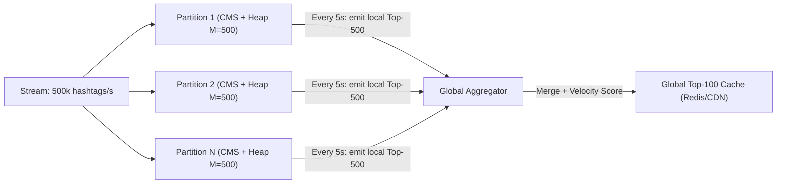
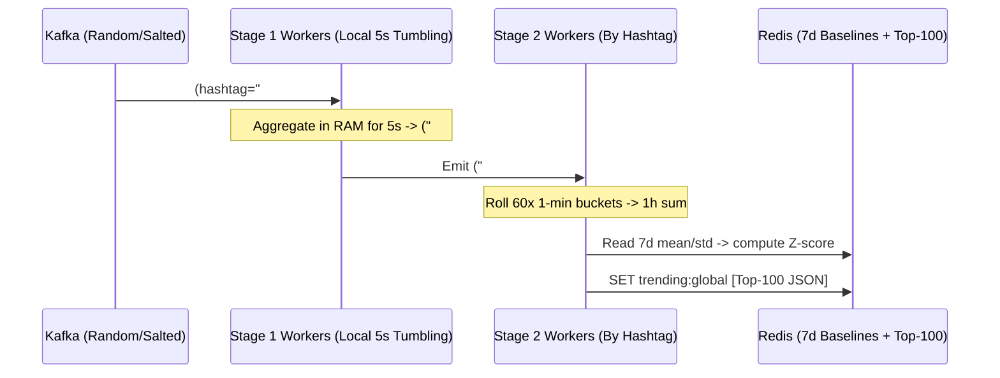
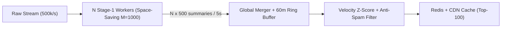

# Top-K & Heavy Hitters: Designing Trending Hashtags

> **Prerequisites:** [Lesson 14: Probabilistic Data Structures](../14-probabilistic-data-structures/README.md) · [Track Overview](../README.md).  
> **Estimated Reading Time:** 25–30 minutes  
> **Target Audience:** Backend engineers building trending hashtags, YouTube trending, or DDoS IP detection, and candidates asked "design a real-time Top-K heavy hitters system over 500k events/s."  
> **Free PDF Notes:** [Download SD-Q-015.pdf](https://backendroadmap.com/notes/system-design/SD-Q-015.pdf)

> [!NOTE]
> **In one line:** Finding the Top-$K$ most frequent items in an unbounded stream of 500k events/s cannot fit an exact hash map of every unique hashtag in RAM; instead, **Heavy Hitter algorithms** combine a **Count-Min Sketch + Min-Heap** (or **Space-Saving / Lossy Counting**) with **tumbling/sliding time windows** and **two-stage distributed aggregation** to track the Top-$K$ in kilobytes of RAM.

> [!TIP]
> **The Golden Rule:** A "Trending" system is **never** just raw all-time counts—all-time Top-$K$ stagnates on `#love` and `#news`. Real trending ranks by **velocity / anomaly** over a sliding window (e.g., $\text{count}_{5\text{m}} / \text{baseline}_{7\text{d}}$) using **partitioned local Top-$M$ $\to$ global merge** ($M \gg K$).

---

## 1. What Top-K & Heavy Hitters Are, and What They Isn't

Suppose a social network processes 500,000 posts/s containing 50 million distinct hashtags per day. Product asks for the **Top 100 trending hashtags** over the last 1 hour, updated every 10 seconds.

If you maintain an exact `HashMap<hashtag, count>` on a single machine, 50M distinct strings take **~4–8 GB RAM**, and sorting 50M keys every 10 seconds takes seconds of CPU. Worse, if you shard by `hash(hashtag)` across 20 workers, no single worker knows the global Top 100 without a distributed merge!

| Term | Precise Meaning | Example |
| :--- | :--- | :--- |
| **Heavy Hitters ($\phi$-heavy)** | Items whose frequency exceeds $\phi N$ (e.g., $> 0.1\%$ of stream) | Top viral hashtags or DDoS IPs |
| **Count-Min Sketch + Min-Heap** | Fixed-RAM sketch estimates counts; Min-Heap of size $K$ retains current Top-$K$ | Fast $O(d + \log K)$ per event |
| **Space-Saving (Misra-Gries)** | Deterministic fixed-size table of $M$ counters; evicts min-count item on new key | Exact error bound $\le N/M$ |
| **Two-Stage (Map-Reduce) Top-$K$** | Each shard emits local Top-$M$ ($M \ge 5K$); coordinator merges into global Top-$K$ | Distributed Flink/Spark/Kafka Streams |
| **Trending Score (Z-score / Velocity)** | Comparing current window count to historical baseline | Detects sudden spikes, not evergreen tags |
| **Not** | A Redis `ZSET` storing all 50M hashtags forever | Unbounded memory; `ZINCRBY` on `#news` melts 1 shard |

### Why It Matters
1. "Design Trending Hashtags / Top-K YouTube Videos / Top-K DDoS IPs" is one of the most frequent senior system design questions because it bridges **streaming systems** and **bounded-memory algorithms**.
2. Naive distributed Top-$K$ (merging only local Top-$K$ from each shard!) has a **classic correctness bug** when items are split evenly across shards—interviewers love catching this.
3. Distinguishing **most frequent** (Heavy Hitters) from **trending** (burst/velocity over baseline) shows real product and engineering maturity.

---

## 2. Anatomy: Single-Node Sketch vs Distributed Two-Stage Top-K



There are two complementary architectures depending on how you partition the stream:
1. **Hash-Partitioned by Key (`hash(hashtag) % N`):** Each partition owns a disjoint subset of hashtags, so it can compute **exact** local counts (or use Space-Saving) and emit its local Top-$K$! *Trap:* A viral hashtag (`#worldcup`) hits **one** partition at 200k/s (**hot-key skew**).
2. **Round-Robin / Random Partitioned (Load-Balanced):** Every partition gets $1/N$ of all traffic (zero hot-key skew!). Each partition runs **CMS + Min-Heap** (or Space-Saving) of size $M \gg K$ and emits its local Top-$M$ to the global aggregator.

> [!WARNING]
> **The Distributed Merge Trap:** If you partition traffic *randomly* across 10 workers and only ask each worker for its **local Top-10**, an item ranked #11 on every worker (say 900 counts each = 9,000 total) could be beat by #1 items with 1,000 counts on 1 worker—and **disappear completely** from the global Top-10! Always collect **local Top-$M$** where $M \ge 5K\text{–}10K$ (or partition by key with local pre-aggregation).

---

## 3. Mathematical Model: Space-Saving Bound, Zipfian Skew & Trending Velocity

**1. Space-Saving (Metwally et al.) Error Bound.** Maintain a bounded table of $M$ `(item, count, error)` entries:
- If incoming item $x$ is in the table: `count[x] += 1`.
- If table has $< M$ items: insert `(x, 1, 0)`.
- Otherwise: find the item $y$ with minimum `count`, replace $y$ with $x$, and set `count[x] = count[y] + 1`, `error[x] = count[y]`.

After $N$ total stream events, the true frequency $f(x)$ satisfies:

$$\text{count}[x] - \text{error}[x] \le f(x) \le \text{count}[x], \qquad \text{error}[x] \le \frac{N}{M}$$

**Worked Example:** Stream $N = 10{,}000{,}000$ events in 1 minute, table size $M = 10{,}000$ counters (~640 KB RAM):
- Maximum possible error per item: $N / M = 10^7 / 10^4 = \mathbf{1{,}000}$ ($0.01\%$ of stream!).
- Any heavy hitter with $> 10{,}000$ events ($> 0.1\%$) is **guaranteed** to be in the table!

**2. Count-Min Sketch + Min-Heap Sizing.**
- CMS with $\varepsilon = 0.0005$ ($w = \lceil e/\varepsilon \rceil = 5{,}437$), $\delta = 0.001$ ($d = 7$): $5{,}437 \times 7 \times 8\text{ B} \approx \mathbf{304\text{ KB}}$.
- Min-Heap of size $K = 100$: **~6 KB**.
- On every event: update CMS in $O(d) = 7$ ops, read $\hat{f}(x) = \text{CMS.estimate}(x)$, and if $\hat{f}(x) > \text{heap.min}()$, update/insert into the Min-Heap in $O(\log K)$.

**3. Trending Velocity (Z-Score) vs Raw Count.** Raw counts favor evergreen tags (`#music`: 10,000/min every day). To detect *trending* bursts, compare the current 5-minute count $c_t$ against the tag's 7-day moving mean $\mu$ and standard deviation $\sigma$ (with smoothing constant $\alpha = 10$ to suppress tiny denominators):

$$\text{trend\_score}(x) = \frac{c_t - \mu}{\sqrt{\sigma^2 + \alpha}}$$

---

## 4. Metrics & Percentiles

| Metric | Meaning | Alert when |
| :--- | :--- | :--- |
| **End-to-end freshness lag** | Time from post event to appearing in Top-100 API | $> 15\text{ s}$ (SLO breach) |
| **Worker hot-partition skew** | Max worker CPU / median worker CPU | $> 3\times$ (key-hash skew on viral tag) |
| **Recall@K vs exact offline job** | Overlap between streaming Top-100 and exact Spark Top-100 | $< 95\%$ ($M$ or CMS $w$ too small) |
| **Min-Heap churn rate** | Evictions/s in the Top-$K$ heap | Sudden spike = noisy tail; increase $M$ |
| **Memory per worker** | Heap + Sketch RAM footprint | $> 70\%$ container limit |

### Worked Example (500k Posts/s, 1-Hour Sliding Window)
1. **Windowing:** Split the 1-hour sliding window into **12 tumbling 5-minute buckets** (or 60 1-minute buckets).
2. **Per-minute Sketch:** Each of 20 Flink workers maintains a 300 KB CMS + $M=1{,}000$ Space-Saving/Min-Heap per 1-minute bucket (~18 MB total for 60 minutes!).
3. **Merge:** Every 10 seconds, the aggregator sums the 60 1-minute buckets for the top candidates, computes `trend_score` against the 7-day baseline stored in Redis, and writes the final Top-100 list to Redis/CDN.

---

## 5. Compounding & Failure Modes: Hot-Key Skew, Evergreen Domination & Spam

1. **Key-Hash Partition Skew:** If you partition Kafka/Flink by `hash(hashtag)`, a sudden `#breaking_news` tag at 150k events/s overloads **one** worker while 19 others are idle. **Fix:** **Two-stage salting**—append a random salt `hashtag#0..15` in Stage 1 (local pre-aggregation over 1 s windows), then strip the salt in Stage 2 (`hash(hashtag)`)! That turns 150k/s on 1 worker into 16 partial sums/s.
2. **Evergreen Tags Blocking Trending:** Without baseline normalization, `#love` and `#photo` stay in Top-10 permanently. **Fix:** Rank by **Z-score / growth ratio** and enforce a minimum absolute threshold (e.g., $c_t \ge 500$) so a tag jumping from 1 to 10 posts doesn't "trend."
3. **Botnet / Spam Manipulation:** A single botnet posting `#buy_scam` 50,000 times in 1 minute can hijack Top-10. **Fix:** Count **unique users** per hashtag (pair with a small HLL or per-user rate limit) or cap each `user_id` to 1 vote per hashtag per window.

---

## 6. Numbers Every Engineer Must Know

| Item | Typical | Implication |
| :--- | :---: | :--- |
| Space-Saving $M = 10{,}000$ RAM | **~640 KB** | Error $\le 0.01\%$ of stream $N$ |
| CMS ($\varepsilon=5\times 10^{-4}, \delta=10^{-3}$) RAM | **~304 KB** | Constant RAM regardless of unique hashtags |
| Local pre-aggregation window | $1\text{–}5\text{ s}$ | Collapses 150k/s viral tag into 16–32 msgs/s |
| Sliding window granularity | 1-min buckets $\times 60$ | 1-hour sliding window with 1-min expiry |
| Local candidate size $M$ vs $K$ | $M \ge 5K\text{–}10K$ | Prevents distributed Top-$K$ recall loss |
| Top-100 API response size | $\sim 4\text{ KB}$ JSON | Serve from CDN / Redis with 5–10 s TTL |

---

## 7. Protocol / Mechanism Deep Dive: Salted Two-Stage Sliding Window



| Question | Answer |
| :--- | :--- |
| **How do you expire old counts in a sliding window?** | Don't decrement a single CMS! Keep **60 separate 1-minute buckets** (or ring buffer of sketches); when minute $t+60$ starts, drop minute $t$ and sum the active 60 buckets. |
| **Why not just use Redis `ZINCRBY` for everything?** | 500k `ZINCRBY`/s on 50M unique hashtags consumes > 5 GB RAM and melts the single core on `#news`. |
| **What if we need exact Top-$K$ for billing?** | Use **key-partitioned stateful Flink** with **salted Stage 1 pre-aggregation** + RocksDB state backend, not approximate sketches. |

**When NOT to use Approximate Heavy Hitters:** When the total number of distinct keys is small ($< 100{,}000$, e.g., top 50 countries or top 1,000 SKUs)—just use an exact hash map or `ZINCRBY`!

---

## 8. Hierarchical Budgets & Design Rules

| Slice | Rule | Control |
| :--- | :--- | :--- |
| **Memory bound** | Fix sketch/Space-Saving size $M$ regardless of cardinality | $M = 10\text{k}$ per worker (~1 MB) |
| **Hot-key protection** | Never hash-partition raw events by `hashtag` without salting | Stage 1 local 1–5 s pre-aggregation |
| **Distributed merge** | Collect $M \ge 5K$ from each worker before global Top-$K$ | Verify Recall@K $\ge 95\%$ vs offline Spark |
| **Window expiry** | Ring buffer of $W$ tumbling buckets (never delete from CMS) | Drop oldest bucket on tick |
| **Trending quality** | Normalize by 7-day baseline + deduplicate per `user_id` | Block botnets & evergreen stagnation |
| **Read path** | Cache final Top-100 at CDN / Redis for 5–10 s | Zero stream-processor load from readers |

---

## 9. Top Mitigations

1. **Use Stage-1 local pre-aggregation (salting)** so viral hashtags don't melt a single Stage-2 partition.
2. **Collect local Top-$M$ ($M \ge 5K$)** from every worker before merging to avoid missing split-across-shards heavy hitters.
3. **Implement sliding windows as a ring buffer of tumbling buckets** (drop oldest bucket cleanly instead of decrementing sketches).
4. **Normalize by historical baseline (Z-score)** so trending reflects *velocity*, not evergreen popularity.
5. **Deduplicate or rate-limit per `user_id`** before counting to prevent botnet manipulation.
6. **Cache the published Top-$K$ list** in Redis/CDN so millions of readers never touch the streaming pipeline.

---

## 10. Production Reference: Two-Stage Heavy Hitters in Stream Processing

Production streaming architectures (e.g., Twitter/X Trending, Cloudflare DDoS Top-IPs, YouTube Live Trending) decouple **high-throughput ingestion** from **global ranking**:
- **Ingestion (Edge/Stage 1):** Workers consume raw events round-robin, running **Space-Saving** or **CMS + Min-Heap** over 5-second micro-batches. Even under a 1M/s DDoS attack targeting 1 IP, no worker does more than `1M / N` work.
- **Global Merge (Stage 2):** Every 5–10 seconds, each Stage-1 worker emits its Top-500 candidates. A lightweight coordinator merges the `N × 500` candidates, updates the 1-hour sliding ring buffer, applies Z-score velocity + anti-spam filters, and publishes the Top-100 JSON to edge caches.



---

## 11. Multi-Language Production Code Tabs

A complete **Space-Saving Heavy Hitters (Metwally et al.)** implementation in Go, TypeScript, Python, and C#.

````carousel
```go
// Go: Space-Saving Heavy Hitters algorithm (O(M) bounded memory, stdlib only).
package main

import (
	"fmt"
	"sort"
)

type Entry struct {
	Item  string
	Count int64
	Error int64
}

type SpaceSaving struct {
	capacity int
	items    map[string]*Entry
}

func NewSpaceSaving(m int) *SpaceSaving {
	return &SpaceSaving{capacity: m, items: make(map[string]*Entry, m)}
}

func (s *SpaceSaving) Add(item string) {
	if e, ok := s.items[item]; ok {
		e.Count++
		return
	}
	if len(s.items) < s.capacity {
		s.items[item] = &Entry{Item: item, Count: 1}
		return
	}
	// Evict entry with minimum count
	var minEntry *Entry
	for _, e := range s.items {
		if minEntry == nil || e.Count < minEntry.Count {
			minEntry = e
		}
	}
	delete(s.items, minEntry.Item)
	s.items[item] = &Entry{Item: item, Count: minEntry.Count + 1, Error: minEntry.Count}
}

func (s *SpaceSaving) TopK(k int) []Entry {
	out := make([]Entry, 0, len(s.items))
	for _, e := range s.items {
		out = append(out, *e)
	}
	sort.Slice(out, func(i, j int) bool { return out[i].Count > out[j].Count })
	if k < len(out) {
		return out[:k]
	}
	return out
}

func main() {
	ss := NewSpaceSaving(5)
	for _, tag := range []string{"#ai", "#go", "#ai", "#rust", "#ai", "#go", "#k8s"} {
		ss.Add(tag)
	}
	fmt.Println("Top 2:", ss.TopK(2))
}
```
<!-- slide -->
```typescript
// TypeScript: Space-Saving Heavy Hitters tracker.
export interface HeavyEntry {
  item: string;
  count: number;
  error: number;
}

export class SpaceSaving {
  private items = new Map<string, HeavyEntry>();

  constructor(private readonly capacity: number) {}

  add(item: string): void {
    const existing = this.items.get(item);
    if (existing) {
      existing.count++;
      return;
    }
    if (this.items.size < this.capacity) {
      this.items.set(item, { item, count: 1, error: 0 });
      return;
    }
    let minEntry: HeavyEntry | null = null;
    for (const e of this.items.values()) {
      if (!minEntry || e.count < minEntry.count) minEntry = e;
    }
    if (minEntry) {
      this.items.delete(minEntry.item);
      this.items.set(item, { item, count: minEntry.count + 1, error: minEntry.count });
    }
  }

  topK(k: number): HeavyEntry[] {
    return [...this.items.values()].sort((a, b) => b.count - a.count).slice(0, k);
  }
}
```
<!-- slide -->
```python
# Python: Space-Saving Heavy Hitters + Trending Z-Score helper.
import math

class SpaceSaving:
    def __init__(self, capacity: int = 1000):
        self.capacity = capacity
        self.counts: dict[str, int] = {}
        self.errors: dict[str, int] = {}

    def add(self, item: str, delta: int = 1) -> None:
        if item in self.counts:
            self.counts[item] += delta
            return
        if len(self.counts) < self.capacity:
            self.counts[item] = delta
            self.errors[item] = 0
            return
        min_item = min(self.counts, key=self.counts.__getitem__)
        min_count = self.counts.pop(min_item)
        self.errors.pop(min_item)
        self.counts[item] = min_count + delta
        self.errors[item] = min_count

    def top_k(self, k: int) -> list[tuple[str, int, int]]:
        ranked = sorted(self.counts.items(), key=lambda kv: kv[1], reverse=True)[:k]
        return [(item, cnt, self.errors[item]) for item, cnt in ranked]

def trend_z_score(current: float, mean_7d: float, std_7d: float, alpha: float = 10.0) -> float:
    return (current - mean_7d) / math.sqrt(std_7d ** 2 + alpha)
```
<!-- slide -->
```csharp
// C#: Space-Saving Heavy Hitters tracker.
using System;
using System.Collections.Generic;
using System.Linq;

public sealed class SpaceSaving
{
    public sealed class Entry
    {
        public string Item { get; init; } = "";
        public long Count { get; set; }
        public long Error { get; set; }
    }

    private readonly int _capacity;
    private readonly Dictionary<string, Entry> _items;

    public SpaceSaving(int capacity = 1000)
    {
        _capacity = capacity;
        _items = new Dictionary<string, Entry>(capacity);
    }

    public void Add(string item, long delta = 1)
    {
        if (_items.TryGetValue(item, out var existing))
        {
            existing.Count += delta;
            return;
        }
        if (_items.Count < _capacity)
        {
            _items[item] = new Entry { Item = item, Count = delta, Error = 0 };
            return;
        }
        Entry? minEntry = null;
        foreach (var e in _items.Values)
            if (minEntry is null || e.Count < minEntry.Count) minEntry = e;

        if (minEntry is not null)
        {
            _items.Remove(minEntry.Item);
            _items[item] = new Entry { Item = item, Count = minEntry.Count + delta, Error = minEntry.Count };
        }
    }

    public IReadOnlyList<Entry> TopK(int k) =>
        _items.Values.OrderByDescending(e => e.Count).Take(k).ToList();
}
```
````

---

## 12. Hands-On CLI Verification Workflows

Verify Space-Saving Heavy Hitters on a Zipfian stream in Python:

```bash
python -c "
import random
from collections import Counter

# Simulate 100,000 Zipf-like events across 5,000 hashtags, SpaceSaving M=200
M = 200
counts, exact = {}, Counter()
tags = [f'#tag_{i}' for i in range(1, 5001)]
weights = [1.0 / (i ** 1.2) for i in range(1, 5001)]
stream = random.choices(tags, weights=weights, k=100_000)

for t in stream:
    exact[t] += 1
    if t in counts: counts[t] += 1
    elif len(counts) < M: counts[t] = 1
    else:
        m_key = min(counts, key=counts.__getitem__)
        counts[t] = counts.pop(m_key) + 1

exact_top10 = [k for k, _ in exact.most_common(10)]
ss_top10 = [k for k, _ in sorted(counts.items(), key=lambda x: x[1], reverse=True)[:10]]
recall = len(set(exact_top10) & set(ss_top10)) / 10
print('Exact Top-5:', exact.most_common(5))
print('SS    Top-5:', sorted(counts.items(), key=lambda x: x[1], reverse=True)[:5])
print(f'Top-10 Recall with M={M} (25x smaller than 5000 keys): {recall:.0%}')
"
```

Verify Redis `TOPK` module commands (`RedisBloom` Top-K HeavyKeeper):

```bash
# Reserve a Top-10 tracker (HeavyKeeper)
redis-cli TOPK.RESERVE trending:hashtags 10 2000 7 0.925

# Stream increments
redis-cli TOPK.INCRBY trending:hashtags "#ai" 500 "#go" 320 "#rust" 280 "#news" 1200

# Fetch current Top-10 with counts
redis-cli TOPK.LIST trending:hashtags WITHCOUNT
```

---

## 13. Common Mistakes to Avoid

1. **Merging only local Top-$K$** across randomly partitioned workers (misses items ranked #11 on every worker).
2. **Ranking "Trending" by raw all-time counts** (`#love` stays #1 forever instead of surfacing sudden bursts).
3. **Partitioning raw streams by `hash(hashtag)` without Stage-1 salting** (one viral hashtag melts one worker).
4. **Attempting to decrement a Count-Min Sketch** for sliding-window expiry instead of dropping tumbling window buckets.
5. **Ignoring botnet/spam inflation** (counting raw posts instead of unique users or per-user capped votes).
6. **Serving Top-100 reads directly from the stream processor** instead of caching the result in Redis/CDN.
7. **Using an unbounded HashMap** in stream workers when cardinality can spike to 50M+ keys.

---

## 14. Key Terms Glossary

| Key Term | Definition |
| :--- | :--- |
| **Heavy Hitters** | Items whose stream frequency exceeds a threshold $\phi N$. |
| **Space-Saving** | Deterministic $M$-slot summary evicting the minimum-count item with error $\le N/M$. |
| **CMS + Min-Heap** | Count-Min Sketch for $O(d)$ frequency estimates paired with a $K$-element Min-Heap. |
| **HeavyKeeper** | RedisBloom's Top-$K$ structure using exponential decay on hash collisions. |
| **Two-stage aggregation** | Local pre-aggregation (Stage 1) followed by global merge (Stage 2) to defeat hot keys. |
| **Sliding window ring buffer** | Maintaining $W$ tumbling sub-buckets and dropping the oldest bucket on each tick. |
| **Velocity / Z-score** | $(c_t - \mu) / \sqrt{\sigma^2 + \alpha}$ measuring anomalous burst over historical baseline. |
| **Recall@K** | Fraction of true Top-$K$ items successfully captured by the approximate Top-$K$ algorithm. |

---

## 15. System Design Interview Questions & Answers

### Basic Conceptual Questions

<details>
<summary><strong>Q1: Why can't we just use a HashMap and sort it to find Top-K in a stream? [BASIC]</strong></summary>

**Answer:**
With 50M+ distinct hashtags or URLs, an exact HashMap consumes gigabytes of RAM per worker and sorting millions of keys every few seconds burns CPU. Heavy-hitter algorithms (Space-Saving, CMS + Min-Heap) bound RAM to a few hundred kilobytes.
</details>

<details>
<summary><strong>Q2: How does Count-Min Sketch + Min-Heap work together? [BASIC]</strong></summary>

**Answer:**
For each incoming item `x`, increment its counters in the Count-Min Sketch and read its estimated frequency $\hat{f}(x)$. If `x` is already in the $K$-element Min-Heap, update its count; otherwise, if $\hat{f}(x)$ exceeds the heap's minimum, replace the minimum with `x`.
</details>

<details>
<summary><strong>Q3: How does the Space-Saving algorithm bound its error? [BASIC]</strong></summary>

**Answer:**
It keeps at most $M$ counters. When full and a new item arrives, it evicts the item with the smallest count `min_c` and assigns the new item `min_c + 1`. Over $N$ events, the maximum possible overestimation for any item is $N / M$.
</details>

<details>
<summary><strong>Q4: What is the difference between "Most Frequent" and "Trending"? [BASIC]</strong></summary>

**Answer:**
"Most Frequent" ranks by raw count (dominated by evergreen tags like `#love`). "Trending" ranks by **burst velocity**—how far the current window's count exceeds its historical 7-day baseline (e.g., Z-score).
</details>

### Scenario-Based Architecture Questions

<details>
<summary><strong>Q5: Design Twitter/X Trending Hashtags for 500k posts/s over a 1-hour sliding window. [SCENARIO]</strong></summary>

**Answer:**
Ingest posts into Kafka. Stage-1 Flink workers consume round-robin, run **Space-Saving ($M=1{,}000$)** or **CMS + Heap** over 1-minute tumbling buckets, and emit local Top-500 every 5 s. A Stage-2 aggregator maintains a 60-bucket ring buffer for the 1-hour sliding window, normalizes against 7-day baselines (Z-score), filters spam by unique-user HLL, and publishes Top-100 to Redis/CDN.
</details>

<details>
<summary><strong>Q6: You partition your stream by `hash(hashtag) % 20`, and `#worldcup` hits 200k/s. What breaks and how do you fix it? [SCENARIO]</strong></summary>

**Answer:**
The single worker owning `#worldcup` melts while the other 19 sit idle. Fix it with **two-stage salting**: partition Stage 1 by `(hashtag, rand() % 32)` and pre-aggregate in 5-second windows, then strip the salt and route to Stage 2 by `hash(hashtag)` (which now receives only 32 updates per 5 s!).
</details>

<details>
<summary><strong>Q7: How do you prevent a botnet from pushing a spam hashtag to #1 Trending? [SCENARIO]</strong></summary>

**Answer:**
Count **unique authors** per hashtag (using a per-tag HyperLogLog or rate-limiting each `user_id` to 1 contribution per hashtag per window), and filter out accounts below a trust/age threshold.
</details>

<details>
<summary><strong>Q8: How do you find the Top-100 DDoS source IPs at an edge router with only 2 MB of RAM? [SCENARIO]</strong></summary>

**Answer:**
Run a **Space-Saving** table of $M = 10{,}000$ entries (~640 KB) or **CMS + Min-Heap** (~350 KB) in the packet-processing path, resetting or rotating windows every 10 seconds to immediately surface attacking IPs.
</details>

### Advanced & Tricky Interview Questions

<details>
<summary><strong>Q9: Why does merging local Top-10 from 10 random workers fail to produce the global Top-10? [TRICKY]</strong></summary>

**Answer:**
Suppose `#tag_A` has 950 events on each of the 10 workers (9,500 total), while 10 different noise tags each spike to 1,000 events on just 1 worker. `#tag_A` ranks #11 on every worker and is **excluded** from every local Top-10, so the global merge misses the true #1 tag! Fix by collecting **local Top-$M$ with $M \ge 5K\text{–}10K$**.
</details>

<details>
<summary><strong>Q10: How do you support a 1-hour sliding window without storing every raw event for 1 hour? [TRICKY]</strong></summary>

**Answer:**
Divide the 1-hour window into **60 tumbling 1-minute buckets**, each with its own compact sketch or Space-Saving summary. On each new minute, drop the oldest bucket and merge/sum the remaining 60 buckets.
</details>

<details>
<summary><strong>Q11: Why shouldn't a tag that goes from 1 post/day to 20 posts/hour top the Trending list? [TRICKY]</strong></summary>

**Answer:**
Pure ratio ($20 / 1 = 20\times$) over-indexes on tiny denominators. Always apply a **minimum volume floor** (e.g., $c_t \ge 500$) and add a smoothing constant $\alpha$ in the Z-score denominator ($\sqrt{\sigma^2 + \alpha}$).
</details>

<details>
<summary><strong>Q12: What is HeavyKeeper (used in Redis `TOPK`) and how does it improve on CMS + Heap? [TRICKY]</strong></summary>

**Answer:**
HeavyKeeper uses a fixed array of `(fingerprint, count)` buckets. When a new item hashes to a bucket occupied by a *different* fingerprint, it **decays** the existing count probabilistically ($b^{-c}$) instead of blindly incrementing it. Mice decay quickly while elephant heavy hitters resist decay, giving higher accuracy in less RAM than CMS.
</details>

---

## 16. One-Page Master Cheat Sheet

```
+---------------------------------------------------------------------------------------------------------+
|                    TOP-K & HEAVY HITTERS — MASTER CHEAT SHEET                                           |
+---------------------------------------------------------------------------------------------------------+
| 1. BOUNDED-RAM ALGORITHMS:                                                                              |
|    - Space-Saving: M counters (~640 KB for M=10k); evict min-count; error <= N/M.                       |
|    - CMS + Min-Heap: O(d) sketch update + O(log K) heap check (~310 KB total).                          |
+---------------------------------------------------------------------------------------------------------+
| 2. DISTRIBUTED MERGE TRAP: Never merge local Top-K from random shards! Collect local Top-M (M >= 5K-10K)|
|    OR use Stage-1 salting (pre-aggregate 5s) -> Stage-2 key-hash merge.                                 |
+---------------------------------------------------------------------------------------------------------+
| 3. SLIDING WINDOWS: Ring buffer of 60x 1-min tumbling buckets; drop oldest bucket on tick.              |
+---------------------------------------------------------------------------------------------------------+
| 4. TRENDING != FREQUENT: Rank by velocity Z-score = (c_t - mean_7d) / sqrt(var + alpha) + volume floor. |
+---------------------------------------------------------------------------------------------------------+
| 5. ANTI-ABUSE & READS: Deduplicate per user_id (stop bots); cache Top-100 in Redis/CDN for 5-10s.       |
+---------------------------------------------------------------------------------------------------------+
```

---

## Further Reading & Sources

- Metwally, Agrawal, El Abbadi, [*Efficient Computation of Frequent and Top-k Elements in Data Streams*](https://www.cs.ucsb.edu/sites/default/files/documents/2005-23.pdf) (Space-Saving, 2005).
- Yang et al., [*HeavyKeeper: An Accurate Algorithm for Finding Top-k Elephant Flows*](https://www.usenix.org/conference/atc18/presentation/gong) (USENIX ATC 2018).
- Redis Documentation, [RedisBloom `TOPK` Probabilistic Top-K](https://redis.io/docs/latest/develop/data-types/probabilistic/top-k/).
- Alex Xu, *System Design Interview — An Insider's Guide, Vol. 1*, Chapter 14 ("Design YouTube / Top-K Heavy Hitters").

---

## Free PDF Notes

[SD-Q-015.pdf](https://backendroadmap.com/notes/system-design/SD-Q-015.pdf)

---

## Next

Continue with [Track 18, Lesson 01: Tenant Isolation Strategies](../../18-multi-tenant-saas/01-tenant-isolation-strategies/README.md).
