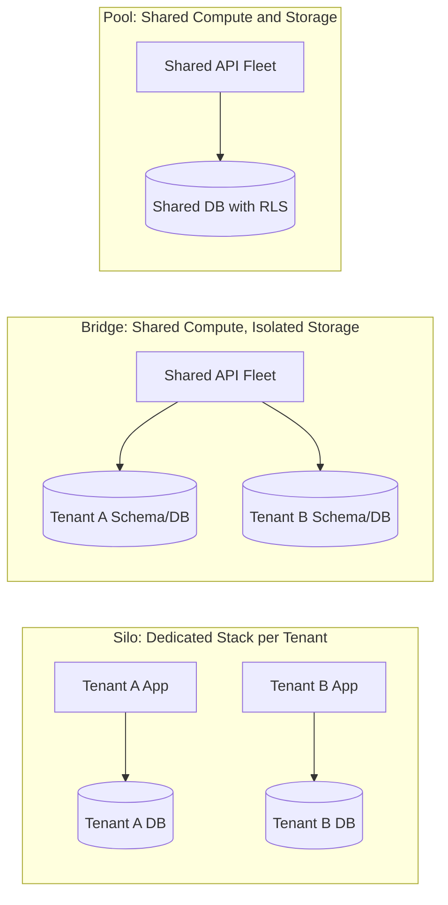
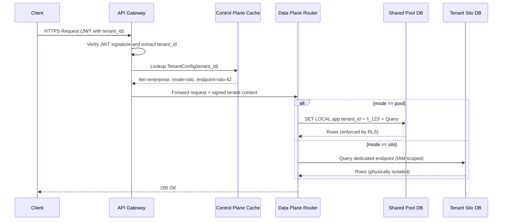
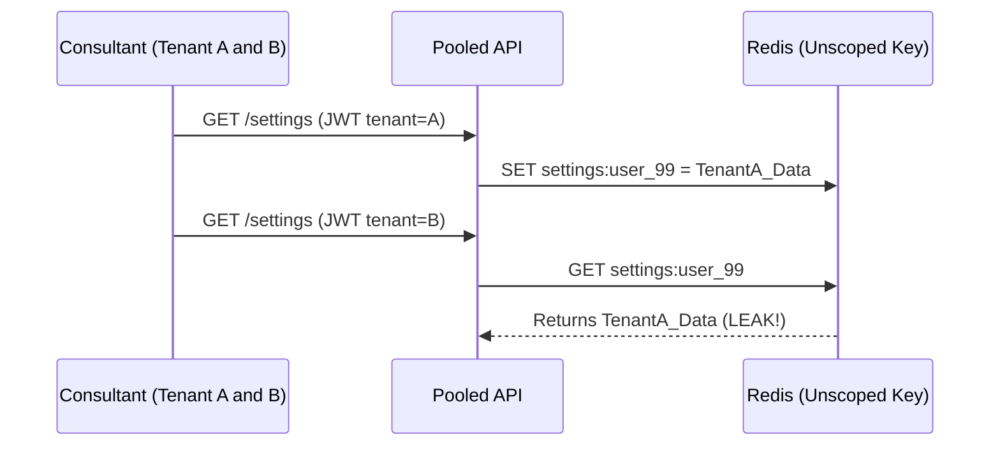

# Tenant Isolation Strategies: Silo vs Pool vs Bridge

> **Prerequisites:** [Lesson 15: Top-K Heavy Hitters](../../17-realtime-and-data/15-top-k-heavy-hitters/README.md) · [Track: Multi-Tenant SaaS](../README.md).  
> **Estimated Reading Time:** 24–28 minutes  
> **Target Audience:** Backend and platform engineers designing B2B/B2C SaaS architectures, and candidates asked "how do you isolate tenants in a multi-tenant system?"  
> **Free PDF Notes:** [Download SD-R-001.pdf](https://backendroadmap.com/notes/system-design/SD-R-001.pdf)

> [!NOTE]
> **In one line:** Multi-tenant isolation chooses where the boundary sits between **Silo** (dedicated compute and storage per tenant), **Pool** (shared compute and storage with logical isolation), and **Bridge** (shared compute with isolated storage or schema-per-tenant). You trade **infrastructure cost and operational agility** against **blast radius, noisy-neighbour risk, and compliance guarantees**.

> [!TIP]
> **The Golden Rule:** Default to **Pool** for control planes and small/mid-tier tenants so unit economics work, and reserve **Silo** (or **Bridge**) for regulated enterprise tiers or workloads with extreme noisy-neighbour profiles—using a **tier-aware routing layer** so you never rewrite application code when a tenant upgrades.

---

## 1. What Tenant Isolation Is, and What It Isn't

A B2B SaaS platform starts with 10 paying customers on a single shared database and three stateless API pods. At 500 customers, one enterprise prospect demands HIPAA compliance and dedicated encryption keys, while a free-tier tenant's bulk CSV import saturates the shared PostgreSQL CPU and degrades p99 latency for everyone else. Moving everyone to dedicated clusters would bankrupt the company; keeping everyone in one undifferentiated pool loses enterprise deals and causes weekly outages.

| Term | Precise Meaning | Example |
| :--- | :--- | :--- |
| **Multi-tenancy** | Serving multiple independent customers (tenants) from a single software product and shared or partitioned infrastructure | Slack workspaces, Stripe merchant accounts |
| **Silo model** | Dedicated compute, network, and storage provisioned exclusively for a single tenant | Dedicated EKS namespace + RDS instance per enterprise tenant |
| **Pool model** | Shared compute and shared storage across many tenants, separated logically by `tenant_id` | Shared API fleet + shared PostgreSQL with Row-Level Security |
| **Bridge model** | Hybrid: shared stateless compute tier paired with isolated storage (schema-per-tenant or database-per-tenant) | Shared API pods routing to `tenant_42` database |
| **Blast radius** | The set of tenants affected when a bug, bad query, or compromise occurs | Pool = all tenants; Silo = 1 tenant |
| **Control plane** | Shared management services: auth, billing, tenant metadata, provisioning, routing | Always pooled, even when data planes are siloed |
| **Data plane** | The runtime compute and storage that process a tenant's actual requests and data | Silo, Bridge, or Pool depending on tier |
| **Not** | Simply adding a `tenant_id` column and hoping every developer remembers `WHERE tenant_id = ?` | That is an isolation vulnerability, not a strategy |

### Why It Matters
1. Isolation defines your **unit economics** (COGS per tenant) and your **gross margin** at 10, 1,000, and 100,000 tenants.
2. Every SaaS architecture interview tests whether you can separate the **control plane** from the **data plane** and match Silo/Bridge/Pool to compliance and cost constraints.
3. Choosing the wrong model early creates painful migrations—either drowning ops in 5,000 siloed clusters or failing a SOC 2 / HIPAA audit on a naive pool.

---

## 2. Anatomy: Silo vs Bridge vs Pool



In **Silo**, Tenant A and Tenant B share zero runtime resources: separate compute, separate databases, often separate VPCs or Kubernetes namespaces. In **Bridge**, stateless API servers are pooled for elastic autoscaling, while storage is partitioned per tenant (schema-per-tenant or database-per-tenant). In **Pool**, both compute and storage are shared, and isolation is enforced by tenant context propagation, IAM/STS scoped credentials, and Row-Level Security (RLS).

| Dimension | Silo | Bridge | Pool |
| :--- | :--- | :--- | :--- |
| **Compute isolation** | Dedicated per tenant | Shared stateless pool | Shared stateless pool |
| **Storage isolation** | Dedicated DB / cluster | Dedicated DB or schema | Shared tables (`tenant_id`) |
| **COGS per tenant** | Very high (idle overhead) | Moderate (storage overhead) | Lowest (high bin-packing) |
| **Noisy neighbour risk** | None across tenants | Low at storage, medium at compute | High without quotas and throttling |
| **Deployment / ops** | Hardest (N stacks to patch/migrate) | Medium (N schemas to migrate) | Easiest (1 fleet, 1 schema) |
| **Compliance (HIPAA/PCI)** | Easiest to certify | Moderate (requires key/access proof) | Hardest (logical boundary only) |

> [!WARNING]
> **Do not confuse logical isolation with physical isolation.** A Pool model with `WHERE tenant_id = $1` protects against casual bugs only if enforced at the database/IAM boundary (e.g., PostgreSQL RLS + session context). Even then, shared CPU, IOPS, and connection pools mean one tenant can still cause a **performance** blast radius (noisy neighbour) even without a **data** leak.

---

## 3. Mathematical Model: Cost, Utilization, and Blast Radius

Let $N$ be the number of tenants, $C_{\text{node}}$ the monthly cost of a minimum viable compute+DB slice (say $\$200/\text{month}$), $u_i \in (0, 1]$ the average utilization of tenant $i$, and $p_{\text{peak}}$ the peak-to-average ratio.

**Infrastructure cost.** In a **Silo** model, every tenant requires at least one provisioned slice sized for its peak:

$$C_{\text{silo}} = N \cdot C_{\text{min}} \cdot p_{\text{peak}}$$

In a **Pool** model, statistical multiplexing smooths uncorrelated peaks across $N$ tenants, so total required capacity scales with the sum of averages plus a burst margin $\sqrt{N}$ (Central Limit Theorem):

$$C_{\text{pool}} = C_{\text{unit}} \cdot \left( \sum_{i=1}^{N} u_i + z \cdot \sigma \sqrt{N} \right)$$

**Worked Numerical Example.** Suppose $N = 1{,}000$ SMB tenants, each averaging $2\%$ of a $\$200/\text{month}$ node ($u_i = 0.02$) with $10\times$ bursts ($p_{\text{peak}} = 10$, requiring $20\%$ of a node at peak, though minimum DB+compute slice is 1 node at $\$200$).
- **Silo:** $1{,}000 \times \$200 = \$200{,}000/\text{month}$ ($98\%$ idle capacity wasted).
- **Pool:** Sum of averages is $1{,}000 \times 0.02 = 20$ nodes. With $z = 3$ and $\sigma = 0.06$, burst margin is $3 \times 0.06 \times \sqrt{1{,}000} \approx 5.7$ nodes, so **26 nodes total** $= 26 \times \$200 = \$5{,}200/\text{month}$.

Pool reduces infrastructure cost by **$97.4\%$** ($\$200{,}000 \rightarrow \$5{,}200$), turning an unprofitable $\$15/\text{month}$ SMB tier into an $80\%+$ gross-margin business.

**Blast Radius.** If a deployment or bad migration has probability $q$ of failing per stack, in Pool a failure affects $100\%$ of $N$ tenants simultaneously; in Silo, a canary rollout to 1 tenant limits blast radius to $1/N = 0.1\%$.

---

## 4. Metrics & Percentiles

| Metric | Meaning | Alert when |
| :--- | :--- | :--- |
| **Cross-tenant leak count** | Any request/query returning another tenant's `tenant_id` | $> 0$ (immediate SEV-1 page) |
| **Per-tenant p99 latency** | Tail latency segmented by `tenant_id` | Tenant A p99 spikes while Tenant B is normal (noisy neighbour) |
| **Tenant cost-to-serve (COGS)** | Compute + storage + egress attributed per `tenant_id` | Exceeds $30\%$ of tenant ARR |
| **Provisioning duration** | Time from tenant signup to ready data plane | $> 5\text{ s}$ (Pool) or $> 5\text{ min}$ (Silo) |
| **Connection pool saturation** | Active DB connections vs pool max, per tenant/tier | $> 80\%$ sustained |
| **Schema drift count** | Silo/Bridge DBs not on the latest migration version | $> 0$ after deployment window |

### Worked Example (Tiered SaaS Routing)
A SaaS analytics product serves 2,000 Free/Pro tenants in a **Pool** (shared Kubernetes cluster, shared PostgreSQL with RLS) and 25 Enterprise tenants in **Silo** (dedicated RDS + dedicated worker pool, $\$2{,}500/\text{month}$ contract). The shared **Control Plane** stores `{tenant_id -> tier, isolation_mode, db_endpoint, iam_role}` in a cached routing table. When a request arrives with a JWT containing `tenant_id`, the API gateway resolves the routing metadata in $< 1\text{ ms}$ from local cache and dispatches to the pooled or siloed data plane without the application handler changing a single line of business logic.

---

## 5. Compounding & Failure Modes: Deployment Drift and Noisy Neighbours

Simulation of 1,000 tenants over 12 months with weekly schema migrations (each migration has a $0.2\%$ per-database transient failure rate due to lock timeouts or network blips) and a $1\%$ daily probability of a noisy-neighbour burst ($20\times$ normal QPS for 10 minutes).

| Model | Weekly Migration Failures (per 1,000 tenants) | Noisy-Neighbour Impact on Other Tenants | Annual Ops Hours (Migrations + Incidents) |
| :--- | :--- | :--- | :--- |
| **Pool (1 shared DB)** | $0.002 \times 1 = 0.002$ (virtually 0, atomic) | **100% of tenants** see p99 jump $4\times$ if unthrottled | ~40 hrs (tuning + quota enforcement) |
| **Bridge (1,000 schemas)** | $0.002 \times 1{,}000 = 2$ failed schemas/week | **Medium** (shared DB CPU/IOPS buffer contention) | ~260 hrs (retry orchestration + drift repair) |
| **Silo (1,000 DBs + clusters)** | $0.002 \times 1{,}000 = 2$ failed DBs/week + fleet drift | **0% cross-tenant** impact | ~900 hrs (fleet automation, patching, upgrades) |

**Takeaway:** Silo eliminates noisy-neighbour blast radius completely, but **linearly compounds operational toil** ($O(N)$). Without automated fleet orchestration (GitOps + self-healing migration runners), Silo collapses under its own weight past ~50–100 tenants.

---

## 6. Numbers Every Engineer Must Know

| Item | Typical | Implication |
| :--- | :---: | :--- |
| **Control plane lookup** | $< 1\text{ ms}$ (in-memory/Redis cache) | Never hit the control-plane DB synchronously per request |
| **Silo provisioning time** | $3\text{–}15\text{ min}$ (Terraform + RDS) | Must be asynchronous; pre-warm a standby pool if instant signup is needed |
| **Pool onboarding time** | $< 50\text{ ms}$ (1 row insert) | Instant self-serve signup |
| **PostgreSQL RLS overhead** | $2\text{–}8\%$ query latency | Negligible when `tenant_id` is the leading index column |
| **Max schemas per Postgres** | ~1,000–5,000 practical limit | Catalog bloat and connection pooling break Bridge at $> 5\text{k}$ tenants |
| **Min Silo idle cost** | $\$100\text{–}\$300/\text{month}$ per tenant | Requires Enterprise ACV ($\ge \$10\text{k}/\text{year}$) to preserve margins |

---

## 7. Protocol Deep Dive: Tier-Aware Request Routing



| Question | Answer |
| :--- | :--- |
| **Where does `tenant_id` come from?** | Always from a verified JWT claim or mTLS cert—never from a mutable query param or JSON body |
| **How do you move a tenant from Pool to Silo?** | Dual-write or CDC sync to the new Silo DB, flip the Control Plane routing flag atomically, drain, and delete Pool rows |
| **Can the Control Plane itself be Silo?** | No; onboarding, auth, and billing must be pooled so you have one pane of glass |
| **What if the Control Plane cache is stale after a tier upgrade?** | Publish an invalidation event on tier change and keep TTL short (e.g., 30–60 s) |

**When NOT to use Silo:** For freemium, self-serve, or high-churn SMB products where ARPU is under $\$50/\text{month}$—provisioning dedicated infrastructure per tenant will make gross margins negative.

---

## 8. Hierarchical Budgets & Design Rules

| Slice | Rule | Control |
| :--- | :--- | :--- |
| **Control vs Data Plane** | Keep auth, billing, and routing pooled; isolate only the data plane | Separate service repos and DBs |
| **Identity Extraction** | Extract `tenant_id` at the edge from verified JWT/session | Reject requests missing `tenant_id` |
| **Pool Enforcement** | Enforce isolation in the DB (RLS) and IAM (dynamic session policies) | Never rely on app `WHERE` clauses alone |
| **Bridge Limits** | Cap schemas per DB instance (e.g., $\le 1{,}000$) | Shard across multiple DB clusters |
| **Silo Automation** | Zero manual provisioning; 100% IaC + automated schema rollouts | Terraform/Crossplane + Canary waves |
| **Cell Architecture** | Group Pool tenants into "cells" (e.g., 500 tenants/cell) | Caps blast radius of a single Pool DB |

---

## 9. Top Mitigations

1. **Adopt Cell-Based Architecture for Pool:** Instead of one giant Pool for 50,000 tenants, run 100 isolated "cells" of 500 tenants each; a bad migration or outage affects 1% of users, not 100%.
2. **Automate Tenant Context Injection:** Use middleware/interceptors to attach `tenant_id` to every logger, trace span, DB connection, and downstream RPC automatically.
3. **Use Dynamic IAM Session Policies (AWS STS / GCP):** Scope S3/storage access dynamically per request using `${aws:PrincipalTag/tenant_id}` so a compromised pod cannot read another tenant's bucket prefix.
4. **Separate Control Plane from Data Plane:** Keep tenant metadata, feature flags, and routing in a highly available pooled control plane.
5. **Provision Silo via Standby Warm Pools:** Pre-create empty Silo DBs/namespaces so Enterprise upgrades complete in seconds instead of 15 minutes.
6. **Enforce Per-Tenant Resource Quotas in Pool:** Pair Pool isolation with rate limits, connection caps, and fair queues (Lesson 04).
7. **Run Cross-Tenant Leak Integration Tests in CI:** Automated tests that authenticate as Tenant A and assert HTTP 403/404 on every Tenant B resource ID.

---

## 10. Production Reference: AWS SaaS Lens & A Cross-Tenant Cache Poisoning SEV-1

The **AWS SaaS Architecture Lens** formalizes Silo, Pool, and Bridge as the three foundational tenancy models, emphasizing that **most mature B2B SaaS platforms run a hybrid**: a pooled control plane, pooled compute for standard tiers, and siloed storage or full-silo cells for regulated enterprise customers.

**SEV-1 Post-Mortem: Shared Cache Key Collision in a Pool Migration**
- **Incident:** A B2B SaaS platform using a Pool compute tier added Redis caching for `GET /api/v1/settings`. The developer keyed Redis as `settings:{user_id}` instead of `settings:{tenant_id}:{user_id}`. When a consultant who belonged to two different tenants switched workspaces, Tenant A's confidential billing settings were served to Tenant B's session.
- **Root Cause:** Tenant context was enforced at the PostgreSQL RLS layer, but **dropped at the Redis cache layer** because cache keys did not include `tenant_id`.
- **Fix:** Wrapped the Redis client in a mandatory `TenantAwareCache` decorator that prefixes every key with `t:{tenant_id}:` extracted from the verified request context, and banned raw Redis client injection via CI lint rules.



---

## 11. Multi-Language Production Code Tabs

A **Tier-Aware Tenant Router** that resolves a verified `tenant_id` to either a **Pool** (shared DSN + RLS context) or **Silo** (dedicated DSN) data plane, plus a tenant-scoped cache key builder.

````carousel
```go
// Go: Tier-aware tenant router separating Control Plane lookup from Data Plane execution.
package tenancy

import (
	"context"
	"errors"
	"fmt"
	"sync"
)

type IsolationMode string

const (
	ModePool IsolationMode = "pool"
	ModeSilo IsolationMode = "silo"
)

type TenantConfig struct {
	TenantID string
	Mode     IsolationMode
	DSN      string
}

type TenantRouter struct {
	mu      sync.RWMutex
	configs map[string]TenantConfig // Control-plane cache
	poolDSN string
}

func NewTenantRouter(poolDSN string) *TenantRouter {
	return &TenantRouter{
		configs: make(map[string]TenantConfig),
		poolDSN: poolDSN,
	}
}

func (r *TenantRouter) Register(cfg TenantConfig) {
	r.mu.Lock()
	defer r.mu.Unlock()
	r.configs[cfg.TenantID] = cfg
}

// Resolve returns the target DSN and whether RLS session context must be set.
func (r *TenantRouter) Resolve(ctx context.Context, tenantID string) (dsn string, useRLS bool, err error) {
	if tenantID == "" {
		return "", false, errors.New("missing verified tenant_id")
	}
	r.mu.RLock()
	cfg, ok := r.configs[tenantID]
	r.mu.RUnlock()
	if !ok {
		return r.poolDSN, true, nil // Default to Pool cell
	}
	if cfg.Mode == ModeSilo {
		return cfg.DSN, false, nil
	}
	return r.poolDSN, true, nil
}

// CacheKey enforces tenant prefixing to prevent cross-tenant cache poisoning.
func CacheKey(tenantID, namespace, key string) string {
	return fmt.Sprintf("t:%s:%s:%s", tenantID, namespace, key)
}
```
<!-- slide -->
```typescript
// TypeScript: Tier-aware tenant router and mandatory tenant-scoped cache key builder.
export type IsolationMode = "pool" | "bridge" | "silo";

export interface TenantRoute {
  tenantId: string;
  mode: IsolationMode;
  dsn: string;
  schema?: string;
}

export class TenantRouter {
  private readonly routes = new Map<string, TenantRoute>();

  constructor(private readonly defaultPoolDsn: string) {}

  registerTenant(route: TenantRoute): void {
    this.routes.set(route.tenantId, route);
  }

  resolve(tenantId: string): { dsn: string; mode: IsolationMode; schema?: string } {
    if (!tenantId) {
      throw new Error("Unauthorized: verified tenantId is required");
    }
    const route = this.routes.get(tenantId);
    if (!route) {
      return { dsn: this.defaultPoolDsn, mode: "pool" };
    }
    return { dsn: route.dsn, mode: route.mode, schema: route.schema };
  }

  static cacheKey(tenantId: string, resource: string, id: string): string {
    if (!tenantId) throw new Error("tenantId required for cache key");
    return `t:${tenantId}:${resource}:${id}`;
  }
}
```
<!-- slide -->
```python
# Python: Cost & blast-radius calculator + tier-aware tenant router (stdlib only).
from dataclasses import dataclass
import math


@dataclass(frozen=True)
class TenantRoute:
    tenant_id: str
    mode: str  # "pool" | "bridge" | "silo"
    dsn: str


class TenantRouter:
    def __init__(self, pool_dsn: str) -> None:
        self._pool_dsn = pool_dsn
        self._routes: dict[str, TenantRoute] = {}

    def register(self, route: TenantRoute) -> None:
        self._routes[route.tenant_id] = route

    def resolve(self, tenant_id: str) -> tuple[str, bool]:
        """Returns (dsn, requires_rls)."""
        if not tenant_id:
            raise ValueError("Missing verified tenant_id")
        route = self._routes.get(tenant_id)
        if route is None or route.mode == "pool":
            return self._pool_dsn, True
        return route.dsn, False

    @staticmethod
    def cache_key(tenant_id: str, namespace: str, key: str) -> str:
        if not tenant_id:
            raise ValueError("tenant_id cannot be empty")
        return f"t:{tenant_id}:{namespace}:{key}"


def compare_silo_vs_pool_cost(n_tenants=1000, node_cost=200.0, avg_util=0.02, sigma=0.06):
    silo_cost = n_tenants * node_cost
    pool_nodes = math.ceil(n_tenants * avg_util + 3.0 * sigma * math.sqrt(n_tenants))
    pool_cost = pool_nodes * node_cost
    savings_pct = (1.0 - pool_cost / silo_cost) * 100.0
    return {"silo_cost": silo_cost, "pool_nodes": pool_nodes, "pool_cost": pool_cost, "savings_pct": round(savings_pct, 2)}
```
<!-- slide -->
```csharp
// C#: Tier-aware tenant router with strict tenant-scoped cache key formatting.
using System;
using System.Collections.Concurrent;

public enum IsolationMode { Pool, Bridge, Silo }

public sealed record TenantRoute(string TenantId, IsolationMode Mode, string Dsn);

public sealed class TenantRouter
{
    private readonly string _poolDsn;
    private readonly ConcurrentDictionary<string, TenantRoute> _routes = new();

    public TenantRouter(string poolDsn) => _poolDsn = poolDsn;

    public void Register(TenantRoute route) => _routes[route.TenantId] = route;

    public (string Dsn, bool RequiresRls) Resolve(string tenantId)
    {
        if (string.IsNullOrWhiteSpace(tenantId))
            throw new UnauthorizedAccessException("Verified tenantId is required.");

        if (_routes.TryGetValue(tenantId, out var route) && route.Mode != IsolationMode.Pool)
            return (route.Dsn, false);

        return (_poolDsn, true);
    }

    public static string CacheKey(string tenantId, string ns, string key) =>
        string.IsNullOrWhiteSpace(tenantId)
            ? throw new ArgumentException("tenantId is required", nameof(tenantId))
            : $"t:{tenantId}:{ns}:{key}";
}
```
````

---

## 12. Hands-On CLI Verification Workflows

Run the Python cost model from Section 3 & Section 11:

```bash
python3 -c '
import math
def compare(n=1000, node=200, u=0.02, sigma=0.06):
    silo = n * node
    nodes = math.ceil(n * u + 3 * sigma * math.sqrt(n))
    pool = nodes * node
    print(f"Silo=${silo:,.0f}/mo | Pool={nodes} nodes (${pool:,.0f}/mo) | Savings={(1-pool/silo)*100:.1f}%")
compare()
'
```

Verify Kubernetes namespace (Silo) vs shared namespace (Pool) resource quotas and PostgreSQL schema counts:

```bash
# Inspect per-tenant Silo namespace quotas in Kubernetes
kubectl get resourcequota --all-namespaces -l isolation=silo

# Count schemas in a Bridge PostgreSQL cluster (watch for catalog bloat > 1000)
psql "$DATABASE_URL" -c "SELECT count(*) AS tenant_schemas FROM information_schema.schemata WHERE schema_name LIKE 'tenant_%';"

# Verify AWS IAM session policy / STS tag-based isolation for Pool S3 prefixes
aws sts get-caller-identity
```

---

## 13. Common Mistakes to Avoid

1. **Putting every free/SMB tenant in a Silo** and destroying gross margins with idle infrastructure.
2. **Mixing Control Plane and Data Plane** so an outage in one tenant's data plane breaks login and billing for everyone.
3. **Forgetting `tenant_id` in cache keys, search indexes, or S3 paths**, leaking data outside the SQL boundary.
4. **Accepting `tenant_id` from request bodies or query strings** instead of verified JWT/mTLS claims.
5. **Using Bridge (schema-per-tenant) at $> 5{,}000$ tenants** on a single PostgreSQL instance, causing catalog bloat and connection-pool exhaustion.
6. **Building Silo without fleet automation**, turning schema migrations into a multi-day manual ordeal.
7. **Assuming Pool RLS prevents noisy neighbours**—RLS isolates *data*, not *CPU, memory, or disk IOPS*.

---

## 14. Key Terms Glossary

| Key Term | Definition |
| :--- | :--- |
| **Multi-tenancy** | Architecture where one software system serves multiple isolated customer organizations. |
| **Silo model** | Dedicated compute and storage provisioned exclusively per tenant. |
| **Pool model** | Shared compute and storage across tenants with logical isolation. |
| **Bridge model** | Hybrid of shared compute with isolated storage (schema or DB per tenant). |
| **Control plane** | Shared services managing tenant lifecycle, auth, billing, and routing. |
| **Data plane** | Runtime compute and storage serving tenant workloads. |
| **Blast radius** | Scope of tenants impacted by a single failure or breach. |
| **Noisy neighbour** | One tenant's workload degrading performance for co-located tenants. |
| **Cell architecture** | Partitioning a Pool into bounded groups of tenants to cap blast radius. |
| **Statistical multiplexing** | Sharing capacity across uncorrelated bursts to raise average utilization. |

---

## 15. System Design Interview Questions & Answers

### Basic Conceptual Questions

<details>
<summary><strong>Q1: What is the difference between Silo, Pool, and Bridge isolation? [BASIC]</strong></summary>

**Answer:**
Silo gives each tenant dedicated compute and storage. Pool shares both compute and storage across tenants using logical boundaries like `tenant_id` and RLS. Bridge shares the stateless compute tier while isolating storage per tenant (schema-per-tenant or database-per-tenant).
</details>

<details>
<summary><strong>Q2: Why is the Control Plane almost always Pooled even when the Data Plane is Siloed? [BASIC]</strong></summary>

**Answer:**
Onboarding, authentication, billing, and tenant-to-endpoint routing require a single unified view across all customers. Siloing the control plane would make global billing, unified admin dashboards, and tenant routing impossible to manage cleanly.
</details>

<details>
<summary><strong>Q3: Which model gives the best unit economics for a freemium SaaS? [BASIC]</strong></summary>

**Answer:**
The Pool model. Statistical multiplexing lets you pack thousands of low-utilization tenants onto shared nodes, cutting infrastructure cost by 90%+ compared to provisioning minimum viable Silo stacks per tenant.
</details>

<details>
<summary><strong>Q4: Does PostgreSQL Row-Level Security (RLS) solve the noisy-neighbour problem? [BASIC]</strong></summary>

**Answer:**
No. RLS enforces *data* isolation so Tenant A cannot read Tenant B's rows, but they still share CPU, RAM, disk IOPS, and connection pools. You still need rate limiting, connection caps, and fair queues to isolate *performance*.
</details>

### Scenario-Based Architecture Questions

<details>
<summary><strong>Q5: A $20/mo SMB SaaS signs a $150k/yr healthcare customer demanding HIPAA and dedicated encryption keys. How do you evolve the architecture? [SCENARIO]</strong></summary>

**Answer:**
Keep the Control Plane pooled and introduce a **tier-aware routing layer**. Leave SMB customers in the Pool data plane, and provision a **Silo** data plane (dedicated VPC/namespace, dedicated DB with customer-managed KMS keys) for the enterprise tenant. The API gateway resolves `tenant_id -> endpoint` from the control-plane cache so application code stays identical.
</details>

<details>
<summary><strong>Q6: Your Pool database holds 20,000 tenants and a bad migration just took down 100% of customers. How do you prevent this? [SCENARIO]</strong></summary>

**Answer:**
Refactor the monolithic Pool into **Cell-Based Architecture** (e.g., 40 cells of 500 tenants each). Deploy migrations one canary cell at a time. A bad migration now impacts at most $2.5\%$ of tenants instead of $100\%$, while preserving Pool unit economics inside each cell.
</details>

<details>
<summary><strong>Q7: An enterprise tenant outgrows the shared Pool and needs to be migrated to a Silo with zero downtime. How do you do it? [SCENARIO]</strong></summary>

**Answer:**
1) Provision the Silo DB. 2) Enable logical replication / CDC (or dual-writes) filtered by `tenant_id` to backfill and stay in sync. 3) Put the tenant briefly in read-only mode (or drain in-flight writes), verify checksum parity, and flip the Control Plane routing pointer to the Silo DSN. 4) Clean up the old Pool rows asynchronously.
</details>

<details>
<summary><strong>Q8: Your Bridge architecture (schema-per-tenant on one Postgres) is hitting 3,000 tenants and migrations now take 4 hours. What happened? [SCENARIO]</strong></summary>

**Answer:**
You hit Postgres catalog bloat and sequential migration compounding ($3{,}000 \times \text{DDL lock time}$). Either shard into multiple Bridge DB clusters (capped at ~500 schemas each) or consolidate SMB tenants into a single Pool schema with RLS and composite `(tenant_id, id)` indexes.
</details>

### Advanced & Tricky Interview Questions

<details>
<summary><strong>Q9: How do you prevent cross-tenant leaks in non-SQL systems (Redis, S3, Elasticsearch) in a Pool model? [TRICKY]</strong></summary>

**Answer:**
Never rely on developer discipline. Wrap Redis/cache clients to force `t:{tenant_id}:` key prefixes from verified request context; use dynamic STS IAM session policies with `${aws:PrincipalTag/tenant_id}` to lock S3 prefixes at the cloud IAM layer; and enforce tenant-filtered aliases or routing keys in Elasticsearch.
</details>

<details>
<summary><strong>Q10: Why can't you simply use a single `tenant_id` JWT claim without checking it against the user's membership? [TRICKY]</strong></summary>

**Answer:**
A user may belong to multiple workspaces, or be removed from a tenant while holding an unexpired token. The auth service must mint tenant-scoped tokens (or validate `(user_id, tenant_id)` membership at the gateway/policy layer) and short token TTLs with revocation checks.
</details>

<details>
<summary><strong>Q11: What is the hidden operational cost of Silo that teams underestimate? [TRICKY]</strong></summary>

**Answer:**
**Fleet drift and migration compounding.** With 500 Silo databases, a $0.2\%$ per-DB migration failure rate guarantees at least 1 broken tenant every deployment. You end up building a mini cloud-provider control plane (state machines, retry runners, drift detectors, automated rollbacks) just to ship a column addition.
</details>

<details>
<summary><strong>Q12: When would you choose Silo compute with Pool storage, or Pool compute with Silo storage? [TRICKY]</strong></summary>

**Answer:**
**Pool compute + Silo storage (Bridge)** is common when data residency or backup isolation is required, but workloads are bursty and stateless API autoscaling saves money. **Silo compute + Pool storage** is rare, used mainly when a tenant runs untrusted custom plugins/code (CPU/memory sandboxing via Firecracker/dedicated pods) against shared catalog data.
</details>

---

## 16. One-Page Master Cheat Sheet

```
+---------------------------------------------------------------------------------------------------------+
|                  TENANT ISOLATION STRATEGIES — MASTER CHEAT SHEET                                       |
+---------------------------------------------------------------------------------------------------------+
| 1. THREE MODELS:                                                                                        |
|    - Silo:   Dedicated compute + DB per tenant. Zero noisy neighbour, high COGS, O(N) ops.              |
|    - Pool:   Shared compute + DB (RLS). 90%+ cost savings via multiplexing, high blast radius.          |
|    - Bridge: Shared compute + isolated DB/schema. Balanced, but schemas bloat past ~1,000/DB.           |
+---------------------------------------------------------------------------------------------------------+
| 2. GOLDEN ARCHITECTURE: Pooled Control Plane (auth, billing, routing) + Tier-Aware Data Plane Router.   |
+---------------------------------------------------------------------------------------------------------+
| 3. BLAST RADIUS CONTROL: Partition Pool into Cells (e.g., 500 tenants/cell) for canary rollouts.        |
+---------------------------------------------------------------------------------------------------------+
| 4. SECURITY BOUNDARY: Never trust body/query tenant_id. Extract from verified JWT; enforce in DB + IAM. |
+---------------------------------------------------------------------------------------------------------+
| 5. CACHE/STORAGE: Wrap Redis (t:{tenant_id}:...) and scope S3 with dynamic IAM session tags.            |
+---------------------------------------------------------------------------------------------------------+
```

---

## Further Reading & Sources

- AWS Architecture Center, [SaaS Architecture Lens: Tenant Isolation](https://docs.aws.amazon.com/wellarchitected/latest/saas-lens/tenant-isolation.html).
- Microsoft Azure Architecture Center, [Multitenant Architecture Approaches for Storage and Data](https://learn.microsoft.com/en-us/azure/architecture/guide/multitenant/approaches/storage-data).
- Tod Golding, *Building Multi-Tenant SaaS Architectures* (O'Reilly, 2024), Chapters 3–6.
- Martin Kleppmann, *Designing Data-Intensive Applications*, Chapter 1 & Chapter 5 (Partitioning & Isolation).

---

## Free PDF Notes

[SD-R-001.pdf](https://backendroadmap.com/notes/system-design/SD-R-001.pdf)

---

## Next

Continue with [Lesson 02: Shared vs Dedicated Databases: Choosing a Multi-Tenant Data Model](../02-shared-vs-dedicated-databases/README.md).
