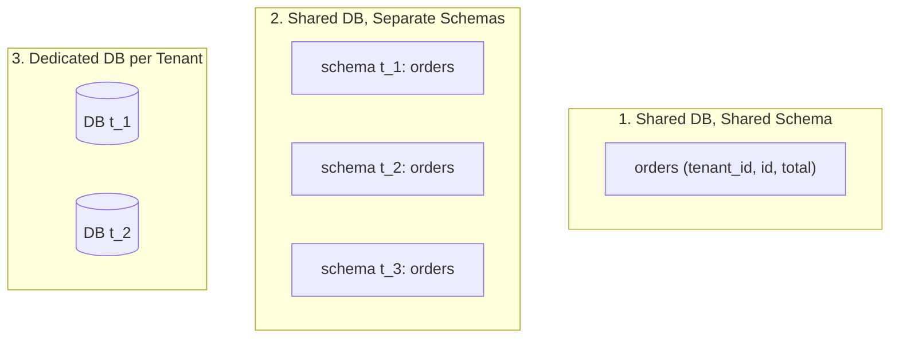
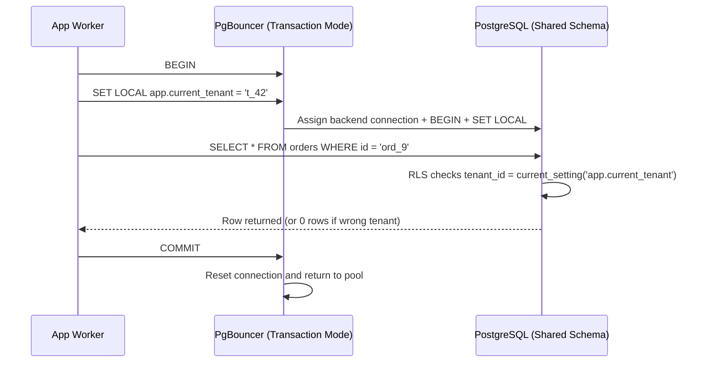
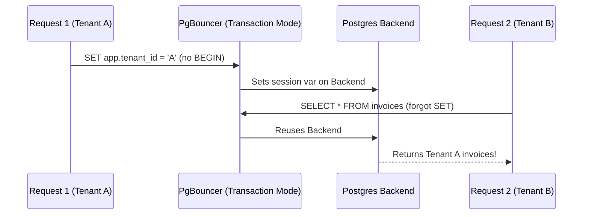

# Shared vs Dedicated Databases: Choosing a Multi-Tenant Data Model

> **Prerequisites:** [Lesson 01: Tenant Isolation Strategies](../01-tenant-isolation-strategies/README.md) · [Track: Multi-Tenant SaaS](../README.md).  
> **Estimated Reading Time:** 24–28 minutes  
> **Target Audience:** Backend engineers designing multi-tenant relational/NoSQL schemas, and candidates asked "should we use one shared table, schema-per-tenant, or database-per-tenant?"  
> **Free PDF Notes:** [Download SD-R-002.pdf](https://backendroadmap.com/notes/system-design/SD-R-002.pdf)

> [!NOTE]
> **In one line:** Multi-tenant data storage spans three concrete patterns: **Shared Database, Shared Schema** (`tenant_id` discriminator + RLS), **Shared Database, Separate Schemas** (namespace per tenant), and **Dedicated Database per Tenant** (physical isolation). You trade **query/cache efficiency and zero-friction migrations** against **per-tenant backup/restore, noisy-neighbour isolation, and catalog scalability**.

> [!TIP]
> **The Golden Rule:** Start with **Shared Database, Shared Schema** with composite `(tenant_id, id)` primary keys and Row-Level Security. Only introduce **Dedicated Databases** for enterprise/regulated tenants or extreme data-skew whales—never use schema-per-tenant as a default for thousands of tenants.

---

## 1. What Multi-Tenant Data Models Are, and What They Aren't

Every B2B SaaS application eventually hits the database modeling fork: should `orders` be one giant table with a `tenant_id` column, 500 schemas inside one PostgreSQL cluster, or 500 separate RDS instances? The choice dictates how fast your queries run, how painful your schema migrations are, whether you can restore a single customer's accidentally deleted data without rolling back everyone else, and how much your AWS bill grows.

| Term | Precise Meaning | Example |
| :--- | :--- | :--- |
| **Shared DB, Shared Schema** | All tenants share the same tables; every row carries a `tenant_id` discriminator | `CREATE TABLE orders (tenant_id UUID, id UUID, ...)` |
| **Shared DB, Separate Schemas** | One database cluster, but each tenant gets its own logical schema/namespace | `tenant_a.orders`, `tenant_b.orders` |
| **Dedicated DB per Tenant** | Each tenant has its own logical database or physical database server/cluster | `rds-tenant-42.internal` |
| **Composite Primary Key** | Primary key leading with `tenant_id` to co-locate a tenant's rows on disk/B-tree | `PRIMARY KEY (tenant_id, order_id)` |
| **Point-in-Time Recovery (PITR)** | Restoring a database to a specific timestamp before accidental deletion | Easy per-tenant in Dedicated DB; painful in Shared |
| **Catalog bloat** | Metadata overhead in `pg_class` / `pg_attribute` when creating tens of thousands of tables | Breaks Separate Schemas past ~1,000–5,000 tenants |
| **Connection pool fragmentation** | Needing separate connection pools per DB/schema, multiplying idle connections | PgBouncer struggles with 1,000+ distinct DBs |
| **Not** | A purely aesthetic SQL preference | It governs buffer-pool hit rate, lock contention, and COGS |

### Why It Matters
1. **Buffer pool efficiency:** Shared Schema keeps hot index pages packed together; Separate Schemas scatter identical table structures across thousands of disjoint B-trees.
2. **Per-tenant lifecycle:** GDPR "right to be forgotten," tenant export, and single-tenant restore are trivial in Dedicated DBs and require careful batching in Shared Schema.
3. **Migration velocity:** Altering 1 table takes seconds; altering 5,000 schemas or 500 databases requires a distributed migration orchestrator.

---

## 2. Anatomy: The Three Data Models



| Criterion | Shared DB, Shared Schema | Shared DB, Separate Schemas | Dedicated DB per Tenant |
| :--- | :--- | :--- | :--- |
| **Tables for 1,000 tenants (20 models)** | 20 tables | 20,000 tables | 20 tables $\times$ 1,000 DBs |
| **Buffer pool / page cache** | Optimal (high density) | Poor (20,000 fragmented B-trees) | Dedicated per tenant |
| **Schema migration** | 1 DDL statement | 1,000 DDL loops (lock risk) | 1,000 DB connections + orchestration |
| **Single-tenant restore (PITR)** | Hard (restore snapshot to temp DB + ETL) | Medium (schema dump/restore) | Trivial (native RDS/cloud PITR) |
| **Tenant deletion (GDPR)** | Batched `DELETE` + `VACUUM` | `DROP SCHEMA CASCADE` (fast) | `DROP DATABASE` / destroy instance |
| **Query isolation** | Logical (RLS + `tenant_id`) | Namespace (`search_path`) + grants | Physical / credential boundary |
| **Scale ceiling** | Millions of tenants (with sharding) | ~1,000–5,000 tenants per cluster | Limited by ops & cost |

> [!WARNING]
> **Schema-per-tenant (`search_path`) is a silent trap at scale.** Setting `SET search_path = tenant_42` looks clean in an ORM, but at 2,000 tenants with 30 tables each, PostgreSQL manages 60,000 table entries in `pg_class`. Query planning slows down, autovacuum workers thrash across 60,000 files, and prepared statement caches bloat per connection.

---

## 3. Mathematical Model: Buffer Pool Hit Rate, Connection Multiplication, and Migration Time

**1. Connection Pool Multiplication.** Let $P$ be the number of stateless API pods, $c$ the connections per pod, and $D$ the number of distinct databases (or non-shared connection pools). Total open DB connections scale as:

$$C_{\text{total}} = P \cdot c \cdot D$$

With $P = 20$ pods, $c = 10$ connections:
- **Shared Schema ($D = 1$):** $20 \times 10 \times 1 = 200$ connections (easily handled by 1 PgBouncer).
- **Dedicated DB ($D = 500$):** $20 \times 10 \times 500 = 100{,}000$ connections if each pod pools every tenant! You *must* route through a dynamic connection multiplexer or serverless DB proxy, and cap per-tenant pools.

**2. Schema Migration Time.** Let $t_{\text{ddl}}$ be the average time to acquire a lock and run a migration on one schema/DB, and $k$ the concurrency of your migration runner:

$$T_{\text{migrate}} = \frac{N \cdot t_{\text{ddl}}}{k}$$

With $N = 2{,}000$ schemas, $t_{\text{ddl}} = 1.5\text{ s}$, and $k = 10$ workers:
- **Separate Schemas / Dedicated DBs:** $T_{\text{migrate}} = \frac{2{,}000 \times 1.5}{10} = 300\text{ s}$ ($5\text{ minutes}$) *if zero fail*.
- **Shared Schema:** $1.5\text{ s}$ total (using expand-and-contract online DDL).

**3. Index Depth & B-Tree Efficiency.** In Shared Schema with composite `(tenant_id, id)`, all rows for `tenant_id = X` sit contiguously in leaf pages. Even with $10^8$ total rows, B-tree height is $\lceil \log_{500}(10^8) \rceil = 4$ pages, and only the hot tenant's leaf pages stay pinned in RAM.

---

## 4. Metrics & Percentiles

| Metric | Meaning | Alert when |
| :--- | :--- | :--- |
| **Buffer pool hit ratio** | % of reads served from RAM vs disk | $< 99\%$ (indicates working-set thrashing or catalog bloat) |
| **Table bloat / dead tuples** | Unreclaimed space from `DELETE`/`UPDATE` | $> 20\%$ dead tuples (especially after tenant offboarding) |
| **Migration lag / failed tenants** | Tenants behind current schema version | $> 0$ after rollout window |
| **Active connections per DB** | Connections used vs `max_connections` | $> 75\%$ |
| **Query plan time** | Time Postgres spends planning before executing | $> 5\text{ ms}$ (classic sign of too many schemas/partitions) |
| **Data skew ratio** | Largest tenant's rows / median tenant's rows | $> 1{,}000\times$ (time to move the whale to Dedicated DB) |

### Worked Example (Handling a "Whale" Tenant)
A shared `events` table holds 500M rows across 1,000 tenants. 999 tenants have ~100k rows each, but Tenant #42 (a whale) has 400M rows ($80\%$ of the table). Because of data skew, queries for Tenant #42 evict the buffer pool for everyone else, and `AUTOVACUUM` on `events` runs for hours. By migrating **only Tenant #42** to a Dedicated DB (via the Lesson 01 `TenantRouter`) and leaving the 999 tenants in the Shared Schema, the shared table drops from 500M to 100M rows, buffer hit rate jumps from $91\%$ to $99.6\%$, and p99 latency stabilizes.

---

## 5. Compounding & Failure Modes: Catalog Bloat and Connection Exhaustion

Benchmarking PostgreSQL 16 (4 vCPU, 16 GB RAM, 500 GB GP3 SSD) across increasing tenant counts (25 tables per tenant, 1,000 rows per tenant):

| Tenant Count | Shared Schema (`pg_class` rows) | Separate Schemas (`pg_class` rows) | Separate Schemas Query Plan Time | `pg_dump` Metadata Overhead |
| :---: | :---: | :---: | :---: | :---: |
| **100** | ~450 | ~2,950 | $0.4\text{ ms}$ | $1.2\text{ s}$ |
| **1,000** | ~450 | ~25,450 | $1.8\text{ ms}$ | $18\text{ s}$ |
| **5,000** | ~450 | ~125,450 | $12.4\text{ ms}$ | $210\text{ s}$ |
| **10,000** | ~450 | ~250,450 | $41.0\text{ ms}$ | $780\text{ s}$ (timeouts) |

**Result:** Shared Schema metadata stays constant ($O(1)$) regardless of tenant count. Separate Schemas compound metadata linearly ($O(N \cdot T)$), degrading query planning, backups, and autovacuum until the cluster becomes unmanageable.

---

## 6. Numbers Every Engineer Must Know

| Item | Typical | Implication |
| :--- | :---: | :--- |
| **B-tree height (100M rows)** | $3\text{–}4$ levels | One shared table is fast if `tenant_id` leads every index |
| **Shared buffer hit target** | $\ge 99\%$ | Below this, disk IOPS spike and noisy neighbours hurt everyone |
| **Postgres `max_connections`** | $100\text{–}500$ default | Always use PgBouncer/RDS Proxy in transaction pooling mode |
| **PgBouncer + RLS caveat** | Transaction pooling resets session state | Use `SET LOCAL` inside transactions, never `SET` |
| **Dedicated RDS minimum** | ~$15\text{–}\$150/\text{mo}$ per instance | Only viable for paid enterprise tiers |
| **Composite index rule** | `(tenant_id, lookup_col)` | Putting `lookup_col` first destroys locality and security |

---

## 7. Protocol Deep Dive: Safe Pool Queries & Single-Tenant PITR



| Question | Answer |
| :--- | :--- |
| **Why `SET LOCAL` instead of `SET`?** | In transaction-pooled PgBouncer, `SET` persists on the backend connection and leaks Tenant A's context to Tenant B's next transaction! `SET LOCAL` scopes strictly to the current transaction |
| **How do you restore 1 tenant in a Shared Schema?** | Restore the latest snapshot + WAL to a temporary DB instance, `SELECT * FROM ... WHERE tenant_id = 't_42'`, and upsert those rows back into production |
| **What if a tenant wants custom columns?** | Use a `JSONB` `custom_fields` column (with GIN index if needed) in Shared Schema—never alter physical schemas per tenant |
| **How do you shard a Shared Schema past 10 TB?** | Shard by `tenant_id` (Citus, Vitess, or application-level cell routing) so every tenant's data lives on one shard and joins stay local |

**When NOT to use Shared Schema:** When regulatory mandates (FedRAMP, strict HIPAA, certain EU banking laws) forbid co-mingled storage at rest, or when tenants require independent maintenance windows and customer-managed backup/restore schedules.

---

## 8. Hierarchical Budgets & Design Rules

| Slice | Rule | Control |
| :--- | :--- | :--- |
| **Primary Keys** | Lead composite PKs/indexes with `tenant_id` | `(tenant_id, id)` on every tenant table |
| **Foreign Keys** | Include `tenant_id` in FKs (`FOREIGN KEY (tenant_id, user_id)`) | Prevents cross-tenant relational links at DB level |
| **Connection Pooling** | Use transaction pooling + `SET LOCAL` | Never `SET` session variables in pooled mode |
| **Migrations** | Expand-and-contract online DDL only | Zero `ACCESS EXCLUSIVE` table locks |
| **Whale Detection** | Monitor top-10 tenants by row count and IOPS | Evict whales to Dedicated DBs via `TenantRouter` |
| **GDPR / Offboarding** | Soft-delete immediately, batch-purge in 1,000-row chunks | Avoids massive transaction logs and vacuum stalls |

---

## 9. Top Mitigations

1. **Enforce Composite `(tenant_id, id)` Keys Everywhere:** Guarantees physical data locality per tenant and prevents accidental cross-tenant foreign-key references.
2. **Use `SET LOCAL` Inside Explicit Transactions:** Eliminates session-state leakage when running PgBouncer or RDS Proxy in transaction-pooling mode.
3. **Partition Large Shared Tables by Hash(`tenant_id`) or Cell:** Keeps individual B-trees and `VACUUM` cycles small even at billions of rows.
4. **Build an Automated Single-Tenant PITR Runbook:** Script snapshot-to-temp-DB extraction by `tenant_id` so accidental customer deletions recover in < 30 minutes.
5. **Evict "Whale" Tenants Proactively:** Move any tenant exceeding 10% of shared cluster IOPS or storage to a Dedicated DB.
6. **Ban Schema-Per-Tenant Above 500 Tenants:** Migrate early before `pg_class` bloat degrades query planning.
7. **Store Tenant Extensions in `JSONB`:** Support custom fields in Shared Schema without schema-per-tenant DDL divergence.

---

## 10. Production Reference: Citus / Vitess Sharding & A PgBouncer Session-Leak SEV-1

Both **Vitess** (MySQL, used by Slack and GitHub) and **Citus** (PostgreSQL) scale Shared Schema architectures by **sharding on `tenant_id`**. Because every query includes `tenant_id`, the query router pushes joins, aggregations, and transactions down to a single shard—giving Shared Schema the horizontal scale of Dedicated DBs without losing single-schema simplicity.

**SEV-1 Post-Mortem: PgBouncer Session Variable Leak**
- **Incident:** A SaaS team switched PgBouncer from `session` mode to `transaction` mode to support 5,000 concurrent API requests. Their middleware ran `SET app.tenant_id = 't_101'` *outside* a transaction block. Connection `conn_7` was returned to the pool with `app.tenant_id = 't_101'` still active. The next request (for `t_202`, which had a bug skipping the `SET` call on read-only endpoints) inherited `t_101` and read `t_101`'s invoices.
- **Root Cause:** Session-level `SET` combined with PgBouncer transaction pooling and an unguarded read path.
- **Fix:** Replaced `SET` with `SET LOCAL` inside an explicit `BEGIN ... COMMIT` wrapper, and configured PostgreSQL RLS with `NULLIF(current_setting('app.current_tenant', true), '')::uuid` so missing context fails closed (returns 0 rows) instead of reading a stale variable.



---

## 11. Multi-Language Production Code Tabs

Transaction-scoped `SET LOCAL` tenant context wrapper for **Shared Schema** + dynamic DSN selection for **Dedicated DB**, ensuring fail-closed isolation.

````carousel
```go
// Go: Safe transaction-scoped tenant context for Shared Schema (database/sql).
package db

import (
	"context"
	"database/sql"
	"errors"
)

type TenantDB struct {
	pool *sql.DB
}

func NewTenantDB(pool *sql.DB) *TenantDB { return &TenantDB{pool: pool} }

// WithTenantTx opens a transaction and binds app.current_tenant using SET LOCAL
// so PgBouncer transaction pooling never leaks tenant state across requests.
func (t *TenantDB) WithTenantTx(ctx context.Context, tenantID string, fn func(*sql.Tx) error) error {
	if tenantID == "" {
		return errors.New("tenant_id is required")
	}
	tx, err := t.pool.BeginTx(ctx, nil)
	if err != nil {
		return err
	}
	defer func() { _ = tx.Rollback() }()

	if _, err := tx.ExecContext(ctx, "SELECT set_config('app.current_tenant', $1, true)", tenantID); err != nil {
		return err
	}
	if err := fn(tx); err != nil {
		return err
	}
	return tx.Commit()
}
```
<!-- slide -->
```typescript
// TypeScript: Transaction-scoped tenant context wrapper (SET LOCAL via set_config(..., true)).
export interface SqlClient {
  query(sql: string, params?: unknown[]): Promise<{ rows: unknown[] }>;
}

export async function withTenantTransaction<T>(
  client: SqlClient,
  tenantId: string,
  work: (tx: SqlClient) => Promise<T>
): Promise<T> {
  if (!tenantId) {
    throw new Error("Fail-closed: tenantId is required before querying");
  }
  await client.query("BEGIN");
  try {
    // 3rd arg `true` makes the setting local to the current transaction (PgBouncer-safe).
    await client.query("SELECT set_config('app.current_tenant', $1, true)", [tenantId]);
    const result = await work(client);
    await client.query("COMMIT");
    return result;
  } catch (err) {
    await client.query("ROLLBACK");
    throw err;
  }
}
```
<!-- slide -->
```python
# Python: Connection pool & catalog-bloat simulator + fail-closed tenant context helper.
from contextlib import contextmanager


def estimate_resources(n_tenants: int, mode: str, pods: int = 20, conns_per_pod: int = 10, t_ddl_s: float = 1.5):
    if mode == "shared_schema":
        return {"connections": pods * conns_per_pod, "pg_class_tables": 25, "migration_s": t_ddl_s}
    if mode == "separate_schemas":
        return {"connections": pods * conns_per_pod, "pg_class_tables": 25 * n_tenants, "migration_s": round(n_tenants * t_ddl_s / 10, 1)}
    if mode == "dedicated_db":
        return {"connections": pods * conns_per_pod * n_tenants, "pg_class_tables": 25, "migration_s": round(n_tenants * t_ddl_s / 10, 1)}
    raise ValueError(f"Unknown mode: {mode}")


@contextmanager
def tenant_tx(conn, tenant_id: str):
    if not tenant_id:
        raise PermissionError("Fail-closed: missing tenant_id")
    cur = conn.cursor()
    cur.execute("BEGIN")
    try:
        cur.execute("SELECT set_config('app.current_tenant', %s, true)", (tenant_id,))
        yield cur
        conn.commit()
    except Exception:
        conn.rollback()
        raise
```
<!-- slide -->
```csharp
// C#: Fail-closed transaction-scoped tenant context using Npgsql/DbConnection.
using System;
using System.Data.Common;
using System.Threading;
using System.Threading.Tasks;

public static class TenantDbExtensions
{
    public static async Task<T> WithTenantTxAsync<T>(
        this DbConnection conn,
        string tenantId,
        Func<DbTransaction, Task<T>> action,
        CancellationToken ct = default)
    {
        if (string.IsNullOrWhiteSpace(tenantId))
            throw new UnauthorizedAccessException("Fail-closed: tenantId is required.");

        await using var tx = await conn.BeginTransactionAsync(ct);
        await using (var cmd = conn.CreateCommand())
        {
            cmd.Transaction = tx;
            cmd.CommandText = "SELECT set_config('app.current_tenant', @tid, true)";
            var p = cmd.CreateParameter();
            p.ParameterName = "@tid";
            p.Value = tenantId;
            cmd.Parameters.Add(p);
            await cmd.ExecuteNonQueryAsync(ct);
        }

        var result = await action(tx);
        await tx.CommitAsync(ct);
        return result;
    }
}
```
````

---

## 12. Hands-On CLI Verification Workflows

Run the resource scaling comparison in Python:

```bash
python3 -c '
def estimate(n, mode, pods=20, conns=10, ddl=1.5):
    if mode == "shared_schema": return {"conns": pods*conns, "tables": 25, "mig_s": ddl}
    if mode == "separate_schemas": return {"conns": pods*conns, "tables": 25*n, "mig_s": n*ddl/10}
    return {"conns": pods*conns*n, "tables": 25, "mig_s": n*ddl/10}
for m in ["shared_schema", "separate_schemas", "dedicated_db"]:
    print(m, estimate(1000, m))
'
```

Inspect PostgreSQL buffer hit ratio, composite indexes, and `pg_class` bloat:

```bash
# Check buffer pool hit ratio (target >= 99%)
psql "$DATABASE_URL" -c "SELECT round(sum(blks_hit)*100.0 / nullif(sum(blks_hit+blks_read),0), 2) AS hit_ratio FROM pg_stat_database;"

# Verify tenant_id is the leading column on indexes
psql "$DATABASE_URL" -c "SELECT tablename, indexname, indexdef FROM pg_indexes WHERE schemaname = 'public' ORDER BY tablename;"

# Check top 5 largest tenants (whale detection)
psql "$DATABASE_URL" -c "SELECT tenant_id, count(*) AS row_count FROM orders GROUP BY tenant_id ORDER BY row_count DESC LIMIT 5;"
```

---

## 13. Common Mistakes to Avoid

1. **Indexing `(id, tenant_id)` instead of `(tenant_id, id)`**—destroys per-tenant disk locality and forces index scans across all tenants.
2. **Using `SET` instead of `SET LOCAL` with PgBouncer transaction pooling**—leaks tenant context across pooled connections.
3. **Choosing schema-per-tenant for a 5,000+ tenant SaaS**—causes `pg_class` catalog bloat and slow query planning.
4. **Omitting `tenant_id` from foreign keys**, allowing a bug to link Tenant A's order to Tenant B's user.
5. **Letting a single whale tenant stay in the Shared Schema**—their vacuum and I/O patterns degrade p99 for all neighbours.
6. **Doing `DELETE FROM orders WHERE tenant_id = ?` in one giant transaction**—locks rows and balloons WAL; always batch deletes.
7. **Forgetting per-tenant PITR scripts**—leaving you unable to restore one customer's data without rolling back everyone.

---

## 14. Key Terms Glossary

| Key Term | Definition |
| :--- | :--- |
| **Shared Schema** | Single set of tables storing all tenants' rows distinguished by `tenant_id`. |
| **Separate Schemas** | One database cluster containing an isolated schema/namespace per tenant. |
| **Dedicated Database** | Physical or logical database instance provisioned exclusively for one tenant. |
| **Composite Primary Key** | Multi-column key leading with `tenant_id` to group a tenant's data together. |
| **Catalog bloat** | Excess metadata growth in system tables (`pg_class`) from too many schemas/tables. |
| **Data skew / Whale** | One tenant holding orders of magnitude more data or traffic than the median tenant. |
| **Transaction pooling** | Pooler mode (e.g., PgBouncer) that reassigns backend DB connections after every `COMMIT`. |
| **Fail-closed context** | Returning 0 rows or an error if `app.current_tenant` is unset, rather than exposing data. |
| **PITR** | Point-in-Time Recovery: restoring database state to a specific second via WAL logs. |
| **Expand-and-contract** | Zero-downtime schema migration pattern adding new columns before removing old ones. |

---

## 15. System Design Interview Questions & Answers

### Basic Conceptual Questions

<details>
<summary><strong>Q1: What are the three main multi-tenant database models? [BASIC]</strong></summary>

**Answer:**
1) **Shared DB, Shared Schema** (`tenant_id` column + RLS). 2) **Shared DB, Separate Schemas** (one schema per tenant). 3) **Dedicated DB per Tenant** (isolated database instance per tenant).
</details>

<details>
<summary><strong>Q2: Why should `tenant_id` be the first column in composite indexes? [BASIC]</strong></summary>

**Answer:**
Because every multi-tenant query filters by `tenant_id`. Putting it first groups all of a tenant's rows contiguously in B-tree leaf pages, maximizing buffer-pool hit rates and keeping scans bounded to that tenant's slice.
</details>

<details>
<summary><strong>Q3: Which model makes GDPR deletion and single-tenant backups easiest? [BASIC]</strong></summary>

**Answer:**
**Dedicated DB per Tenant**, because you can drop the instance or run native cloud PITR on that single database without affecting any other customer.
</details>

<details>
<summary><strong>Q4: What is the main drawback of Separate Schemas (schema-per-tenant)? [BASIC]</strong></summary>

**Answer:**
Catalog bloat and operational compounding. Above ~1,000–5,000 tenants, `pg_class` metadata slows down query planning, `pg_dump` stalls, and running DDL migrations across thousands of schemas takes hours.
</details>

### Scenario-Based Architecture Questions

<details>
<summary><strong>Q5: You are designing a new B2B SaaS expecting 10,000 SMB customers and 20 Enterprise customers. What data model do you pick? [SCENARIO]</strong></summary>

**Answer:**
A hybrid: **Shared DB, Shared Schema** (partitioned into cells if needed) for the 10,000 SMBs to maximize buffer efficiency and keep COGS low, paired with **Dedicated DBs** for the 20 Enterprise customers who pay for physical isolation and custom PITR.
</details>

<details>
<summary><strong>Q6: A customer accidentally deleted 50,000 records in your Shared Schema database 2 hours ago. How do you recover them? [SCENARIO]</strong></summary>

**Answer:**
Perform a Point-in-Time Recovery (PITR) of the shared database to a *new temporary instance* at `T - 2h10m`. Extract only rows matching `WHERE tenant_id = '<customer_id>'`, and upsert them back into the production database. Never roll back the production shared DB.
</details>

<details>
<summary><strong>Q7: One tenant generates 75% of all writes in your Shared Schema table and autovacuum is falling behind. What do you do? [SCENARIO]</strong></summary>

**Answer:**
Evict the whale tenant to a **Dedicated DB** using CDC/logical replication and flip their route in the Control Plane. Then run batched cleanup (`DELETE` in 5,000-row chunks) and `VACUUM` on the shared table.
</details>

<details>
<summary><strong>Q8: Your team wants to let Enterprise customers add custom fields to the `leads` table. Should you alter their schema? [SCENARIO]</strong></summary>

**Answer:**
No—per-tenant DDL creates schema drift and breaks ORM/migration tooling. Store custom attributes in a `JSONB` column (indexed with GIN if queried) and validate against per-tenant metadata stored in the Control Plane.
</details>

### Advanced & Tricky Interview Questions

<details>
<summary><strong>Q9: Why is `SET app.current_tenant` dangerous with PgBouncer? [TRICKY]</strong></summary>

**Answer:**
In `transaction` pooling mode, PgBouncer returns the backend PostgreSQL connection to the pool on `COMMIT` without resetting session-level `SET` variables. The next tenant's transaction can inherit the previous tenant's `app.current_tenant`! Always use `SET LOCAL` (or `set_config(..., true)`) inside an explicit transaction.
</details>

<details>
<summary><strong>Q10: How do you scale a Shared Schema database beyond a single PostgreSQL primary's write limit? [TRICKY]</strong></summary>

**Answer:**
Shard horizontally by `tenant_id` using Citus, Vitess, or application-level cell sharding. Because `tenant_id` is the shard key, single-tenant transactions, joins, and foreign keys remain local to one shard with zero distributed 2PC overhead.
</details>

<details>
<summary><strong>Q11: How can a foreign key in a Shared Schema cause a cross-tenant data leak? [TRICKY]</strong></summary>

**Answer:**
If `orders(id, tenant_id, user_id)` has `FOREIGN KEY (user_id) REFERENCES users(id)`, a bug could insert Tenant A's order referencing Tenant B's `user_id`, and a join on `users` might expose Tenant B's email. Always use composite foreign keys: `FOREIGN KEY (tenant_id, user_id) REFERENCES users(tenant_id, id)`.
</details>

<details>
<summary><strong>Q12: What happens to your ORM connection pool if you have 500 Dedicated DBs and 30 API pods? [TRICKY]</strong></summary>

**Answer:**
If each pod opens a 10-connection pool per DB, you attempt $30 \times 500 \times 10 = 150{,}000$ connections. You must use a centralized proxy/multiplexer, lazy-init tiny per-tenant pools with aggressive idle eviction (e.g., 30s TTL), or serverless DBs that scale to zero.
</details>

---

## 16. One-Page Master Cheat Sheet

```
+---------------------------------------------------------------------------------------------------------+
|                  SHARED VS DEDICATED DATABASES — MASTER CHEAT SHEET                                     |
+---------------------------------------------------------------------------------------------------------+
| 1. SHARED SCHEMA: Best COGS, O(1) metadata, easy migrations. Requires (tenant_id, id) PKs + RLS.        |
| 2. SEPARATE SCHEMAS: Traps you at ~1,000-5,000 tenants via pg_class bloat and slow query planning.      |
| 3. DEDICATED DB: Best for Enterprise compliance, PITR, and evicting noisy "whale" tenants.              |
+---------------------------------------------------------------------------------------------------------+
| 4. PGBOUNCER RULE: Always use `SET LOCAL` / `set_config(..., true)` inside BEGIN..COMMIT. Never `SET`.  |
+---------------------------------------------------------------------------------------------------------+
| 5. COMPOSITE FKs: `FOREIGN KEY (tenant_id, user_id)` prevents cross-tenant relational links.            |
+---------------------------------------------------------------------------------------------------------+
| 6. SCALE OUT: Shard Shared Schema by `tenant_id` (Citus/Vitess/Cells) so all joins stay single-shard.   |
+---------------------------------------------------------------------------------------------------------+
```

---

## Further Reading & Sources

- Microsoft Azure Architecture Center, [Multi-tenant SaaS Database Tenancy Patterns](https://learn.microsoft.com/en-us/azure/azure-sql/database/saas-tenancy-app-design-patterns).
- AWS Database Blog, [Multi-tenant Data Isolation with PostgreSQL Row Level Security](https://aws.amazon.com/blogs/database/multi-tenant-data-isolation-with-postgresql-row-level-security/).
- Citus Data Documentation, [Multi-tenant Applications with Citus](https://docs.citusdata.com/en/stable/use_cases/multi_tenant.html).
- Martin Kleppmann, *Designing Data-Intensive Applications*, Chapter 6 ("Partitioning").

---

## Free PDF Notes

[SD-R-002.pdf](https://backendroadmap.com/notes/system-design/SD-R-002.pdf)

---

## Next

Continue with [Lesson 03: Tenant-Aware Authorization: Tenant Claims, Context & Row-Level Security](../03-tenant-aware-authorization/README.md).
