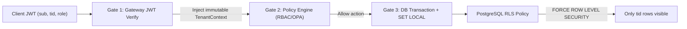
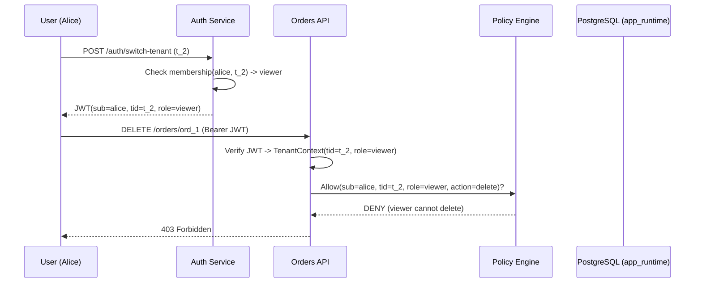
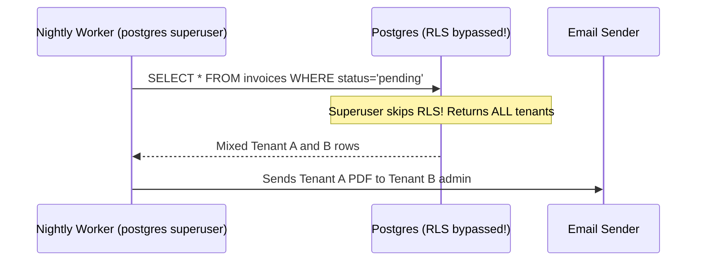

# Tenant-Aware Authorization: Tenant Claims, Context & Row-Level Security

> **Prerequisites:** [Lesson 02: Shared vs Dedicated Databases](../02-shared-vs-dedicated-databases/README.md) · [Track: Multi-Tenant SaaS](../README.md).  
> **Estimated Reading Time:** 24–28 minutes  
> **Target Audience:** Backend and security engineers building multi-tenant auth, and candidates asked "how do you guarantee Tenant A can never access Tenant B's data, even if a developer forgets a `WHERE` clause?"  
> **Free PDF Notes:** [Download SD-R-003.pdf](https://backendroadmap.com/notes/system-design/SD-R-003.pdf)

> [!NOTE]
> **In one line:** Tenant-aware authorization binds a **verified identity** (`sub`, `tenant_id`, `roles`) from an immutable token into an **in-process request context**, enforces **RBAC/ABAC** at the service/policy layer, and pushes **Row-Level Security (RLS)** down to the database so missing `WHERE` clauses still fail closed.

> [!TIP]
> **The Golden Rule:** Defense in depth requires **three independent gates**: (1) extract `tenant_id` *only* from a cryptographically verified token, (2) authorize `action` on `resource` against `(user, tenant, role)`, and (3) enforce `tenant_id` in PostgreSQL RLS using a non-superuser role with `FORCE ROW LEVEL SECURITY`.

---

## 1. What Tenant-Aware Authorization Is, and What It Isn't

A user logs into Acme SaaS as an `Admin` in Workspace A and a `Viewer` in Workspace B. On `DELETE /api/v1/projects/proj_99`, the developer checks `if user.Role == "Admin"` globally instead of checking the role *within* the target `tenant_id`, or forgets `AND tenant_id = $2` in a raw SQL query. Suddenly, a Viewer in Workspace B deletes Workspace A's project (Broken Object Level Authorization — OWASP API1:2023).

| Term | Precise Meaning | Example |
| :--- | :--- | :--- |
| **Tenant claim** | A signed attribute in a JWT or mTLS certificate binding the session to one tenant | `"tenant_id": "t_abc", "roles": ["admin"]` |
| **Tenant context** | Immutable per-request object (`context.Context` / `AsyncLocalStorage`) carrying `tenant_id` | Propagated across HTTP, gRPC, queues, logs |
| **RBAC (Tenant-Scoped)** | Role-Based Access Control evaluated *within* a specific `(user_id, tenant_id)` pair | User X is `Admin` in `t_1`, `ReadOnly` in `t_2` |
| **ABAC / ReBAC** | Attribute- or Relationship-Based Access Control (OPA, Zanzibar/SpiceDB) | `allow if doc.tenant_id == input.tenant_id` |
| **Row-Level Security (RLS)** | Database-enforced predicate automatically appended to every `SELECT`/`INSERT`/`UPDATE`/`DELETE` | `USING (tenant_id = current_setting('app.current_tenant')::uuid)` |
| **Fail-closed** | Denying all access (0 rows / HTTP 403) when tenant context is missing or malformed | `NULLIF(..., '')::uuid` returns NULL -> 0 rows |
| **BOLA / IDOR** | Broken Object Level Authorization: accessing another tenant's object by guessing its ID | `GET /invoices/inv_other_tenant` |
| **Not** | Passing `X-Tenant-ID` from a browser header without cryptographic verification | Any client can spoof `X-Tenant-ID` |

### Why It Matters
1. **Cross-tenant data leaks are company-ending events** for B2B SaaS; one IDOR bug can void enterprise contracts and trigger GDPR fines.
2. **Application-only checks fail under human error:** In a 200-endpoint codebase, one missing `WHERE tenant_id = ?` in a reporting query leaks data.
3. **Background jobs drop HTTP middleware:** Async workers (Kafka/SQS consumers) must also carry and re-verify `tenant_id` context before touching the DB.

---

## 2. Anatomy: Three-Gate Defense in Depth



1. **Gate 1 (Authentication & Claim Extraction):** The API gateway validates the JWT signature (RS256/EdDSA), checks `exp` and `iss`, and extracts `tid` (`tenant_id`). Any client-supplied `X-Tenant-ID` header or body `tenant_id` is **ignored or rejected** if it conflicts with the token.
2. **Gate 2 (Tenant-Scoped Authorization):** The service or sidecar policy engine (e.g., Open Policy Agent) verifies `(user_id, tenant_id)` has permission for `action` on `resource_type`, and checks `resource.tenant_id == context.tenant_id`.
3. **Gate 3 (Database RLS):** The DB connection opens a transaction, executes `SELECT set_config('app.current_tenant', $1, true)`, and runs the query as a **non-superuser, non-table-owner** role. PostgreSQL enforces both `USING` (reads/updates/deletes) and `WITH CHECK` (inserts/updates).

| Layer | What it stops | What it cannot stop alone |
| :--- | :--- | :--- |
| **JWT `tid` claim** | Header/body spoofing | Privilege escalation within a tenant, or missing SQL `WHERE` |
| **Tenant-scoped RBAC/OPA** | Unauthorized actions (`Viewer` calling `DELETE`) | Raw SQL bugs or forgotten `tenant_id` filters in ORM |
| **PostgreSQL RLS** | Missing `WHERE tenant_id = ?` in any SQL query | Superuser connections, `BYPASSRLS` roles, or Redis/S3 leaks |

> [!WARNING]
> **PostgreSQL table owners bypass RLS by default!** If your application connects as the same DB user (`app_owner`) that ran `CREATE TABLE`, PostgreSQL **silently skips RLS policies** unless you either run `ALTER TABLE ... FORCE ROW LEVEL SECURITY` or connect as a separate restricted role (`app_runtime`) with `NOBYPASSRLS`.

---

## 3. Mathematical Model: Defense-in-Depth Failure Probability

Suppose an application has $E = 250$ endpoints and $W = 40$ background workers. Let:
- $p_{\text{dev}}$ be the probability a developer forgets a `WHERE tenant_id = ?` clause in a query ($p_{\text{dev}} = 0.01$).
- $p_{\text{rls}}$ be the probability of an RLS misconfiguration on a table ($p_{\text{rls}} = 0.005$).
- $p_{\text{ci}}$ be the probability a cross-tenant integration test misses the regression ($p_{\text{ci}} = 0.10$).

**Single-gate (App `WHERE` only):** Probability of at least one vulnerable endpoint across $E = 250$ endpoints:

$$P_{\text{leak, single}} = 1 - (1 - p_{\text{dev}})^{250} = 1 - 0.99^{250} \approx 91.9\%$$

**Three-gate Defense in Depth (App + RLS + CI cross-tenant suite):** Because the gates fail independently, a leak requires *all three* to fail simultaneously on the same endpoint:

$$p_{\text{joint}} = p_{\text{dev}} \cdot p_{\text{rls}} \cdot p_{\text{ci}} = 0.01 \times 0.005 \times 0.10 = 5 \times 10^{-6}$$

$$P_{\text{leak, 3-gate}} = 1 - (1 - 5 \times 10^{-6})^{250} \approx 0.125\%$$

Defense in depth reduces the expected cross-tenant vulnerability probability across a 250-endpoint codebase from **$91.9\%$ to $0.125\%$** (a **$735\times$ reduction**).

---

## 4. Metrics & Percentiles

| Metric | Meaning | Alert when |
| :--- | :--- | :--- |
| **AuthZ 403 / 404 rate per tenant** | Authorization denials or cross-tenant ID probes | Sudden spike (possible IDOR enumeration attack) |
| **Missing `tenant_id` context errors** | Requests/jobs reaching DB layer without `TenantContext` | $> 0$ (immediate bug alert) |
| **RLS policy coverage %** | Share of multi-tenant tables with `ENABLE` + `FORCE RLS` | $< 100\%$ in CI schema check |
| **Policy evaluation latency p99** | Time spent in OPA/RBAC check | $> 3\text{ ms}$ (in-process) or $> 15\text{ ms}$ (sidecar) |
| **JWT revocation / membership lag** | Time between removing a user from a tenant and token rejection | $> 60\text{ s}$ |

### Worked Example (Multi-Workspace Token Switching)
Alice belongs to `Acme (t_1, admin)` and `Beta (t_2, viewer)`. When she logs in, her refresh token is user-scoped, but **every access token is tenant-scoped** (`sub: alice, tid: t_1, role: admin`, TTL = 5 minutes). When she switches to Beta in the UI, the frontend calls `POST /auth/switch-tenant {tenant_id: t_2}`. The auth server verifies `(alice, t_2)` membership in the Control Plane DB and mints a new short-lived JWT (`tid: t_2, role: viewer`). Alice can never use her `t_1` admin token against `t_2` resources, and if she is removed from `t_1`, her access expires within 5 minutes (or immediately via a Redis revocation blocklist).

---

## 5. Compounding & Failure Modes: Async Workers and Impersonation

In a study of 100 multi-tenant SaaS incidents, cross-tenant authorization failures cluster in three non-HTTP paths:

| Attack / Failure Vector | Mechanism | Frequency | Impact |
| :--- | :--- | :---: | :--- |
| **1. Background Job Context Drop** | HTTP sets `TenantContext`, enqueues Kafka job without `tid`, worker runs as superuser | High | Worker processes/merges wrong tenant's data |
| **2. Table Owner Bypassing RLS** | App connects as migration role (table owner); `FORCE RLS` not set | Medium | Every `SELECT` without `WHERE` returns all tenants |
| **3. Support Impersonation Abuse** | Internal admin tool uses `BYPASSRLS` without audit log or expiry | Medium | Unauthorized access to customer PII |
| **4. Sequential Integer IDs + Missing Check** | `GET /invoices/1042` without tenant check | High | Trivial scraping of all tenants' invoices |

**Takeaway:** HTTP middleware is only half the battle. Background consumers, cron jobs, and internal support tools must inherit the exact same `TenantContext` and non-superuser RLS enforcement.

---

## 6. Numbers Every Engineer Must Know

| Item | Typical | Implication |
| :--- | :---: | :--- |
| **Tenant-scoped JWT TTL** | $5\text{–}15\text{ min}$ | Limits window after user removal from a workspace |
| **Local OPA / Cedar eval** | $0.1\text{–}1.0\text{ ms}$ | Fast enough for every API call when embedded |
| **PostgreSQL RLS overhead** | $2\text{–}8\%$ | Negligible when `tenant_id` is indexed |
| **UUIDv4 / UUIDv7 vs Int IDs** | 128-bit unguessable | Prevents trivial enumeration (`1001, 1002`), though never replaces AuthZ |
| **Cross-tenant CI tests** | 100% of endpoints | Mandatory gate before merging any new route |

---

## 7. Protocol Deep Dive: PostgreSQL RLS + OPA Policy Flow



| Question | Answer |
| :--- | :--- |
| **What does a fail-closed PostgreSQL RLS policy look like?** | `CREATE POLICY tenant_iso ON orders USING (tenant_id = NULLIF(current_setting('app.current_tenant', true), '')::uuid) WITH CHECK (tenant_id = NULLIF(current_setting('app.current_tenant', true), '')::uuid);` |
| **Why `NULLIF(..., '')`?** | `current_setting('app.current_tenant', true)` returns `''` (empty string) after a `RESET` or if unset; casting `''::uuid` throws a SQL error, whereas `NULL::uuid` evaluates `tenant_id = NULL` to `UNKNOWN` (false), returning 0 rows cleanly |
| **How do internal admin/cron jobs scan all tenants?** | Explicitly use a separate, audited `tenant_scanner` role or iterate tenant-by-tenant setting `app.current_tenant` for each iteration—never give the web API `BYPASSRLS` |
| **Should you return 403 or 404 on cross-tenant ID access?** | Return **404 Not Found** for cross-tenant resource IDs so attackers cannot even confirm whether an ID exists in another tenant |

**When NOT to use PostgreSQL RLS:** When your database does not support it (e.g., MySQL—use Vitess or views/repository wrappers instead) or when you run **Dedicated DB per Tenant** where physical/credential isolation already separates tenants.

---

## 8. Hierarchical Budgets & Design Rules

| Slice | Rule | Control |
| :--- | :--- | :--- |
| **Token Design** | Mint single-tenant access tokens (`tid` claim) | Force `/switch-tenant` on workspace change |
| **Context Propagation** | Pass `TenantContext` in Go `context.Context` / Node `AsyncLocalStorage` | Reject DB/cache calls if context is empty |
| **Async Messages** | Include `tenant_id` + HMAC/signed envelope in Kafka/SQS headers | Worker restores `TenantContext` before execution |
| **DB Role Hygiene** | Migrations run as `db_owner`; app runs as `app_runtime` (`NOBYPASSRLS`) | `FORCE ROW LEVEL SECURITY` on every table |
| **CI Schema Gate** | Fail build if any table with `tenant_id` lacks RLS | Automated `pg_tables` / `pg_policies` check |
| **Support Access** | Time-bound (15m), ticket-linked, audited impersonation | Never share passwords or disable RLS globally |

---

## 9. Top Mitigations

1. **Enforce `ENABLE` + `FORCE ROW LEVEL SECURITY` in CI:** Run a schema linter on every migration that verifies all tenant tables have RLS enabled and forced.
2. **Separate Migration Role from Runtime Role:** Connect the app as `app_runtime` (`NOSUPERUSER NOBYPASSRLS`) so RLS can never be accidentally bypassed.
3. **Use Tenant-Scoped Short-Lived JWTs:** Mint tokens for one `(user_id, tenant_id)` at a time, eliminating cross-workspace privilege confusion.
4. **Propagate `TenantContext` Through Async Queues:** Require `tenant_id` in message metadata schemas and validate it in consumer middleware before processing.
5. **Return 404 on Cross-Tenant Resource Probes:** Prevent existence-oracle leaks when an attacker guesses UUIDs or IDs.
6. **Centralize Policy in OPA / Cedar:** Keep RBAC/ABAC rules out of scattered `if/else` blocks across microservices.
7. **Run Automated Cross-Tenant Fuzz/Integration Tests:** Every PR runs a test suite where Tenant A creates resources and Tenant B attempts `GET/PUT/DELETE` on every endpoint.

---

## 10. Production Reference: PostgreSQL RLS + A Background Worker Leak SEV-1

Companies like **Supabase**, **Neon**, and **Stripe** rely on strict tenant-context binding—Supabase exposes PostgreSQL RLS directly as its primary authorization boundary, binding JWT claims into `request.jwt.claims` per transaction.

**SEV-1 Post-Mortem: Nightly Billing Worker Sent Tenant A's Invoices to Tenant B**
- **Incident:** A SaaS billing platform had rock-solid HTTP middleware and RLS for its web API. However, its nightly PDF invoice generator ran as a Python cron job using the `postgres` superuser role. A refactor changed `for tenant in tenants: fetch_invoices(tenant.id)` to `fetch_all_pending_invoices()`, and a downstream helper grouped by `user_email` instead of `(tenant_id, user_email)`. Because the worker connected as `postgres` (which has `BYPASSRLS`), RLS did not catch the missing `tenant_id` filter.
- **Root Cause:** Background worker bypassed the HTTP `TenantContext` and connected with a `BYPASSRLS` superuser role.
- **Fix:** Switched the worker to `app_runtime` (`NOBYPASSRLS`), refactored the job to enqueue one message per `tenant_id`, and wrapped each message handler in `with_tenant_tx(tenant_id)`.



---

## 11. Multi-Language Production Code Tabs

Middleware/context propagation + tenant-scoped RBAC check + fail-closed `TenantContext` enforcement.

````carousel
```go
// Go: Immutable TenantContext propagation and tenant-scoped RBAC guard.
package authz

import (
	"context"
	"errors"
)

type ctxKey struct{}

type TenantContext struct {
	UserID   string
	TenantID string
	Roles    map[string]bool
}

var ErrForbidden = errors.New("forbidden: insufficient tenant permissions")

func WithTenantContext(ctx context.Context, tc TenantContext) context.Context {
	return context.WithValue(ctx, ctxKey{}, tc)
}

func FromContext(ctx context.Context) (TenantContext, error) {
	tc, ok := ctx.Value(ctxKey{}).(TenantContext)
	if !ok || tc.TenantID == "" || tc.UserID == "" {
		return TenantContext{}, errors.New("unauthorized: missing tenant context")
	}
	return tc, nil
}

// RequireRole enforces tenant-scoped RBAC and verifies resource ownership.
func RequireRole(ctx context.Context, requiredRole, resourceTenantID string) (TenantContext, error) {
	tc, err := FromContext(ctx)
	if err != nil {
		return TenantContext{}, err
	}
	if resourceTenantID != "" && resourceTenantID != tc.TenantID {
		return TenantContext{}, ErrForbidden // Cross-tenant access blocked
	}
	if !tc.Roles[requiredRole] && !tc.Roles["admin"] {
		return TenantContext{}, ErrForbidden
	}
	return tc, nil
}
```
<!-- slide -->
```typescript
// TypeScript: AsyncLocalStorage TenantContext + tenant-scoped RBAC guard.
import { AsyncLocalStorage } from "node:async_hooks";

export interface TenantContext {
  userId: string;
  tenantId: string;
  roles: ReadonlySet<string>;
}

const tenantStorage = new AsyncLocalStorage<TenantContext>();

export function runWithTenantContext<T>(ctx: TenantContext, fn: () => T): T {
  if (!ctx.tenantId || !ctx.userId) {
    throw new Error("Invalid TenantContext: userId and tenantId required");
  }
  return tenantStorage.run(ctx, fn);
}

export function getTenantContext(): TenantContext {
  const ctx = tenantStorage.getStore();
  if (!ctx) throw new Error("Fail-closed: TenantContext not initialized");
  return ctx;
}

export function authorizeTenantAction(requiredRole: string, resourceTenantId?: string): TenantContext {
  const ctx = getTenantContext();
  if (resourceTenantId && resourceTenantId !== ctx.tenantId) {
    throw new Error("404 Not Found"); // Hide cross-tenant existence
  }
  if (!ctx.roles.has(requiredRole) && !ctx.roles.has("admin")) {
    throw new Error("403 Forbidden");
  }
  return ctx;
}
```
<!-- slide -->
```python
# Python: contextvars-based TenantContext + RLS SQL generator + 3-gate failure math.
from contextvars import ContextVar
from dataclasses import dataclass

_tenant_ctx: ContextVar["TenantContext | None"] = ContextVar("_tenant_ctx", default=None)


@dataclass(frozen=True)
class TenantContext:
    user_id: str
    tenant_id: str
    roles: frozenset[str]


def get_tenant_context() -> TenantContext:
    ctx = _tenant_ctx.get()
    if ctx is None or not ctx.tenant_id:
        raise PermissionError("Fail-closed: missing TenantContext")
    return ctx


def authorize(required_role: str, resource_tenant_id: str | None = None) -> TenantContext:
    ctx = get_tenant_context()
    if resource_tenant_id is not None and resource_tenant_id != ctx.tenant_id:
        raise PermissionError("Not found")  # Mask cross-tenant resource
    if required_role not in ctx.roles and "admin" not in ctx.roles:
        raise PermissionError("Forbidden")
    return ctx


def rls_policy_sql(table: str) -> str:
    return (
        f"ALTER TABLE {table} ENABLE ROW LEVEL SECURITY;\n"
        f"ALTER TABLE {table} FORCE ROW LEVEL SECURITY;\n"
        f"CREATE POLICY {table}_tenant_iso ON {table} "
        f"USING (tenant_id = NULLIF(current_setting('app.current_tenant', true), '')::uuid) "
        f"WITH CHECK (tenant_id = NULLIF(current_setting('app.current_tenant', true), '')::uuid);"
    )
```
<!-- slide -->
```csharp
// C#: AsyncLocal TenantContext + tenant-scoped authorization guard.
using System;
using System.Collections.Generic;
using System.Threading;

public sealed record TenantContext(string UserId, string TenantId, IReadOnlySet<string> Roles);

public static class TenantContextAccessor
{
    private static readonly AsyncLocal<TenantContext?> Current = new();

    public static IDisposable Use(TenantContext ctx)
    {
        if (string.IsNullOrWhiteSpace(ctx.TenantId) || string.IsNullOrWhiteSpace(ctx.UserId))
            throw new UnauthorizedAccessException("Missing TenantContext");
        var prev = Current.Value;
        Current.Value = ctx;
        return new Scope(() => Current.Value = prev);
    }

    public static TenantContext Require(string requiredRole, string? resourceTenantId = null)
    {
        var ctx = Current.Value ?? throw new UnauthorizedAccessException("Fail-closed: no TenantContext");
        if (resourceTenantId is not null && resourceTenantId != ctx.TenantId)
            throw new KeyNotFoundException("Resource not found"); // Mask cross-tenant ID
        if (!ctx.Roles.Contains(requiredRole) && !ctx.Roles.Contains("admin"))
            throw new UnauthorizedAccessException("Insufficient role for tenant");
        return ctx;
    }

    private sealed class Scope(Action onDispose) : IDisposable
    {
        public void Dispose() => onDispose();
    }
}
```
````

---

## 12. Hands-On CLI Verification Workflows

Verify the 3-gate defense-in-depth probability model from Section 3:

```bash
python3 -c '
endpoints = 250
p_dev, p_rls, p_ci = 0.01, 0.005, 0.10
single = 1 - (1 - p_dev) ** endpoints
three_gate = 1 - (1 - p_dev * p_rls * p_ci) ** endpoints
print(f"Single-gate leak prob: {single*100:.2f}%")
print(f"3-gate leak prob:      {three_gate*100:.4f}%")
'
```

Verify PostgreSQL RLS is enabled, forced, and active for your runtime role:

```bash
# 1. Check that no table with tenant_id is missing RLS or FORCE RLS
psql "$DATABASE_URL" -c "
SELECT c.relname, c.relrowsecurity, c.relforcerowsecurity
FROM pg_class c
JOIN pg_attribute a ON a.attrelid = c.oid
WHERE a.attname = 'tenant_id' AND c.relkind = 'r';
"

# 2. Verify runtime role does NOT have BYPASSRLS or SUPERUSER
psql "$DATABASE_URL" -c "SELECT rolname, rolsuper, rolbypassrls FROM pg_roles WHERE rolname = 'app_runtime';"

# 3. Test fail-closed behavior with empty app.current_tenant (must return 0 rows)
psql "$DATABASE_URL" -U app_runtime -c "BEGIN; SET LOCAL app.current_tenant = ''; SELECT count(*) FROM orders; ROLLBACK;"
```

---

## 13. Common Mistakes to Avoid

1. **Trusting `X-Tenant-ID` headers from the client** without matching against a signed JWT claim.
2. **Connecting the app as the PostgreSQL table owner or superuser**, which silently disables RLS.
3. **Forgetting `WITH CHECK` on RLS policies**, allowing Tenant A to `INSERT` or `UPDATE` rows with `tenant_id = 'B'`.
4. **Using `current_setting('app.current_tenant')` without `NULLIF(..., '')`**, causing runtime crashes on unset variables.
5. **Dropping `TenantContext` when publishing to Kafka/SQS**, leaving background workers running un-scoped.
6. **Checking `user.role == 'admin'` globally** instead of checking role membership within `context.tenant_id`.
7. **Returning `403 Forbidden` instead of `404 Not Found`** on cross-tenant IDs, leaking resource existence.

---

## 14. Key Terms Glossary

| Key Term | Definition |
| :--- | :--- |
| **Tenant claim** | Signed token attribute (`tid`) binding a session to a specific tenant. |
| **Tenant context** | Request-scoped immutable metadata propagated across layers and workers. |
| **Row-Level Security (RLS)** | Database-level row filtering enforced on every SQL statement. |
| **`FORCE ROW LEVEL SECURITY`** | PostgreSQL flag ensuring even table owners are subject to RLS policies. |
| **`NOBYPASSRLS`** | Role attribute preventing a database user from skipping RLS checks. |
| **BOLA / IDOR** | Accessing another tenant's object by manipulating its identifier. |
| **Fail-closed** | Defaulting to deny/zero rows when authorization context is missing. |
| **Tenant-scoped RBAC** | Role permissions evaluated per `(user_id, tenant_id)` membership. |
| **OPA / Cedar** | Policy engines externalizing fine-grained authorization rules. |
| **Existence oracle** | Difference between 403 and 404 revealing whether another tenant's ID exists. |

---

## 15. System Design Interview Questions & Answers

### Basic Conceptual Questions

<details>
<summary><strong>Q1: Why is `WHERE tenant_id = ?` in application code not enough for multi-tenant security? [BASIC]</strong></summary>

**Answer:**
Developers are human: across hundreds of endpoints, reporting queries, and background jobs, someone will eventually omit `tenant_id` in a raw query or join. Pushing Row-Level Security (RLS) into the database guarantees fail-closed isolation even when application SQL has a bug.
</details>

<details>
<summary><strong>Q2: Where should `tenant_id` come from on an incoming API request? [BASIC]</strong></summary>

**Answer:**
Strictly from a cryptographically verified token (JWT `tid` claim) or mTLS client certificate validated at the API gateway. Never trust client-supplied `X-Tenant-ID` headers, query parameters, or JSON body fields on their own.
</details>

<details>
<summary><strong>Q3: What is the difference between `USING` and `WITH CHECK` in PostgreSQL RLS? [BASIC]</strong></summary>

**Answer:**
`USING` filters which existing rows are visible to `SELECT`, `UPDATE`, and `DELETE`. `WITH CHECK` validates new or modified rows on `INSERT` and `UPDATE` so a tenant cannot write a row claiming another tenant's `tenant_id`.
</details>

<details>
<summary><strong>Q4: Why should cross-tenant ID lookups return 404 instead of 403? [BASIC]</strong></summary>

**Answer:**
Returning `403 Forbidden` confirms to an attacker that the resource ID exists in another tenant (an existence oracle). Returning `404 Not Found` (which RLS does naturally by filtering the row out) reveals nothing.
</details>

### Scenario-Based Architecture Questions

<details>
<summary><strong>Q5: A user is an Admin in Workspace A and a Viewer in Workspace B. How do you model their JWTs? [SCENARIO]</strong></summary>

**Answer:**
Issue **tenant-scoped access tokens**: the JWT contains `sub`, `tid` (one workspace), and `roles` for *that* workspace only, with a short TTL (5–15 min). Switching workspaces in the UI calls `/auth/switch-tenant`, which verifies membership in the Control Plane and mints a fresh token for the new `tid`.
</details>

<details>
<summary><strong>Q6: You enabled RLS on `orders`, but integration tests show Tenant A can still read Tenant B's rows. What are the top 3 causes? [SCENARIO]</strong></summary>

**Answer:**
1) The app is connecting as a `SUPERUSER` or `BYPASSRLS` role. 2) The app is connecting as the **table owner** and `ALTER TABLE orders FORCE ROW LEVEL SECURITY` was not run. 3) PgBouncer in transaction mode leaked a previous `SET app.current_tenant` because `SET LOCAL` wasn't used.
</details>

<details>
<summary><strong>Q7: How do you ensure Kafka/SQS background workers enforce tenant authorization? [SCENARIO]</strong></summary>

**Answer:**
Include `tenant_id` (and optionally `actor_id` + correlation ID) in the message envelope headers. The consumer middleware extracts `tenant_id`, populates `TenantContext`, and wraps DB work in `withTenantTransaction(tenant_id)` using the same `app_runtime` (`NOBYPASSRLS`) role.
</details>

<details>
<summary><strong>Q8: Your support team needs to debug a customer's account. How do you implement impersonation safely? [SCENARIO]</strong></summary>

**Answer:**
Never disable RLS globally. Instead, issue a short-lived (e.g., 15-minute), ticket-linked impersonation JWT scoped strictly to that single `tenant_id` with read-only permissions (unless escalated), and emit an immutable audit log entry for every action taken.
</details>

### Advanced & Tricky Interview Questions

<details>
<summary><strong>Q9: How does `NULLIF(current_setting('app.current_tenant', true), '')::uuid` prevent subtle outages? [TRICKY]</strong></summary>

**Answer:**
If a query runs without `SET LOCAL`, `current_setting(..., true)` returns `''` (empty string) rather than throwing an error. Casting `''::uuid` directly would crash with `invalid input syntax for type uuid`. `NULLIF(..., '')` converts `''` to `NULL`, so `tenant_id = NULL` evaluates to false and fails closed with 0 rows.
</details>

<details>
<summary><strong>Q10: Can PostgreSQL RLS policies hurt query performance, and how do you avoid it? [TRICKY]</strong></summary>

**Answer:**
Yes, if the RLS expression is non-indexable (e.g., calling a volatile function or subquery per row). Keep the RLS predicate a simple equality `tenant_id = NULLIF(current_setting('app.current_tenant', true), '')::uuid` and ensure `tenant_id` is the leading column of your indexes so Postgres uses an Index Scan.
</details>

<details>
<summary><strong>Q11: How do you handle global/shared reference tables (e.g., `countries`, `currencies`) alongside RLS? [TRICKY]</strong></summary>

**Answer:**
Do not put `tenant_id` or RLS on immutable global reference tables; grant `SELECT`-only to `app_runtime`. If a table has *both* system defaults (`tenant_id IS NULL`) and tenant overrides, use `USING (tenant_id IS NULL OR tenant_id = ...)` for `SELECT`, and `WITH CHECK (tenant_id = ...)` for writes.
</details>

<details>
<summary><strong>Q12: What if a microservice uses Redis or Elasticsearch where SQL RLS doesn't exist? [TRICKY]</strong></summary>

**Answer:**
Enforce the boundary in a mandatory client wrapper that reads `TenantContext`: Redis keys are prefixed `t:{tenant_id}:`, and Elasticsearch queries inject a mandatory `term` filter on `tenant_id` (or use tenant-specific aliases). Ban raw client usage via static analysis/linting.
</details>

---

## 16. One-Page Master Cheat Sheet

```
+---------------------------------------------------------------------------------------------------------+
|                  TENANT-AWARE AUTHORIZATION — MASTER CHEAT SHEET                                        |
+---------------------------------------------------------------------------------------------------------+
| 1. THREE GATES:                                                                                         |
|    Gate 1: Extract `tid` ONLY from verified JWT/mTLS (ignore client headers/body).                      |
|    Gate 2: Evaluate RBAC/OPA within `(user_id, tenant_id)` + return 404 on cross-tenant IDs.            |
|    Gate 3: PostgreSQL RLS (`ENABLE` + `FORCE`) with `app_runtime` (`NOBYPASSRLS`).                      |
+---------------------------------------------------------------------------------------------------------+
| 2. FAIL-CLOSED RLS: `tenant_id = NULLIF(current_setting('app.current_tenant', true), '')::uuid`.        |
|    Always include BOTH `USING` (reads/updates/deletes) and `WITH CHECK` (inserts/updates).              |
+---------------------------------------------------------------------------------------------------------+
| 3. ASYNC WORKERS: Propagate `tenant_id` in message headers; never run workers as `postgres` superuser.  |
+---------------------------------------------------------------------------------------------------------+
| 4. CI GUARDRAILS: Lint migrations for missing RLS + run cross-tenant negative tests on every endpoint.  |
+---------------------------------------------------------------------------------------------------------+
```

---

## Further Reading & Sources

- PostgreSQL Documentation, [Row Security Policies](https://www.postgresql.org/docs/current/ddl-rowsecurity.html).
- OWASP API Security Top 10 (2023), [API1: Broken Object Level Authorization](https://owasp.org/API-Security/editions/2023/en/0xa1-broken-object-level-authorization/).
- AWS Architecture Center, [SaaS Tenant Isolation Strategies & IAM Session Policies](https://docs.aws.amazon.com/wellarchitected/latest/saas-lens/tenant-isolation.html).
- Open Policy Agent (OPA), [Multi-Tenant Authorization Patterns](https://www.openpolicyagent.org/docs/latest/).

---

## Free PDF Notes

[SD-R-003.pdf](https://backendroadmap.com/notes/system-design/SD-R-003.pdf)

---

## Next

Continue with [Lesson 04: Noisy Neighbour Mitigation: Per-Tenant Limits, Quotas & Fair Queues](../04-noisy-neighbour-mitigation/README.md).
