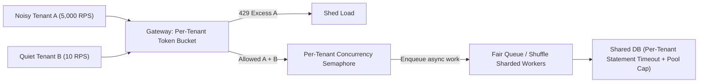
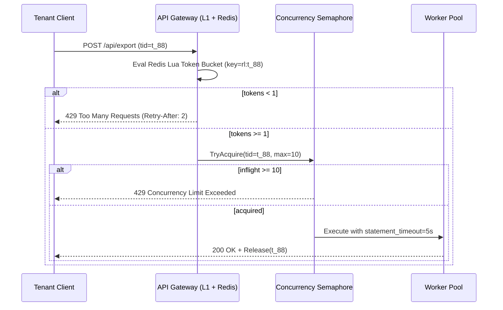
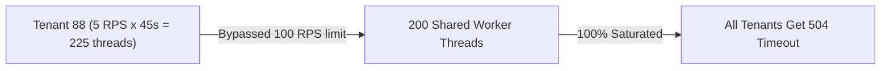

# Noisy Neighbour Mitigation: Per-Tenant Limits, Quotas & Fair Queues

> **Prerequisites:** [Lesson 03: Tenant-Aware Authorization](../03-tenant-aware-authorization/README.md) · [Track: Multi-Tenant SaaS](../README.md).  
> **Estimated Reading Time:** 24–28 minutes  
> **Target Audience:** Backend and SRE engineers running shared Pool/Bridge infrastructure, and candidates asked "how do you stop one customer's traffic spike from taking down everyone else?"  
> **Free PDF Notes:** [Download SD-R-004.pdf](https://backendroadmap.com/notes/system-design/SD-R-004.pdf)

> [!NOTE]
> **In one line:** Noisy neighbour mitigation protects shared compute, queues, and databases by bounding **concurrency**, **request rate**, **queue fairness (Weighted Fair Queueing / Shuffle Sharding)**, and **blast radius** per `tenant_id`, turning one tenant's $50\times$ spike into `429 Too Many Requests` or bounded delay *for that tenant alone*.

> [!TIP]
> **The Golden Rule:** Rate limits (RPS) alone do not stop noisy neighbours—one slow expensive query holds a DB connection for 10 seconds at just 1 RPS. You must bound **three dimensions per tenant**: **Rate** (token bucket), **Concurrency** (in-flight semaphores), and **Queue Fairness** (DRR / Shuffle Sharding).

---

## 1. What Noisy Neighbour Mitigation Is, and What It Isn't

On a Tuesday morning, Tenant #88 launches a misconfigured cron script that fires 8,000 `/api/v1/export` requests per second, or runs an unindexed regex search across 50M rows. In an unguarded Pool architecture, Tenant #88 consumes 100% of the API pods' worker threads, saturates the shared PostgreSQL connection pool, and fills the shared RabbitMQ/Kafka queue with 2 million export jobs. Paying Enterprise Tenant #12 sees timeouts and 503s even though their own traffic is 5 RPS.

| Term | Precise Meaning | Example |
| :--- | :--- | :--- |
| **Noisy neighbour** | One tenant exhausting shared CPU, memory, connections, IOPS, or queue capacity | Tenant #88's bulk export starving Tenant #12 |
| **Per-tenant rate limit** | Capping requests per second (Token Bucket / Sliding Window) keyed by `tenant_id` | 100 RPS steady, burst 250 |
| **Concurrency limit** | Capping simultaneous in-flight requests or DB connections per tenant | Max 10 concurrent heavy queries per tenant |
| **Fair Queueing (WFQ / DRR)** | Scheduling queued jobs across per-tenant sub-queues so no tenant monopolizes workers | Deficit Round Robin (DRR) |
| **Shuffle sharding** | Assigning each tenant a random subset of $k$ workers out of $N$ total workers | 2 of 16 workers -> tiny overlap probability |
| **Load shedding** | Dropping or deferring low-priority/excess traffic when global health degrades | Return `429` with `Retry-After` |
| **Not** | A global rate limit (`10,000 RPS` total) | A global limit lets 1 tenant consume all 10,000 RPS and starve everyone else |

### Why It Matters
1. **Shared Pool economics collapse without fairness:** You cannot sell SLAs ($99.95\%$ availability) on shared infrastructure if one free-tier user can degrade paid customers.
2. **FIFO queues amplify noisy neighbours:** A single shared FIFO queue turns a bulk import from Tenant A into head-of-line blocking for Tenant B's interactive clicks.
3. **Interviewers test multi-dimensional thinking:** Mentioning only "add a Redis rate limiter" misses concurrency limits, DB connection caps, and queue scheduling.

---

## 2. Anatomy: Multi-Layer Fairness Architecture



| Layer | Mechanism | What it prevents |
| :--- | :--- | :--- |
| **1. Edge / Gateway** | Per-tenant Token Bucket (Redis / Envoy) | High-RPS floods saturating API ingress |
| **2. App / Concurrency** | Per-tenant semaphore (`max_inflight`) | Slow/expensive endpoints holding all worker threads |
| **3. Async Queue** | Per-tenant virtual queues + Deficit Round Robin (DRR) | Head-of-line blocking from bulk imports/exports |
| **4. Worker Pool** | Shuffle sharding ($k$ of $N$ workers per tenant) | Crash/OOM/poison-pill blast radius |
| **5. Database** | `statement_timeout`, per-tenant connection cap, read-replica routing | One heavy analytical query starving OLTP |

> [!WARNING]
> **FIFO queues are a noisy-neighbour amplifier.** If Tenant A dumps 500,000 background jobs into a single FIFO queue at 09:00:00, and Tenant B enqueues 1 password-reset email at 09:00:01, Tenant B waits behind all 500,000 jobs—even if your API gateway has rate limits!

---

## 3. Mathematical Model: Little's Law, Shuffle Sharding, and DRR

**1. Why Concurrency Limits Matter (Little's Law).** Average concurrent slots occupied by tenant $i$ is $L_i = \lambda_i \cdot W_i$, where $\lambda_i$ is arrival rate and $W_i$ is latency.
Suppose a service has $100$ worker threads.
- Tenant A sends $\lambda_A = 10\text{ RPS}$ of a slow report taking $W_A = 9\text{ s}$: $L_A = 10 \times 9 = 90$ threads ($90\%$ of the fleet!).
- Tenant B sends $\lambda_B = 50\text{ RPS}$ of fast lookups taking $W_B = 20\text{ ms}$: $L_B = 50 \times 0.02 = 1$ thread.
Even though Tenant A's RPS ($10$) is *5x lower* than Tenant B's ($50$), Tenant A consumes **90% of the workers**. Capping per-tenant concurrency at $L_{\max} = 15$ keeps 85 threads free for everyone else.

**2. Shuffle Sharding Overlap Probability.** Suppose you have $N = 16$ workers and assign each tenant a random subset of $k = 2$ workers (or $k = 4$ of $N = 32$). The number of distinct combinations is $\binom{N}{k}$. The probability that Tenant B's shard overlaps *completely* with noisy Tenant A's shard is:

$$P_{\text{total overlap}} = \frac{1}{\binom{N}{k}}$$

For $N = 16, k = 2$: $\binom{16}{2} = 120$, so complete overlap is **$0.83\%$**! Even with $N = 32, k = 4$: $\binom{32}{4} = 35{,}960$, so complete overlap is **$0.0028\%$** ($1$ in $35{,}960$). A noisy neighbour can at worst degrade *part* of a few tenants' capacity, while 99%+ of tenants remain completely untouched.

**3. Deficit Round Robin (DRR) Fairness.** Each active tenant queue $i$ receives a quantum $Q_i$ (proportional to tier weight $w_i$) per round, accumulating a deficit counter $D_i \leftarrow D_i + Q_i$, and dequeues jobs of cost $c_j$ while $D_i \ge c_j$. Over any interval, tenant $i$'s share of worker capacity approaches $\frac{w_i}{\sum_{j \in \text{active}} w_j}$.

---

## 4. Metrics & Percentiles

| Metric | Meaning | Alert when |
| :--- | :--- | :--- |
| **Per-tenant `429` rate** | Requests rejected by tenant rate/concurrency limit | Sustained $> 5\%$ (noisy tenant or misconfigured client) |
| **Top-1 tenant share of CPU/DB** | Fraction of cluster resources consumed by single busiest tenant | $> 20\%$ of shared Pool capacity |
| **Per-tenant queue wait p99** | Time from enqueue to worker start, segmented by `tenant_id` | Quiet tenant p99 rises during another tenant's burst |
| **DB active connections per tenant** | Connections currently executing queries for `tenant_id` | Exceeds per-tenant cap |
| **Statement timeout kills** | Queries cancelled by `SET LOCAL statement_timeout` | Rising for a specific tenant |

### Worked Example (FIFO vs Fair Queue Under 50x Burst)
Suppose 10 workers process 100 jobs/sec total (10 jobs/s per worker).
- **Normal:** 10 quiet tenants send 2 jobs/s each (20 jobs/s total, $20\%$ utilization).
- **Burst:** Tenant #1 dumps 10,000 bulk jobs at $t=0$.
  - **Single FIFO Queue:** All 10 workers drain Tenant #1's 10,000 jobs at 100/s. Quiet Tenant #2's interactive job submitted at $t=1\text{ s}$ waits **$100\text{ seconds}$**!
  - **DRR Fair Queue:** Active tenants = 10. Each gets $100 / 10 = 10\text{ jobs/s}$ share. Tenant #2's 2 jobs/s are served in **$< 100\text{ ms}$**, while Tenant #1 drains at the remaining $82\text{ jobs/s}$ (taking $122\text{ s}$). Zero collateral damage.

---

## 5. Compounding & Failure Modes: Unbounded Retries & Lock Contention

Simulation of a 100-worker shared service (1,000 RPS capacity) when 1 noisy tenant spikes to 2,000 RPS and clients retry failed requests aggressively without jitter:

| Protection Level | Quiet Tenant p99 Latency | Quiet Tenant Error Rate | Noisy Tenant Outcome |
| :--- | :---: | :---: | :--- |
| **No per-tenant limits** | $4{,}200\text{ ms}$ (collapsed) | $62\%$ timeouts | $62\%$ timeouts |
| **Rate limit only (slow 8s queries)** | $1{,}850\text{ ms}$ (thread starvation) | $18\%$ timeouts | `429` + slow thread hogging |
| **Rate + Concurrency + DRR + Shuffle Shard** | **$24\text{ ms}$** (unaffected) | **$0.0\%$** | `429` + `Retry-After`, bounded to 10 slots |

**Takeaway:** Without `Retry-After` headers and per-tenant concurrency caps, noisy clients enter a **retry storm** that multiplies ingress load $3\text{–}5\times$. Always return `429` with `Retry-After` and shed excess at the edge before it touches app threads or the DB.

---

## 6. Numbers Every Engineer Must Know

| Item | Typical | Implication |
| :--- | :---: | :--- |
| **Redis token bucket check** | $0.5\text{–}1.5\text{ ms}$ (Lua script) | Atomic check-and-decrement at edge |
| **Local in-memory L1 limiter** | $< 0.01\text{ ms}$ | Rejects extreme floods before even hitting Redis |
| **Per-tenant `statement_timeout`** | $2\text{–}10\text{ s}$ (OLTP) | Prevents runaway SQL from holding DB connections |
| **Shuffle shard size** | $k = 2\text{–}4$ of $N = 16\text{–}64$ | $99\%+$ isolation with zero dedicated idle hardware |
| **Tiered burst multiplier** | $2\times\text{–}5\times$ steady rate | Absorbs legitimate short spikes without `429` |

---

## 7. Protocol Deep Dive: Atomic Token Bucket + Fair Queueing



| Question | Answer |
| :--- | :--- |
| **How do you make Redis rate limiting atomic?** | Use a Redis Lua script (or `EVALSHA`) that computes token refill + decrement in one round-trip with zero race conditions |
| **What if a noisy tenant floods Redis itself?** | Put a tiny **L1 local token bucket** (e.g., per-pod cache) in front of Redis; once a tenant is hard-throttled, short-circuit `429` in memory for 1–2 seconds |
| **How do you implement Fair Queues on Kafka or SQS?** | Use separate per-tier topics (e.g., `jobs.free`, `jobs.pro`, `jobs.enterprise`) or a lightweight Redis-backed virtual queue per `tenant_id` scheduled via DRR into worker pods |
| **Should Enterprise and Free tenants share the same rate limits?** | No—store `{rps, burst, max_concurrency, weight}` per tier in the Control Plane and pass into the limiter |

**When NOT to use Shuffle Sharding:** When $N$ (number of workers) is tiny ($< 4$), because $\binom{3}{2} = 3$ gives high overlap. At small scale, per-tenant concurrency caps and DRR give better protection.

---

## 8. Hierarchical Budgets & Design Rules

| Slice | Rule | Control |
| :--- | :--- | :--- |
| **Ingress Rate** | Token bucket per `tenant_id` (tier-based RPS + burst) | Redis Lua + L1 local short-circuit |
| **Concurrency** | Max in-flight requests per `tenant_id` | Distributed or per-pod semaphore |
| **Async Scheduling** | Never use one raw FIFO for multi-tenant bulk jobs | Per-tenant queues + DRR / tier topics |
| **Database Guard** | `SET LOCAL statement_timeout = '5000ms'` | Kills runaway queries automatically |
| **Bulk / Analytics** | Route heavy exports/reports to read replicas | Isolates primary OLTP write pool |
| **Client Backoff** | Return `429` + `Retry-After` + `X-RateLimit-Remaining` | Prevents blind retry storms |

---

## 9. Top Mitigations

1. **Combine Rate Limits with Concurrency Caps:** Rate limits stop high-RPS floods; concurrency semaphores stop low-RPS, high-latency thread hogs.
2. **Replace Single FIFO Queues with DRR or Tiered Queues:** Guarantee quiet tenants' small jobs jump ahead of a noisy tenant's 100k-job batch.
3. **Apply Shuffle Sharding on Worker Pools:** Hash `tenant_id` to $k$ of $N$ workers so a poison pill or OOM crash only affects a tiny fraction of tenants.
4. **Set `SET LOCAL statement_timeout` Per Transaction:** Never let one tenant's bad regex or unindexed `JOIN` hold a DB connection indefinitely.
5. **Short-Circuit Hot-Throttled Tenants in L1 Memory:** Protect Redis from being DDoS'd by a tenant already receiving `429`s.
6. **Route Heavy Read/Export Workloads to Read Replicas:** Keep the primary database reserved for latency-sensitive OLTP traffic.
7. **Instrument Per-Tenant Resource Attribution:** Track CPU time, DB rows read, and queue wait per `tenant_id` to spot noisy neighbours before they page on-call.

---

## 10. Production Reference: AWS Route 53 Shuffle Sharding & A Bulk-Import SEV-1

**AWS Route 53** famously popularized **Shuffle Sharding** for multi-tenant DNS: instead of placing customers on a single shared shard (large blast radius) or dedicated hardware (high cost), each customer is assigned 4 virtual servers out of 32 ($\binom{32}{4} = 35{,}960$ combinations), making simultaneous cross-tenant outages statistically near-zero.

**SEV-1 Post-Mortem: Unthrottled CSV Import Starved All API Workers**
- **Incident:** A B2B CRM had a `100 RPS` per-tenant rate limit on its API gateway. A mid-tier tenant uploaded 50 CSVs of 100k contacts each at `5 RPS` (well below their `100 RPS` limit!). Each import held a synchronous HTTP worker thread and a PostgreSQL connection for `45 seconds`. Within 20 seconds, all 200 API worker threads across the fleet were blocked on CSV imports, causing `504 Gateway Timeout` for every other customer.
- **Root Cause:** Rate limiting measured *requests per second* ($\lambda$), ignoring *request duration* ($W$) and *concurrency* ($L = \lambda W$).
- **Fix:** Moved CSV imports to an async Fair Queue (DRR) returning `202 Accepted`, and added a per-tenant concurrency semaphore (`max_inflight = 10`) on synchronous endpoints.



---

## 11. Multi-Language Production Code Tabs

A **Per-Tenant Concurrency + Token Bucket Limiter** and a **Deficit Round Robin (DRR) Fair Queue** scheduler.

````carousel
```go
// Go: Per-tenant Token Bucket + Concurrency Limiter (stdlib only).
package ratelimit

import (
	"sync"
	"time"
)

type tenantBucket struct {
	tokens     float64
	lastRefill time.Time
	inflight   int
}

type TenantLimiter struct {
	mu             sync.Mutex
	tenants        map[string]*tenantBucket
	ratePerSec     float64
	burst          float64
	maxConcurrency int
}

func NewTenantLimiter(ratePerSec, burst float64, maxConcurrency int) *TenantLimiter {
	return &TenantLimiter{
		tenants:        make(map[string]*tenantBucket),
		ratePerSec:     ratePerSec,
		burst:          burst,
		maxConcurrency: maxConcurrency,
	}
}

// Acquire returns (allowed, releaseFunc). Call releaseFunc when the request finishes.
func (l *TenantLimiter) Acquire(tenantID string) (bool, func()) {
	l.mu.Lock()
	defer l.mu.Unlock()

	now := time.Now()
	b, ok := l.tenants[tenantID]
	if !ok {
		b = &tenantBucket{tokens: l.burst, lastRefill: now}
		l.tenants[tenantID] = b
	}

	elapsed := now.Sub(b.lastRefill).Seconds()
	b.tokens = min(l.burst, b.tokens+elapsed*l.ratePerSec)
	b.lastRefill = now

	if b.tokens < 1.0 || b.inflight >= l.maxConcurrency {
		return false, func() {}
	}
	b.tokens -= 1.0
	b.inflight++

	return true, func() {
		l.mu.Lock()
		defer l.mu.Unlock()
		b.inflight--
	}
}
```
<!-- slide -->
```typescript
// TypeScript: Deficit Round Robin (DRR) Fair Queue scheduler across tenants.
interface Job<T> {
  tenantId: string;
  cost: number;
  payload: T;
}

export class FairQueue<T> {
  private readonly queues = new Map<string, Job<T>[]>();
  private readonly deficits = new Map<string, number>();
  private readonly activeTenants: string[] = [];

  constructor(private readonly quantum = 10) {}

  enqueue(job: Job<T>): void {
    let q = this.queues.get(job.tenantId);
    if (!q) {
      q = [];
      this.queues.set(job.tenantId, q);
      this.deficits.set(job.tenantId, 0);
      this.activeTenants.push(job.tenantId);
    }
    q.push(job);
  }

  // Dequeues the next fair job using Deficit Round Robin so no tenant hogs workers.
  dequeue(): Job<T> | undefined {
    let checked = 0;
    while (this.activeTenants.length > 0 && checked < this.activeTenants.length * 2) {
      const tid = this.activeTenants.shift()!;
      const q = this.queues.get(tid)!;
      if (q.length === 0) {
        this.queues.delete(tid);
        this.deficits.delete(tid);
        continue;
      }
      const deficit = (this.deficits.get(tid) ?? 0) + this.quantum;
      const head = q[0];
      if (deficit >= head.cost) {
        this.deficits.set(tid, deficit - head.cost);
        q.shift();
        if (q.length > 0) this.activeTenants.push(tid);
        else {
          this.queues.delete(tid);
          this.deficits.delete(tid);
        }
        return head;
      }
      this.deficits.set(tid, deficit);
      this.activeTenants.push(tid);
      checked++;
    }
    return undefined;
  }
}
```
<!-- slide -->
```python
# Python: Shuffle Sharding + DRR Fair Queue simulation (stdlib only).
import hashlib
import math


def shuffle_shard(tenant_id: str, total_workers: int = 16, shard_size: int = 2) -> list[int]:
    """Deterministically maps tenant_id to k of N workers."""
    indices = list(range(total_workers))
    chosen = []
    seed = tenant_id.encode()
    for i in range(shard_size):
        digest = hashlib.sha256(seed + i.to_bytes(2, "big")).digest()
        pick_idx = int.from_bytes(digest[:4], "big") % len(indices)
        chosen.append(indices.pop(pick_idx))
    return sorted(chosen)


def overlap_probability(total_workers: int = 16, shard_size: int = 2) -> float:
    return 1.0 / math.comb(total_workers, shard_size)


def simulate_fifo_vs_drr(noisy_jobs: int = 1000, quiet_tenants: int = 9, capacity_per_s: int = 100):
    fifo_wait_s = noisy_jobs / capacity_per_s
    active = 1 + quiet_tenants
    drr_share = capacity_per_s / active
    drr_wait_s = 1.0 / drr_share
    return {"fifo_quiet_wait_s": fifo_wait_s, "drr_quiet_wait_s": round(drr_wait_s, 3)}
```
<!-- slide -->
```csharp
// C#: Per-tenant Concurrency Semaphore + Token Bucket guard.
using System;
using System.Collections.Concurrent;

public sealed class TenantGuard
{
    private sealed class State
    {
        public double Tokens;
        public DateTime LastRefill;
        public int Inflight;
        public readonly object Lock = new();
    }

    private readonly ConcurrentDictionary<string, State> _states = new();
    private readonly double _rate;
    private readonly double _burst;
    private readonly int _maxConc;

    public TenantGuard(double ratePerSec, double burst, int maxConcurrency)
    {
        _rate = ratePerSec;
        _burst = burst;
        _maxConc = maxConcurrency;
    }

    public bool TryAcquire(string tenantId, out IDisposable? lease)
    {
        var state = _states.GetOrAdd(tenantId, _ => new State { Tokens = _burst, LastRefill = DateTime.UtcNow });
        lock (state.Lock)
        {
            var now = DateTime.UtcNow;
            state.Tokens = Math.Min(_burst, state.Tokens + (now - state.LastRefill).TotalSeconds * _rate);
            state.LastRefill = now;

            if (state.Tokens < 1.0 || state.Inflight >= _maxConc)
            {
                lease = null;
                return false;
            }
            state.Tokens -= 1.0;
            state.Inflight++;
            lease = new Lease(() => { lock (state.Lock) state.Inflight--; });
            return true;
        }
    }

    private sealed class Lease(Action release) : IDisposable
    {
        public void Dispose() => release();
    }
}
```
````

---

## 12. Hands-On CLI Verification Workflows

Verify Shuffle Sharding overlap and FIFO vs DRR latency in Python:

```bash
python3 -c '
import math
for n, k in [(16, 2), (32, 4), (64, 4)]:
    print(f"N={n}, k={k} -> combinations={math.comb(n,k):,}, full_overlap={100/math.comb(n,k):.5f}%")
'
```

Inspect active slow queries and per-tenant connection counts in PostgreSQL:

```bash
# Find long-running queries (candidates for statement_timeout)
psql "$DATABASE_URL" -c "SELECT pid, now() - query_start AS duration, left(query, 80) FROM pg_stat_activity WHERE state = 'active' ORDER BY duration DESC LIMIT 10;"

# Test Redis atomic rate-limit key inspection
redis-cli --scan --pattern "rl:*" | head -n 10
```

---

## 13. Common Mistakes to Avoid

1. **Using a single global rate limit** instead of per-tenant limits—one noisy tenant consumes the entire budget.
2. **Limiting RPS without limiting concurrency**, letting slow endpoints exhaust all worker threads at low RPS.
3. **Using a single FIFO queue for mixed interactive + bulk jobs**, causing severe head-of-line blocking.
4. **Omitting `Retry-After` on `429` responses**, triggering retry storms from aggressive SDKs.
5. **Running unbounded SQL queries without `statement_timeout`**, letting one tenant lock DB connections.
6. **Hitting Redis on every single request for an already-throttled tenant** instead of short-circuiting in local memory.
7. **Giving free and enterprise tenants identical limits** instead of tier-aware quotas from the Control Plane.

---

## 14. Key Terms Glossary

| Key Term | Definition |
| :--- | :--- |
| **Noisy neighbour** | Tenant whose workload degrades shared resources for co-located tenants. |
| **Token bucket** | Rate-limiting algorithm allowing steady average rate plus bounded bursts. |
| **Concurrency limit** | Maximum simultaneous in-flight requests or connections allowed per tenant. |
| **Head-of-line blocking** | Small urgent jobs stuck waiting behind a large batch in a FIFO queue. |
| **Deficit Round Robin (DRR)** | Fair-queueing scheduler giving each active tenant an equal or weighted slice. |
| **Shuffle sharding** | Assigning each tenant a random $k$-of-$N$ subset of workers to isolate failures. |
| **Load shedding** | Intentionally rejecting excess requests (`429`/`503`) to protect system stability. |
| **Retry storm** | Cascading traffic amplification when throttled clients immediately retry. |
| **`statement_timeout`** | PostgreSQL setting that aborts any query running longer than the configured limit. |
| **Resource attribution** | Measuring CPU, DB, and queue consumption per `tenant_id`. |

---

## 15. System Design Interview Questions & Answers

### Basic Conceptual Questions

<details>
<summary><strong>Q1: What is the noisy-neighbour problem in multi-tenant SaaS? [BASIC]</strong></summary>

**Answer:**
It occurs when one tenant's traffic spike, heavy query, or bulk job consumes a disproportionate share of shared CPU, memory, DB connections, or queue capacity, degrading latency or availability for other tenants on the same infrastructure.
</details>

<details>
<summary><strong>Q2: Why isn't an RPS rate limit enough to stop a noisy neighbour? [BASIC]</strong></summary>

**Answer:**
By Little's Law ($L = \lambda W$), even 5 RPS of a slow 40-second export occupies 200 worker threads simultaneously. You must pair RPS rate limits with **per-tenant concurrency limits** and **DB statement timeouts**.
</details>

<details>
<summary><strong>Q3: Why do FIFO queues make noisy neighbours worse? [BASIC]</strong></summary>

**Answer:**
In a FIFO queue, if Tenant A enqueues 50,000 batch jobs, Tenant B's 1 interactive job sits behind all 50,000 jobs (head-of-line blocking). Fair Queueing (DRR) or separate per-tier queues ensure Tenant B is served immediately.
</details>

<details>
<summary><strong>Q4: What HTTP status code and headers should you return when throttling a tenant? [BASIC]</strong></summary>

**Answer:**
Return `429 Too Many Requests` along with `Retry-After` (seconds to wait) and `X-RateLimit-Remaining` / `X-RateLimit-Reset` so well-behaved SDKs back off with jitter instead of hammering the server.
</details>

### Scenario-Based Architecture Questions

<details>
<summary><strong>Q5: A tenant's unindexed search query runs for 60 seconds and exhausts your shared PostgreSQL connection pool. How do you fix it? [SCENARIO]</strong></summary>

**Answer:**
1) Enforce `SET LOCAL statement_timeout = '5000ms'` on OLTP transactions. 2) Add a per-tenant concurrency cap on search endpoints. 3) Route heavy search/reporting queries to a read replica or dedicated search index (OpenSearch/Elasticsearch).
</details>

<details>
<summary><strong>Q6: You have 32 background workers and 5,000 tenants. How do you isolate poison-pill crashes without dedicating 1 worker per tenant? [SCENARIO]</strong></summary>

**Answer:**
Use **Shuffle Sharding** with $k = 4$ workers out of $N = 32$. Each tenant hashes to 4 workers ($\binom{32}{4} = 35{,}960$ combinations). A poison pill crashing Tenant A's 4 workers has only a $0.0028\%$ chance of completely overlapping with Tenant B's 4 workers.
</details>

<details>
<summary><strong>Q7: How do you implement Fair Queueing on top of Kafka when you have 10,000 tenants? [SCENARIO]</strong></summary>

**Answer:**
Creating 10,000 Kafka topics causes ZooKeeper/KRaft metadata bloat. Instead, partition by **tier** (e.g., `jobs.enterprise`, `jobs.pro`, `jobs.free`) with dedicated consumer pools per tier, OR push excess jobs from noisy tenants into a delayed/overflow topic while keeping the primary topic fast.
</details>

<details>
<summary><strong>Q8: A noisy tenant is sending 50,000 RPS and your Redis rate-limiter cluster is hitting 100% CPU. What do you do? [SCENARIO]</strong></summary>

**Answer:**
Add an **L1 in-memory negative cache / local token bucket** on each API gateway/pod. When Redis reports a tenant is over quota, cache the block locally for 1–2 seconds so subsequent flood requests are rejected with `429` in $< 0.01\text{ ms}$ without touching Redis.
</details>

### Advanced & Tricky Interview Questions

<details>
<summary><strong>Q9: How do you handle a legitimate burst from a paying Enterprise tenant without letting them starve others? [TRICKY]</strong></summary>

**Answer:**
Use **hierarchical quotas with spare-capacity borrowing** (like HTB/DRR): guarantee every tenant a baseline share, allow Enterprise tenants a higher burst token bucket and higher DRR weight, and route their sustained heavy workloads to a dedicated Silo cell or read replica if they exceed Pool thresholds.
</details>

<details>
<summary><strong>Q10: How do you prevent a tenant from bypassing per-tenant rate limits by creating 100 API keys or 50 sub-accounts? [TRICKY]</strong></summary>

**Answer:**
Always key the primary rate limiter and concurrency semaphore by **`tenant_id`**, never solely by `user_id` or `api_key_id`. You can have *smaller* sub-limits per API key, but they must roll up into the parent `tenant_id` budget.
</details>

<details>
<summary><strong>Q11: What is the difference between a Rate Limit and a Quota? [TRICKY]</strong></summary>

**Answer:**
A **rate limit** protects *infrastructure stability* over short windows (e.g., 100 RPS, 10 concurrent requests). A **quota** enforces *business entitlements* over billing cycles (e.g., 1,000,000 API calls/month or 50 GB storage), which we cover in Lesson 05.
</details>

<details>
<summary><strong>Q12: How do you detect a noisy neighbour who stays *under* your RPS and concurrency limits? [TRICKY]</strong></summary>

**Answer:**
Instrument **per-tenant resource attribution** (DB CPU time, buffer reads, cache evictions, queue bytes processed). A tenant sending 1 RPS of 50 MB JSON payloads or full-table scans will show up as #1 in `DB_time_ms` or `egress_bytes` per `tenant_id` even at low RPS.
</details>

---

## 16. One-Page Master Cheat Sheet

```
+---------------------------------------------------------------------------------------------------------+
|                  NOISY NEIGHBOUR MITIGATION — MASTER CHEAT SHEET                                        |
+---------------------------------------------------------------------------------------------------------+
| 1. THREE DIMENSIONS: Rate (Token Bucket RPS) + Concurrency (Semaphore) + Fairness (DRR / Tiers).        |
| 2. LITTLE'S LAW TRAP: L = lambda * W. Low RPS x High Latency (45s) still exhausts all worker threads!   |
| 3. FAIR QUEUEING: Replace single FIFO with Deficit Round Robin (DRR) or tier-separated topics.          |
| 4. SHUFFLE SHARDING: Assign k of N workers per tenant (e.g., 4 of 32 -> 1/35,960 full overlap).         |
| 5. DB PROTECTION: SET LOCAL statement_timeout + per-tenant pool cap + offload exports to read replicas. |
| 6. EDGE PROTECTION: L1 in-memory short-circuit for hot-throttled tenants + return 429 + Retry-After.    |
+---------------------------------------------------------------------------------------------------------+
```

---

## Further Reading & Sources

- AWS Builders' Library, [Workload Isolation Using Shuffle Sharding](https://aws.amazon.com/builders-library/workload-isolation-using-shuffle-sharding/).
- Stripe Engineering Blog, [Scaling Your API with Rate Limiters](https://stripe.com/blog/rate-limiters).
- Microsoft Azure Architecture Center, [Noisy Neighbor Antipattern](https://learn.microsoft.com/en-us/azure/architecture/antipatterns/noisy-neighbor/noisy-neighbor).
- Shreedhar & Varghese, *Efficient Fair Queueing Using Deficit Round-Robin* (IEEE/ACM Transactions on Networking).

---

## Free PDF Notes

[SD-R-004.pdf](https://backendroadmap.com/notes/system-design/SD-R-004.pdf)

---

## Next

Continue with [Lesson 05: Quotas and Usage Metering: Billing Customers Accurately](../05-quotas-and-usage-metering/README.md).
