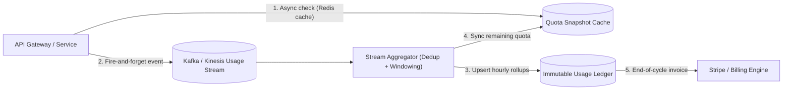
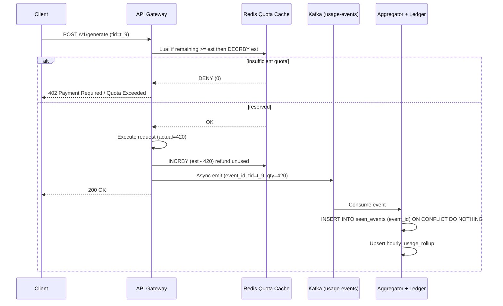
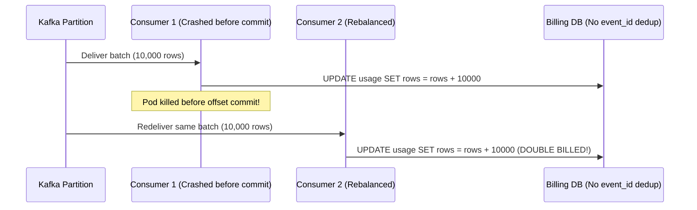

# Quotas and Usage Metering: Billing Customers Accurately

> **Prerequisites:** [Lesson 04: Noisy Neighbour Mitigation](../04-noisy-neighbour-mitigation/README.md) · [Track: Multi-Tenant SaaS](../README.md).  
> **Estimated Reading Time:** 24–28 minutes  
> **Target Audience:** Backend and billing-platform engineers building usage-based SaaS pricing, and candidates asked "how do you meter millions of API events per second and bill customers accurately without slowing down requests or double-charging?"  
> **Free PDF Notes:** [Download SD-R-005.pdf](https://backendroadmap.com/notes/system-design/SD-R-005.pdf)

> [!NOTE]
> **In one line:** Usage metering separates the **fast hot path** (asynchronous, idempotent event emission and approximate cached quota checks) from the **accurate cold path** (deduplicated stream aggregation, late-arrival watermarks, and immutable billing ledgers). You trade **sub-second hard-stop precision** against **request latency, high availability, and zero double-billing**.

> [!TIP]
> **The Golden Rule:** Never run a synchronous `UPDATE billing_counters` SQL statement on the API hot path. Emit immutable **idempotent usage events** (`event_id`, `tenant_id`, `metric`, `quantity`, `timestamp`) to a durable stream, aggregate into time buckets, and enforce quotas via asynchronously synced Redis/in-memory snapshots.

---

## 1. What Quotas and Usage Metering Are, and What They Isn't

A SaaS API platform bills customers $\$10$ per 1M API calls and $\$0.10$ per GB-month of storage, with a free tier capped at 100,000 calls/month. If the API gateway synchronously increments a PostgreSQL row on every request, database lock contention caps throughput at ~1,500 RPS. If it uses a naive Kafka consumer without deduplication, a consumer rebalance replays 50,000 events and **double-charges** customers on their monthly invoice.

| Term | Precise Meaning | Example |
| :--- | :--- | :--- |
| **Usage metering** | Recording billable consumption events (`API calls`, `tokens`, `GB-hours`) per tenant | `{event_id, tenant_id, metric: "api_calls", qty: 1}` |
| **Quota (Entitlement)** | A business limit over a billing period (monthly seats, API calls, storage GB) | Free tier: 100k calls/month; Pro: 5M calls/month |
| **Hard quota vs Soft quota** | Hard rejects with `402`/`429` at 100%; Soft allows overage and bills or alerts | Free = hard cap; Enterprise = soft cap + overage billing |
| **Idempotency key (`event_id`)** | Unique identifier per billable action ensuring retries never double-count | `req_uuid` or `sha256(job_id + step)` |
| **Aggregation window** | Time bucket (minute/hour/day) rolling raw events into compact billing records | `SUM(qty)` per `(tenant_id, metric, hour)` |
| **Watermark (Late data)** | Grace period for delayed events before closing an invoice window | Wait 2 hours past midnight UTC before finalizing |
| **High-water mark vs Sum** | Peak usage in a period (seats, storage) vs cumulative count (API calls) | `MAX(storage_gb)` vs `SUM(api_calls)` |
| **Not** | Rate limiting (Lesson 04) | Rate limits protect infra per second; quotas enforce billing per month |

### Why It Matters
1. **Direct revenue and trust impact:** Under-counting loses revenue; over-counting (double-billing) destroys customer trust and causes chargebacks.
2. **Hot-path isolation:** Billing/metering outages must never take down the core API.
3. **Classic Senior/Staff interview topic:** Combines streaming, idempotency, approximations, and financial ledger design.

---

## 2. Anatomy: Hot Path vs Metering Pipeline vs Quota Enforcement



1. **Hot Path (Quota Check):** The API reads a local/Redis quota snapshot (`remaining_calls > 0`) in $< 1\text{ ms}$. It **does not** wait for the billing ledger to commit.
2. **Event Emission:** After serving the request, the API emits an immutable usage event with a unique `event_id` to an append-only stream (Kafka/Kinesis) via a non-blocking buffered producer.
3. **Deduplication & Aggregation:** Stream consumers deduplicate by `event_id` (using a Bloom filter + RocksDB/Redis/DB unique constraint over the dedup window) and aggregate into `(tenant_id, metric, hour_bucket)` rollups.
4. **Quota Sync:** Every few seconds (or N events), the aggregator updates the Redis quota cache (`used_this_month`), closing the feedback loop.
5. **Invoicing:** At month-end (plus watermark grace period), the billing engine sums the immutable ledger rollups and pushes line items to Stripe/invoicing.

| Enforcement Mode | Latency | Accuracy at Cap | Failure Mode | Best For |
| :--- | :---: | :---: | :--- | :--- |
| **Sync DB Increment** | $10\text{–}30\text{ ms}$ | Exact ($0\%$ overshoot) | DB lock contention; outage blocks API | Low-QPS high-value actions (e.g., creating a VM) |
| **Redis `INCR` + Async Flush** | $1\text{–}2\text{ ms}$ | Near-exact | Redis crash loses delta since last flush | Medium-QPS hard quotas |
| **Local Buffer + Async Stream** | $< 0.1\text{ ms}$ | Eventual ($1\text{–}5\text{ s}$ lag) | Small overshoot ($< 1\%$) during burst | High-QPS API metering, LLM tokens, bytes |

> [!WARNING]
> **Never rely on Redis `INCR` alone as your billing source of truth.** Redis is an in-memory cache: an eviction, failover, or `FLUSH` loses the month's billable usage. Always treat **immutable, deduplicated events in durable storage** as the billing ledger, and Redis as a *disposable enforcement cache*.

---

## 3. Mathematical Model: Hot-Path Contention, Overshoot Bound, and Dedup Memory

**1. Why Sync DB Increment Fails (Amdahl's Law / Row Lock Contention).** If a single tenant sends $\lambda = 2{,}000\text{ RPS}$ and each `UPDATE counters SET used = used + 1 WHERE tenant_id = $1` holds a row lock for $t_{\text{lock}} = 2\text{ ms}$, the theoretical maximum throughput for that single tenant's row is:

$$\mu_{\max} = \frac{1}{t_{\text{lock}}} = \frac{1}{0.002\text{ s}} = 500\text{ RPS}$$

At $2{,}000\text{ RPS}$, $1{,}500\text{ RPS}$ queue up behind the single row lock until connection pools exhaust!

**2. Async Quota Overshoot Bound.** With async aggregation lag $\Delta t$ (say $5\text{ s}$) across $P$ pods and a tenant throttled at rate $R_{\text{max}}$:

$$\text{Max Overshoot} \le R_{\text{max}} \cdot \Delta t$$

For a Free-tier tenant capped at $100\text{ RPS}$ with $\Delta t = 5\text{ s}$, maximum overshoot past the 100,000 monthly quota is $100 \times 5 = 500$ calls ($0.5\%$). For high-value actions (e.g., provisioning GPUs), set $\Delta t = 0$ (synchronous reservation).

**3. Deduplication Window Sizing.** At $\lambda = 50{,}000\text{ events/s}$ with a $24\text{-hour}$ deduplication window ($86{,}400\text{ s}$):

$$N_{\text{events/day}} = 50{,}000 \times 86{,}400 = 4.32 \times 10^9\text{ events}$$

Storing $4.32\text{ billion}$ 16-byte UUIDs in RAM takes $4.32 \times 10^9 \times 32\text{ bytes (with hash overhead)} \approx 138\text{ GB}$! Instead, partition by hour (`24` hourly RocksDB/Bloom+DB buckets of $180\text{M}$ events each) and drop buckets older than 24 hours.

---

## 4. Metrics & Percentiles

| Metric | Meaning | Alert when |
| :--- | :--- | :--- |
| **Metering pipeline lag** | Time from API event emission to ledger commit | $> 60\text{ s}$ (quota enforcement goes stale) |
| **Duplicate event rate** | % of events dropped by `event_id` deduplication | Sudden spike $> 5\%$ (indicates producer/consumer retry loop) |
| **Quota overshoot %** | `(billed_usage - hard_quota) / hard_quota` for hard-capped tiers | $> 2\%$ (sync interval $\Delta t$ too large) |
| **Unbilled / DLQ events** | Events failing schema validation or tenant lookup | $> 0$ (direct revenue loss) |
| **Reconciliation drift** | `|raw_stream_count - ledger_total| / raw_stream_count` | $> 0.01\%$ (bug in aggregator or dropped events) |

### Worked Example (Hybrid Reservation + Metering for LLM Tokens)
An AI SaaS charges per output token and gives Free users 100,000 tokens/month. Before calling the LLM, the API checks Redis (`remaining_tokens >= max_tokens_requested`) and places a **soft reservation** (`DECRBY max_tokens`). After the stream finishes (say, only 420 tokens were generated out of 1,000 reserved), the API emits a durable `UsageEvent(event_id=req_123, tenant=t_9, qty=420)` to Kafka and refunds the unused 580 tokens to Redis. The Kafka aggregator deduplicates by `req_123` and writes `420` to the immutable billing ledger. Result: **zero overshoot** on the hard cap, **exact billing** in the ledger, and **zero DB locks** on the hot path.

---

## 5. Compounding & Failure Modes: Consumer Rebalances and Late Events

Simulation of 10,000,000 billable events ($0.01\%$ consumer rebalance replay rate, $0.5\%$ late-arriving offline/webhook events arriving 30–90 minutes late):

| Pipeline Design | Replayed Events Double-Billed | Late Events Dropped | Invoice Accuracy |
| :--- | :---: | :---: | :---: |
| **No `event_id` dedup, strict 5-min window** | $1{,}000$ events | $50{,}000$ events | **$99.49\%$** ($50\text{k}$ lost revenue, $1\text{k}$ overcharged) |
| **`event_id` dedup, 2-hour watermark** | **$0$** | **$0$** | **$100.00\%$** |

**Takeaway:** At-least-once delivery (Kafka/SQS) guarantees replays during deployments and rebalances. Without `event_id` idempotency, you **will** double-charge customers. Without a late-arrival watermark, you **will** under-bill mobile/offline/async workloads.

---

## 6. Numbers Every Engineer Must Know

| Item | Typical | Implication |
| :--- | :---: | :--- |
| **Local in-memory batch flush** | Every $1\text{–}5\text{ s}$ or $1{,}000$ events | Reduces Kafka/DB write QPS by $100\text{–}1{,}000\times$ |
| **Hot-path quota cache check** | $< 1\text{ ms}$ (Redis) / $< 0.01\text{ ms}$ (local) | Never block API responses on SQL billing tables |
| **Dedup retention window** | $24\text{–}72\text{ hours}$ | Covers realistic consumer retries and replay windows |
| **Invoice watermark grace** | $1\text{–}6\text{ hours}$ after period end | Captures late-arriving async/edge usage before finalizing |
| **Reconciliation target** | $< 0.001\%$ drift | Daily automated audit comparing raw logs vs billing ledger |

---

## 7. Protocol Deep Dive: Idempotent Metering & Soft-Reservation Flow



| Question | Answer |
| :--- | :--- |
| **What if the API crashes *after* serving the request but *before* flushing the async buffer?** | You lose a tiny local batch (under-bill slightly—acceptable for high-QPS APIs, or use an outbox/WAL for high-value actions like GPU minutes) |
| **How do you meter *stateful* resources like Storage GB-hours?** | Run a periodic gauge sampler (e.g., every hour, snapshot `SUM(bytes)` per `tenant_id` from S3/DB) and emit `storage_gb_hour` events with `event_id = "{tenant_id}:{hour_iso}"` |
| **How do you handle a customer upgrading their plan mid-month?** | Store immutable plan-change events with `effective_at` timestamps; the billing engine prorates or applies tiered pricing per window |
| **Should quota checks fail-open or fail-closed if Redis is down?** | **Fail-open** for paid/Enterprise customers (keep serving, meter via Kafka, reconcile later); optionally fail-closed or use local fallback for Free tier |

**When NOT to use async eventual metering:** For irreversible, high-cost single actions (e.g., sending an SMS, spinning up a $\$10/\text{hr}$ GPU cluster, or transferring money) where even a $5\text{-second}$ overshoot is unacceptable—use synchronous Redis/DB reservation.

---

## 8. Hierarchical Budgets & Design Rules

| Slice | Rule | Control |
| :--- | :--- | :--- |
| **Event Schema** | Every usage event has `event_id` (UUID), `tenant_id`, `metric`, `qty`, `ts` | Enforce via Protobuf/JSON Schema |
| **Idempotency** | Deduplicate on `event_id` before adding to billing rollups | Unique constraint / RocksDB state |
| **Hot Path** | Read-only or Redis atomic check; zero SQL writes on request path | Circuit breaker + fail-open for paid tiers |
| **Ledger Immutability** | Never `UPDATE` past finalized invoices; append credit/debit adjustments | Append-only `usage_ledger` table |
| **Clock / Timezone** | Store all timestamps in UTC; anchor billing cycles to UTC midnight | Consistent window boundaries |
| **Reconciliation** | Daily job compares gateway access logs vs billing ledger | Alert if drift $> 0.01\%$ |

---

## 9. Top Mitigations

1. **Assign a Deterministic `event_id` at the Source:** Use `request_id` (or `job_id:attempt_step`) so retries and Kafka rebalances are 100% idempotent.
2. **Batch Events in Memory Before Flushing to Kafka/DB:** Flush every 1 second or 500 events to cut downstream write pressure by orders of magnitude.
3. **Use Fail-Open Quota Checks for Paid Tiers:** Never let a Redis hiccup cause a 500 outage for paying customers; fall back to local cache and reconcile from the stream.
4. **Separate Counters (API Calls) from Gauges (Storage/Seats):** Sum counters over time; sample gauges periodically and integrate (GB-hours) or take high-water marks.
5. **Apply a Late-Arrival Watermark Before Invoicing:** Wait 2–6 hours after month-end before locking the invoice so delayed async jobs are included.
6. **Keep an Immutable Audit Ledger:** Store raw or hourly-aggregated records with adjustment entries rather than mutating a single `monthly_total` integer.
7. **Expose Real-Time Usage Dashboards & Webhook Alerts:** Notify customers at $80\%$ and $100\%$ of quota so they upgrade proactively instead of hitting a surprise `402`/`429`.

---

## 10. Production Reference: Stripe Billing Meters / Lago & A Double-Billing SEV-1

Modern usage-based billing systems (**Stripe Billing Meters**, **Orb**, **Lago**) all follow the same core architecture: **high-throughput idempotent event ingestion** (`identifier` = `event_id`), **time-windowed aggregation** (`SUM`, `MAX`, `UNIQUE_COUNT`), and **decoupled invoice generation**.

**SEV-1 Post-Mortem: Kafka Consumer Rebalance Double-Charged 1,400 Customers**
- **Incident:** A SaaS data pipeline metered `rows_processed` by having workers publish `{tenant_id, rows}` (without an `event_id`) to Kafka. A Kubernetes node upgrade triggered a 20-minute consumer group rebalance. Uncommitted offsets were re-read, and the aggregator ran `UPDATE monthly_usage SET rows = rows + $1`. At month-end, 1,400 customers received invoices $1.4\times\text{–}2.1\times$ higher than actual usage.
- **Root Cause:** No `event_id` on usage events + non-idempotent `+=` SQL updates on an at-least-once Kafka stream.
- **Fix:** Added a deterministic `event_id` (`job_id:batch_seq`) to every event, introduced a `processed_events(event_id PRIMARY KEY)` dedup table inside the same PostgreSQL transaction as the rollup `UPSERT`, and built a daily reconciliation job against raw S3 audit logs.



---

## 11. Multi-Language Production Code Tabs

An **Idempotent Usage Metering Aggregator** (with `event_id` deduplication + hourly rollup) and a **Quota Enforcer**.

````carousel
```go
// Go: Idempotent usage event aggregator with per-tenant hourly rollups (stdlib only).
package metering

import (
	"sync"
	"time"
)

type UsageEvent struct {
	EventID   string
	TenantID  string
	Metric    string
	Quantity  int64
	Timestamp time.Time
}

type RollupKey struct {
	TenantID string
	Metric   string
	HourUTC  string
}

type MeteringAggregator struct {
	mu      sync.Mutex
	seen    map[string]struct{} // In prod: bounded time-windowed store / DB table
	rollups map[RollupKey]int64
}

func NewMeteringAggregator() *MeteringAggregator {
	return &MeteringAggregator{
		seen:    make(map[string]struct{}),
		rollups: make(map[RollupKey]int64),
	}
}

// Ingest processes an event idempotently; returns false if already counted.
func (m *MeteringAggregator) Ingest(ev UsageEvent) bool {
	m.mu.Lock()
	defer m.mu.Unlock()

	if _, dup := m.seen[ev.EventID]; dup {
		return false // Idempotent drop on Kafka/SQS replay
	}
	m.seen[ev.EventID] = struct{}{}

	hour := ev.Timestamp.UTC().Format("2006-01-02T15")
	key := RollupKey{TenantID: ev.TenantID, Metric: ev.Metric, HourUTC: hour}
	m.rollups[key] += ev.Quantity
	return true
}

func (m *MeteringAggregator) TotalForTenant(tenantID, metric string) int64 {
	m.mu.Lock()
	defer m.mu.Unlock()
	var sum int64
	for k, v := range m.rollups {
		if k.TenantID == tenantID && k.Metric == metric {
			sum += v
		}
	}
	return sum
}
```
<!-- slide -->
```typescript
// TypeScript: Buffered async usage emitter + idempotent aggregator.
export interface UsageEvent {
  eventId: string;
  tenantId: string;
  metric: string;
  quantity: number;
  timestampIso: string;
}

export class UsageMeter {
  private buffer: UsageEvent[] = [];
  private readonly seenIds = new Set<string>();
  private readonly rollups = new Map<string, number>();

  constructor(private readonly flushBatchSize = 100) {}

  // Hot-path: non-blocking append to in-memory batch.
  record(event: UsageEvent): void {
    this.buffer.push(event);
    if (this.buffer.length >= this.flushBatchSize) {
      this.flush();
    }
  }

  // Cold-path: idempotent aggregation by eventId.
  flush(): number {
    let applied = 0;
    const batch = this.buffer.splice(0, this.buffer.length);
    for (const ev of batch) {
      if (this.seenIds.has(ev.eventId)) continue; // Dedup replay
      this.seenIds.add(ev.eventId);
      const hour = ev.timestampIso.slice(0, 13); // YYYY-MM-DDTHH
      const key = `${ev.tenantId}:${ev.metric}:${hour}`;
      this.rollups.set(key, (this.rollups.get(key) ?? 0) + ev.quantity);
      applied++;
    }
    return applied;
  }

  getUsage(tenantId: string, metric: string): number {
    let total = 0;
    const prefix = `${tenantId}:${metric}:`;
    for (const [k, v] of this.rollups.entries()) {
      if (k.startsWith(prefix)) total += v;
    }
    return total;
  }
}
```
<!-- slide -->
```python
# Python: Idempotent metering + soft-reservation quota check + overshoot math (stdlib only).
from collections import defaultdict
from dataclasses import dataclass


@dataclass(frozen=True)
class UsageEvent:
    event_id: str
    tenant_id: str
    metric: str
    quantity: int
    hour_utc: str


class BillingMeter:
    def __init__(self) -> None:
        self._seen: set[str] = set()
        self._rollups: dict[tuple[str, str, str], int] = defaultdict(int)
        self._quotas: dict[str, int] = {}

    def set_quota(self, tenant_id: str, limit: int) -> None:
        self._quotas[tenant_id] = limit

    def check_quota(self, tenant_id: str, metric: str, requested: int = 1) -> bool:
        limit = self._quotas.get(tenant_id, 0)
        used = sum(v for (t, m, _), v in self._rollups.items() if t == tenant_id and m == metric)
        return (used + requested) <= limit

    def ingest(self, ev: UsageEvent) -> bool:
        if ev.event_id in self._seen:
            return False  # Idempotent deduplication
        self._seen.add(ev.event_id)
        self._rollups[(ev.tenant_id, ev.metric, ev.hour_utc)] += ev.quantity
        return True
```
<!-- slide -->
```csharp
// C#: Idempotent usage aggregator with thread-safe deduplication and hourly rollups.
using System;
using System.Collections.Concurrent;

public sealed record UsageEvent(string EventId, string TenantId, string Metric, long Quantity, DateTime TimestampUtc);

public sealed class BillingAggregator
{
    private readonly ConcurrentDictionary<string, byte> _seen = new();
    private readonly ConcurrentDictionary<string, long> _rollups = new();

    public bool TryIngest(UsageEvent ev)
    {
        if (!_seen.TryAdd(ev.EventId, 0))
            return false; // Duplicate event ignored

        var key = $"{ev.TenantId}:{ev.Metric}:{ev.TimestampUtc:yyyy-MM-ddTHH}";
        _rollups.AddOrUpdate(key, ev.Quantity, (_, prev) => prev + ev.Quantity);
        return true;
    }

    public long GetTotal(string tenantId, string metric)
    {
        long total = 0;
        var prefix = $"{tenantId}:{metric}:";
        foreach (var kv in _rollups)
        {
            if (kv.Key.StartsWith(prefix, StringComparison.Ordinal))
                total += kv.Value;
        }
        return total;
    }
}
```
````

---

## 12. Hands-On CLI Verification Workflows

Simulate idempotent deduplication and async overshoot bounds in Python:

```bash
python3 -c '
r_max, sync_lag_s, monthly_quota = 100, 5, 100_000
overshoot = r_max * sync_lag_s
print(f"Max overshoot: {overshoot} calls ({overshoot/monthly_quota*100:.2f}% of quota)")

# Verify idempotent dedup on replayed event IDs
seen, total = set(), 0
events = [("e1", 10), ("e2", 25), ("e1", 10), ("e3", 15), ("e2", 25)]
for eid, qty in events:
    if eid not in seen:
        seen.add(eid)
        total += qty
print(f"Billed total after replays: {total} (expected 50)")
'
```

Inspect PostgreSQL idempotent ledger upsert and Kafka consumer lag for metering topics:

```bash
# Verify idempotent SQL pattern in PostgreSQL
psql "$DATABASE_URL" -c "
SELECT tenant_id, metric, date_trunc('hour', bucket_ts) AS hour, sum(quantity)
FROM usage_rollups
GROUP BY 1, 2, 3
ORDER BY 3 DESC LIMIT 10;
"

# Check metering consumer lag (lag * avg_rate = current quota staleness)
kafka-consumer-groups.sh --bootstrap-server localhost:9092 --describe --group billing-aggregator
```

---

## 13. Common Mistakes to Avoid

1. **Incrementing PostgreSQL billing rows synchronously on every API request**—creates severe lock contention.
2. **Emitting usage events without a unique `event_id`**, causing double-billing whenever Kafka/SQS replays messages.
3. **Treating Redis as the permanent billing database** instead of a disposable quota-enforcement cache.
4. **Failing-closed on billing/Redis outages for paying Enterprise customers**, turning a metering blip into a full API outage.
5. **Forgetting late-arrival watermarks**, silently dropping valid usage from offline SDKs or delayed webhooks.
6. **Mutating a single `monthly_total` column** instead of keeping an immutable, auditable ledger of rollups and adjustments.
7. **Confusing rate limits (RPS) with quotas (monthly entitlements)** and using the same mechanism for both.

---

## 14. Key Terms Glossary

| Key Term | Definition |
| :--- | :--- |
| **Usage metering** | Capturing and aggregating billable consumption events per tenant. |
| **Quota (Entitlement)** | Business limit on total consumption over a billing period. |
| **Hard vs Soft quota** | Blocking requests at 100% vs allowing overage with billing/alerts. |
| **Idempotency key (`event_id`)** | Unique ID per billable event preventing duplicate counting on retries. |
| **Hot path vs Cold path** | Fast request-time quota check vs asynchronous durable billing aggregation. |
| **High-water mark** | Billing metric based on peak concurrent usage (e.g., max seats) in a period. |
| **Watermark** | Grace period waiting for late-arriving events before closing a billing window. |
| **Soft reservation** | Temporarily reserving estimated quota before an operation and refunding the unused delta. |
| **Reconciliation** | Auditing aggregated billing totals against raw gateway/system logs. |
| **Immutable ledger** | Append-only record of usage rollups and credit/debit adjustments. |

---

## 15. System Design Interview Questions & Answers

### Basic Conceptual Questions

<details>
<summary><strong>Q1: What is the difference between a rate limit and a quota? [BASIC]</strong></summary>

**Answer:**
A **rate limit** protects infrastructure stability over short windows (e.g., 100 RPS, 10 concurrent connections). A **quota** enforces commercial entitlements over a billing cycle (e.g., 1,000,000 API calls/month, 50 GB storage).
</details>

<details>
<summary><strong>Q2: Why shouldn't you run `UPDATE usage SET count = count + 1` in PostgreSQL on every API call? [BASIC]</strong></summary>

**Answer:**
Every request for the same tenant contends on the same row lock, capping single-tenant throughput to $1 / t_{\text{lock}}$ (a few hundred RPS) and coupling API availability to the billing database.
</details>

<details>
<summary><strong>Q3: How do you prevent double-charging when using an at-least-once broker like Kafka? [BASIC]</strong></summary>

**Answer:**
Attach a deterministic `event_id` (e.g., `request_id` or `job_id:step`) to every usage event at the source, and deduplicate by `event_id` in the aggregator before updating billing rollups.
</details>

<details>
<summary><strong>Q4: What is the difference between a counter metric and a gauge metric in billing? [BASIC]</strong></summary>

**Answer:**
A **counter** (API calls, tokens, emails sent) is summed over the billing period. A **gauge** (storage GB, active seats) is sampled periodically and integrated (GB-hours) or billed by its high-water mark (`MAX`).
</details>

### Scenario-Based Architecture Questions

<details>
<summary><strong>Q5: Design a metering pipeline for 100,000 API requests/sec with exact monthly billing. [SCENARIO]</strong></summary>

**Answer:**
1) **Hot path:** Check cached remaining quota in Redis/local memory ($< 1\text{ ms}$). 2) **Emit:** Buffer usage events in memory and flush batches every 1–2s to Kafka with `event_id`. 3) **Aggregate:** Stream processors deduplicate by `event_id` (using partitioned hourly RocksDB/DB buckets) and upsert `(tenant_id, metric, hour)` rollups into an immutable ledger. 4) **Sync:** Push updated totals back to Redis every few seconds.
</details>

<details>
<summary><strong>Q6: An AI SaaS has a strict 100k token free tier. Tokens aren't known until the LLM finishes streaming. How do you prevent huge overshoots? [SCENARIO]</strong></summary>

**Answer:**
Use **soft reservation**: before starting generation, atomically `DECRBY max_tokens` in Redis. Once the stream completes with actual tokens $A < \text{max\_tokens}$, refund $(\text{max\_tokens} - A)$ to Redis and emit the exact `event_id` with quantity $A$ to the durable billing stream.
</details>

<details>
<summary><strong>Q7: Your Redis quota cluster crashes and loses the last 10 minutes of counters. Did you lose billable revenue? [SCENARIO]</strong></summary>

**Answer:**
No—if Redis is only the **enforcement cache** and the **immutable event stream + ledger** is the source of truth. Rebuild Redis counters by summing the current month's ledger rollups per `tenant_id` in seconds.
</details>

<details>
<summary><strong>Q8: A customer's mobile SDK queues offline events and uploads them 90 minutes after midnight on the 1st of the new month. How do you bill them? [SCENARIO]</strong></summary>

**Answer:**
Use **event-time** (not processing-time) with a **watermark grace period** (e.g., 4 hours past month-end) before closing the previous month's invoice. Events arriving *after* the watermark close are recorded as an adjustment line item on the *next* month's invoice.
</details>

### Advanced & Tricky Interview Questions

<details>
<summary><strong>Q9: How do you store `event_id` deduplication state for 5 billion events/day without running out of RAM? [TRICKY]</strong></summary>

**Answer:**
Partition deduplication state by **time window** (e.g., hourly buckets) and **tenant hash**. Keep only the active 24–72 hour window in fast storage (RocksDB or Bloom filter + disk-backed index), and drop expired hourly partitions instead of maintaining an unbounded global set.
</details>

<details>
<summary><strong>Q10: Should quota enforcement fail-open or fail-closed when the quota service is unreachable? [TRICKY]</strong></summary>

**Answer:**
**Fail-open for paid tiers** (allow traffic, keep emitting usage events locally/to Kafka, and reconcile later) so a billing outage never violates your 99.99% API SLA. Free tiers can fail-closed or fall back to conservative local rate limits to prevent abuse.
</details>

<details>
<summary><strong>Q11: How do you handle `UNIQUE_COUNT` billing (e.g., Monthly Active Users) at 50M events/day per tenant? [TRICKY]</strong></summary>

**Answer:**
Exact `COUNT(DISTINCT user_id)` across billions of events is expensive. For approximate tiers or dashboards, use **HyperLogLog (HLL)** (~12 KB per tenant per month, $0.81\%$ standard error). For exact contractual billing, partition `(tenant_id, month, user_id)` in ClickHouse/BigQuery or use partitioned bitmap indexes.
</details>

<details>
<summary><strong>Q12: How do you prove to an Enterprise customer that your usage invoice is accurate? [TRICKY]</strong></summary>

**Answer:**
Provide an **immutable, queryable usage ledger** (or daily S3 export) containing hourly rollups, the `event_id` count, and adjustment records, backed by automated daily reconciliation against raw API gateway logs with $< 0.001\%$ drift.
</details>

---

## 16. One-Page Master Cheat Sheet

```
+---------------------------------------------------------------------------------------------------------+
|                  QUOTAS AND USAGE METERING — MASTER CHEAT SHEET                                         |
+---------------------------------------------------------------------------------------------------------+
| 1. SEPARATE PATHS: Hot Path (Redis quota check < 1ms) != Cold Path (Kafka -> Dedup -> Billing Ledger).  |
| 2. IDEMPOTENCY: Every event carries a deterministic `event_id`; dedup in partitioned time buckets.      |
| 3. REDIS IS CACHE: Never use Redis INCR as billing source of truth; rebuild from the immutable ledger.  |
| 4. SOFT RESERVATION: Reserve max estimated cost in Redis before work; refund unused delta afterward.    |
| 5. LATE DATA: Aggregate by event-time with a 2-6h watermark grace period before locking invoices.       |
| 6. FAIL-OPEN PAID TIERS: Billing/Redis blips must never cause 500s for paying customers.                |
+---------------------------------------------------------------------------------------------------------+
```

---

## Further Reading & Sources

- Stripe Documentation, [Usage-Based Billing & Meters](https://docs.stripe.com/billing/subscriptions/usage-based).
- Lago Open-Source Billing Architecture, [High-Throughput Usage Metering](https://www.getlago.com/blog).
- Martin Kleppmann, *Designing Data-Intensive Applications*, Chapter 11 ("Stream Processing", Watermarks & Exactly-Once Semantics).
- Tyler Akidau et al., *Streaming Systems* (O'Reilly), Chapters 2–3 (Event Time, Watermarks, and Windows).

---

## Free PDF Notes

[SD-R-005.pdf](https://backendroadmap.com/notes/system-design/SD-R-005.pdf)

---

## Next

Continue with [Lesson 06: Data Residency & Sovereignty: Keeping EU Data in the EU](../06-data-residency-sovereignty/README.md).
