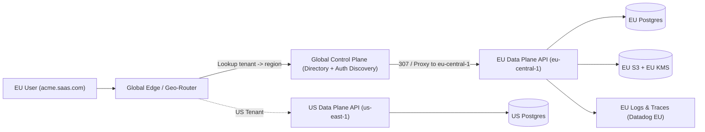
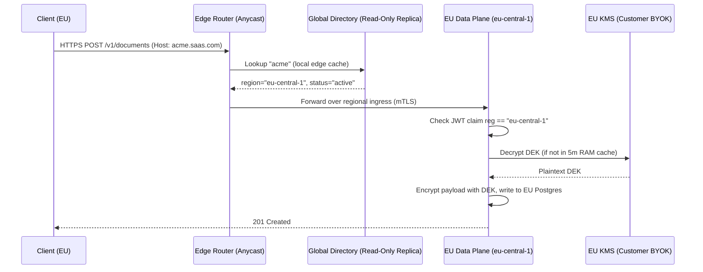
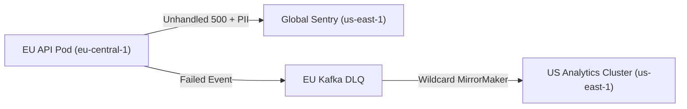

# Data Residency & Sovereignty: Keeping EU Data in the EU

> **Prerequisites:** [Lesson 05: Quotas and Usage Metering](../05-quotas-and-usage-metering/README.md).  
> **Estimated Reading Time:** 24–28 minutes  
> **Target Audience:** Backend and platform engineers building multi-region SaaS, and candidates asked "how do you keep EU customer data in the EU without breaking global features?"  
> **Free PDF Notes:** [Download SD-R-006.pdf](https://backendroadmap.com/notes/system-design/SD-R-006.pdf)

> [!NOTE]
> **In one line:** **Data residency** pins where data is stored and processed at rest and in transit, while **data sovereignty** governs whose laws, encryption keys, and legal jurisdiction control access to that data. Achieving both in a multi-tenant SaaS requires splitting a **global control plane** (routing, auth discovery, billing metadata) from **regional data planes** (tenant databases, object storage, search, logs, backups) and enforcing **tenant-to-region pinning** at the edge.

> [!TIP]
> **The Golden Rule:** Never let a global microservice query a regional database over a cross-border link, and never ship regional PII into a centralized US logging/analytics pipeline. Route the user to their home region at the edge, process the request inside that region, and export only anonymized or aggregated telemetry.

---

## 1. What Data Residency & Sovereignty Is, and What It Isn't

An enterprise customer in Frankfurt signs a $500k contract with your SaaS, which originally launched in `us-east-1`. Their legal team asks one question: *"Can you guarantee that our employees' PII, uploaded documents, backups, support logs, and encryption keys never leave the European Union?"* Spinning up a read replica in `eu-central-1` does not satisfy this: writes still go to Virginia, logs still stream to a US Datadog org, and your US-based SREs can still decrypt the database.

| Term | Precise Meaning | Example |
| :--- | :--- | :--- |
| **Data residency** | Physical/geographic location where data is stored and processed | Tenant A's Postgres, S3, and Redis live in `eu-central-1` (Frankfurt) |
| **Data sovereignty** | Legal jurisdiction and cryptographic control over data access | EU subsidiary operates the keys (BYOK/HYOK) under GDPR |
| **Data localization** | Strict statutory mandate requiring data to stay inside national borders | Financial/health records that cannot cross borders even for backups |
| **Control plane** | Global metadata needed to route requests and manage tenant lifecycle | `tenant_id -> region_url` directory, SSO discovery, billing SKUs |
| **Data plane** | Regional compute and storage holding actual customer payloads and PII | Regional API pods, RDS, S3 buckets, Kafka topics, search indexes |
| **Tenant pinning** | Cryptographic or directory binding of a tenant to one home region | JWT claim `region: "eu-central-1"` verified by the edge router |
| **BYOK / HYOK** | Bring Your Own Key / Hold Your Own Key for envelope encryption | Customer KMS key in `eu-central-1` or external HSM |
| **Not** | Just adding a CDN or a cross-region read replica | CDN caches edge assets; replicas still originate from a primary |

### Why It Matters
1. **Enterprise sales gatekeeper:** GDPR (Schrems II), HIPAA, FedRAMP, and financial regulators make regional pinning a hard pass/fail requirement for B2B SaaS deals.
2. **Hidden leakage paths:** Most residency violations happen not in the primary database, but in **telemetry, backups, dead-letter queues, ML training pipelines, and support screenshots**.
3. **Architecture lock-in:** Retrofitting a single-region monolith with global joins into a region-pinned control/data plane split is 10x harder than designing tenant-region routing early.

---

## 2. Anatomy: Global Control Plane vs. Regional Data Planes



The **edge router** inspects the tenant identifier (subdomain `acme.saas.com`, JWT `tid` claim, or OIDC discovery email domain) and consults a globally replicated, low-latency **Tenant Directory** (e.g., DynamoDB Global Tables or Cloudflare KV). If the request lands in the wrong region, the edge either issues a `307 Temporary Redirect` to `eu.api.saas.com` or proxies the request over a regional ingress without terminating TLS in the wrong jurisdiction.

| Component | Lives in Control Plane (Global) | Lives in Data Plane (Regional) |
| :--- | :--- | :--- |
| **Tenant directory** | `tenant_id`, `home_region`, `status`, `plan_tier` | Full tenant settings, user profiles, PII |
| **Authentication** | OIDC/SAML IdP metadata, domain-to-tenant mapping | Session tokens, audit logs, SCIM user records |
| **Application data** | None (zero customer payloads) | Databases, object storage, search, caches, queues |
| **Observability** | Aggregated health metrics (error rate, p99) | Structured logs, APM traces with request payloads |
| **Encryption keys** | Key IDs / ARN pointers only | Regional KMS CMKs or customer-managed HSM keys |

> [!WARNING]
> **The #1 residency trap is "Control Plane Creep."** Teams put `user_email`, `company_name`, or `last_login_ip` into the global tenant directory "just for the admin portal." Suddenly, EU PII is replicated globally to `us-east-1` and `ap-southeast-1`, violating the residency guarantee. Keep the global directory strictly **pseudonymous** (`tenant_id`, `region`, `domain_hash`).

---

## 3. Mathematical Model: Cross-Region Latency, Blast Radius, and Key-Wrapping Cost

**Latency penalty of misrouted requests.** If an EU user (Frankfurt) hits a US edge (`us-east-1`) and the US API queries an EU database, every sequential DB round-trip pays the transatlantic RTT ($\approx 90\text{ ms}$):

$$T_{\text{hairpin}} = T_{\text{user}\to\text{US}} + N_{\text{queries}} \cdot \text{RTT}_{\text{US}\leftrightarrow\text{EU}} + T_{\text{compute}}$$

With $N_{\text{queries}} = 8$ sequential SQL queries and $\text{RTT}_{\text{US}\leftrightarrow\text{EU}} = 90\text{ ms}$, the request pays $8 \times 90 = 720\text{ ms}$ in pure speed-of-light tax before compute. Edge routing to the home region eliminates $N_{\text{queries}} - 1$ cross-ocean hops:

$$T_{\text{pinned}} = \text{RTT}_{\text{user}\to\text{EU}} + T_{\text{lookup}} + N_{\text{queries}} \cdot \text{RTT}_{\text{local}} + T_{\text{compute}}$$

With $\text{RTT}_{\text{user}\to\text{EU}} = 18\text{ ms}$, local directory cache hit $T_{\text{lookup}} = 1\text{ ms}$, and $\text{RTT}_{\text{local}} = 0.8\text{ ms}$, $T_{\text{pinned}} \approx 18 + 1 + 6.4 = 25.4\text{ ms}$ (plus compute)—a **28x reduction** in network wait.

**Envelope Encryption & KMS Quota Cost.** With BYOK/HYOK, each tenant has a Customer Managed Key (CMK) in their region. Calling KMS on every row read is impossible (KMS limits are typically $5{,}500\text{–}30{,}000\text{ req/s}$ per region and cost \$0.03 per 10,000 calls). Instead, use **Data Encryption Keys (DEKs)** cached in memory for TTL $\tau$:

$$\text{KMS}_{\text{QPS}} = \frac{N_{\text{active\_tenants}} \cdot N_{\text{pods}}}{\tau}$$

**Worked Numerical Example:** Suppose an EU data plane has $N_{\text{active\_tenants}} = 2{,}000$ tenants, $N_{\text{pods}} = 40$ API pods, and each pod caches a tenant's unwrapped DEK in RAM for $\tau = 300\text{ s}$ (5 minutes). Worst-case KMS QPS is:

$$\text{KMS}_{\text{QPS}} = \frac{2{,}000 \times 40}{300} = 266.7\text{ req/s}$$

That easily fits inside a 10,000 req/s KMS quota. Without DEK caching ($\tau = 0$) at $5{,}000\text{ RPS}$ app traffic, KMS QPS would hit $5{,}000\text{ req/s}$, adding $15\text{ ms}$ p99 latency per request and costing $\$1{,}296/\text{day}$ in KMS API fees alone.

---

## 4. Metrics & Percentiles

| Metric | Meaning | Alert when |
| :--- | :--- | :--- |
| **Cross-region egress bytes** | Network bytes leaving a pinned data plane region | Any non-zero egress from regional DB/S3 to foreign IPs |
| **Misrouted request rate** | Requests arriving at wrong regional data plane | $> 0.5\%$ of traffic (broken DNS/Geo-router or stale client) |
| **Directory lookup $p_{99}$** | Time to resolve `tenant_id -> region` at edge | $> 5\text{ ms}$ (cache miss or global store throttling) |
| **KMS unwrap $p_{99}$ / error rate** | Time/failures unwrapping tenant DEKs | $> 20\text{ ms}$ or any `AccessDenied` (revoked BYOK!) |
| **PII scanner violation count** | PII regex/NER hits in global logs or control plane | $> 0$ (immediate SEV-1 compliance incident) |
| **Regional replication lag** | Async lag within the region's multi-AZ/DR pair | $> 5\text{ s}$ (RPO risk within sovereign boundary) |

### Worked Example (BYOK Key Revocation)
An EU bank revokes your SaaS's IAM grant on their AWS KMS CMK at 14:02 UTC during a security drill. Within $\tau = 300\text{ s}$, as cached DEKs expire on the 40 EU API pods, `kms:Decrypt` returns `AccessDeniedException`. The API immediately returns `423 Locked` (`tenant_key_revoked`) for that tenant without affecting the other 1,999 EU tenants, and pages no one—because a customer-initiated key revocation is an expected sovereignty control, not a system outage.

---

## 5. Compounding & Failure Modes: What Breaks in Multi-Region Residency

| Failure Mode | How It Happens | Impact |
| :--- | :--- | :--- |
| **Control plane outage** | Global Tenant Directory in `us-east-1` goes down | Edge cannot resolve `tenant_id -> region`; **all regions go dark** |
| **Telemetry leakage** | Global Sentry/Datadog SDK captures stack trace with user email | EU PII lands on US servers; GDPR breach notification required |
| **Cross-region backup** | Terraform defaults S3 replication or RDS snapshots to `us-east-1` | Silent residency violation discovered during SOC2/ISO audit |
| **Tenant migration split-brain** | Moving a tenant from US to EU while writes still hit US | Divergent records, lost updates, orphaned S3 objects |
| **Support tooling bypass** | Admin impersonation tool runs in US and queries EU DB directly | Cross-border PII transfer + audit trail gap |

To survive a **Control Plane outage**, every regional edge caches the `tenant_id -> region` mapping locally with a long stale-while-revalidate window (e.g., 24 hours) and embeds the `region` claim directly in signed JWTs (`"reg": "eu-central-1"`). Even if the global directory is completely unreachable, existing sessions and cached domains keep routing to `eu-central-1`.

---

## 6. Numbers Every Engineer Must Know

| Item | Typical | Implication |
| :--- | :--- | :--- |
| **Intra-AZ network RTT** | $0.2\text{–}0.8\text{ ms}$ | Safe for synchronous microservices and SQL joins |
| **Cross-AZ (same region) RTT** | $1\text{–}2\text{ ms}$ | Multi-AZ synchronous DB commit adds ~1–2 ms |
| **US-East to EU-Central RTT** | $85\text{–}100\text{ ms}$ | Hairpinning kills UX; never do cross-region DB queries |
| **Edge directory cache hit** | $< 1\text{ ms}$ (in-memory / KV) | Negligible routing tax at the edge |
| **KMS `Decrypt` latency** | $5\text{–}15\text{ ms}$ | Cache DEKs in memory with 5–15 min TTL |
| **GDPR breach notification SLA** | $72\text{ hours}$ | Must detect and prove containment of cross-border leaks fast |
| **Minimum regions for global B2B** | 2–3 (`US`, `EU`, optional `AP`/`UK`) | Each region is a full data plane; keep count minimal |

---

## 7. Protocol / Mechanism Deep Dive: Edge Routing & Region Pinning



| Question | Answer |
| :--- | :--- |
| **What if a user travels from Frankfurt to New York?** | Their request hits a US edge PoP, which looks up `acme -> eu-central-1` and routes the request to Frankfurt. Data never settles in the US. |
| **Where do cross-tenant features (e.g., shared links) live?** | Either disallow cross-region sharing, or require explicit user consent to transfer a snapshot to the recipient's region. |
| **How do you handle search and analytics?** | Run separate OpenSearch/ClickHouse clusters per region; aggregate only non-PII counts to the global billing plane. |
| **How do you prevent accidental cross-region API calls?** | Enforce `reg` claim matching in middleware + AWS SCPs / GCP Org Policies blocking non-approved regions. |

**When not to use regional data planes.** If you are building a B2C app with no enterprise compliance requirements and no regional latency need, running full regional data planes triples operational overhead. Start with one region and add a second only when enterprise contracts or latency justify the stamp.

---

## 8. Hierarchical Budgets & Design Rules

| Slice | Rule | Control |
| :--- | :--- | :--- |
| **Edge routing** | Resolve `tenant_id -> region` in $< 5\text{ ms}$ without PII | Pseudonymous global directory + edge KV cache |
| **Region guard** | Every data-plane API rejects mismatched `region` claims | Middleware asserts `token.region == os.getenv("REGION")` |
| **Cloud IAM / SCP** | Physically block resource creation outside approved regions | AWS Service Control Policies (`aws:RequestedRegion`) |
| **Observability** | Logs, traces, and crash dumps stay in the home region | Regional OTel collectors -> regional Datadog/S3 sinks |
| **Encryption** | Envelope encryption with regional CMK / BYOK | DEK cached in RAM ($\tau \le 5\text{ min}$); never persisted plaintext |
| **Backups & DR** | Cross-AZ within region, or sovereign pair (`eu-central-1` $\leftrightarrow$ `eu-west-1`) | Automated Terraform policy checks (OPA/Conftest) |
| **Support access** | Just-in-time (JIT) regional bastion with customer approval | Zero standing access from US engineers to EU prod |

---

## 9. Top Mitigations

1. **Enforce region-claim middleware on every endpoint** so a misrouted request fails closed (`403 Misdirected Request` or `421`) instead of silently writing to the wrong database.
2. **Use Cloud Org Policies / SCPs** to deny provisioning RDS, S3, or KMS keys in unapproved regions, and restrict `eu-central-1` data planes to EU-only DR pairs (`eu-west-1`).
3. **Scrub PII at the OTel collector** before any metric or trace leaves the region; keep full structured logs in regional object storage.
4. **Embed `region` in the tenant's JWT and subdomain** (`acme.eu.saas.com`) so clients hit the right region directly after login without an extra control-plane hop.
5. **Implement envelope encryption with BYOK support** from day one so upgrading a tenant to sovereign key control requires only swapping their CMK ARN.
6. **Build a dedicated, idempotent tenant migration pipeline** (snapshot -> CDC sync -> brief read-only cutover -> verify -> tombstone old region) rather than ad-hoc scripts.
7. **Automate residency assertions in CI/CD** using Open Policy Agent (OPA) to scan Terraform plans for cross-region replication rules or global S3 buckets.

---

## 10. Production Reference: Surviving a Cross-Region Telemetry Leak (SEV-1)

A B2B HR SaaS launched an EU data plane in `eu-central-1` (`Frankfurt`). Primary Postgres and S3 were pinned to Frankfurt, and the sales team signed 40 German enterprise customers under strict GDPR Data Processing Agreements (DPAs).

- **The incident:** During a routine SOC2/GDPR audit, an automated DLP scanner flagged German employee names, IBANs, and home addresses inside a centralized **Sentry** error-tracking project hosted in the US (`us-east-1`), as well as inside **Kafka dead-letter queues** mirrored to a US analytics cluster.
- **Root cause:** The backend error handler serialized the full HTTP request body and local variables on unhandled `500` exceptions and shipped them to a single global Sentry DSN. Separately, the analytics team subscribed a US-based Flink job to `*.dlq` topics without region filtering.



- **The fix:**
  1. Deployed regional Sentry/OTel relay instances in `eu-central-1` with strict field-level PII redaction (`[REDACTED]`) before indexing.
  2. Replaced wildcard Kafka MirrorMaker rules with explicit allowlists that only mirror anonymized, schema-validated billing counters (`tenant_id`, `event_count`).
  3. Added egress firewall rules (VPC Security Groups + Network ACLs) blocking outbound traffic from EU data-plane subnets to non-EU control-plane IPs.

---

## 11. Multi-Language Production Code Tabs

A **Region-Pinned Router & Guard Middleware** with an in-memory DEK cache and fail-closed `421 Misdirected Request` enforcement.

````carousel
```go
// Go: Region-pinning middleware + envelope DEK cache with TTL.
package residency

import (
	"errors"
	"net/http"
	"sync"
	"time"
)

type TenantRoute struct {
	TenantID string
	Region   string
	KMSKeyID string
}

type Guard struct {
	localRegion string
	directory   map[string]TenantRoute
	dekCache    sync.Map // tenantID -> cachedDEK
}

type cachedDEK struct {
	key       []byte
	expiresAt time.Time
}

func NewGuard(localRegion string, dir map[string]TenantRoute) *Guard {
	return &Guard{localRegion: localRegion, directory: dir}
}

func (g *Guard) Middleware(next http.Handler) http.Handler {
	return http.HandlerFunc(func(w http.ResponseWriter, r *http.Request) {
		tid := r.Header.Get("X-Tenant-ID")
		route, ok := g.directory[tid]
		if !ok {
			http.Error(w, "unknown tenant", http.StatusNotFound)
			return
		}
		// Fail closed if request landed in the wrong data plane region.
		if route.Region != g.localRegion {
			w.Header().Set("X-Correct-Region", route.Region)
			http.Error(w, "misdirected request: wrong region", http.StatusMisdirectedRequest)
			return
		}
		next.ServeHTTP(w, r)
	})
}

func (g *Guard) GetDEK(tenantID string, unwrap func(keyID string) ([]byte, error)) ([]byte, error) {
	if v, ok := g.dekCache.Load(tenantID); ok {
		entry := v.(cachedDEK)
		if time.Now().Before(entry.expiresAt) {
			return entry.key, nil
		}
	}
	route, ok := g.directory[tenantID]
	if !ok {
		return nil, errors.New("tenant not found")
	}
	raw, err := unwrap(route.KMSKeyID) // Calls regional KMS only on cache miss
	if err != nil {
		return nil, err
	}
	g.dekCache.Store(tenantID, cachedDEK{key: raw, expiresAt: time.Now().Add(5 * time.Minute)})
	return raw, nil
}
```
<!-- slide -->
```typescript
// TypeScript: Edge region resolver & fail-closed data-plane guard.
export interface TenantDirectoryEntry {
  tenantId: string;
  homeRegion: "us-east-1" | "eu-central-1" | "ap-southeast-1";
  kmsKeyArn: string;
}

export class ResidencyGuard {
  private dekCache = new Map<string, { dek: Uint8Array; expiresAt: number }>();

  constructor(
    private readonly localRegion: string,
    private readonly directory: Map<string, TenantDirectoryEntry>
  ) {}

  assertLocalRegion(tenantId: string): TenantDirectoryEntry {
    const entry = this.directory.get(tenantId);
    if (!entry) {
      throw new Error(`404: Tenant ${tenantId} not found in directory`);
    }
    if (entry.homeRegion !== this.localRegion) {
      // 421 Misdirected Request prevents cross-border data processing.
      throw new Error(
        `421: Tenant ${tenantId} pinned to ${entry.homeRegion}, received in ${this.localRegion}`
      );
    }
    return entry;
  }

  async getOrUnwrapDEK(
    tenantId: string,
    kmsDecrypt: (arn: string) => Promise<Uint8Array>,
    ttlMs = 300_000
  ): Promise<Uint8Array> {
    const entry = this.assertLocalRegion(tenantId);
    const cached = this.dekCache.get(tenantId);
    if (cached && Date.now() < cached.expiresAt) {
      return cached.dek;
    }
    const dek = await kmsDecrypt(entry.kmsKeyArn);
    this.dekCache.set(tenantId, { dek, expiresAt: Date.now() + ttlMs });
    return dek;
  }
}
```
<!-- slide -->
```python
# Python: Residency latency & KMS QPS model + fail-closed guard (stdlib only).
import time
from dataclasses import dataclass


@dataclass(frozen=True)
class TenantRoute:
    tenant_id: str
    home_region: str
    kms_key_arn: str


class ResidencyGuard:
    def __init__(self, local_region: str, directory: dict[str, TenantRoute], dek_ttl_s: int = 300):
        self.local_region = local_region
        self.directory = directory
        self.dek_ttl_s = dek_ttl_s
        self._dek_cache: dict[str, tuple[bytes, float]] = {}

    def verify_region(self, tenant_id: str) -> TenantRoute:
        route = self.directory.get(tenant_id)
        if not route:
            raise LookupError(f"Unknown tenant: {tenant_id}")
        if route.home_region != self.local_region:
            raise PermissionError(
                f"421 Misdirected: {tenant_id} belongs to {route.home_region}, not {self.local_region}"
            )
        return route

    def get_dek(self, tenant_id: str, kms_unwrap_fn) -> bytes:
        route = self.verify_region(tenant_id)
        now = time.monotonic()
        cached = self._dek_cache.get(tenant_id)
        if cached and now < cached[1]:
            return cached[0]
        dek = kms_unwrap_fn(route.kms_key_arn)
        self._dek_cache[tenant_id] = (dek, now + self.dek_ttl_s)
        return dek


def model_kms_qps(active_tenants: int, pods: int, ttl_s: int) -> float:
    return round((active_tenants * pods) / ttl_s, 2)


def model_hairpin_ms(user_to_wrong_ms: float, queries: int, cross_rtt_ms: float) -> float:
    return round(user_to_wrong_ms + queries * cross_rtt_ms, 1)
```
<!-- slide -->
```csharp
// C#: ASP.NET-style ResidencyGuard with ConcurrentDictionary DEK cache.
using System.Collections.Concurrent;

public sealed record TenantRoute(string TenantId, string HomeRegion, string KmsKeyArn);

public sealed class ResidencyGuard
{
    private readonly string _localRegion;
    private readonly IReadOnlyDictionary<string, TenantRoute> _directory;
    private readonly ConcurrentDictionary<string, (byte[] Dek, DateTimeOffset ExpiresAt)> _cache = new();

    public ResidencyGuard(string localRegion, IReadOnlyDictionary<string, TenantRoute> directory)
    {
        _localRegion = localRegion;
        _directory = directory;
    }

    public TenantRoute AssertLocalRegion(string tenantId)
    {
        if (!_directory.TryGetValue(tenantId, out var route))
            throw new KeyNotFoundException($"Tenant {tenantId} not found.");
        if (!string.Equals(route.HomeRegion, _localRegion, StringComparison.Ordinal))
            throw new InvalidOperationException(
                $"421 Misdirected: {tenantId} pinned to {route.HomeRegion}, hit {_localRegion}.");
        return route;
    }

    public async Task<byte[]> GetDekAsync(string tenantId, Func<string, Task<byte[]>> kmsDecrypt)
    {
        var route = AssertLocalRegion(tenantId);
        if (_cache.TryGetValue(tenantId, out var entry) && DateTimeOffset.UtcNow < entry.ExpiresAt)
            return entry.Dek;

        var dek = await kmsDecrypt(route.KmsKeyArn);
        _cache[tenantId] = (dek, DateTimeOffset.UtcNow.AddMinutes(5));
        return dek;
    }
}
```
````

---

## 12. Hands-On CLI Verification Workflows

Verify the math model and guard behavior in Python:

```bash
python3 -c '
from residency import model_kms_qps, model_hairpin_ms
print("KMS QPS (2000 tenants, 40 pods, 300s TTL):", model_kms_qps(2000, 40, 300))
print("Hairpin latency (8 queries * 90ms RTT):", model_hairpin_ms(85, 8, 90), "ms")
'
```

Verify cloud-level residency controls (AWS S3 replication, RDS region, and IAM SCPs):

```bash
# 1. Verify an EU S3 bucket has no cross-region replication to US
aws s3api get-bucket-replication --bucket acme-eu-documents --region eu-central-1

# 2. Verify KMS Customer Managed Key is strictly in eu-central-1
aws kms describe-key --key-id alias/acme-byok --region eu-central-1 --query 'KeyMetadata.Arn'

# 3. Check DNS/Edge routing headers to confirm EU tenant hits eu-central-1
curl -I -H "Host: acme.saas.com" https://api.saas.com/healthz | grep -i x-served-region
```

---

## 13. Common Mistakes to Avoid

1. **Letting PII leak into the global control plane** (emails, names, IPs in the tenant directory).
2. **Centralizing logs, Sentry errors, or analytics in `us-east-1`** while claiming "EU data residency."
3. **Using cross-region read replicas** to satisfy residency—writes and primary storage still violate sovereignty.
4. **Calling KMS on every database row** without an in-memory DEK cache, blowing through KMS quotas and latency budgets.
5. **Failing open when the region claim is missing** instead of returning `421 Misdirected Request`.
6. **Forgetting backups, snapshots, and dead-letter queues**, which quietly replicate across regions by default.
7. **Making the global control plane a runtime SPOF** for every data-plane request without edge caching.

---

## 14. Key Terms Glossary

| Key Term | Definition |
| :--- | :--- |
| **Data residency** | Physical geographic location where data is stored and processed. |
| **Data sovereignty** | Legal jurisdiction and cryptographic key control governing data access. |
| **Control plane** | Global metadata plane for routing, discovery, and tenant lifecycle. |
| **Data plane** | Regional compute and storage plane holding actual tenant payloads. |
| **Tenant pinning** | Binding a tenant to a single immutable home region. |
| **BYOK / HYOK** | Bring Your Own Key / Hold Your Own Key for customer-controlled encryption. |
| **Envelope encryption** | Encrypting data with a fast DEK, and wrapping the DEK with a KMS CMK. |
| **Hairpinning** | Routing a request to a distant region only to query back to the user's home region. |
| **SCP (Service Control Policy)** | Cloud org-level guardrail blocking resource creation in unapproved regions. |
| **Schrems II** | EU legal ruling restricting transatlantic personal data transfers without safeguards. |

---

## 15. System Design Interview Questions & Answers

### Basic Conceptual Questions

<details>
<summary><strong>Q1: What is the difference between data residency and data sovereignty? [BASIC]</strong></summary>

**Answer:**
**Data residency** is *where* data physically sits (e.g., Frankfurt, `eu-central-1`). **Data sovereignty** is *whose laws and cryptographic keys* govern access to that data (e.g., an EU legal entity operating a customer-managed KMS key under GDPR, preventing foreign government subpoenas or US-based engineers from decrypting it).
</details>

<details>
<summary><strong>Q2: What belongs in the global control plane vs. a regional data plane? [BASIC]</strong></summary>

**Answer:**
The **control plane** holds only pseudonymous routing and lifecycle metadata (`tenant_id`, `home_region`, `domain_hash`, `plan_tier`). The **data plane** holds everything with customer payloads or PII: databases, object storage, search indexes, caches, queues, audit logs, and observability sinks.
</details>

<details>
<summary><strong>Q3: Why is a cross-region read replica not enough for EU residency? [BASIC]</strong></summary>

**Answer:**
Because all writes still flow to the primary database in the US, and the full dataset still lives in the US. Residency requires that EU tenant data originate, be processed, and be backed up exclusively within the EU.
</details>

<details>
<summary><strong>Q4: Why do we cache Data Encryption Keys (DEKs) in memory when using BYOK? [BASIC]</strong></summary>

**Answer:**
Calling KMS `Decrypt` on every request adds 5–15 ms of latency, high per-request cost, and risks hitting regional KMS QPS limits. Envelope encryption caches the unwrapped DEK in pod RAM for a short TTL (e.g., 5 minutes), reducing KMS calls by orders of magnitude while still honoring key revocation quickly.
</details>

### Scenario-Based Architecture Questions

<details>
<summary><strong>Q5: How do you route `acme.saas.com` to the right region without adding 100 ms per request? [SCENARIO]</strong></summary>

**Answer:**
Use an Anycast edge router (Cloudflare Workers, CloudFront Functions, or Envoy) backed by an edge-replicated KV/directory mapping `acme -> eu-central-1`. The lookup takes $< 1\text{ ms}$ at the nearest PoP, which routes directly to the EU ingress. Also embed `reg: "eu-central-1"` in the signed JWT so subsequent API calls validate region affinity locally.
</details>

<details>
<summary><strong>Q6: How do you handle global search or cross-tenant collaboration across regions? [SCENARIO]</strong></summary>

**Answer:**
Do **not** build a single global search index—that violates residency. Run regional search clusters (OpenSearch/Elasticsearch per region). If two tenants in different regions must collaborate (e.g., shared Slack-connect channel), require explicit opt-in consent and replicate only the shared channel's messages with clear data-transfer disclosures.
</details>

<details>
<summary><strong>Q7: How do you migrate an existing customer from `us-east-1` to `eu-central-1` with near-zero downtime? [SCENARIO]</strong></summary>

**Answer:**
1. Provision tenant schema/bucket in EU and start logical CDC replication from US to EU for that `tenant_id`.
2. Verify row counts and checksums while live traffic still hits US.
3. Put the tenant in a brief read-only maintenance window (10–30 s), drain in-flight queues, wait for CDC lag = 0, flip `home_region` in the global directory, and resume writes in EU.
4. Retain US data for a short rollback window, then cryptographically shred/delete it.
</details>

<details>
<summary><strong>Q8: Your support team is in San Francisco, but EU customers forbid US engineers from viewing their PII. How do you debug issues? [SCENARIO]</strong></summary>

**Answer:**
1. Keep all logs and traces in `eu-central-1` with PII fields scrubbed at the OTel collector.
2. Require **Just-in-Time (JIT) access** where an EU customer explicitly grants time-bounded impersonation or support-bundle export, logged to an immutable audit trail.
3. Use synthetic/anonymized data for reproduction in staging.
</details>

### Advanced & Tricky Interview Questions

<details>
<summary><strong>Q9: What happens if your global Tenant Directory in `us-east-1` goes down? [TRICKY]</strong></summary>

**Answer:**
If the edge depends synchronously on a single-region directory, a US outage takes down EU and AP too. Mitigate by replicating the directory to edge KV stores in every region with a 24-hour stale-while-revalidate fallback, and embedding `home_region` inside signed JWTs so authenticated traffic needs zero directory lookups.
</details>

<details>
<summary><strong>Q10: A customer revokes their BYOK KMS key in `eu-central-1`. How should your system behave? [TRICKY]</strong></summary>

**Answer:**
Within the DEK cache TTL (e.g., 5 minutes), `kms:Decrypt` fails with `AccessDeniedException`. The API should immediately evict that tenant's cached DEK, return `423 Locked` (`kms_key_revoked`) for that tenant only, avoid triggering retry storms or paging on-call as a platform outage, and log the event to the tenant's audit trail.
</details>

<details>
<summary><strong>Q11: How do you enforce that a developer cannot accidentally deploy an S3 bucket or RDS replica in the wrong region? [TRICKY]</strong></summary>

**Answer:**
Use defense in depth: (1) OPA/Conftest policy checks in CI blocking unapproved regions in Terraform, (2) Cloud Org Policies / AWS SCPs denying `ec2`, `rds`, `s3` API calls outside approved regions, and (3) runtime VPC egress rules preventing EU data-plane pods from reaching US data stores.
</details>

<details>
<summary><strong>Q12: How do you handle global billing and usage metering without violating EU data residency? [TRICKY]</strong></summary>

**Answer:**
Meter usage inside the EU data plane (seats, API calls, GB stored) and emit only **pseudonymous aggregated counters** (`{tenant_id: "t_981", metric: "api_calls", count: 142000, period: "2026-11"}`) to the global billing service. Never include user names, emails, or request payloads in billing events.
</details>

---

## 16. One-Page Master Cheat Sheet

```
+---------------------------------------------------------------------------------------------------------+
|                    DATA RESIDENCY & SOVEREIGNTY — MASTER CHEAT SHEET                                    |
+---------------------------------------------------------------------------------------------------------+
| 1. RESIDENCY vs SOVEREIGNTY: Residency = where bytes live (Frankfurt). Sovereignty = whose laws & keys  |
|    control access (EU legal entity + BYOK/HYOK KMS).                                                    |
+---------------------------------------------------------------------------------------------------------+
| 2. CONTROL vs DATA PLANE: Control plane = pseudonymous directory (tenant_id -> region).                 |
|    Data plane = DBs, S3, Redis, Kafka, Search, Logs, Backups—100% pinned inside the region.             |
+---------------------------------------------------------------------------------------------------------+
| 3. ROUTING & GUARD: Edge resolves tenant -> region (<5 ms). Data plane asserts token.reg == LOCAL_REG   |
|    and fails closed with 421 Misdirected Request. Avoid hairpinning (8 * 90ms = 720ms tax).             |
+---------------------------------------------------------------------------------------------------------+
| 4. ENVELOPE ENCRYPTION: Wrap data with DEK, wrap DEK with customer CMK. Cache DEK in RAM (TTL = 5 min)  |
|    so KMS QPS = (Tenants * Pods) / TTL.                                                                 |
+---------------------------------------------------------------------------------------------------------+
| 5. LEAKAGE VECTORS: Sentry/Datadog logs, Kafka DLQs, cross-region backups, support tools, billing.      |
+---------------------------------------------------------------------------------------------------------+
| 6. GUARDRAILS: AWS SCPs / GCP Org Policies + OPA in CI + regional OTel PII scrubbers + JIT support.     |
+---------------------------------------------------------------------------------------------------------+
```

---

## Further Reading & Sources

- AWS Architecture Blog, [Building a Multi-Region SaaS Architecture with Data Residency](https://aws.amazon.com/blogs/architecture/).
- European Data Protection Board (EDPB), *Recommendations 01/2020 on measures that supplement transfer tools* (Schrems II compliance).
- Google Cloud Architecture Center, [Data Residency and Sovereignty with Assured Workloads](https://cloud.google.com/assured-workloads/docs).
- Martin Kleppmann, *Designing Data-Intensive Applications*, Chapter 5 ("Replication") & Chapter 6 ("Partitioning").

---

## Free PDF Notes

[SD-R-006.pdf](https://backendroadmap.com/notes/system-design/SD-R-006.pdf)

---

## Next

Continue with [Lesson 07: Enterprise Identity: SAML/OIDC SSO, SCIM & Group-to-Role Mapping](../07-enterprise-identity/README.md).