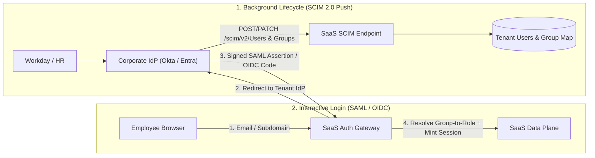
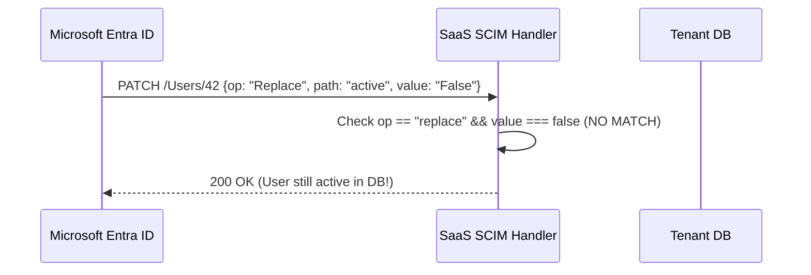

# Enterprise Identity: SAML/OIDC SSO, SCIM & Group-to-Role Mapping

> **Prerequisites:** [Lesson 06: Data Residency & Sovereignty](../06-data-residency-sovereignty/README.md).  
> **Estimated Reading Time:** 24–28 minutes  
> **Target Audience:** Backend engineers building B2B SaaS authentication/authorization, and candidates asked "how do you integrate Okta/Entra ID with SSO, automatic provisioning, and RBAC?"  
> **Free PDF Notes:** [Download SD-R-007.pdf](https://backendroadmap.com/notes/system-design/SD-R-007.pdf)

> [!NOTE]
> **In one line:** Enterprise identity separates **authentication** (**SAML 2.0 / OIDC SSO**: proving who the user is via their corporate IdP), **lifecycle provisioning** (**SCIM 2.0**: creating, updating, and deprovisioning users/groups automatically), and **authorization** (**Group-to-Role Mapping**: translating IdP groups like `eng-admins` into SaaS RBAC roles without manual admin work).

> [!TIP]
> **The Golden Rule:** Never rely on login-time Just-In-Time (JIT) provisioning alone for offboarding. When an employee is fired in Okta, they must lose access and active sessions **within minutes via SCIM `DELETE`/`active: false` + short-lived tokens**, not wait until they try to log in again.

---

## 1. What Enterprise Identity Is, and What It Isn't

A 5,000-person company buys your SaaS. Their CISO immediately blocks password logins and demands three things: (1) employees log in via Okta/Microsoft Entra ID (**SSO**), (2) when someone joins or leaves HR/Workday, their SaaS seat is created or revoked automatically (**SCIM**), and (3) membership in the Okta group `Prod-Operators` automatically grants the `Admin` role in your SaaS (**Group-to-Role Mapping**).

| Term | Precise Meaning | Example |
| :--- | :--- | :--- |
| **IdP (Identity Provider)** | Corporate directory that authenticates employees | Okta, Microsoft Entra ID, Ping Identity |
| **SP (Service Provider)** | Your SaaS application trusting the IdP's assertions | `app.yoursaas.com` |
| **SAML 2.0** | XML-based federation protocol using signed assertions | `POST /sso/saml/acs` with XML `Assertion` |
| **OIDC (OpenID Connect)** | Modern JSON/JWT identity layer on top of OAuth 2.0 | `id_token` + `userinfo` via Authorization Code + PKCE |
| **SCIM 2.0** | RESTful JSON API (RFC 7643/7644) for user & group sync | `PATCH /scim/v2/Users/123` (`active: false`) |
| **JIT Provisioning** | Creating a user record on their first successful SSO login | Works for onboarding, **fails for offboarding** |
| **Group-to-Role Mapping** | Declarative rules mapping IdP groups to tenant RBAC roles | `okta:sec-ops` $\to$ `tenant_role: SecurityAdmin` |
| **Not** | A single protocol that does both login and offboarding | SSO handles login; SCIM handles lifecycle |

### Why It Matters
1. **The "SSO Tax" reality:** Enterprise buyers will not deploy a B2B tool without SAML/OIDC + SCIM because manual CSV user management is an audit failure.
2. **Instant offboarding:** Without SCIM deprovisioning, a terminated employee with a valid 7-day refresh token or API key retains access after leaving the company.
3. **Least-privilege RBAC at scale:** Mapping IdP groups to roles lets the customer's IT team manage permissions in one place (Okta/Entra) with full approval workflows.

---

## 2. Anatomy: SSO Login Flow vs. SCIM Provisioning Loop



Notice the two completely separate planes:
1. **SCIM 2.0 (Out-of-band push):** Runs whenever IT adds, updates, or fires an employee. It keeps your SaaS user table and group memberships synchronized even if the user hasn't logged in for months.
2. **SAML / OIDC (Interactive login):** Runs when the user opens a browser. Your Auth Gateway looks up the tenant's IdP configuration (by subdomain `acme.saas.com` or email domain `acme.com` via **Home Realm Discovery**), redirects to the IdP, validates the cryptographic signature, and mints a short-lived session.

| Protocol | Payload Format | Primary Strengths | Primary Pain Points |
| :--- | :--- | :--- | :--- |
| **SAML 2.0** | Signed XML | Universal enterprise adoption; IdP-initiated & SP-initiated SSO | XML canonicalization bugs (XXE, signature wrapping), 200+ group bloat |
| **OIDC** | Signed JWT (JSON) | Clean REST/JSON, PKCE for SPAs/mobile, easy debugging | Slightly less uniform enterprise IdP config for multi-tenant apps |
| **SCIM 2.0** | JSON REST API | Standardized `Users` & `Groups` CRUD + `PATCH` operations | IdPs send inconsistent `PATCH` payloads; eventual consistency & rate limits |

> [!WARNING]
> **Never trust `email` as a primary key or allow unverified email domain claiming.** If Tenant A claims `gmail.com` or `acme.com` without DNS TXT verification, an attacker can intercept logins or hijack accounts. Always key SSO users by `(tenant_id, idp_issuer, idp_subject_id)` and require DNS verification before enabling domain-based Home Realm Discovery.

---

## 3. Mathematical Model: Offboarding Exposure Window & Token/Cache Budgets

Suppose an employee is terminated in HR at $t = 0$. How long can they still access your SaaS? The **Offboarding Exposure Window** $W_{\text{expose}}$ is the sum of HR-to-IdP sync delay, IdP-to-SaaS SCIM push delay, and your longest-lived unrevoked credential (access token TTL or cached RBAC TTL):

$$W_{\text{expose}} = T_{\text{HR}\to\text{IdP}} + T_{\text{SCIM\_push}} + \max(T_{\text{access\_JWT}}, T_{\text{session\_cache}})$$

If your SaaS issues stateless JWTs with $T_{\text{access\_JWT}} = 24\text{ hours}$ and checks no revocation list, a fired employee keeps full API access for a full day even if SCIM disables them in 5 seconds!

**IdP Group Bloat & Token Size.** Large enterprises often put users in $G = 150\text{–}500$ AD/Okta groups. Embedding all groups into a SAML assertion or OIDC `id_token` (or HTTP `Cookie` header) breaks the $4\text{ KB}$ browser cookie limit and $8\text{ KB}$ NGINX/ALB header limit:

$$\text{Header\_Bytes} = B_{\text{base}} + G \cdot \bar{L}_{\text{group\_name}}$$

**Worked Numerical Example:** Suppose an enterprise user belongs to $G = 220$ Okta groups, each averaging $\bar{L}_{\text{group\_name}} = 38\text{ bytes}$, plus $B_{\text{base}} = 450\text{ bytes}$ of standard JWT claims. Raw payload size is:

$$\text{Payload} = 450 + (220 \times 38) = 8{,}810\text{ bytes}$$

Base64url-encoded, that becomes $\approx 11.7\text{ KB}$, immediately triggering `431 Request Header Fields Too Large` at the API gateway. **Fix:** Filter groups at the IdP (only send `saas-*` groups), or store group-to-role mappings server-side via SCIM and put only a compact `role_mask` or `session_id` in the JWT.

---

## 4. Metrics & Percentiles

| Metric | Meaning | Alert when |
| :--- | :--- | :--- |
| **SSO callback error rate** | Failed SAML/OIDC assertions per tenant | $> 1\%$ (expired IdP cert, clock skew, XML error) |
| **SCIM sync latency $p_{99}$** | Time for `POST/PATCH /scim/v2/Users` | $> 500\text{ ms}$ (IdPs time out aggressively at 3–5 s) |
| **SCIM 429 / 5xx rate** | Throttled or failed provisioning calls | $> 0.1\%$ (causes silent drift between IdP and SaaS) |
| **Cert expiry lead time** | Days until tenant's SAML X.509 cert expires | $< 30\text{ days}$ (proactive customer email alert) |
| **Orphaned active sessions** | Sessions still valid after `user.active = false` | $> 0$ (session revocation hook broken) |
| **Auth gateway $p_{99}$** | Time to validate assertion and mint session | $> 150\text{ ms}$ |

### Worked Example (Expiring SAML Certificate)
Acme Corp's Okta SAML signing certificate expires on Sunday at 00:00 UTC. Without dual-certificate support and 30/14/7-day expiry alerts, all 5,000 Acme employees are locked out Monday morning. With **rolling dual-cert validation** (storing `[current_cert, next_cert]` per tenant), Acme IT uploads the new cert on Thursday, both certs validate seamlessly over the weekend, and Monday morning has zero downtime.

---

## 5. Compounding & Failure Modes: What Breaks in Enterprise Identity

| Failure Mode | How It Happens | Impact |
| :--- | :--- | :--- |
| **XML Signature Wrapping (XSW)** | SAML parser verifies signature on one XML node, reads `NameID` from an unsigned injected node | **Total authentication bypass** (attacker logs in as any user) |
| **Clock skew rejection** | IdP server is 4 minutes ahead of SaaS server; `NotBefore` check fails | Legitimate users randomly fail SSO with `AssertionNotYetValid` |
| **SCIM `PATCH` dialect mismatch** | Okta sends `{"op": "replace", "value": {"active": false}}`; Entra sends `{"op": "Replace", "path": "active", "value": "False"}` | Deprovisioning silently fails or throws `400 Bad Request` |
| **Group-to-role conflict** | User is in `Eng-ReadOnly` and `Eng-Admin`; naive code picks first match | Non-deterministic permissions or accidental privilege downgrade |
| **IdP-initiated SSO CSRF** | Attacker crafts unsolicited SAML POST without `InResponseTo` check | Session fixation or cross-tenant login confusion |

---

## 6. Numbers Every Engineer Must Know

| Item | Typical | Implication |
| :--- | :--- | :--- |
| **Access JWT TTL (enterprise)** | $5\text{–}15\text{ minutes}$ | Bounds offboarding exposure without DB lookup on every call |
| **SAML clock skew tolerance** | $\pm 2\text{–}3\text{ minutes}$ | Standard `NotBefore` / `NotOnOrAfter` leeway |
| **HTTP header / cookie limit** | $4\text{ KB}$ cookie / $8\text{ KB}$ header | Never stuff raw IdP group lists into cookies or JWTs |
| **SCIM IdP request timeout** | $3\text{–}10\text{ seconds}$ | Keep SCIM endpoints fast; process large group fans async |
| **SCIM batch / page size** | $50\text{–}100\text{ users/page}$ | Implement RFC 7644 pagination (`startIndex`, `count`) |
| **SAML cert rotation window** | $1\text{–}3\text{ years}$ | Support $\ge 2$ active certs per tenant for zero-downtime rotation |

---

## 7. Protocol / Mechanism Deep Dive: SAML vs. OIDC & SCIM `PATCH`

```mermaid
sequenceDiagram
    participant U as User Browser
    participant SP as SaaS Auth Service
    participant IdP as Okta / Entra ID

    U->>SP: GET /login (email: alice@acme.com)
    SP->>SP: Home Realm Discovery (acme.com -> Tenant T1, OIDC)
    SP-->>U: 302 Redirect to IdP /authorize (state, nonce, code_challenge)
    U->>IdP: Authenticate + MFA
    IdP-->>U: 302 Redirect to /sso/oidc/callback?code=xyz&state=...
    U->>SP: GET /sso/oidc/callback
    SP->>IdP: POST /token (code + code_verifier)
    IdP-->>SP: id_token (sub, email, groups)
    SP->>SP: Verify signature, iss, aud, nonce; map groups -> RBAC roles
    SP-->>U: Set HttpOnly Session Cookie + 10m Access JWT
```

| Question | Answer |
| :--- | :--- |
| **Should we prefer SAML 2.0 or OIDC for new integrations?** | Support **both**. OIDC is cleaner and supports PKCE, but ~60–70% of legacy enterprise IT teams still mandate SAML 2.0. |
| **How do we resolve group-to-role conflicts?** | Use **most-permissive union** (additive roles) or an explicit **priority-ordered rule table**—never arbitrary hash-map iteration order. |
| **What happens if a user's email changes in HR?** | Key the user by immutable `externalId` (SCIM) / `sub` (OIDC) / `NameID` (SAML), not `email`, so name changes don't create duplicate accounts. |
| **How do we authenticate SCIM requests?** | Per-tenant long-lived Bearer token (hashed in DB, rotatable) or OAuth 2.0 client credentials scoped strictly to `tenant_id`. |

**When not to build your own SAML/SCIM engine.** SAML XML canonicalization and IdP-specific SCIM quirks are notoriously brittle. If your team is small, use a dedicated identity broker (WorkOS, Auth0 Enterprise, Dex, or Keycloak) and focus your engineering on **tenant-scoped RBAC and session revocation**.

---

## 8. Hierarchical Budgets & Design Rules

| Slice | Rule | Control |
| :--- | :--- | :--- |
| **Domain ownership** | Verify DNS TXT record before enabling domain-based SSO | Prevents domain hijacking across tenants |
| **SAML parsing** | Disable XML external entities (XXE) & DTDs; validate signed element ID | Reject any assertion where `NameID` is outside signed node |
| **Token lifetime** | Short-lived access JWT ($\le 15\text{ min}$) + server-side refresh/session | SCIM `active: false` revokes refresh token immediately |
| **SCIM idempotency** | Key users by `(tenant_id, external_id)` with `UNIQUE` constraint | Handles IdP retries without duplicate user rows |
| **Group mapping** | Store `idp_group -> saas_role` in DB; compute effective roles on login/refresh | Avoids 8 KB header overflow from 200+ AD groups |
| **Break-glass access** | Keep 1–2 MFA-protected local owner credentials per tenant | Prevents total lockout if the customer's IdP goes down |

---

## 9. Top Mitigations

1. **Always disable DTD/XXE and validate SAML assertions against the exact signed XML element** (never use naive XPath queries that fall for XML Signature Wrapping).
2. **Revoke all active refresh tokens and session IDs synchronously inside the SCIM `active: false` / `DELETE` handler**, and keep access JWT TTLs $\le 15\text{ minutes}$.
3. **Normalize SCIM `PATCH` operations** (case-insensitive `op: "Replace"`, string `"False"` vs boolean `false`, missing `path` with nested `value`) so Okta, Entra ID, and OneLogin all work cleanly.
4. **Support dual SAML signing certificates per tenant** and send automated expiry warnings at 30, 14, and 7 days.
5. **Require DNS TXT verification** before mapping an email domain (`acme.com`) to a tenant's SSO connection.
6. **Resolve group-to-role mappings deterministically** (union of mapped roles or explicit priority order) and default to least privilege (`Viewer` or `NoAccess`) when no group matches.
7. **Provide a break-glass local admin login** (disabled during normal SSO, enabled via verified recovery) for IdP outages.

---

## 10. Production Reference: The SCIM `PATCH` Deprovisioning Bypass

An enterprise SaaS integrated Okta SCIM 2.0 and passed their initial tests. Six months later, a customer using **Microsoft Entra ID** noticed that three employees who left the company weeks earlier still appeared as `Active` in the SaaS admin console.

- **Root cause:** The SaaS's SCIM `PATCH /scim/v2/Users/:id` endpoint only checked `if op["op"] == "replace" and op["path"] == "active" and op["value"] is False:`. Microsoft Entra ID sent `{"op": "Replace", "path": "active", "value": "False"}` (capitalized `"Replace"` and string `"False"`). The handler silently ignored the unrecognized operation and returned `200 OK`!



- **The fix:**
  1. Built a strict, normalized SCIM `PATCH` parser (case-insensitive `op`, coercing `"true"`/`"false"` strings, handling pathless `value: {"active": false}` payloads).
  2. Added an integration test suite replaying real golden payloads from Okta, Entra ID, Google Workspace, and PingOne.
  3. Coupled `active = false` directly to a `RevokeAllUserSessions(tenantID, userID)` transaction and an audit log event.

---

## 11. Multi-Language Production Code Tabs

**SCIM `PATCH` Normalizer + Deterministic Group-to-Role Resolver** in all 4 languages.

````carousel
```go
// Go: SCIM PATCH active-status normalizer + deterministic Group-to-Role mapper.
package identity

import (
	"fmt"
	"strings"
)

type PatchOp struct {
	Op    string `json:"op"`
	Path  string `json:"path"`
	Value any    `json:"value"`
}

// ParseSCIMActive handles Okta, Entra ID ("Replace", "False"), and pathless PATCH formats.
func ParseSCIMActive(ops []PatchOp) (found bool, active bool) {
	for _, op := range ops {
		if !strings.EqualFold(op.Op, "replace") {
			continue
		}
		if strings.EqualFold(op.Path, "active") {
			if b, ok := toBool(op.Value); ok {
				return true, b
			}
		}
		if op.Path == "" {
			if m, ok := op.Value.(map[string]any); ok {
				if raw, exists := m["active"]; exists {
					if b, ok := toBool(raw); ok {
						return true, b
					}
				}
			}
		}
	}
	return false, false
}

func toBool(v any) (bool, bool) {
	switch val := v.(type) {
	case bool:
		return val, true
	case string:
		if strings.EqualFold(val, "true") {
			return true, true
		}
		if strings.EqualFold(val, "false") {
			return false, true
		}
	}
	return false, false
}

// ResolveHighestRole picks the highest-privilege role from mapped IdP groups.
func ResolveHighestRole(idpGroups []string, mapping map[string]string, rank map[string]int) (string, error) {
	bestRole, bestRank := "", -1
	for _, g := range idpGroups {
		if role, ok := mapping[g]; ok {
			if r := rank[role]; r > bestRank {
				bestRole, bestRank = role, r
			}
		}
	}
	if bestRole == "" {
		return "", fmt.Errorf("no mapped role for groups %v", idpGroups)
	}
	return bestRole, nil
}
```
<!-- slide -->
```typescript
// TypeScript: SCIM PATCH normalizer & deterministic Group-to-Role resolver.
export interface ScimPatchOp {
  op: string;
  path?: string;
  value: unknown;
}

function coerceBool(val: unknown): boolean | undefined {
  if (typeof val === "boolean") return val;
  if (typeof val === "string") {
    if (val.toLowerCase() === "true") return true;
    if (val.toLowerCase() === "false") return false;
  }
  return undefined;
}

export function extractScimActive(ops: ScimPatchOp[]): boolean | undefined {
  for (const item of ops) {
    if (item.op.toLowerCase() !== "replace") continue;
    if (item.path?.toLowerCase() === "active") {
      const b = coerceBool(item.value);
      if (b !== undefined) return b;
    }
    if (!item.path && typeof item.value === "object" && item.value !== null) {
      const rec = item.value as Record<string, unknown>;
      if ("active" in rec) {
        const b = coerceBool(rec.active);
        if (b !== undefined) return b;
      }
    }
  }
  return undefined;
}

export function resolveRoles(
  idpGroups: string[],
  groupToRole: Record<string, string>,
  rolePriority: Record<string, number>
): string {
  let bestRole = "Viewer";
  let bestScore = -1;
  for (const group of idpGroups) {
    const mapped = groupToRole[group];
    if (mapped && (rolePriority[mapped] ?? 0) > bestScore) {
      bestRole = mapped;
      bestScore = rolePriority[mapped] ?? 0;
    }
  }
  return bestRole;
}
```
<!-- slide -->
```python
# Python: SCIM PATCH normalizer, Group-to-Role resolver, and exposure window model (stdlib only).
def _to_bool(val):
    if isinstance(val, bool):
        return val
    if isinstance(val, str):
        if val.lower() == "true":
            return True
        if val.lower() == "false":
            return False
    return None


def parse_scim_active(operations: list[dict]) -> bool | None:
    """Handles Okta, Entra ID ('Replace' + 'False'), and pathless SCIM PATCH."""
    for op in operations:
        if str(op.get("op", "")).lower() != "replace":
            continue
        path = str(op.get("path", "")).lower()
        if path == "active":
            parsed = _to_bool(op.get("value"))
            if parsed is not None:
                return parsed
        elif path == "" and isinstance(op.get("value"), dict) and "active" in op["value"]:
            parsed = _to_bool(op["value"]["active"])
            if parsed is not None:
                return parsed
    return None


def resolve_highest_role(
    idp_groups: list[str],
    group_map: dict[str, str],
    role_rank: dict[str, int],
    default_role: str = "Viewer",
) -> str:
    matched = [group_map[g] for g in idp_groups if g in group_map]
    if not matched:
        return default_role
    return max(matched, key=lambda r: role_rank.get(r, 0))


def offboarding_exposure_s(hr_sync_s: int, scim_push_s: int, max_jwt_ttl_s: int) -> int:
    return hr_sync_s + scim_push_s + max_jwt_ttl_s
```
<!-- slide -->
```csharp
// C#: SCIM PATCH normalizer and deterministic Group-to-Role mapper.
using System.Text.Json;

public sealed record ScimPatchOp(string Op, string? Path, JsonElement Value);

public static class EnterpriseIdentity
{
    public static bool? ExtractActiveFlag(IEnumerable<ScimPatchOp> ops)
    {
        foreach (var op in ops)
        {
            if (!string.Equals(op.Op, "replace", StringComparison.OrdinalIgnoreCase))
                continue;

            if (string.Equals(op.Path, "active", StringComparison.OrdinalIgnoreCase))
                return CoerceBool(op.Value);

            if (string.IsNullOrEmpty(op.Path) && op.Value.ValueKind == JsonValueKind.Object &&
                op.Value.TryGetProperty("active", out var activeProp))
                return CoerceBool(activeProp);
        }
        return null;
    }

    private static bool? CoerceBool(JsonElement el) => el.ValueKind switch
    {
        JsonValueKind.True => true,
        JsonValueKind.False => false,
        JsonValueKind.String when bool.TryParse(el.GetString(), out var b) => b,
        _ => null
    };

    public static string ResolveHighestRole(
        IEnumerable<string> idpGroups,
        IReadOnlyDictionary<string, string> mapping,
        IReadOnlyDictionary<string, int> ranks)
    {
        var best = "Viewer";
        var bestRank = -1;
        foreach (var g in idpGroups)
        {
            if (mapping.TryGetValue(g, out var role) &&
                ranks.TryGetValue(role, out var r) && r > bestRank)
            {
                best = role;
                bestRank = r;
            }
        }
        return best;
    }
}
```
````

---

## 12. Hands-On CLI Verification Workflows

Test the SCIM `PATCH` normalizer against Okta and Entra ID payloads:

```bash
python3 -c '
from identity import parse_scim_active, resolve_highest_role
entra_patch = [{"op": "Replace", "path": "active", "value": "False"}]
okta_patch  = [{"op": "replace", "value": {"active": False}}]
print("Entra active:", parse_scim_active(entra_patch))
print("Okta active:", parse_scim_active(okta_patch))
print("Role:", resolve_highest_role(["eng-ro", "sec-admin"], {"eng-ro": "Viewer", "sec-admin": "Admin"}, {"Viewer": 1, "Admin": 10}))
'
```

Inspect a SAML X.509 certificate expiry date and verify an OIDC discovery endpoint:

```bash
# 1. Check SAML IdP signing certificate expiration date
openssl x509 -in tenant-idp-cert.pem -noout -dates

# 2. Verify OIDC Discovery metadata (issuer, jwks_uri, authorization_endpoint)
curl -s https://acme.okta.com/.well-known/openid-configuration | jq '{issuer, jwks_uri, token_endpoint}'

# 3. Test SCIM 2.0 User deprovisioning endpoint locally
curl -X PATCH http://localhost:8080/scim/v2/Users/usr_123 \
  -H "Authorization: Bearer $SCIM_TOKEN" \
  -H "Content-Type: application/scim+json" \
  -d '{"schemas":["urn:ietf:params:scim:api:messages:2.0:PatchOp"],"Operations":[{"op":"Replace","path":"active","value":"False"}]}'
```

---

## 13. Common Mistakes to Avoid

1. **Relying on JIT provisioning without SCIM**—users are created on login, but fired employees are never deprovisioned.
2. **Issuing 24-hour stateless JWTs** with no revocation mechanism, leaving fired employees with API access all day.
3. **Keying users by `email` instead of immutable `externalId` / `sub`**, breaking logins when someone changes their last name.
4. **Stuffing 300 AD/Okta groups into cookies or JWTs**, triggering `431 Request Header Fields Too Large`.
5. **Allowing unverified email-domain claiming**, enabling cross-tenant account hijacking.
6. **Ignoring SAML XML Signature Wrapping (XSW)** and XXE vulnerabilities in custom XML parsers.
7. **Supporting only one SAML certificate per tenant**, causing guaranteed outages on cert rotation day.

---

## 14. Key Terms Glossary

| Key Term | Definition |
| :--- | :--- |
| **SSO (Single Sign-On)** | Delegating user authentication to a corporate Identity Provider. |
| **SAML 2.0** | XML-based enterprise federation standard using signed assertions. |
| **OIDC (OpenID Connect)** | JSON/JWT identity layer built on OAuth 2.0. |
| **SCIM 2.0** | REST API standard (RFC 7643/7644) for automated user and group provisioning. |
| **IdP / SP** | Identity Provider (Okta/Entra) / Service Provider (your SaaS). |
| **Home Realm Discovery** | Routing a user to the right tenant IdP based on subdomain or verified email domain. |
| **JIT Provisioning** | Creating a user account automatically on their first SSO login. |
| **Group-to-Role Mapping** | Translating corporate IdP groups into SaaS RBAC roles. |
| **XSW (XML Signature Wrapping)** | Attack injecting unsigned SAML XML elements alongside a valid signature. |
| **Break-glass account** | Emergency local admin credential used only when the customer's IdP is down. |

---

## 15. System Design Interview Questions & Answers

### Basic Conceptual Questions

<details>
<summary><strong>Q1: What is the difference between SAML/OIDC and SCIM? [BASIC]</strong></summary>

**Answer:**
**SAML/OIDC** handles **authentication** at login time (proving who the user is). **SCIM** handles **lifecycle provisioning** out-of-band (creating, updating, and deprovisioning users and groups automatically when HR records change, even if the user never logs in).
</details>

<details>
<summary><strong>Q2: Why isn't Just-In-Time (JIT) provisioning enough for enterprise security? [BASIC]</strong></summary>

**Answer:**
JIT only runs when a user logs in. If an employee is terminated, JIT cannot notify your SaaS to disable their account, revoke their active sessions, or remove their API keys. You need SCIM push deprovisioning for timely offboarding.
</details>

<details>
<summary><strong>Q3: What is Home Realm Discovery (HRD)? [BASIC]</strong></summary>

**Answer:**
The mechanism that determines which corporate IdP to redirect a user to—either via a tenant-specific subdomain (`acme.saas.com`) or by looking up their verified email domain (`alice@acme.com` $\to$ Acme's Okta).
</details>

<details>
<summary><strong>Q4: What is Group-to-Role Mapping? [BASIC]</strong></summary>

**Answer:**
A tenant-configured mapping from corporate IdP groups (e.g., `okta:Cloud-Admins`) to internal SaaS RBAC roles (e.g., `TenantAdmin`). It lets IT manage access centrally in their IdP without logging into your SaaS admin panel.
</details>

### Scenario-Based Architecture Questions

<details>
<summary><strong>Q5: An enterprise customer has 400 Okta groups per user, and their logins fail with `431 Request Header Too Large`. How do you fix it? [SCENARIO]</strong></summary>

**Answer:**
Stop embedding raw IdP groups in cookies or JWTs. Instead, sync group memberships server-side via SCIM (or store them in a session table at login), evaluate Group-to-Role mapping on the server, and put only a compact `session_id` or small `roles` array in the token.
</details>

<details>
<summary><strong>Q6: A customer asks: "If I disable a user in Okta at 10:00 AM, how fast do they lose access to your API?" [SCENARIO]</strong></summary>

**Answer:**
Okta pushes a SCIM `PATCH` (`active: false`) within seconds. Our SCIM handler immediately marks the user disabled and revokes all refresh tokens and stateful sessions. If access JWTs have a 5–10 minute TTL, total exposure is bounded to $\le 10\text{ minutes}$—or $< 1\text{ second}$ if the gateway checks a fast Redis revocation set.
</details>

<details>
<summary><strong>Q7: How do you handle zero-downtime SAML certificate rotation for 1,000 enterprise tenants? [SCENARIO]</strong></summary>

**Answer:**
Store an array of active X.509 signing certificates per tenant (e.g., `current` and `next`), accept assertions signed by either valid cert, and send automated alerts at 30, 14, and 7 days before `notAfter`.
</details>

<details>
<summary><strong>Q8: How do you prevent a malicious tenant from claiming `acme.com` and hijacking Acme Corp's SSO logins? [SCENARIO]</strong></summary>

**Answer:**
Require **domain ownership verification** (a unique DNS `TXT` record on `acme.com`) before activating domain-based Home Realm Discovery, and enforce unique ownership of each verified domain across tenants.
</details>

### Advanced & Tricky Interview Questions

<details>
<summary><strong>Q9: What is an XML Signature Wrapping (XSW) attack in SAML, and how do you prevent it? [TRICKY]</strong></summary>

**Answer:**
An attacker takes a legitimately signed SAML response, moves the signed `<Assertion>` into an ignored wrapper element, and injects a forged `<Assertion>` with `NameID=admin@acme.com`. A buggy parser validates the signature on the moved node but reads `NameID` from the forged node. Prevent it by disabling DTDs/XXE, validating strictly against the SAML XML Schema (XSD), and extracting claims **only from the exact DOM element whose `ID` attribute was cryptographically verified**.
</details>

<details>
<summary><strong>Q10: A user belongs to `Eng-ReadOnly` and `Eng-Admins` in Entra ID. How should Group-to-Role mapping resolve this? [TRICKY]</strong></summary>

**Answer:**
Never rely on iteration order. Either compute the **union of permissions** (or pick the highest-ranked role in an explicit priority hierarchy), or support explicit `Deny` overrides—and document the rule clearly in the admin UI.
</details>

<details>
<summary><strong>Q11: What happens when a customer's Okta instance has an outage? Are their admins locked out? [TRICKY]</strong></summary>

**Answer:**
Yes, unless you provide a **break-glass local owner account** (protected by hardware MFA / TOTP, disabled for normal SSO users, and audited) that can be activated during an IdP outage.
</details>

<details>
<summary><strong>Q12: How do you handle SCIM rate limits when a customer imports 50,000 employees on day one? [TRICKY]</strong></summary>

**Answer:**
Return fast `200/201` responses for individual user creates, use `Retry-After` headers with `429` if burst limits are exceeded, and process large group-membership fan-outs asynchronously via a per-tenant queue so one onboarding tenant doesn't starve other tenants' SCIM updates.
</details>

---

## 16. One-Page Master Cheat Sheet

```
+---------------------------------------------------------------------------------------------------------+
|                    ENTERPRISE IDENTITY (SSO, SCIM, RBAC) — MASTER CHEAT SHEET                           |
+---------------------------------------------------------------------------------------------------------+
| 1. THREE PILLARS: Authentication (SAML 2.0 / OIDC) · Provisioning (SCIM 2.0) · Authorization (RBAC).    |
+---------------------------------------------------------------------------------------------------------+
| 2. OFFBOARDING SLA: Exposure = HR_sync + SCIM_push + max(Access_JWT_TTL, Session_Cache_TTL).            |
|    JIT creates users on login; SCIM disables them on termination + revokes refresh tokens immediately.  |
+---------------------------------------------------------------------------------------------------------+
| 3. SECURITY RULES: Verify DNS TXT for domains · Key users by immutable sub/externalId (not email) ·     |
|    Prevent SAML XSW (read claims only from signed node) · Support >= 2 active SAML certs.               |
+---------------------------------------------------------------------------------------------------------+
| 4. GROUP BLOAT: 200+ AD groups > 8 KB header limit. Resolve Group-to-Role server-side; keep JWT small.  |
+---------------------------------------------------------------------------------------------------------+
| 5. SCIM REALITY: Normalize PATCH (Okta vs Entra "Replace"/"False"), handle pathless ops, test both.     |
+---------------------------------------------------------------------------------------------------------+
```

---

## Further Reading & Sources

- IETF RFC 7643 & RFC 7644, *System for Cross-domain Identity Management (SCIM) Core Schema & Protocol*.
- OpenID Foundation, *OpenID Connect Core 1.0* and OAuth 2.0 Security Best Current Practice (PKCE).
- OASIS Security Services TC, *SAML 2.0 Technical Overview* & OWASP *SAML Security Cheat Sheet*.
- WorkOS Engineering Blog, *The Developer's Guide to Enterprise SSO & SCIM*.

---

## Free PDF Notes

[SD-R-007.pdf](https://backendroadmap.com/notes/system-design/SD-R-007.pdf)

---

## Next

Continue with [Lesson 08: Enterprise Audit Trails: Tamper-Evident, Exportable Logs](../08-enterprise-audit-trails/README.md).