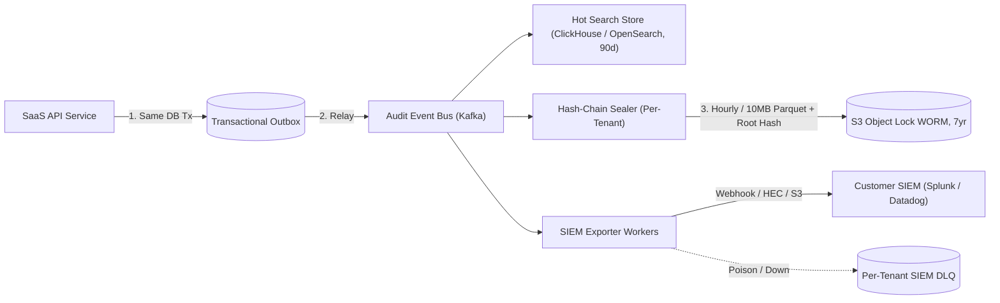
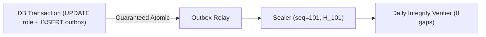

# Enterprise Audit Trails: Tamper-Evident, Exportable Logs

> **Prerequisites:** [Lesson 07: Enterprise Identity](../07-enterprise-identity/README.md).  
> **Estimated Reading Time:** 22–26 minutes  
> **Target Audience:** Backend engineers building compliance-grade SaaS platforms, and candidates asked "how do you design a tamper-evident, multi-tenant audit log that streams to customer SIEMs?"  
> **Free PDF Notes:** [Download SD-R-008.pdf](https://backendroadmap.com/notes/system-design/SD-R-008.pdf)

> [!NOTE]
> **In one line:** An **enterprise audit trail** is an immutable, structured record of *who* did *what* to *which resource*, *when*, and *from where*—protected against tampering via **append-only WORM storage and cryptographic hash chaining**, queryable by tenant admins, and continuously exportable to customer SIEMs (Splunk, Datadog, Sentinel, S3).

> [!TIP]
> **The Golden Rule:** Audit logs are **not** application debug logs. Never let `logger.info()` and compliance audit events share the same unguaranteed, mutable pipeline. Emit structured audit events durably (transactional outbox or synchronous append), seal them with per-tenant hash chains + WORM storage, and decouple SIEM delivery with per-tenant DLQs.

---

## 1. What Enterprise Audit Trails Are, and What They Aren't

A financial regulator investigates an unauthorized wire-transfer rule change in your SaaS. Your application logs rotated out after 14 days, and a compromised admin could have run `DELETE FROM audit_logs` anyway. Enterprise customers (SOC2, HIPAA, PCI-DSS, ISO 27001) require proof that **nobody—not even a rogue DBA or SaaS SRE—can silently alter or delete historical audit records**, and they want those events streamed in real time into their own SIEM.

| Term | Precise Meaning | Example |
| :--- | :--- | :--- |
| **Audit event** | Structured, domain-level record of a security or state-changing action | `actor: alice@acme.com`, `action: role.updated`, `target: usr_42` |
| **Application log** | Unstructured or semi-structured diagnostic output for engineers | `ERROR: pool timeout after 3000ms` |
| **Tamper-evident** | Any modification or deletion of past records is cryptographically detectable | SHA-256 hash chain (`H_n = SHA256(H_{n-1} || event_n)`) |
| **WORM storage** | Write-Once-Read-Many storage enforcing retention locks | AWS S3 Object Lock (Compliance Mode) |
| **SIEM export** | Continuous push/pull of tenant audit events to customer security tools | Splunk HEC, Datadog Logs, AWS S3, Sentinel |
| **Dual-control / Break-glass** | Recording support/impersonation actions with both SaaS SRE and tenant context | `actor: sre@saas.com`, `on_behalf_of: tenant_acme` |
| **Not** | A `SELECT *` dump of every HTTP `GET` health check | High-signal security/config/data-access events, not noise |

### Why It Matters
1. **Non-repudiation & compliance:** SOC2 Type II, HIPAA, and PCI-DSS mandate immutable, actor-attributed audit logs retained for 1–7 years.
2. **Customer SOC integration:** Enterprises correlate your SaaS events with Okta logins and endpoint telemetry in Splunk/Sentinel to detect lateral movement.
3. **Blast-radius containment:** If one tenant's SIEM endpoint goes down, it must not backpressure your API or block another tenant's audit stream.

---

## 2. Anatomy: Durable Ingestion, Tamper-Evident Sealing & SIEM Fan-Out



The architecture separates **three distinct retention and delivery tiers**:
1. **Hot query tier (30–90 days):** Indexed in ClickHouse or OpenSearch partitioned by `(tenant_id, month)` so tenant admins can filter by actor, action, IP, and time range in $< 500\text{ ms}$.
2. **Immutable WORM archive (1–7 years):** A per-tenant **Hash-Chain Sealer** batches events, computes `H_n = SHA256(H_{n-1} || canonical_json(event_n))`, writes Parquet/JSONL segments to **S3 Object Lock (Compliance Mode)**, and anchors the batch's Merkle/chain root hash in a separate append-only ledger.
3. **SIEM Export workers:** Independently consume from the bus and push to each tenant's configured sink (Splunk HEC, S3 bucket, Datadog, Webhook) with per-tenant rate limits, circuit breakers, and dead-letter queues.

| Tier | Storage | Retention | Purpose |
| :--- | :--- | :--- | :--- |
| **Hot** | ClickHouse / OpenSearch | 30–90 days | Interactive UI search, CSV export, anomaly alerts |
| **Cold / WORM** | S3 Object Lock (Compliance) | 1–7 years | Tamper-proof legal archive, forensic verification |
| **Streaming** | Kafka $\to$ SIEM Workers | Real-time ($< 5\text{ s}$) | Customer SOC correlation (Splunk, Sentinel, Datadog) |

> [!WARNING]
> **Never make synchronous HTTP calls to a customer's Splunk/SIEM inside your API request path.** If a customer's Splunk server hangs for 30 seconds, your SaaS login or checkout API hangs too. Always decouple ingestion (outbox/broker) from SIEM delivery.

---

## 3. Mathematical Model: Storage Growth, Hash-Chain Verification & SIEM Backlog

**Storage Volume.** Let a SaaS have $T$ tenants, each generating $\lambda_t$ audit events/sec of average raw JSON size $B_{\text{raw}}$ bytes, compressed at ratio $c$ (typically $c \approx 5\text{–}8\times$ for Parquet/Zstd) over retention $D$ days:

$$S_{\text{year}} = \frac{\left(\sum_{t=1}^{T} \lambda_t\right) \cdot 86{,}400 \cdot 365 \cdot B_{\text{raw}}}{c}$$

**Worked Numerical Example:** Suppose $T = 5{,}000$ tenants average $\lambda_t = 0.08\text{ events/s}$ (aggregate $\Lambda = 400\text{ events/s}$), with $B_{\text{raw}} = 1{,}024\text{ bytes}$ per event:
- **Daily raw volume:** $400 \times 86{,}400 \times 1{,}024 = 35.39\text{ GB/day}$ ($\approx 12.92\text{ TB/year}$ raw).
- **WORM Parquet/Zstd ($c = 6\times$):** $12.92 / 6 = 2.15\text{ TB/year}$ ($\approx \$50/\text{month}$ on S3 Standard + Object Lock).
- **Hot index (90 days, $1.3\times$ index overhead):** $35.39\text{ GB} \times 90 \times 1.3 / 1024 \approx 4.04\text{ TB}$ on SSDs.

**Hash-Chain Integrity Verification.** For a tenant's sequence $e_1, e_2, \dots, e_N$:

$$H_0 = \text{SHA256}(\text{tenant\_id} \parallel \text{genesis\_salt}), \qquad H_i = \text{SHA256}(H_{i-1} \parallel \text{canonical}(e_i))$$

An auditor verifies $N$ events in $O(N)$ time (typically $\sim 500{,}000\text{ SHA-256 hashes/s}$ per CPU core, so 1 million events verify in $\approx 2\text{ seconds}$). Any deleted, reordered, or edited event breaks $H_i$ and every subsequent $H_j$ ($j > i$).

---

## 4. Metrics & Percentiles

| Metric | Meaning | Alert when |
| :--- | :--- | :--- |
| **Outbox relay lag** | Time from DB commit to Kafka publish | $> 2\text{ seconds}$ (audit events falling behind) |
| **Hash-chain break count** | Sequence gaps or hash mismatches in verification job | $> 0$ (immediate SEV-1 integrity alert) |
| **SIEM delivery lag $p_{99}$** | Event timestamp to customer SIEM `200 OK` | $> 30\text{ seconds}$ (per-tenant SLA breach) |
| **SIEM DLQ depth (per tenant)** | Failed SIEM exports after retries | $> 100\text{ events}$ (notify tenant admin of broken webhook/token) |
| **Hot query $p_{99}$** | Tenant admin audit search latency | $> 1.5\text{ seconds}$ |
| **WORM seal lag** | Time since last sealed S3 Object Lock segment | $> 2\times \text{seal\_interval}$ (e.g., $> 2\text{ hours}$) |

### Worked Example (Noisy-Neighbor SIEM Outage)
Tenant B rotates their Splunk HEC token without updating your SaaS, causing `401 Unauthorized` on all SIEM exports. Because each tenant has an isolated retry budget + circuit breaker, after 5 consecutive `401`s, Tenant B's exporter opens its circuit, routes events to Tenant B's DLQ (retained for 7 days), and emails Tenant B's security admin. Meanwhile, Tenant A and Tenant C continue receiving SIEM events at $< 1\text{ s}$ latency with zero thread-pool starvation.

---

## 5. Compounding & Failure Modes: What Breaks in Audit Systems

| Failure Mode | How It Happens | Impact |
| :--- | :--- | :--- |
| **Dual-write loss** | Service commits `UPDATE roles` to Postgres, then crashes before Kafka `produce()` | State changed with **zero audit trail** |
| **Clock skew / non-monotonic order** | Two API pods with 200 ms NTP drift write events out of causal order | Broken hash chain or confusing timeline |
| **PII / secret leakage in logs** | Audit payload serializes `new_api_key` or `password` in `changes.after` | Audit log becomes a credential treasure trove |
| **Unbounded SIEM retries** | Shared Kafka consumer blocks on Tenant B's 30s timeout | All tenants' SIEM streams stall |
| **Mutable S3 bucket** | S3 bucket lacks Object Lock Compliance Mode; compromised root IAM deletes logs | Fails SOC2/SEC audit |

To prevent **hash-chain contention** across multiple API pods, assign sequence numbers and compute $H_i$ in a **single-writer-per-tenant partition** (e.g., Kafka partitioned by `tenant_id`, sealed by one consumer per partition) rather than locking a database row on every API request.

---

## 6. Numbers Every Engineer Must Know

| Item | Typical | Implication |
| :--- | :--- | :--- |
| **Hot search retention** | $30\text{–}90\text{ days}$ | Keep SSD costs bounded; archive older data to WORM |
| **Compliance WORM retention** | $1\text{–}7\text{ years}$ | Driven by SOC2 (1 yr), HIPAA (6 yr), FINRA/SEC (7 yr) |
| **Average audit event size** | $0.8\text{–}2.0\text{ KB}$ JSON | Compresses $5\text{–}8\times$ in Parquet/Zstd |
| **SHA-256 throughput (1 core)** | $\sim 500\text{K–}1\text{M ops/s}$ | Negligible CPU overhead for hash chaining |
| **SIEM batch size** | $100\text{–}500\text{ events}$ or $1\text{ MB}$ | Amortizes TLS/HTTP overhead when pushing to Splunk/Datadog |
| **SIEM HTTP timeout** | $3\text{–}5\text{ seconds}$ | Fail fast and circuit-break per tenant |

---

## 7. Protocol / Mechanism Deep Dive: Outbox + Hash-Chained WORM Sealing

```mermaid
sequenceDiagram
    participant API as API Service
    participant DB as Tenant Postgres (Outbox)
    participant K as Kafka (Partitioned by tenant_id)
    participant S as Hash-Chain Sealer
    participant S3 as S3 Object Lock (WORM)

    API->>DB: BEGIN; UPDATE roles...; INSERT INTO audit_outbox...; COMMIT;
    DB->>K: CDC / Outbox Relay publishes event (key=tenant_id)
    K->>S: Consume ordered batch for tenant_id
    S->>S: Canonicalize JSON + H_i = SHA256(H_{i-1} || event_i)
    S->>S3: PutObject (ObjectLockMode=COMPLIANCE, RetainUntil=+7yr)
    S->>S: Persist checkpoint (seq_end, H_end)
```

| Question | Answer |
| :--- | :--- |
| **Why partition Kafka by `tenant_id`?** | Guarantees per-tenant causal ordering and lets one sealer compute the sequential hash chain without distributed locks. |
| **What if a tenant requests GDPR "Right to be Forgotten" on an immutable WORM log?** | Store only pseudonymous IDs (`usr_42`) in the audit log, or encrypt PII fields with a per-user DEK and **cryptographically shred** the DEK on deletion—preserving the hash chain intact. |
| **Why canonical JSON before hashing?** | Standard `json.dumps` key order can vary across languages; sort keys and use UTF-8 without whitespace (RFC 8785) so verification is deterministic. |
| **Push vs. Pull for SIEM export?** | Support both: **Push** (Splunk HEC, Datadog, Webhook) for real-time $< 5\text{ s}$ alerts, and **Pull** (`GET /v1/audit-logs?cursor=...` or S3 cross-account bucket) for batch ingestion. |

**When not to build a custom hash-chained ledger.** If you only need basic activity history for a consumer app, a simple append-only Postgres table with 90-day retention is plenty. Add WORM Object Lock, cryptographic hash chaining, and SIEM exporters when selling to regulated B2B enterprises.

---

## 8. Hierarchical Budgets & Design Rules

| Slice | Rule | Control |
| :--- | :--- | :--- |
| **Capture** | Every state-changing mutation writes an audit row in the **same DB transaction** | Transactional Outbox pattern; no fire-and-forget |
| **Schema** | Enforce canonical envelope: `event_id`, `tenant_id`, `actor`, `action`, `target`, `ts`, `ip`, `trace_id` | JSON Schema / Protobuf validation at producer |
| **Sanitization** | Never log secrets, tokens, passwords, or raw PII payloads | Field-level allowlist for `changes.before` / `changes.after` |
| **Immutability** | S3 Object Lock in **Compliance Mode** + per-tenant SHA-256 hash chain | Even AWS root cannot delete before `RetainUntilDate` |
| **SIEM isolation** | Per-tenant rate limit, circuit breaker, and 7-day DLQ | One broken customer endpoint cannot stall others |
| **Verification** | Scheduled daily/weekly verifier checks chain continuity and root hashes | Alerts on any missing sequence number or hash mismatch |

---

## 9. Top Mitigations

1. **Use the Transactional Outbox** so an audit event is never lost if the service crashes right after committing a business mutation.
2. **Partition the audit stream by `tenant_id`** to establish a deterministic per-tenant sequence without database row locks.
3. **Seal archived segments with S3 Object Lock (Compliance Mode)** and store the root `H_end` hash in a separate read-only/WORM manifest.
4. **Canonicalize JSON (sorted keys, UTC ISO-8601 timestamps)** before hashing so Go, Python, TypeScript, and C# verifiers always compute identical digests.
5. **Isolate SIEM exporters per tenant** with short timeouts (3–5 s), exponential backoff, circuit breakers, and self-serve DLQ replay in the admin UI.
6. **Encrypt or pseudonymize PII** inside audit events so GDPR erasure (crypto-shredding) doesn't break the immutable hash chain.
7. **Distinguish SaaS SRE impersonation** (`actor.type = "support_sre"`, `impersonating = "alice@acme.com"`) in the customer's audit log for full transparency.

---

## 10. Production Reference: The Silent Audit Gap During a Role Escalation

An enterprise B2B platform used an async HTTP call (`await auditClient.post(...)`) inside a `try/catch` block to record admin role changes. During a traffic spike, the audit service timed out, the `catch` block swallowed the error to avoid failing user requests, and 1,200 role mutations—including a compromised contractor granting themselves `Owner`—went unrecorded.

- **Root cause:** Fire-and-forget audit logging with silent error suppression, plus no sequence numbers to detect missing events.
- **The fix:**
  1. Moved audit capture into the **same PostgreSQL transaction** as the business mutation (`INSERT INTO audit_outbox`).
  2. Added monotonically increasing per-tenant `seq` numbers and SHA-256 hash chaining in the sealer.
  3. Built a daily automated integrity verifier that alerts if `max(seq) - min(seq) + 1 != count(events)` or if any hash fails.



---

## 11. Multi-Language Production Code Tabs

**Tamper-Evident Hash-Chain Audit Logger & Verifier** in all 4 languages using canonical JSON + SHA-256.

````carousel
```go
// Go: Canonical SHA-256 hash-chained audit log appender and verifier.
package audit

import (
	"crypto/sha256"
	"encoding/hex"
	"encoding/json"
	"fmt"
)

type AuditEvent struct {
	TenantID string `json:"tenant_id"`
	Seq      int64  `json:"seq"`
	Actor    string `json:"actor"`
	Action   string `json:"action"`
	Target   string `json:"target"`
	PrevHash string `json:"prev_hash"`
	Hash     string `json:"hash"`
}

func ComputeHash(prevHash string, e AuditEvent) (string, error) {
	// Struct field order is deterministic in Go JSON marshaling.
	payload := struct {
		TenantID string `json:"tenant_id"`
		Seq      int64  `json:"seq"`
		Actor    string `json:"actor"`
		Action   string `json:"action"`
		Target   string `json:"target"`
		PrevHash string `json:"prev_hash"`
	}{e.TenantID, e.Seq, e.Actor, e.Action, e.Target, prevHash}

	raw, err := json.Marshal(payload)
	if err != nil {
		return "", err
	}
	sum := sha256.Sum256(raw)
	return hex.EncodeToString(sum[:]), nil
}

func VerifyChain(genesisHash string, events []AuditEvent) error {
	prev := genesisHash
	for i, ev := range events {
		if ev.PrevHash != prev {
			return fmt.Errorf("chain broken at seq %d: prev_hash mismatch", ev.Seq)
		}
		expected, err := ComputeHash(prev, ev)
		if err != nil || expected != ev.Hash {
			return fmt.Errorf("tamper detected at index %d (seq %d)", i, ev.Seq)
		}
		prev = ev.Hash
	}
	return nil
}
```
<!-- slide -->
```typescript
// TypeScript: Canonical SHA-256 hash-chained audit trail & verifier (Node crypto).
import { createHash } from "crypto";

export interface AuditEvent {
  tenantId: string;
  seq: number;
  actor: string;
  action: string;
  target: string;
  prevHash: string;
  hash: string;
}

export function computeAuditHash(prevHash: string, e: Omit<AuditEvent, "hash" | "prevHash">): string {
  // Deterministic key order for cross-language canonical hashing.
  const canonical = JSON.stringify({
    action: e.action,
    actor: e.actor,
    prevHash,
    seq: e.seq,
    target: e.target,
    tenantId: e.tenantId,
  });
  return createHash("sha256").update(canonical, "utf8").digest("hex");
}

export function verifyAuditChain(genesisHash: string, events: AuditEvent[]): boolean {
  let prev = genesisHash;
  for (const ev of events) {
    if (ev.prevHash !== prev) return false;
    const expected = computeAuditHash(prev, ev);
    if (expected !== ev.hash) return false;
    prev = ev.hash;
  }
  return true;
}
```
<!-- slide -->
```python
# Python: Tamper-evident hash-chain audit log + storage/verification model (stdlib only).
import hashlib
import json
from dataclasses import dataclass


@dataclass
class AuditEvent:
    tenant_id: str
    seq: int
    actor: str
    action: str
    target: str
    prev_hash: str
    hash: str = ""


def compute_hash(prev_hash: str, event: AuditEvent) -> str:
    canonical = json.dumps(
        {
            "tenant_id": event.tenant_id,
            "seq": event.seq,
            "actor": event.actor,
            "action": event.action,
            "target": event.target,
            "prev_hash": prev_hash,
        },
        sort_keys=True,
        separators=(",", ":"),
    ).encode("utf-8")
    return hashlib.sha256(canonical).hexdigest()


def verify_chain(genesis_hash: str, events: list[AuditEvent]) -> tuple[bool, int | None]:
    prev = genesis_hash
    for ev in events:
        if ev.prev_hash != prev or compute_hash(prev, ev) != ev.hash:
            return False, ev.seq
        prev = ev.hash
    return True, None


def annual_storage_tb(events_per_sec: float, avg_bytes: int = 1024, compression: float = 6.0) -> float:
    raw_bytes = events_per_sec * 86_400 * 365 * avg_bytes
    return round((raw_bytes / compression) / (1024**4), 3)
```
<!-- slide -->
```csharp
// C#: Canonical SHA-256 hash-chained audit trail & integrity verifier.
using System.Security.Cryptography;
using System.Text;
using System.Text.Json;

public sealed record AuditEvent(
    string TenantId, long Seq, string Actor, string Action, string Target, string PrevHash, string Hash);

public static class AuditChain
{
    public static string ComputeHash(string prevHash, AuditEvent e)
    {
        var canonical = JsonSerializer.Serialize(new
        {
            action = e.Action,
            actor = e.Actor,
            prevHash,
            seq = e.Seq,
            target = e.Target,
            tenantId = e.TenantId
        });
        var bytes = SHA256.HashData(Encoding.UTF8.GetBytes(canonical));
        return Convert.ToHexString(bytes).ToLowerInvariant();
    }

    public static bool Verify(string genesisHash, IEnumerable<AuditEvent> events)
    {
        var prev = genesisHash;
        foreach (var ev in events)
        {
            if (ev.PrevHash != prev || ComputeHash(prev, ev) != ev.Hash)
                return false;
            prev = ev.Hash;
        }
        return true;
    }
}
```
````

---

## 12. Hands-On CLI Verification Workflows

Verify hash-chain tamper detection and annual storage sizing in Python:

```bash
python3 -c '
from audit import AuditEvent, compute_hash, verify_chain, annual_storage_tb
g = "0" * 64
e1 = AuditEvent("t1", 1, "alice@acme.com", "role.update", "usr_2", g)
e1.hash = compute_hash(g, e1)
e2 = AuditEvent("t1", 2, "alice@acme.com", "key.create", "key_9", e1.hash)
e2.hash = compute_hash(e1.hash, e2)
print("Valid chain:", verify_chain(g, [e1, e2]))
e1.action = "role.delete"  # Tamper!
print("After tamper:", verify_chain(g, [e1, e2]))
print("400 events/s annual WORM TB:", annual_storage_tb(400))
'
```

Verify S3 Object Lock (Compliance Mode) on an archive bucket:

```bash
# 1. Confirm Object Lock is enabled at the bucket level
aws s3api get-object-lock-configuration --bucket acme-audit-worm

# 2. Inspect retention lock on a sealed Parquet segment
aws s3api get-object-retention --bucket acme-audit-worm --key t1/2026/11/seg-0001.parquet

# 3. Export a tenant audit slice via CLI / API
curl -s "https://api.saas.com/v1/audit-logs?from=2026-11-01T00:00:00Z&limit=50" \
  -H "Authorization: Bearer $ADMIN_TOKEN" | jq '.events[] | {seq, actor, action, hash}'
```

---

## 13. Common Mistakes to Avoid

1. **Treating `logger.info()` as an audit trail**—debug logs are mutable, sampled, and lack guaranteed delivery.
2. **Dual-writing** (commit DB, then async HTTP call to audit service) without a transactional outbox.
3. **Logging secrets, JWTs, or raw passwords** inside `changes.before` / `changes.after` diffs.
4. **Letting a slow customer SIEM block the shared audit pipeline** instead of isolating per-tenant workers and DLQs.
5. **Using S3 without Object Lock (Compliance Mode)**, leaving archives vulnerable to compromised IAM credentials.
6. **Hashing non-canonical JSON**, causing false tamper alerts when key ordering differs across services.
7. **Omitting SaaS support impersonation context**, hiding who actually performed an action during a support session.

---

## 14. Key Terms Glossary

| Key Term | Definition |
| :--- | :--- |
| **Audit trail** | Immutable, chronological, actor-attributed record of security and state-changing events. |
| **Tamper-evident** | Design where any unauthorized edit or deletion is cryptographically detectable. |
| **Hash chaining** | Linking each event's SHA-256 digest to the previous event's digest (`H_{i-1}`). |
| **WORM** | Write-Once-Read-Many storage that blocks overwrites and deletes until retention expires. |
| **S3 Object Lock** | AWS S3 feature enforcing WORM retention (Governance vs. stricter Compliance Mode). |
| **SIEM** | Security Information and Event Management system (Splunk, Datadog, Microsoft Sentinel). |
| **Transactional Outbox** | Writing the audit event in the same ACID DB transaction as the business mutation. |
| **Canonical JSON** | Deterministic JSON serialization (sorted keys, no whitespace) for consistent hashing. |
| **Crypto-shredding** | Deleting a user's encryption key to satisfy GDPR erasure without mutating WORM logs. |
| **Per-tenant DLQ** | Isolated dead-letter queue holding failed SIEM deliveries for one tenant. |

---

## 15. System Design Interview Questions & Answers

### Basic Conceptual Questions

<details>
<summary><strong>Q1: How is an enterprise audit trail different from application logs? [BASIC]</strong></summary>

**Answer:**
Application logs are diagnostic, often sampled, unstructured, and mutable. Enterprise audit trails are **compliance-grade, structured business/security events** (`actor`, `action`, `target`, `timestamp`, `ip`) with guaranteed capture, multi-year WORM retention, cryptographic tamper-evidence, and customer SIEM export.
</details>

<details>
<summary><strong>Q2: What makes an audit log "tamper-evident"? [BASIC]</strong></summary>

**Answer:**
**Hash chaining** (each event's hash includes the previous event's hash: $H_i = \text{SHA256}(H_{i-1} \parallel e_i)$) combined with **WORM storage** (like S3 Object Lock Compliance Mode) and external root-hash anchoring. If anyone deletes or edits a past event, all subsequent hashes fail verification.
</details>

<details>
<summary><strong>Q3: Why do enterprises demand SIEM export? [BASIC]</strong></summary>

**Answer:**
Security Operations Centers (SOCs) monitor dozens of SaaS tools. They need your audit events streamed in near-real-time into Splunk, Datadog, or Microsoft Sentinel to correlate suspicious activity (e.g., an anomalous Okta login followed by a mass data export in your SaaS).
</details>

<details>
<summary><strong>Q4: What is S3 Object Lock Compliance Mode vs. Governance Mode? [BASIC]</strong></summary>

**Answer:**
In **Governance Mode**, users with special IAM permissions can still override retention or delete objects. In **Compliance Mode**, **no one**—not even the AWS account root user—can delete or overwrite an object until its `RetainUntilDate` expires.
</details>

### Scenario-Based Architecture Questions

<details>
<summary><strong>Q5: How do you guarantee an audit event is never lost if a service crashes right after updating the database? [SCENARIO]</strong></summary>

**Answer:**
Use the **Transactional Outbox pattern**: insert the audit event into an `audit_outbox` table inside the exact same ACID database transaction as the state change. An outbox relay (or CDC via Debezium) reliably publishes it to Kafka.
</details>

<details>
<summary><strong>Q6: A customer's Splunk endpoint goes down for 6 hours. How do you prevent it from affecting other tenants? [SCENARIO]</strong></summary>

**Answer:**
Decouple SIEM export from ingestion via Kafka, and enforce **per-tenant circuit breakers, rate limits, and isolated DLQs**. When Tenant B's Splunk fails repeatedly, the exporter trips Tenant B's circuit, routes events to Tenant B's DLQ (e.g., 7-day retention), alerts Tenant B's admin, and continues delivering Tenant A's and C's logs uninterrupted.
</details>

<details>
<summary><strong>Q7: How do you scale interactive audit log search for 10,000 tenants over 90 days? [SCENARIO]</strong></summary>

**Answer:**
Store the hot 90-day tier in a columnar/search engine like **ClickHouse** or **OpenSearch**, partitioned by `(toYYYYMM(ts), tenant_id)` with secondary indexes on `actor`, `action`, and `target`. Offload anything older than 90 days to S3 Parquet WORM storage.
</details>

<details>
<summary><strong>Q8: How do you audit actions taken by your own internal SREs when debugging a customer's issue? [SCENARIO]</strong></summary>

**Answer:**
Require Just-in-Time (JIT) approval for support impersonation, and record both identities in the audit event: `actor: "sre-alice@saas.com"`, `actor_type: "saas_support"`, `on_behalf_of: "tenant_acme"`, `ticket_id: "SUP-9912"`. Make these events visible in the customer's own audit log and SIEM stream.
</details>

### Advanced & Tricky Interview Questions

<details>
<summary><strong>Q9: How do you compute a per-tenant hash chain at 5,000 events/sec without a global database lock? [TRICKY]</strong></summary>

**Answer:**
Don't compute the hash chain synchronously on API pods. Publish events to a Kafka topic **partitioned by `tenant_id`**. Since each partition is consumed by a single Sealer worker, that worker computes $H_i = \text{SHA256}(H_{i-1} \parallel e_i)$ sequentially in memory at hundreds of thousands of events/sec with zero lock contention.
</details>

<details>
<summary><strong>Q10: How do you comply with a GDPR "Right to be Forgotten" request if your audit logs are in immutable WORM storage? [TRICKY]</strong></summary>

**Answer:**
Use **crypto-shredding** (or pseudonymization): store opaque `user_id`s in the audit log, or encrypt PII fields (`email`, `ip`) with a per-user encryption key stored outside WORM. When a user requests erasure, delete their key—the WORM log and its SHA-256 hash chain remain 100% intact, while the PII becomes permanently unreadable.
</details>

<details>
<summary><strong>Q11: What if an attacker compromises your Sealer and rewrites the entire hash chain from `seq = 1`? [TRICKY]</strong></summary>

**Answer:**
Anchor each sealed segment's root hash (`H_end`) externally—for example, write it to a separate cross-account WORM ledger, AWS QLDB-style append-only store, or sign it with an HSM key that the Sealer cannot forge retroactively.
</details>

<details>
<summary><strong>Q12: Should you audit `GET` (read) requests as well as `POST/PUT/DELETE` (writes)? [TRICKY]</strong></summary>

**Answer:**
Not all `GET`s (UI polling would explode storage 100x). Audit **sensitive reads**—such as viewing PII/PHI records, downloading bulk exports, or revealing API secrets—and sample/aggregate or rate-limit high-frequency read audits.
</details>

---

## 16. One-Page Master Cheat Sheet

```
+---------------------------------------------------------------------------------------------------------+
|                    ENTERPRISE AUDIT TRAILS — MASTER CHEAT SHEET                                         |
+---------------------------------------------------------------------------------------------------------+
| 1. CAPTURE: Transactional Outbox in the same ACID DB tx as the mutation. Never fire-and-forget.         |
+---------------------------------------------------------------------------------------------------------+
| 2. THREE TIERS: Hot (ClickHouse/OpenSearch 90d) · WORM (S3 Object Lock Compliance 7yr) · SIEM Stream.   |
+---------------------------------------------------------------------------------------------------------+
| 3. TAMPER-EVIDENCE: Partition Kafka by tenant_id -> single Sealer computes H_i = SHA256(H_{i-1}||e_i)   |
|    over canonical JSON -> seal Parquet to S3 WORM + anchor root hash externally.                        |
+---------------------------------------------------------------------------------------------------------+
| 4. SIEM ISOLATION: Per-tenant circuit breaker, rate limit, and DLQ so one broken Splunk never stalls    |
|    other tenants or backpressures the API.                                                              |
+---------------------------------------------------------------------------------------------------------+
| 5. PRIVACY & SECURITY: Scrub secrets/tokens; crypto-shred PII for GDPR without breaking hash chains;    |
|    attribute SaaS SRE impersonation explicitly.                                                         |
+---------------------------------------------------------------------------------------------------------+
```

---

## Further Reading & Sources

- AWS Storage Documentation, *Using S3 Object Lock (Compliance vs. Governance Mode)*.
- IETF RFC 8785, *JSON Canonicalization Scheme (JCS)*.
- Martin Kleppmann, *Designing Data-Intensive Applications*, Chapter 11 ("Stream Processing" & Event Sourcing).
- NIST SP 800-92, *Guide to Computer Security Log Management*.

---

## Free PDF Notes

[SD-R-008.pdf](https://backendroadmap.com/notes/system-design/SD-R-008.pdf)

---

## Next

Continue with [Lesson 09: Tenant Configuration: Plans, Overrides & Entitlements](../09-tenant-configuration/README.md).