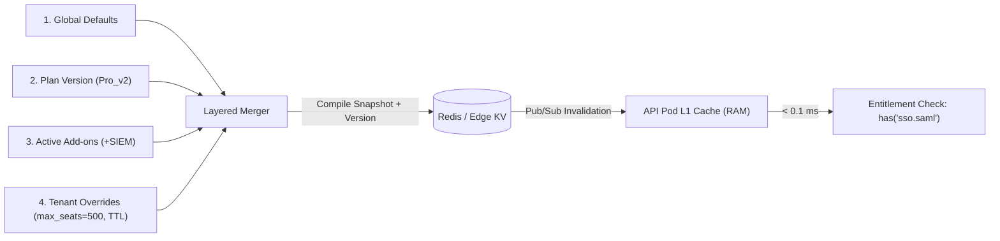
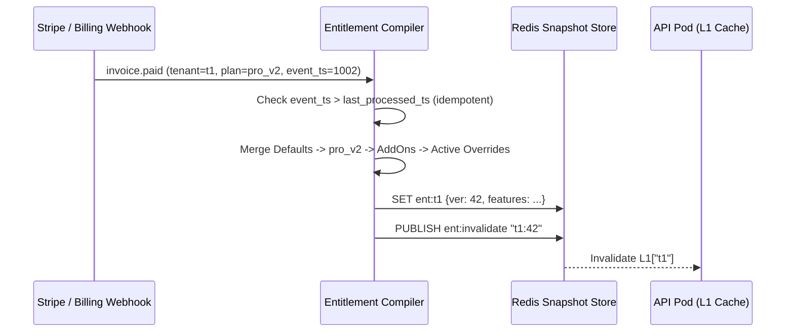
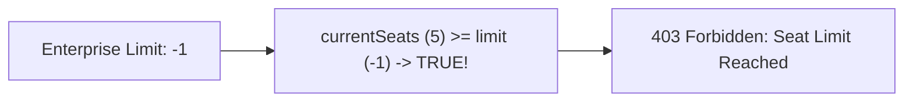

# Tenant Configuration: Plans, Overrides & Entitlements

> **Prerequisites:** [Lesson 08: Enterprise Audit Trails](../08-enterprise-audit-trails/README.md).  
> **Estimated Reading Time:** 22–26 minutes  
> **Target Audience:** Backend engineers designing SaaS monetization, feature gating, and plan management, and candidates asked "how do you model plans, custom enterprise overrides, and fast entitlement checks?"  
> **Free PDF Notes:** [Download SD-R-009.pdf](https://backendroadmap.com/notes/system-design/SD-R-009.pdf)

> [!NOTE]
> **In one line:** **Tenant configuration** separates **Plans** (reusable commercial bundles like `Pro` or `Enterprise`), **Add-ons & Overrides** (per-tenant custom limits or negotiated exceptions), and **Entitlements** (the fast, runtime-resolved truth of *what tenant T can do right now*, evaluated in $< 1\text{ ms}$ via layered merging and versioned caching).

> [!TIP]
> **The Golden Rule:** Never scatter `if tenant.plan == "enterprise"` checks across your codebase. Check **capabilities/entitlements** (`entitlements.has("sso.saml")` or `entitlements.limit("max_seats")`), resolved by merging `Global Defaults -> Plan -> Add-ons -> Tenant Overrides`.

---

## 1. What Tenant Configuration Is, and What It Isn't

Your sales team closes a $200k deal with Acme Corp. Acme is on the `Pro` plan, *except* they negotiated 500 seats (instead of 100), SAML SSO unlocked early, and a 90-day trial of AI Copilot. If your code checks `if (plan === "Enterprise")`, sales has to put Acme on `Enterprise` and manually disable 12 other features—or worse, hardcode `if (tenantId === "acme")`.

| Term | Precise Meaning | Example |
| :--- | :--- | :--- |
| **Plan / Tier** | Standard commercial package defining baseline features and limits | `Free`, `Pro` (`max_seats: 100`, `sso: false`) |
| **Add-on** | Optional purchasable module layered on top of a plan | `+AuditLogExport` (`siem_export: true`) |
| **Tenant override** | Explicit per-tenant exception (sales negotiation, beta, or kill-switch) | `acme: { max_seats: 500, sso: true, expires_at: "2027-01-01" }` |
| **Entitlement** | Final resolved boolean, numeric limit, or enum for a `(tenant, feature)` pair | `evaluate(acme, "max_seats") -> 500` |
| **Feature flag** | Engineering rollout/kill-switch (percentage, canary, operational) | `new_search_engine: 10% rollout` |
| **Grandfathering** | Pinning existing tenants to an older plan version when pricing changes | `Pro_v1` vs `Pro_v2` |
| **Not** | Storing billing invoices or Stripe webhook state directly in app middleware | Separate **Billing** (money) from **Entitlements** (access) |

### Why It Matters
1. **Zero-code commercial agility:** Product and sales can launch `Pro_v2`, run trials, or grant custom enterprise limits without deploying application code.
2. **Sub-millisecond hot path:** Every API request checks entitlements; it must resolve in RAM/Redis in $< 1\text{ ms}$ without hitting the billing provider (Stripe).
3. **Clean grandfathering:** Versioning plans (`Pro_v1`, `Pro_v2`) prevents breaking existing customers when you raise prices or repackage features.

---

## 2. Anatomy: Layered Resolution Pipeline & Caching



When a tenant's subscription or override changes in the **Control Plane**, a compiler merges the four layers in strict precedence order:

$$\text{Effective}(T, k) = \text{Override}(T, k) \;\triangleright\; \text{AddOns}(T, k) \;\triangleright\; \text{PlanVersion}(T, k) \;\triangleright\; \text{GlobalDefault}(k)$$

It writes a single, pre-compiled **Entitlement Snapshot** (`version: 42`, `features: {...}`, `limits: {...}`) to Redis and publishes an invalidation event (`tenant:acme:v42`) so API pods refresh their L1 in-memory cache immediately.

| Layer | Mutability | Owner | Example |
| :--- | :--- | :--- | :--- |
| **Global Defaults** | Code / Config deploy | Engineering | `max_seats: 5`, `sso: false` |
| **Plan Version** | Immutable once published | Product / Billing | `Pro_v2: { max_seats: 100 }` |
| **Add-ons** | Attached per subscription | Billing (Stripe) | `SIEM_Pack: { siem_export: true }` |
| **Tenant Overrides** | Time-bounded or permanent | Sales Ops / Support | `acme: { max_seats: 500, expires_at: ... }` |

> [!WARNING]
> **Never query Stripe or your billing database synchronously on API requests.** If Stripe has a 500 ms latency spike or outage, your entire SaaS goes down. Always materialize entitlements into a local snapshot store + L1 cache, updated asynchronously via webhooks.

---

## 3. Mathematical Model: Cache Stampede, Snapshot Size & L1 Freshness

**L1 Cache Memory Footprint.** Suppose you have $T = 100{,}000$ active tenants, and each compiled entitlement snapshot has $K = 40$ keys ($\approx 1.2\text{ KB}$ JSON/msgpack). Total memory for *all* tenants in Redis is:

$$M_{\text{Redis}} = 100{,}000 \times 1.2\text{ KB} \approx 120\text{ MB}$$

Each API pod keeps an LRU L1 cache of the $10{,}000$ hottest tenants: $10{,}000 \times 1.2\text{ KB} \approx 12\text{ MB}$ per pod—tiny!

**Propagation Delay & Staleness.** Let an API pod handle $R = 2{,}000\text{ req/s}$ across $N_{\text{pods}} = 50$ pods. If L1 cache relies solely on a TTL $\tau = 60\text{ s}$ without Pub/Sub invalidation, Redis sees:

$$\text{Redis}_{\text{QPS}} = \frac{N_{\text{active\_tenants}} \cdot N_{\text{pods}}}{\tau}$$

**Worked Numerical Example:** With $N_{\text{active\_tenants}} = 15{,}000$ tenants active in a minute, $N_{\text{pods}} = 50$, and $\tau = 60\text{ s}$:

$$\text{Redis}_{\text{QPS}} = \frac{15{,}000 \times 50}{60} = 12{,}500\text{ req/s}$$

With **Pub/Sub invalidation + $\tau = 300\text{ s}$ fallback TTL**, steady-state Redis QPS drops $5\times$ to $2{,}500\text{ req/s}$, while plan upgrades propagate to all 50 pods in $< 50\text{ ms}$!

---

## 4. Metrics & Percentiles

| Metric | Meaning | Alert when |
| :--- | :--- | :--- |
| **Entitlement check $p_{99}$** | Latency of `hasFeature()` / `getLimit()` | $> 1\text{ ms}$ (L1 cache miss or Redis stall) |
| **L1 cache hit ratio** | Percentage of checks served from pod RAM | $< 95\%$ (LRU too small or TTL too short) |
| **Webhook-to-snapshot lag** | Time from Stripe webhook to compiled snapshot | $> 5\text{ seconds}$ (customer upgraded but still blocked) |
| **Override expiry backlog** | Expired overrides not yet cleaned/recompiled | $> 0$ for $> 1\text{ hour}$ |
| **Snapshot compilation errors** | Invalid schema or missing plan version | $> 0$ (immediate alert; never overwrite valid snapshot) |

### Worked Example (Trial Expiration)
Acme Corp gets a 14-day override `ai_copilot: true, expires_at: 2026-12-01T00:00:00Z`. Rather than running a cron job to delete rows, the entitlement evaluator checks `now < override.expires_at` at read time **and** a background sweeper recompiles the snapshot at expiry. Even if the sweeper is delayed by 30 seconds, the read-time check enforces the exact expiration boundary deterministically.

---

## 5. Compounding & Failure Modes: What Breaks in Tenant Configuration

| Failure Mode | How It Happens | Impact |
| :--- | :--- | :--- |
| **Plan name coupling** | Code checks `if plan == "enterprise"` in 80 places | Cannot repackage plans or grant partial enterprise features |
| **Unversioned plan edits** | Product edits `Pro` from 100 seats to 50 seats in place | Existing customers suddenly lose seats (broken grandfathering) |
| **Numeric vs. boolean conflict** | One service treats `max_seats: -1` as unlimited; another treats `-1` as 0 | Paying enterprise customers get locked out of adding users |
| **Webhook out-of-order** | Stripe delivers `subscription.updated` before `subscription.created` | Tenant downgraded or left in broken state |
| **Orphaned overrides** | Sales grants `max_seats: 1000` override; tenant later upgrades to `Enterprise` (2,000 seats) | Override **downgrades** them to 1,000 seats! |

Notice that last bug (**Override Downgrade**): for numeric limits, decide explicitly whether an override is an **absolute pin** (`= 1000`) or a **floor/delta** (`max(plan, 1000)` or `+500`), and clear temporary overrides on plan upgrades.

---

## 6. Numbers Every Engineer Must Know

| Item | Typical | Implication |
| :--- | :--- | :--- |
| **L1 entitlement lookup** | $50\text{–}200\text{ ns}$ (in-memory map) | Zero measurable overhead per HTTP request |
| **Redis snapshot lookup** | $0.5\text{–}1.5\text{ ms}$ | Fast fallback on L1 miss |
| **Entitlements per tenant** | $20\text{–}100\text{ keys}$ | Entire snapshot fits in $1\text{–}3\text{ KB}$ |
| **Plan versions per tier** | $2\text{–}5\text{ active}$ | Immutable versions (`pro_v1`, `pro_v2`) make grandfathering trivial |
| **Webhook-to-UI SLA** | $< 3\text{–}5\text{ seconds}$ | Users expect immediate unlock right after entering a credit card |

---

## 7. Protocol / Mechanism Deep Dive: Entitlement Compilation & Fail-Safe Defaults



| Question | Answer |
| :--- | :--- |
| **How do you handle out-of-order billing webhooks?** | Store `last_event_ts` (or Stripe `event.created` / monotonic version) on the subscription; ignore older events, or fetch the current subscription state from the billing API on receipt. |
| **Should entitlements fail open or fail closed if Redis is down?** | Serve **stale L1 cache** first; if completely cold, fail closed on paid-only features (`sso`) or fall back to safe `Free` defaults—never crash the entire API. |
| **How do feature flags differ from entitlements?** | **Entitlements** are *commercial* (who paid for what, per tenant, long-lived). **Feature flags** are *operational* (gradual 5% rollout, bug kill-switch, short-lived). Keep them separate, though an operational kill-switch can override an entitlement in an emergency. |

**When not to build a custom entitlement engine.** Early-stage startups with 2 plans and 0 custom overrides can start with a simple JSON config file mapping `plan_id -> limits`. Build the full layered compiler + override store once sales starts negotiating custom enterprise deals.

---

## 8. Hierarchical Budgets & Design Rules

| Slice | Rule | Control |
| :--- | :--- | :--- |
| **Code coupling** | Never branch on `plan_name` in business logic | Always query `entitlement.Has(feature)` / `entitlement.Limit(key)` |
| **Plan immutability** | Never mutate a published plan version; create `pro_v3` | Existing tenants stay on `pro_v2` (grandfathering) |
| **Precedence** | `Default < Plan < AddOn < Override < KillSwitch` | Single deterministic compiler function |
| **Time bounds** | Every trial/sales override has an optional `expires_at` | Checked at read time + cleaned up by sweeper |
| **Hot-path speed** | L1 RAM cache + Redis snapshot + Pub/Sub invalidation | $< 1\text{ ms}$ p99; zero runtime calls to Stripe |
| **Auditability** | Every override/plan change emits an enterprise audit event | Who granted `max_seats=500`, why, and when it expires |

---

## 9. Top Mitigations

1. **Decouple code from plan names** by gating every feature behind an explicit capability key (`sso.saml`, `audit.siem_export`, `seats.max`).
2. **Version plans immutably** (`pro_2025_01`, `pro_2026_11`) so pricing changes never silently break grandfathered customers.
3. **Compile pre-merged entitlement snapshots** into Redis and cache them in pod L1 memory with Pub/Sub invalidation.
4. **Enforce `expires_at` at evaluation time** so expired trials/overrides stop working at the exact second, regardless of cron delays.
5. **Represent "unlimited" explicitly** (e.g., `null` or a typed `Limit{Unlimited: true}` struct), never magic `-1` integers that can leak into arithmetic.
6. **Handle out-of-order billing webhooks** by storing monotonic event timestamps or re-fetching canonical state from the billing provider.
7. **Support an emergency operational kill-switch layer** above tenant overrides so SREs can disable a crashing feature globally in seconds.

---

## 10. Production Reference: The `-1` Unlimited Seats Bug

A SaaS platform stored numeric limits as plain integers and used `-1` to represent "unlimited" for Enterprise tenants. A new developer added a seat-enforcement check: `if currentSeats >= limit { return 403 }`.

- **The incident:** Immediately after deploy, every Enterprise customer (`limit = -1`) was blocked from inviting new users because `5 >= -1` evaluated to `true`! Meanwhile, a separate `remaining = limit - currentSeats` UI widget displayed `-6 seats remaining`.
- **Root cause:** Using a magic sentinel integer (`-1`) instead of an explicit typed limit (`unlimited: bool, value: int64`).



- **The fix:**
  1. Replaced raw integer limits with a typed struct `{ Unlimited bool, Value int64 }` across all schemas and SDKs.
  2. Added unit tests covering `0`, `positive`, and `Unlimited` cases for every quota/entitlement helper.
  3. Added a global kill-switch and L1 snapshot versioning so bad config pushes roll back in $< 5\text{ seconds}$.

---

## 11. Multi-Language Production Code Tabs

**Layered Entitlement Compiler & Typed Evaluator** (`Default < Plan < AddOn < Override` with `expires_at` and explicit `Unlimited` limits) in all 4 languages.

````carousel
```go
// Go: Layered Entitlement Compiler with typed Unlimited limits and expiration.
package entitlements

import "time"

type Limit struct {
	Unlimited bool
	Value     int64
}

type Override struct {
	Key       string
	BoolVal   *bool
	LimitVal  *Limit
	ExpiresAt *time.Time
}

type Snapshot struct {
	Features map[string]bool
	Limits   map[string]Limit
}

func Compile(
	defaults Snapshot,
	plan Snapshot,
	addOns []Snapshot,
	overrides []Override,
	now time.Time,
) Snapshot {
	out := Snapshot{
		Features: make(map[string]bool),
		Limits:   make(map[string]Limit),
	}
	apply := func(s Snapshot) {
		for k, v := range s.Features {
			out.Features[k] = v
		}
		for k, v := range s.Limits {
			out.Limits[k] = v
		}
	}
	apply(defaults)
	apply(plan)
	for _, a := range addOns {
		apply(a)
	}
	for _, ov := range overrides {
		if ov.ExpiresAt != nil && !now.Before(*ov.ExpiresAt) {
			continue // Expired trial/override is ignored deterministically
		}
		if ov.BoolVal != nil {
			out.Features[ov.Key] = *ov.BoolVal
		}
		if ov.LimitVal != nil {
			out.Limits[ov.Key] = *ov.LimitVal
		}
	}
	return out
}

func (s Snapshot) CanUseSeats(current, requested int64) bool {
	lim, ok := s.Limits["max_seats"]
	if !ok {
		return false
	}
	return lim.Unlimited || (current+requested) <= lim.Value
}
```
<!-- slide -->
```typescript
// TypeScript: Layered Entitlement Compiler with typed Unlimited limits.
export type Limit = { unlimited: true } | { unlimited: false; value: number };

export interface EntitlementLayer {
  features?: Record<string, boolean>;
  limits?: Record<string, Limit>;
}

export interface TenantOverride {
  key: string;
  boolVal?: boolean;
  limitVal?: Limit;
  expiresAtMs?: number;
}

export interface CompiledEntitlements {
  features: Record<string, boolean>;
  limits: Record<string, Limit>;
}

export function compileEntitlements(
  defaults: EntitlementLayer,
  plan: EntitlementLayer,
  addOns: EntitlementLayer[],
  overrides: TenantOverride[],
  nowMs = Date.now()
): CompiledEntitlements {
  const features: Record<string, boolean> = { ...defaults.features, ...plan.features };
  const limits: Record<string, Limit> = { ...defaults.limits, ...plan.limits };

  for (const addon of addOns) {
    Object.assign(features, addon.features);
    Object.assign(limits, addon.limits);
  }
  for (const ov of overrides) {
    if (ov.expiresAtMs !== undefined && nowMs >= ov.expiresAtMs) continue;
    if (ov.boolVal !== undefined) features[ov.key] = ov.boolVal;
    if (ov.limitVal !== undefined) limits[ov.key] = ov.limitVal;
  }
  return { features, limits };
}

export function canAddSeats(ent: CompiledEntitlements, current: number, delta: number): boolean {
  const lim = ent.limits["max_seats"];
  if (!lim) return false;
  return lim.unlimited || current + delta <= lim.value;
}
```
<!-- slide -->
```python
# Python: Layered Entitlement Compiler + Redis QPS model (stdlib only).
from dataclasses import dataclass, field


@dataclass(frozen=True)
class Limit:
    value: int = 0
    unlimited: bool = False

    def allows(self, current: int, delta: int = 1) -> bool:
        return self.unlimited or (current + delta) <= self.value


@dataclass
class Override:
    key: str
    bool_val: bool | None = None
    limit_val: Limit | None = None
    expires_at: float | None = None


@dataclass
class Snapshot:
    features: dict[str, bool] = field(default_factory=dict)
    limits: dict[str, Limit] = field(default_factory=dict)


def compile_entitlements(
    defaults: Snapshot,
    plan: Snapshot,
    addons: list[Snapshot],
    overrides: list[Override],
    now_ts: float,
) -> Snapshot:
    features = {**defaults.features, **plan.features}
    limits = {**defaults.limits, **plan.limits}
    for addon in addons:
        features.update(addon.features)
        limits.update(addon.limits)
    for ov in overrides:
        if ov.expires_at is not None and now_ts >= ov.expires_at:
            continue
        if ov.bool_val is not None:
            features[ov.key] = ov.bool_val
        if ov.limit_val is not None:
            limits[ov.key] = ov.limit_val
    return Snapshot(features=features, limits=limits)
```
<!-- slide -->
```csharp
// C#: Layered Entitlement Compiler with typed Limit and expiration checks.
public readonly record struct Limit(long Value, bool Unlimited)
{
    public bool Allows(long current, long delta = 1) => Unlimited || (current + delta) <= Value;
}

public sealed record Override(string Key, bool? BoolVal, Limit? LimitVal, DateTimeOffset? ExpiresAt);

public sealed class EntitlementSnapshot
{
    public Dictionary<string, bool> Features { get; } = new();
    public Dictionary<string, Limit> Limits { get; } = new();

    public void Merge(EntitlementSnapshot other)
    {
        foreach (var (k, v) in other.Features) Features[k] = v;
        foreach (var (k, v) in other.Limits) Limits[k] = v;
    }

    public static EntitlementSnapshot Compile(
        EntitlementSnapshot defaults,
        EntitlementSnapshot plan,
        IEnumerable<EntitlementSnapshot> addOns,
        IEnumerable<Override> overrides,
        DateTimeOffset now)
    {
        var result = new EntitlementSnapshot();
        result.Merge(defaults);
        result.Merge(plan);
        foreach (var a in addOns) result.Merge(a);
        foreach (var ov in overrides)
        {
            if (ov.ExpiresAt.HasValue && now >= ov.ExpiresAt.Value) continue;
            if (ov.BoolVal.HasValue) result.Features[ov.Key] = ov.BoolVal.Value;
            if (ov.LimitVal.HasValue) result.Limits[ov.Key] = ov.LimitVal.Value;
        }
        return result;
    }
}
```
````

---

## 12. Hands-On CLI Verification Workflows

Test layered entitlement compilation and expiration in Python:

```bash
python3 -c '
from entitlements import Limit, Override, Snapshot, compile_entitlements
defaults = Snapshot({"sso": False}, {"max_seats": Limit(5)})
pro_v2   = Snapshot({"sso": False}, {"max_seats": Limit(100)})
siem     = Snapshot({"siem_export": True}, {})
overrides = [
    Override("sso", bool_val=True, expires_at=2000.0),
    Override("max_seats", limit_val=Limit(unlimited=True), expires_at=None),
]
active = compile_entitlements(defaults, pro_v2, [siem], overrides, now_ts=1500.0)
expired = compile_entitlements(defaults, pro_v2, [siem], overrides, now_ts=2500.0)
print("At t=1500:", active.features, active.limits["max_seats"].allows(10_000))
print("At t=2500:", expired.features, expired.limits["max_seats"].allows(10_000))
'
```

Inspect compiled tenant snapshots in Redis and test invalidation:

```bash
# 1. Read compiled entitlement snapshot for tenant acme
redis-cli GET "ent:acme" | jq .

# 2. Trigger L1 cache invalidation across all API pods
redis-cli PUBLISH "ent:invalidate" "acme:43"

# 3. Verify API entitlement endpoint returns resolved capabilities
curl -s https://api.saas.com/v1/tenants/acme/entitlements \
  -H "Authorization: Bearer $ADMIN_TOKEN" | jq '{plan_version, features, limits}'
```

---

## 13. Common Mistakes to Avoid

1. **Branching on `plan_name` (`if plan == "enterprise"`)** instead of checking capability keys.
2. **Mutating plans in place**, silently breaking grandfathered customers on older pricing.
3. **Calling Stripe/billing APIs synchronously** on every user request.
4. **Using `-1` magic integers for unlimited**, causing comparison bugs (`5 >= -1`).
5. **Forgetting `expires_at` checks at evaluation time**, leaving expired trials active until a cron runs.
6. **Mixing operational feature flags with commercial entitlements** without clear precedence.
7. **Overwriting valid snapshots when a billing webhook arrives out of order**.

---

## 14. Key Terms Glossary

| Key Term | Definition |
| :--- | :--- |
| **Plan / Tier** | Versioned commercial bundle of baseline features and limits (`pro_v2`). |
| **Add-on** | Optional paid module layered on top of a base plan. |
| **Tenant override** | Per-tenant exception for sales deals, trials, or custom limits. |
| **Entitlement** | Final resolved runtime capability (`sso: true`, `max_seats: 500`). |
| **Grandfathering** | Keeping existing customers on an older immutable plan version. |
| **Entitlement snapshot** | Pre-merged, versioned JSON/msgpack blob cached in Redis and pod RAM. |
| **Feature flag** | Engineering rollout or operational kill-switch (separate from billing). |
| **L1 / L2 cache** | In-process pod RAM cache (L1) backed by shared Redis (L2). |
| **Pub/Sub invalidation** | Broadcasting snapshot version updates to evict stale L1 entries immediately. |
| **Typed Limit** | Explicit `{value, unlimited}` representation avoiding magic `-1` bugs. |

---

## 15. System Design Interview Questions & Answers

### Basic Conceptual Questions

<details>
<summary><strong>Q1: What is the difference between a Plan, an Override, and an Entitlement? [BASIC]</strong></summary>

**Answer:**
A **Plan** is a reusable commercial bundle (`Pro`). An **Override** is a per-tenant exception (`max_seats = 500` for Acme). An **Entitlement** is the **final resolved runtime truth** computed by merging `Defaults < Plan < Add-ons < Overrides`.
</details>

<details>
<summary><strong>Q2: Why shouldn't application code check `if tenant.plan == "enterprise"`? [BASIC]</strong></summary>

**Answer:**
Because commercial packaging changes constantly. If sales offers SAML SSO as a paid add-on to `Pro` customers, or grants a 14-day Enterprise trial, `plan == "enterprise"` breaks everywhere. Checking `entitlements.has("sso.saml")` decouples engineering from pricing changes.
</details>

<details>
<summary><strong>Q3: What is grandfathering, and how do you support it cleanly? [BASIC]</strong></summary>

**Answer:**
Grandfathering keeps existing customers on their original terms when you change pricing. Support it by making plan versions **immutable** (`pro_v1`, `pro_v2`). New signups get `pro_v2`; existing tenants keep `plan_version = "pro_v1"` until they explicitly migrate.
</details>

<details>
<summary><strong>Q4: Why separate Feature Flags from Commercial Entitlements? [BASIC]</strong></summary>

**Answer:**
Entitlements represent **what a customer paid for** (long-lived, contractually binding). Feature flags represent **engineering rollouts and kill-switches** (short-lived, percentage-based). Mixing them leads to accidentally turning off a paid feature when cleaning up an old rollout flag.
</details>

### Scenario-Based Architecture Questions

<details>
<summary><strong>Q5: How do you serve entitlement checks in $< 1\text{ ms}$ without calling Stripe on every request? [SCENARIO]</strong></summary>

**Answer:**
Use an asynchronous **Entitlement Compiler** triggered by Stripe webhooks and admin overrides. It merges all layers into a small (~1.2 KB) snapshot in Redis and publishes an invalidation message so API pods cache the snapshot in L1 RAM, serving checks in nanoseconds.
</details>

<details>
<summary><strong>Q6: A customer upgrades their plan via Stripe Checkout and immediately redirects back to your app. How do you avoid showing "Upgrade required" due to webhook lag? [SCENARIO]</strong></summary>

**Answer:**
On the Checkout success callback, trigger a synchronous `ReconcileSubscription(tenantId)` call from your backend to Stripe (using the `checkout_session_id`), compile and write the new snapshot to Redis + broadcast L1 invalidation before returning the redirect response.
</details>

<details>
<summary><strong>Q7: Sales grants Acme Corp an override of `max_seats = 200` while on `Pro` (100 seats). Six months later, Acme upgrades to `Enterprise` (500 seats). What goes wrong? [SCENARIO]</strong></summary>

**Answer:**
If the override is an absolute pin (`= 200`), upgrading to `Enterprise` **downgrades** Acme from 500 seats to 200! Prevent this by either modeling overrides as additive deltas (`+100 seats`), using `max(plan, override)` semantics, or automatically expiring/clearing lower overrides upon plan upgrade.
</details>

<details>
<summary><strong>Q8: How do you handle a 14-day Enterprise trial that must expire at midnight UTC? [SCENARIO]</strong></summary>

**Answer:**
Attach `expires_at` to the trial override records, evaluate `now < expires_at` **at read time** inside the entitlement check, and run a background sweeper to recompile and clean up expired overrides.
</details>

### Advanced & Tricky Interview Questions

<details>
<summary><strong>Q9: Stripe sends `customer.subscription.updated` webhooks out of order during a rapid upgrade/downgrade. How do you prevent stale state? [TRICKY]</strong></summary>

**Answer:**
Never blindly apply webhook payloads. Either store `last_stripe_event_created` and discard older events, or treat the webhook purely as a **wake-up signal** and fetch the authoritative current subscription state directly from Stripe's API before compiling the snapshot.
</details>

<details>
<summary><strong>Q10: How do you safely remove a feature key from the codebase without breaking compiled snapshots? [TRICKY]</strong></summary>

**Answer:**
Use a two-phase deprecation: (1) stop reading the key in application code and deploy, (2) remove the key from plan definitions and run a background recompile of tenant snapshots. Never delete a key from the config schema while old code pods still read it.
</details>

<details>
<summary><strong>Q11: What happens if Redis goes down and your L1 cache misses for a newly logged-in tenant? [TRICKY]</strong></summary>

**Answer:**
Serve stale L1 entries if available; on a cold miss when Redis is unreachable, fall back to reading the compiled snapshot from the primary Postgres `tenant_entitlements` table (or fail safe to `Free` tier defaults for non-critical paths) rather than returning `500` across the whole platform.
</details>

<details>
<summary><strong>Q12: How do you audit who granted a $0 enterprise override to a customer? [TRICKY]</strong></summary>

**Answer:**
Every override mutation in the internal admin/Sales Ops portal must require a `reason` / `ticket_id`, an `expires_at` (or explicit permanent approval), and emit an immutable enterprise audit log event recording the internal operator, before/after values, and timestamp.
</details>

---

## 16. One-Page Master Cheat Sheet

```
+---------------------------------------------------------------------------------------------------------+
|                    TENANT CONFIGURATION & ENTITLEMENTS — MASTER CHEAT SHEET                             |
+---------------------------------------------------------------------------------------------------------+
| 1. GOLDEN RULE: Check capabilities (has("sso.saml")), NEVER plan names (plan == "enterprise").          |
+---------------------------------------------------------------------------------------------------------+
| 2. PRECEDENCE: Global Defaults < Immutable Plan Version < Add-ons < Tenant Overrides < Kill-Switch.     |
+---------------------------------------------------------------------------------------------------------+
| 3. HOT PATH: Compile snapshot (~1.2 KB) async via webhooks -> Redis (L2) + Pod RAM (L1) + Pub/Sub       |
|    invalidation. Zero synchronous Stripe calls on user requests (< 1 ms p99).                           |
+---------------------------------------------------------------------------------------------------------+
| 4. GRANDFATHERING: Version plans immutably (pro_v1, pro_v2). Never mutate published plans in place.     |
+---------------------------------------------------------------------------------------------------------+
| 5. EDGE CASES: Typed Limit{Value, Unlimited} (never -1) · Read-time expires_at · Idempotent webhooks.   |
+---------------------------------------------------------------------------------------------------------+
```

---

## Further Reading & Sources

- Stripe Documentation, *Entitlements & Subscription Webhooks Best Practices*.
- Martin Fowler, *Feature Toggles (Managing Configuration vs. Releases)*.
- AWS SaaS Lens, *Tiering, Packaging, and Entitlements in Multi-Tenant SaaS*.
- Stigg / Schematic Engineering Blogs, *Modeling SaaS Pricing, Plans, and Overrides*.

---

## Free PDF Notes

[SD-R-009.pdf](https://backendroadmap.com/notes/system-design/SD-R-009.pdf)

---

## Next

Continue with [Lesson 10: Deployment Stamps: Scaling SaaS with Cells Across Regions](../10-deployment-stamps/README.md).