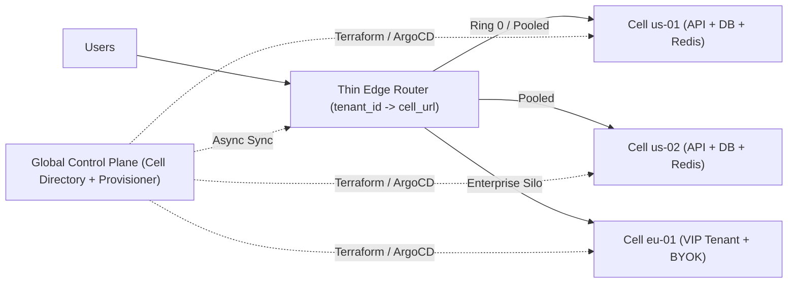
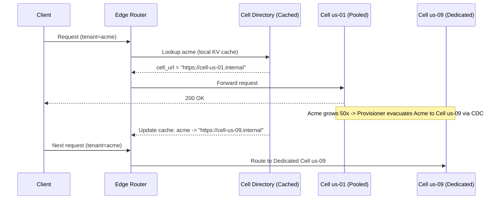
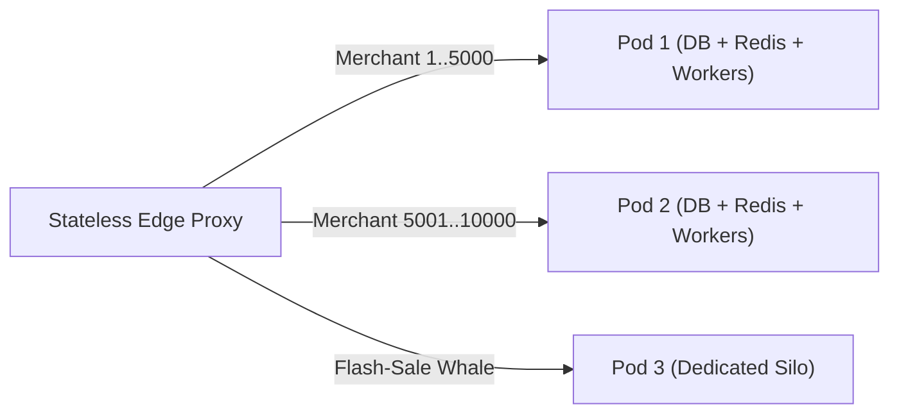

# Deployment Stamps: Scaling SaaS with Cells Across Regions

> **Prerequisites:** [Lesson 09: Tenant Configuration](../09-tenant-configuration/README.md).  
> **Estimated Reading Time:** 24–28 minutes  
> **Target Audience:** Staff/principal engineers scaling multi-tenant SaaS beyond single-cluster limits, and candidates asked "how do you cap blast radius and scale to 100,000+ tenants across regions?"  
> **Free PDF Notes:** [Download SD-R-010.pdf](https://backendroadmap.com/notes/system-design/SD-R-010.pdf)

> [!NOTE]
> **In one line:** A **Deployment Stamp (Cell-Based Architecture)** packages your entire application stack (API, workers, database, cache, queue) into an independent, fixed-capacity unit called a **stamp** or **cell**, isolates each tenant to one cell, and scales horizontally by stamping out new cells—capping blast radius, eliminating shared bottlenecks, and enabling safe canary rollouts.

> [!TIP]
> **The Golden Rule:** Never scale a single monolithic cluster or shared database indefinitely until one bad migration or noisy neighbor takes down 100% of your customers. Cap every cell at a fixed **maximum tenant/RPS ceiling** (e.g., 5% or 10% of fleet) and scale by **adding cells**, not making cells bigger.

---

## 1. What Deployment Stamps Are, and What They Isn't

Your SaaS grew from 100 to 25,000 tenants on one giant Kubernetes cluster and one 64-vCPU primary Postgres instance. Now, a single bad schema migration locks the `users` table and takes down *every* customer simultaneously; a Redis OOM kills *every* tenant's session; and you have hit the cloud provider's IOPS and connection limits. **Deployment Stamps** (popularized by Azure's Deployment Stamps pattern and AWS Cell-Based Architecture) solve this by **sharding the entire stack** into self-contained, share-nothing cells.

| Term | Precise Meaning | Example |
| :--- | :--- | :--- |
| **Deployment Stamp / Cell** | Self-contained, fixed-size instance of the full data-plane stack | `cell-us-01` (EKS + RDS + Redis + Kafka) serving 2,000 tenants |
| **Tenant-to-Cell Router** | Thin stateless edge layer mapping `tenant_id -> cell_endpoint` | Cloudflare Worker / Envoy reading global cell directory |
| **Shared-nothing cell** | Zero cross-cell database joins, shared Redis, or shared queues | `cell-us-01` cannot query `cell-us-02`'s RDS |
| **Scale unit** | Predictable capacity target of one stamp | 1 cell = 2,000 tenants, 5,000 RPS, 2 TB DB |
| **Canary / Ring cell** | Dedicated cell(s) receiving deployments first (Ring 0 $\to$ Ring 1 $\to$ Ring 2) | `cell-us-00` (internal/free) $\to$ 1% $\to$ 10% $\to$ 100% |
| **Dedicated (Silo) cell** | A stamp holding a single VIP enterprise tenant | `cell-eu-acme` for a $2M/yr bank |
| **Not** | Just horizontal pod autoscaling or database read replicas | HPA scales compute only; a single DB/Redis remains a global SPOF |

### Why It Matters
1. **Blast-radius containment:** With 20 equal cells, a catastrophic cell failure or bad canary deploy affects at most **5%** of tenants—not 100%.
2. **Predictable performance:** You load-test and certify **one cell** to its exact scale unit; scaling 10x simply means stamping 10 identical Terraform modules.
3. **Flexible isolation:** Free/Pro tenants share pooled cells, while regulated or noisy enterprise whales get their own **dedicated cell** with zero code changes.

---

## 2. Anatomy: Control Plane, Edge Router & Share-Nothing Cells



Every cell is **hermetically sealed**:
- **Inside a cell:** API pods, async workers, primary + standby DB, Redis cluster, and regional queue/storage.
- **Outside a cell (Control Plane):** Only the **Cell Directory** (`tenant_id -> cell_url`), the **Cell Provisioner** (Terraform/Crossplane), and **Wave Deployment Orchestrator** (ArgoCD/Spinnaker).

| Dimension | Single Monolithic Cluster | Cell-Based (Deployment Stamps) |
| :--- | :--- | :--- |
| **Blast radius** | 100% of tenants on DB/Redis/deploy failure | $1/N$ of tenants (e.g., 5% with 20 cells) |
| **Scaling ceiling** | Hits single-DB IOPS, lock contention, cloud quotas | Virtually unlimited (add more cells) |
| **Deployment risk** | All-or-nothing or complex feature-flag rollbacks | Progressive ring rollouts (`cell-01` $\to$ `cell-02..20`) |
| **Operational overhead** | Low (1 cluster to manage) | Higher (must automate IaC, fleet schema migrations, monitoring) |

> [!WARNING]
> **If your cells share a single Redis cluster, Kafka cluster, or "shared global DB," you do NOT have a cell-based architecture.** Any shared runtime dependency reintroduces a 100% blast radius. Keep the Edge Router ultra-thin, stateless, and backed by locally cached routing tables.

---

## 3. Mathematical Model: Blast Radius, Availability & Packing Efficiency

**Blast Radius.** If $T$ tenants are evenly distributed across $N_{\text{cells}}$ independent stamps, a single-cell outage impacts fraction $B = 1 / N_{\text{cells}}$ of the customer base:

$$B = \frac{1}{N_{\text{cells}}}, \qquad \text{Downtime\_Impact}_{\text{fleet}} = \frac{\text{Downtime}_{\text{cell}}}{N_{\text{cells}}}$$

**Fleet-Wide Effective Availability.** Suppose each cell has availability $A_{\text{cell}} = 99.95\%$ (262 minutes downtime/year), and the thin Edge Router has $A_{\text{edge}} = 99.999\%$ (5.2 minutes/year). The expected customer-minutes lost per tenant per year is:

$$A_{\text{tenant}} \approx A_{\text{edge}} \cdot A_{\text{cell}} = 0.99999 \times 0.9995 \approx 99.949\%$$

However, because cell failures are **uncorrelated** across stamps (especially across AZs/regions and staggered deployment rings), the probability that **all** $N_{\text{cells}}$ fail simultaneously is:

$$P(\text{total\_outage}) = (1 - A_{\text{edge}}) + (1 - A_{\text{cell}})^{N_{\text{cells}}}$$

**Worked Numerical Example:** With $N_{\text{cells}} = 20$ cells, $A_{\text{cell}} = 99.95\%$ ($1 - A_{\text{cell}} = 5 \times 10^{-4}$), and $A_{\text{edge}} = 99.999\%$:
- **Single-cell failure impact:** $1 / 20 = \mathbf{5\%}$ of tenants.
- **Simultaneous multi-cell outage:** $(5 \times 10^{-4})^{20} \approx 10^{-66}$ (effectively zero); total fleet outage is dominated solely by the ultra-simple Edge Router ($0.001\%$, or 5.2 min/yr).
- **Scale unit sizing:** For $100{,}000$ total tenants at $5{,}000\text{ tenants/cell}$, you run $N_{\text{cells}} = 20$ cells, each sized identically for $5{,}000$ tenants + $30\%$ headroom.

---

## 4. Metrics & Percentiles

| Metric | Meaning | Alert when |
| :--- | :--- | :--- |
| **Cell utilization (CPU / DB / IOPS)** | Load relative to certified scale-unit ceiling | $> 70\%$ (trigger automated new cell provisioning) |
| **Tenant count per cell** | Packing density vs. max cell cap | $> 85\%$ of cell cap (stop placing new signups here) |
| **Edge routing $p_{99}$** | Time to resolve `tenant_id -> cell_url` | $> 3\text{ ms}$ (edge cache miss or directory issue) |
| **Schema migration skew** | Version difference across fleet cells | $> 1\text{ version}$ behind for $> 24\text{ hours}$ |
| **Cell provisioning time** | Time from trigger to healthy empty stamp | $> 30\text{ minutes}$ (risks running out of headroom) |
| **Ring 0 error delta** | Error rate of canary cell vs. Ring 1/2 cells | $> 2\times$ baseline (halt fleet rollout immediately) |

### Worked Example (Automated Cell Drain & Rollout Halt)
During a weekly release, Ring 0 (`cell-us-00`, 2% of traffic) shows a $3.2\%$ spike in `500` errors and $+40\text{ ms}$ DB query latency 4 minutes after deployment. The Wave Orchestrator automatically halts the rollout before Ring 1 (`cell-us-01..04`) or Ring 2 (`cell-us-05..20`) are touched. **98% of customers experience zero errors.**

---

## 5. Compounding & Failure Modes: What Breaks in Cell Architectures

| Failure Mode | How It Happens | Impact |
| :--- | :--- | :--- |
| **Edge Router becomes a SPOF** | Edge does synchronous DB lookup or complex auth logic | Every cell goes down when the edge fails |
| **Hot cell (whale tenant)** | One tenant in a pooled cell grows 100x and saturates DB IOPS | All 1,999 neighbors in that cell suffer |
| **Configuration drift** | Engineer manually hotfixes `cell-us-04` RDS parameter group | `cell-us-04` behaves differently; next deploy fails |
| **Global feature breakage** | Product requires a cross-tenant leaderboard across all 20 cells | Scatter-gather across 20 DBs causes tail-latency explosion |
| **Fleet-wide bad config push** | Control plane pushes a broken feature flag to all 20 cells at once | Bypasses deployment rings; **100% outage** |

Notice that last failure mode (**Global Config Blast**): **treat configuration and schema changes with the exact same progressive rings as code deployments!**

---

## 6. Numbers Every Engineer Must Know

| Item | Typical | Implication |
| :--- | :--- | :--- |
| **Target cells at scale** | $10\text{–}100\text{ cells}$ | Caps blast radius to $1\%\text{–}10\%$ per cell |
| **Cell headroom threshold** | Provision new cell at $70\%$ full | Gives buffer while Terraform/DB warm-up completes |
| **Edge routing overhead** | $< 1\text{–}2\text{ ms}$ | Must be thin, stateless, and cached in edge RAM/KV |
| **Canary soak time (Ring 0)** | $15\text{–}60\text{ minutes}$ | Catches memory leaks, slow queries, and crash loops |
| **Minimum cell size** | 1 primary DB + 1 standby + 2+ AZs | Don't over-shard too early; idle base cost per cell matters |
| **Tenant-to-cell migration** | $5\text{–}30\text{ s}$ write pause (CDC cutover) | Needed to move noisy whales into dedicated silo cells |

---

## 7. Protocol / Mechanism Deep Dive: Cell Placement, Routing & Whale Evacuation



| Question | Answer |
| :--- | :--- |
| **How do you assign new tenants to cells?** | Use **least-loaded placement** among active pooled cells in the tenant's home region (e.g., weighted random across cells below $70\%$ capacity), excluding Ring 0 canary cells for paid enterprise signups. |
| **How do you move a noisy whale out of a pooled cell?** | Run **live CDC replication** (e.g., Postgres logical replication) for `WHERE tenant_id = 'whale'` to a fresh dedicated cell, pause writes briefly (5–15 s) to drain lag to zero, flip the Cell Directory pointer, and delete old rows. |
| **How do you keep the Edge Router from becoming a bottleneck?** | Keep it **ultra-thin** (only parse `Host` / `X-Tenant-ID` / JWT `cell` claim, look up in-memory/KV map, and proxy). Never run business logic, DB queries, or heavy transforms at the router. |

**When not to use Deployment Stamps.** If you have fewer than 1,000 tenants, low traffic, and no data-residency or enterprise silo requirements, managing 10 cells adds unnecessary IaC and schema-migration complexity. Start with a well-partitioned single cell (`cell-01`) and design your tenant routing + share-nothing boundaries early so stamping `cell-02` later is a config change, not a rewrite.

---

## 8. Hierarchical Budgets & Design Rules

| Slice | Rule | Control |
| :--- | :--- | :--- |
| **Cell boundary** | Zero cross-cell runtime dependencies (no shared DB/Redis/Kafka) | VPC peering blocked between data-plane cells |
| **Scale unit** | Fixed max tenants, RPS, and DB storage per cell | Automated placement stops routing at $85\%$ capacity |
| **Edge router** | Stateless, $< 2\text{ ms}$ lookup, 24h stale-while-revalidate fallback | Minimal code surface; deployed independently of cells |
| **IaC & drift** | 100% of cell infra defined in versioned Terraform/Crossplane modules | Drift detection alerts; zero manual console edits |
| **Rollouts** | Progressive rings (Ring 0 $\to$ 1 $\to$ 2) for code, schemas, and config | Automated rollback on error/latency regression |
| **Migrations** | Backward-compatible expand-and-contract DB migrations only | Old and new app versions can run across cells during waves |

---

## 9. Top Mitigations

1. **Keep the Edge Router razor-thin**—only route by `tenant_id` using locally cached maps, with zero synchronous calls to the Control Plane.
2. **Automate cell provisioning via IaC (Terraform/Crossplane)** so spinning up `cell-us-12` takes 15 minutes with zero manual steps or drift.
3. **Roll out code, DB migrations, and feature configs in rings** (Canary $\to$ 10% $\to$ 50% $\to$ 100%) with automated metric gates.
4. **Enforce backward-compatible DB migrations** (expand-and-contract) because cells in different rings will temporarily run different schema versions.
5. **Build a self-service/automated Tenant Evacuation (Cell Split) tool** using CDC so you can move a fast-growing whale tenant to a dedicated cell without downtime.
6. **Cap cell placement at $70\text{–}85\%$ capacity** so every cell retains burst headroom for its existing tenants.
7. **Embed `cell_id` in the tenant's JWT/subdomain** after login so clients can bypass directory lookups on subsequent requests.

---

## 10. Production Reference: Slack / Shopify-Style Cell Isolation

Large-scale SaaS platforms like **Shopify (Pods)** and **Slack / AWS** use cell-based architectures to survive massive flash traffic (e.g., Black Friday) and isolate failures.

- **The problem:** Before podding/cell isolation, a single noisy merchant running a flash sale or a bad database query could exhaust connection pools or lock tables across the entire platform, degrading checkout for thousands of unrelated merchants.
- **The architecture:** Each **Pod (Cell)** holds a fixed subset of merchants with its own isolated MySQL/Postgres shard, Redis cluster, and job workers. A stateless edge proxy inspects the shop/tenant ID and routes the request to the assigned pod.



- **Key takeaways:**
  1. When a flash-sale merchant spikes 50x, they can be live-migrated to a dedicated Pod without affecting anyone else.
  2. When a Pod experiences a hardware or DB issue, 95%+ of the platform remains completely green.
  3. Global features (like cross-merchant admin billing) read from async, eventually consistent warehouse aggregates—never from live cross-pod joins.

---

## 11. Multi-Language Production Code Tabs

**Cell Placement Allocator, Ring Rollout Planner & Edge Router** in all 4 languages.

````carousel
```go
// Go: Cell Router + Least-Loaded Placement Allocator with Capacity Cap.
package cells

import (
	"errors"
	"sync"
)

type Cell struct {
	ID         string
	Region     string
	Endpoint   string
	Tenants    int
	MaxTenants int
	IsCanary   bool
}

type Directory struct {
	mu          sync.RWMutex
	cells       map[string]*Cell
	tenantToCel map[string]string
}

func NewDirectory() *Directory {
	return &Directory{
		cells:       make(map[string]*Cell),
		tenantToCel: make(map[string]string),
	}
}

func (d *Directory) AddCell(c *Cell) {
	d.mu.Lock()
	defer d.mu.Unlock()
	d.cells[c.ID] = c
}

// PlaceTenant assigns a new tenant to the least-loaded non-canary cell under 85% cap.
func (d *Directory) PlaceTenant(tenantID, region string) (string, error) {
	d.mu.Lock()
	defer d.mu.Unlock()
	if existing, ok := d.tenantToCel[tenantID]; ok {
		return existing, nil
	}
	var best *Cell
	bestRatio := 1.0
	for _, c := range d.cells {
		if c.Region != region || c.IsCanary {
			continue
		}
		ratio := float64(c.Tenants) / float64(c.MaxTenants)
		if ratio < 0.85 && ratio < bestRatio {
			best, bestRatio = c, ratio
		}
	}
	if best == nil {
		return "", errors.New("no cell capacity available: provision new stamp")
	}
	best.Tenants++
	d.tenantToCel[tenantID] = best.ID
	return best.Endpoint, nil
}

func (d *Directory) Route(tenantID string) (string, bool) {
	d.mu.RLock()
	defer d.mu.RUnlock()
	cid, ok := d.tenantToCel[tenantID]
	if !ok {
		return "", false
	}
	return d.cells[cid].Endpoint, true
}
```
<!-- slide -->
```typescript
// TypeScript: Edge Cell Router & Capacity-Aware Tenant Placer.
export interface Cell {
  id: string;
  region: string;
  endpoint: string;
  tenantCount: number;
  maxTenants: number;
  ring: 0 | 1 | 2;
}

export class CellDirectory {
  private cells = new Map<string, Cell>();
  private tenantMap = new Map<string, string>();

  registerCell(cell: Cell): void {
    this.cells.set(cell.id, cell);
  }

  placeTenant(tenantId: string, region: string, maxFillRatio = 0.85): string {
    const existing = this.tenantMap.get(tenantId);
    if (existing) return this.cells.get(existing)!.endpoint;

    let best: Cell | undefined;
    let lowestRatio = Infinity;
    for (const cell of this.cells.values()) {
      if (cell.region !== region || cell.ring === 0) continue;
      const ratio = cell.tenantCount / cell.maxTenants;
      if (ratio < maxFillRatio && ratio < lowestRatio) {
        best = cell;
        lowestRatio = ratio;
      }
    }
    if (!best) {
      throw new Error(`Region ${region} at cell capacity; stamp a new cell`);
    }
    best.tenantCount += 1;
    this.tenantMap.set(tenantId, best.id);
    return best.endpoint;
  }

  resolveEndpoint(tenantId: string): string | undefined {
    const cellId = this.tenantMap.get(tenantId);
    return cellId ? this.cells.get(cellId)?.endpoint : undefined;
  }
}
```
<!-- slide -->
```python
# Python: Cell placement, blast-radius & ring-rollout model (stdlib only).
from dataclasses import dataclass


@dataclass
class Cell:
    cell_id: str
    region: str
    endpoint: str
    tenants: int
    max_tenants: int
    ring: int = 2  # 0=canary, 1=early, 2=general


class CellControlPlane:
    def __init__(self):
        self.cells: dict[str, Cell] = {}
        self.routes: dict[str, str] = {}

    def register_cell(self, cell: Cell) -> None:
        self.cells[cell.cell_id] = cell

    def place_tenant(self, tenant_id: str, region: str, cap_ratio: float = 0.85) -> str:
        if tenant_id in self.routes:
            return self.cells[self.routes[tenant_id]].endpoint
        candidates = [
            c for c in self.cells.values()
            if c.region == region and c.ring > 0 and (c.tenants / c.max_tenants) < cap_ratio
        ]
        if not candidates:
            raise RuntimeError(f"No capacity in {region}: stamp a new cell")
        chosen = min(candidates, key=lambda c: c.tenants / c.max_tenants)
        chosen.tenants += 1
        self.routes[tenant_id] = chosen.cell_id
        return chosen.endpoint


def blast_radius_pct(num_cells: int) -> float:
    return round(100.0 / num_cells, 2)


def fleet_total_outage_prob(edge_avail: float, cell_avail: float, num_cells: int) -> float:
    return (1.0 - edge_avail) + ((1.0 - cell_avail) ** num_cells)
```
<!-- slide -->
```csharp
// C#: Thread-safe Cell Directory & Least-Loaded Placement Allocator.
using System.Collections.Concurrent;

public sealed class CellInfo
{
    public required string Id { get; init; }
    public required string Region { get; init; }
    public required string Endpoint { get; init; }
    public required int MaxTenants { get; init; }
    public int Ring { get; init; } = 2;
    public int TenantCount;
}

public sealed class CellDirectory
{
    private readonly ConcurrentDictionary<string, CellInfo> _cells = new();
    private readonly ConcurrentDictionary<string, string> _routes = new();
    private readonly object _placeLock = new();

    public void RegisterCell(CellInfo cell) => _cells[cell.Id] = cell;

    public string PlaceTenant(string tenantId, string region)
    {
        if (_routes.TryGetValue(tenantId, out var cid))
            return _cells[cid].Endpoint;

        lock (_placeLock)
        {
            if (_routes.TryGetValue(tenantId, out cid))
                return _cells[cid].Endpoint;

            var chosen = _cells.Values
                .Where(c => c.Region == region && c.Ring > 0 && (double)c.TenantCount / c.MaxTenants < 0.85)
                .OrderBy(c => (double)c.TenantCount / c.MaxTenants)
                .FirstOrDefault()
                ?? throw new InvalidOperationException($"No cell capacity in {region}; stamp a new cell.");

            chosen.TenantCount++;
            _routes[tenantId] = chosen.Id;
            return chosen.Endpoint;
        }
    }

    public string? Resolve(string tenantId) =>
        _routes.TryGetValue(tenantId, out var cid) && _cells.TryGetValue(cid, out var cell)
            ? cell.Endpoint
            : null;
}
```
````

---

## 12. Hands-On CLI Verification Workflows

Verify cell placement, capacity capping, and blast-radius math in Python:

```bash
python3 -c '
from cells import Cell, CellControlPlane, blast_radius_pct, fleet_total_outage_prob
cp = CellControlPlane()
cp.register_cell(Cell("us-00", "us-east-1", "https://us00.saas.internal", 50, 5000, ring=0))
cp.register_cell(Cell("us-01", "us-east-1", "https://us01.saas.internal", 4100, 5000, ring=2))
cp.register_cell(Cell("us-02", "us-east-1", "https://us02.saas.internal", 1200, 5000, ring=2))
print("Placed acme at:", cp.place_tenant("acme", "us-east-1"))
print("20-cell blast radius:", blast_radius_pct(20), "%")
print("Total outage prob:", fleet_total_outage_prob(0.99999, 0.9995, 20))
'
```

Inspect Kubernetes/Terraform cell stamps and verify ring rollout status:

```bash
# 1. Stamp out a new EU cell using parameterized Terraform module
terraform apply -var="cell_id=eu-04" -var="region=eu-central-1" -var="ring=2"

# 2. Check ArgoCD ApplicationSet rollout status across cell rings
argocd app list -l app.kubernetes.io/part-of=saas-cells

# 3. Verify edge router maps tenant to expected cell without cross-cell hops
curl -sI -H "X-Tenant-ID: acme" https://api.saas.com/healthz | grep -i x-cell-id
```

---

## 13. Common Mistakes to Avoid

1. **Sharing a single Redis, Kafka, or "global" database across cells**—reintroduces a 100% blast radius.
2. **Making the Edge Router fat** with synchronous DB lookups, auth logic, or heavy payload inspection.
3. **Stamping cells manually** instead of 100% parameterized IaC, leading to snowflake cell drift.
4. **Pushing feature flags or DB migrations to all cells at once**, bypassing progressive ring safety.
5. **Running destructive (non-backward-compatible) DB migrations**, breaking cells in mixed-version rollout waves.
6. **Filling cells to 100% capacity**, leaving zero headroom for tenant traffic spikes.
7. **Over-sharding too early** (e.g., 50 cells for 200 tenants), burning engineering time and idle cloud costs.

---

## 14. Key Terms Glossary

| Key Term | Definition |
| :--- | :--- |
| **Deployment Stamp / Cell** | Independent, fixed-capacity, full-stack unit serving a subset of tenants. |
| **Share-nothing** | Architecture with zero shared runtime state (DB, cache, queue) between cells. |
| **Scale unit** | Certified capacity target of one cell (e.g., 5,000 tenants, 10,000 RPS). |
| **Edge / Cell Router** | Thin stateless proxy mapping `tenant_id` to its assigned cell endpoint. |
| **Deployment Rings** | Staged rollout groups (Ring 0 canary $\to$ Ring 1 early $\to$ Ring 2 general). |
| **Silo cell** | A dedicated stamp hosting a single VIP or regulated enterprise tenant. |
| **Pooled cell** | A shared stamp hosting many small/medium tenants. |
| **Tenant evacuation** | Live-migrating a growing or noisy tenant from a pooled cell to a dedicated cell. |
| **Blast radius** | Maximum percentage of customers impacted by a single component or cell failure. |
| **Expand-and-contract** | Backward-compatible DB migration pattern safe for staggered multi-cell rollouts. |

---

## 15. System Design Interview Questions & Answers

### Basic Conceptual Questions

<details>
<summary><strong>Q1: What is a Deployment Stamp (Cell-Based Architecture)? [BASIC]</strong></summary>

**Answer:**
A pattern where you package your entire application stack (API, workers, database, cache, queues) into independent, fixed-size units called **cells** or **stamps**. Each tenant is pinned to one cell, and you scale by adding more cells rather than scaling one monolithic cluster.
</details>

<details>
<summary><strong>Q2: How does a cell-based architecture reduce blast radius? [BASIC]</strong></summary>

**Answer:**
Because cells are **share-nothing**. If you run 20 cells and one cell suffers a database outage, Redis OOM, or bad canary deploy, only the $5\%$ of tenants on that cell are affected—the other $95\%$ stay completely healthy.
</details>

<details>
<summary><strong>Q3: What is a "scale unit"? [BASIC]</strong></summary>

**Answer:**
The fixed, load-tested capacity of a single cell (e.g., 5,000 tenants, 8,000 RPS, 2 TB Postgres). Instead of guessing how a 10x larger database will behave, you certify one scale unit and replicate it identically.
</details>

<details>
<summary><strong>Q4: What is the difference between a pooled cell and a silo cell? [BASIC]</strong></summary>

**Answer:**
A **pooled cell** hosts hundreds or thousands of standard tenants sharing compute and storage (with logical tenant isolation). A **silo cell** is a dedicated stamp provisioned for a single high-value, noisy, or compliance-sensitive enterprise tenant.
</details>

### Scenario-Based Architecture Questions

<details>
<summary><strong>Q5: How do you route requests to the right cell without adding latency or creating a SPOF? [SCENARIO]</strong></summary>

**Answer:**
Use a razor-thin, stateless **Edge Router** backed by an in-memory/edge-KV copy of `tenant_id -> cell_url` with a 24-hour stale fallback. Also embed `cell_id` in the tenant's subdomain (`acme.cell04.saas.com` or CNAME) or JWT claims so routing takes $< 1\text{–}2\text{ ms}$ with zero control-plane round-trips.
</details>

<details>
<summary><strong>Q6: One tenant in a pooled cell suddenly grows 50x and saturates the cell's database IOPS. What do you do? [SCENARIO]</strong></summary>

**Answer:**
**Evacuate the whale tenant** into a dedicated silo cell: provision a new cell via Terraform, start logical CDC replication for `WHERE tenant_id = 'whale'`, pause writes for 5–15 seconds to drain CDC lag to zero, flip the Edge Router's `tenant_id -> cell_url` entry, and delete the old rows from the pooled cell.
</details>

<details>
<summary><strong>Q7: How do you deploy code and database schema changes across 50 cells safely? [SCENARIO]</strong></summary>

**Answer:**
Use **progressive deployment rings** (Ring 0 canary $\to$ Ring 1 10% $\to$ Ring 2 100%) with automated soak times and error/latency gates. Ensure all DB migrations are **backward-compatible (expand-and-contract)** so cells in different rings can run different code/schema versions during the rollout window.
</details>

<details>
<summary><strong>Q8: When should a startup NOT adopt Deployment Stamps? [SCENARIO]</strong></summary>

**Answer:**
When they have a small tenant count (e.g., $< 1{,}000$ tenants) that easily fits on one multi-AZ database, and no data-residency or enterprise silo requirements. Stamps add IaC, observability, and migration orchestration overhead—start with one clean cell and design share-nothing boundaries so you can stamp out `cell-02` when needed.
</details>

### Advanced & Tricky Interview Questions

<details>
<summary><strong>Q9: Product asks for a "Global Search" or "Cross-Tenant Leaderboard" across 30 cells. How do you build it without breaking cell isolation? [TRICKY]</strong></summary>

**Answer:**
Never do live scatter-gather queries across 30 cell databases—tail latency will explode and a single slow cell will break the feature. Instead, have each cell emit anonymized/authorized events to an **async analytical plane** (e.g., ClickHouse / data warehouse) and serve global views from that eventually consistent read model.
</details>

<details>
<summary><strong>Q10: You rolled out a code bug to Ring 0, caught it, and halted. A week later, a bad config flag takes down all 50 cells at once. Why? [TRICKY]</strong></summary>

**Answer:**
Because the team treated **code** with progressive rings, but pushed **global config/feature flags** to all 50 cells simultaneously! Configs, routing rules, and kill-switches must also roll out through Ring 0 $\to$ Ring 1 $\to$ Ring 2.
</details>

<details>
<summary><strong>Q11: How do you prevent "hot-spotting" when placing 1,000 new signups per hour? [TRICKY]</strong></summary>

**Answer:**
Use **least-loaded or weighted-random placement** across all pooled cells below the $70\%\text{–}85\%$ capacity threshold, rather than filling `cell-01` to 85% before touching `cell-02`. That spreads new-tenant onboarding bursts evenly.
</details>

<details>
<summary><strong>Q12: How do Deployment Stamps combine with Data Residency (Lesson 06)? [TRICKY]</strong></summary>

**Answer:**
They fit together naturally: **regions** define *where* cells are stamped (`eu-central-1` vs. `us-east-1`), and **cells** define *how* capacity and blast radius are bounded inside each region (`cell-eu-01`, `cell-eu-02`, `cell-us-01`). The Edge Router simply resolves `tenant_id -> regional_cell_url`.
</details>

---

## 16. One-Page Master Cheat Sheet

```
+---------------------------------------------------------------------------------------------------------+
|                    DEPLOYMENT STAMPS (CELL ARCHITECTURE) — MASTER CHEAT SHEET                           |
+---------------------------------------------------------------------------------------------------------+
| 1. DEFINITION: Full-stack, share-nothing unit (API + Workers + DB + Redis + Queue) with a fixed scale   |
|    unit (e.g., 5,000 tenants). Scale by adding cells, not making one cluster bigger.                    |
+---------------------------------------------------------------------------------------------------------+
| 2. BLAST RADIUS: 20 cells = max 5% impact per cell outage. Zero shared DB/Redis/Kafka between cells!    |
+---------------------------------------------------------------------------------------------------------+
| 3. ROUTING: Thin, stateless Edge Router (<2 ms) with cached tenant_id -> cell_url + 24h stale fallback. |
+---------------------------------------------------------------------------------------------------------+
| 4. ROLLOUTS: Progressive Rings (Ring 0 Canary -> Ring 1 -> Ring 2) for code, schemas, AND config flags. |
+---------------------------------------------------------------------------------------------------------+
| 5. WHALES & GROWTH: Cap placement at 70-85%; provision new cells via IaC; evacuate noisy whales via     |
|    live CDC replication into dedicated silo cells.                                                      |
+---------------------------------------------------------------------------------------------------------+
```

---

## Further Reading & Sources

- Microsoft Azure Architecture Center, [Deployment Stamps Pattern](https://learn.microsoft.com/en-us/azure/architecture/patterns/deployment-stamp).
- AWS Well-Architected Framework, *Cell-Based Architecture* & *Reducing Blast Radius with Cells*.
- Shopify Engineering, *Scaling Shopify with Pods (Partitioned Multi-Tenancy)*.
- Slack Engineering, *Migrating to Cell-Based Architecture*.

---

## Free PDF Notes

[SD-R-010.pdf](https://backendroadmap.com/notes/system-design/SD-R-010.pdf)

---

## Next

Continue with [Track 19, Lesson 01: Cloud Service Models: IaaS vs PaaS vs FaaS vs SaaS](../../19-cloud-and-platform/01-cloud-service-models/README.md).