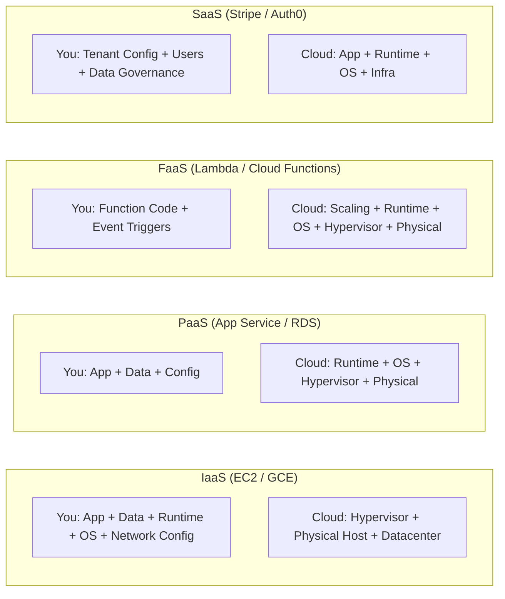
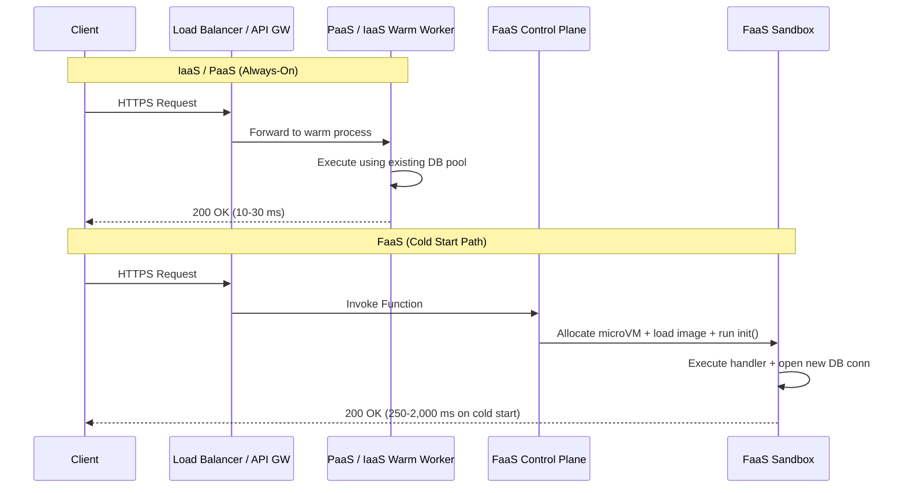
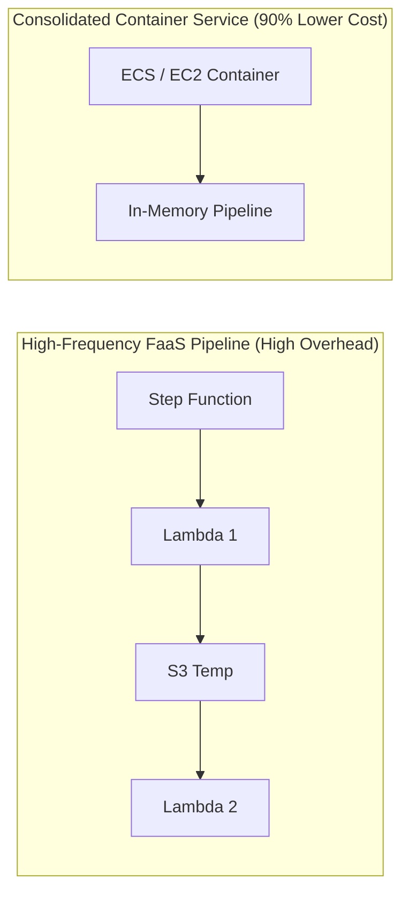

# Cloud Service Models: IaaS vs PaaS vs FaaS vs SaaS

> **Prerequisites:** [Lesson 10: Deployment Stamps](../../18-multi-tenant-saas/10-deployment-stamps/README.md).  
> **Estimated Reading Time:** 22–26 minutes  
> **Target Audience:** Backend engineers choosing compute abstractions for new services, and candidates asked "would you run this on EC2, ECS/App Service, or Lambda?"  
> **Free PDF Notes:** [Download SD-V-001.pdf](https://backendroadmap.com/notes/system-design/SD-V-001.pdf)

> [!NOTE]
> **In one line:** Cloud service models trade **control** for **operational leverage** along the shared-responsibility boundary: **IaaS** hands you virtual hardware, **PaaS** hands you a runtime, **FaaS** hands you per-invocation execution, and **SaaS** hands you a finished product. As you move right, you write less undifferentiated plumbing—and surrender kernel access, predictable unit cost at high utilization, and fine-grained network or scheduling control.

> [!TIP]
> **The Golden Rule:** Start as far right as your workload's constraints allow (PaaS or FaaS for bursty/standard web & event workloads; SaaS for non-core capabilities like auth or billing). Drop left to IaaS/containers only when you hit a hard constraint: custom kernel/GPU needs, steady high-utilization unit economics, cold-start intolerance, or strict compliance isolation.

---

## 1. What Cloud Service Models Are, and What They Aren't

A payments startup needs to launch an API, a webhook processor, and a back-office invoicing tool. Running everything on raw VMs means patching Linux kernels, rotating OS certificates, configuring systemd units, and paying for idle CPU at 3 a.m. Conversely, putting a steady 10,000-RPS stateful WebSocket gateway on FaaS hits execution duration limits, cold starts, and 3x higher compute bills than reserved instances.

| Term | Precise Meaning | Example |
| :--- | :--- | :--- |
| **IaaS (Infrastructure as a Service)** | Virtualized compute, block/object storage, and software-defined networking; you manage OS, runtime, and app | AWS EC2, GCP Compute Engine, Azure VMs |
| **CaaS (Containers as a Service)** | Managed container orchestration where you supply OCI images without managing control-plane VMs | AWS ECS Fargate, GCP Cloud Run, Azure Container Apps |
| **PaaS (Platform as a Service)** | Managed runtime, OS patching, scaling, and deployment pipeline; you supply application code | Heroku, Azure App Service, AWS Elastic Beanstalk, Managed Postgres (RDS) |
| **FaaS (Function as a Service / Serverless)** | Event-driven, ephemeral execution billed per invocation and GB-second; scales to zero | AWS Lambda, GCP Cloud Functions, Azure Functions |
| **SaaS (Software as a Service)** | Complete multi-tenant application consumed over API or UI; provider owns code, data tier, and uptime | Stripe, Auth0, Datadog, Snowflake |
| **Shared Responsibility Model** | Contract dividing security/ops between provider ("security *of* the cloud") and customer ("security *in* the cloud") | AWS patches hypervisor; you patch IAM policies & app dependencies |
| **Not** | A binary "cloud-native vs legacy" hierarchy | Many high-scale systems mix IaaS (Kafka/DBs), PaaS/CaaS (APIs), and FaaS (cron/webhooks) |

### Why It Matters
1. Choosing the wrong abstraction creates either **undifferentiated heavy lifting** (a 4-person team maintaining Kubernetes and OS patches) or **architectural lock-in and runaway bills** (running steady high-CPU batch jobs on FaaS).
2. Interviewers probe whether you understand the **cost crossover point** between pay-per-request (FaaS) and pay-per-capacity (IaaS/PaaS), plus **cold starts** and **execution limits**.
3. The **shared responsibility boundary** determines who gets paged at 2 a.m. for a zero-day OpenSSL vulnerability or a misconfigured firewall.

---

## 2. Anatomy: The Shared Responsibility Stack



| Dimension | IaaS | PaaS / CaaS | FaaS | SaaS |
| :--- | :--- | :--- | :--- | :--- |
| **Unit of deployment** | VM image (AMI) | Code bundle / OCI container | Single function ZIP / image | Config / API keys |
| **Scaling granularity** | Minutes (VM boot) | Seconds to tens of seconds | Sub-second per request | Invisible to tenant |
| **Scale to zero** | No (pay while running) | Optional (Cloud Run) / No (RDS) | Yes (zero idle cost) | N/A |
| **Max execution time** | Unlimited | Unlimited (request timeouts apply) | 15 min (Lambda) / 60 min (Cloud Run) | N/A |
| **Cold start** | None (always warm) | Low/None (always-on) | 50 ms – 3,000 ms (JVM/.NET/VPC) | None |
| **Ops burden** | High (OS, agents, patching) | Medium-Low (app + scaling rules) | Very Low (code + IAM + concurrency) | Minimal (vendor risk) |

> [!WARNING]
> **"Serverless" does not mean "no ops" or "cheaper at all scales."** At steady, high utilization (>35–45% average CPU), FaaS GB-second pricing typically costs **2x to 5x more** than reserved IaaS or managed containers, and you still own IAM least-privilege, concurrency limits, dead-letter queues, and downstream connection pooling.

---

## 3. Mathematical Model: Total Cost of Ownership & FaaS-vs-IaaS Break-Even

Let's model the monthly cost of running a stateless HTTP service under **IaaS/CaaS** (always-on instances) versus **FaaS** (pay-per-invocation + GB-second compute), plus **engineering ops cost**.

For **FaaS**, monthly compute cost for $N$ requests, average duration $D$ (seconds), memory $M$ (GB), per-request price $p_{\text{req}}$, and compute price $p_{\text{gb-s}}$ is:

$$C_{\text{FaaS}} = N \cdot p_{\text{req}} + N \cdot D \cdot M \cdot p_{\text{gb-s}}$$

For **IaaS** with $k$ instances (including HA redundancy + headroom), hourly instance rate $p_{\text{hr}}$, and 730 hours/month:

$$C_{\text{IaaS}} = k \cdot 730 \cdot p_{\text{hr}}$$

Let $U$ be the utilization factor: the fraction of total provisioned capacity actually executing requests. Total monthly CPU-seconds consumed by the workload is $N \cdot D$. Setting $C_{\text{FaaS}} = C_{\text{IaaS}}$ yields the **break-even utilization** $U^*$:

$$U^* \approx \frac{p_{\text{hr}} / (3600 \cdot M_{\text{inst}})}{p_{\text{gb-s}} + p_{\text{req}} / (D \cdot M)}$$

### Worked Numerical Example
Suppose an API handles **$N = 100\text{ million}$ requests/month**, each taking **$D = 0.15\text{ s}$** on **$M = 0.5\text{ GB}$** RAM.
- **FaaS pricing** (AWS Lambda us-east-1 ballpark): $p_{\text{req}} = \$0.20 / 10^6 = \$2 \times 10^{-7}$, $p_{\text{gb-s}} = \$0.0000166667$:
  - Request cost: $100 \times 10^6 \times \$2 \times 10^{-7} = \$20.00$
  - Compute cost: $100 \times 10^6 \times 0.15 \times 0.5 \times \$0.0000166667 = \$125.00$
  - **Total FaaS:** **$\$145.00/\text{month}$**.
- **IaaS pricing**: 2 × `t3.medium` (2 vCPU, 4 GB RAM) for Multi-AZ HA at $\$0.0416/\text{hr}$ each:
  - $C_{\text{IaaS}} = 2 \times 730 \times \$0.0416 = \$60.74/\text{month}$ (on-demand), or $\approx \$38/\text{month}$ (1-yr Savings Plan).
  - **Break-even:** At 100M requests/month ($\approx 38.6$ RPS average), FaaS is already **2.4x more expensive** on raw compute than two Multi-AZ VMs.
  - Conversely, at **2 million requests/month** ($\approx 0.77$ RPS, bursty internal webhook), FaaS costs **$\$2.90/\text{month}$** while HA IaaS still costs **$\$60.74/\text{month}$**—FaaS is **21x cheaper**.

Add **Engineering TCO**: if IaaS requires 8 hours/month of OS patching, AMI baking, and autoscaling tuning at $\$100/\text{hr}$ fully loaded, that is **$\$800/\text{month}$** in hidden labor—dwarfing the $\$84$ compute difference until scale grows much larger.

---

## 4. Metrics & Percentiles

| Metric | Meaning | Alert when |
| :--- | :--- | :--- |
| **Cold-start rate & $p_{99}$ init duration** | Fraction of FaaS invocations spawning a new sandbox + init ms | Cold-start rate $> 1\%$ on user-facing paths or $p_{99} > 500\text{ ms}$ |
| **CPU / Memory utilization** | Actual compute used vs provisioned (IaaS/PaaS) | Sustained $< 15\%$ (over-provisioned) or $> 75\%$ (headroom risk) |
| **FaaS concurrency & throttles** | Concurrent executions vs account/reserved limit | `Throttles > 0` (requests are being rejected with 429) |
| **Patch / CVE age** | Days since OS/runtime security patch applied (IaaS/CaaS) | Critical CVE $> 24\text{ hours}$ unpatched |
| **Cost per 1M requests** | Total cloud bill divided by traffic volume | Rising $> 15\%$ week-over-week without traffic growth |
| **Deployment lead time** | Commit to production across environments | Increasing due to manual AMI/VM bake steps |

### Worked Example (Bursty Webhook vs Steady Checkout API)
A fintech runs two workloads:
1. **Webhook ingestor**: 500k events/day, 90% arriving in a 20-minute market-close window. On IaaS sized for peak, 23.6 hours/day sit at 2% CPU. On FaaS, it scales from 0 to 400 concurrent workers in 2 seconds and costs $\$18/\text{month}$.
2. **Checkout API**: 1,200 RPS steady with 2,500 RPS peak, $p_{99}$ latency SLO of 80 ms, maintaining persistent gRPC and Postgres connection pools. On FaaS, cold starts violate the 80 ms SLO and 2,500 concurrent Lambdas exhaust Postgres `max_connections`. On PaaS/CaaS (always-on containers with a connection pooler), $p_{99}$ stays at 28 ms and compute is 55% cheaper.

---

## 5. Compounding & Failure Modes

How service model choices fail under real-world pressure:

1. **FaaS Downstream Connection Exhaustion ("Serverless DDoS"):** A sudden 10x traffic spike spawns 1,500 FaaS containers in 5 seconds. Each opens 2 TCP connections to RDS Postgres (`max_connections = 500`). The database rejects connections, causing retries, which spawn even more functions.
2. **IaaS Configuration Drift ("Snowflake Servers"):** Engineers SSH into production VMs to hotfix a config file. Six months later, an autoscaling event launches a fresh VM from the old image, and the new node crashes in production.
3. **PaaS/SaaS Noisy Neighbor & Quota Ceiling:** A managed PaaS tier hits a hard platform limit (e.g., max 30 instances, max 10,000 connections, or shared egress IP rate-limited by a third party) with no escape hatch without re-platforming.
4. **FaaS Recursive Loop ("Bill Shock"):** An S3 upload triggers a Lambda that writes a thumbnail back to the *same* S3 bucket prefix, triggering itself infinitely—burning thousands of dollars in minutes before concurrency caps trip.

---

## 6. Numbers Every Engineer Must Know

| Item | Typical | Implication |
| :--- | :---: | :--- |
| **VM boot + user-data init (IaaS)** | 45–180 s | Too slow for sub-minute burst autoscaling; keep warm headroom |
| **Container cold start (CaaS/FaaS)** | 200 ms – 2 s | Fine for async; use min-instances/provisioned concurrency for sync $p_{99}$ |
| **FaaS cold start (Node/Python/Go)** | 50–250 ms | Usually acceptable; keep bundle small |
| **FaaS cold start (JVM / .NET without SnapStart)** | 1,000–4,000 ms | Violates interactive SLOs unless AOT/SnapStart/warmed |
| **FaaS break-even utilization vs IaaS** | ~25–40% | Below this, FaaS wins on compute; above this, IaaS/CaaS wins |
| **FaaS max execution timeout** | 15 min (Lambda) | Long ETL/video jobs must move to batch/containers |
| **Managed DB (PaaS) price premium vs raw VM** | 1.3x–1.8x | Almost always worth it vs hiring 24/7 DBAs |

---

## 7. Mechanism Deep Dive: Request Lifecycle Across Models



| Question | Answer |
| :--- | :--- |
| **Who patches the OS kernel?** | You in IaaS; the cloud provider in PaaS, CaaS (serverless), FaaS, and SaaS. |
| **Where does state live?** | Never on FaaS local disk (ephemeral) or auto-scaled IaaS root volumes; always in external managed stores (RDS, S3, Redis). |
| **How do you avoid FaaS DB connection storms?** | Use a connection proxy (RDS Proxy, PgBouncer) or HTTP-based serverless DBs (DynamoDB, Aurora Data API). |
| **What is the biggest hidden cost of PaaS/SaaS?** | Egress bandwidth, per-seat/per-MAU SaaS tiers at scale, and migration cost if you outgrow platform limits. |

**When NOT to use FaaS:** Sustained high-throughput APIs (>40% utilization), long-running stateful connections (WebSockets with in-memory rooms, gRPC streams), workloads needing GPUs/custom kernel modules, or strict sub-50 ms $p_{99}$ without provisioned concurrency.

---

## 8. Hierarchical Budgets & Design Rules

| Slice | Rule | Control |
| :--- | :--- | :--- |
| **Compute default** | Default to PaaS/CaaS for APIs, FaaS for event glue, SaaS for non-core | Architecture review checklist |
| **Database** | Never self-host databases on raw IaaS unless you have dedicated DBAs | Use managed PaaS (RDS/Cloud SQL) |
| **Immutability** | Zero SSH in production; bake AMIs or OCI containers in CI | Disable SSH ports; SSM/bastion break-glass only |
| **FaaS guardrails** | Set reserved concurrency + billing alarms + DLQs on every function | IaC policy check (Terraform/CDK) |
| **Connection pooling** | Put a proxy between FaaS and relational DBs | RDS Proxy / PgBouncer |
| **Portability** | Containerize business logic even on PaaS so exit to CaaS/K8s stays cheap | Standard HTTP/OCI interfaces |

---

## 9. Top Mitigations

1. **Match abstraction to utilization curve:** Use FaaS for spiky/event-driven work, CaaS/PaaS for steady APIs, and IaaS only for specialized compute or cost-optimized steady-state clusters.
2. **Use Provisioned Concurrency or min-instances** on FaaS/Cloud Run for latency-sensitive endpoints to eliminate cold starts.
3. **Place a connection pooler (RDS Proxy / PgBouncer)** in front of relational databases accessed by FaaS.
4. **Enforce concurrency caps and DLQs** on all FaaS triggers to prevent recursive loops and cascading bill shock.
5. **Automate IaaS patching with immutable images** (Packer + ASG rolling replacements) instead of in-place `apt upgrade`.
6. **Evaluate "build vs buy" with 3-year TCO:** Include engineering hours, on-call burden, and compliance audits, not just cloud invoice lines.

---

## 10. Production Reference: The Serverless-to-Containers Migration (Prime Video & Industry Pattern)

A well-documented industry pattern (exemplified by Amazon Prime Video's 2023 architecture case study for its audio/video quality monitoring service) illustrates what happens when a high-throughput media pipeline is initially built with **FaaS + step orchestration**:

- **The problem:** The monitoring service invoked serverless functions and step-function transitions for every video frame/segment at high volume. Orchestration state transitions and S3 intermediate writes between steps became the dominant cost and bottleneck, hitting account scaling limits.
- **The fix:** Consolidating the distributed serverless steps into a single-process **containerized service (ECS/EC2)** kept intermediate frame buffers in local memory instead of serializing across S3 and step transitions.
- **The result:** **~90% infrastructure cost reduction** and higher throughput without changing business logic.



**Lesson:** FaaS shines for coarse-grained, bursty events. When a tight loop runs millions of times per hour with heavy intermediate state, moving left to CaaS/IaaS removes serialization and per-transition taxes.

---

## 11. Multi-Language Production Code Tabs

A Cloud Cost & Break-Even Calculator modeling **FaaS vs IaaS/PaaS** monthly cost, break-even RPS, and engineering TCO across workloads.

````carousel
```go
// Go: Cloud Service Model TCO & FaaS-vs-IaaS break-even calculator.
package main

import "fmt"

type Workload struct {
	RequestsPerMonth float64
	AvgDurationSec   float64
	MemoryGB         float64
}

func FaasMonthlyCost(w Workload) float64 {
	const reqPrice = 0.20 / 1_000_000.0
	const gbSecPrice = 0.0000166667
	reqCost := w.RequestsPerMonth * reqPrice
	computeCost := w.RequestsPerMonth * w.AvgDurationSec * w.MemoryGB * gbSecPrice
	return reqCost + computeCost
}

func IaasMonthlyCost(instances int, hourlyRate, opsHoursPerMonth, engHourlyRate float64) (infra, total float64) {
	infra = float64(instances) * 730.0 * hourlyRate
	total = infra + (opsHoursPerMonth * engHourlyRate)
	return infra, total
}

func main() {
	webhook := Workload{RequestsPerMonth: 2_000_000, AvgDurationSec: 0.15, MemoryGB: 0.5}
	checkout := Workload{RequestsPerMonth: 100_000_000, AvgDurationSec: 0.15, MemoryGB: 0.5}

	for name, w := range map[string]Workload{"Webhook (2M/mo)": webhook, "Checkout (100M/mo)": checkout} {
		faas := FaasMonthlyCost(w)
		infra, total := IaasMonthlyCost(2, 0.0416, 6.0, 100.0)
		fmt.Printf("%-18s | FaaS: $%7.2f | IaaS Infra: $%6.2f | IaaS+Ops: $%7.2f\n", name, faas, infra, total)
	}
}
```
<!-- slide -->
```typescript
// TypeScript: Cloud Service Model TCO & Break-Even Evaluator.
interface Workload {
  name: string;
  requestsPerMonth: number;
  avgDurationSec: number;
  memoryGb: number;
}

function calcFaasCost(w: Workload): number {
  const reqCost = w.requestsPerMonth * (0.20 / 1_000_000);
  const gbSecCost = w.requestsPerMonth * w.avgDurationSec * w.memoryGb * 0.0000166667;
  return reqCost + gbSecCost;
}

function calcIaasCost(instances: number, hourlyRate: number, opsHours = 6, engRate = 100) {
  const infra = instances * 730 * hourlyRate;
  return { infra, totalWithOps: infra + opsHours * engRate };
}

const workloads: Workload[] = [
  { name: "Webhook (2M/mo)", requestsPerMonth: 2_000_000, avgDurationSec: 0.15, memoryGb: 0.5 },
  { name: "Checkout (100M/mo)", requestsPerMonth: 100_000_000, avgDurationSec: 0.15, memoryGb: 0.5 },
];

for (const w of workloads) {
  const faas = calcFaasCost(w);
  const iaas = calcIaasCost(2, 0.0416);
  console.log(`${w.name}: FaaS=$${faas.toFixed(2)}, IaaS Infra=$${iaas.infra.toFixed(2)}, IaaS+Ops=$${iaas.totalWithOps.toFixed(2)}`);
}
```
<!-- slide -->
```python
# Python: FaaS vs IaaS cost & utilization crossover model (stdlib only).
def faas_monthly_cost(requests: int, duration_s: float, memory_gb: float) -> float:
    req_cost = requests * (0.20 / 1_000_000)
    compute_cost = requests * duration_s * memory_gb * 0.0000166667
    return round(req_cost + compute_cost, 2)


def iaas_monthly_cost(instances: int, hourly_rate: float, ops_hours: float = 6.0, eng_rate: float = 100.0):
    infra = round(instances * 730 * hourly_rate, 2)
    return {"infra": infra, "total_with_ops": round(infra + ops_hours * eng_rate, 2)}


def breakeven_requests(iaas_infra_cost: float, duration_s: float, memory_gb: float) -> int:
    cost_per_req = (0.20 / 1_000_000) + (duration_s * memory_gb * 0.0000166667)
    return int(iaas_infra_cost / cost_per_req)


if __name__ == "__main__":
    for label, reqs in [("Webhook 2M", 2_000_000), ("Checkout 100M", 100_000_000)]:
        print(label, "FaaS:", faas_monthly_cost(reqs, 0.15, 0.5), "IaaS:", iaas_monthly_cost(2, 0.0416))
    print("Break-even requests/month (vs $60.74 IaaS):", breakeven_requests(60.74, 0.15, 0.5))
```
<!-- slide -->
```csharp
// C#: Cloud Service Model TCO & Break-Even Calculator.
using System;

public record Workload(string Name, double RequestsPerMonth, double AvgDurationSec, double MemoryGb);

public static class CloudCostModel
{
    public static double FaasMonthlyCost(Workload w) =>
        (w.RequestsPerMonth * (0.20 / 1_000_000.0)) +
        (w.RequestsPerMonth * w.AvgDurationSec * w.MemoryGb * 0.0000166667);

    public static (double Infra, double WithOps) IaasMonthlyCost(int instances, double hourlyRate, double opsHours = 6, double engRate = 100)
    {
        var infra = instances * 730.0 * hourlyRate;
        return (infra, infra + opsHours * engRate);
    }

    public static void Main()
    {
        var workloads = new[]
        {
            new Workload("Webhook (2M/mo)", 2_000_000, 0.15, 0.5),
            new Workload("Checkout (100M/mo)", 100_000_000, 0.15, 0.5)
        };
        foreach (var w in workloads)
        {
            var faas = FaasMonthlyCost(w);
            var iaas = IaasMonthlyCost(2, 0.0416);
            Console.WriteLine($"{w.Name}: FaaS=${faas:F2} | IaaS Infra=${iaas.Infra:F2} | IaaS+Ops=${iaas.WithOps:F2}");
        }
    }
}
```
````

---

## 12. Hands-On CLI Verification Workflows

Run the Python break-even calculation locally:

```bash
python -c "
def faas(n, d=0.15, m=0.5): return round(n*(0.20/1e6 + d*m*0.0000166667), 2)
print('2M reqs FaaS:', faas(2_000_000), '100M reqs FaaS:', faas(100_000_000))
"
```

Inspect real cloud service abstractions and quotas with cloud CLIs:

```bash
# AWS: inspect Lambda account concurrency limits & usage
aws lambda get-account-settings

# AWS: check EC2 instance types & vCPU/memory specs
aws ec2 describe-instance-types --instance-types t3.medium --query "InstanceTypes[*].[InstanceType,VCpuInfo.DefaultVCpus,MemoryInfo.SizeInMiB]"

# GCP: inspect Cloud Run service min/max instances & concurrency
gcloud run services describe my-api --region us-central1 --format="yaml(spec.template.metadata.annotations)"
```

---

## 13. Common Mistakes to Avoid

1. **Choosing IaaS by default** for a small team's CRUD API, burning months on patching and deployment plumbing.
2. **Running steady high-RPS workloads on FaaS** without checking the 30–40% utilization cost crossover.
3. **Connecting FaaS directly to a relational DB** without a connection proxy, exhausting `max_connections` during spikes.
4. **Ignoring FaaS cold starts** on latency-sensitive user paths (especially JVM/.NET inside a VPC).
5. **Self-hosting stateful databases on raw VMs** when managed PaaS (RDS/Cloud SQL) handles backups, failover, and patching.
6. **Forgetting concurrency limits and DLQs** on serverless event triggers, risking runaway bills or silent drops.
7. **Treating SaaS as zero-risk** without evaluating vendor lock-in, rate limits, and data residency.

---

## 14. Key Terms Glossary

| Key Term | Definition |
| :--- | :--- |
| **IaaS** | Virtualized compute, storage, and networking where the customer manages OS and runtime. |
| **PaaS** | Managed runtime and OS platform where the customer deploys only application code and config. |
| **CaaS** | Managed container orchestration (Fargate, Cloud Run) running customer OCI images. |
| **FaaS** | Event-driven, ephemeral functions billed per invocation and GB-second, scaling to zero. |
| **SaaS** | Turnkey multi-tenant software consumed via UI or API; vendor manages the entire stack. |
| **Shared Responsibility** | Division of security and operational duties between cloud provider and customer. |
| **Cold Start** | Latency penalty when FaaS/CaaS allocates a new sandbox and initializes the runtime. |
| **Provisioned Concurrency** | Pre-warmed FaaS execution environments kept alive to eliminate cold starts. |
| **Undifferentiated Heavy Lifting** | Operational toil (patching, racking, backups) that adds no competitive product value. |
| **TCO (Total Cost of Ownership)** | Combined cloud invoice plus engineering hours for maintenance, on-call, and compliance. |

---

## 15. System Design Interview Questions & Answers

### Basic Conceptual Questions

<details>
<summary><strong>Q1: What is the core difference between IaaS, PaaS, FaaS, and SaaS? [BASIC]</strong></summary>

**Answer:**
Each model shifts the **shared responsibility boundary** higher up the stack. In **IaaS**, you manage OS, runtime, and app; in **PaaS**, the provider manages OS and runtime while you deploy code; in **FaaS**, the provider also manages per-request scaling and lifecycle down to zero; in **SaaS**, the provider delivers the entire application.
</details>

<details>
<summary><strong>Q2: What does "Shared Responsibility Model" mean in practice? [BASIC]</strong></summary>

**Answer:**
The cloud provider is responsible for security *of* the cloud (physical datacenters, hardware, hypervisors, managed service control planes). The customer is responsible for security *in* the cloud (IAM permissions, encryption configuration, application code, and—in IaaS—OS patching and host firewalls).
</details>

<details>
<summary><strong>Q3: Why does FaaS have cold starts, and which runtimes suffer most? [BASIC]</strong></summary>

**Answer:**
When no warm sandbox is available, the platform must allocate a microVM/container, download the code/image, start the language runtime, and run initialization code before handling the request. Compiled/lightweight runtimes (Go, Python, Node.js) cold-start in 50–250 ms; heavy VMs (JVM, .NET) can take 1–4 seconds unless optimized with AOT or SnapStart.
</details>

<details>
<summary><strong>Q4: When is managed PaaS worth its price premium over raw IaaS? [BASIC]</strong></summary>

**Answer:**
Almost always for stateful infrastructure like relational databases (RDS/Cloud SQL) and message brokers, as well as standard web APIs for small-to-medium teams. A 1.4x compute markup is far cheaper than hiring 24/7 engineers to manage backups, failover, OS CVEs, and replication.
</details>

### Scenario-Based Architecture Questions

<details>
<summary><strong>Q5: You are designing a webhook processor that is idle 22 hours/day and spikes to 500 RPS for 10 minutes. What compute model do you pick? [SCENARIO]</strong></summary>

**Answer:**
**FaaS (or scale-to-zero CaaS like Cloud Run).** Sizing IaaS for 500 RPS wastes ~95% of provisioned capacity for 22 hours/day. FaaS scales to zero during idle periods and bursts instantaneously, provided we place a queue/DLQ in front and bound downstream database concurrency.
</details>

<details>
<summary><strong>Q6: A team's checkout API runs on Lambda, handles 1,500 steady RPS, and suffers $p_{99}$ latency spikes and Postgres connection errors. What happened and how do you fix it? [SCENARIO]</strong></summary>

**Answer:**
Two issues: (1) At 1,500 steady RPS, cold starts hurt $p_{99}$ and FaaS compute costs ~2–3x more than containers/VMs; (2) each Lambda instance opens its own Postgres connection, exhausting `max_connections`. Short-term fix: add RDS Proxy + Provisioned Concurrency. Long-term fix: migrate the steady-state API to **CaaS/PaaS** (always-on containers with a local connection pool).
</details>

<details>
<summary><strong>Q7: A compliance requirement demands custom Linux kernel modules (eBPF) and dedicated physical hosts. Which model fits? [SCENARIO]</strong></summary>

**Answer:**
**IaaS (specifically Dedicated Hosts or bare-metal instances).** PaaS and FaaS abstract away the OS kernel and share underlying host kernels/hypervisors with other tenants, making custom kernel modules impossible.
</details>

<details>
<summary><strong>Q8: Should a 5-person startup build its own auth and billing systems on IaaS or buy SaaS? [SCENARIO]</strong></summary>

**Answer:**
**Buy SaaS (e.g., Auth0/Cognito and Stripe).** Auth and billing are non-differentiating, high-risk domains with heavy security/compliance overhead (PCI-DSS, OAuth edge cases). Engineering time should go to core product differentiation.
</details>

### Advanced & Tricky Interview Questions

<details>
<summary><strong>Q9: At what utilization does IaaS/CaaS become cheaper than FaaS, and why isn't compute cost the whole story? [TRICKY]</strong></summary>

**Answer:**
On raw compute, FaaS and on-demand IaaS typically cross over around **25–40% average utilization** (even lower against 1–3 year Savings Plans). However, **TCO** includes engineering labor: if IaaS requires 10 hours/month of patching and cluster maintenance ($1,000+), FaaS/PaaS remains cheaper overall until the raw cloud bill difference exceeds that operational cost.
</details>

<details>
<summary><strong>Q10: How can a serverless architecture accidentally DDoS its own downstream systems or create runaway bills? [TRICKY]</strong></summary>

**Answer:**
Unbounded horizontal scaling amplifies failures: if a downstream DB slows down, FaaS invocations take longer, concurrency climbs, retries fire, and thousands of sandboxes hammer the DB simultaneously. Similarly, recursive event loops (writing back to a trigger bucket) can burn thousands of dollars in minutes. Mitigations: reserved concurrency caps, circuit breakers, DLQs, and billing alarms.
</details>

<details>
<summary><strong>Q11: Why did some high-throughput teams (like Prime Video's monitoring service) migrate *from* serverless back to containers/monolith? [TRICKY]</strong></summary>

**Answer:**
At very high frequency, the **orchestration tax** (step-function state transitions, intermediate S3 serialization, and per-invocation overhead) exceeded the cost of actual compute. Consolidating into a single-process container kept data in memory and cut infrastructure costs by ~90%.
</details>

<details>
<summary><strong>Q12: How do you avoid vendor lock-in when using PaaS or FaaS without sacrificing developer velocity? [TRICKY]</strong></summary>

**Answer:**
Keep business logic in **pure, framework-agnostic modules** behind clean interfaces (hexagonal architecture), package services as standard **OCI containers** where possible (portable across Cloud Run, ECS Fargate, App Runner, and Kubernetes), and isolate cloud-specific triggers (SQS/Lambda adapters) at the thin outer edge.
</details>

---

## 16. One-Page Master Cheat Sheet

```
+---------------------------------------------------------------------------------------------------------+
|                   CLOUD SERVICE MODELS (IaaS vs PaaS vs FaaS vs SaaS) — MASTER CHEAT SHEET              |
+---------------------------------------------------------------------------------------------------------+
| 1. SPECTRUM: IaaS (VMs) -> CaaS (Containers) -> PaaS (Runtime/DB) -> FaaS (Functions) -> SaaS (Product) |
|    Moving right = less ops & faster launch, less kernel/network control & higher unit cost at scale.     |
+---------------------------------------------------------------------------------------------------------+
| 2. COST CROSSOVER: FaaS wins for bursty/low-utilization (<25-40% avg). IaaS/CaaS wins for steady load.  |
|    Always include Engineering TCO (patching, on-call) alongside the raw cloud bill.                     |
+---------------------------------------------------------------------------------------------------------+
| 3. FAAS TRAPS: Cold starts (50ms-4s) · 15m timeout · DB connection exhaustion · recursive bill shock.   |
+---------------------------------------------------------------------------------------------------------+
| 4. SHARED RESPONSIBILITY: Provider secures OF the cloud; you secure IN the cloud (IAM, data, app).      |
+---------------------------------------------------------------------------------------------------------+
| 5. RULE OF THUMB: SaaS for non-core (auth/billing) · PaaS for DBs · CaaS for steady APIs · FaaS glue.   |
+---------------------------------------------------------------------------------------------------------+
```

---

## Further Reading & Sources

- NIST Definition of Cloud Computing (SP 800-145) — canonical definitions of IaaS, PaaS, and SaaS.
- AWS Well-Architected Serverless Applications Lens & Shared Responsibility Model documentation.
- Martin Kleppmann, *Designing Data-Intensive Applications*, Chapter 1 (Reliability, Scalability, Maintainability).
- Amazon Prime Video Tech Blog, *Scaling up the Prime Video audio/video monitoring service and reducing costs by 90%* (2023).

---

## Free PDF Notes

[SD-V-001.pdf](https://backendroadmap.com/notes/system-design/SD-V-001.pdf)

---

## Next

Continue with [Lesson 02: Regions, Availability Zones & Edge: What Multi-AZ Really Protects](../02-regions-availability-zones-edge/README.md).
