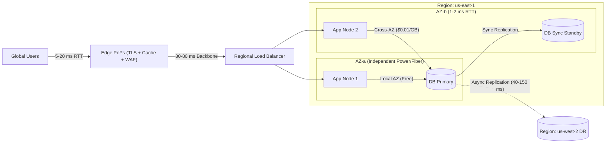
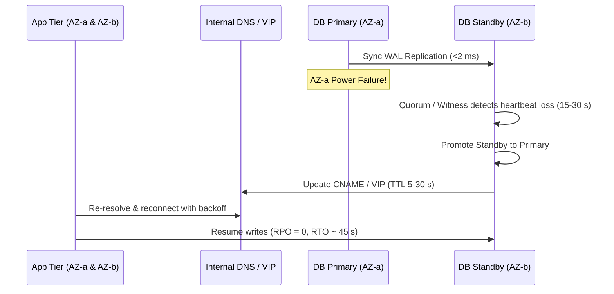
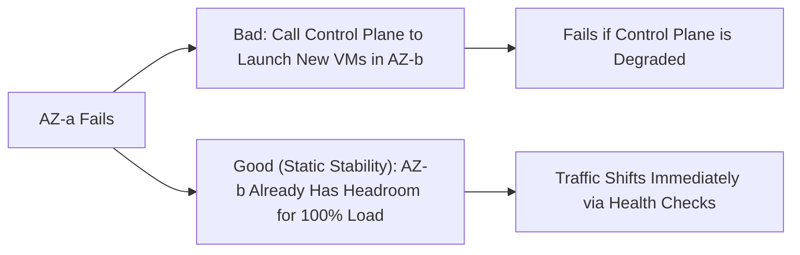

# Regions, Availability Zones & Edge: What Multi-AZ Really Protects

> **Prerequisites:** [Lesson 01: Cloud Service Models: IaaS vs PaaS vs FaaS vs SaaS](../01-cloud-service-models/README.md).  
> **Estimated Reading Time:** 23–27 minutes  
> **Target Audience:** Backend engineers designing high-availability topologies, and candidates asked "what happens if an Availability Zone—or an entire Region—goes down?"  
> **Free PDF Notes:** [Download SD-V-002.pdf](https://backendroadmap.com/notes/system-design/SD-V-002.pdf)

> [!NOTE]
> **In one line:** A **Region** is a geographically isolated cluster of datacenters; an **Availability Zone (AZ)** is an independent fault domain (separate power, cooling, networking) within a Region separated by <2 ms RTT; **Edge PoPs** sit near end users to cache and terminate TLS. **Multi-AZ** protects against datacenter/rack/power failures with synchronous replication, while **Multi-Region** is required for regional outages, control-plane failures, and global latency—at the cost of asynchronous replication and cross-region egress fees.

> [!TIP]
> **The Golden Rule:** Use **Multi-AZ** as your non-negotiable baseline for production availability (99.95–99.99%). Add **Multi-Region** only when your SLA (>99.99%), global latency budget, or regulatory RPO/RTO demands it—and never assume Multi-AZ protects against bad deployments, logical data corruption, or regional control-plane outages.

---

## 1. What Regions, AZs, and Edge Are, and What They Aren't

A team deploys its Postgres primary in `us-east-1a` and its app servers in `us-east-1b`, feeling safe because they are "Multi-AZ." Two things go wrong: first, every database query crosses an AZ boundary twice, adding latency and **$0.01/GB** cross-AZ data transfer charges; second, when a bad schema migration drops a table—or when a regional IAM/DNS control-plane incident hits `us-east-1`—all three AZs fail together.

| Term | Precise Meaning | Example |
| :--- | :--- | :--- |
| **Region** | Sovereign geographic area containing 3+ isolated Availability Zones | `us-east-1` (N. Virginia), `eu-central-1` (Frankfurt) |
| **Availability Zone (AZ)** | One or more discrete datacenters with independent power, cooling, and fiber, <2 ms apart | `us-east-1a`, `us-east-1b`, `us-east-1c` |
| **Edge Location (PoP)** | ISP-adjacent point of presence caching static assets and terminating TLS close to users | CloudFront, Cloudflare, Fastly PoPs (300+ cities) |
| **Blast radius** | Maximum scope of components affected by a single physical or logical failure | Single rack < Single AZ < Single Region |
| **RTO (Recovery Time Objective)** | Maximum acceptable downtime after a failure | RTO = 60 s for Multi-AZ DB failover |
| **RPO (Recovery Point Objective)** | Maximum acceptable data loss measured in time | RPO = 0 (sync Multi-AZ) vs RPO = 5 s (async Multi-Region) |
| **Not** | A guarantee that AZ names match across accounts | Your `us-east-1a` may map to a different physical building than your neighbor's `us-east-1a` |

### Why It Matters
1. **Multi-AZ vs Multi-Region** is one of the most common follow-up questions in system design interviews ("what if the whole datacenter/region goes dark?").
2. **Cross-AZ network fees** silently become 15–30% of cloud bills in chatty microservice or Kafka clusters if you ignore AZ-aware routing.
3. **Control-plane coupling** (IAM, DNS, S3 global/regional endpoints) means a regional outage can break even Multi-AZ workloads.

---

## 2. Anatomy: Edge, Region, and Multi-AZ Topology



| Failure Scenario | Single-AZ | Multi-AZ (1 Region) | Multi-Region (Active-Active / DR) |
| :--- | :--- | :--- | :--- |
| **Server / Rack failure** | Outage | **Protected** (auto-replaced) | **Protected** |
| **Datacenter power / fiber cut** | Outage | **Protected** (failover in 30–60 s) | **Protected** |
| **Regional control-plane / DNS outage** | Outage | **Vulnerable** (shared control plane) | **Protected** (if decoupled) |
| **Bad code deploy / `DROP TABLE`** | Outage | **Vulnerable** (replicates to standby!) | **Vulnerable** (need backups/PITR) |
| **Replication mode** | None | **Synchronous** (RPO = 0) | **Asynchronous** (RPO > 0, or costly Paxos/Spanner) |
| **Cross-boundary network cost** | $0 | ~$0.01–$0.02/GB cross-AZ | ~$0.02–$0.09/GB cross-region |

> [!WARNING]
> **Multi-AZ does NOT protect against logical corruption or bad deployments.** Synchronous replication faithfully replicates a `DELETE FROM orders` without a `WHERE` clause to the standby AZ in under 2 milliseconds. You still need Point-in-Time Recovery (PITR), immutable backups, and staged rollouts.

---

## 3. Mathematical Model: Availability & Cross-AZ Bandwidth Cost

**1. Composite Availability.** If a single AZ has annual availability $A_{\text{AZ}}$ (e.g., $99.9\% = 0.999$, ~8.76 hours downtime/year), and failures across $k$ AZs are independent, the probability that *all* $k$ AZs fail simultaneously is $(1 - A_{\text{AZ}})^k$:

$$A_{\text{Multi-AZ}} = 1 - (1 - A_{\text{AZ}})^k$$

With $k = 2$ AZs at $99.9\%$:

$$A_{\text{2-AZ}} = 1 - (0.001)^2 = 0.999999 \text{ (six nines theoretically)}$$

In practice, **shared control planes, DNS, and human deployments** cap real-world Multi-AZ availability around **99.95%–99.99%** (4.38 hours to 52.6 minutes downtime/year)—far below the theoretical $99.9999\%$.

**2. Cross-AZ Data Transfer Tax.** Suppose a chatty microservice cluster has $R$ requests/s, each generating $B$ bytes of internal RPC/DB/Kafka traffic across $k$ AZs. Without AZ-aware routing, the fraction of traffic crossing AZ boundaries is $\frac{k - 1}{k}$. Monthly cross-AZ cost at price $p_{\text{AZ}}$ ($0.01/GB each direction = $0.02/GB round-trip or $0.01/GB billed on egress):

$$C_{\text{cross-AZ}} = R \cdot B_{\text{GB}} \cdot 2{,}592{,}000 \cdot \left(\frac{k - 1}{k}\right) \cdot p_{\text{AZ}}$$

### Worked Numerical Example
A Kafka + microservice platform across **$k = 3$ AZs** processes **$R = 5{,}000$ req/s**, with **$B = 50\text{ KB}$** ($5 \times 10^{-5}\text{ GB}$) of internal read/replication traffic per request, billed at **$p_{\text{AZ}} = \$0.01/\text{GB}$** per cross-AZ transfer:
- Total monthly internal traffic: $5{,}000 \times 5 \times 10^{-5} \times 2{,}592{,}000 = 648{,}000\text{ GB/month}$.
- Cross-AZ fraction ($\frac{3-1}{3} = 66.7\%$): $432{,}000\text{ GB/month}$.
- **Cross-AZ bill:** $432{,}000 \times \$0.01 = \mathbf{\$4{,}320/\text{month}}$ (and $2\times$ if both ingress and egress are billed, i.e., **$\$8{,}640/\text{month}$**).
- Enabling **AZ-aware read replicas / Kafka follower fetching** keeps reads local, cutting this cost by ~65–80%.

---

## 4. Metrics & Percentiles

| Metric | Meaning | Alert when |
| :--- | :--- | :--- |
| **Inter-AZ RTT $p_{99}$** | Round-trip network latency between AZs in a region | $> 3\text{ ms}$ (indicates congestion or suboptimal placement) |
| **Cross-region replication lag** | Seconds behind primary in async DR region | Exceeds RPO target (e.g., $> 5\text{ s}$) |
| **Edge Cache Hit Ratio (CHR)** | Percentage of requests served from Edge PoP vs Origin | Drops below 85% for cacheable static/API assets |
| **Cross-AZ bytes transferred** | GB/hour crossing AZ boundaries | Unexpected spike (often a misconfigured read replica or chatty RPC) |
| **Failover drill RTO** | Actual measured time to promote standby during chaos test | Exceeds SLA RTO (e.g., $> 60\text{ s}$) |

### Worked Example (Global E-Commerce Latency)
A user in Tokyo hits an origin in `us-east-1` (Virginia):
- **Without Edge PoP:** TCP handshake (150 ms) + TLS handshake (150 ms × 2 = 300 ms) + HTTP GET (150 ms) = **600 ms** just to fetch a 10 KB product page.
- **With Edge PoP in Tokyo:** TCP + TLS terminates at the Tokyo Edge (**12 ms**). Static assets return in **15 ms** (92% CHR). Dynamic API calls traverse a persistent, pre-warmed TLS connection over the cloud backbone to `us-east-1`, cutting dynamic latency from 600 ms to **175 ms**.

---

## 5. Compounding & Failure Modes

1. **Unbalanced AZ Capacity ("The Thundering Herd on Failover"):** You run 50% of capacity in AZ-a and 50% in AZ-b at 75% CPU each. When AZ-a fails, 100% of traffic shifts to AZ-b, pushing AZ-b to 150% CPU and crashing the remaining healthy zone. **Fix:** Run at $\le \frac{k-1}{k}$ utilization (e.g., $\le 50\%$ across 2 AZs, $\le 66\%$ across 3 AZs) so $N-1$ zones can absorb 100% of peak traffic.
2. **Gray Failure / Split-Brain:** AZ-a loses *partial* connectivity (packet loss 40%), so health checks flap rather than failing cleanly. Traffic continues hitting degraded nodes.
3. **Regional Control-Plane Lockout:** During an outage of a regional control plane (e.g., EC2/AutoScaling APIs in `us-east-1`), your *data plane* (running VMs) stays up, but autoscaling and deployments fail. If your Multi-Region failover script depends on the broken region's control plane, failover fails too!

---

## 6. Numbers Every Engineer Must Know

| Item | Typical | Implication |
| :--- | :---: | :--- |
| **Same-AZ RTT** | 0.1–0.5 ms | Negligible; chatty RPCs are cheap here |
| **Cross-AZ RTT (same region)** | 0.8–2.0 ms | Fast enough for synchronous DB/consensus replication |
| **Cross-Region RTT (US East ↔ US West)** | 60–80 ms | Too slow for synchronous 2PC/Paxos on every user write |
| **Cross-Region RTT (US ↔ Europe / Asia)** | 80–160 ms | Requires Edge caching or Active-Active regional writes |
| **Edge PoP RTT to end user** | 5–25 ms | Terminating TLS at Edge saves 2–3 transoceanic RTTs |
| **Multi-AZ DB failover RTO** | 30–90 s | App must handle transient connection errors + DNS TTLs |
| **Cross-AZ transfer cost** | ~$0.01/GB (each way) | High-volume Kafka/DB reads should be AZ-local |

---

## 7. Mechanism Deep Dive: Multi-AZ Failover vs Multi-Region Failover



| Question | Answer |
| :--- | :--- |
| **Why not run synchronous replication across Regions?** | At 70 ms RTT, every write pays 70+ ms for commit quorum, and if the WAN link drops, the primary stalls completely (CAP theorem: CP blocks availability). |
| **How do you make Multi-Region Active-Active work?** | Partition users by home region (e.g., EU data in `eu-central-1`, US data in `us-east-1`) or use CRDTs/conflict-resolution for multi-writer tables (DynamoDB Global Tables, Cosmos DB). |
| **Why do AZ IDs (`use1-az1`) differ from AZ names (`us-east-1a`)?** | Cloud providers randomize AZ names per account to balance load. Always compare physical **AZ IDs** when peering or co-locating resources across accounts. |

**When NOT to go Multi-Region:** When your team has not yet mastered single-region Multi-AZ backups, automated failover drills, and immutable infrastructure. Premature Multi-Region adds split-brain risk, data consistency bugs, and 2–3x cost.

---

## 8. Hierarchical Budgets & Design Rules

| Slice | Rule | Control |
| :--- | :--- | :--- |
| **AZ count** | Minimum 2 AZs (3 AZs for quorum systems like Kafka/etcd/Raft) | Terraform/IaC subnet modules |
| **Headroom ($N-1$)** | Peak utilization $\le 50\%$ (2 AZs) or $\le 66\%$ (3 AZs) | Autoscaling target tracking + load tests |
| **AZ-local affinity** | Route reads to local-AZ replicas/caches first | Kubernetes `topologyAwareHints` / Kafka `rack.id` |
| **Control-plane independence** | Never require Region A's APIs to fail over to Region B | Pre-provisioned DR + Route 53 data-plane health checks |
| **DNS TTL** | Keep internal/failover DNS TTLs at 5–30 s; honor them in clients | JVM `networkaddress.cache.ttl` / Go/Node DNS config |
| **Edge** | Terminate TLS, WAF, and static caching at Edge PoPs | CloudFront / Cloudflare in front of ALB |

---

## 9. Top Mitigations

1. **Deploy across 3 AZs** for quorum-based data stores (Raft/Paxos) and at least 2 AZs for stateless compute.
2. **Size for $N-1$ capacity** so losing an entire AZ does not overload the survivors.
3. **Enable AZ-aware routing** (Kafka follower fetching, Kubernetes Topology Aware Routing, local Redis/DB read replicas) to cut latency and cross-AZ bills.
4. **Add an Edge CDN/WAF** in front of regional load balancers to absorb DDoS and save transoceanic TLS handshakes.
5. **Run quarterly GameDays** (actually kill an AZ or promote a standby) to verify RTO, DNS caching, and connection-pool recovery.
6. **Maintain immutable backups / PITR** in a separate region or isolated account to survive logical corruption and ransomware.

---

## 10. Production Reference: AWS `us-east-1` Outages & Static Stability

Major cloud outages (such as the December 2021 AWS `us-east-1` network/control-plane event) repeatedly teach the same architectural lesson: **static stability**.

- **The problem:** During the incident, the EC2/AutoScaling *control plane* in `us-east-1` became unreachable, and internal network congestion isolated services that relied on dynamic scaling or cross-region orchestration hosted in `us-east-1`. Services that tried to spin up new instances in another AZ *during* the outage failed because the control plane itself was degraded.
- **The fix (Static Stability):** Keep enough pre-provisioned capacity running across AZs *before* a failure happens so that if one AZ dies, the remaining AZs handle 100% of load **without needing to call EC2/AutoScaling APIs**.
- **Multi-Region lesson:** Ensure your global control plane (DNS health checks, CI/CD runners, incident tooling) does not have a hidden hard dependency on a single primary region.



---

## 11. Multi-Language Production Code Tabs

An **AZ-Aware Endpoint Selector & Cross-AZ Cost/Availability Simulator** that prefers local-AZ backends when healthy and falls back across AZs only on failure.

````carousel
```go
// Go: AZ-aware endpoint router with local-AZ preference and N-1 fallback.
package main

import (
	"fmt"
	"math"
)

type Endpoint struct {
	Host    string
	AZ      string
	Healthy bool
}

func SelectEndpoint(localAZ string, endpoints []Endpoint) (Endpoint, bool) {
	// 1. Prefer healthy endpoint in the same AZ (0 cross-AZ cost, <0.5ms RTT)
	for _, ep := range endpoints {
		if ep.Healthy && ep.AZ == localAZ {
			return ep, true
		}
	}
	// 2. Fallback to healthy endpoint in another AZ (static stability)
	for _, ep := range endpoints {
		if ep.Healthy {
			return ep, true
		}
	}
	return Endpoint{}, false
}

func MultiAZAvailability(azAvail float64, azCount int) float64 {
	return 1.0 - math.Pow(1.0-azAvail, float64(azCount))
}

func main() {
	eps := []Endpoint{
		{Host: "10.0.1.10", AZ: "az-a", Healthy: false},
		{Host: "10.0.2.10", AZ: "az-b", Healthy: true},
	}
	chosen, ok := SelectEndpoint("az-a", eps)
	fmt.Printf("Chosen: %+v (ok=%v) | 2-AZ theoretical avail: %.6f\n", chosen, ok, MultiAZAvailability(0.999, 2))
}
```
<!-- slide -->
```typescript
// TypeScript: AZ-aware router & cross-AZ transfer cost estimator.
interface Endpoint {
  host: string;
  az: string;
  healthy: boolean;
}

export function selectEndpoint(localAz: string, endpoints: Endpoint[]): Endpoint | null {
  const local = endpoints.find((e) => e.healthy && e.az === localAz);
  if (local) return local;
  return endpoints.find((e) => e.healthy) ?? null;
}

export function crossAzMonthlyCost(rps: number, kbPerReq: number, azCount: number, pricePerGb = 0.01): number {
  const gbPerSec = rps * (kbPerReq / (1024 * 1024));
  const monthlyGb = gbPerSec * 2_592_000;
  const crossAzFraction = (azCount - 1) / azCount;
  return monthlyGb * crossAzFraction * pricePerGb;
}

console.log("Selected:", selectEndpoint("az-a", [{ host: "10.0.1.5", az: "az-a", healthy: true }, { host: "10.0.2.5", az: "az-b", healthy: true }]));
console.log("Cross-AZ cost ($):", crossAzMonthlyCost(5000, 50, 3).toFixed(2));
```
<!-- slide -->
```python
# Python: Multi-AZ availability, N-1 headroom, and cross-AZ cost simulator (stdlib only).
def multi_az_availability(az_avail: float, num_azs: int) -> float:
    return 1.0 - ((1.0 - az_avail) ** num_azs)


def max_safe_utilization_pct(num_azs: int) -> float:
    """N-1 static stability: surviving AZs must absorb 100% load if 1 AZ dies."""
    return round(((num_azs - 1) / num_azs) * 100, 1)


def cross_az_monthly_cost(rps: int, kb_per_req: float, num_azs: int, price_per_gb: float = 0.01) -> float:
    gb_total = rps * (kb_per_req / 1_000_000) * 2_592_000
    return round(gb_total * ((num_azs - 1) / num_azs) * price_per_gb, 2)


if __name__ == "__main__":
    print("2-AZ avail:", multi_az_availability(0.999, 2))
    print("Safe peak util (2 AZs):", max_safe_utilization_pct(2), "% | (3 AZs):", max_safe_utilization_pct(3), "%")
    print("Cross-AZ cost (5k RPS, 50KB, 3 AZs): $", cross_az_monthly_cost(5000, 50, 3))
```
<!-- slide -->
```csharp
// C#: AZ-aware endpoint selector & N-1 headroom calculator.
using System;
using System.Collections.Generic;
using System.Linq;

public record Endpoint(string Host, string Az, bool Healthy);

public static class TopologyRouter
{
    public static Endpoint? Select(string localAz, IEnumerable<Endpoint> endpoints) =>
        endpoints.FirstOrDefault(e => e.Healthy && e.Az == localAz)
        ?? endpoints.FirstOrDefault(e => e.Healthy);

    public static double MaxSafeUtilizationPct(int azCount) => ((azCount - 1.0) / azCount) * 100.0;

    public static void Main()
    {
        var eps = new[] { new Endpoint("10.0.1.9", "az-a", false), new Endpoint("10.0.2.9", "az-b", true) };
        Console.WriteLine($"Routed to: {Select("az-a", eps)} | 3-AZ N-1 Max Util: {MaxSafeUtilizationPct(3):F1}%");
    }
}
```
````

---

## 12. Hands-On CLI Verification Workflows

Verify AZ mappings, Edge PoP headers, and cross-AZ latency:

```bash
# 1. Inspect physical AZ IDs vs logical AZ names in your AWS account
aws ec2 describe-availability-zones --region us-east-1 \
  --query "AvailabilityZones[*].[ZoneName,ZoneId,State]" --output table

# 2. Check which Edge PoP served an HTTP request (CloudFront / Cloudflare headers)
curl -sI https://example.com | grep -iE "x-cache|x-amz-cf-pop|cf-ray|server"

# 3. Verify Python N-1 headroom & cross-AZ cost math
python -c "print('3-AZ N-1 max util:', round(2/3*100,1), '% | Cross-AZ 5k RPS 50KB:', round(5000*5e-5*2592000*(2/3)*0.01, 2))"
```

---

## 13. Common Mistakes to Avoid

1. **Assuming Multi-AZ protects against `DROP TABLE` or bad deployments**—sync replication copies mistakes instantly.
2. **Running 2 AZs at 80% CPU each**, causing the surviving AZ to collapse at 160% CPU during a failover.
3. **Ignoring cross-AZ data transfer costs** in chatty microservices, Redis, or Kafka clusters.
4. **Caching DNS forever** (e.g., old JVM defaults), causing clients to keep hitting a dead AZ IP after failover.
5. **Deploying 2 AZs for a Raft/Paxos quorum** (etcd, ZooKeeper, MongoDB) instead of 3—losing 1 of 2 breaks quorum!
6. **Coupling Multi-Region failover to the failed region's control plane.**
7. **Skipping Edge PoPs for global users**, forcing every TLS handshake across an ocean.

---

## 14. Key Terms Glossary

| Key Term | Definition |
| :--- | :--- |
| **Region** | Geographically isolated cluster of 3+ Availability Zones. |
| **Availability Zone (AZ)** | Independent datacenter fault domain with separate power, cooling, and fiber (<2 ms apart). |
| **AZ ID** | Physical identifier for an AZ consistent across all cloud accounts. |
| **Edge PoP** | Distributed Point of Presence near end users for caching, WAF, and TLS termination. |
| **Static Stability** | Designing capacity so surviving zones absorb failure without needing control-plane scaling calls. |
| **RTO** | Recovery Time Objective: maximum tolerable downtime after a failure. |
| **RPO** | Recovery Point Objective: maximum tolerable data loss measured in time. |
| **Synchronous Replication** | Write commits only after standby confirms receipt (RPO = 0; requires <2 ms RTT). |
| **Asynchronous Replication** | Primary commits immediately and ships logs later (low latency; RPO > 0). |
| **Blast Radius** | Maximum scope of systems impacted by a single fault. |

---

## 15. System Design Interview Questions & Answers

### Basic Conceptual Questions

<details>
<summary><strong>Q1: What is the difference between a Region, an Availability Zone, and an Edge Location? [BASIC]</strong></summary>

**Answer:**
A **Region** is a geographic area (e.g., `us-east-1`). An **Availability Zone** is an isolated datacenter fault domain inside a Region with independent power/cooling/networking (<2 ms apart). An **Edge Location (PoP)** is a smaller, globally distributed node near ISPs/users for CDN caching, TLS termination, and WAF filtering.
</details>

<details>
<summary><strong>Q2: What does Multi-AZ actually protect against, and what does it NOT protect against? [BASIC]</strong></summary>

**Answer:**
Multi-AZ protects against **physical datacenter failures**: power loss, cooling failure, fiber cuts, and rack/host crashes. It does **NOT** protect against bad code deployments, logical data corruption (`DROP TABLE`), regional control-plane outages, or global DNS/IAM failures.
</details>

<details>
<summary><strong>Q3: Why do quorum systems (Kafka/Raft/etcd) need 3 AZs instead of 2? [BASIC]</strong></summary>

**Answer:**
Quorum requires $\lfloor N/2 \rfloor + 1$ nodes. With 2 nodes across 2 AZs, quorum is 2—so losing 1 AZ halts all writes. With 3 AZs, quorum is 2 of 3, so losing 1 AZ still allows the system to elect a leader and serve writes.
</details>

<details>
<summary><strong>Q4: Why do Edge PoPs reduce latency even for dynamic, uncacheable APIs? [BASIC]</strong></summary>

**Answer:**
TCP and TLS handshakes require 2–3 round trips. Terminating TLS at an Edge PoP 15 ms from the user—and forwarding over persistent, pre-warmed connections across the cloud provider's private backbone—eliminates transoceanic handshake RTTs.
</details>

### Scenario-Based Architecture Questions

<details>
<summary><strong>Q5: Your 2-AZ service runs at 70% CPU during peak. What happens if AZ-a goes down? [SCENARIO]</strong></summary>

**Answer:**
AZ-b will receive 100% of the traffic, pushing its CPU demand to 140%. Latency will spike, health checks will fail, and the entire service will suffer a cascading outage. With 2 AZs, peak utilization must stay $\le 50\%$ (or $\le 66\%$ across 3 AZs) for $N-1$ resilience.
</details>

<details>
<summary><strong>Q6: Your cloud bill shows $12,000/month in EC2-Other "Regional Data Transfer." What is happening and how do you fix it? [SCENARIO]</strong></summary>

**Answer:**
That is **cross-AZ data transfer** ($0.01/GB each direction) from chatty microservices, database read replicas, or Kafka consumers reading across AZs. Fix it by enabling AZ-aware routing (Kafka `client.rack`, Kubernetes Topology Aware Routing, local-AZ read replicas/caches).
</details>

<details>
<summary><strong>Q7: A product requires RPO = 0 and <50 ms write latency for users in both Europe and the US. Can you use synchronous Multi-Region replication? [SCENARIO]</strong></summary>

**Answer:**
No—physics prevents it. US ↔ Europe RTT is ~80–120 ms, so synchronous cross-region writes violate the 50 ms budget. Instead, **partition data by user home region** (EU users write synchronously in EU Multi-AZ; US users write synchronously in US Multi-AZ) and replicate asynchronously for analytics/DR.
</details>

<details>
<summary><strong>Q8: During a database failover in Multi-AZ, half your app servers keep throwing connection errors for 5 minutes. Why? [SCENARIO]</strong></summary>

**Answer:**
The clients are caching the old primary's IP address beyond the DNS TTL (common in older JVM or Go/Node HTTP/DB pools) or not closing stale TCP sockets. Fix by setting low DNS cache TTLs, configuring connection-pool max lifetimes, and using a proxy/smart driver that re-resolves on error.
</details>

### Advanced & Tricky Interview Questions

<details>
<summary><strong>Q9: What is "Static Stability" and why did cloud providers start emphasizing it? [TRICKY]</strong></summary>

**Answer:**
Static stability means a system continues operating during an AZ or control-plane failure **without needing to create new resources or call control-plane APIs**. If AZ-a dies and your runbook relies on AutoScaling launching new VMs in AZ-b, you fail if the EC2 control plane is also degraded. Pre-provisioning $N-1$ headroom avoids that dependency.
</details>

<details>
<summary><strong>Q10: Why can't two companies rely on both deploying to `us-east-1a` to minimize latency between them? [TRICKY]</strong></summary>

**Answer:**
Logical AZ names (`us-east-1a`) are randomly mapped per account to prevent every customer from piling onto the first AZ. Account A's `us-east-1a` could physically be `use1-az4` while Account B's `us-east-1a` is `use1-az1`. You must match **physical AZ IDs** (`use1-az1`) to co-locate.
</details>

<details>
<summary><strong>Q11: How do you design Multi-Region failover so a broken Region A doesn't break the failover mechanism itself? [TRICKY]</strong></summary>

**Answer:**
Keep the failover control plane **out-of-band** from Region A: use global/data-plane health checks (e.g., Route 53 health checks from independent regions), pre-warmed or statically stable capacity in Region B, and never store failover scripts, Terraform state, or CI/CD runners exclusively in Region A.
</details>

<details>
<summary><strong>Q12: Active-Passive vs Active-Active Multi-Region: what are the hidden costs of Active-Active? [TRICKY]</strong></summary>

**Answer:**
Active-Active eliminates idle DR capacity and improves global latency, but introduces **multi-writer data conflicts** (requiring CRDTs, LWW, or regional sharding), **global sequence/uniqueness coordination**, **harder debugging**, and **cross-region replication egress fees** on every write.
</details>

---

## 16. One-Page Master Cheat Sheet

```
+---------------------------------------------------------------------------------------------------------+
|               REGIONS, AVAILABILITY ZONES & EDGE — MASTER CHEAT SHEET                                   |
+---------------------------------------------------------------------------------------------------------+
| 1. HIERARCHY: Edge PoP (5-25ms, cache/TLS) -> Region (geo cluster) -> AZ (<2ms RTT, isolated power).    |
+---------------------------------------------------------------------------------------------------------+
| 2. MULTI-AZ PROTECTS: Power, cooling, fiber, rack failures (sync replication, RPO=0, RTO 30-90s).       |
|    DOES NOT PROTECT: Bad deploys, DROP TABLE, regional control-plane outages, global IAM/DNS faults.    |
+---------------------------------------------------------------------------------------------------------+
| 3. STATIC STABILITY: Keep N-1 headroom (<=50% for 2 AZs, <=66% for 3 AZs) so failover needs NO new VMs. |
+---------------------------------------------------------------------------------------------------------+
| 4. CROSS-AZ TAX: ~$0.01/GB each way. Use AZ-aware routing (local replicas, Kafka rack, K8s topology).   |
+---------------------------------------------------------------------------------------------------------+
| 5. MULTI-REGION: Needed for regional outages & global latency. Async replication (RPO>0) or geo-shard.  |
+---------------------------------------------------------------------------------------------------------+
```

---

## Further Reading & Sources

- AWS Architecture Center, *Static Stability Using Availability Zones* & *AWS Fault Isolation Boundaries*.
- Google Cloud Architecture Framework, *Reliability: Regions and Zones*.
- Martin Kleppmann, *Designing Data-Intensive Applications*, Chapter 5 (Replication) & Chapter 9 (Consistency and Consensus).
- AWS Post-Event Summary, *Summary of the AWS Service Event in the Northern Virginia (US-EAST-1) Region* (Dec 2021).

---

## Free PDF Notes

[SD-V-002.pdf](https://backendroadmap.com/notes/system-design/SD-V-002.pdf)

---

## Next

Continue with [Lesson 03: Cloud Networking: VNets, Subnets, Security Groups & Private Endpoints](../03-cloud-networking/README.md).
