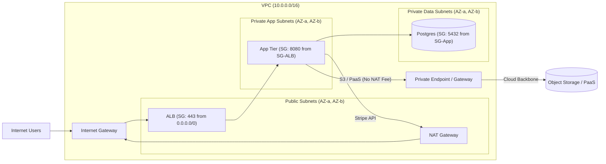
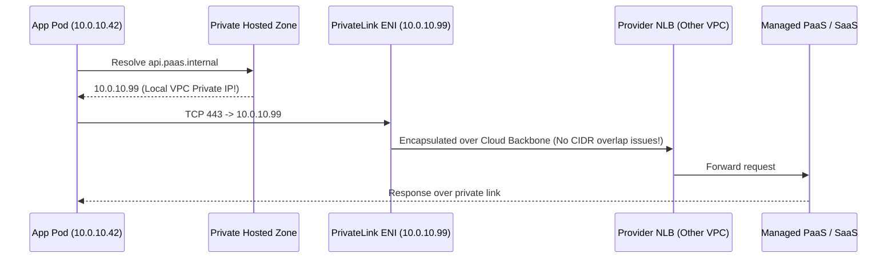
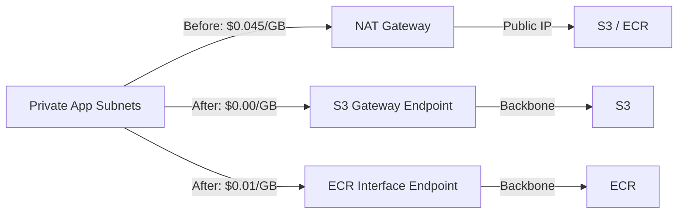

# Cloud Networking: VNets, Subnets, Security Groups & Private Endpoints

> **Prerequisites:** [Lesson 02: Regions, Availability Zones & Edge: What Multi-AZ Really Protects](../02-regions-availability-zones-edge/README.md).  
> **Estimated Reading Time:** 24–28 minutes  
> **Target Audience:** Backend engineers designing secure cloud network topologies, and candidates asked "how do your services talk to the database and external APIs without exposing them to the internet?"  
> **Free PDF Notes:** [Download SD-V-003.pdf](https://backendroadmap.com/notes/system-design/SD-V-003.pdf)

> [!NOTE]
> **In one line:** A **VPC/VNet** is your isolated virtual network; **Subnets** partition it into public (routable to an Internet Gateway) and private (no direct inbound internet) CIDR blocks per AZ; **Security Groups** are stateful instance-level firewalls; and **Private Endpoints (PrivateLink)** let traffic reach managed PaaS or SaaS services over the cloud backbone without traversing the public internet or paying NAT Gateway per-GB tolls.

> [!TIP]
> **The Golden Rule:** Put **only** load balancers and NAT Gateways in public subnets. Put all application servers, caches, and databases in **private subnets** with least-privilege Security Groups (referencing SG IDs, not `0.0.0.0/0`), and use **VPC/Private Endpoints** for high-volume S3, DynamoDB, or PaaS traffic.

---

## 1. What Cloud Networking Is, and What It Isn't

A team launches a web app and its Postgres database in the same VPC. To "make it work quickly," they put both in a public subnet and open port `5432` to `0.0.0.0/0` ("we have a strong password"). Within 15 minutes, automated scanners are brute-forcing Postgres. Even when they move the app to a private subnet and add a NAT Gateway so it can upload files to S3, their cloud bill spikes by $4,000/month because every gigabyte sent to S3 is routed through the NAT Gateway at **$0.045/GB**.

| Term | Precise Meaning | Example |
| :--- | :--- | :--- |
| **VPC / VNet** | Logically isolated software-defined network spanning a single Region | `10.0.0.0/16` (65,536 IPs) |
| **Subnet** | A CIDR slice of a VPC, scoped to a single AZ (AWS) or Region (GCP) | `10.0.1.0/24` (Public AZ-a), `10.0.10.0/24` (Private AZ-a) |
| **Route Table** | Rules determining where outbound packets from a subnet are forwarded | `0.0.0.0/0 -> igw-123` (public) vs `0.0.0.0/0 -> nat-456` (private) |
| **Security Group (SG)** | **Stateful** allow-only firewall attached to ENIs/instances; return traffic is auto-allowed | Allow TCP 5432 *only* from `sg-app-tier` |
| **NACL (Network ACL)** | **Stateless** allow/deny firewall at the subnet boundary; requires explicit return rules | Emergency IP blocklist at subnet edge |
| **NAT Gateway** | Managed proxy allowing private-subnet instances to initiate *outbound* internet calls | Outbound OS updates or calling Stripe API |
| **Private Endpoint / PrivateLink** | Private IP inside your VPC mapping directly to a PaaS/SaaS service over cloud backbone | `vpce-s3` or PrivateLink to RDS/Snowflake |
| **Not** | A replacement for application auth/mTLS | Network isolation is defense-in-depth, not zero-trust by itself |

### Why It Matters
1. **Least-privilege networking** (public ALB $\rightarrow$ private app $\rightarrow$ private DB) is the #1 security baseline in every production architecture review.
2. **CIDR planning** (`10.x.0.0/16`) cannot overlap if you ever need VPC Peering or Transit Gateway across environments or acquired companies.
3. **NAT Gateway vs Private Endpoint** is a classic cloud cost trap that separates senior engineers from novices.

---

## 2. Anatomy: Public/Private Subnets, Security Groups & PrivateLink



| Feature | Security Group (SG) | Network ACL (NACL) |
| :--- | :--- | :--- |
| **Scope** | Instance / ENI level | Subnet level |
| **Statefulness** | **Stateful** (return traffic auto-allowed) | **Stateless** (must allow ephemeral ports `1024-65535` inbound & outbound) |
| **Rule types** | Allow only (implicit deny at end) | Allow AND Deny (evaluated in rule-number order) |
| **References** | Can reference other **Security Group IDs** | CIDR blocks only |
| **Primary use** | Day-to-day micro-segmentation | Coarse subnet guardrails / emergency IP bans |

> [!WARNING]
> **Routing S3/DynamoDB/Container Registry traffic through a NAT Gateway is a silent budget killer.** NAT Gateways charge **~$0.045/GB** processed plus hourly fees. A **Gateway/Interface VPC Endpoint** routes that traffic privately over the cloud backbone—faster, more secure, and **$0.00/GB** for S3/DynamoDB Gateway Endpoints.

---

## 3. Mathematical Model: CIDR Sizing & NAT-vs-Endpoint Economics

**1. Usable IPv4 Addresses in a Subnet.** A subnet with prefix length $/p$ has $2^{32 - p}$ total addresses. Cloud providers reserve **5 IPs** per subnet (AWS reserves `.0` network, `.1` router, `.2` DNS, `.3` future, `.255` broadcast):

$$\text{Usable IPs} = 2^{32 - p} - 5$$

- `/24` subnet: $2^8 - 5 = \mathbf{251}$ usable IPs.
- `/26` subnet: $2^6 - 5 = \mathbf{59}$ usable IPs.
- `/28` subnet: $2^4 - 5 = \mathbf{11}$ usable IPs (minimum in AWS—often exhausted by ALB/Lambda ENIs!).

**2. NAT Gateway vs Private Endpoint Cost.** For $V_{\text{GB}}$ monthly traffic to PaaS/S3 across $k$ AZs:

$$C_{\text{NAT}} = k \cdot (730 \cdot \$0.045) + V_{\text{GB}} \cdot \$0.045$$

$$C_{\text{Interface-VPCE}} = k \cdot (730 \cdot \$0.01) + V_{\text{GB}} \cdot \$0.01 \qquad (\text{Gateway VPCE for S3/DynamoDB} = \$0)$$

### Worked Numerical Example
An ML/analytics pipeline across **2 AZs** pulls **$V_{\text{GB}} = 50\text{ TB}$ ($50{,}000\text{ GB}$)** per month from S3 and ECR:
- **Via NAT Gateway:**
  - Hourly: $2 \times 730 \times \$0.045 = \$65.70$
  - Data processing: $50{,}000 \times \$0.045 = \$2{,}250.00$
  - **Total NAT:** **$\$2{,}315.70/\text{month}$**.
- **Via S3 Gateway Endpoint:**
  - Hourly + Data: **$\$0.00/\text{month}$** (saves **$\$2{,}315.70/\text{month}$**).
- **Via Interface Endpoint (e.g., ECR / Secrets Manager, 50 TB):**
  - Hourly: $2 \times 730 \times \$0.01 = \$14.60$
  - Data: $50{,}000 \times \$0.01 = \$500.00$
  - **Total Interface VPCE:** **$\$514.60/\text{month}$** (**4.5x cheaper** than NAT, and never touches the public internet).

---

## 4. Metrics & Percentiles

| Metric | Meaning | Alert when |
| :--- | :--- | :--- |
| **Available IPs per subnet** | Remaining unallocated IPv4s in CIDR | $< 20\%$ free (blocks autoscaling & blue/green deploys!) |
| **NAT Gateway `ErrorPortAllocation`** | Dropped connections due to SNAT port exhaustion (65k ports/IP) | $> 0$ (add secondary Elastic IP to NAT GW) |
| **VPC Flow Log `REJECT` rate** | Denied packets per minute | Sudden spike (port scan or misconfigured SG after deploy) |
| **NAT BytesOutToDestination** | Traffic leaving VPC via NAT | Unexpected GB/hr (missing VPC Endpoint for S3/ECR) |
| **DNS resolution latency** | VPC resolver (`+2` IP) lookup time | $> 5\text{ ms}$ or `NXDOMAIN` spikes |

### Worked Example (SNAT Port Exhaustion)
A single NAT Gateway IP has ~55,000–64,000 ephemeral ports per destination IP:port tuple. A fleet of 200 workers all polling the same third-party webhook endpoint without HTTP keep-alive opens 60,000 short-lived TCP connections within 60 seconds (sitting in `TIME_WAIT`). `ErrorPortAllocation` spikes, and outbound calls fail with timeouts. **Fix:** Enable HTTP keep-alive connection pooling, attach multiple Elastic IPs to the NAT Gateway, or route via PrivateLink.

---

## 5. Compounding & Failure Modes

1. **IP Exhaustion in Kubernetes / Serverless:** Each Pod (with AWS VPC CNI) or VPC-attached Lambda consumes a real subnet IP. A `/26` subnet (59 IPs) fills up during a rolling deployment (which temporarily doubles pod count), causing `InsufficientFreeAddressesInSubnet` and failed autoscaling.
2. **Overlapping CIDRs During M&A or Peering:** Both `prod` and `analytics` VPCs were created with the default `10.0.0.0/16`. When you try to peer them or connect via Transit Gateway, routing fails because both claim `10.0.0.0/16`. Re-IPing a live VPC requires rebuilding subnets and migrating workloads.
3. **NACL Ephemeral Port Outage:** An engineer adds a "security hardening" NACL allowing only port `443` inbound and outbound. All outbound HTTPS calls immediately break because the *return* packets arrive on ephemeral ports (`1024–65535`), which the stateless NACL blocks.

---

## 6. Numbers Every Engineer Must Know

| Item | Typical | Implication |
| :--- | :---: | :--- |
| **Reserved IPs per subnet (AWS)** | 5 IPs | A `/28` gives only 11 usable IPs; use `/24` or `/22` for app/K8s subnets |
| **NAT Gateway data fee** | ~$0.045/GB | Always bypass NAT for S3/DynamoDB/ECR via VPC Endpoints |
| **Interface Endpoint data fee** | ~$0.01/GB | 4.5x cheaper than NAT + private backbone |
| **Gateway Endpoint fee (S3/DDB)** | $0.00/GB | Zero cost; enable on every VPC by default |
| **SNAT ephemeral ports per NAT IP** | ~55k–65k per dest | High-churn short connections exhaust ports; use keep-alive |
| **VPC Peering bandwidth** | Line-rate (10–100 Gbps) | Non-transitive (A–B and B–C does NOT connect A–C) |

---

## 7. Mechanism Deep Dive: PrivateLink vs VPC Peering vs Transit Gateway



| Question | Answer |
| :--- | :--- |
| **Why use PrivateLink instead of VPC Peering for SaaS/shared services?** | VPC Peering requires non-overlapping CIDRs and exposes whole subnets (subject to SGs). PrivateLink exposes **only a single service port** via a local ENI—even if both VPCs use `10.0.0.0/16`! |
| **Is VPC Peering transitive?** | **No.** If VPC A peers with B, and B peers with C, A cannot reach C. For hub-and-spoke across 5+ VPCs, use a **Transit Gateway** (or Cloud Router/Virtual WAN). |
| **Does putting a Lambda in a VPC make it slower?** | Historically yes (ENI creation took seconds). Modern Hyperplane ENIs share a single ENI per SG+subnet, making VPC cold starts near-zero—though you must still size subnets for IPs. |

**When NOT to use complex hub-and-spoke Transit Gateways:** For a single-product startup with 1–2 VPCs. Over-segmenting into 15 VPCs early creates massive operational and routing overhead.

---

## 8. Hierarchical Budgets & Design Rules

| Slice | Rule | Control |
| :--- | :--- | :--- |
| **CIDR allocation** | Central IPAM registry; never reuse `10.x.0.0/16` across VPCs | Terraform IPAM / network team registry |
| **Subnet sizing** | Use `/24` (251 IPs) or `/22` (1,019 IPs) for app/K8s subnets; `/26` for ALB/NAT | IaC CIDR validation |
| **Public vs Private** | Zero app/DB instances in public subnets; ALB + NAT only | Cloud Config / SCP guardrails |
| **Security Groups** | Reference `sg-id` (not CIDRs) between tiers; ban `0.0.0.0/0` on 22/3306/5432 | Automated policy-as-code (OPA/Checkov) |
| **Endpoints** | Enable S3/DynamoDB Gateway Endpoints + ECR/Secrets Interface Endpoints | Default VPC Terraform module |
| **Observability** | Enable VPC Flow Logs on rejected/all traffic to S3/CloudWatch | Baseline account landing zone |

---

## 9. Top Mitigations

1. **Enforce a strict 3-tier subnet layout** (Public: ALB/NAT $\rightarrow$ Private App $\rightarrow$ Private Data with no internet route).
2. **Reference Security Group IDs** (`sg-alb` $\rightarrow$ `sg-app` $\rightarrow$ `sg-db`) so autoscaled IPs are authorized automatically.
3. **Deploy VPC Gateway Endpoints** for S3/DynamoDB and **PrivateLink** for PaaS/SaaS to eliminate NAT bills and public internet exposure.
4. **Plan non-overlapping CIDRs** (`/16` per VPC, `/22` or `/24` per subnet) from day one.
5. **Keep NACLs stateless-safe** (default allow-all, using them only for emergency subnet-level IP blocks) and let stateful SGs do micro-segmentation.
6. **Monitor subnet free IPs and NAT `ErrorPortAllocation`** to catch exhaustion before deployments fail.

---

## 10. Production Reference: The $18,000/Month NAT Gateway Surprise

A fast-growing container platform ran 80 microservices in private subnets across 3 AZs. Every pod pull from ECR, every analytics Parquet write to S3, and every log ship to CloudWatch traversed the 3 NAT Gateways.

- **The problem:** Monthly traffic to S3 and ECR reached 380 TB. At $0.045/GB, NAT Gateway processing fees alone hit **$17,100/month**—more than the ECS/EC2 compute bill!
- **The fix:** Added an **S3 Gateway Endpoint** ($0/GB) and **Interface Endpoints** for ECR and CloudWatch Logs ($0.01/GB), plus updated the private route tables.
- **The result:** NAT Gateway traffic dropped by 92% overnight, cutting networking spend by **~$14,500/month** while keeping all traffic on the private AWS backbone.



---

## 11. Multi-Language Production Code Tabs

A **CIDR Subnet Planner & Security Group / NAT-vs-VPCE Cost Validator** to verify non-overlapping subnets, usable IPs, and endpoint savings.

````carousel
```go
// Go: CIDR usable IP calculator & non-overlapping check + NAT vs VPCE cost model.
package main

import (
	"fmt"
	"net/netip"
)

func UsableIPs(prefix netip.Prefix) int {
	bits := 32 - prefix.Bits()
	total := 1 << bits
	if total <= 5 {
		return 0
	}
	return total - 5 // Cloud providers reserve 5 IPs per IPv4 subnet
}

func main() {
	vpc := netip.MustParsePrefix("10.10.0.0/16")
	subA := netip.MustParsePrefix("10.10.1.0/24")
	subB := netip.MustParsePrefix("10.10.2.0/24")
	fmt.Printf("VPC %s contains subA=%v, subA overlaps subB=%v\n", vpc, vpc.Overlaps(subA), subA.Overlaps(subB))
	fmt.Printf("Usable IPs in /24: %d | /26: %d | /28: %d\n",
		UsableIPs(subA),
		UsableIPs(netip.MustParsePrefix("10.10.3.0/26")),
		UsableIPs(netip.MustParsePrefix("10.10.4.0/28")),
	)
}
```
<!-- slide -->
```typescript
// TypeScript: Subnet usable IP calculator & NAT vs Private Endpoint cost comparison.
function usableIps(prefixLen: number): number {
  const total = 2 ** (32 - prefixLen);
  return Math.max(0, total - 5);
}

function compareNatVsEndpoint(gbPerMonth: number, azCount: number) {
  const natCost = azCount * 730 * 0.045 + gbPerMonth * 0.045;
  const gatewayEndpointCost = 0; // S3 / DynamoDB
  const interfaceEndpointCost = azCount * 730 * 0.01 + gbPerMonth * 0.01;
  return { natCost, gatewayEndpointCost, interfaceEndpointCost };
}

console.log("Usable IPs (/24, /26, /28):", usableIps(24), usableIps(26), usableIps(28));
console.log("50 TB/mo across 2 AZs:", compareNatVsEndpoint(50_000, 2));
```
<!-- slide -->
```python
# Python: CIDR overlap & usable IP validator + NAT vs VPC Endpoint cost model (stdlib only).
import ipaddress


def validate_subnets(vpc_cidr: str, subnet_cidrs: list[str]) -> dict:
    vpc = ipaddress.ip_network(vpc_cidr)
    nets = [ipaddress.ip_network(s) for s in subnet_cidrs]
    for i, a in enumerate(nets):
        assert vpc.supernet_of(a), f"{a} outside {vpc}"
        for b in nets[i + 1:]:
            assert not a.overlaps(b), f"Overlap: {a} and {b}"
    return {str(n): max(0, n.num_addresses - 5) for n in nets}


def nat_vs_vpce(gb_month: float, azs: int = 2) -> dict:
    nat = round(azs * 730 * 0.045 + gb_month * 0.045, 2)
    iface = round(azs * 730 * 0.01 + gb_month * 0.01, 2)
    return {"nat_usd": nat, "interface_vpce_usd": iface, "gateway_vpce_usd": 0.0}


if __name__ == "__main__":
    print("Subnets usable IPs:", validate_subnets("10.10.0.0/16", ["10.10.1.0/24", "10.10.2.0/24", "10.10.3.0/26"]))
    print("50 TB/mo (2 AZs):", nat_vs_vpce(50_000, 2))
```
<!-- slide -->
```csharp
// C#: Subnet usable IPs & NAT vs Interface Endpoint cost calculator.
using System;

public static class CloudNetPlanner
{
    public static int UsableIps(int prefixLength) => Math.Max(0, (1 << (32 - prefixLength)) - 5);

    public static (double NatUsd, double InterfaceVpceUsd, double GatewayVpceUsd) CompareCosts(double gbMonth, int azs) =>
        (azs * 730 * 0.045 + gbMonth * 0.045, azs * 730 * 0.01 + gbMonth * 0.01, 0.0);

    public static void Main()
    {
        Console.WriteLine($"Usable IPs: /24={UsableIps(24)}, /26={UsableIps(26)}, /28={UsableIps(28)}");
        var costs = CompareCosts(50_000, 2);
        Console.WriteLine($"50 TB/mo: NAT=${costs.NatUsd:F2}, InterfaceVPCE=${costs.InterfaceVpceUsd:F2}, GatewayVPCE=${costs.GatewayVpceUsd:F2}");
    }
}
```
````

---

## 12. Hands-On CLI Verification Workflows

Validate CIDR math, Security Groups, and VPC Endpoints:

```bash
# 1. Python CIDR & NAT-vs-VPCE verification
python -c "import ipaddress; n=ipaddress.ip_network('10.10.1.0/24'); print('Total:', n.num_addresses, 'Usable:', n.num_addresses-5)"

# 2. AWS: audit Security Groups with 0.0.0.0/0 open on non-HTTP ports
aws ec2 describe-security-groups \
  --filters "Name=ip-permission.cidr,Values=0.0.0.0/0" \
  --query "SecurityGroups[*].[GroupId,GroupName,IpPermissions[?IpRanges[?CidrIp=='0.0.0.0/0']].FromPort]"

# 3. AWS: check available IPv4 addresses per subnet & existing VPC Endpoints
aws ec2 describe-subnets --query "Subnets[*].[SubnetId,AvailabilityZone,CidrBlock,AvailableIpAddressCount]" --output table
aws ec2 describe-vpc-endpoints --query "VpcEndpoints[*].[VpcEndpointId,ServiceName,VpcEndpointType,State]" --output table
```

---

## 13. Common Mistakes to Avoid

1. **Putting databases or app servers in public subnets** ("we'll just lock down the Security Group").
2. **Opening Security Groups to `0.0.0.0/0` on SSH (22) or DB ports (5432/3306)** instead of referencing SG IDs or using SSM/bastion.
3. **Routing S3/DynamoDB/ECR traffic through a NAT Gateway**, paying $0.045/GB unnecessarily.
4. **Using `/28` or `/27` subnets** for Kubernetes or autoscaling tiers, hitting IP exhaustion during rolling deploys.
5. **Reusing `10.0.0.0/16` across every VPC**, blocking future VPC Peering or Transit Gateway connections.
6. **Forgetting ephemeral return ports (`1024–65535`) in stateless NACLs**, breaking outbound HTTPS/DB calls.
7. **Assuming VPC Peering is transitive** (A $\leftrightarrow$ B $\leftrightarrow$ C does not let A reach C).

---

## 14. Key Terms Glossary

| Key Term | Definition |
| :--- | :--- |
| **VPC / VNet** | Isolated software-defined virtual network within a cloud region. |
| **CIDR Block** | IP address range notation (e.g., `10.0.0.0/16`) defining network size. |
| **Public Subnet** | Subnet whose route table points `0.0.0.0/0` to an Internet Gateway. |
| **Private Subnet** | Subnet with no direct inbound internet route; outbound goes via NAT or Private Endpoint. |
| **Security Group (SG)** | Stateful instance/ENI-level allow-only firewall supporting SG-to-SG references. |
| **Network ACL (NACL)** | Stateless subnet-level firewall with numbered allow/deny rules. |
| **NAT Gateway** | Managed outbound proxy giving private instances internet egress without inbound access. |
| **Private Endpoint / PrivateLink** | Private IP inside a VPC mapping directly to a PaaS/SaaS service over the cloud backbone. |
| **VPC Peering** | Non-transitive, direct private network link between two non-overlapping VPCs. |
| **SNAT Port Exhaustion** | Running out of ephemeral source ports on a NAT Gateway IP due to high connection churn. |

---

## 15. System Design Interview Questions & Answers

### Basic Conceptual Questions

<details>
<summary><strong>Q1: What makes a subnet "public" vs "private"? [BASIC]</strong></summary>

**Answer:**
Its **Route Table**. A public subnet has a route `0.0.0.0/0 -> Internet Gateway (IGW)` (and instances have public IPs). A private subnet has no route to an IGW; its `0.0.0.0/0` points to a **NAT Gateway** (or has no internet route at all).
</details>

<details>
<summary><strong>Q2: Security Group vs Network ACL—how do they differ? [BASIC]</strong></summary>

**Answer:**
Security Groups are **stateful** (return traffic is automatically allowed), operate at the **instance/ENI** level, support **allow rules only**, and can reference other SG IDs. NACLs are **stateless** (you must explicitly allow ephemeral return ports), operate at the **subnet** boundary, and support both **allow and deny** rules.
</details>

<details>
<summary><strong>Q3: Why do you put a NAT Gateway in a public subnet if it serves private subnets? [BASIC]</strong></summary>

**Answer:**
Because the NAT Gateway itself needs a public Elastic IP and a route to the **Internet Gateway** to reach external endpoints on behalf of private instances. Private instances send outbound packets to the NAT Gateway, which translates the source IP and forwards them to the IGW.
</details>

<details>
<summary><strong>Q4: What is a Private Endpoint (PrivateLink) and why use it? [BASIC]</strong></summary>

**Answer:**
It creates a private IP (ENI) or route-table entry inside your VPC that connects directly to a cloud service (S3, RDS, KMS) or third-party SaaS over the cloud provider's private backbone—eliminating public internet exposure and avoiding NAT Gateway per-GB charges.
</details>

### Scenario-Based Architecture Questions

<details>
<summary><strong>Q5: Draw the network topology for a 3-tier web app (ALB, API containers, Postgres). Which subnets and SGs do you use? [SCENARIO]</strong></summary>

**Answer:**
- **Public Subnets (AZ-a, AZ-b):** ALB (`sg-alb`: allow 443 from `0.0.0.0/0`) and NAT Gateways.
- **Private App Subnets (AZ-a, AZ-b):** API containers (`sg-app`: allow 8080 *only* from `sg-alb`).
- **Private Data Subnets (AZ-a, AZ-b):** Postgres Primary/Standby (`sg-db`: allow 5432 *only* from `sg-app`). Add S3/ECR VPC Endpoints so app pods don't pay NAT fees.
</details>

<details>
<summary><strong>Q6: Your private-subnet ETL job writes 100 TB/month to S3 and your NAT Gateway bill is $4,500/month. How do you fix it? [SCENARIO]</strong></summary>

**Answer:**
Create an **S3 Gateway VPC Endpoint** and attach it to the private subnet route tables. S3 traffic immediately bypasses the NAT Gateway, dropping the $0.045/GB NAT processing fee to **$0.00/GB** while keeping traffic private.
</details>

<details>
<summary><strong>Q7: A Kubernetes rolling deploy fails with `InsufficientFreeAddressesInSubnet` even though CPU is at 30%. Why? [SCENARIO]</strong></summary>

**Answer:**
Each pod (with VPC CNI) consumes an IPv4 address from the subnet, and rolling deployments temporarily spin up new pods before terminating old ones. The subnet CIDR (e.g., `/26` = 59 usable IPs) is exhausted. Fix by migrating to larger `/22` subnets, enabling CNI prefix delegation, or adding a secondary CIDR.
</details>

<details>
<summary><strong>Q8: Two companies merge; both use `10.0.0.0/16` in their production VPCs, and Company A needs to call Company B's internal API. What do you do? [SCENARIO]</strong></summary>

**Answer:**
VPC Peering and Transit Gateway **cannot** connect overlapping `10.0.0.0/16` CIDRs directly. Expose Company B's API via **PrivateLink** (endpoint service behind an NLB) into Company A's VPC—PrivateLink translates addresses at the endpoint ENI, working seamlessly even with identical CIDRs.
</details>

### Advanced & Tricky Interview Questions

<details>
<summary><strong>Q9: Why is VPC Peering called "non-transitive," and how do you connect 20 VPCs? [TRICKY]</strong></summary>

**Answer:**
In a peered pair A–B and B–C, traffic from A cannot hop through B to reach C; a full mesh of 20 VPCs would require $\frac{20 \times 19}{2} = 190$ peering links. Instead, use a hub-and-spoke **Transit Gateway** (or Cloud Router) where all 20 VPCs attach once to the central hub.
</details>

<details>
<summary><strong>Q10: How can a NAT Gateway fail even when bandwidth is well below its Gbps limit? [TRICKY]</strong></summary>

**Answer:**
**SNAT port exhaustion.** A single Elastic IP on a NAT Gateway provides ~55k–64k ephemeral ports per destination IP:port. If hundreds of workers open short-lived connections without HTTP keep-alive to the same external API, ports get stuck in `TIME_WAIT` and `ErrorPortAllocation` drops new connections.
</details>

<details>
<summary><strong>Q11: Does private networking (VPC + SGs) remove the need for TLS/mTLS between internal services? [TRICKY]</strong></summary>

**Answer:**
No. Under **Zero-Trust** and compliance frameworks (PCI, SOC 2), network isolation is only one layer. Compromised pods or misconfigured SGs could still sniff or spoof plaintext traffic; mTLS ensures encrypted transport and cryptographic service identity regardless of IP.
</details>

<details>
<summary><strong>Q12: You add a NACL rule allowing inbound TCP 443 and outbound TCP 443 on a public subnet. Why do outbound HTTPS calls from that subnet break? [TRICKY]</strong></summary>

**Answer:**
NACLs are **stateless**. When an instance initiates an outbound HTTPS call to port 443, the server replies to a random **ephemeral port (`1024–65535`)** on the client. Without an inbound NACL rule allowing `1024–65535`, the return packets are dropped.
</details>

---

## 16. One-Page Master Cheat Sheet

```
+---------------------------------------------------------------------------------------------------------+
|               CLOUD NETWORKING (VNets, Subnets, SGs, PrivateLink) — MASTER CHEAT SHEET                  |
+---------------------------------------------------------------------------------------------------------+
| 1. SUBNETS: Public (0.0.0.0/0 -> IGW: ALB, NAT only) | Private (0.0.0.0/0 -> NAT/VPCE: Apps, DBs).      |
+---------------------------------------------------------------------------------------------------------+
| 2. FIREWALLS: Security Groups = stateful, instance-level, allow-only, reference SG IDs.                 |
|    NACLs = stateless, subnet-level, allow/deny (must allow ephemeral return ports 1024-65535).          |
+---------------------------------------------------------------------------------------------------------+
| 3. CIDR MATH: Usable IPs = 2^(32-p) - 5 (/24 = 251 IPs, /26 = 59, /28 = 11). Never overlap VPC CIDRs!   |
+---------------------------------------------------------------------------------------------------------+
| 4. COST TRAP: NAT Gateway = $0.045/GB. Use Gateway VPCE ($0/GB for S3/DDB) & PrivateLink ($0.01/GB).    |
+---------------------------------------------------------------------------------------------------------+
| 5. PRIVATELINK: Exposes 1 service port privately over backbone; works even with overlapping CIDRs!      |
+---------------------------------------------------------------------------------------------------------+
```

---

## Further Reading & Sources

- AWS VPC Documentation, *Subnets, Route Tables, Security Groups, and AWS PrivateLink*.
- Microsoft Azure Architecture Center, *Hub-Spoke Network Topology* & *Azure Private Link*.
- Google Cloud VPC Documentation, *Virtual Private Cloud (VPC) Overview & Private Service Connect*.
- Evan Gilman & Doug Barth, *Zero Trust Networks* (O'Reilly).

---

## Free PDF Notes

[SD-V-003.pdf](https://backendroadmap.com/notes/system-design/SD-V-003.pdf)

---

## Next

Continue with [Lesson 04: Well-Architected Frameworks: The Six Pillars and a Pre-Launch Review](../04-well-architected-frameworks/README.md).
