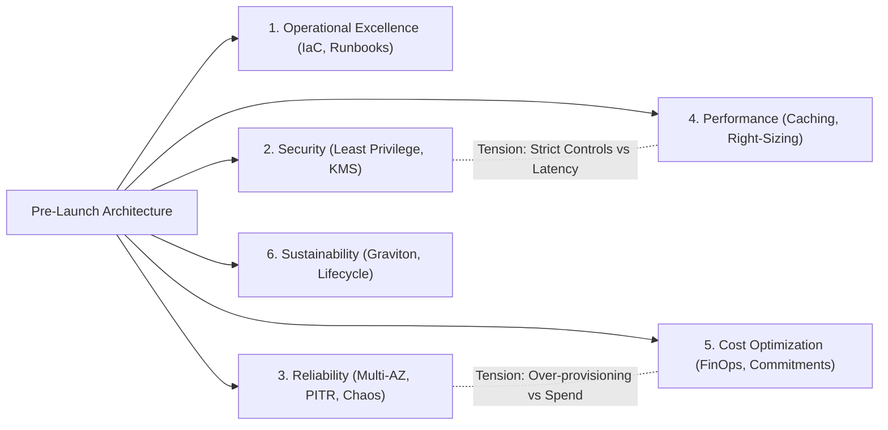
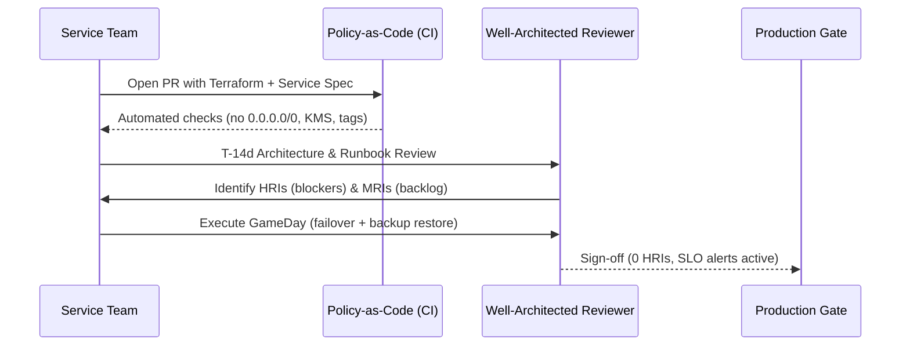
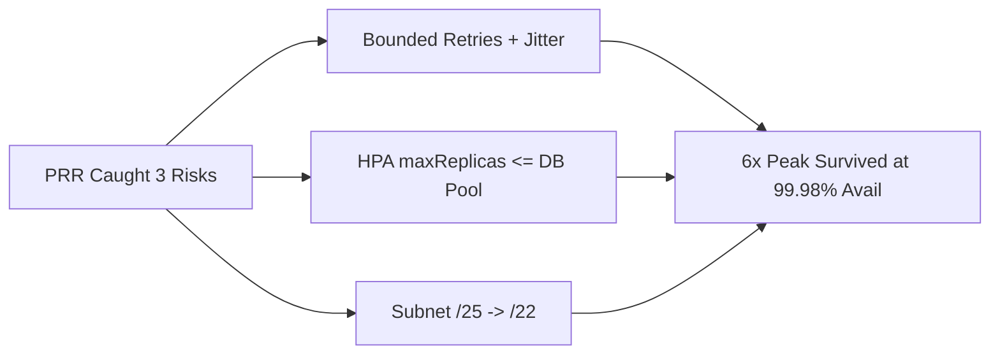

# Well-Architected Frameworks: The Six Pillars and a Pre-Launch Review

> **Prerequisites:** [Lesson 03: Cloud Networking: VNets, Subnets, Security Groups & Private Endpoints](../03-cloud-networking/README.md).  
> **Estimated Reading Time:** 22–26 minutes  
> **Target Audience:** Tech leads preparing a production readiness review (PRR), and candidates asked "how do you review an architecture before launch and balance reliability, security, and cost?"  
> **Free PDF Notes:** [Download SD-V-004.pdf](https://backendroadmap.com/notes/system-design/SD-V-004.pdf)

> [!NOTE]
> **In one line:** A **Well-Architected Framework** is a structured six-pillar checklist—**Operational Excellence, Security, Reliability, Performance Efficiency, Cost Optimization, and Sustainability**—used to surface hidden single points of failure, security gaps, and runaway costs *before* production traffic hits. You never maximize all six at once; you make **explicit, documented trade-offs** aligned to your business SLOs.

> [!TIP]
> **The Golden Rule:** Run a **Pre-Launch Well-Architected Review** two weeks before go-live (never the day before), classify findings into **High-Risk Issues (HRIs)** that block launch vs **Medium-Risk Issues (MRIs)** with dated remediation tickets, and automate pillar checks into CI/CD so architecture doesn't drift.

---

## 1. What a Well-Architected Framework Is, and What It Isn't

A team spends four months building a new billing service. It passes unit tests and works in staging. On launch week, a minor spike triggers an autoscaling loop that exhausts database connections (Reliability), logs unmasked credit card tokens to CloudWatch (Security), leaves 40 oversized GPUs/instances running idle (Cost), and nobody knows who owns the alert or how to roll back (Operational Excellence). A 90-minute Well-Architected Review would have caught all four before launch.

| Term | Precise Meaning | Example |
| :--- | :--- | :--- |
| **Operational Excellence** | Running and monitoring systems to deliver business value and continually improve processes | IaC, runbooks, game days, blameless post-mortems |
| **Security** | Protecting data, systems, and assets via IAM least privilege, encryption, and detection | Zero public DBs, KMS encryption, automated CVE scanning |
| **Reliability** | Recovering from infrastructure or service disruptions and scaling to meet demand | Multi-AZ, backups/PITR, circuit breakers, quotas |
| **Performance Efficiency** | Using computing resources efficiently as demand and technology evolve | Right-sizing, caching, read replicas, async queues |
| **Cost Optimization** | Avoiding unnecessary cost and aligning cloud spend to business unit economics | Spot/Savings Plans, S3 lifecycle, NAT-to-VPCE |
| **Sustainability** | Minimizing environmental impact (energy, hardware) of cloud workloads | ARM/Graviton CPUs, scale-to-zero, data retention |
| **HRI / MRI** | High-Risk Issue (launch blocker) / Medium-Risk Issue (post-launch backlog with SLA) | Unencrypted PII = HRI; missing S3 tiering = MRI |
| **Not** | A compliance checkbox you pass once and forget | Workloads drift continuously; reviews must be recurring |

### Why It Matters
1. **Production Readiness Reviews (PRRs)** at major tech companies (Google, AWS, Stripe) are built directly on these six pillars.
2. In system design interviews, structuring your wrap-up around **Reliability, Security, Cost, and Operations** signals principal-level maturity.
3. Most SEV-1 outages are not exotic distributed-systems bugs—they are violated fundamentals (missing backups, un-tested failover, expired certs, unbounded retries).

---

## 2. Anatomy: The Six Pillars & Their Trade-Off Tension



| Trade-Off Pair | Typical Tension | How Principal Engineers Resolve It |
| :--- | :--- | :--- |
| **Reliability vs Cost** | Multi-Region Active-Active doubles infra cost | Match topology to **error budget & SLA** (Multi-AZ for 99.95%; Multi-Region only for 99.99%+) |
| **Security vs Performance** | Deep packet inspection / mTLS / KMS calls add ms | Cache KMS data keys locally; terminate TLS at Edge; use hardware AES-NI |
| **Speed of Delivery vs Ops** | Skipping IaC/runbooks ships faster this week | Use golden Terraform modules so the secure, observable path is the *fastest* path |
| **Performance vs Sustainability** | Running hot idle pools for "just in case" | Use predictive autoscaling + ARM64 (Graviton) for 20–40% better perf/watt |

> [!WARNING]
> **A Well-Architected Review without a Severity Gate becomes theater.** If every finding is treated as equal, teams ignore a 40-item backlog. Define **HRIs (Launch Blockers)** strictly: public sensitive data, no automated backup restore test, single-AZ stateful tier, or missing kill-switch/rollback.

---

## 3. Mathematical Model: Weighted Risk Scoring & Cost-of-Downtime vs Mitigation

How do you decide objectively whether a reliability or cost mitigation is worth doing before launch? Compare the **Annualized Loss Expectancy (ALE)** of an outage against the **Annualized Cost of Mitigation (ACM)**:

$$\text{ALE} = \text{ARO} \times \text{SLE}, \qquad \text{ROI}_{\text{mitigation}} = \frac{\text{ALE}_{\text{before}} - \text{ALE}_{\text{after}} - \text{ACM}}{\text{ACM}}$$

Where **ARO** is Annualized Rate of Occurrence and **SLE** is Single Loss Expectancy (lost revenue + SLA credits + engineering recovery cost).

For a Pre-Launch Review scorecard across $n = 6$ pillars with weights $w_i$ ($\sum w_i = 1$) and pillar pass-rates $s_i \in [0, 1]$:

$$S_{\text{total}} = \sum_{i=1}^{6} w_i \, s_i \quad \text{subject to } \text{HRI}_{\text{count}} = 0$$

### Worked Numerical Example
An e-commerce checkout service processes **$50,000/hour** during peak hours.
- **Unmitigated risk (Single-AZ DB):** Expected AZ/hardware outage **$\text{ARO} = 0.5/\text{year}$**, mean recovery time **4 hours** (manual restore from snapshot), so $\text{SLE} = 4 \times \$50{,}000 = \$200{,}000$.
  - $\text{ALE}_{\text{before}} = 0.5 \times \$200{,}000 = \mathbf{\$100{,}000/\text{year}}$.
- **Mitigation (Multi-AZ RDS Standby):** Adds **$\$600/\text{month} = \$7{,}200/\text{year}$** ($\text{ACM}$), cutting outage downtime to a 60-second automatic failover ($\text{SLE} \approx \$833$, $\text{ALE}_{\text{after}} \approx \$417$).
  - **Net annual savings:** $\$100{,}000 - \$417 - \$7{,}200 = \mathbf{\$92{,}383/\text{year}}$ (**ROI = 12.8x**).
- Conversely, adding **Active-Active Multi-Region** for **$\$180{,}000/\text{year}$** to save 15 minutes of regional outage every 3 years ($\text{ALE} \approx \$4{,}167$) has **negative ROI**—unless contractually mandated by an enterprise SLA.

---

## 4. Metrics & Percentiles

| Metric | Meaning | Alert when |
| :--- | :--- | :--- |
| **Open HRIs (High-Risk Issues)** | Unresolved launch-blocking architectural risks | $> 0$ at T-7 days before launch |
| **Error Budget Burn Rate** | Rate at which SLO unavailability budget is consumed | $> 2\%$ of monthly budget burned in 1 hour |
| **Unit Cost (Cost / 1M requests)** | Cloud spend normalized by business volume | $> 15\%$ drift without feature/traffic change |
| **Backup Restore Drill RTO** | Measured time to restore DB from snapshot to clean env | Untested in $> 90$ days or $>$ SLA RTO |
| **IaC Drift %** | Resources modified manually outside Terraform/CDK | $> 0$ in production accounts |
| **Mean Time to Recovery (MTTR)** | Median/p90 time from alert to service restoration | Trending upward quarter-over-quarter |

### Worked Example (Pre-Launch Review Scorecard)
Two weeks before launch, a team runs a 25-check Well-Architected PRR:
- **Security (5/5):** Private subnets, SG-to-SG rules, KMS encryption, Secrets Manager, WAF enabled.
- **Reliability (4/5 — 1 HRI):** Multi-AZ enabled, PITR enabled, *but backup restore has never been tested* $\rightarrow$ **HRI: Run restore drill before launch**.
- **Cost (3/5 — 2 MRIs):** S3 lifecycle missing + NAT Gateway used for S3 $\rightarrow$ **MRI: Add S3 Gateway Endpoint** (saves $1,800/mo).
- **Result:** Launch gated until the 1 HRI (restore drill) passes; MRIs scheduled for Sprint +1.

---

## 5. Compounding & Failure Modes

1. **The "Green Staging, Red Production" Fallacy:** Staging has 100 rows in Postgres, 10 RPS, and no WAF. Production has 100M rows, 2,000 RPS, and bot traffic. Missing indexes, missing connection poolers, and tight NAT/subnet limits only surface under production scale.
2. **Silent Cost Compounding:** Leaving verbose `DEBUG` logging enabled in production at 5,000 RPS generates 50 TB/month of CloudWatch/Datadog logs—costing **$25,000–$50,000/month** in ingestion fees alone.
3. **Un-tested Runbooks ("Paper Reliability"):** A team writes a failover runbook in Notion but never runs a GameDay. During a real SEV-1, the IAM role in the runbook lacks permissions and the CLI flags were deprecated a year ago.

---

## 6. Numbers Every Engineer Must Know

| Item | Typical | Implication |
| :--- | :---: | :--- |
| **PRR timing before launch** | 2–3 weeks prior | Gives time to fix HRIs without rushing |
| **Graviton (ARM64) vs x86 price-perf** | 20–40% better | Easiest Cost + Sustainability win for containers/DBs |
| **Savings Plans / Reserved Instances** | 30–60% discount | Commit only for baseline steady-state (60–70% of avg) |
| **Un-tested backup failure rate** | High (~20–30% fail first drill) | An untested backup is not a backup |
| **Log ingestion cost (managed SaaS/Cloud)** | $0.50–$2.50/GB | Never log full request/response bodies at `INFO` in prod |
| **SLO 99.9% monthly error budget** | 43.2 minutes | 99.99% = 4.32 minutes (10x harder/costlier) |

---

## 7. Mechanism Deep Dive: The Pre-Launch Review Workflow



| Question | Answer |
| :--- | :--- |
| **Who should run a Well-Architected Review?** | A peer principal/staff engineer or cloud architect *outside* the immediate feature team, using a blameless, collaborative checklist. |
| **How long should a PRR take?** | 60–90 minutes for the live review, backed by automated policy-as-code checks that run in seconds on every PR. |
| **What if a business deadline conflicts with an HRI?** | Either fix the HRI, reduce launch scope (e.g., internal beta / 5% canary), or get explicit VP/risk-owner sign-off accepting the ALE. |

**When NOT to run a full 6-pillar review:** On disposable prototypes, internal hackathons, or low-risk static marketing pages—apply a lightweight 5-minute security/cost guardrail instead.

---

## 8. Hierarchical Budgets & Design Rules

| Slice | Rule | Control |
| :--- | :--- | :--- |
| **Operational Excellence** | 100% IaC; documented rollback + on-call runbook per service | GitOps + PRR gate |
| **Security** | Least-privilege IAM, KMS at rest, TLS 1.2+ in transit, zero secrets in code | Checkov / tfsec / Secret scanning |
| **Reliability** | Multi-AZ, automated PITR backups, tested restore, bounded retries/timeouts | Quarterly GameDay |
| **Performance** | Load-tested at 2x peak; DB queries indexed; caching & async queues | k6/Locust load test in staging |
| **Cost (FinOps)** | Mandatory cost-allocation tags, billing anomaly alerts, VPCE for S3 | AWS Budgets / Infracost in PRs |
| **Sustainability** | ARM64 where supported, S3 lifecycle/expiration, right-sized instances | Compute Optimizer / Trusted Advisor |

---

## 9. Top Mitigations

1. **Automate pillar guardrails in CI/CD** (Checkov/OPA for security, Infracost for FinOps) so human reviews focus on architecture, not typos.
2. **Test disaster recovery before launch:** Restore a production-sized snapshot and trigger an AZ failover in staging.
3. **Define explicit SLOs and error budgets** so Reliability vs Cost trade-offs are data-driven.
4. **Enforce mandatory resource tagging** (`service`, `owner`, `env`, `cost-center`) to attribute 100% of spend.
5. **Implement kill switches and feature flags** so bad releases are mitigated in seconds without a full redeploy.
6. **Schedule quarterly Well-Architected re-reviews** for Tier-1 services as traffic and architecture evolve.

---

## 10. Production Reference: The Pre-Launch Review That Saved Black Friday

Before a major retail peak event, a platform team ran a Well-Architected Review on a newly rewritten inventory reservation service:

- **Findings:** (1) The service used an un-bounded retry loop against Redis on timeout (Reliability HRI), (2) it had no S3 lifecycle policy on 40 TB of audit snapshots (Cost MRI), and (3) its Kubernetes HPA lacked a `maxReplicas` cap, which could exhaust the subnet's `/25` IP pool and Postgres `max_connections` (Reliability + Networking HRI).
- **The fix:** Added exponential backoff with jitter + circuit breaker, capped HPA `maxReplicas` aligned to PgBouncer pool capacity, and expanded the subnet to `/22`.
- **The result:** During a 6x Black Friday traffic surge and a brief downstream cache blip, the circuit breaker shed non-critical reads cleanly and the checkout path stayed at **99.98% availability**.



---

## 11. Multi-Language Production Code Tabs

An automated **Well-Architected Pre-Launch Scorecard & ALE ROI Evaluator** that scores all 6 pillars, flags HRIs as launch blockers, and computes mitigation ROI.

````carousel
```go
// Go: Well-Architected Pre-Launch Scorecard & HRI Launch Gate.
package main

import "fmt"

type Check struct {
	Pillar string
	Name   string
	Passed bool
	IsHRI  bool // High-Risk Issue blocks launch
}

func EvaluateLaunchGate(checks []Check) (score float64, hriCount int, approved bool) {
	passed := 0
	for _, c := range checks {
		if c.Passed {
			passed++
		} else if c.IsHRI {
			hriCount++
		}
	}
	score = float64(passed) / float64(len(checks)) * 100.0
	return score, hriCount, hriCount == 0 && score >= 80.0
}

func main() {
	checks := []Check{
		{"Security", "Private DB + KMS", true, true},
		{"Reliability", "Multi-AZ Enabled", true, true},
		{"Reliability", "Restore Drill Tested", false, true},
		{"Cost", "S3 Gateway Endpoint", false, false},
	}
	score, hris, ok := EvaluateLaunchGate(checks)
	fmt.Printf("Score: %.1f%% | Open HRIs: %d | Launch Approved: %v\n", score, hris, ok)
}
```
<!-- slide -->
```typescript
// TypeScript: Well-Architected Scorecard & ALE Mitigation ROI Evaluator.
interface Check {
  pillar: string;
  name: string;
  passed: boolean;
  isHri: boolean;
}

export function evaluatePrr(checks: Check[]) {
  const passed = checks.filter((c) => c.passed).length;
  const openHris = checks.filter((c) => !c.passed && c.isHri);
  const scorePct = (passed / checks.length) * 100;
  return { scorePct, openHriCount: openHris.length, approved: openHris.length === 0 && scorePct >= 80 };
}

export function mitigationRoi(aleBefore: number, aleAfter: number, annualCost: number): number {
  return (aleBefore - aleAfter - annualCost) / annualCost;
}

console.log(evaluatePrr([
  { pillar: "Security", name: "Least Privilege IAM", passed: true, isHri: true },
  { pillar: "Reliability", name: "Restore Drill", passed: false, isHri: true },
  { pillar: "Cost", name: "Graviton Migration", passed: false, isHri: false },
]));
console.log("Multi-AZ ROI:", mitigationRoi(100_000, 417, 7_200).toFixed(2) + "x");
```
<!-- slide -->
```python
# Python: Well-Architected 6-Pillar Scorecard & ALE ROI calculator (stdlib only).
from dataclasses import dataclass


@dataclass
class Check:
    pillar: str
    name: str
    passed: bool
    is_hri: bool = False


def evaluate_prr(checks: list[Check]) -> dict:
    open_hris = [c.name for c in checks if not c.passed and c.is_hri]
    score = round(sum(c.passed for c in checks) / len(checks) * 100, 1)
    return {"score_pct": score, "open_hris": open_hris, "approved": len(open_hris) == 0 and score >= 80.0}


def ale_roi(hourly_rev: float, outage_hrs: float, aro_before: float, aro_after: float, acm: float) -> dict:
    ale_before = aro_before * hourly_rev * outage_hrs
    ale_after = aro_after * hourly_rev * (1 / 60)  # 60-sec failover
    roi = round((ale_before - ale_after - acm) / acm, 2)
    return {"ale_before": ale_before, "ale_after": round(ale_after, 2), "net_savings": round(ale_before - ale_after - acm, 2), "roi_x": roi}


if __name__ == "__main__":
    print(evaluate_prr([Check("Security", "KMS", True, True), Check("Reliability", "Restore Drill", False, True)]))
    print(ale_roi(50_000, 4, 0.5, 0.5, 7_200))
```
<!-- slide -->
```csharp
// C#: Well-Architected Pre-Launch Gate & ALE ROI Calculator.
using System;
using System.Collections.Generic;
using System.Linq;

public record Check(string Pillar, string Name, bool Passed, bool IsHri);

public static class WellArchitectedGate
{
    public static (double ScorePct, int OpenHris, bool Approved) Evaluate(IReadOnlyList<Check> checks)
    {
        var openHris = checks.Count(c => !c.Passed && c.IsHri);
        var score = checks.Count(c => c.Passed) * 100.0 / checks.Count;
        return (score, openHris, openHris == 0 && score >= 80.0);
    }

    public static void Main()
    {
        var res = Evaluate(new[]
        {
            new Check("Security", "Private Subnets", true, true),
            new Check("Reliability", "Restore Drill", false, true),
            new Check("Cost", "S3 Lifecycle", false, false)
        });
        Console.WriteLine($"Score: {res.ScorePct:F1}% | HRIs: {res.OpenHris} | Approved: {res.Approved}");
    }
}
```
````

---

## 12. Hands-On CLI Verification Workflows

Run automated Well-Architected checks locally and against cloud accounts:

```bash
# 1. Run Terraform/IaC security & best-practice scan (Checkov)
checkov -d ./terraform --framework terraform

# 2. Preview cloud cost impact in a PR (Infracost)
infracost breakdown --path ./terraform

# 3. AWS: list Well-Architected workloads & high-risk counts
aws wellarchitected list-workloads --query "WorkloadSummaries[*].[WorkloadName,RiskCounts]" --output table

# 4. Verify ALE ROI calculation in Python
python -c "ale_b=0.5*200000; ale_a=0.5*(50000/60); acm=7200; print('Net savings:', round(ale_b-ale_a-acm, 2), 'ROI:', round((ale_b-ale_a-acm)/acm, 2))"
```

---

## 13. Common Mistakes to Avoid

1. **Running the review on launch day** when there is zero time left to fix HRIs.
2. **Treating all findings equally** instead of separating launch-blocking HRIs from sprint-backlog MRIs.
3. **Never testing backup restores** ("we have automated snapshots" $\neq$ proven recovery).
4. **Over-engineering for 99.999% availability** when the business only needs 99.9% (burning 5x the budget).
5. **Ignoring FinOps until the first $50k bill arrives** (missing billing alarms, S3 lifecycle, and NAT bypass).
6. **Doing manual console hotfixes** after the review, creating IaC drift.
7. **Skipping Operational Excellence** (no runbooks, no correlation IDs, no rollback plan).

---

## 14. Key Terms Glossary

| Key Term | Definition |
| :--- | :--- |
| **Well-Architected Framework** | Six-pillar methodology for evaluating and improving cloud architectures. |
| **Operational Excellence** | Pillar focused on IaC, observability, runbooks, and continuous improvement. |
| **Security Pillar** | Pillar covering IAM least privilege, encryption, network isolation, and detection. |
| **Reliability Pillar** | Pillar covering fault tolerance, Multi-AZ, backups, quotas, and automated recovery. |
| **Performance Efficiency** | Pillar focused on right-sizing, caching, and adapting to workload demand. |
| **Cost Optimization (FinOps)** | Pillar aligning cloud spend to business value and eliminating waste. |
| **Sustainability Pillar** | Pillar minimizing energy and hardware footprint (e.g., ARM64, lifecycle policies). |
| **HRI (High-Risk Issue)** | Critical architectural flaw that must be mitigated before production launch. |
| **ALE (Annualized Loss Expectancy)** | Expected yearly financial loss from a risk ($\text{ARO} \times \text{SLE}$). |
| **PRR (Production Readiness Review)** | Pre-launch gate verifying a service is safe, observable, and supportable in prod. |

---

## 15. System Design Interview Questions & Answers

### Basic Conceptual Questions

<details>
<summary><strong>Q1: What are the six pillars of a Well-Architected Framework? [BASIC]</strong></summary>

**Answer:**
1. **Operational Excellence** (IaC, runbooks, observability), 2. **Security** (IAM, encryption, network boundaries), 3. **Reliability** (Multi-AZ, backups, chaos testing), 4. **Performance Efficiency** (right-sizing, caching), 5. **Cost Optimization** (FinOps, commitments, eliminating idle waste), and 6. **Sustainability** (energy efficiency, ARM64, data lifecycle).
</details>

<details>
<summary><strong>Q2: Why do we classify findings into High-Risk Issues (HRIs) vs Medium-Risk Issues (MRIs)? [BASIC]</strong></summary>

**Answer:**
Because not all risks warrant delaying a product launch. **HRIs** (e.g., unencrypted PII, single-AZ database, untested backup, no rollback path) are launch blockers. **MRIs** (e.g., missing S3 tiering, reserved instance commitments) are tracked with dated tickets post-launch.
</details>

<details>
<summary><strong>Q3: What is the difference between Cost Optimization and simply "making the cloud bill smaller"? [BASIC]</strong></summary>

**Answer:**
Cost Optimization is about **unit economics** (cost per 1M requests or per order), not blind cuts. Spending $600/month on Multi-AZ to prevent a $100,000 outage is great Cost Optimization; cutting Multi-AZ to save $600 is false economy.
</details>

<details>
<summary><strong>Q4: What is Sustainability in cloud architecture, and how does it overlap with Cost? [BASIC]</strong></summary>

**Answer:**
Sustainability minimizes energy and hardware consumption per unit of work—via **scale-to-zero**, **right-sizing**, **ARM64/Graviton CPUs** (20–40% better perf/watt), and **S3 data expiration**. Nearly every sustainability optimization also reduces your cloud bill.
</details>

### Scenario-Based Architecture Questions

<details>
<summary><strong>Q5: Two weeks before launch, your PRR finds the team has automated RDS snapshots but has never tested a restore. Do you block launch? [SCENARIO]</strong></summary>

**Answer:**
**Yes (HRI)**—or require a 30-minute restore drill in staging before sign-off. An untested backup frequently fails due to missing KMS key permissions, wrong parameter groups, or unexpectedly long restore times that violate RTO.
</details>

<details>
<summary><strong>Q6: A stakeholder demands 99.999% availability ("five nines") for an internal HR portal. How do you push back using Well-Architected principles? [SCENARIO]</strong></summary>

**Answer:**
Use **Cost vs Reliability ROI**: 99.999% allows only **5.26 minutes of downtime per year**, requiring Active-Active Multi-Region, global load balancing, and zero-downtime schema migrations—costing 3–5x more. For an internal HR portal, 99.9% (8.76 hours/year) via Multi-AZ saves hundreds of thousands of dollars with negligible business impact.
</details>

<details>
<summary><strong>Q7: Your staging environment works fine, but you want to ensure production won't fall over on launch day. What 4 checks do you run? [SCENARIO]</strong></summary>

**Answer:**
1. **Load test at 2x expected peak** against production-like data volume. 2. **Verify quotas & limits** (AWS service limits, subnet IPs, DB `max_connections`). 3. **Chaos/Failover test** (kill an AZ/pod, verify circuit breakers and alerts). 4. **Verify rollback & kill-switches** work in under 2 minutes.
</details>

<details>
<summary><strong>Q8: A service's cloud bill tripled in a month even though user traffic only grew 10%. Which pillars do you inspect first? [SCENARIO]</strong></summary>

**Answer:**
**Cost Optimization + Operational Excellence:** Check billing breakdown by service—the top culprits are almost always (1) verbose `DEBUG` logging/observability ingestion, (2) NAT Gateway data processing (missing S3/ECR VPC endpoints), (3) cross-AZ transfer, or (4) runaway autoscaling/zombie environments.
</details>

### Advanced & Tricky Interview Questions

<details>
<summary><strong>Q9: How do you prevent "architecture drift" 6 months after a successful Pre-Launch Review? [TRICKY]</strong></summary>

**Answer:**
Shift pillar checks left into **Policy-as-Code** in CI/CD (Checkov/OPA for security, Infracost for FinOps), enforce **GitOps** (no console edits), run **continuous compliance** (AWS Config / Cloud Custodian), and schedule **quarterly re-reviews** triggered automatically by major traffic or topology changes.
</details>

<details>
<summary><strong>Q10: Give an example where Reliability and Security directly conflict, and how you resolve it. [TRICKY]</strong></summary>

**Answer:**
**Break-glass emergency access vs Least Privilege**, or **DDoS WAF rules vs False Positives**. If WAF rules are too aggressive, legitimate users get blocked (hurting availability). Resolve via staged WAF "count" mode before "block" mode, and audited, time-bound break-glass IAM roles with MFA for SEV-1 incidents.
</details>

<details>
<summary><strong>Q11: Why can "Performance Efficiency" actually *hurt* Reliability if done carelessly? [TRICKY]</strong></summary>

**Answer:**
Aggressive **caching** or **connection pooling** without bounds can create massive **thundering herds** when a cache expires or a pool restarts, overwhelming the origin database. Every performance optimization needs bounded concurrency, jittered TTLs, and graceful degradation.
</details>

<details>
<summary><strong>Q12: How do you quantify whether a security or reliability control is worth its cost to a skeptical CFO? [TRICKY]</strong></summary>

**Answer:**
Compute **Annualized Loss Expectancy ($\text{ALE} = \text{ARO} \times \text{SLE}$)** before and after the control, and compare the reduction against the **Annualized Cost of Mitigation (ACM)**. Presenting "$7,200/yr prevents $100,000/yr expected loss (12.8x ROI)" speaks the exact language of risk and finance.
</details>

---

## 16. One-Page Master Cheat Sheet

```
+---------------------------------------------------------------------------------------------------------+
|               WELL-ARCHITECTED FRAMEWORKS (6 PILLARS & PRR) — MASTER CHEAT SHEET                        |
+---------------------------------------------------------------------------------------------------------+
| 1. SIX PILLARS: Operational Excellence · Security · Reliability · Performance · Cost · Sustainability.   |
+---------------------------------------------------------------------------------------------------------+
| 2. PRE-LAUNCH REVIEW (T-14 DAYS): Gate launch on 0 open HRIs (High-Risk Issues); track MRIs in backlog. |
+---------------------------------------------------------------------------------------------------------+
| 3. TRADE-OFF MATH: ALE = ARO * SLE. Only fund controls where (ALE_before - ALE_after) > Annual Cost.    |
+---------------------------------------------------------------------------------------------------------+
| 4. TOP LAUNCH BLOCKERS: Public DBs/buckets · Single-AZ state · Untested backups · Unbounded retries.   |
+---------------------------------------------------------------------------------------------------------+
| 5. PREVENT DRIFT: Automate checks in CI/CD (Checkov, OPA, Infracost) + quarterly GameDays.              |
+---------------------------------------------------------------------------------------------------------+
```

---

## Further Reading & Sources

- AWS Well-Architected Framework (*The Six Pillars* & *Well-Architected Tool* whitepapers).
- Microsoft Azure Well-Architected Framework (*Review & Design Principles*).
- Google Cloud Architecture Framework & *Site Reliability Engineering* (Google SRE Book, Chapter 4: Service Level Objectives & PRR).
- FinOps Foundation, *Cloud FinOps* (O'Reilly).

---

## Free PDF Notes

[SD-V-004.pdf](https://backendroadmap.com/notes/system-design/SD-V-004.pdf)

---

## Next

Continue with [Lesson 05: Containers & Docker: Images, Layers, Multi-Stage Builds vs VMs](../05-containers-docker/README.md).
