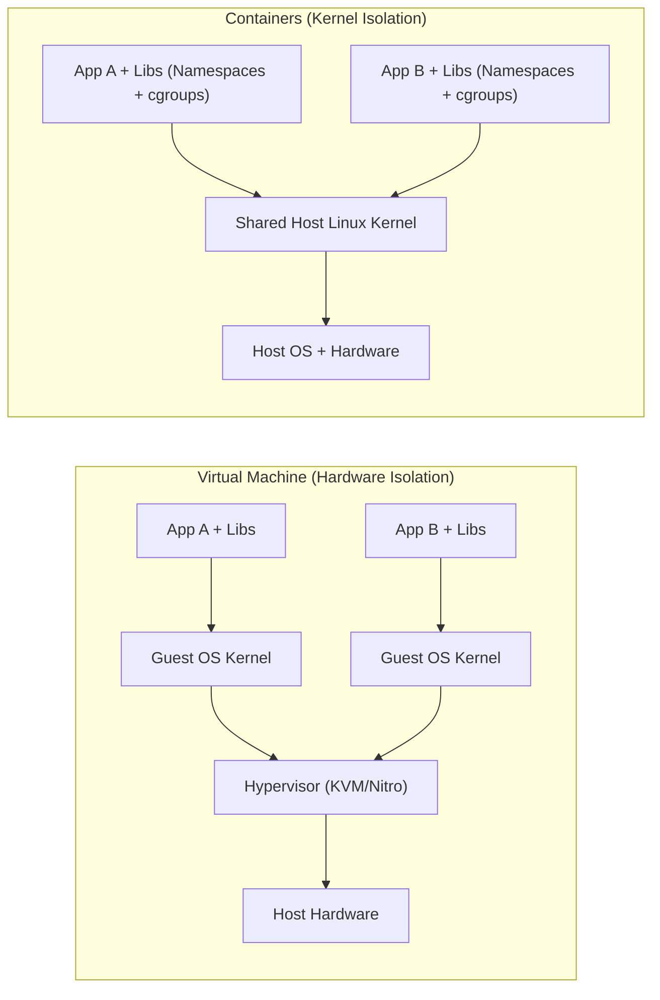
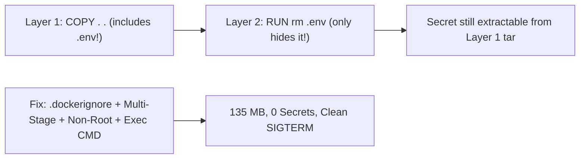

# Containers & Docker: Images, Layers, Multi-Stage Builds vs VMs

> **Prerequisites:** [Lesson 04: Well-Architected Frameworks: The Six Pillars and a Pre-Launch Review](../04-well-architected-frameworks/README.md).  
> **Estimated Reading Time:** 23–27 minutes  
> **Target Audience:** Backend engineers packaging services for production, and candidates asked "how do containers actually work under the hood compared to VMs, and how do you shrink and secure images?"  
> **Free PDF Notes:** [Download SD-V-005.pdf](https://backendroadmap.com/notes/system-design/SD-V-005.pdf)

> [!NOTE]
> **In one line:** A **container** is not a lightweight VM—it is an ordinary Linux process isolated by **namespaces** (what it can see), constrained by **cgroups** (what it can use), and packaged as an immutable **OCI image** of copy-on-write **layers**. Using **multi-stage builds** separates heavy build toolchains from minimal runtime images, shrinking image size by 80–95%, speeding up autoscaling pulls, and cutting CVE attack surface.

> [!TIP]
> **The Golden Rule:** Always build production containers with **multi-stage Dockerfiles** into **distroless or minimal bases**, run as a **non-root user**, order layers from least-frequently changed to most-frequently changed for cache hits, and remember that containers share the **host Linux kernel**—so use VMs/microVMs (Firecracker) when running untrusted multi-tenant code.

---

## 1. What Containers Are, and What They Aren't

A team containerizes a Go API using `FROM golang:1.23` and ships a **1.1 GB image** running as `root` with `gcc`, `git`, and `curl` still inside. Every autoscaling event takes 45 seconds just to pull and extract the image, and a security scan flags 140 OS CVEs. Switching to a **multi-stage build** (`golang:1.23` builder $\rightarrow$ `gcr.io/distroless/static:nonroot`) drops the image to **18 MB**, cuts pull time to **1.5 seconds**, and leaves **0 shell/package-manager CVEs**.

| Term | Precise Meaning | Example |
| :--- | :--- | :--- |
| **Container** | Isolated OS process sharing the host kernel, backed by namespaces + cgroups | Running `nginx` or `api-server` process |
| **Linux Namespaces** | Kernel isolation of *visibility* (`pid`, `net`, `mnt`, `ipc`, `uts`, `user`) | Container sees PID 1 and its own `eth0`, not host processes |
| **cgroups (Control Groups)** | Kernel enforcement of *resource limits* (CPU shares/quota, memory, I/O) | Cap container at 512 MiB RAM and 0.5 vCPU |
| **Image (OCI)** | Read-only, content-addressable stack of filesystem layers + JSON manifest | `ghcr.io/org/api:v1.4.2` |
| **UnionFS / OverlayFS** | Copy-on-write filesystem merging read-only image layers + 1 writable container layer | Shared base layers stored once on disk |
| **Multi-Stage Build** | Dockerfile with multiple `FROM` stages; only compiled artifacts copy to final image | Build in `golang:1.23`, copy binary to `distroless` |
| **Virtual Machine (VM)** | Hardware-virtualized guest running a **full separate OS kernel** via a hypervisor | EC2 instance (KVM / Nitro) |
| **Not** | A security sandbox equivalent to a VM for untrusted code | A kernel exploit inside a container compromises the host |

### Why It Matters
1. **"How do containers differ from VMs?"** is a staple infrastructure interview question—saying "namespaces + cgroups + shared kernel" immediately separates deep knowledge from buzzwords.
2. **Image size directly governs autoscaling speed** and registry egress cost.
3. **Layer caching** determines whether CI builds take 20 seconds or 8 minutes.

---

## 2. Anatomy: Virtual Machines vs Containers & Multi-Stage Layers



| Dimension | Virtual Machine (VM) | Container (Docker / containerd) | MicroVM (Firecracker / Kata) |
| :--- | :--- | :--- | :--- |
| **Isolation boundary** | Hypervisor + Guest Kernel | Linux Namespaces + cgroups + seccomp | Lightweight KVM per sandbox |
| **Boot / startup time** | 30–120 seconds | **50–500 milliseconds** | 125–300 milliseconds |
| **Memory overhead per unit** | 256 MB – 2 GB (Guest OS) | **~5–20 MB** | ~5–15 MB |
| **Density per host** | Tens of VMs | **Hundreds to thousands** | Hundreds |
| **Untrusted multi-tenant safety** | Strong | Weak (shared kernel) | **Strong** (used by AWS Lambda/Fargate) |

> [!WARNING]
> **Running as `root` inside a container or mounting `/var/run/docker.sock` breaks isolation.** UID 0 inside a container maps to UID 0 on the host unless user-namespaces are enabled; mounting the Docker socket gives the container full root control over the host machine. Always set `USER nonroot` (or `65532`) in your Dockerfile.

---

## 3. Mathematical Model: Image Pull Time, Layer Deduplication & Density

**1. Total Startup Time on a Cold Node.** When an autoscaler spins up a container on a fresh node, startup latency is dominated by **image pull + decompression**, not process boot:

$$T_{\text{start}} = T_{\text{pull}} + T_{\text{extract}} + T_{\text{app\_init}} = \frac{S_{\text{compressed}}}{B_{\text{net}}} + \frac{S_{\text{uncompressed}}}{R_{\text{disk}}} + T_{\text{app\_init}}$$

Where $S$ is image size, $B_{\text{net}}$ is registry pull bandwidth, and $R_{\text{disk}}$ is disk decompression/write throughput.

**2. Layer Sharing Across $N$ Services.** If $N$ microservices share a common base image of size $S_{\text{base}}$ and each adds an app layer of size $S_{\text{app}, i}$, OverlayFS stores $S_{\text{base}}$ **once** per node:

$$S_{\text{node\_disk}} = S_{\text{base}} + \sum_{i=1}^{N} S_{\text{app}, i}$$

### Worked Numerical Example
A Kubernetes node pulls a new service image over a **1 Gbps ($125\text{ MB/s}$)** link with disk extract rate **$250\text{ MB/s}$**, and app init **$0.3\text{ s}$**:
- **Single-stage `golang:1.23` image:** $S_{\text{compressed}} = 380\text{ MB}$, $S_{\text{uncompressed}} = 1{,}100\text{ MB}$:
  - $T_{\text{start}} = \frac{380}{125} + \frac{1{,}100}{250} + 0.3 = 3.04 + 4.40 + 0.3 = \mathbf{7.74\text{ s}}$ (and >30 s on throttled/bursty nodes).
  - Across 500 daily CI builds/pulls, registry egress = $500 \times 0.38\text{ GB} = 190\text{ GB/day}$.
- **Multi-stage `distroless` image:** $S_{\text{compressed}} = 9\text{ MB}$, $S_{\text{uncompressed}} = 18\text{ MB}$:
  - $T_{\text{start}} = \frac{9}{125} + \frac{18}{250} + 0.3 = 0.072 + 0.072 + 0.3 = \mathbf{0.44\text{ s}}$ (**17.6x faster startup**).
  - Daily registry egress drops by **97.6%** to $4.5\text{ GB/day}$.

---

## 4. Metrics & Percentiles

| Metric | Meaning | Alert when |
| :--- | :--- | :--- |
| **Image pull duration $p_{99}$** | Time from pod schedule to `Pulled` event | $> 10\text{ s}$ (image too bloated or missing local registry cache) |
| **Uncompressed image size** | Total bytes of all OCI layers | $> 200\text{ MB}$ for Go/Rust; $> 500\text{ MB}$ for JVM/Node/Python |
| **Critical/High CVEs per image** | Known vulnerabilities in base OS & app libs | $> 0$ Critical CVEs in production images |
| **CI build cache hit rate** | Percentage of Docker layers reused from cache | $< 70\%$ (indicates bad layer ordering like `COPY . .` before `npm ci`) |
| **Container restart / OOMKill count** | Exits with code `137` (cgroup memory limit) | $> 0$ (memory limit too tight or memory leak) |

### Worked Example (Fixing a 6-Minute CI Build)
A Python service Dockerfile has `COPY . .` on line 3, followed by `RUN pip install -r requirements.txt` on line 4. Every time a developer edits a single line of `.py` code, the `COPY . .` layer hash changes, invalidating the `pip install` layer cache and forcing a 5-minute wheel rebuild. **Fix:** Copy *only* `requirements.txt` first, run `pip install`, and `COPY . .` last—cutting CI build time from **6 minutes to 18 seconds**.

---

## 5. Compounding & Failure Modes

1. **Secret Leakage in Image Layers:** Running `COPY .env .` in layer 3 and `RUN rm .env` in layer 4 **does NOT remove `.env`**! UnionFS layers are append-only; `rm` only writes a whiteout file in layer 4, while layer 3 still contains the secret in `docker history` / image tarballs. **Fix:** Use BuildKit `--mount=type=secret` or inject secrets at runtime, never in image layers.
2. **Zombie PID 1 & Ignored `SIGTERM`:** Wrapping an app in a shell form `CMD python app.py` (which runs `/bin/sh -c ...`) makes `sh` PID 1. During Kubernetes scaling down, `sh` often fails to forward `SIGTERM` to `python`, causing the pod to hang for 30 seconds until `SIGKILL` (dropping in-flight requests). **Fix:** Use exec-form `CMD ["python", "app.py"]` or `tini` as PID 1.
3. **Writable Container Layer Bloat:** Writing logs or temp files to container disk instead of `stdout`/tmpfs grows the OverlayFS writable layer until the host node hits `DiskPressure` and evicts pods.

---

## 6. Numbers Every Engineer Must Know

| Item | Typical | Implication |
| :--- | :---: | :--- |
| **Minimal Go/Rust distroless image** | 10–25 MB | Pulls in <1 s; near-zero OS CVE surface |
| **Slim Python/Node multi-stage image** | 80–180 MB | vs 900 MB–1.2 GB for full Debian/Ubuntu base |
| **Container process start overhead** | 50–300 ms | Orders of magnitude faster than VM boot (45–120 s) |
| **SIGTERM grace period (default K8s)** | 30 s | App must handle `SIGTERM` directly (exec-form `CMD`) |
| **Exit code `137`** | `128 + 9 (SIGKILL)` | Almost always cgroup OOMKill; inspect memory limits |
| **Exit code `143`** | `128 + 15 (SIGTERM)` | Graceful shutdown signal received |

---

## 7. Mechanism Deep Dive: OverlayFS & Multi-Stage Build Pipeline

```mermaid
sequenceDiagram
    participant Dev as Dockerfile (Multi-Stage)
    participant B as Stage 1: Builder (golang:1.23)
    participant F as Stage 2: Runtime (distroless)
    participant Reg as Container Registry (OCI)
    participant Node as Host Kernel (OverlayFS + cgroups)

    Dev->>B: COPY go.mod -> go mod download (Cached!)
    Dev->>B: COPY . -> CGO_ENABLED=0 go build -o /app
    B->>F: COPY --from=builder /app /app (Drops compiler & source!)
    F->>Reg: Push 18 MB image (sha256 digest)
    Reg->>Node: Pull layers once; mount read-only lowerdir + writable upperdir
    Node->>Node: Start PID 1 in isolated namespaces + cgroups
```

| Question | Answer |
| :--- | :--- |
| **How does Docker layer caching work?** | Each instruction hashes its command + input files. If unchanged, Docker reuses the cached layer; once one layer changes, all *subsequent* layers must rebuild. |
| **Why `distroless` or `scratch` instead of `alpine`?** | `distroless` has no shell (`sh`), `apk`, or `curl`—if an attacker gets RCE, they have no tools to pivot. Also avoids `musl` libc DNS/threading quirks that sometimes affect `alpine`. |
| **What happens when a container writes to a file from a lower image layer?** | OverlayFS performs **Copy-on-Write (CoW)**: it copies the file up to the container's writable `upperdir` and modifies it there, leaving the shared base layer untouched. |

**When NOT to use containers:** When you need hardware-enforced multi-tenant kernel isolation for untrusted code (use **Firecracker microVMs** or **gVisor**), or for legacy monolithic Windows/kernel-driver workloads that cannot be decoupled from the host OS.

---

## 8. Hierarchical Budgets & Design Rules

| Slice | Rule | Control |
| :--- | :--- | :--- |
| **Base image** | Pin by digest or minor tag (`:1.23-alpine`, never `:latest`); prefer `distroless` | Hadolint / Trivy CI gate |
| **Build strategy** | Mandatory multi-stage builds; copy lockfiles before source code | Dockerfile PR review + linter |
| **Privilege** | Mandatory `USER nonroot`; drop Linux capabilities (`CAP_NET_RAW`, etc.) | PodSecurity / OPA Gatekeeper |
| **Secrets** | Zero secrets in `ENV`, `ARG`, or `COPY`; use BuildKit `--mount=type=secret` | Trivy / Gitleaks secret scan |
| **Signals** | Always use exec-form `ENTRYPOINT`/`CMD` (`["/app"]`) for `SIGTERM` handling | Signal test in CI |
| **Logging** | Write structured JSON logs to `stdout`/`stderr`, never local container files | DaemonSet log collector |

---

## 9. Top Mitigations

1. **Adopt multi-stage Dockerfiles** across all languages (Go, Rust, Java JRE/jlink, Node, Python wheels) to strip compilers and dev dependencies.
2. **Order Dockerfile instructions by change frequency** (OS packages $\rightarrow$ lockfiles $\rightarrow$ `install` $\rightarrow$ source code) and use `.dockerignore` (exclude `.git`, `node_modules`).
3. **Run as non-root (`USER 65532`)** and mount the root filesystem read-only (`readOnlyRootFilesystem: true`) with `/tmp` on `emptyDir`.
4. **Scan every image in CI** (Trivy / Grype) and fail builds on Critical CVEs.
5. **Pin base images and dependencies** for reproducible builds, and use `exec`-form `CMD` so `SIGTERM` drains connections cleanly.
6. **Use rootless/microVM runtimes** (Firecracker, Kata, gVisor) if running untrusted user-submitted code.

---

## 10. Production Reference: The `rm .env` Layer Leak & OOMKill Cascade

A SaaS company pushed an "internal" container image to a partner registry. Six months later, a security audit ran `docker history` and extracted an older layer:

- **The problem:** Their Dockerfile had `COPY . .` (which included `.env.prod` with AWS keys because `.dockerignore` was missing) followed by `RUN rm -f .env.prod`. Because OCI layers are immutable, the deleted `.env.prod` remained intact inside the earlier layer tarball. Simultaneously, the container used shell-form `CMD node server.js`, ignoring `SIGTERM` during deploys and causing 502 errors.
- **The fix:** Added `.dockerignore` (`.git`, `.env*`), switched to multi-stage build with `distroless/nodejs20:nonroot`, switched to exec-form `CMD ["server.js"]`, and rotated all keys.
- **The result:** Image size dropped from **940 MB to 135 MB**, zero secrets in layers, and zero-downtime rolling deploys.



---

## 11. Multi-Language Production Code Tabs

Production-ready **Multi-Stage Container Health/SIGTERM Grace-Handler** templates (plus a multi-stage Dockerfile pattern) showing how apps handle container `SIGTERM` and `stdout` logging cleanly in all 4 languages.

````carousel
```go
// Go: Container-ready HTTP server handling SIGTERM (PID 1) for zero-downtime drain.
// Multi-stage Dockerfile: FROM golang:1.23 AS build -> FROM gcr.io/distroless/static:nonroot
package main

import (
	"context"
	"log"
	"net/http"
	"os/signal"
	"syscall"
	"time"
)

func main() {
	mux := http.NewServeMux()
	mux.HandleFunc("/healthz", func(w http.ResponseWriter, _ *http.Request) { w.WriteHeader(http.StatusOK) })
	srv := &http.Server{Addr: ":8080", Handler: mux}

	ctx, stop := signal.NotifyContext(context.Background(), syscall.SIGTERM, syscall.SIGINT)
	defer stop()

	go func() {
		if err := srv.ListenAndServe(); err != nil && err != http.ErrServerClosed {
			log.Fatalf("listen: %v", err)
		}
	}()

	<-ctx.Done() // Wait for container orchestrator SIGTERM
	shutdownCtx, cancel := context.WithTimeout(context.Background(), 15*time.Second)
	defer cancel()
	_ = srv.Shutdown(shutdownCtx) // Drain in-flight requests cleanly
}
```
<!-- slide -->
```typescript
// TypeScript (Node): Graceful SIGTERM drain for exec-form container CMD ["node", "dist/server.js"].
import http from "node:http";

const server = http.createServer((req, res) => {
  if (req.url === "/healthz") {
    res.writeHead(200).end("ok");
    return;
  }
  res.writeHead(200).end("hello");
});

server.listen(8080, () => console.log(JSON.stringify({ level: "info", msg: "listening", port: 8080 })));

function shutdown(signal: string) {
  console.log(JSON.stringify({ level: "info", msg: "draining", signal }));
  server.close(() => process.exit(0));
  setTimeout(() => process.exit(1), 15_000).unref(); // Force exit before K8s SIGKILL (30s)
}

process.on("SIGTERM", () => shutdown("SIGTERM"));
process.on("SIGINT", () => shutdown("SIGINT"));
```
<!-- slide -->
```python
# Python: Container layer-size & startup-time estimator + SIGTERM handler (stdlib only).
import signal
import sys


def startup_time_sec(compressed_mb: float, uncompressed_mb: float, net_mbps: float = 1000.0, disk_mbs: float = 250.0) -> float:
    net_mbs = net_mbps / 8.0
    return round((compressed_mb / net_mbs) + (uncompressed_mb / disk_mbs) + 0.3, 2)


def handle_sigterm(signum, _frame):
    print(f'{{"level":"info","msg":"received signal {signum}, draining"}}', flush=True)
    sys.exit(0)


if __name__ == "__main__":
    signal.signal(signal.SIGTERM, handle_sigterm)
    print("Single-stage golang (380/1100 MB):", startup_time_sec(380, 1100), "s")
    print("Multi-stage distroless (9/18 MB):", startup_time_sec(9, 18), "s")
```
<!-- slide -->
```csharp
// C#: Container-ready graceful SIGTERM drain & startup estimator.
using System;
using System.Threading;

public static class ContainerLifecycle
{
    public static void Main()
    {
        using var cts = new CancellationTokenSource();
        AppDomain.CurrentDomain.ProcessExit += (_, _) =>
        {
            Console.WriteLine("{\"level\":\"info\",\"msg\":\"SIGTERM received, draining\"}");
            cts.Cancel();
        };

        Console.WriteLine("{\"level\":\"info\",\"msg\":\"container started\"}");
        // In ASP.NET Core, IHostApplicationLifetime automatically handles SIGTERM drain.
    }
}
```
````

---

## 12. Hands-On CLI Verification Workflows

Inspect image layers, sizes, non-root execution, and CVEs locally:

```bash
# 1. Inspect every layer and its size in an OCI/Docker image
docker history --no-trunc my-api:latest

# 2. Verify container is NOT running as root (UID should be != 0)
docker run --rm --entrypoint id my-api:latest

# 3. Scan image for OS & library CVEs using Trivy
trivy image --severity HIGH,CRITICAL my-api:latest

# 4. Inspect Linux namespaces and cgroup memory limit of a running container
docker inspect --format '{{.HostConfig.Memory}} {{.State.Pid}}' my-container
```

---

## 13. Common Mistakes to Avoid

1. **Skipping multi-stage builds**, shipping compilers, `git`, and 1 GB of build caches to prod.
2. **Copying source code before dependency lockfiles** (`COPY . .` before `pip/npm/go mod`), destroying CI layer caching.
3. **Thinking `RUN rm secret` deletes a secret** from earlier immutable image layers.
4. **Running containers as `root` (UID 0)** or mounting `/var/run/docker.sock`.
5. **Using shell-form `CMD python app.py`** instead of exec-form `CMD ["python", "app.py"]`, breaking `SIGTERM` graceful shutdown.
6. **Using `:latest` tags in production**, making rollbacks and debugging non-reproducible.
7. **Treating containers as strong multi-tenant security boundaries** for untrusted user code (use microVMs instead).

---

## 14. Key Terms Glossary

| Key Term | Definition |
| :--- | :--- |
| **Linux Namespaces** | Kernel feature isolating what a process can see (PIDs, network, mounts, users). |
| **cgroups** | Kernel feature limiting how much CPU, memory, and I/O a process group can consume. |
| **OCI Image** | Standardized, immutable bundle of read-only filesystem layers and runtime config. |
| **OverlayFS / UnionFS** | Copy-on-write filesystem stacking read-only image layers beneath a writable container layer. |
| **Multi-Stage Build** | Dockerfile pattern compiling in a full SDK stage and copying only artifacts to a minimal runtime stage. |
| **Distroless** | Minimal container base image containing only runtime + app, with no shell or package manager. |
| **PID 1** | First process in a container namespace; responsible for receiving `SIGTERM` and reaping zombies. |
| **OOMKill (Exit 137)** | Kernel killing a container process because it exceeded its cgroup memory limit. |
| **BuildKit Secret Mount** | Secure build-time secret injection (`--mount=type=secret`) that leaves zero trace in image layers. |
| **MicroVM** | Lightweight KVM-isolated sandbox (e.g., Firecracker) combining VM security with container speed. |

---

## 15. System Design Interview Questions & Answers

### Basic Conceptual Questions

<details>
<summary><strong>Q1: How does a container differ from a Virtual Machine? [BASIC]</strong></summary>

**Answer:**
A **VM** virtualizes hardware via a hypervisor and runs a full **guest OS kernel** per VM (tens of seconds to boot, hundreds of MB overhead). A **container** shares the **host OS kernel**, using Linux **namespaces** for visibility isolation and **cgroups** for resource limits (starts in milliseconds, minimal overhead).
</details>

<details>
<summary><strong>Q2: What do Linux namespaces and cgroups each do? [BASIC]</strong></summary>

**Answer:**
**Namespaces** control what a process can *see* (its own PID tree, network interfaces, filesystem mounts, hostname). **cgroups** control what a process can *use* (max RAM, CPU shares/quotas, disk I/O). Together they create the illusion of an isolated machine.
</details>

<details>
<summary><strong>Q3: What is a multi-stage Docker build, and why use it? [BASIC]</strong></summary>

**Answer:**
A Dockerfile with multiple `FROM` stages: Stage 1 uses a full SDK image to compile/bundle the app; Stage 2 copies *only* the compiled binary/artifacts into a tiny runtime image (`distroless` or `alpine`). It shrinks images by 80–95%, speeds up autoscaling pulls, and removes compilers/shells from production.
</details>

<details>
<summary><strong>Q4: Why does layer order in a Dockerfile matter? [BASIC]</strong></summary>

**Answer:**
Docker caches each layer based on its instruction and input files. Putting `COPY . .` before `npm install` or `pip install` invalidates the dependency cache on every single code edit. Putting lockfile copies and dependency installs *before* `COPY . .` keeps CI builds fast.
</details>

### Scenario-Based Architecture Questions

<details>
<summary><strong>Q5: Your Go service container is 1.1 GB and takes 40 seconds to scale up. How do you fix it? [SCENARIO]</strong></summary>

**Answer:**
Use a **multi-stage build**: compile a static binary (`CGO_ENABLED=0`) in `golang:1.23`, then `COPY --from=builder` into `gcr.io/distroless/static:nonroot`. Image size drops from ~1.1 GB to ~18 MB, cutting pull + extract time to ~1 second.
</details>

<details>
<summary><strong>Q6: Someone accidentally committed `.env` into a Docker build, then added `RUN rm .env` on the next line. Is the image safe to push? [SCENARIO]</strong></summary>

**Answer:**
**No!** Image layers are immutable and append-only. `RUN rm .env` only marks the file deleted in the top layer; the `.env` file is still stored in the previous layer's tarball and can be extracted with `docker save` or `docker history`. You must exclude it via `.dockerignore`, rebuild without the secret, and **rotate the leaked credentials**.
</details>

<details>
<summary><strong>Q7: During rolling deployments, your containerized API drops active connections and takes 30 seconds per pod to stop. Why? [SCENARIO]</strong></summary>

**Answer:**
Either the Dockerfile uses **shell-form `CMD python app.py`** (so `/bin/sh` is PID 1 and swallows `SIGTERM`), or the app doesn't handle `SIGTERM`. Orchestrators wait 30s (`terminationGracePeriodSeconds`) and then send `SIGKILL`. Fix by using **exec-form `CMD ["python", "app.py"]`** and implementing a `SIGTERM` handler that stops accepting new connections and drains in-flight requests.
</details>

<details>
<summary><strong>Q8: You are building a SaaS platform where users upload and execute arbitrary Python scripts. Are standard Docker containers safe enough? [SCENARIO]</strong></summary>

**Answer:**
**No.** Standard containers share the host Linux kernel; a single kernel vulnerability (or misconfigured capability) lets untrusted code escape to the host. Use **microVMs** (AWS Firecracker, Kata Containers) or user-space kernel sandboxes (**gVisor**) for untrusted multi-tenant code execution.
</details>

### Advanced & Tricky Interview Questions

<details>
<summary><strong>Q9: What does exit code 137 mean in a container, and why doesn't `free -m` inside a container show the container's limit? [TRICKY]</strong></summary>

**Answer:**
Exit code `137 = 128 + 9 (SIGKILL)` usually means the **cgroup OOM killer** terminated the process for exceeding its memory limit. Classic `free -m` or `/proc/meminfo` reads the *host's* memory unless cgroup-aware tooling or LXCFS is used—which is why older JVM/Node runtimes used to over-allocate heap based on host RAM and get OOMKilled!
</details>

<details>
<summary><strong>Q10: Why do many teams prefer `distroless` over `alpine` for production containers? [TRICKY]</strong></summary>

**Answer:**
Two reasons: (1) **Security**—`distroless` has no shell (`sh`) or package manager (`apk`), giving attackers zero living-off-the-land tools; (2) **Compatibility**—`alpine` uses `musl` libc instead of `glibc`, which can cause subtle DNS resolution differences or performance/segfault issues in Python C-extensions and JVM/Rust binaries.
</details>

<details>
<summary><strong>Q11: How does OverlayFS handle 50 containers on the same host all reading from the same 100 MB base image? [TRICKY]</strong></summary>

**Answer:**
OverlayFS mounts the read-only image layers (`lowerdir`) **once** and shares both disk blocks and OS page-cache memory across all 50 containers. Only files modified at runtime are copied up (Copy-on-Write) into each container's private `upperdir`.
</details>

<details>
<summary><strong>Q12: Why should you never mount `/var/run/docker.sock` inside an application container in production? [TRICKY]</strong></summary>

**Answer:**
The Docker daemon runs as `root` on the host. Any process that can talk to `docker.sock` can spawn a privileged container mounting the host's `/` filesystem (`docker run -v /:/host ...`), granting instant full root compromise of the host node.
</details>

---

## 16. One-Page Master Cheat Sheet

```
+---------------------------------------------------------------------------------------------------------+
|               CONTAINERS & DOCKER (Images, Layers, Multi-Stage vs VMs) — MASTER CHEAT SHEET             |
+---------------------------------------------------------------------------------------------------------+
| 1. UNDER THE HOOD: Container = Host Kernel + Namespaces (visibility) + cgroups (CPU/RAM limits).        |
|    VM = Hypervisor + Guest Kernel (stronger untrusted isolation, slower boot, higher RAM overhead).     |
+---------------------------------------------------------------------------------------------------------+
| 2. MULTI-STAGE BUILDS: Compile in SDK stage -> copy binary to distroless/slim (80-95% smaller, 0 shell).|
+---------------------------------------------------------------------------------------------------------+
| 3. LAYER CACHING: Order least-changed -> most-changed (OS -> lockfiles -> install -> COPY . .).         |
+---------------------------------------------------------------------------------------------------------+
| 4. SECURITY: Never run as root (`USER nonroot`). Never `COPY` secrets (`rm` leaves them in lower layer).|
+---------------------------------------------------------------------------------------------------------+
| 5. LIFECYCLE: Use exec-form `CMD ["..."]` for SIGTERM (143) drain; watch for cgroup OOMKill (Exit 137). |
+---------------------------------------------------------------------------------------------------------+
```

---

## Further Reading & Sources

- OCI (Open Container Initiative) Image & Runtime Specifications.
- Docker Documentation, *Multi-Stage Builds* & *Storage Drivers (OverlayFS)*.
- Google Container Tools, *Distroless Container Images*.
- Julia Evans, *What even is a container: namespaces and cgroups*.

---

## Free PDF Notes

[SD-V-005.pdf](https://backendroadmap.com/notes/system-design/SD-V-005.pdf)

---

## Next

Continue with [Lesson 06: Kubernetes Core Objects: Pod, Deployment, Service, Ingress](../06-kubernetes-core-objects/README.md).
