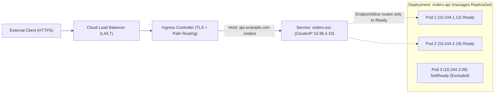
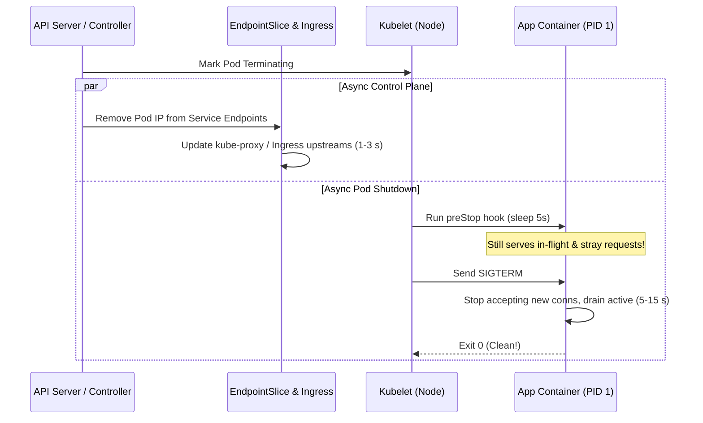
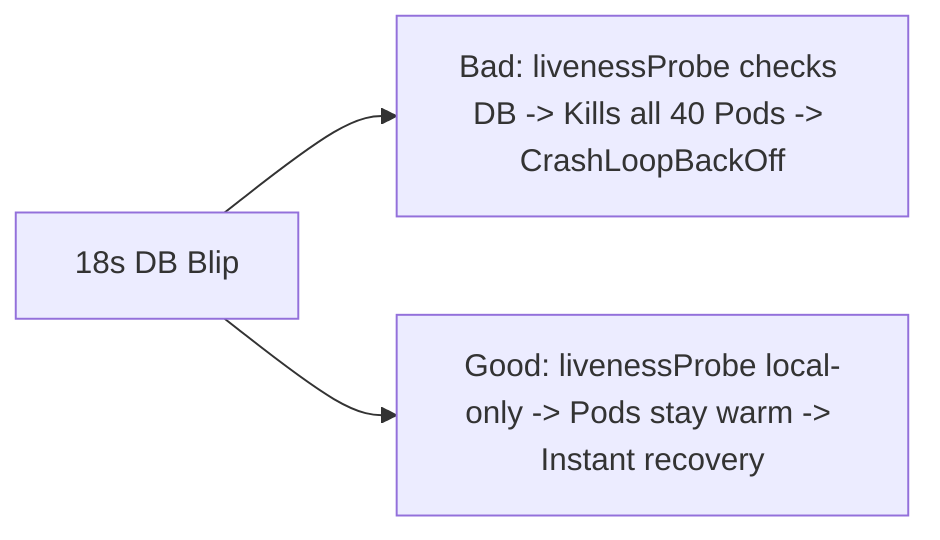

# Kubernetes Core Objects: Pod, Deployment, Service, Ingress

> **Prerequisites:** [Lesson 05: Containers & Docker: Images, Layers, Multi-Stage Builds vs VMs](../05-containers-docker/README.md).  
> **Estimated Reading Time:** 24–28 minutes  
> **Target Audience:** Backend engineers deploying services on Kubernetes, and candidates asked "trace what happens from an external HTTPS request to a Pod, and how zero-downtime rolling updates work."  
> **Free PDF Notes:** [Download SD-V-006.pdf](https://backendroadmap.com/notes/system-design/SD-V-006.pdf)

> [!NOTE]
> **In one line:** Kubernetes is a **declarative reconciliation loop**: you declare desired state in YAML, and controllers continuously drive cluster state toward it. A **Pod** wraps 1+ co-located containers sharing a network/IP; a **Deployment** manages ReplicaSets for declarative rolling updates; a **Service** gives ephemeral Pods a stable virtual IP and DNS name; and an **Ingress** (or Gateway API) routes external L7 HTTP/HTTPS traffic into Services.

> [!TIP]
> **The Golden Rule:** Never create bare Pods directly in production—always wrap them in a **Deployment** (or StatefulSet), expose them via a **Service** (`ClusterIP` internally) + **Ingress** (externally), and configure **`readinessProbe`** + **`preStop` sleep** so traffic drains cleanly during rolling updates.

---

## 1. What Kubernetes Core Objects Are, and What They Aren't

A developer deploys a container as a bare `Pod` with a hardcoded IP. When the node reboots, the Pod is gone forever—there is no controller to recreate it, and its IP changes. Next, they create a `Deployment` of 3 Pods, but during a rolling update, users hit `502 Bad Gateway` errors for 10 seconds because Kubernetes sends traffic to new Pods before the app finishes warming up, and keeps sending traffic to terminating Pods while `kube-proxy` iptables rules are still updating.

| Term | Precise Meaning | Example |
| :--- | :--- | :--- |
| **Pod** | Smallest deployable unit: 1+ containers sharing network namespace (`localhost`) & storage volumes | `api-7d9f8b-x2k9p` (`10.244.1.15`) |
| **ReplicaSet** | Ensures $N$ identical Pods matching a label selector are running at all times | Managed automatically by a Deployment |
| **Deployment** | Declarative controller managing ReplicaSets for rolling updates, scaling, and rollbacks | `orders-api` (`replicas: 4`) |
| **Service (`ClusterIP` / `LB`)** | Stable virtual IP (VIP) + DNS name load-balancing across healthy Pods via `EndpointSlice` | `orders-svc.prod.svc.cluster.local` |
| **Ingress / Gateway API** | L7 HTTP/HTTPS router mapping hostnames/paths + TLS to backend Services | `api.example.com/orders -> orders-svc:80` |
| **Label & Selector** | Key-value metadata tying Services and Deployments loosely to Pods | `app: orders, env: prod` |
| **Reconciliation Loop** | Control-plane pattern comparing Desired State (etcd) vs Actual State and acting | `Desired: 3 Pods, Actual: 2 -> Create 1` |
| **Not** | A PaaS out of the box | You still configure probes, Ingress, DNS, TLS, and RBAC |

### Why It Matters
1. **Tracing an external request** (`User -> LB -> Ingress -> Service -> Pod`) is one of the most common cloud-platform interview questions.
2. **Pod IPs are ephemeral**; Services and DNS decouple callers from constant rescheduling.
3. **Zero-downtime rollouts** depend on understanding how `Deployment`, `readinessProbe`, and `EndpointSlice` removal race against each other.

---

## 2. Anatomy: Request Path & Object Hierarchy



| Service Type | Reachability | How It Works | Use Case |
| :--- | :--- | :--- | :--- |
| **`ClusterIP`** (default) | Inside cluster only | Stable internal VIP + kube-dns | Microservice-to-microservice calls |
| **`NodePort`** | `<NodeIP>:<30000-32767>` | Opens static port on every node | Legacy/bare-metal testing; underlying base for LB |
| **`LoadBalancer`** | External internet/VPC | Provisions cloud NLB/ALB pointing to NodePorts/Pods | Exposing Ingress Controller or non-HTTP TCP/gRPC |
| **`ExternalName`** | DNS alias | Returns a `CNAME` record | Pointing to external managed RDS/SaaS |

> [!WARNING]
> **Service `ClusterIP` is a virtual IP, not a real network interface, and it does NOT do L7 HTTP load balancing.** `kube-proxy` (iptables/IPVS) operates at **L4 (TCP)**. For long-lived **gRPC/HTTP/2** connections, a single TCP connection pins all RPCs to *one* Pod! Use a headless Service with client-side LB or an L7 proxy/service mesh (Envoy/Linkerd) for gRPC.

---

## 3. Mathematical Model: Rolling Update Surge, Unavailability & Pod Density

A Deployment with $R$ desired replicas uses `maxSurge` ($S$, extra Pods allowed above $R$) and `maxUnavailable` ($U$, Pods allowed down below $R$) during a rollout:

$$\text{Max total Pods during rollout} = R + S, \qquad \text{Min available Pods} = R - U$$

If each Pod requires $T_{\text{ready}}$ seconds to boot and pass its `readinessProbe`, and batches of $B = S + U$ Pods roll per wave, the minimum rollout duration is:

$$T_{\text{rollout}} \ge \left\lceil \frac{R}{S + U} \right\rceil \cdot T_{\text{ready}}$$

### Worked Numerical Example
You run **$R = 20$ replicas** of `orders-api`, each taking **$T_{\text{ready}} = 15\text{ s}$** to start and pass readiness:
- **Zero-downtime config (`maxSurge: 25%` $\rightarrow S=5$, `maxUnavailable: 0` $\rightarrow U=0$):**
  - Min available Pods = $20 - 0 = \mathbf{20}$ (100% capacity preserved throughout).
  - Max temporary Pods = $20 + 5 = \mathbf{25}$ (requires +25% cluster CPU/IP headroom).
  - Minimum rollout time = $\lceil 20 / 5 \rceil \times 15\text{ s} = \mathbf{60\text{ s}}$.
- **Aggressive config (`maxSurge: 50%` $\rightarrow S=10$, `maxUnavailable: 25%` $\rightarrow U=5$):**
  - Min available drops to $15$ (75% capacity), but rollout finishes in $\lceil 20 / 15 \rceil \times 15\text{ s} = \mathbf{30\text{ s}}$.

---

## 4. Metrics & Percentiles

| Metric | Meaning | Alert when |
| :--- | :--- | :--- |
| **`Deployment` available vs desired** | `status.availableReplicas < spec.replicas` | Persists $> 5\text{ min}$ (stuck rollout / CrashLoopBackOff) |
| **Pod `CrashLoopBackOff` / restarts** | Container repeatedly exiting non-zero | Restarts $> 3$ in 10 minutes |
| **Ingress 5xx rate (`502` / `503` / `504`)** | Upstream Pod reset or timeout at L7 edge | $> 0.1\%$ (often rollout drain race or readiness misconfig) |
| **`EndpointSlice` ready count** | Healthy Pods backing a Service | Drops to `0` (total service outage) |
| **CoreDNS latency $p_{99}$** | Service discovery lookup time | $> 10\text{ ms}$ or `SERVFAIL` |

### Worked Example (Fixing Rollout 502s)
During every deploy, Ingress logs a 3-second burst of `502 Bad Gateway` errors. Why? When Kubernetes terminates a Pod, two things happen **asynchronously in parallel**: (1) `kubelet` sends `SIGTERM` to the app, and (2) the EndpointSlice controller removes the Pod's IP from `iptables` across all nodes. If the app exits immediately in 50 ms *before* `kube-proxy` / Ingress finishes updating its rules (which can take 1–2 seconds), Ingress routes new requests to a dead socket! **Fix:** Add a `preStop` hook (`sleep 5`) so the Pod stays alive for 5 seconds while endpoints propagate, *then* handles `SIGTERM`.

---

## 5. Compounding & Failure Modes

1. **Missing `readinessProbe` ("Premature Traffic"):** Without a `readinessProbe`, Kubernetes considers a Pod `Ready` the instant its process starts—sending production traffic while the JVM/app is still loading DB pools and caches, causing 500s.
2. **Aggressive `livenessProbe` ("Death Spiral"):** Setting `livenessProbe` to check a downstream database or using a tight 1-second timeout causes Kubernetes to kill and restart healthy Pods whenever the DB blips—turning a 2-second DB hiccup into a 5-minute cluster-wide `CrashLoopBackOff`. **Rule:** `livenessProbe` must *only* check local process health (not external dependencies!).
3. **Label Selector Mismatch / Orphaned Traffic:** Changing a Pod's labels without updating the Service selector leaves the Service with 0 Endpoints (`503 Service Unavailable`).

---

## 6. Numbers Every Engineer Must Know

| Item | Typical | Implication |
| :--- | :---: | :--- |
| **Default `terminationGracePeriodSeconds`** | 30 s | Total budget for `preStop` + `SIGTERM` drain before `SIGKILL` |
| **`preStop` propagation buffer** | 5–10 s | Prevents 502s during async `EndpointSlice` / Ingress updates |
| **Max Pods per Node (AWS EKS / standard)** | 17–110 Pods | Often bounded by node ENI/IP slots, not CPU |
| **DNS search path (`ndots: 5`)** | Up to 4–8 lookups | External domains (`api.stripe.com`) trigger extra cluster DNS queries unless FQDN or `ndots: 2` |
| **Default rolling update (`Deployment`)** | `25%` surge / `25%` unavail | Set `maxUnavailable: 0` for critical stateless APIs |

---

## 7. Mechanism Deep Dive: Zero-Downtime Pod Termination Sequence



| Question | Answer |
| :--- | :--- |
| **`readinessProbe` vs `livenessProbe` vs `startupProbe`?** | **Readiness:** "Can I receive Service traffic?" (removes from Endpoints on fail). **Liveness:** "Am I deadlocked?" (restarts container on fail). **Startup:** "Have I finished slow boot?" (disables liveness/readiness until initial pass). |
| **Ingress vs Gateway API?** | **Ingress** is the classic L7 HTTP/HTTPS resource (often needing vendor-specific annotations). **Gateway API** is the modern, role-oriented successor supporting native header routing, traffic splitting, and gRPC/TCP. |
| **When to use `StatefulSet` instead of `Deployment`?** | When Pods need **stable network identities** (`db-0`, `db-1`), **ordered startup/shutdown**, and **persistent per-Pod storage** (`volumeClaimTemplates`)—e.g., Kafka, Postgres, etcd. |

**When NOT to use Kubernetes:** For a 2-person team running 1–3 simple stateless APIs and a managed DB. Managed PaaS/CaaS (Cloud Run, ECS Fargate, App Runner) gives you 90% of the benefits with 10% of the cluster upgrade, CNI, and RBAC overhead.

---

## 8. Hierarchical Budgets & Design Rules

| Slice | Rule | Control |
| :--- | :--- | :--- |
| **Workloads** | Never deploy bare Pods; use `Deployment` (stateless) or `StatefulSet` (stateful) | Admission policy |
| **Probes** | Every production Deployment has `readinessProbe` + `livenessProbe` (local-only!) | Kyverno / OPA policy |
| **Rollouts** | `maxUnavailable: 0` + `preStop: sleep 5` + `SIGTERM` drain handler | Standard Helm/Kustomize base |
| **Services** | Default `ClusterIP`; expose externally only via Ingress/Gateway + TLS | NetworkPolicy + Ingress |
| **DNS** | Use `ndots: 2` (or trailing dot FQDNs) for heavy external API callers | Pod `dnsConfig` |
| **Ingress** | Terminate TLS at Ingress/LB; enforce rate limits and body size caps | Ingress annotations / WAF |

---

## 9. Top Mitigations

1. **Pair `preStop: ["sh", "-c", "sleep 5"]` (or app-level drain delay) with `SIGTERM` handling** to eliminate rollout 502s.
2. **Keep `livenessProbe` strictly local** (e.g., `/livez` returns 200 if event loop isn't wedged); check DB/Redis only in `readinessProbe` (`/readyz`).
3. **Set `maxUnavailable: 0` and `maxSurge: 25%`** on user-facing Deployments so capacity never dips during deploys.
4. **Use `revisionHistoryLimit` and `kubectl rollout undo`** for instant 5-second rollbacks on bad releases.
5. **For gRPC services, don't rely on `ClusterIP` L4 balancing**—use client-side round-robin with headless Services or an L7 proxy/mesh.
6. **Adopt Gateway API** for new clusters needing canary traffic splitting, header routing, and clean multi-team ownership.

---

## 10. Production Reference: The Liveness Probe Outage Multiplier

A fintech company deployed a payment API on Kubernetes with a `/health` endpoint that ran `SELECT 1` on Postgres, wired to **both** `readinessProbe` and `livenessProbe` (`failureThreshold: 3`, `periodSeconds: 5`).

- **The problem:** A minor 18-second network blip slowed Postgres queries. Within 15 seconds, *every single Pod* in the 40-Pod Deployment failed its `livenessProbe` simultaneously. `kubelet` killed and restarted all 40 Pods at once. When they booted, all 40 Pods slammed Postgres with cold connection-pool handshakes and cache warmups, keeping Postgres saturated and trapping the entire cluster in a 25-minute `CrashLoopBackOff` loop.
- **The fix:** Split probes into `/livez` (in-process check only) for `livenessProbe`, and `/readyz` (DB ping) for `readinessProbe`.
- **The result:** During subsequent DB blips, Pods were temporarily marked `NotReady` without restarting, and traffic recovered automatically within 2 seconds of DB recovery.



---

## 11. Multi-Language Production Code Tabs

Production-ready **Split `/livez` vs `/readyz` Health Probe Handlers** + Kubernetes Deployment & Service rollout math.

````carousel
```go
// Go: Split /livez (process health) vs /readyz (dependency health) for Kubernetes probes.
package main

import (
	"net/http"
	"sync/atomic"
)

var dbHealthy atomic.Bool

func main() {
	dbHealthy.Store(true)
	mux := http.NewServeMux()

	// livenessProbe: NEVER check external DBs here! Only check if this process is alive.
	mux.HandleFunc("/livez", func(w http.ResponseWriter, _ *http.Request) {
		w.WriteHeader(http.StatusOK)
		_, _ = w.Write([]byte("alive"))
	})

	// readinessProbe: Remove Pod from Service EndpointSlice if dependencies are unreachable.
	mux.HandleFunc("/readyz", func(w http.ResponseWriter, _ *http.Request) {
		if !dbHealthy.Load() {
			http.Error(w, "db unavailable", http.StatusServiceUnavailable)
			return
		}
		w.WriteHeader(http.StatusOK)
		_, _ = w.Write([]byte("ready"))
	})

	_ = http.ListenAndServe(":8080", mux)
}
```
<!-- slide -->
```typescript
// TypeScript: Split /livez vs /readyz endpoints for Kubernetes Deployment probes.
import http from "node:http";

let isShuttingDown = false;
let dbConnected = true;

const server = http.createServer((req, res) => {
  if (req.url === "/livez") {
    res.writeHead(200).end("alive");
    return;
  }
  if (req.url === "/readyz") {
    if (isShuttingDown || !dbConnected) {
      res.writeHead(503).end("not ready");
      return;
    }
    res.writeHead(200).end("ready");
    return;
  }
  res.writeHead(200).end("ok");
});

process.on("SIGTERM", () => {
  isShuttingDown = true; // Immediately fail /readyz while draining in-flight requests
  setTimeout(() => server.close(() => process.exit(0)), 5000);
});

server.listen(8080);
```
<!-- slide -->
```python
# Python: Kubernetes Deployment rollout math & split probe simulator (stdlib only).
import math


def rollout_plan(replicas: int, max_surge: int, max_unavail: int, ready_sec: int) -> dict:
    batch = max_surge + max_unavail
    waves = math.ceil(replicas / batch)
    return {
        "max_total_pods": replicas + max_surge,
        "min_available_pods": replicas - max_unavail,
        "min_rollout_sec": waves * ready_sec,
    }


if __name__ == "__main__":
    print("Zero-downtime (20 pods, surge 5, unavail 0):", rollout_plan(20, 5, 0, 15))
    print("Fast rollout (20 pods, surge 10, unavail 5):", rollout_plan(20, 10, 5, 15))
```
<!-- slide -->
```csharp
// C#: Split /livez vs /readyz health state model for Kubernetes.
using System;

public sealed class ProbeState
{
    public volatile bool ShuttingDown;
    public volatile bool DbHealthy = true;

    public (int Status, string Body) Livez() => (200, "alive");
    public (int Status, string Body) Readyz() =>
        (!ShuttingDown && DbHealthy) ? (200, "ready") : (503, "not ready");

    public static void Main()
    {
        var state = new ProbeState();
        Console.WriteLine($"Initial: livez={state.Livez()}, readyz={state.Readyz()}");
        state.DbHealthy = false;
        Console.WriteLine($"DB blip: livez={state.Livez()}, readyz={state.Readyz()}");
    }
}
```
````

---

## 12. Hands-On CLI Verification Workflows

Inspect Pods, Deployments, EndpointSlices, and Ingress routing with `kubectl`:

```bash
# 1. Inspect Deployment rollout status and ReplicaSets
kubectl rollout status deployment/orders-api -n prod
kubectl get rs -l app=orders-api -n prod

# 2. Verify Service is actually wired to Ready Pod IPs (EndpointSlice)
kubectl get endpointslices -l kubernetes.io/service-name=orders-svc -n prod

# 3. Debug a failing Pod (events, logs from previous crashed container)
kubectl describe pod <pod-name> -n prod
kubectl logs <pod-name> -n prod --previous

# 4. Instant rollback to previous healthy ReplicaSet
kubectl rollout undo deployment/orders-api -n prod
```

---

## 13. Common Mistakes to Avoid

1. **Deploying bare Pods** instead of a `Deployment` or `StatefulSet` (no self-healing or rollbacks).
2. **Checking external databases in `livenessProbe`**, causing cluster-wide `CrashLoopBackOff` on any DB blip.
3. **Omitting `readinessProbe`**, sending live traffic to warming-up containers.
4. **Skipping `preStop` sleep**, causing 502s during the race between `SIGTERM` and `EndpointSlice` removal.
5. **Assuming `ClusterIP` load-balances gRPC/HTTP/2 requests** across Pods (L4 TCP pins connections to one Pod).
6. **Mismatched labels** between `Service.spec.selector` and `Deployment.spec.template.metadata.labels`.
7. **Running Kubernetes for a tiny 2-service startup** when Cloud Run / ECS Fargate would ship faster with zero cluster ops.

---

## 14. Key Terms Glossary

| Key Term | Definition |
| :--- | :--- |
| **Pod** | Smallest Kubernetes unit: 1+ containers sharing network IP and volumes. |
| **ReplicaSet** | Controller maintaining a specified number of identical Pod replicas. |
| **Deployment** | Declarative controller managing ReplicaSets for rolling updates and rollbacks. |
| **Service (`ClusterIP`)** | Stable virtual IP and internal DNS name load-balancing across matching Pods. |
| **EndpointSlice** | Object tracking the live IP addresses of `Ready` Pods backing a Service. |
| **Ingress / Gateway API** | L7 HTTP/HTTPS routing layer mapping external hosts/paths + TLS to Services. |
| **`readinessProbe`** | Probe controlling whether a Pod receives Service traffic. |
| **`livenessProbe`** | Probe controlling whether `kubelet` restarts a deadlocked container. |
| **`preStop` Hook** | Command executed before `SIGTERM` to allow async endpoint removal to propagate. |
| **Reconciliation Loop** | Continuous control-plane cycle driving actual cluster state to match desired state. |

---

## 15. System Design Interview Questions & Answers

### Basic Conceptual Questions

<details>
<summary><strong>Q1: Explain the relationship between a Pod, ReplicaSet, Deployment, Service, and Ingress. [BASIC]</strong></summary>

**Answer:**
A **Deployment** manages **ReplicaSets**, which ensure $N$ **Pods** are running. A **Service** provides a stable virtual IP and DNS name over those ephemeral Pods using label selectors. An **Ingress** (or Gateway API) routes external L7 HTTP/HTTPS traffic by host/path and terminates TLS before forwarding to the Service.
</details>

<details>
<summary><strong>Q2: Why do we need a Service if Pods already have IP addresses? [BASIC]</strong></summary>

**Answer:**
Pod IPs are **ephemeral**—every restart, scale event, or rolling deploy assigns brand-new IPs. A **Service** gives callers a single stable virtual IP and DNS name (`svc.ns.svc.cluster.local`), dynamically updating its `EndpointSlice` as Pods come and go.
</details>

<details>
<summary><strong>Q3: What is the difference between `readinessProbe` and `livenessProbe`? [BASIC]</strong></summary>

**Answer:**
`readinessProbe` determines whether a Pod is **added to Service Endpoints** (failing it removes the Pod from load balancing without killing it). `livenessProbe` determines whether the container is **restarted** by `kubelet` (used for deadlocks).
</details>

<details>
<summary><strong>Q4: When would you use a `StatefulSet` instead of a `Deployment`? [BASIC]</strong></summary>

**Answer:**
Use a `StatefulSet` for stateful systems (Kafka, Postgres, etcd) that require **stable hostnames** (`pod-0`, `pod-1`), **ordered startup/termination**, and **dedicated persistent volumes** per replica (`volumeClaimTemplates`). Use `Deployment` for stateless services.
</details>

### Scenario-Based Architecture Questions

<details>
<summary><strong>Q5: Trace an external HTTPS request to `https://api.example.com/orders` all the way to your Go container in Kubernetes. [SCENARIO]</strong></summary>

**Answer:**
Client resolves DNS to the **Cloud Load Balancer** $\rightarrow$ LB forwards to the **Ingress Controller** $\rightarrow$ Ingress terminates TLS and matches `/orders` to `orders-svc` $\rightarrow$ `EndpointSlice` / `kube-proxy` picks a `Ready` Pod IP (`10.244.x.y`) $\rightarrow$ packet enters the Pod's network namespace on container port `8080`.
</details>

<details>
<summary><strong>Q6: Every time you deploy `orders-api`, users see a brief spike of `502 Bad Gateway` errors for 2–3 seconds. How do you fix it? [SCENARIO]</strong></summary>

**Answer:**
This is the **Pod termination race condition**: `SIGTERM` kills the app before `EndpointSlice` updates propagate to `kube-proxy`/Ingress. Fix by adding a **`preStop` hook (`sleep 5`)** so the Pod keeps serving stray requests for 5 seconds while endpoints drain, *then* handles `SIGTERM` gracefully.
</details>

<details>
<summary><strong>Q7: Your 30-Pod API enters a cluster-wide `CrashLoopBackOff` whenever the database has a 15-second hiccup. Why? [SCENARIO]</strong></summary>

**Answer:**
The `livenessProbe` is checking the database. When the DB slows down, `kubelet` kills and restarts all 30 Pods simultaneously, creating a thundering herd on the recovering DB. Fix by making `livenessProbe` **strictly local** (`/livez`) and keeping the DB check only in `readinessProbe` (`/readyz`).
</details>

<details>
<summary><strong>Q8: You scaled a gRPC service from 2 Pods to 10 Pods, but 2 Pods are still taking 90% of the CPU. Why? [SCENARIO]</strong></summary>

**Answer:**
gRPC uses long-lived **HTTP/2 TCP connections**, and a standard Kubernetes `ClusterIP` Service only load-balances at **L4 (per TCP connection)**. Existing clients stay pinned to the original 2 Pods. Fix with an L7 proxy/service mesh (Envoy/Linkerd) or a headless Service + client-side gRPC round-robin load balancing.
</details>

### Advanced & Tricky Interview Questions

<details>
<summary><strong>Q9: What is the Kubernetes "reconciliation loop" and why does it make K8s resilient to control-plane blips? [TRICKY]</strong></summary>

**Answer:**
Controllers use **level-triggered** reconciliation (comparing desired state in `etcd` with actual cluster state) rather than **edge-triggered** imperative commands. If a controller crashes mid-rollout and restarts, it simply reads current vs desired state and finishes converging without losing track.
</details>

<details>
<summary><strong>Q10: Why can `ndots: 5` in Kubernetes Pod DNS cause unexpected latency spikes for external API calls? [TRICKY]</strong></summary>

**Answer:**
With `ndots: 5`, any hostname with fewer than 5 dots (like `api.stripe.com`, which has 2) is treated as *relative* first. CoreDNS tries `api.stripe.com.ns.svc.cluster.local`, `api.stripe.com.svc.cluster.local`, etc., before trying the real domain—multiplying DNS queries 4–8x. Fix by setting `ndots: 2` or using a trailing dot (`api.stripe.com.`).
</details>

<details>
<summary><strong>Q11: What is the difference between `maxSurge: 0, maxUnavailable: 1` and `maxSurge: 1, maxUnavailable: 0`? [TRICKY]</strong></summary>

**Answer:**
`maxSurge: 0, maxUnavailable: 1` terminates an old Pod *before* starting a new one (uses zero extra cluster capacity, but temporarily reduces service capacity). `maxSurge: 1, maxUnavailable: 0` starts a new `Ready` Pod *before* terminating an old one (preserves 100% capacity, but requires extra CPU/IP headroom).
</details>

<details>
<summary><strong>Q12: What happens if a Deployment's Pod fails `readinessProbe` forever during a rolling update with `maxUnavailable: 0`? [TRICKY]</strong></summary>

**Answer:**
The rollout **pauses safely without causing an outage**: the new ReplicaSet's Pod stays `NotReady`, so the old ReplicaSet's Pods are never terminated (`maxUnavailable: 0` protects 100% of existing capacity). After `progressDeadlineSeconds` (default 10 min), the Deployment marks the rollout failed.
</details>

---

## 16. One-Page Master Cheat Sheet

```
+---------------------------------------------------------------------------------------------------------+
|               KUBERNETES CORE OBJECTS (Pod, Deployment, Service, Ingress) — MASTER CHEAT SHEET          |
+---------------------------------------------------------------------------------------------------------+
| 1. REQUEST PATH: Client -> Cloud LB -> Ingress (L7 TLS/Path) -> Service (ClusterIP VIP) -> Ready Pods.  |
+---------------------------------------------------------------------------------------------------------+
| 2. WORKLOADS: Never bare Pods. Use Deployment (stateless, ReplicaSets) or StatefulSet (ordered + PVC).  |
+---------------------------------------------------------------------------------------------------------+
| 3. PROBES: livenessProbe = local-only (/livez). readinessProbe = deps (/readyz). Never check DB in live!|
+---------------------------------------------------------------------------------------------------------+
| 4. ZERO-DOWNTIME ROLLOUT: maxUnavailable: 0 + preStop: sleep 5 (endpoint propagation) + SIGTERM drain.  |
+---------------------------------------------------------------------------------------------------------+
| 5. L4 vs L7 GOTCHA: ClusterIP is L4 TCP (pins HTTP/2 & gRPC!). Use L7 mesh or headless + client LB.     |
+---------------------------------------------------------------------------------------------------------+
```

---

## Further Reading & Sources

- Kubernetes Documentation, *Workloads (Pods, Deployments)*, *Services & EndpointSlices*, and *Gateway API*.
- Brendan Burns et al., *Kubernetes: Up and Running* (O'Reilly).
- Learnk8s, *Graceful Shutdown and Zero-Downtime Deployments in Kubernetes*.
- Google SRE Book / Cloud Architecture Center, *Kubernetes Production Best Practices*.

---

## Free PDF Notes

[SD-V-006.pdf](https://backendroadmap.com/notes/system-design/SD-V-006.pdf)

---

## Next

Continue with [Lesson 07: Kubernetes Scheduling: Requests, Limits, OOMKilled, QoS & PDBs](../07-kubernetes-scheduling/README.md).
