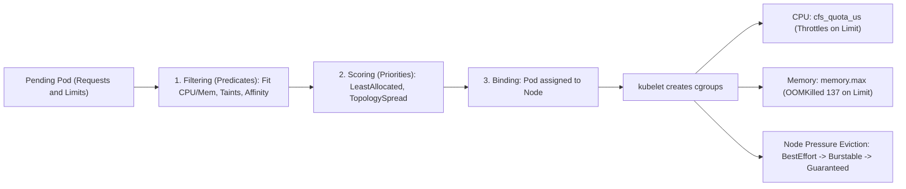
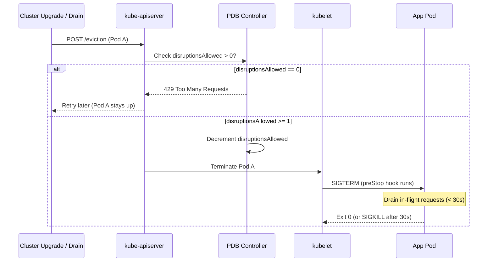
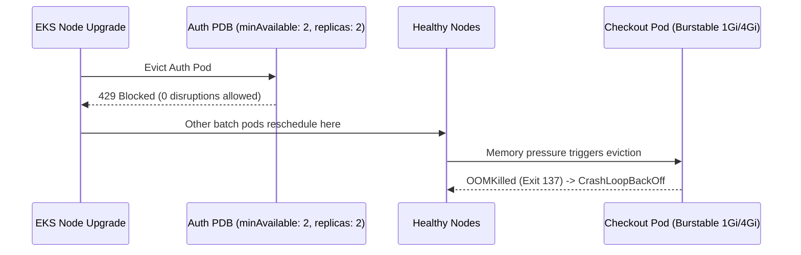

# Kubernetes Scheduling: Requests, Limits, OOMKilled, QoS & PDBs

> **Prerequisites:** [Lesson 06: Kubernetes Core Objects](../06-kubernetes-core-objects/README.md).  
> **Estimated Reading Time:** 24–28 minutes  
> **Target Audience:** Backend and platform engineers sizing workloads in production, and candidates asked "why was my pod OOMKilled or evicted during a node drain?"  
> **Free PDF Notes:** [Download SD-V-007.pdf](https://backendroadmap.com/notes/system-design/SD-V-007.pdf)

> [!NOTE]
> **In one line:** Kubernetes schedules pods onto nodes using **requests** (reserved capacity), enforces runtime ceilings using **limits** (CPU throttling via CFS quota, memory termination via `OOMKilled`), ranks eviction order via **QoS classes** (`Guaranteed`, `Burstable`, `BestEffort`), and protects availability during voluntary drains with **PodDisruptionBudgets (PDBs)**.

> [!TIP]
> **The Golden Rule:** Set `memory.request == memory.limit` for stateful or latency-sensitive services to avoid unexpected `OOMKilled` evictions under node pressure, and **never** set CPU limits blindly on bursty request handlers if tail latency ($p_{99}$) matters more than noisy-neighbor isolation.

---

## 1. What Kubernetes Scheduling Is, and What It Isn't

A payments API pod is running fine on a 16-vCPU, 64 GiB node until 09:00 UTC when a batch analytics pod starts on the same node, allocates 28 GiB of heap, and triggers a kernel OOM event. Suddenly the payments pod dies with exit code `137` (`OOMKilled`), even though the cluster had plenty of free memory on *other* nodes. Meanwhile, a cluster upgrade drains a node and takes down all three replicas of an auth service at once because no `PodDisruptionBudget` existed.

| Term | Precise Meaning | Example |
| :--- | :--- | :--- |
| **kube-scheduler** | Control-plane component that binds `Pending` pods to nodes via Filtering and Scoring | Picks `node-04` over `node-02` |
| **Resource Request** | Minimum CPU/memory guaranteed to a container; used for scheduling bin-packing | `cpu: 500m`, `memory: 1Gi` |
| **Resource Limit** | Maximum CPU/memory a container may consume via Linux cgroups | `cpu: 2000m`, `memory: 2Gi` |
| **CPU Throttling** | Kernel CFS period enforcement pausing a runnable container when it exhausts quota | `nr_throttled` spikes, $p_{99}$ jumps |
| **OOMKilled (Exit 137)** | Kernel OOM killer (`SIGKILL`, `128 + 9 = 137`) terminates a container exceeding memory limit | JVM heap + off-heap > `2Gi` |
| **QoS Class** | Kernel/kubelet eviction priority (`Guaranteed`, `Burstable`, `BestEffort`) | `BestEffort` killed first |
| **PodDisruptionBudget (PDB)** | Policy limiting how many pods may be down concurrently during voluntary disruptions | `minAvailable: 2` on 3 replicas |
| **Not** | Autoscaling or dynamic load-based rescheduling of running pods | Scheduler only places `Pending` pods |

### Why It Matters
1. Misconfigured requests and limits are the #1 cause of silent $p_{99}$ latency spikes (CPU throttling) and cascading restarts (`OOMKilled`) in Kubernetes.
2. QoS classes determine *which* pods survive when a node runs out of memory (`NodePressure` eviction).
3. Without PDBs, routine cluster maintenance (node upgrades, spot preemptions, Karpenter consolidation) turns into self-inflicted outages.

---

## 2. Anatomy: Scheduling Pipeline, Cgroups & Eviction



The `kube-scheduler` never looks at *actual* real-time CPU or memory usage on a node; it only sums the **requests** of pods already bound to that node. Once scheduled, the Linux kernel enforces **limits** via cgroups v1/v2.

| Resource | Compressible? | Enforced At | What Happens When Exceeded |
| :--- | :--- | :--- | :--- |
| **CPU** | Yes | `cpu.cfs_quota_us` per `100ms` period | Container is throttled (paused until next `100ms` window); **not killed** |
| **Memory** | No | `memory.limit_in_bytes` / `memory.max` | Kernel OOM killer sends `SIGKILL` (exit code `137`, `OOMKilled`) |
| **Ephemeral Storage** | No | `kubelet` eviction manager | Pod evicted if `emptyDir` + container logs exceed limit |

| QoS Class | Condition | OOM Score Adj | Eviction Order Under Node Memory Pressure |
| :--- | :--- | :---: | :--- |
| **Guaranteed** | Every container has `requests == limits` for both CPU and memory | `-997` | **Last** (only if system daemons need memory) |
| **Burstable** | At least one container has a request or limit, not matching Guaranteed | `2` to `999` | **Second** (ordered by % of memory request used) |
| **BestEffort** | No requests and no limits set on any container | `1000` | **First** (evicted immediately on pressure) |

> [!WARNING]
> **The CPU Limit Latency Trap:** Because Linux CFS enforces CPU quota in 100 ms periods (or `100ms` default `cfs_period_us`), a 4-thread service with `cpu.limit: 1000m` (100 ms quota per 100 ms wall time) can burn its entire 100 ms budget in **25 ms** across 4 cores and then sit **frozen for 75 ms** waiting for the next period—even when the node has 15 idle CPU cores!

---

## 3. Mathematical Model: Allocatable Capacity, CFS Quota & PDB Quorum

**Node Allocatable Capacity.** A node with raw capacity $C_{\text{raw}}$ reserves resources for the OS kernel (`system-reserved`), kubelet/containerd (`kube-reserved`), and the eviction threshold (`eviction-hard`):

$$C_{\text{alloc}} = C_{\text{raw}} - R_{\text{system}} - R_{\text{kube}} - R_{\text{evict}}$$

**CFS Throttling Window.** Given $n$ active threads, CPU limit $L_{\text{cpu}}$ (in cores), and CFS period $P = 100\text{ ms}$, the CPU quota is $Q = L_{\text{cpu}} \cdot P$. The maximum burst wall-time before throttling is:

$$T_{\text{active}} = \frac{Q}{n} = \frac{L_{\text{cpu}} \cdot P}{n}, \qquad T_{\text{stalled}} = P - T_{\text{active}}$$

**Bin-Packing Utilization & PDB Safety.** If $R_{\text{pod}}$ is pod memory request and $N_{\text{pods}}$ is replica count with PDB `maxUnavailable` $= u$ (or `minAvailable` $= m$), the minimum surviving replicas during any voluntary drain is:

$$N_{\text{surviving}} \ge N_{\text{pods}} - u = m$$

### Worked Example
1. **Node Allocatable:** A `m6i.4xlarge` node has `16 vCPU` and `64 GiB` RAM. Reserve `200m` CPU + `1 GiB` for system/kubelet and `100 MiB` eviction-hard:
   - $C_{\text{alloc, mem}} = 64 - 1 - 0.1 = 62.9\text{ GiB}$.
   - If each API pod requests `2 GiB` memory, the node fits at most $\lfloor 62.9 / 2 \rfloor = 31$ pods.
2. **CFS Throttling:** An API pod has `cpu.limit = 1000m` ($L_{\text{cpu}} = 1.0$) and runs 4 concurrent Go/JVM threads ($n = 4$) during a GC or JSON-parse burst:
   - $Q = 1.0 \times 100\text{ ms} = 100\text{ ms}$.
   - $T_{\text{active}} = 100 / 4 = 25\text{ ms}$, followed by $T_{\text{stalled}} = 75\text{ ms}$ of forced sleep! A 30 ms request now takes $30 + 75 = 105\text{ ms}$ ($3.5\times$ $p_{99}$ regression).
3. **PDB Quorum:** A 5-replica stateless service sets `minAvailable: 4` (equivalent to `maxUnavailable: 1`). During a rolling node upgrade across 3 AZs, `kubectl drain` can evict at most 1 pod at a time, preserving $\ge 80\%$ capacity.

---

## 4. Metrics & Percentiles

| Metric | Meaning | Alert when |
| :--- | :--- | :--- |
| `container_cpu_cfs_throttled_periods_total / periods_total` | Fraction of 100 ms CFS windows throttled | $> 5\%$ for latency-sensitive APIs |
| `kube_pod_container_status_terminated_reason{reason="OOMKilled"}` | Container killed by kernel OOM | $> 0$ in production |
| `container_memory_working_set_bytes / limit` | Active memory (anon + active file cache) vs limit | $> 85\%$ sustained |
| `kube_pod_status_phase{phase="Pending"}` | Pods stuck waiting for scheduler | $> 0$ for $> 2\text{ min}$ |
| `kube_poddisruptionbudget_status_disruptions_allowed` | Remaining voluntary disruptions allowed by PDB | `0` continuously (blocks node drains) |
| `kube_node_status_condition{condition="MemoryPressure"}` | Node approaching eviction threshold | `status="true"` |

### Worked Example (`working_set_bytes` vs `RSS`)
A Go service has `memory.limit = 1Gi` (1,024 MiB) and reads a 400 MiB config/lookup file from disk. Linux caches those 400 MiB in the **page cache**, which counts toward `container_memory_working_set_bytes` if the pages are active. If the Go heap grows to 650 MiB, total working set hits $650 + 400 = 1,050\text{ MiB} > 1,024\text{ MiB}$, and the container is `OOMKilled`—even though Go's heap metric only reported 650 MiB.

---

## 5. Compounding & Failure Modes

What happens when you overcommit memory (`request < limit`) across a 10-node cluster?

| Scenario | Cluster Memory State | Outcome |
| :--- | :--- | :--- |
| **Normal load** (each pod requests 1 GiB, limit 2 GiB, uses 1.1 GiB) | 30 pods/node = 33 GiB used on 64 GiB node | Looks healthy; 51% utilization |
| **Traffic burst** (all 30 pods spike to 1.9 GiB simultaneously) | $30 \times 1.9 = 57\text{ GiB}$ + 4 GiB OS = 61 GiB | Crosses `eviction-hard`; kubelet evicts `Burstable` pods |
| **Evicted pods reschedule** onto remaining 9 nodes | Remaining nodes absorb extra pods and also cross 61 GiB | **Cascading eviction storm** across the entire cluster |
| **Blocking PDB** (`minAvailable: 100%` or `maxUnavailable: 0`) | Node drain hangs indefinitely | Cluster autoscaler & security patching **deadlocked** |

---

## 6. Numbers Every Engineer Must Know

| Item | Typical | Implication |
| :--- | :---: | :--- |
| Default Linux CFS period (`cfs_period_us`) | `100 ms` | CPU limits throttle in 100 ms buckets |
| `SIGKILL` exit code (`OOMKilled`) | `137` (`128 + 9`) | Always distinguish exit `137` (OOM) from `143` (`SIGTERM` graceful stop) |
| Default `terminationGracePeriodSeconds` | `30 s` | Pod gets `SIGTERM`, then `SIGKILL` after 30 s |
| `kubelet` default `eviction-hard` memory | `100 MiB` | Kubelet starts evicting pods before kernel OOM |
| Scheduler filtering + scoring latency | `1–10 ms` per pod | Scheduling throughput ~100–500 pods/s on default clusters |
| Safe memory headroom (`working_set / limit`) | `70%–80%` | Leaves room for GC spikes and page cache |

---

## 7. Protocol Deep Dive: Pod Eviction vs Voluntary Drain



| Question | Answer |
| :--- | :--- |
| **Does a PDB protect against `OOMKilled` or hardware failure?** | **No.** PDBs only guard *voluntary* disruptions via the Eviction API (`kubectl drain`, upgrades, autoscaler scale-down). |
| **What happens if `kubectl delete pod` is used?** | Bypass! Direct `DELETE /pods` does **not** use the Eviction API and ignores PDBs. |
| **Should I set `minAvailable: 1` on a 1-replica Deployment?** | **Never.** `disruptionsAllowed` becomes `0`, permanently blocking node drains and upgrades. |
| **What if `cpu.request` is set without `cpu.limit`?** | The pod gets guaranteed CPU shares during contention and can burst into idle node CPU with **zero CFS throttling**. |

**When not to omit CPU limits:** In untrusted multi-tenant clusters (e.g., running third-party user code or CI jobs), omitting CPU limits allows a runaway loop to starve kernel/monitoring daemons or distort noisy-neighbor SLAs unless `Guaranteed` QoS or strict `LimitRange` policies are enforced.

---

## 8. Hierarchical Budgets & Design Rules

| Slice | Rule | Control |
| :--- | :--- | :--- |
| **Memory** | Set `memory.request == memory.limit` for production services | Prevents overcommit cascades and grants higher eviction priority |
| **CPU** | Set `cpu.request` accurately ($p_{50}$–$p_{80}$); omit `cpu.limit` for latency-critical APIs | Eliminates CFS throttling spikes |
| **QoS** | Critical control-plane & stateful pods must be `Guaranteed` | `requests == limits` for CPU and memory |
| **PDBs** | Every multi-replica production service must have a PDB | `minAvailable: 50%` or `maxUnavailable: 1` |
| **Topology** | Spread replicas across AZs and nodes | `topologySpreadConstraints` with `topology.kubernetes.io/zone` |
| **Graceful Shutdown** | `terminationGracePeriodSeconds` > max request timeout + `preStop` sleep | `preStop: sleep 5` lets Endpoints/EndpointSlice propagate |
| **Guardrails** | Enforce defaults and ceilings per namespace | `LimitRange` + `ResourceQuota` |

---

## 9. Top Mitigations

1. **Match memory requests to limits** (`request == limit`) on all Tier-1 services so nodes never overcommit memory.
2. **Remove CPU limits on latency-sensitive microservices** (or increase `cpu.limit` to $4\times$–$8\times$ request) and monitor `container_cpu_cfs_throttled_periods_total`.
3. **Add `topologySpreadConstraints`** across zones and nodes so a single AZ or node failure never wipes out a quorum.
4. **Define a `PodDisruptionBudget`** with `maxUnavailable: 1` (or `25%`) on every Deployment with $\ge 2$ replicas; never set `maxUnavailable: 0`.
5. **Configure `preStop` sleep (`5s`) + `SIGTERM` handler** so kube-proxy/Ingress stops sending traffic before the process closes its listening socket.
6. **Tune runtime heap ceilings explicitly** (e.g., JVM `-XX:MaxRAMPercentage=75.0`, Go `GOMEMLIMIT=800MiB`) to stay below `memory.limit`.
7. **Use `PriorityClass`** (`system-cluster-critical`, `high-priority-api`, `batch-low`) so batch jobs are preempted before user-facing APIs.

---

## 10. Production Reference: SEV-1 Node Drain Deadlock & OOM Storm

During a routine EKS node-group AMI upgrade, 40% of nodes failed to drain for 3 hours, while remaining nodes suffered cascading `OOMKilled` restarts on the checkout service.



- **Root Cause:** (1) The Auth service had `replicas: 2` and `minAvailable: 2`, making `disruptionsAllowed = 0` and wedging the node drain. (2) Checkout pods were `Burstable` (`request: 1Gi`, `limit: 4Gi`) and had no `GOMEMLIMIT`, so when rescheduled onto crowded nodes they spiked to 3.2 GiB and were `OOMKilled`.
- **Fix:** Changed Auth PDB to `minAvailable: 1` (`replicas: 3`), set Checkout `memory.request == memory.limit == 2Gi` (`Guaranteed` QoS) with `GOMEMLIMIT=1700MiB`, and added a `LimitRange` rejecting `BestEffort` pods in production namespaces.

---

## 11. Multi-Language Production Code Tabs

A scheduling & capacity simulator that computes node bin-packing, CFS throttling delay, and QoS eviction order.

````carousel
```go
// Go: Compute QoS class, CFS throttling stall, and node bin-packing fit.
package main

import (
	"fmt"
	"math"
)

type ContainerSpec struct {
	CPUReqMillicores int
	CPULimMillicores int
	MemReqMiB        int
	MemLimMiB        int
}

func DetermineQoS(c ContainerSpec) string {
	if c.CPUReqMillicores > 0 && c.CPUReqMillicores == c.CPULimMillicores &&
		c.MemReqMiB > 0 && c.MemReqMiB == c.MemLimMiB {
		return "Guaranteed"
	}
	if c.CPUReqMillicores > 0 || c.CPULimMillicores > 0 || c.MemReqMiB > 0 || c.MemLimMiB > 0 {
		return "Burstable"
	}
	return "BestEffort"
}

// CFSStallMs returns forced idle ms per 100ms period when `threads` run concurrently.
func CFSStallMs(cpuLimitMillicores, threads int) float64 {
	if cpuLimitMillicores <= 0 || threads <= 0 {
		return 0
	}
	const periodMs = 100.0
	quotaMs := (float64(cpuLimitMillicores) / 1000.0) * periodMs
	activeMs := quotaMs / float64(threads)
	if activeMs >= periodMs {
		return 0
	}
	return math.Round((periodMs-activeMs)*100) / 100
}

func main() {
	spec := ContainerSpec{CPUReqMillicores: 500, CPULimMillicores: 1000, MemReqMiB: 2048, MemLimMiB: 2048}
	fmt.Printf("QoS=%s, StallPer100ms=%.2fms\n", DetermineQoS(spec), CFSStallMs(spec.CPULimMillicores, 4))
}
```
<!-- slide -->
```typescript
// TypeScript: Kubernetes scheduler bin-packing & QoS classifier.
interface PodSpec {
  name: string;
  cpuReqM: number;
  cpuLimM: number;
  memReqMiB: number;
  memLimMiB: number;
}

type QoSClass = "Guaranteed" | "Burstable" | "BestEffort";

export function classifyQoS(p: PodSpec): QoSClass {
  if (p.cpuReqM > 0 && p.cpuReqM === p.cpuLimM && p.memReqMiB > 0 && p.memReqMiB === p.memLimMiB) {
    return "Guaranteed";
  }
  if (p.cpuReqM > 0 || p.cpuLimM > 0 || p.memReqMiB > 0 || p.memLimMiB > 0) {
    return "Burstable";
  }
  return "BestEffort";
}

export function canScheduleOnNode(
  nodeAlloc: { cpuM: number; memMiB: number },
  existing: PodSpec[],
  incoming: PodSpec
): boolean {
  const usedCpu = existing.reduce((sum, p) => sum + p.cpuReqM, 0);
  const usedMem = existing.reduce((sum, p) => sum + p.memReqMiB, 0);
  return usedCpu + incoming.cpuReqM <= nodeAlloc.cpuM && usedMem + incoming.memReqMiB <= nodeAlloc.memMiB;
}
```
<!-- slide -->
```python
# Python: Node allocatable, CFS throttling, and PDB safety calculator (stdlib only).
from dataclasses import dataclass

@dataclass
class PodSpec:
    name: str
    cpu_req_m: int
    cpu_lim_m: int
    mem_req_mib: int
    mem_lim_mib: int

def qos_class(p: PodSpec) -> str:
    if p.cpu_req_m > 0 and p.cpu_req_m == p.cpu_lim_m and p.mem_req_mib > 0 and p.mem_req_mib == p.mem_lim_mib:
        return "Guaranteed"
    if any(v > 0 for v in (p.cpu_req_m, p.cpu_lim_m, p.mem_req_mib, p.mem_lim_mib)):
        return "Burstable"
    return "BestEffort"

def cfs_throttle_ms(cpu_lim_m: int, active_threads: int, period_ms: float = 100.0) -> float:
    if cpu_lim_m <= 0:
        return 0.0
    quota_ms = (cpu_lim_m / 1000.0) * period_ms
    active_ms = quota_ms / max(1, active_threads)
    return round(max(0.0, period_ms - active_ms), 2)

def pdb_disruptions_allowed(replicas: int, ready: int, min_available: int) -> int:
    return max(0, ready - min_available)

if __name__ == "__main__":
    p = PodSpec("checkout", 500, 1000, 2048, 2048)
    print(qos_class(p), cfs_throttle_ms(p.cpu_lim_m, 4), pdb_disruptions_allowed(5, 5, 4))
```
<!-- slide -->
```csharp
// C#: QoS classifier and PDB disruption allowance check.
using System;

public sealed record PodResourceSpec(int CpuReqM, int CpuLimM, int MemReqMiB, int MemLimMiB);

public static class K8sSchedulerHelper
{
    public static string GetQoSClass(PodResourceSpec spec)
    {
        if (spec.CpuReqM > 0 && spec.CpuReqM == spec.CpuLimM &&
            spec.MemReqMiB > 0 && spec.MemReqMiB == spec.MemLimMiB)
            return "Guaranteed";

        if (spec.CpuReqM > 0 || spec.CpuLimM > 0 || spec.MemReqMiB > 0 || spec.MemLimMiB > 0)
            return "Burstable";

        return "BestEffort";
    }

    public static int DisruptionsAllowed(int readyReplicas, int minAvailable) =>
        Math.Max(0, readyReplicas - minAvailable);
}
```
````

---

## 12. Hands-On CLI Verification Workflows

```bash
# 1. Inspect node allocatable capacity vs requests committed
kubectl describe node <node-name> | grep -A 8 "Allocated resources"

# 2. Check a pod's QoS class and OOMKilled exit code (137)
kubectl get pod <pod-name> -o jsonpath='{.status.qosClass}{"\n"}{.status.containerStatuses[0].lastState.terminated.reason}{"\n"}'

# 3. Inspect PDBs and see if disruptionsAllowed == 0 (which blocks drains)
kubectl get pdb -A -o custom-columns=NS:.metadata.namespace,NAME:.metadata.name,MIN:.spec.minAvailable,MAX:.spec.maxUnavailable,ALLOWED:.status.disruptionsAllowed

# 4. Dry-run a node drain to verify PDBs allow eviction
kubectl drain <node-name> --ignore-daemonsets --delete-emptydir-data --dry-run=client

# 5. Inspect CFS throttling inside a container (cgroups v2)
kubectl exec <pod-name> -- cat /sys/fs/cgroup/cpu.stat
```

---

## 13. Common Mistakes to Avoid

1. **Setting `cpu.limit` blindly on multi-threaded APIs**, causing 75 ms CFS stalls on idle nodes.
2. **Overcommitting memory (`request < limit`) on Tier-1 services**, triggering cascading `OOMKilled` evictions.
3. **Leaving pods as `BestEffort`** (no requests/limits), guaranteeing they are killed first under pressure.
4. **Setting `minAvailable: 100%` or `maxUnavailable: 0` in a PDB**, deadlocking cluster upgrades.
5. **Forgetting `GOMEMLIMIT` or JVM `-XX:MaxRAMPercentage`**, so the runtime allocates past `memory.limit`.
6. **Ignoring `preStop` sleep**, causing 502 errors during rolling deploys while kube-proxy still routes to terminating pods.
7. **Assuming `kube-scheduler` checks live CPU/RAM usage**—it only bins by `requests`.

---

## 14. Key Terms Glossary

| Key Term | Definition |
| :--- | :--- |
| **Resource Request** | Guaranteed minimum CPU/memory used by `kube-scheduler` for node placement. |
| **Resource Limit** | Hard runtime ceiling enforced by Linux cgroups. |
| **CFS Quota** | Linux Completely Fair Scheduler mechanism enforcing CPU limits in 100 ms windows. |
| **OOMKilled (Exit 137)** | Kernel termination (`SIGKILL`) when a container exceeds its memory limit. |
| **QoS Class** | Pod eviction priority (`Guaranteed`, `Burstable`, `BestEffort`). |
| **PodDisruptionBudget (PDB)** | Policy bounding concurrent voluntary pod evictions. |
| **Allocatable** | Node capacity remaining for pods after OS and kubelet reservations. |
| **Eviction API** | Kubernetes endpoint that enforces PDBs during drains, unlike raw `DELETE`. |
| **Topology Spread** | Constraint distributing pod replicas evenly across zones or nodes. |
| **PriorityClass** | Integer weight deciding which pods preempt others when cluster capacity is full. |

---

## 15. System Design Interview Questions & Answers

### Basic Conceptual Questions

<details>
<summary><strong>Q1: What is the difference between CPU/memory requests and limits? [BASIC]</strong></summary>

**Answer:**
Requests are scheduling guarantees used by `kube-scheduler` to place pods on nodes with enough free capacity. Limits are runtime enforcement ceilings enforced by Linux cgroups: exceeding CPU limits causes throttling (pausing), while exceeding memory limits causes `OOMKilled` (exit code `137`).
</details>

<details>
<summary><strong>Q2: What are the three Kubernetes QoS classes and how are they assigned? [BASIC]</strong></summary>

**Answer:**
`Guaranteed` (every container has `requests == limits` for both CPU and memory), `Burstable` (at least one container has a request or limit, but not matching `Guaranteed`), and `BestEffort` (no requests or limits set). Under node memory pressure, `BestEffort` pods are evicted first, then `Burstable`, then `Guaranteed`.
</details>

<details>
<summary><strong>Q3: What is a PodDisruptionBudget (PDB) and what does it protect against? [BASIC]</strong></summary>

**Answer:**
A PDB specifies `minAvailable` or `maxUnavailable` replicas for a workload. It protects against **voluntary** disruptions (node drains, cluster upgrades, autoscaler scale-down) via the Eviction API. It does **not** protect against involuntary failures like `OOMKilled` or hardware crashes.
</details>

<details>
<summary><strong>Q4: Why does exit code 137 happen in Kubernetes? [BASIC]</strong></summary>

**Answer:**
Exit code `137` equals `128 + 9` (`SIGKILL`). In Kubernetes it usually means the container exceeded its `memory.limit` (`OOMKilled`), the node ran out of memory, or the container ignored `SIGTERM` for `terminationGracePeriodSeconds` (30 s) and was forcefully killed.
</details>

### Scenario-Based Architecture Questions

<details>
<summary><strong>Q5: Your Go/Java API has $p_{99}$ latency spikes to 200 ms even though node CPU is only 20% utilized. Why? [SCENARIO]</strong></summary>

**Answer:**
CFS CPU throttling. If the container has `cpu.limit: 1000m` and bursts across 4 threads, it consumes its 100 ms CFS quota in 25 ms and is frozen for the remaining 75 ms of the 100 ms period, regardless of idle node CPU. Verify with `/sys/fs/cgroup/cpu.stat` (`nr_throttled`) and remove or raise the CPU limit.
</details>

<details>
<summary><strong>Q6: A cluster upgrade is stuck for hours trying to drain a node. What do you check first? [SCENARIO]</strong></summary>

**Answer:**
Check `kubectl get pdb -A` for any PDB with `disruptionsAllowed: 0` (such as `minAvailable: 1` on a 1-replica deployment or `minAvailable == replicas`). Also check for pods with `local-storage` or stuck finalizers blocking termination.
</details>

<details>
<summary><strong>Q7: How do you configure a 3-replica stateful/critical service so it survives both node pressure and rolling upgrades? [SCENARIO]</strong></summary>

**Answer:**
Set `memory.request == memory.limit` (and `cpu.request == cpu.limit` for `Guaranteed` QoS), add `topologySpreadConstraints` across 3 AZs (`topology.kubernetes.io/zone`), and attach a PDB with `minAvailable: 2` (`maxUnavailable: 1`).
</details>

<details>
<summary><strong>Q8: Your app's heap metric is 600 MiB inside a 1 GiB limit, yet Kubernetes OOMKills it. Why? [SCENARIO]</strong></summary>

**Answer:**
The kernel counts **total working set** (heap + off-heap/native memory + active OS page cache from file reads) against `memory.limit`, not just application heap. Check `container_memory_working_set_bytes` and tune `GOMEMLIMIT` or `-XX:MaxRAMPercentage` with headroom for page cache.
</details>

### Advanced & Tricky Interview Questions

<details>
<summary><strong>Q9: Why does `Guaranteed` QoS require setting `cpu.request == cpu.limit`, even if CPU limits can cause throttling? [TRICKY]</strong></summary>

**Answer:**
Kubernetes only assigns `Guaranteed` QoS when *both* CPU and memory have `requests == limits` on every container. For latency-critical services where you want to avoid CFS throttling *and* avoid memory eviction, the trade-off is either setting a high `cpu.request == cpu.limit` sized for peak bursts, or accepting `Burstable` QoS with `memory.request == memory.limit` (which still gives a low OOM score relative to overcommitted pods).
</details>

<details>
<summary><strong>Q10: Does `kubectl drain` wait for `terminationGracePeriodSeconds` and PDBs? What about `kubectl delete pod`? [TRICKY]</strong></summary>

**Answer:**
`kubectl drain` calls the Eviction API, which respects PDBs and triggers graceful termination (`preStop` + `SIGTERM` + `terminationGracePeriodSeconds`). `kubectl delete pod` bypasses the Eviction API and ignores PDBs entirely.
</details>

<details>
<summary><strong>Q11: How does `kube-scheduler` handle a pod that requests 0 CPU and 0 memory? [TRICKY]</strong></summary>

**Answer:**
It passes the Filtering phase on almost any node with unallocated pod slots (`maxPods`, typically 110), because `kube-scheduler` only checks `requests`. The pod gets `BestEffort` QoS and will be the very first pod killed if any `Burstable` pod on that node bursts its memory.
</details>

<details>
<summary><strong>Q12: Why do 502 errors still happen during rolling updates even with a working `SIGTERM` handler? [TRICKY]</strong></summary>

**Answer:**
`SIGTERM` is sent to the pod concurrently with EndpointSlice removal propagation to kube-proxy/Ingress controllers. If the app closes its listening socket immediately on `SIGTERM`, in-flight or newly routed packets hit a closed port for 1–3 seconds. Adding a `preStop` hook (`sleep 5`) keeps the socket open while traffic drains.
</details>

---

## 16. One-Page Master Cheat Sheet

```
+---------------------------------------------------------------------------------------------------------+
|                  KUBERNETES SCHEDULING & STABILITY — MASTER CHEAT SHEET                                 |
+---------------------------------------------------------------------------------------------------------+
| 1. REQUESTS vs LIMITS: Requests = scheduler bin-packing; Limits = cgroup runtime enforcement.           |
+---------------------------------------------------------------------------------------------------------+
| 2. CPU vs MEMORY: CPU is compressible (throttled in 100ms CFS windows); Memory is NOT (OOMKilled 137).  |
+---------------------------------------------------------------------------------------------------------+
| 3. QoS EVICTION ORDER: BestEffort (killed 1st) -> Burstable -> Guaranteed (requests == limits).         |
+---------------------------------------------------------------------------------------------------------+
| 4. PDBs: Guard voluntary drains only (minAvailable / maxUnavailable). Never set disruptionsAllowed = 0. |
+---------------------------------------------------------------------------------------------------------+
| 5. TAIL LATENCY RULE: Omit CPU limits on bursty APIs (or size high); ALWAYS set memory.req == limit.    |
+---------------------------------------------------------------------------------------------------------+
| 6. GRACEFUL SHUTDOWN: preStop sleep 5s + SIGTERM drain < terminationGracePeriodSeconds (30s).           |
+---------------------------------------------------------------------------------------------------------+
```

---

## Further Reading & Sources

- Kubernetes Documentation, [Resource Management for Pods and Containers](https://kubernetes.io/docs/concepts/configuration/manage-resources-containers/).
- Kubernetes Documentation, [Pod Quality of Service Classes](https://kubernetes.io/docs/concepts/workloads/pods/pod-qos/).
- Kubernetes Documentation, [Specifying a Disruption Budget for your Application](https://kubernetes.io/docs/tasks/run-application/configure-pdb/).
- Brendan Gregg, *Systems Performance*, Chapter 6 (CPU CFS) & Chapter 7 (Memory & OOM Killer).

---

## Free PDF Notes

[SD-V-007.pdf](https://backendroadmap.com/notes/system-design/SD-V-007.pdf)

---

## Next

Continue with [Lesson 08: Kubernetes Autoscaling: HPA, VPA, Cluster Autoscaler & KEDA](../08-kubernetes-autoscaling/README.md).
