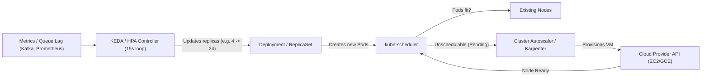
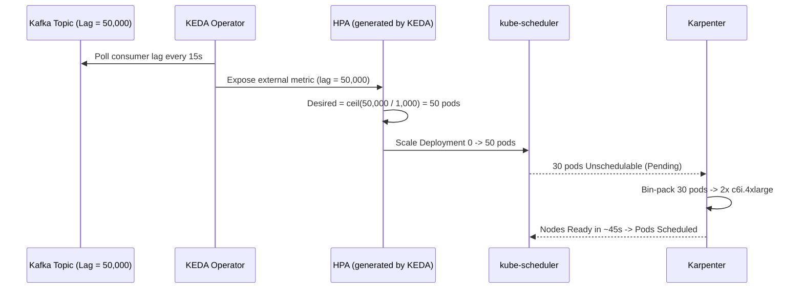
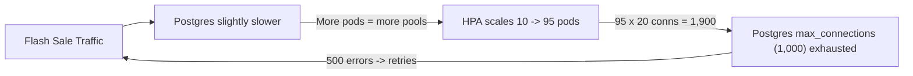

# Kubernetes Autoscaling: HPA, VPA, Cluster Autoscaler & KEDA

> **Prerequisites:** [Lesson 07: Kubernetes Scheduling](../07-kubernetes-scheduling/README.md).  
> **Estimated Reading Time:** 24–28 minutes  
> **Target Audience:** Backend and platform engineers designing elastic clusters, and candidates asked "how do you autoscale pods and nodes together without thrashing?"  
> **Free PDF Notes:** [Download SD-V-008.pdf](https://backendroadmap.com/notes/system-design/SD-V-008.pdf)

> [!NOTE]
> **In one line:** **HPA** scales pod replica counts on CPU/memory/custom metrics, **VPA** adjusts pod CPU/memory requests/limits, **KEDA** scales pods from `0` to $N$ on external event sources (Kafka lag, SQS depth), and **Cluster Autoscaler / Karpenter** provisions or removes nodes when pods go `Pending` or nodes sit underutilized.

> [!TIP]
> **The Golden Rule:** Scale **pods** on business-aligned signals (RPS, queue lag via KEDA/HPA) and let **Cluster Autoscaler or Karpenter** reactively provision **nodes** for `Pending` pods—never run HPA and VPA on the *same* metric (CPU/memory) simultaneously, or they will fight each other.

---

## 1. What Kubernetes Autoscaling Is, and What It Isn't

At 18:00 UTC a flash sale multiplies checkout traffic $8\times$. HPA sees CPU cross 70% and requests 40 new pods—but the cluster only has room for 6. The remaining 34 pods sit `Pending`, waiting 4 minutes for Cluster Autoscaler to spin up new EC2 nodes, pull container images, and pass readiness probes. Meanwhile, queue consumers sit idle at 5% CPU while 200,000 Kafka messages pile up because nobody wired KEDA to consumer lag.

| Term | Precise Meaning | Example |
| :--- | :--- | :--- |
| **HPA (Horizontal Pod Autoscaler)** | Control loop adjusting `replicas` on a Deployment/StatefulSet every 15 s | Scale 4 $\to$ 20 pods at 70% CPU |
| **VPA (Vertical Pod Autoscaler)** | Recommends or mutates container `requests`/`limits` based on historical usage | Bump `memory.request` 512Mi $\to$ 1Gi |
| **Cluster Autoscaler (CA)** | Adds nodes when pods are `Pending` due to insufficient resources; removes empty/low nodes | Scales AWS ASG 3 $\to$ 12 nodes |
| **Karpenter** | Node provisioner that launches right-sized instances directly via cloud APIs in ~45 s | Picks `c6i.2xlarge` directly |
| **KEDA** | Event-driven autoscaler that drives HPA from external metrics and supports scale-to-zero | Scale on Kafka consumer lag |
| **Metrics Server** | Lightweight in-memory aggregator exposing `metrics.k8s.io` (`kubectl top`) | Scrapes kubelet every 15–60 s |
| **Not** | Instantaneous scaling | Cold-start = metric lag + node boot + image pull + readiness |

### Why It Matters
1. Pod autoscaling without node autoscaling stalls at `Pending` pods; node autoscaling without pod autoscaling never reacts to traffic.
2. Scaling on CPU alone fails for I/O-bound services and queue workers, where latency or queue lag spikes long before CPU does.
3. Unbounded autoscaling can DDoS your own database by opening thousands of new connections during a spike.

---

## 2. Anatomy: The Two-Loop Autoscaling Pipeline



Kubernetes autoscaling is **two decoupled control loops**:
1. **Workload loop (HPA / KEDA / VPA):** Changes the *shape or count* of pods.
2. **Infrastructure loop (Cluster Autoscaler / Karpenter):** Watches for `Pending` pods that failed scheduling and provisions nodes to fit them.

| Dimension | HPA | VPA | KEDA | Cluster Autoscaler / Karpenter |
| :--- | :--- | :--- | :--- | :--- |
| **What it scales** | Pod `replicas` | Pod `requests` / `limits` | Pod `replicas` (`0..N`) | Cluster `Nodes` |
| **Trigger** | CPU, Memory, Custom Metrics | Historical OOMs & CPU/Mem usage | 60+ external scalers (Kafka, SQS, Cron) | `Pending` pods / underutilized nodes |
| **Scale to zero?** | No (min 1, unless alpha/KEDA) | N/A | **Yes** (`0 -> N`) | Yes (for non-system node groups) |
| **Disruption** | Non-disruptive | Recreates pods (unless InPlacePodVerticalScaling) | Non-disruptive | Drains nodes on scale-down |

> [!WARNING]
> **The HPA + VPA Thrashing Trap:** Never configure HPA and VPA to target CPU on the same Deployment. If traffic rises, HPA adds replicas while VPA *also* raises `cpu.request`—which drops CPU utilization %, causing HPA to scale down, which causes VPA to shrink requests again in an endless oscillation. Use VPA in `Off` (recommendation-only) mode or pair HPA (CPU) with VPA (Memory only, or `Initial`).

---

## 3. Mathematical Model: HPA Target Formula & Cold-Start Budget

**HPA Desired Replicas.** Every `horizontal-pod-autoscaler-sync-period` (default 15 s), HPA computes:

$$\text{desiredReplicas} = \left\lceil \text{currentReplicas} \times \frac{\text{currentMetricValue}}{\text{desiredMetricValue}} \right\rceil$$

Kubernetes applies a **10% tolerance band** (`0.9` to `1.1` ratio) to prevent flapping on noisy metrics.

**Total Scale-Out Latency.** When a sudden spike hits, time to healthy capacity is the sum of every stage:

$$T_{\text{scale}} = T_{\text{scrape}} + T_{\text{HPA}} + T_{\text{node\_boot}} + T_{\text{image\_pull}} + T_{\text{ready}}$$

**Queue-Driven Sizing (KEDA).** Given backlog $B$, per-pod processing rate $r$ (msgs/s), and target drain time $T_{\text{target}}$:

$$N_{\text{pods}} = \min\!\left(N_{\max},\; \left\lceil \frac{B}{r \cdot T_{\text{target}}} \right\rceil\right)$$

### Worked Example
1. **HPA Calculation:** A service runs `4` replicas with `cpu.request = 500m`, target utilization `70%` (`350m`). Current average usage jumps to `630m` (`126%` of request):
   - Ratio $= 126 / 70 = 1.8$ (outside $[0.9, 1.1]$ tolerance).
   - $\text{desiredReplicas} = \lceil 4 \times 1.8 \rceil = \lceil 7.2 \rceil = 8$ pods.
2. **Cold-Start Budget:** Metrics scrape (`15 s`) + HPA sync (`15 s`) + CA scale-up scan (`10 s`) + Cloud VM boot (`75 s`) + container image pull (`25 s`) + app startup/readiness (`20 s`) = **$160\text{ s}$ (~2.7 minutes)**. If you need to absorb a 30-second burst, autoscaling alone is too slow—you need **headroom (over-provisioning / pause pods)** or a **queue**.

---

## 4. Metrics & Percentiles

| Metric | Meaning | Alert when |
| :--- | :--- | :--- |
| `kube_horizontalpodautoscaler_status_current_replicas / max_replicas` | How close HPA is to hitting its ceiling | $\ge 90\%$ of `maxReplicas` sustained |
| `kube_pod_status_phase{phase="Pending"}` | Pods waiting on Cluster Autoscaler / Karpenter | Pending $> 3\text{ min}$ |
| `cluster_autoscaler_unschedulable_pods_count` | Pods CA cannot place (e.g., max ASG size hit) | $> 0$ for $> 2\text{ min}$ |
| `keda_scaler_metrics_value` | External lag/depth driving KEDA | Lag rising while `replicas == maxReplicas` |
| `kube_pod_container_status_restarts_total` | Crashes during scale-out (e.g., DB connection exhaustion) | Spikes correlated with scale-out |

### Worked Example (Over-Provisioning with Pause Pods)
To cut the `75 s` VM boot delay to `< 5 s`, platform teams run low-priority **placeholder ("pause") pods** (`PriorityClass: -10`) consuming 2 nodes worth of idle buffer. When a real API pod scales out and goes `Pending`, `kube-scheduler` immediately preempts the pause pods in $< 1\text{ s}$, and the evicted pause pods go `Pending` instead—triggering Cluster Autoscaler in the background to replenish the buffer.

---

## 5. Compounding & Failure Modes

| Failure Mode | Mechanism | Blast Radius |
| :--- | :--- | :--- |
| **Scale-out DB stampede** | HPA scales API 10 $\to$ 100 pods; each opens 20 DB connections | 2,000 connections crash Postgres (`max_connections` hit) |
| **Scale-down thrashing** | HPA scales down prematurely during brief lull | Lost caches, repeated cold starts, $p_{99}$ spikes |
| **CA scale-down blocked** | Pod has `local-storage`, no PDB headroom, or `safe-to-evict: false` | Empty-ish nodes never consolidate; cloud bill doubles |
| **HPA missing metrics** | Metrics Server down or pod missing `resources.requests` | HPA logs `FailedGetResourceMetric` and **freezes** scaling |

---

## 6. Numbers Every Engineer Must Know

| Item | Typical | Implication |
| :--- | :---: | :--- |
| HPA default sync interval | `15 s` | Minimum reaction time even for local metrics |
| HPA default tolerance band | `±10%` (`0.1`) | Prevents flapping around target threshold |
| HPA default scale-down stabilization window | `300 s` (5 min) | Avoids premature scale-in during transient dips |
| Cluster Autoscaler VM boot + join | `60–120 s` | Karpenter cuts this to `~35–55 s` via direct Fleet API |
| CA default scale-down unneeded time | `10 min` | Node must stay under `50%` utilization for 10 min before removal |
| Image pull time (500 MB container) | `15–40 s` | Keep images slim (distroless/Alpine) or pre-cached |

---

## 7. Protocol Deep Dive: KEDA + HPA + Karpenter Interaction



| Question | Answer |
| :--- | :--- |
| **Does KEDA replace HPA?** | **No.** KEDA creates and manages an HPA object under the hood, feeding it external metrics and handling the `0 <-> 1` transition. |
| **Why does HPA require `requests` to scale on CPU/memory?** | HPA computes utilization as `currentUsage / request`. Without `requests`, HPA cannot calculate a percentage and refuses to scale. |
| **Cluster Autoscaler vs Karpenter?** | CA scales pre-defined Node Groups/ASGs (homogeneous sizes, slower); Karpenter provisions right-sized nodes directly from cloud instance catalogs in ~45 s. |
| **What happens to in-flight requests when HPA scales down?** | Kubernetes sends `SIGTERM` to the selected pod; it must finish in-flight work before `terminationGracePeriodSeconds` expires. |

**When not to use HPA:** Do not use HPA on single-writer stateful workloads, non-sharded caches, or services bottlenecked by a single downstream database unless you also bound `maxReplicas` to the database's connection/QPS ceiling.

---

## 8. Hierarchical Budgets & Design Rules

| Slice | Rule | Control |
| :--- | :--- | :--- |
| **HPA Bounds** | Always set `minReplicas >= 2` (for HA) and a safe `maxReplicas` | Prevents DB connection exhaustion |
| **Stabilization** | Set `scaleUp` fast (`0–15s`), `scaleDown` slow (`300s+`) | `behavior.scaleDown.stabilizationWindowSeconds: 300` |
| **Requests Required** | Every HPA-managed container must define `cpu.request` | Enforced via `LimitRange` / admission policy |
| **KEDA** | Use KEDA for queue/stream consumers instead of CPU | Trigger on Kafka lag or SQS `ApproximateNumberOfMessages` |
| **Buffer** | Use low-priority pause pods for sub-second burst absorption | `PriorityClass` value `-10` |
| **Node Provisioning** | Prefer Karpenter (or multi-AZ CA with `least-waste`) | Consolidate underutilized nodes automatically |

---

## 9. Top Mitigations

1. **Cap `maxReplicas`** based on downstream capacity (e.g., `maxReplicas * poolSize <= dbMaxConnections * 0.8`).
2. **Use custom/external metrics (RPS, KEDA queue lag)** for I/O-bound services instead of CPU utilization.
3. **Configure asymmetric HPA `behavior`**: aggressive scale-up, conservative 5-minute scale-down stabilization.
4. **Deploy low-priority buffer (pause) pods** so urgent scale-outs preempt placeholders in $< 1\text{ s}$ instead of waiting 90 s for a VM.
5. **Run VPA in `Off` mode** first to right-size requests before enabling HPA, avoiding HPA/VPA metric conflicts.
6. **Keep container images small** (`< 150 MB`) to shave 20–30 s off cold-start time on brand-new nodes.

---

## 10. Production Reference: Black Friday Scale-Out DB Exhaustion

An e-commerce checkout API had HPA configured with `minReplicas: 5`, `maxReplicas: 120`, and `targetCPU: 60%`. During a flash sale, checkout latency increased because Postgres slowed down slightly, which caused threads to block and HPA to scale pods from 10 to 95 in 4 minutes.



- **Root Cause:** Each pod opened a 20-connection HikariCP pool. At 50+ pods, total connections exceeded Postgres's `max_connections = 1000`, causing connection refusals, retries, and total outage.
- **Fix:** Placed PgBouncer in transaction-pooling mode in front of Postgres, capped HPA `maxReplicas` at `40`, and switched HPA trigger from CPU to `http_requests_per_second` with `scaleUp` rate limiting.

---

## 11. Multi-Language Production Code Tabs

An HPA + KEDA scaling calculator implementing Kubernetes' exact 10% tolerance band and stabilization logic.

````carousel
```go
// Go: HPA desired replicas calculation with Kubernetes 10% tolerance band.
package main

import (
	"fmt"
	"math"
)

func ComputeHPAReplicas(currentReplicas int, currentMetric, targetMetric float64, minRep, maxRep int) int {
	if targetMetric <= 0 || currentReplicas <= 0 {
		return minRep
	}
	ratio := currentMetric / targetMetric
	// Kubernetes default tolerance is 0.1 (10% deadband)
	if math.Abs(1.0-ratio) <= 0.1 {
		return currentReplicas
	}
	desired := int(math.Ceil(float64(currentReplicas) * ratio))
	if desired < minRep {
		return minRep
	}
	if desired > maxRep {
		return maxRep
	}
	return desired
}

func main() {
	fmt.Println("Desired:", ComputeHPAReplicas(4, 126.0, 70.0, 2, 20)) // 8
	fmt.Println("Deadband:", ComputeHPAReplicas(4, 74.0, 70.0, 2, 20)) // 4
}
```
<!-- slide -->
```typescript
// TypeScript: HPA + KEDA lag-based desired replica calculator.
export function hpaDesiredReplicas(
  current: number,
  currentValue: number,
  targetValue: number,
  minReplicas: number,
  maxReplicas: number,
  tolerance = 0.1
): number {
  const ratio = currentValue / targetValue;
  if (Math.abs(1 - ratio) <= tolerance) return current;
  const raw = Math.ceil(current * ratio);
  return Math.max(minReplicas, Math.min(maxReplicas, raw));
}

export function kedaLagReplicas(lag: number, lagPerPod: number, maxReplicas: number): number {
  if (lag <= 0) return 0; // KEDA supports scale-to-zero
  return Math.min(maxReplicas, Math.ceil(lag / lagPerPod));
}
```
<!-- slide -->
```python
# Python: HPA formula + cold-start latency budget model (stdlib only).
import math

def hpa_desired_replicas(current: int, current_val: float, target_val: float,
                         min_rep: int = 2, max_rep: int = 50, tolerance: float = 0.1) -> int:
    ratio = current_val / target_val
    if abs(1.0 - ratio) <= tolerance:
        return current
    desired = math.ceil(current * ratio)
    return max(min_rep, min(max_rep, desired))

def cold_start_seconds(scrape_s=15, hpa_s=15, node_boot_s=75, image_pull_s=25, ready_s=20) -> int:
    return scrape_s + hpa_s + node_boot_s + image_pull_s + ready_s

if __name__ == "__main__":
    print("HPA 126% vs 70%:", hpa_desired_replicas(4, 126, 70))  # 8
    print("Cold start (s):", cold_start_seconds())             # 150s
```
<!-- slide -->
```csharp
// C#: HPA replica calculator with tolerance deadband and bounds.
using System;

public static class AutoscalerMath
{
    public static int ComputeDesiredReplicas(
        int current, double currentMetric, double targetMetric,
        int minReplicas, int maxReplicas, double tolerance = 0.1)
    {
        double ratio = currentMetric / targetMetric;
        if (Math.Abs(1.0 - ratio) <= tolerance)
            return current;

        int desired = (int)Math.Ceiling(current * ratio);
        return Math.Clamp(desired, minReplicas, maxReplicas);
    }
}
```
````

---

## 12. Hands-On CLI Verification Workflows

```bash
# 1. Inspect HPA status, current vs target metrics, and scaling conditions
kubectl get hpa -A
kubectl describe hpa checkout-api-hpa

# 2. Check live pod resource usage via Metrics Server
kubectl top pods -n prod --sort-by=cpu

# 3. Inspect KEDA ScaledObject status and underlying HPA
kubectl get scaledobject -A
kubectl describe scaledobject order-worker-scaler

# 4. Watch Cluster Autoscaler logs for why a Pending pod isn't triggering scale-up
kubectl logs -n kube-system deployment/cluster-autoscaler --tail=100

# 5. Inspect Karpenter NodePool and NodeClaims
kubectl get nodepools,nodeclaims
```

---

## 13. Common Mistakes to Avoid

1. **Using HPA and VPA on CPU/memory at the same time**—causes endless scaling oscillations.
2. **Forgetting `resources.requests`** on HPA-managed pods, breaking utilization calculation.
3. **Scaling queue workers on CPU instead of queue lag** (use KEDA).
4. **Unbounded `maxReplicas`** that exhausts downstream database connection pools.
5. **Ignoring cold-start time (2–3 minutes)** when promising sub-second flash-sale elasticity.
6. **Setting `scaleDown` stabilization too low**, causing thrashing and lost in-memory caches.
7. **Running 1-replica `minReplicas`** in production, leaving zero availability during node drains.

---

## 14. Key Terms Glossary

| Key Term | Definition |
| :--- | :--- |
| **HPA** | Horizontal Pod Autoscaler; scales pod replica count based on metrics. |
| **VPA** | Vertical Pod Autoscaler; adjusts container CPU/memory requests and limits. |
| **Cluster Autoscaler** | Scales cloud node groups up for `Pending` pods and down for idle nodes. |
| **Karpenter** | High-speed node provisioner launching right-sized VMs directly via cloud APIs. |
| **KEDA** | Kubernetes Event-driven Autoscaling; connects external metrics and scales to zero. |
| **Tolerance Band** | Default $\pm 10\%$ HPA deadband preventing flapping on minor metric noise. |
| **Stabilization Window** | Cooldown period (default 300 s for scale-down) smoothing replica drops. |
| **Pause Pods** | Low-priority placeholder pods providing instant headroom for burst scale-outs. |
| **Metrics Server** | Cluster-wide aggregator supplying CPU/memory metrics to `kubectl top` and HPA. |
| **Scale-to-Zero** | Reducing replicas to `0` when idle, supported natively by KEDA. |

---

## 15. System Design Interview Questions & Answers

### Basic Conceptual Questions

<details>
<summary><strong>Q1: What is the difference between HPA, VPA, and Cluster Autoscaler? [BASIC]</strong></summary>

**Answer:**
HPA scales the **number of pod replicas** horizontally. VPA adjusts the **CPU/memory requests and limits** of existing pods vertically. Cluster Autoscaler adds or removes **worker nodes (VMs)** when pods cannot be scheduled or nodes are underutilized.
</details>

<details>
<summary><strong>Q2: What formula does HPA use to calculate desired replicas? [BASIC]</strong></summary>

**Answer:**
$\text{desiredReplicas} = \lceil \text{currentReplicas} \times (\text{currentMetric} / \text{desiredMetric}) \rceil$, subject to a default $\pm 10\%$ tolerance deadband and `minReplicas` / `maxReplicas` bounds.
</details>

<details>
<summary><strong>Q3: Why use KEDA instead of standard HPA? [BASIC]</strong></summary>

**Answer:**
KEDA supports **60+ external event sources** (Kafka lag, SQS depth, RabbitMQ, Prometheus) out of the box without writing custom metrics adapters, and supports **scale-to-zero** (`0 -> N` replicas) for event-driven or batch workloads.
</details>

<details>
<summary><strong>Q4: Why does HPA require `resources.requests` to be set? [BASIC]</strong></summary>

**Answer:**
HPA expresses CPU and memory targets as a percentage of `requests`. Without `requests` defined on every container in the pod, HPA cannot compute utilization and stops scaling.
</details>

### Scenario-Based Architecture Questions

<details>
<summary><strong>Q5: Your Kafka consumer pods stay at 2 replicas while lag hits 500,000 messages. Why? [SCENARIO]</strong></summary>

**Answer:**
HPA is likely configured on **CPU utilization**, and the consumers are I/O-bound (waiting on network/DB calls) so CPU stays at 15% below the 70% threshold. Replace the CPU trigger with **KEDA** scaling on Kafka consumer group lag, bounded by the topic's partition count.
</details>

<details>
<summary><strong>Q6: A flash sale hits in 30 seconds. Why isn't HPA + Cluster Autoscaler fast enough? [SCENARIO]</strong></summary>

**Answer:**
End-to-end cold start (metric scrape + HPA sync + VM boot + image pull + readiness) takes **2–3 minutes**. To absorb a 30-second burst, pre-warm capacity with **low-priority pause pods** (preempted in $< 1\text{ s}$) or decouple the spike with a message queue.
</details>

<details>
<summary><strong>Q7: HPA scaled your API from 10 to 80 pods, and now the entire site is returning 500s. What happened? [SCENARIO]</strong></summary>

**Answer:**
Downstream saturation—most commonly **database connection pool exhaustion** or downstream rate-limit breaches. Bound `maxReplicas` to the database's safe limit, introduce connection pooling (PgBouncer/RDS Proxy), and use queues for non-critical writes.
</details>

<details>
<summary><strong>Q8: How do you use VPA safely in production without causing outages? [SCENARIO]</strong></summary>

**Answer:**
Run VPA in `updateMode: "Off"` (or `"Initial"`) to gather P95/P99 usage recommendations, apply them via GitOps/CI, and if you must use `"Auto"` mode, pair it with a PDB so VPA's pod evictions never take down all replicas at once.
</details>

### Advanced & Tricky Interview Questions

<details>
<summary><strong>Q9: Why do HPA and VPA fight if both target CPU on the same Deployment? [TRICKY]</strong></summary>

**Answer:**
When load rises, HPA adds pods while VPA increases `cpu.request`. Higher `cpu.request` lowers the *percentage* CPU utilization, tricking HPA into scaling down, which then causes VPA to lower requests—creating an oscillation loop.
</details>

<details>
<summary><strong>Q10: Why can't Cluster Autoscaler scale down a node that is only 15% utilized? [TRICKY]</strong></summary>

**Answer:**
Common blockers: (1) a pod on that node has a PDB with `disruptionsAllowed: 0`, (2) a pod uses `emptyDir` local storage without `cluster-autoscaler.kubernetes.io/safe-to-evict: "true"`, (3) a pod has strict `nodeAffinity` with nowhere else to land, or (4) it's a `kube-system` pod without a PDB.
</details>

<details>
<summary><strong>Q11: What happens when KEDA scales a Kafka consumer beyond the topic's partition count? [TRICKY]</strong></summary>

**Answer:**
Extra consumer pods sit **completely idle** because Kafka assigns each partition to at most one consumer within a consumer group. Always set KEDA's `maxReplicaCount <= partitionCount`.
</details>

<details>
<summary><strong>Q12: How does Karpenter reduce scale-out latency compared to Cluster Autoscaler? [TRICKY]</strong></summary>

**Answer:**
Cluster Autoscaler relies on pre-configured cloud Auto Scaling Groups (ASGs) and polls slowly, often taking 90–150 s. Karpenter talks directly to the cloud EC2 Fleet API, selects the exact instance type/size for the `Pending` pods' bin-packing shape, and provisions nodes in ~35–55 s.
</details>

---

## 16. One-Page Master Cheat Sheet

```
+---------------------------------------------------------------------------------------------------------+
|                    KUBERNETES AUTOSCALING — MASTER CHEAT SHEET                                          |
+---------------------------------------------------------------------------------------------------------+
| 1. TWO LOOPS: HPA/KEDA/VPA scale Pods; Cluster Autoscaler/Karpenter scale Nodes on Pending pods.        |
+---------------------------------------------------------------------------------------------------------+
| 2. HPA FORMULA: ceil(current * (metric / target)) with +-10% deadband and 300s scale-down window.       |
+---------------------------------------------------------------------------------------------------------+
| 3. NEVER PAIR: HPA + VPA on CPU/Memory simultaneously (they oscillate). Use VPA in Off/Initial mode.    |
+---------------------------------------------------------------------------------------------------------+
| 4. KEDA: Use for queue lag / event streams (scales 0 -> N). Cap maxReplicas <= Kafka partitions.        |
+---------------------------------------------------------------------------------------------------------+
| 5. COLD START: Scrape + HPA + VM boot + image pull = 2-3 min. Use Pause Pods for <1s burst headroom.    |
+---------------------------------------------------------------------------------------------------------+
| 6. DOWNSTREAM SAFETY: Always cap maxReplicas so pods cannot exhaust DB connections.                     |
+---------------------------------------------------------------------------------------------------------+
```

---

## Further Reading & Sources

- Kubernetes Documentation, [Horizontal Pod Autoscaling](https://kubernetes.io/docs/tasks/run-application/horizontal-pod-autoscale/).
- Kubernetes Autoscaler SIG, [Cluster Autoscaler FAQ](https://github.com/kubernetes/autoscaler/blob/master/cluster-autoscaler/FAQ.md).
- KEDA Documentation, [KEDA Concepts & Scalers](https://keda.sh/docs/latest/concepts/).
- Karpenter Documentation, [Provisioning & Consolidation](https://karpenter.sh/docs/concepts/).

---

## Free PDF Notes

[SD-V-008.pdf](https://backendroadmap.com/notes/system-design/SD-V-008.pdf)

---

## Next

Continue with [Lesson 09: Databases on Kubernetes? StatefulSets, Volumes & Operators](../09-databases-on-kubernetes-statefulsets-volumes-operators/README.md).
