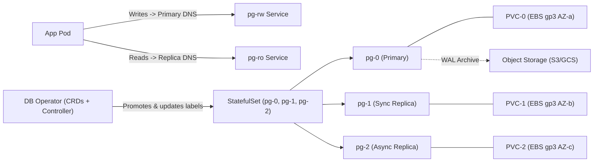
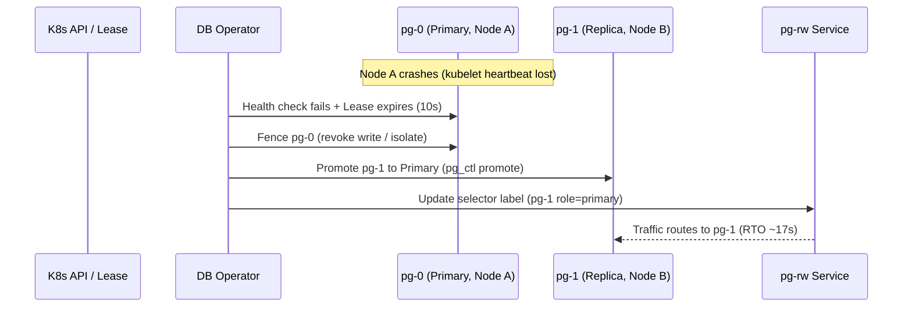
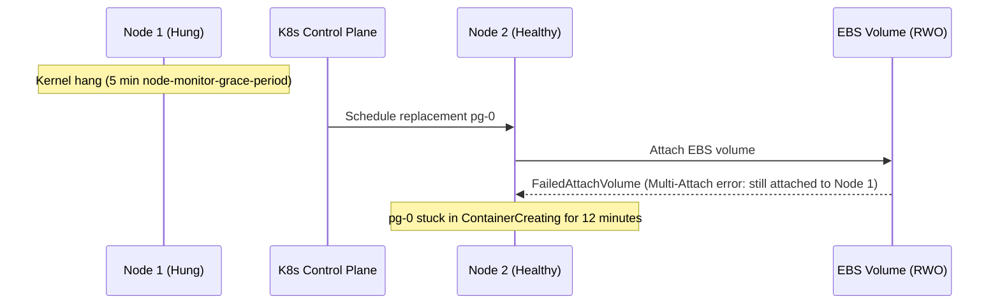

# Databases on Kubernetes? StatefulSets, Volumes & Operators

> **Prerequisites:** [Lesson 08: Kubernetes Autoscaling](../08-kubernetes-autoscaling/README.md).  
> **Estimated Reading Time:** 24–28 minutes  
> **Target Audience:** Backend and platform engineers deciding between managed DBs (RDS/Cloud SQL) and self-hosted Kubernetes databases, and candidates asked "how do StatefulSets, PVCs, and Operators work together?"  
> **Free PDF Notes:** [Download SD-V-009.pdf](https://backendroadmap.com/notes/system-design/SD-V-009.pdf)

> [!NOTE]
> **In one line:** Running stateful databases on Kubernetes requires **StatefulSets** (stable ordinal identities `db-0`, `db-1` and ordered scaling), **PersistentVolumeClaims (PVCs) + CSI storage** (decoupling disk lifecycle from ephemeral pods), and **Operators** (encoding Day-2 database operations—failover, WAL backups, minor upgrades—into a custom controller).

> [!TIP]
> **The Golden Rule:** Use a **managed database** (RDS, Cloud SQL, Aurora) by default unless you have strict multi-cloud portability, data-sovereignty, or massive fleet-consolidation requirements—and if you *do* run databases on Kubernetes, **never** run them with raw Deployments or without a battle-tested Operator (e.g., CloudNativePG, Strimzi).

---

## 1. What Databases on Kubernetes Is, and What It Isn't

A team deploys Postgres using a standard Kubernetes `Deployment` with an `emptyDir` volume. Two weeks later, a node drains for an OS patch: Kubernetes kills `postgres-7f9b` and spins up `postgres-2a1c` on a different node with a brand-new empty disk. All customer data is gone. Even if they used a `PersistentVolumeClaim`, a `Deployment` shares *one* PVC across replicas—causing two Postgres processes to mount the same volume or deadlock on `Multi-Attach` errors.

| Term | Precise Meaning | Example |
| :--- | :--- | :--- |
| **StatefulSet** | Workload controller giving pods sticky ordinal names (`db-0`, `db-1`), stable DNS, and per-pod PVCs | `pg-0`, `pg-1`, `pg-2` |
| **Headless Service** | `clusterIP: None` Service returning individual pod A/SRV records instead of a virtual VIP | `pg-0.pg-headless.prod.svc` |
| **PVC / PV / StorageClass** | Claim (request), Volume (actual disk), and Provisioner template (`gp3`, `pd-ssd`) | `volumeClaimTemplates` in StatefulSet |
| **CSI (Container Storage Interface)** | Plugin standard connecting Kubernetes to EBS, GCE PD, Ceph, or NVMe | `ebs.csi.aws.com` |
| **Kubernetes Operator** | CRD + custom reconciliation controller automating Day-2 DBA tasks | CloudNativePG, Vitess, Strimzi |
| **Day-2 Operations** | Automated failover, PITR backups, TLS rotation, major/minor version upgrades | Promoting `pg-1` when `pg-0` dies |
| **Not** | A replacement for DBA expertise or distributed consensus | StatefulSets don't configure replication |

### Why It Matters
1. "Should we run databases on Kubernetes?" is a classic Staff/Senior system design trade-off question.
2. Understanding **why** Deployments corrupt stateful workloads (shared PVC, random names, parallel termination) tests core Kubernetes depth.
3. Operators bridge the gap between generic pod scheduling and database-specific semantics (primary election, fencing, WAL archiving).

---

## 2. Anatomy: StatefulSet + Headless Service + Operator



A `StatefulSet` guarantees three invariants that a `Deployment` does not:
1. **Stable Network Identity:** Pods are named `<name>-0`, `<name>-1`, `<name>-2` and addressed via `<pod>.<headless-svc>.<ns>.svc.cluster.local`.
2. **Stable Per-Pod Storage:** `volumeClaimTemplates` creates a dedicated PVC (`data-pg-0`, `data-pg-1`) that **survives pod deletion and rescheduling**.
3. **Ordered Operations:** Pods start sequentially (`0 -> 1 -> 2`) and terminate in reverse (`2 -> 1 -> 0`).

| Dimension | Managed DB (RDS / Cloud SQL) | Self-Hosted on K8s (Operator) | Raw StatefulSet (No Operator) |
| :--- | :--- | :--- | :--- |
| **Setup & Day-2 Ops** | Cloud provider handles patching, backups, HA | Team owns Operator, CSI, and upgrades | Manual scripts for failover & backups |
| **Portability** | Locked to cloud vendor | Runs on AWS, GCP, bare-metal | Portable but fragile |
| **Cost at Scale** | Higher ($20$–$40\%$ managed markup) | Lower compute/storage cost at large fleets | Lower compute, high human ops cost |
| **Failure Blast Radius** | Isolated from K8s control plane | Shares K8s cluster, CNI, and CSI risks | High risk of split-brain / data loss |

> [!WARNING]
> **The AZ-Pinned Volume Trap:** Cloud block volumes (AWS EBS, GCP PD) are **single-Availability-Zone** resources. If `pg-0`'s PVC is in `us-east-1a` and `us-east-1a` has no compute capacity (or suffers an outage), `pg-0` stays `Pending` forever—it **cannot** mount `us-east-1a`'s EBS disk from a node in `us-east-1b`. Always spread StatefulSet replicas across AZs and rely on database-level replication (`pg-1` in `us-east-1b`).

---

## 3. Mathematical Model: Storage IOPS, Network Hop & RTO

**Stateful Failover RTO.** When the primary pod `pg-0` dies on a node, total Recovery Time Objective is:

$$\text{RTO}_{\text{total}} = T_{\text{detect}} + T_{\text{fence}} + T_{\text{promote}} + T_{\text{dns\_or\_label}}$$

- With **Operator-managed DB replication**: $T_{\text{detect}} \approx 10\text{ s}$ + $T_{\text{promote}} \approx 5\text{ s}$ + Service endpoint update $\approx 2\text{ s} \implies \text{RTO} \approx 17\text{ s}$.
- With **single-instance pod reschedule (EBS detach/attach)**: $T_{\text{node\_timeout}} (40\text{ s}) + T_{\text{volume\_force\_detach}} (30\text{–}120\text{ s}) + T_{\text{mount}} (10\text{ s}) + T_{\text{crash\_recovery}} (20\text{ s}) \implies \text{RTO} \approx 100\text{–}190\text{ s}$.

**Storage Throughput & Latency.** Network-attached CSI storage adds a network hop over local NVMe:

$$T_{\text{write}} = T_{\text{WAL\_net}} + T_{\text{EBS\_io}} + T_{\text{sync\_replica\_rtt}}$$

### Worked Example
A 3-node Postgres cluster runs on EKS across 3 AZs (`1a`, `1b`, `1c`) using EBS `gp3` (`3,000 IOPS`, `125 MB/s` baseline) with 1 synchronous replica (`synchronous_commit = on`).
- Local EBS `fsync`: `0.8 ms`.
- Cross-AZ RTT to sync replica `pg-1`: `1.2 ms`.
- Total commit latency: $0.8 + 1.2 = 2.0\text{ ms}$ ($\implies$ max ~500 serial commits/sec per connection).
- If `pg-0` is terminated and the Operator promotes `pg-1` in `1b` by updating the `role: primary` pod label, `pg-rw` Service endpoints flip in ~17 s—without waiting for EBS volume detach/attach!

---

## 4. Metrics & Percentiles

| Metric | Meaning | Alert when |
| :--- | :--- | :--- |
| `kubelet_volume_stats_available_bytes / capacity_bytes` | Remaining PVC disk space | $< 15\%$ free (disk full corrupts/halts DB) |
| `cnpg_pg_replication_lag_seconds` (or WAL lag bytes) | Replica lag behind primary | $> 5\text{ s}$ or $> 100\text{ MB}$ |
| `kube_persistentvolumeclaim_status_phase{phase!="Bound"}` | PVC stuck provisioning or attaching | $> 1\text{ min}$ |
| `storage_operation_duration_seconds` (CSI attach/mount) | EBS/PD attach latency | $p_{99} > 30\text{ s}$ |
| `cnpg_collector_last_failed_backup_timestamp` | WAL/basebackup failure | Any failed backup $> 15\text{ min}$ |

### Worked Example (Silent PVC Full Outage)
A StatefulSet has a 100 GiB PVC with `allowVolumeExpansion: true`, but nobody configured automated PVC resizing or alerting. Postgres WAL logs fill the last 2 GiB during a bulk migration. Postgres immediately panics and enters `CrashLoopBackOff`, and because the disk is 100% full, even `psql` or WAL cleanup cannot run until an engineer manually expands the PVC and restarts the pod.

---

## 5. Compounding & Failure Modes

| Failure Mode | What Happens | Result |
| :--- | :--- | :--- |
| **`Multi-Attach` deadlock** | Node crashes; new pod starts on another node before old node detaches EBS (`ReadWriteOnce`) | New pod stuck in `ContainerCreating` for 6+ minutes |
| **PVC `ReclaimPolicy: Delete`** | Engineer runs `helm uninstall` or deletes StatefulSet + PVCs | Cloud provider **permanently deletes** underlying EBS volumes |
| **No PodAntiAffinity** | All 3 replicas (`pg-0`, `pg-1`, `pg-2`) schedule onto the same node/AZ | Single node or AZ failure wipes out entire quorum |
| **Split-Brain on network partition** | Operator loses contact with `pg-0` and promotes `pg-1` while `pg-0` still accepts writes | Divergent transactions; manual data reconciliation required |

---

## 6. Numbers Every Engineer Must Know

| Item | Typical | Implication |
| :--- | :---: | :--- |
| Cloud `ReadWriteOnce` detach + reattach | `30–180 s` | Never rely on single-pod reschedule for HA; use DB replication |
| `gp3` baseline IOPS / throughput | `3,000 IOPS`, `125 MB/s` | Provision extra IOPS (`up to 16,000`) for write-heavy DBs |
| Cross-AZ RTT (same region) | `0.5–1.5 ms` | Sync replication adds ~1 ms per commit |
| `StatefulSet` `podManagementPolicy` | `OrderedReady` (default) | `Parallel` speeds up large clusters but breaks ordered init |
| `fsGroup` recursive `chown` on large PVCs | `minutes` on millions of files | Set `fsGroupChangePolicy: OnRootMismatch` to avoid slow boots |

---

## 7. Protocol Deep Dive: Operator Failover vs Raw StatefulSet



| Question | Answer |
| :--- | :--- |
| **Does a StatefulSet automatically delete PVCs when scaled down?** | **No** (by design, to prevent accidental data loss). `persistentVolumeClaimRetentionPolicy` (K8s 1.27+) lets you opt in if desired. |
| **Why do we need an Operator if StatefulSets already exist?** | A StatefulSet knows nothing about SQL, WAL replication, primary election, fencing, or PITR backups—it only starts containers with sticky names and disks. |
| **Local NVMe vs Network CSI (`ebs-sc`)?** | Local NVMe gives sub-100 $\mu$s latency and 100k+ IOPS, but data is **lost if the node dies**, requiring DB-level replication + automated rebuilds. |
| **What does `fsGroupChangePolicy: OnRootMismatch` do?** | Skips recursive `chown` across millions of database files on every pod restart, cutting startup from minutes to milliseconds. |

**When not to run databases on Kubernetes:** Early-stage teams without dedicated SRE/DBA capacity, low-to-medium scale workloads where RDS/Cloud SQL costs less than one engineer's on-call burden, or legacy databases without a mature Kubernetes Operator.

---

## 8. Hierarchical Budgets & Design Rules

| Slice | Rule | Control |
| :--- | :--- | :--- |
| **Storage Safety** | `reclaimPolicy: Retain` on production `StorageClass` | Prevents accidental `kubectl delete pvc` data wipe |
| **Volume Expansion** | `allowVolumeExpansion: true` + alert at 80% disk | Enables online resize without downtime |
| **Placement** | `topologySpreadConstraints` + `podAntiAffinity` across AZs | Guarantees quorum survives AZ loss |
| **QoS** | `Guaranteed` (`requests == limits`) + `PriorityClass` | Prevents OOMKills and evictions |
| **Boot Speed** | `fsGroupChangePolicy: OnRootMismatch` | Prevents slow `chown` on restart |
| **Backups** | Continuous WAL archiving + automated PITR restore tests | Verified RPO $< 5\text{ min}$ |

---

## 9. Top Mitigations

1. **Use a mature Operator** (CloudNativePG for Postgres, Strimzi for Kafka, Percona/Vitess for MySQL) rather than hand-rolled StatefulSets.
2. **Set `reclaimPolicy: Retain`** on production database `StorageClass` so deleting a PVC never destroys the underlying cloud disk.
3. **Enforce `podAntiAffinity` across AZs** so primary and replicas never share a node or Availability Zone.
4. **Configure `PDB` (`minAvailable: 2` on 3-node quorum)** so cluster upgrades drain one database pod at a time.
5. **Run automated backup-restore drills** weekly into an ephemeral namespace—an untested backup is not a backup.
6. **Monitor disk usage at 75% / 85%** and enable `allowVolumeExpansion: true`.

---

## 10. Production Reference: The `Multi-Attach` Deadlock Outage

A team ran a single-instance PostgreSQL StatefulSet (`replicas: 1`) on EKS with an EBS `gp3` volume (`ReadWriteOnce`). An underlying EC2 instance suffered a hardware hang and stopped responding.



- **Root Cause:** Kubernetes waited 5 minutes (`pod-eviction-timeout`) before marking `pg-0` terminating, and because Node 1 was hung, `kubelet` couldn't cleanly unmount/detach the EBS volume, causing `Multi-Attach` errors on Node 2.
- **Fix:** Migrated to a 3-replica CloudNativePG cluster spread across 3 AZs with synchronous replication (`RTO ~17 s`), so failover switches to a live replica (`pg-1`) instead of waiting on EBS detach/attach.

---

## 11. Multi-Language Production Code Tabs

A Kubernetes database readiness & primary-election health probe / connection router helper across 4 languages.

````carousel
```go
// Go: StatefulSet ordinal parser and primary/replica endpoint builder.
package main

import (
	"fmt"
	"strconv"
	"strings"
)

func ParseStatefulSetOrdinal(podName string) (int, error) {
	idx := strings.LastIndex(podName, "-")
	if idx == -1 || idx == len(podName)-1 {
		return -1, fmt.Errorf("invalid StatefulSet pod name: %s", podName)
	}
	return strconv.Atoi(podName[idx+1:])
}

func PodFQDN(podName, headlessSvc, namespace string) string {
	return fmt.Sprintf("%s.%s.%s.svc.cluster.local", podName, headlessSvc, namespace)
}

func main() {
	ord, _ := ParseStatefulSetOrdinal("pg-cluster-1")
	fmt.Printf("Ordinal=%d, FQDN=%s\n", ord, PodFQDN("pg-cluster-1", "pg-headless", "prod"))
}
```
<!-- slide -->
```typescript
// TypeScript: StatefulSet DNS builder and quorum calculation.
export function podDns(podName: string, headlessService: string, namespace: string): string {
  return `${podName}.${headlessService}.${namespace}.svc.cluster.local`;
}

export function quorumSize(replicas: number): number {
  return Math.floor(replicas / 2) + 1;
}

export function canTolerateNodeLoss(replicas: number, failedNodes: number): boolean {
  return replicas - failedNodes >= quorumSize(replicas);
}
```
<!-- slide -->
```python
# Python: StatefulSet quorum, RTO, and StorageClass safety checker (stdlib only).
def quorum_size(replicas: int) -> int:
    return (replicas // 2) + 1

def estimate_rto_seconds(mode: str) -> int:
    if mode == "operator_replicated":
        # detect (10s) + promote (5s) + service endpoint update (2s)
        return 10 + 5 + 2
    # single-instance RWO: node_timeout (40s) + force_detach (90s) + mount (10s) + recovery (20s)
    return 40 + 90 + 10 + 20

def validate_storage_class(reclaim_policy: str, allow_expansion: bool) -> list[str]:
    issues = []
    if reclaim_policy != "Retain":
        issues.append("Use reclaimPolicy: Retain for production DBs to prevent accidental data loss.")
    if not allow_expansion:
        issues.append("Enable allowVolumeExpansion: true for online disk resizes.")
    return issues

if __name__ == "__main__":
    print("Quorum(3):", quorum_size(3))
    print("RTO replicated vs RWO:", estimate_rto_seconds("operator_replicated"), estimate_rto_seconds("rwo"))
```
<!-- slide -->
```csharp
// C#: StatefulSet ordinal & quorum helper.
using System;

public static class StatefulSetHelper
{
    public static string GetPodFqdn(string serviceName, int ordinal, string headlessSvc, string ns) =>
        $"{serviceName}-{ordinal}.{headlessSvc}.{ns}.svc.cluster.local";

    public static int Quorum(int replicas) => (replicas / 2) + 1;
}
```
````

---

## 12. Hands-On CLI Verification Workflows

```bash
# 1. Inspect StatefulSet pods, ordinals, and bound PVCs
kubectl get statefulset,pods,pvc -n prod -l app=postgres

# 2. Verify StorageClass reclaimPolicy and volume expansion support
kubectl get storageclass -o custom-columns=NAME:.metadata.name,PROVISIONER:.provisioner,RECLAIM:.reclaimPolicy,EXPAND:.allowVolumeExpansion

# 3. Check headless Service DNS resolution from inside the cluster
kubectl run dns-test --rm -it --image=busybox:1.36 -- nslookup pg-0.pg-headless.prod.svc.cluster.local

# 4. Inspect volume attach/mount events for Multi-Attach errors
kubectl get events -n prod --field-selector reason=FailedAttachVolume

# 5. Check CloudNativePG cluster status (if using CNPG Operator)
kubectl cnpg status pg-cluster -n prod
```

---

## 13. Common Mistakes to Avoid

1. **Using a `Deployment` for a database**, causing shared-PVC `Multi-Attach` errors or data loss.
2. **Leaving `reclaimPolicy: Delete`** on production DB StorageClasses—one `kubectl delete pvc` wipes the disk.
3. **Omitting `podAntiAffinity` across AZs**, letting all 3 database replicas land on the same node.
4. **Relying on single-pod `ReadWriteOnce` failover** instead of database-level replication.
5. **Forgetting `fsGroupChangePolicy: OnRootMismatch`**, causing 5-minute restarts on large volumes.
6. **Not testing PITR backup restores** until an actual SEV-1 incident.
7. **Running a database on Kubernetes without an Operator** and expecting Kubernetes to handle failover.

---

## 14. Key Terms Glossary

| Key Term | Definition |
| :--- | :--- |
| **StatefulSet** | Controller providing sticky pod ordinals, stable DNS, and per-pod PVCs. |
| **Headless Service** | Service with `clusterIP: None` returning direct pod IPs/DNS records. |
| **PVC (PersistentVolumeClaim)** | User request for durable storage bound to a `PersistentVolume`. |
| **CSI** | Container Storage Interface; plugin layer for cloud/local block and file storage. |
| **ReadWriteOnce (RWO)** | Volume mountable by only one node at a time (e.g., AWS EBS). |
| **ReclaimPolicy (`Retain`)** | Keeps underlying cloud disk intact even after a PVC is deleted. |
| **Operator** | Custom controller + CRDs automating Day-2 stateful application operations. |
| **Fencing** | Isolating a failed primary so it cannot accept stale writes (prevents split-brain). |
| **PITR** | Point-in-Time Recovery using base backups plus continuous WAL logs. |
| **Multi-Attach Error** | Failure attaching an RWO disk to a new node while still attached to a hung node. |

---

## 15. System Design Interview Questions & Answers

### Basic Conceptual Questions

<details>
<summary><strong>Q1: Why can't you run a replicated database using a Kubernetes Deployment? [BASIC]</strong></summary>

**Answer:**
A `Deployment` treats pods as interchangeable cattle with random names, terminates them in parallel, and shares a single PVC template across replicas (which fails `ReadWriteOnce` or corrupts data). A `StatefulSet` gives each pod a sticky ordinal (`db-0`, `db-1`), a dedicated PVC, and ordered startup/shutdown.
</details>

<details>
<summary><strong>Q2: What is a Headless Service and why do StatefulSets need one? [BASIC]</strong></summary>

**Answer:**
A Headless Service sets `clusterIP: None`. Instead of load-balancing behind a single virtual IP, DNS returns the individual A/SRV records for each pod (`db-0.db-headless.ns.svc`), allowing database nodes to discover and replicate to specific peers.
</details>

<details>
<summary><strong>Q3: What is a Kubernetes Operator? [BASIC]</strong></summary>

**Answer:**
An Operator combines Custom Resource Definitions (CRDs) with a custom reconciliation controller that encodes human DBA/SRE knowledge—automating primary failover, backup/PITR, TLS rotation, and rolling minor/major version upgrades.
</details>

<details>
<summary><strong>Q4: What happens to a PVC when a StatefulSet pod is deleted or scaled down? [BASIC]</strong></summary>

**Answer:**
The PVC is **preserved** and reattaches to the replacement pod (`db-0`) when it starts, ensuring data survives pod restarts and node drains.
</details>

### Scenario-Based Architecture Questions

<details>
<summary><strong>Q5: Should our startup run PostgreSQL on Kubernetes or use Amazon RDS / Cloud SQL? [SCENARIO]</strong></summary>

**Answer:**
Use **RDS / Cloud SQL** by default. Managed databases offload automated patching, cross-AZ failover, PITR backups, and on-call risk for a modest cost premium. Only choose self-hosted Kubernetes DBs (with an Operator like CloudNativePG) if you need multi-cloud portability, strict data sovereignty, or have a dedicated platform team managing hundreds of DB instances.
</details>

<details>
<summary><strong>Q6: A node running your single-replica Postgres pod dies, and the new pod is stuck in `ContainerCreating` for 10 minutes. Why? [SCENARIO]</strong></summary>

**Answer:**
`Multi-Attach` deadlock on a `ReadWriteOnce` cloud disk (like EBS). Because the old node hung without cleanly detaching the volume, the new node cannot attach it until Kubernetes times out and force-detaches. Fix: run a replicated cluster with an Operator so failover promotes a live replica in ~17 s.
</details>

<details>
<summary><strong>Q7: How do you ensure a 3-node database on Kubernetes survives an Availability Zone outage? [SCENARIO]</strong></summary>

**Answer:**
Enforce `topologySpreadConstraints` (or `podAntiAffinity`) on `topology.kubernetes.io/zone` so `db-0`, `db-1`, and `db-2` each land in a different AZ with their own AZ-local PVCs, and configure synchronous/quorum replication across them.
</details>

<details>
<summary><strong>Q8: Your database pod takes 6 minutes to restart after a minor patch because of volume permissions. How do you fix it? [SCENARIO]</strong></summary>

**Answer:**
Set `securityContext.fsGroupChangePolicy: "OnRootMismatch"` in the Pod spec so `kubelet` only updates file ownership if the root directory's permissions don't match, avoiding a recursive `chown` over millions of database files.
</details>

### Advanced & Tricky Interview Questions

<details>
<summary><strong>Q9: How do Kubernetes Operators prevent split-brain during a network partition? [TRICKY]</strong></summary>

**Answer:**
Through **distributed consensus / fencing**: the Operator uses Kubernetes `Lease` objects (backed by etcd/Raft) or quorum consensus (Patroni/etcd/Raft) plus fencing (revoking old primary credentials, terminating the old pod, or waiting out lease TTL) before promoting a new primary.
</details>

<details>
<summary><strong>Q10: Why are local NVMe PVs faster than EBS, and what is the hidden operational cost? [TRICKY]</strong></summary>

**Answer:**
Local NVMe bypasses network storage hops (~100 $\mu$s vs ~1 ms, 100k+ IOPS), but local disks are **ephemeral to the host**—if the node fails, the disk is gone. You must rely 100% on database replication and automated full-rebuild workflows when replacing a dead node.
</details>

<details>
<summary><strong>Q11: Why should `reclaimPolicy` be `Retain` instead of `Delete` on production DB StorageClasses? [TRICKY]</strong></summary>

**Answer:**
With `Delete`, accidentally deleting a PVC (or running `helm uninstall`) triggers the CSI driver to immediately delete the cloud EBS/PD disk, causing irreversible data loss. `Retain` keeps the underlying cloud volume intact so an operator can recover it.
</details>

<details>
<summary><strong>Q12: How does an Operator handle zero-downtime primary switchover during a Kubernetes node upgrade? [TRICKY]</strong></summary>

**Answer:**
Paired with a PDB (`minAvailable: 2`), `kubectl drain` triggers the Operator to perform a **graceful switchover**: it flushes WAL to the synchronous replica, promotes the replica to primary, flips the `role: primary` label on the `-rw` Service, and then allows the old primary pod to terminate.
</details>

---

## 16. One-Page Master Cheat Sheet

```
+---------------------------------------------------------------------------------------------------------+
|                  DATABASES ON KUBERNETES — MASTER CHEAT SHEET                                           |
+---------------------------------------------------------------------------------------------------------+
| 1. DEFAULT CHOICE: Managed DB (RDS/Cloud SQL) unless multi-cloud, sovereignty, or massive fleet scale.  |
+---------------------------------------------------------------------------------------------------------+
| 2. STATEFULSET: Gives sticky ordinals (db-0, db-1), Headless DNS, per-pod PVCs, and ordered scaling.    |
+---------------------------------------------------------------------------------------------------------+
| 3. OPERATORS: StatefulSets don't know SQL. Use Operators (CNPG, Strimzi) for failover, WAL, upgrades.   |
+---------------------------------------------------------------------------------------------------------+
| 4. STORAGE TRAPS: EBS/PD are single-AZ & RWO (Multi-Attach deadlock). Use replication, not single-pod.  |
+---------------------------------------------------------------------------------------------------------+
| 5. SAFETY CHECKLIST: reclaimPolicy: Retain · allowVolumeExpansion: true · OnRootMismatch · AZ Spread.   |
+---------------------------------------------------------------------------------------------------------+
| 6. BACKUPS: Continuous WAL archiving to S3/GCS + automated weekly PITR restore drills.                  |
+---------------------------------------------------------------------------------------------------------+
```

---

## Further Reading & Sources

- Kubernetes Documentation, [StatefulSets](https://kubernetes.io/docs/concepts/workloads/controllers/statefulset/).
- Kubernetes Documentation, [Persistent Volumes & CSI](https://kubernetes.io/docs/concepts/storage/persistent-volumes/).
- CloudNativePG Documentation, [Architecture & Failover](https://cloudnative-pg.io/documentation/current/architecture/).
- Google SRE Book / CNCF Data on Kubernetes Working Group, *State of Data on Kubernetes*.

---

## Free PDF Notes

[SD-V-009.pdf](https://backendroadmap.com/notes/system-design/SD-V-009.pdf)

---

## Next

Continue with [Lesson 10: Kubernetes Networking: CNI, Services, Ingress & NetworkPolicies](../10-kubernetes-networking/README.md).
