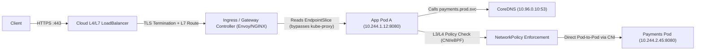
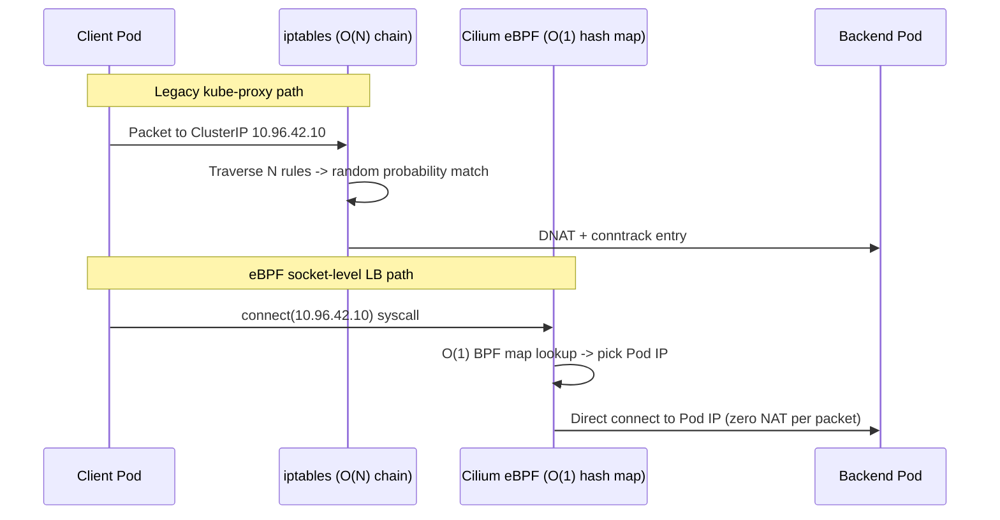
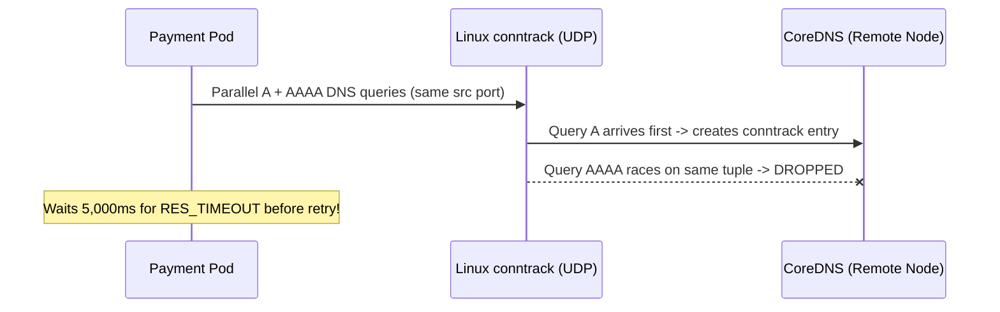

# Kubernetes Networking: CNI, Services, Ingress & NetworkPolicies

> **Prerequisites:** [Lesson 09: Databases on Kubernetes? StatefulSets, Volumes & Operators](../09-databases-on-kubernetes-statefulsets-volumes-operators/README.md).  
> **Estimated Reading Time:** 24–28 minutes  
> **Target Audience:** Backend and platform engineers debugging pod-to-pod latency, DNS timeouts, or zero-trust isolation, and candidates asked "what happens when a packet enters an Ingress and reaches a Pod?"  
> **Free PDF Notes:** [Download SD-V-010.pdf](https://backendroadmap.com/notes/system-design/SD-V-010.pdf)

> [!NOTE]
> **In one line:** **CNI** plugins give every pod a unique routable IP across nodes, **Services** (`ClusterIP`, `NodePort`, `LoadBalancer`) provide stable virtual IPs over ephemeral pod IPs via `kube-proxy`/eBPF, **Ingress / Gateway API** routes L7 HTTP/gRPC traffic into the cluster, and **NetworkPolicies** act as default-allow-until-applied L3/L4 firewalls.

> [!TIP]
> **The Golden Rule:** Use **eBPF-based CNI** (Cilium or AWS VPC CNI) instead of legacy `iptables` `kube-proxy` once your cluster grows past ~1,000 Services, and apply a **default-deny `NetworkPolicy`** in every production namespace so compromised pods cannot pivot laterally.

---

## 1. What Kubernetes Networking Is, and What It Isn't

A team deploys a microservice that calls `http://payments.prod.svc.cluster.local:8080`. Intermittent `503`s and 5-second DNS timeouts start appearing under load. Meanwhile, a compromised marketing-site pod in namespace `web` can `curl` the internal admin API in namespace `finance` because Kubernetes allows **all pod-to-pod traffic by default**.

| Term | Precise Meaning | Example |
| :--- | :--- | :--- |
| **Kubernetes Network Model** | Flat IP space: every pod gets its own IP and can reach any pod without NAT | `10.244.1.12` $\to$ `10.244.2.45` |
| **CNI (Container Network Interface)** | Plugin allocating pod IPs and wiring virtual Ethernet (`veth`) or eBPF datapaths | Cilium, Calico, AWS VPC CNI, Flannel |
| **Service (`ClusterIP`)** | Stable virtual IP (VIP) load-balancing across matching pod endpoints | `10.96.42.10` $\to$ 3 backend pods |
| **EndpointSlice** | Scalable list of healthy pod IPs backing a Service (replaced legacy `Endpoints`) | Max 100 endpoints per slice |
| **kube-proxy** | Node daemon programming `iptables`, `IPVS`, or replaced by **eBPF** to route VIPs | DNAT `ClusterIP` $\to$ `PodIP` |
| **Ingress / Gateway API** | L7 HTTP/HTTPS router (TLS termination, host/path routing) backed by a controller | NGINX, Envoy Gateway, AWS ALB |
| **NetworkPolicy** | L3/L4 firewall rules selecting pods by labels; default-allow until a policy selects a pod | Deny all ingress except `api` pods |
| **Not** | Traditional Docker port-mapping (`-p 8080:80`) | Pods don't share host ports by default |

### Why It Matters
1. "Trace a packet from the internet to a pod" is one of the most common cloud/platform interview questions.
2. `iptables` `kube-proxy` degrades linearly ($O(N)$) with Service count, while `conntrack` table exhaustion causes silent packet drops.
3. Without `NetworkPolicy`, a single SSRF or RCE vulnerability in one pod exposes every service in the cluster.

---

## 2. Anatomy: Packet Flow from Internet to Pod



| Service Type | Scope | How It Works | Typical Use |
| :--- | :--- | :--- | :--- |
| **ClusterIP** | Internal only | Stable cluster VIP (`10.96.x.x`) routed via `kube-proxy`/eBPF | Pod-to-pod internal RPC |
| **NodePort** | External (node IPs) | Opens a static port (`30000–32767`) on every node | Bare-metal or behind custom LB |
| **LoadBalancer** | External (cloud) | Provisions cloud NLB/ALB pointing to NodePorts or pod IPs directly | Exposing Ingress controller or TCP service |
| **Headless (`None`)** | Internal DNS | No VIP; DNS returns all pod IPs directly | StatefulSets, gRPC client-side LB |

> [!WARNING]
> **The `conntrack` & DNS `ndots:5` Trap:** By default, Kubernetes sets `ndots:5` in every pod's `/etc/resolv.conf`. Looking up `api.stripe.com` (only 2 dots, $< 5$) triggers **4 sequential search-path lookups** (`api.stripe.com.prod.svc.cluster.local`, `.svc.cluster.local`, `.cluster.local`, `.ec2.internal`)—both IPv4 (`A`) and IPv6 (`AAAA`)—generating **8–10 DNS packets per external call** and hammering CoreDNS and `conntrack`!

---

## 3. Mathematical Model: `iptables` Complexity, `ndots:5` Amplification & `conntrack`

**Routing Lookup Complexity.**
- Legacy `iptables` `kube-proxy` evaluates rules sequentially: $O(N)$ where $N$ is the number of Services/Endpoints.
- `IPVS` or **eBPF (Cilium)** uses hash maps: $O(1)$ lookup regardless of cluster size.

**DNS Amplification (`ndots:5`).** For $R$ external requests/s with uncached DNS and $S$ search domains (typically 4), dual-stack (`A` + `AAAA`) generates:

$$\lambda_{\text{DNS}} = 2 \cdot (S + 1) \cdot R = 10 \cdot R$$

**`conntrack` Table Sizing.** Every active TCP/UDP flow creates an entry (~300 bytes). With $C$ concurrent connections and `nf_conntrack_tcp_timeout_time_wait` $= 120\text{ s}$:

$$E_{\text{conntrack}} = C_{\text{active}} + (\lambda_{\text{new\_conn}} \times 120\text{ s})$$

### Worked Example
1. **DNS Amplification:** A service makes `2,000` external HTTPS calls/s to `api.stripe.com` without connection pooling or trailing dots:
   - With `ndots:5` and 4 search domains: $\lambda_{\text{DNS}} = 10 \times 2,000 = 20,000\text{ DNS queries/s}$ hitting CoreDNS!
   - Adding a trailing dot (`api.stripe.com.`) or setting `dnsConfig: options: [{name: ndots, value: "2"}]` drops this $5\times$ to `4,000 qps` (or `0` with keep-alive pooling).
2. **`conntrack` Exhaustion:** A node handles `3,000` short-lived connections/s with `TIME_WAIT = 120 s`. Entries needed $= 3,000 \times 120 = 360,000$. If kernel default `nf_conntrack_max` is `131,072`, the kernel **silently drops** `SYN` packets (`nf_conntrack: table full, dropping packet`), causing 1 s / 3 s TCP retransmit timeouts!

---

## 4. Metrics & Percentiles

| Metric | Meaning | Alert when |
| :--- | :--- | :--- |
| `coredns_dns_request_duration_seconds` ($p_{99}$) | CoreDNS lookup latency | $> 25\text{ ms}$ |
| `node_nf_conntrack_entries / node_nf_conntrack_entries_limit` | Kernel connection tracking utilization | $> 75\%$ |
| `coredns_dns_responses_total{rcode="SERVFAIL"}` | Failed DNS resolutions | $> 0.1\%$ of queries |
| `kubeproxy_sync_proxy_rules_duration_seconds` | Time to reprogram `iptables` on Service churn | $> 1\text{ s}$ (indicates `iptables` scale wall) |
| `cilium_drop_count_total` (or NetworkPolicy drops) | Packets dropped by CNI/NetworkPolicy | Unexpected spike after deploy |

### Worked Example (5-Second DNS Timeout)
On older Linux kernels, parallel `A` and `AAAA` queries sharing a single UDP socket in `glibc`/`musl` can race inside `conntrack`, dropping one packet and triggering a **5-second DNS timeout** (`RES_TIMEOUT`). Enabling **NodeLocal DNSCache** (running a DNS cache DaemonSet on every node via TCP/localhost) eliminates cross-node UDP `conntrack` races and drops DNS $p_{99}$ from `15 ms` to `< 1 ms`.

---

## 5. Compounding & Failure Modes

| Failure Mode | Mechanism | Impact |
| :--- | :--- | :--- |
| **`iptables` churn at 5,000 Services** | Every pod add/delete rewrites tens of thousands of `iptables` rules | `kube-proxy` sync takes 10+ s; stale endpoints cause 502s |
| **VPC IP exhaustion (AWS VPC CNI)** | Every pod consumes a real VPC subnet IP | Nodes hit max ENI/IPs; new pods stuck `ContainerCreating` |
| **Broken `NetworkPolicy` forgets DNS** | Default-deny egress blocks UDP/TCP port `53` to `kube-system` | Pods cannot resolve *any* Service name; app appears dead |
| **Double NAT on `externalTrafficPolicy: Cluster`** | LB hits Node A, `kube-proxy` SNATs & forwards to Pod on Node B | Client source IP is lost + extra network hop |

---

## 6. Numbers Every Engineer Must Know

| Item | Typical | Implication |
| :--- | :---: | :--- |
| `iptables` `kube-proxy` practical ceiling | `~1,000–2,000 Services` | Switch to `IPVS` or **eBPF (Cilium)** beyond this |
| `EndpointSlice` max endpoints per slice | `100` | Prevents 10 MB etcd/API watch payloads on huge Services |
| Default Pod `ndots` in `/etc/resolv.conf` | `5` | Amplifies external DNS queries $5\times$ unless tuned to `2` |
| Linux `RES_TIMEOUT` (DNS UDP retry) | `5 s` | Use NodeLocal DNSCache + `single-request-reopen` |
| Overlay CNI (VXLAN) vs Native VPC CNI overhead | `~5%–10%` CPU / MTU `-50B` | Native routing / eBPF avoids encapsulation overhead |
| Gateway API vs Ingress | Gateway API = role-oriented + L4/L7 | Successor to `networking.k8s.io/v1` Ingress |

---

## 7. Protocol Deep Dive: `kube-proxy` (iptables) vs eBPF Service Routing



| Question | Answer |
| :--- | :--- |
| **Why do Ingress controllers bypass `kube-proxy`?** | Ingress controllers (NGINX, Envoy) watch `EndpointSlice` directly and load-balance to pod IPs in userspace, enabling HTTP keep-alive, weighted canaries, and circuit breaking that L4 `kube-proxy` cannot do. |
| **What does `externalTrafficPolicy: Local` do?** | Routes external `LoadBalancer`/`NodePort` traffic only to pods on the *receiving* node, preserving client source IP and avoiding a second node hop—at the risk of uneven load if pods aren't spread evenly. |
| **Why is `Gateway API` replacing `Ingress`?** | `Ingress` only supports basic HTTP host/path rules and relies on vendor-specific annotations (`nginx.ingress.kubernetes.io/...`). `Gateway API` separates infra (`GatewayClass`, `Gateway`) from app routes (`HTTPRoute`, `GRPCRoute`) with native traffic splitting. |
| **Does `NetworkPolicy` encrypt pod-to-pod traffic?** | **No.** `NetworkPolicy` is only L3/L4 allow/deny firewalling. For mTLS encryption in transit, use a Service Mesh (Istio/Linkerd) or CNI WireGuard/IPsec (Cilium/Calico). |

**When not to use a Service Mesh (Istio/Linkerd):** If you only need L3/L4 isolation (`NetworkPolicy`) and basic L7 ingress routing, adding a sidecar-based Service Mesh introduces 1–3 ms per-hop proxy latency and significant memory overhead per pod.

---

## 8. Hierarchical Budgets & Design Rules

| Slice | Rule | Control |
| :--- | :--- | :--- |
| **Dataplane** | Use eBPF (`Cilium`) or `IPVS` for $> 1,000$ Services | Eliminates $O(N)$ `iptables` tail latency |
| **DNS** | Deploy `NodeLocal DNSCache` + set `ndots: 2` | Prevents `conntrack` races and 5 s DNS stalls |
| **Security** | Default-deny `NetworkPolicy` per namespace + explicit DNS egress | Blocks lateral movement while keeping CoreDNS working |
| **L7 Routing** | Prefer `Gateway API` (`HTTPRoute`) over annotation-heavy `Ingress` | Portable canary/header routing |
| **IPAM** | Size VPC CIDR / pod CIDR for $3\times$ peak pod growth | Prevents VPC IP exhaustion |
| **Kernel** | Monitor `nf_conntrack_entries` and tune `nf_conntrack_max` | Prevents silent `SYN` drops |

---

## 9. Top Mitigations

1. **Deploy NodeLocal DNSCache** so pods query a node-local TCP/cached resolver instead of cross-node UDP CoreDNS.
2. **Set `ndots: 2`** in `dnsConfig` for pods making heavy external API calls.
3. **Adopt eBPF CNI (Cilium)** to replace `iptables` `kube-proxy` with $O(1)$ socket-level load balancing.
4. **Apply a default-deny `NetworkPolicy`** in every namespace, always explicitly allowing egress to `kube-system` port `53` (TCP + UDP).
5. **Monitor `nf_conntrack_entries`** and increase `nf_conntrack_max` on high-churn nodes.
6. **Use `EndpointSlice`** (default in K8s 1.21+) and keep Services under ~1,000 backing pods per Service where possible.

---

## 10. Production Reference: The 5-Second DNS & `conntrack` Blackout

A high-throughput payment gateway migrated to EKS and began seeing random `5.02 s` latency spikes on 0.5% of outbound webhook calls, even though CPU, memory, and upstream banks were healthy.



- **Root Cause:** Dual-stack `A` and `AAAA` UDP DNS lookups raced in Linux `conntrack` over `veth` pairs, dropping one packet and triggering `glibc`'s 5-second `RES_TIMEOUT`, compounded by `ndots:5` multiplying DNS volume $8\times$.
- **Fix:** Deployed **NodeLocal DNSCache** (serving DNS over node-local TCP/link-local IP) and set `ndots: "2"` in pod `dnsConfig`. DNS $p_{99}$ dropped from `5,002 ms` to `0.8 ms` immediately.

---

## 11. Multi-Language Production Code Tabs

A DNS `ndots` query-amplification estimator and `conntrack` table sizing calculator across 4 languages.

````carousel
```go
// Go: Estimate DNS query amplification from ndots and check conntrack table headroom.
package main

import (
	"fmt"
	"strings"
)

func EstimateDNSQueriesPerCall(hostname string, ndots int, searchDomains int, dualStack bool) int {
	if strings.HasSuffix(hostname, ".") {
		if dualStack {
			return 2
		}
		return 1
	}
	dots := strings.Count(hostname, ".")
	lookups := 1
	if dots < ndots {
		lookups = searchDomains + 1
	}
	if dualStack {
		return lookups * 2
	}
	return lookups
}

func ConntrackRequired(activeConns, newConnsPerSec, timeWaitSec int) int {
	return activeConns + (newConnsPerSec * timeWaitSec)
}

func main() {
	fmt.Println("ndots=5 queries:", EstimateDNSQueriesPerCall("api.stripe.com", 5, 4, true)) // 10
	fmt.Println("ndots=2 queries:", EstimateDNSQueriesPerCall("api.stripe.com", 2, 4, true)) // 2
	fmt.Println("conntrack entries:", ConntrackRequired(10000, 3000, 120))                   // 370000
}
```
<!-- slide -->
```typescript
// TypeScript: DNS ndots amplification & conntrack capacity checker.
export function dnsQueriesPerCall(
  host: string,
  ndots = 5,
  searchDomains = 4,
  dualStack = true
): number {
  if (host.endsWith(".")) return dualStack ? 2 : 1;
  const dotCount = (host.match(/\./g) || []).length;
  const attempts = dotCount < ndots ? searchDomains + 1 : 1;
  return dualStack ? attempts * 2 : attempts;
}

export function conntrackUtilization(
  activeConns: number,
  newConnsPerSec: number,
  conntrackMax: number,
  timeWaitSec = 120
): number {
  const needed = activeConns + newConnsPerSec * timeWaitSec;
  return Number(((needed / conntrackMax) * 100).toFixed(1));
}
```
<!-- slide -->
```python
# Python: DNS ndots amplification & conntrack sizing simulator (stdlib only).
def dns_queries_per_call(host: str, ndots: int = 5, search_domains: int = 4, dual_stack: bool = True) -> int:
    if host.endswith("."):
        return 2 if dual_stack else 1
    dots = host.count(".")
    lookups = (search_domains + 1) if dots < ndots else 1
    return lookups * (2 if dual_stack else 1)

def conntrack_needed(active_conns: int, new_conns_per_s: int, time_wait_s: int = 120) -> int:
    return active_conns + (new_conns_per_s * time_wait_s)

if __name__ == "__main__":
    print("stripe.com ndots=5:", dns_queries_per_call("api.stripe.com", ndots=5))  # 10
    print("stripe.com ndots=2:", dns_queries_per_call("api.stripe.com", ndots=2))  # 2
    print("conntrack needed:", conntrack_needed(10_000, 3_000))                    # 370,000
```
<!-- slide -->
```csharp
// C#: DNS ndots amplification and conntrack capacity calculator.
using System;
using System.Linq;

public static class K8sNetworkingMath
{
    public static int EstimateDnsQueries(string host, int ndots = 5, int searchDomains = 4, bool dualStack = true)
    {
        if (host.EndsWith('.')) return dualStack ? 2 : 1;
        int dots = host.Count(c => c == '.');
        int lookups = dots < ndots ? searchDomains + 1 : 1;
        return dualStack ? lookups * 2 : lookups;
    }

    public static long ConntrackEntriesNeeded(long activeConns, long newConnsPerSec, int timeWaitSec = 120) =>
        activeConns + (newConnsPerSec * timeWaitSec);
}
```
````

---

## 12. Hands-On CLI Verification Workflows

```bash
# 1. Inspect Service, EndpointSlices, and backing pod IPs
kubectl get svc,endpointslices -n prod

# 2. Check CoreDNS pods and pod /etc/resolv.conf ndots setting
kubectl get pods -n kube-system -l k8s-app=kube-dns
kubectl exec -n prod <pod-name> -- cat /etc/resolv.conf

# 3. Inspect NetworkPolicies in a namespace
kubectl get networkpolicy -n prod -o yaml

# 4. Check Linux conntrack utilization on a node (via debug/SSM)
sysctl net.netfilter.nf_conntrack_count net.netfilter.nf_conntrack_max

# 5. Test DNS resolution and latency from inside a pod
kubectl run netshoot --rm -it --image=nicolaka/netshoot -- dig +stats payments.prod.svc.cluster.local
```

---

## 13. Common Mistakes to Avoid

1. **Assuming Kubernetes isolates namespaces by default**—pod-to-pod traffic is wide open without `NetworkPolicy`.
2. **Writing a default-deny egress `NetworkPolicy` and forgetting port 53**, breaking all DNS lookups.
3. **Ignoring `ndots: 5`**, generating $10\times$ unnecessary DNS load on external API calls.
4. **Running `iptables` `kube-proxy` past 2,000+ Services** without migrating to eBPF/IPVS.
5. **Under-sizing VPC pod CIDRs**, causing `FailedCreatePodSandBox: no available IPs`.
6. **Using `externalTrafficPolicy: Cluster` when you need real client IPs**, losing source IP to SNAT.
7. **Ignoring `nf_conntrack_max`**, leading to silent `SYN` packet drops under high connection churn.

---

## 14. Key Terms Glossary

| Key Term | Definition |
| :--- | :--- |
| **CNI** | Container Network Interface; plugin assigning pod IPs and routing packets across nodes. |
| **ClusterIP** | Internal virtual IP load-balancing across a Service's pods. |
| **EndpointSlice** | Scalable resource tracking healthy pod IPs for a Service (max 100/slice). |
| **kube-proxy** | Node component programming `iptables`/`IPVS` rules for Services. |
| **eBPF (Cilium)** | Kernel-level programmable datapath providing $O(1)$ Service routing and policy enforcement. |
| **Ingress / Gateway API** | L7 HTTP/gRPC routing resources backed by Envoy/NGINX/ALB controllers. |
| **NetworkPolicy** | L3/L4 firewall rules restricting pod ingress and egress by labels/CIDRs. |
| **CoreDNS** | Cluster DNS server resolving `<svc>.<ns>.svc.cluster.local`. |
| **`ndots: 5`** | Default `resolv.conf` threshold triggering search-path expansion on names with $< 5$ dots. |
| **`conntrack`** | Linux kernel connection-tracking table used for NAT and stateful firewalling. |

---

## 15. System Design Interview Questions & Answers

### Basic Conceptual Questions

<details>
<summary><strong>Q1: What are the fundamental rules of the Kubernetes Networking Model? [BASIC]</strong></summary>

**Answer:**
(1) Every pod gets its own unique IP address; (2) all pods can communicate with all other pods on any node without NAT; (3) agents on a node (like `kubelet`) can communicate with all pods on that node.
</details>

<details>
<summary><strong>Q2: Compare `ClusterIP`, `NodePort`, `LoadBalancer`, and `Headless` Services. [BASIC]</strong></summary>

**Answer:**
`ClusterIP` exposes an internal virtual IP; `NodePort` opens a static port (`30000–32767`) on every node; `LoadBalancer` provisions a cloud LB routing into the cluster; `Headless` (`clusterIP: None`) skips the VIP and returns direct pod IPs via DNS.
</details>

<details>
<summary><strong>Q3: What is a CNI plugin and why do we need it? [BASIC]</strong></summary>

**Answer:**
Kubernetes itself does not implement pod networking. The CNI (Container Network Interface) plugin—such as Cilium, Calico, or AWS VPC CNI—allocates pod IPs (IPAM) and configures virtual interfaces/routes so packets travel between pods across nodes.
</details>

<details>
<summary><strong>Q4: How do `NetworkPolicies` behave by default in Kubernetes? [BASIC]</strong></summary>

**Answer:**
**Default-allow.** Until at least one `NetworkPolicy` selects a pod, all ingress and egress traffic is permitted. Once a policy selects a pod, any traffic not explicitly allowed by a matching policy is denied.
</details>

### Scenario-Based Architecture Questions

<details>
<summary><strong>Q5: Trace what happens when an external HTTPS request hits your Ingress and reaches a backend pod. [SCENARIO]</strong></summary>

**Answer:**
Client resolves domain to the Cloud `LoadBalancer`, which forwards TCP/443 to the Ingress/Gateway controller pod (Envoy/NGINX). The Ingress controller terminates TLS, matches host/path rules (`HTTPRoute`/`Ingress`), looks up healthy pod IPs from `EndpointSlices`, and sends the request directly to a backend pod's IP over the CNI network (checked against any `NetworkPolicy`).
</details>

<details>
<summary><strong>Q6: Your app sees random 5-second timeouts when calling external APIs, while internal calls are fast. Why? [SCENARIO]</strong></summary>

**Answer:**
Classic `ndots:5` + UDP `conntrack` race. Every external hostname (`api.stripe.com`) triggers 8–10 `A`/`AAAA` DNS lookups across search domains; if a UDP packet is dropped in `conntrack`, `glibc` waits 5 seconds (`RES_TIMEOUT`). Fix: deploy **NodeLocal DNSCache** and set `ndots: 2`.
</details>

<details>
<summary><strong>Q7: You applied a default-deny egress `NetworkPolicy` and now your pods can't connect to anything by name. Why? [SCENARIO]</strong></summary>

**Answer:**
Default-deny egress also blocks UDP/TCP port `53` to CoreDNS in `kube-system`. Always add an explicit egress rule allowing port `53` (UDP & TCP) to `kube-system` pods labeled `k8s-app: kube-dns`.
</details>

<details>
<summary><strong>Q8: Your cluster scaled to 3,000 Services and `kube-proxy` CPU/latency spiked during deploys. What do you change? [SCENARIO]</strong></summary>

**Answer:**
`iptables` `kube-proxy` has $O(N)$ rule evaluation and full-table rewrites on every endpoint change. Migrate to **Cilium eBPF** (socket-level $O(1)$ hash map load balancing) or `IPVS` mode.
</details>

### Advanced & Tricky Interview Questions

<details>
<summary><strong>Q9: Why did Kubernetes replace `Endpoints` with `EndpointSlices`? [TRICKY]</strong></summary>

**Answer:**
A single `Endpoints` object stored *all* pod IPs for a Service. For a Service with 5,000 pods, every single pod restart forced the API server to push a multi-megabyte `Endpoints` update to every `kube-proxy` node in the cluster. `EndpointSlices` shard endpoints into chunks of 100, keeping updates tiny.
</details>

<details>
<summary><strong>Q10: What is the trade-off of `externalTrafficPolicy: Local` on a `LoadBalancer` Service? [TRICKY]</strong></summary>

**Answer:**
`Local` preserves the client's real source IP and avoids an extra cross-node hop, but if pods are unevenly distributed across nodes, nodes with 1 pod receive the same share of LB traffic as nodes with 5 pods (and nodes with 0 pods fail health checks).
</details>

<details>
<summary><strong>Q11: Why can AWS VPC CNI cause pods to stick in `Pending`/`ContainerCreating` even when nodes have plenty of CPU and RAM? [TRICKY]</strong></summary>

**Answer:**
AWS VPC CNI assigns each pod a real VPC secondary IP from the node's ENIs. Smaller EC2 instance types have strict limits on ENIs and IPs per ENI (e.g., `t3.medium` supports only 17 pod IPs), or the subnet itself runs out of free IPs—exhausting IPAM before CPU/RAM fills up.
</details>

<details>
<summary><strong>Q12: How does Cilium eBPF eliminate `conntrack` overhead for `ClusterIP` Services? [TRICKY]</strong></summary>

**Answer:**
Instead of rewriting packet headers with `iptables` DNAT on every packet, Cilium hooks the `connect()`/`sendmsg()` syscalls at socket creation and translates `ClusterIP` directly to the chosen `PodIP` in $O(1)$ via a BPF hash map—bypassing `kube-proxy` and `iptables` entirely.
</details>

---

## 16. One-Page Master Cheat Sheet

```
+---------------------------------------------------------------------------------------------------------+
|                  KUBERNETES NETWORKING — MASTER CHEAT SHEET                                             |
+---------------------------------------------------------------------------------------------------------+
| 1. MODEL: Every pod gets a unique IP; pod-to-pod works without NAT; default-allow until NetworkPolicy.  |
+---------------------------------------------------------------------------------------------------------+
| 2. SERVICES: ClusterIP (internal VIP), NodePort (30000-32767), LoadBalancer, Headless (DNS only).       |
+---------------------------------------------------------------------------------------------------------+
| 3. DATAPLANE: iptables = O(N) (wall ~2k Services); IPVS / Cilium eBPF = O(1) hash maps.                 |
+---------------------------------------------------------------------------------------------------------+
| 4. DNS & CONNTRACK: ndots:5 amplifies external DNS 5-10x. Use NodeLocal DNSCache + ndots:2.             |
+---------------------------------------------------------------------------------------------------------+
| 5. INGRESS -> GATEWAY API: L7 routing (TLS, paths, canary). Bypasses kube-proxy via EndpointSlices.     |
+---------------------------------------------------------------------------------------------------------+
| 6. ZERO TRUST: Apply default-deny NetworkPolicy per namespace + explicit allow to CoreDNS (port 53).    |
+---------------------------------------------------------------------------------------------------------+
```

---

## Further Reading & Sources

- Kubernetes Documentation, [Services, Load Balancing, and Networking](https://kubernetes.io/docs/concepts/services-networking/).
- Kubernetes Documentation, [Network Policies](https://kubernetes.io/docs/concepts/services-networking/network-policies/).
- Cilium Documentation, [eBPF Host-Routing & kube-proxy Replacement](https://docs.cilium.io/en/stable/network/kubernetes/kubeproxy-free/).
- Kubernetes Gateway API, [Concepts & HTTPRoute](https://gateway-api.sigs.k8s.io/).

---

## Free PDF Notes

[SD-V-010.pdf](https://backendroadmap.com/notes/system-design/SD-V-010.pdf)

---

## Next

Continue with [Lesson 11: Infrastructure as Code: Terraform State, Plan/Apply, Modules & Drift](../11-infrastructure-as-code/README.md).
