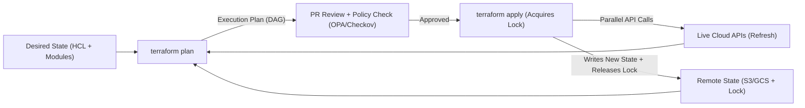
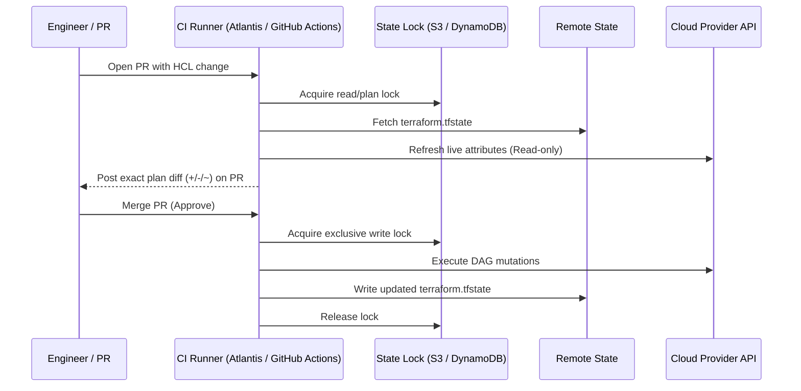
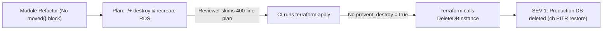

# Infrastructure as Code: Terraform State, Plan/Apply, Modules & Drift

> **Prerequisites:** [Lesson 10: Kubernetes Networking](../10-kubernetes-networking/README.md).  
> **Estimated Reading Time:** 24–28 minutes  
> **Target Audience:** Backend and platform engineers managing cloud infrastructure at scale, and candidates asked "how does Terraform state work and how do you prevent two engineers or drift from destroying production?"  
> **Free PDF Notes:** [Download SD-V-011.pdf](https://backendroadmap.com/notes/system-design/SD-V-011.pdf)

> [!NOTE]
> **In one line:** **Infrastructure as Code (IaC)** declares cloud resources in versioned code; **Terraform/OpenTofu** maps those declarations to real cloud APIs via a **State file** (`terraform.tfstate`), computes diffs during `plan`, mutates resources during `apply` under a **remote state lock**, and detects out-of-band console changes (**drift**).

> [!TIP]
> **The Golden Rule:** Store Terraform state in a **versioned, encrypted remote backend with locking** (e.g., S3 + DynamoDB / native S3 lockfile), split state into **small blast-radius stacks** (networking, database, app), and **never** edit live cloud resources in the AWS/GCP console without reconciling code immediately.

---

## 1. What Infrastructure as Code Is, and What It Isn't

An engineer creates an S3 bucket and an RDS security group rule manually in the AWS Console during an incident. Two weeks later, another engineer runs `terraform apply` from their laptop using a stale local `terraform.tfstate`—accidentally wiping out the security group rule and creating a duplicate VPC peering connection, while a third engineer runs `apply` at the exact same moment and corrupts the state file.

| Term | Precise Meaning | Example |
| :--- | :--- | :--- |
| **Declarative IaC** | Describe the desired *end state*; the engine computes the steps to get there | Terraform/OpenTofu HCL, CloudFormation |
| **Imperative IaC / Scripting** | Describe *exact commands* in sequence; breaks if re-run without idempotency checks | Bash + `aws cli` scripts |
| **State (`terraform.tfstate`)** | JSON mapping between HCL resource addresses and real cloud IDs + metadata | `aws_vpc.main` $\leftrightarrow$ `vpc-0a1b2c3d` |
| **State Locking** | Distributed mutex preventing concurrent `apply` runs from corrupting state | S3 `use_lockfile` / DynamoDB lock |
| **Plan / Apply** | Two-phase workflow: `plan` diffs HCL vs state vs cloud; `apply` executes the DAG | `+ create`, `~ update`, `-/+ destroy & replace` |
| **Module** | Reusable, versioned package of HCL resources with typed inputs and outputs | `terraform-aws-modules/vpc/aws` |
| **Configuration Drift** | Divergence between Terraform state/code and actual cloud infrastructure | Manual AWS Console hotfix |
| **Not** | Continuous self-healing reconciliation | Terraform only runs when invoked (unlike GitOps) |

### Why It Matters
1. "How do you structure Terraform at scale?" and "How do you handle state and drift?" are core platform/system design questions.
2. Monolithic state files turn a tiny typo into a multi-minute `plan` and a catastrophic blast radius.
3. Knowing how `plan` detects `-/+` (force replacement) prevents accidental database deletions during routine applies.

---

## 2. Anatomy: The Terraform Reconciliation & DAG Pipeline



Terraform builds a **Directed Acyclic Graph (DAG)** of resource dependencies so independent resources (e.g., 3 subnets) are created in parallel while dependent resources (e.g., RDS instance waiting on subnet group) run in strict topological order.

| Action Symbol | Meaning | Risk Level |
| :--- | :--- | :--- |
| `+ create` | Resource does not exist in state or cloud | Low |
| `~ update in-place` | Mutable attribute changed (e.g., tags, instance description) | Low–Medium |
| `-/+ destroy and then create` | Immutable attribute changed (e.g., RDS subnet group, `ami` on EC2) | **HIGH (Downtime / Data Loss!)** |
| `+/- create before destroy` | Replacement created before old resource is deleted (`lifecycle` block) | Low–Medium |

> [!WARNING]
> **The `-/+` Force-Replacement Trap:** Changing an immutable field on a stateful resource (like `availability_zone` or `engine_version` on an RDS instance, or `name` on an S3 bucket) causes Terraform to plan `-/+ destroy and then create`. If you blindly approve `apply` in CI, Terraform **deletes your production database** before creating the new one! Always set `lifecycle { prevent_destroy = true }` on stateful resources.

---

## 3. Mathematical Model: Blast Radius, `plan` Latency & Parallelism

**`plan` Refresh Latency.** During `terraform plan`, Terraform queries the cloud API for every resource $R$ in the state file, bounded by `-parallelism=P` (default `10`):

$$T_{\text{plan}} \approx \left\lceil \frac{R}{P} \right\rceil \cdot \bar{t}_{\text{api}}$$

**Blast Radius Decomposition.** Splitting a monolith of $R_{\text{total}}$ resources into $K$ isolated state files (stacks: `network`, `data`, `eks`, `app`) reduces both failure blast radius and plan time by $K$:

$$\text{BlastRadius}_{\text{stack}} = \frac{R_{\text{total}}}{K}, \qquad T_{\text{plan, stack}} \approx \frac{T_{\text{plan, monolith}}}{K}$$

**State Lock Contention.** With $M$ engineers/CI jobs sharing one state file and average `apply` duration $T_{\text{apply}}$, queueing probability rises rapidly once arrival rate $\lambda \to 1 / T_{\text{apply}}$. Splitting into $K$ stacks cuts lock contention by $K\times$.

### Worked Example
A monolithic Terraform state holds $R = 600$ resources (VPC, IAM, EKS, RDS, 40 microservices). With default parallelism $P = 10$ and average cloud API `Describe` latency $\bar{t}_{\text{api}} = 250\text{ ms}$:
- $T_{\text{plan}} \approx \lceil 600 / 10 \rceil \times 0.25\text{ s} = 15\text{ s}$ (often 45–90 s with AWS rate-limiting/retries).
- Worse: a bad `apply` locks all 600 resources, blocking 15 teams.
- Splitting into $K = 10$ stacks (~60 resources each) drops $T_{\text{plan}}$ to **~1.5 s**, cuts lock contention $10\times$, and isolates `network`/`rds` changes from daily `app` deploys.

---

## 4. Metrics & Percentiles

| Metric | Meaning | Alert when |
| :--- | :--- | :--- |
| **Resources per state file** | Size of blast radius and API refresh load | $> 200$–$300$ resources in one state |
| **Drift detection count** | Scheduled `plan -detailed-exitcode` returning exit `2` (diff) | Any drift in `prod` networking/IAM/DB stacks |
| **`terraform plan` duration ($p_{95}$)** | CI feedback loop latency | $> 60\text{ s}$ (time to split state) |
| **State lock hold duration** | How long a CI job or engineer holds the state mutex | $> 15\text{ min}$ (stale/crashed apply) |
| **Policy-as-Code failures** | OPA / Checkov / tfsec violations caught pre-apply | Rising trend (missing module guardrails) |

### Worked Example (Secret Exposure in `terraform.tfstate`)
Terraform state is **plaintext JSON**—even if a variable is marked `sensitive = true` in HCL, its resolved value (e.g., `aws_db_instance.password` or `tls_private_key.private_key_pem`) is stored **in cleartext** inside `terraform.tfstate`. Anyone with `s3:GetObject` on the state bucket can read every database password unless the bucket is KMS-encrypted, strictly IAM-scoped, and ephemeral/managed secrets (AWS Secrets Manager / Vault) are used instead.

---

## 5. Compounding & Failure Modes

| Failure Mode | Mechanism | Consequence |
| :--- | :--- | :--- |
| **Local state on laptop** | Engineer runs `apply` locally; state never pushed to remote | Next engineer's `plan` tries to recreate or overwrite live infra |
| **No state locking** | Two CI pipelines run `apply` concurrently on the same state | Race condition overwrites state; orphaned or corrupted cloud resources |
| **Unpinned module/provider versions** | `version = ">= 5.0"` pulls breaking major/minor release overnight | Unexpected `-/+` replacements on next CI run |
| **Console hotfix drift** | Engineer edits security group in AWS Console during outage | Next `terraform apply` silently reverts the fix, re-triggering the outage |

---

## 6. Numbers Every Engineer Must Know

| Item | Typical | Implication |
| :--- | :---: | :--- |
| Default `-parallelism` in Terraform | `10` concurrent ops | Raising to `20–30` speeds plans but can hit AWS API `ThrottlingException` |
| `terraform plan -detailed-exitcode` | `0` = no diff, `1` = error, `2` = drift | Exit code `2` powers automated drift-detection cron jobs |
| Healthy max resources per state file | `50–250` | Keeps `plan` fast and blast radius small |
| State file storage format | Plaintext JSON | Treat state buckets as **Tier-0 secrets** (KMS + strict IAM + versioning) |
| S3 state versioning retention | `90+ days` | Enables instant rollback if a state file is corrupted |

---

## 7. Protocol Deep Dive: `plan` / `apply` & Drift Detection



| Question | Answer |
| :--- | :--- |
| **What is the difference between `terraform import` / `import {}` block and `moved {}`?** | `import` brings an *existing* manually created cloud resource under Terraform management. `moved` refactors a resource's HCL address (e.g., into a module) **without** destroying and recreating the live resource. |
| **How does `terraform plan` detect drift?** | It compares three things: (1) HCL code, (2) `terraform.tfstate`, and (3) live cloud APIs (`refresh`). If live differs from state, `plan` proposes reverting live back to match HCL. |
| **What is `create_before_destroy`?** | A `lifecycle` rule instructing Terraform to provision the replacement resource *first* before deleting the old one, enabling zero-downtime swaps (e.g., Launch Templates, TLS certs). |
| **Terraform vs OpenTofu?** | OpenTofu is the Linux Foundation open-source fork of Terraform (MPL-2.0) created after HashiCorp's BSL license change; it is drop-in compatible and adds native client-side state encryption. |

**When not to use Terraform:** Do not use Terraform to manage **high-frequency application deploys** (container image tags, replica counts, Kubernetes ConfigMaps) every 5 minutes. Use Terraform for foundational cloud infrastructure (VPC, IAM, RDS, EKS) and **GitOps (Argo CD / Flux)** for Kubernetes workloads.

---

## 8. Hierarchical Budgets & Design Rules

| Slice | Rule | Control |
| :--- | :--- | :--- |
| **State Isolation** | Split by lifecycle & ownership (`org`, `network`, `data`, `eks`, `app`) | Separate state files per environment & layer |
| **Locking & Encryption** | Remote backend with KMS encryption, versioning, and locking | S3 `encrypt = true`, `use_lockfile = true` / DynamoDB |
| **Stateful Guardrails** | Protect databases and buckets from accidental `-/+` | `lifecycle { prevent_destroy = true }` |
| **Version Pinning** | Pin exact provider and module versions + commit `.terraform.lock.hcl` | `required_providers` + SemVer `~>` constraints |
| **Drift Detection** | Run scheduled `terraform plan -detailed-exitcode` daily | Alert Slack/PagerDuty on exit code `2` |
| **CI-Only Apply** | Block human laptops from running `apply` against `prod` | OIDC short-lived CI credentials + PR approval |

---

## 9. Top Mitigations

1. **Enforce remote state + locking + S3 versioning** from Day 1; ban local `.tfstate` files.
2. **Split monolithic state** into layered stacks (`network` $\to$ `data` $\to$ `compute` $\to$ `app`) wired via `terraform_remote_state` or SSM/Parameter Store outputs.
3. **Add `lifecycle { prevent_destroy = true }`** to every RDS database, S3 bucket, KMS key, and VPC.
4. **Use `moved {}` blocks** when refactoring modules so Terraform updates state addresses instead of destroying resources.
5. **Run `plan` on every PR and `apply` only on `main` merge** (via Atlantis, Spacelift, or GitHub Actions OIDC).
6. **Schedule daily drift-detection plans** (`-detailed-exitcode`) to catch console hotfixes within 24 hours.
7. **Scan plans with OPA / Checkov** pre-apply to block public S3 buckets, `0.0.0.0/0` SSH, or unencrypted volumes.

---

## 10. Production Reference: The Accidental `-/+` RDS Destruction

An engineer refactored a Terraform module by renaming an `aws_db_subnet_group` resource and moving it into a child module. In the PR comment, the `terraform plan` output was 400 lines long and buried `-/+ aws_db_instance.primary must be replaced` at line 320.



- **Root Cause:** (1) No `moved {}` block was used during refactoring, (2) `lifecycle { prevent_destroy = true }` was missing on `aws_db_instance`, and (3) no OPA policy blocked `delete` actions on stateful resources in CI.
- **Fix:** Added `prevent_destroy = true` on all stateful resources, added an OPA/Conftest check failing any PR plan that contains `delete` on `aws_db_instance`/`aws_s3_bucket`, and trained engineers to always use `moved {}` blocks when refactoring.

---

## 11. Multi-Language Production Code Tabs

A Terraform `tfplan` JSON safety analyzer (mimicking CI policy checks that block `delete` / `replace` on stateful resources).

````carousel
```go
// Go: Parse a Terraform plan summary and block destructive changes to stateful resources.
package main

import (
	"fmt"
	"slices"
)

type ResourceChange struct {
	Address string
	Type    string
	Actions []string // e.g., ["create"], ["update"], ["delete", "create"]
}

var protectedTypes = []string{"aws_db_instance", "aws_rds_cluster", "aws_s3_bucket"}

func ValidatePlan(changes []ResourceChange) []string {
	var violations []string
	for _, c := range changes {
		if slices.Contains(protectedTypes, c.Type) && slices.Contains(c.Actions, "delete") {
			violations = append(violations, fmt.Sprintf("BLOCKED: %s (%s) plans destructive action %v", c.Address, c.Type, c.Actions))
		}
	}
	return violations
}

func main() {
	plan := []ResourceChange{
		{Address: "module.db.aws_db_instance.main", Type: "aws_db_instance", Actions: []string{"delete", "create"}},
		{Address: "aws_security_group.api", Type: "aws_security_group", Actions: []string{"update"}},
	}
	fmt.Println(ValidatePlan(plan))
}
```
<!-- slide -->
```typescript
// TypeScript: Terraform plan JSON guardrail checking for destructive stateful actions.
interface ResourceChange {
  address: string;
  type: string;
  change: { actions: Array<"create" | "update" | "delete" | "no-op"> };
}

const PROTECTED_TYPES = new Set(["aws_db_instance", "aws_rds_cluster", "aws_s3_bucket"]);

export function checkPlanSafety(changes: ResourceChange[]): string[] {
  return changes
    .filter((rc) => PROTECTED_TYPES.has(rc.type) && rc.change.actions.includes("delete"))
    .map((rc) => `DENIED: ${rc.address} (${rc.type}) would be destroyed/replaced`);
}
```
<!-- slide -->
```python
# Python: Parse `terraform show -json tfplan` output and block stateful deletions (stdlib only).
import json

PROTECTED_TYPES = {"aws_db_instance", "aws_rds_cluster", "aws_s3_bucket", "google_sql_database_instance"}

def check_tfplan(plan_dict: dict) -> list[str]:
    violations = []
    for rc in plan_dict.get("resource_changes", []):
        rtype = rc.get("type", "")
        actions = rc.get("change", {}).get("actions", [])
        if rtype in PROTECTED_TYPES and "delete" in actions:
            violations.append(f"BLOCKED: {rc['address']} ({rtype}) actions={actions}")
    return violations

if __name__ == "__main__":
    sample = {"resource_changes": [
        {"address": "aws_db_instance.prod", "type": "aws_db_instance", "change": {"actions": ["delete", "create"]}}
    ]}
    print(check_tfplan(sample))
```
<!-- slide -->
```csharp
// C#: Terraform plan guardrail blocking accidental DB/bucket replacements.
using System;
using System.Collections.Generic;
using System.Linq;

public sealed record TfResourceChange(string Address, string Type, string[] Actions);

public static class TerraformPlanGuard
{
    private static readonly HashSet<string> Protected = new() { "aws_db_instance", "aws_s3_bucket" };

    public static IEnumerable<string> FindViolations(IEnumerable<TfResourceChange> changes) =>
        changes
            .Where(c => Protected.Contains(c.Type) && c.Actions.Contains("delete"))
            .Select(c => $"BLOCKED: {c.Address} ({c.Type}) plans destructive change");
}
```
````

---

## 12. Hands-On CLI Verification Workflows

```bash
# 1. Initialize backend, download locked providers, and validate syntax
terraform init -backend=true
terraform validate

# 2. Generate a machine-readable plan and inspect for drift (exit 2 = drift/changes)
terraform plan -out=tfplan -detailed-exitcode
terraform show -json tfplan | jq '.resource_changes[] | {address, actions: .change.actions}'

# 3. Safely refactor a resource address without destroying it (HCL moved block or CLI)
terraform state mv aws_s3_bucket.logs module.logging.aws_s3_bucket.logs

# 4. Import an existing console-created resource into state
terraform import aws_s3_bucket.legacy my-existing-bucket-name

# 5. Force-unlock a stuck state lock ONLY after verifying no CI job is running
terraform force-unlock <LOCK_ID>
```

---

## 13. Common Mistakes to Avoid

1. **Storing `terraform.tfstate` locally or committing it to Git** (leaks secrets and causes team collisions).
2. **Putting the entire company's infra in one giant state file** (slow plans, huge blast radius, constant lock contention).
3. **Ignoring `-/+ destroy and then create` in `plan` output** on databases or buckets.
4. **Using `terraform state rm` + `apply` carelessly**, leaving orphaned cloud resources running and billing.
5. **Running `force-unlock` while another CI pipeline is still applying**, corrupting state.
6. **Hardcoding secrets in `.tfvars`** instead of fetching from Secrets Manager/Vault at runtime.
7. **Letting console hotfixes linger** without importing or reverting them in HCL.

---

## 14. Key Terms Glossary

| Key Term | Definition |
| :--- | :--- |
| **IaC (Infrastructure as Code)** | Managing and provisioning infrastructure through version-controlled machine-readable files. |
| **Declarative vs Imperative** | Specifying desired end state (Terraform) vs step-by-step commands (Bash scripts). |
| **State (`terraform.tfstate`)** | JSON file mapping HCL resource definitions to live cloud resource IDs. |
| **State Locking** | Mutex mechanism preventing simultaneous `apply` runs on the same state. |
| **Plan / Apply** | Previewing the execution DAG diff (`plan`) before mutating live infra (`apply`). |
| **Configuration Drift** | Divergence between declared IaC/state and actual live cloud configuration. |
| **Module** | Reusable, versioned bundle of Terraform resources with defined inputs/outputs. |
| **`moved` Block** | Declarative refactoring directive that renames a resource in state without recreating it. |
| **`prevent_destroy`** | Lifecycle meta-argument causing `plan` to fail if a resource would be destroyed. |
| **OpenTofu** | Open-source, Linux Foundation-governed fork of Terraform. |

---

## 15. System Design Interview Questions & Answers

### Basic Conceptual Questions

<details>
<summary><strong>Q1: What is Terraform state and why does Terraform need it? [BASIC]</strong></summary>

**Answer:**
`terraform.tfstate` is a JSON file mapping HCL resource blocks (`aws_vpc.main`) to real cloud resource IDs (`vpc-0a1b2c3d`), tracking metadata and dependencies. Without state, Terraform wouldn't know which cloud resources it owns, couldn't detect deletions, and couldn't compute accurate diffs.
</details>

<details>
<summary><strong>Q2: Declarative vs Imperative IaC—what is the difference? [BASIC]</strong></summary>

**Answer:**
Declarative IaC (Terraform, CloudFormation) specifies *what* the final infrastructure should look like; the engine figures out the create/update/delete steps and makes them idempotent. Imperative IaC (Bash/Python scripts) specifies *how* to run commands step-by-step, which often fails if partially executed or re-run.
</details>

<details>
<summary><strong>Q3: Why must Terraform state be stored remotely with locking? [BASIC]</strong></summary>

**Answer:**
Remote storage (S3/GCS) gives the whole team and CI/CD a single source of truth with encryption and versioning, while state locking (DynamoDB / S3 lockfile) acts as a mutex so two concurrent `apply` runs cannot corrupt the state file or create duplicate resources.
</details>

<details>
<summary><strong>Q4: What is configuration drift and how do you detect it? [BASIC]</strong></summary>

**Answer:**
Drift happens when live cloud infrastructure changes outside Terraform (e.g., manual AWS Console edits during an incident). Detect it by running a scheduled `terraform plan -detailed-exitcode` in CI; exit code `2` signals drift.
</details>

### Scenario-Based Architecture Questions

<details>
<summary><strong>Q5: Your company has 1,200 resources in one Terraform state file; `plan` takes 8 minutes and teams constantly block each other. How do you fix it? [SCENARIO]</strong></summary>

**Answer:**
Decompose the monolith into **layered, small-blast-radius stacks** (e.g., `org/iam`, `network`, `data`, `eks`, `apps/service-a`), each with its own remote state file, and pass outputs via `terraform_remote_state` or SSM Parameter Store. `plan` drops to seconds and teams stop contending on one lock.
</details>

<details>
<summary><strong>Q6: You need to refactor a production RDS instance into a Terraform module without any downtime. How? [SCENARIO]</strong></summary>

**Answer:**
Add a `moved { from = aws_db_instance.main; to = module.db.aws_db_instance.main }` block in HCL (or run `terraform state mv`). Run `terraform plan` and verify it reports `0 to add, 0 to change, 0 to destroy` (only `moved`).
</details>

<details>
<summary><strong>Q7: During an outage, someone manually added an ingress rule in the AWS Console. How do you reconcile it cleanly? [SCENARIO]</strong></summary>

**Answer:**
Either codify the new rule into HCL and run `terraform plan` (if it's a permanent fix) or run `terraform apply` to revert the console hotfix back to the declared state—never leave undocumented drift in production.
</details>

<details>
<summary><strong>Q8: How do you prevent a junior engineer's PR from accidentally deleting a production database? [SCENARIO]</strong></summary>

**Answer:**
Layer three defenses: (1) `lifecycle { prevent_destroy = true }` on the DB resource, (2) automated OPA/Conftest policy checks in CI that reject any `tfplan` containing `delete` on stateful resource types, and (3) require senior/platform approval for `apply` on `data` stacks.
</details>

### Advanced & Tricky Interview Questions

<details>
<summary><strong>Q9: Why does `sensitive = true` in Terraform variables NOT protect secrets from state readers? [TRICKY]</strong></summary>

**Answer:**
`sensitive = true` only redacts values from CLI stdout/logs. Terraform still writes the **cleartext secret** into `terraform.tfstate` JSON. You must encrypt state at rest (KMS), restrict state bucket IAM tightly, and prefer referencing secret ARNs/IDs created out-of-band rather than generating secrets inside Terraform.
</details>

<details>
<summary><strong>Q10: What is the difference between `create_before_destroy` and default replacement behavior? [TRICKY]</strong></summary>

**Answer:**
By default, Terraform destroys the old resource *first*, causing downtime, then creates the new one. `lifecycle { create_before_destroy = true }` reverses the order—provisioning the replacement first, updating dependents, and then deleting the old resource (though resource names must be unique, e.g., using `name_prefix`).
</details>

<details>
<summary><strong>Q11: When should you NOT use Terraform? [TRICKY]</strong></summary>

**Answer:**
Do not use Terraform for high-frequency Kubernetes app deployments (use **Argo CD / Flux** GitOps), OS-level package configuration inside running VMs (use immutable golden images with Packer), or dynamic autoscaling state (let HPA/Karpenter own runtime scaling, and use `ignore_changes = [desired_count]` if needed).
</details>

<details>
<summary><strong>Q12: What happens if a `terraform apply` crashes halfway through creating 10 resources? [TRICKY]</strong></summary>

**Answer:**
Terraform writes partial state for the resources that succeeded before the crash (and may leave a stale lock if killed with `SIGKILL`). On the next `plan`/`apply`, Terraform reads the partial state, sees the remaining 4 resources don't exist yet, and resumes creating only what's missing—though failed/half-created resources may be marked `tainted` for replacement.
</details>

---

## 16. One-Page Master Cheat Sheet

```
+---------------------------------------------------------------------------------------------------------+
|                  INFRASTRUCTURE AS CODE (TERRAFORM) — MASTER CHEAT SHEET                                |
+---------------------------------------------------------------------------------------------------------+
| 1. WORKFLOW: HCL (desired) + Remote State + Live Cloud -> `plan` (DAG diff) -> `apply` (locked).        |
+---------------------------------------------------------------------------------------------------------+
| 2. STATE SECURITY: Remote backend + locking + versioning + KMS. State JSON holds cleartext secrets!     |
+---------------------------------------------------------------------------------------------------------+
| 3. BLAST RADIUS: Split monoliths into layered stacks (network -> data -> compute -> app), <=250 res.    |
+---------------------------------------------------------------------------------------------------------+
| 4. GUARDRAILS: lifecycle { prevent_destroy = true } + OPA plan checks + moved {} for refactors.         |
+---------------------------------------------------------------------------------------------------------+
| 5. DRIFT: Scheduled `terraform plan -detailed-exitcode` (exit 2 = drift). Reconcile console hotfixes.   |
+---------------------------------------------------------------------------------------------------------+
| 6. BOUNDARY: Terraform for cloud infra (VPC, RDS, EKS); GitOps (Argo CD/Flux) for K8s app deploys.      |
+---------------------------------------------------------------------------------------------------------+
```

---

## Further Reading & Sources

- HashiCorp / OpenTofu Documentation, [State, Backends, and Lifecycle Meta-Arguments](https://developer.hashicorp.com/terraform/language/state).
- Yevgeniy Brikman, *Terraform: Up & Running* (3rd Edition), Chapters 3–5 (State, Isolation, Modules).
- Google Cloud Architecture Center, [Best practices for using Terraform](https://cloud.google.com/docs/terraform/best-practices-for-terraform).

---

## Free PDF Notes

[SD-V-011.pdf](https://backendroadmap.com/notes/system-design/SD-V-011.pdf)

---

## Next

Continue with [Lesson 12: GitOps: Pull-Based Deploys with Argo CD and Flux](../12-gitops/README.md).
