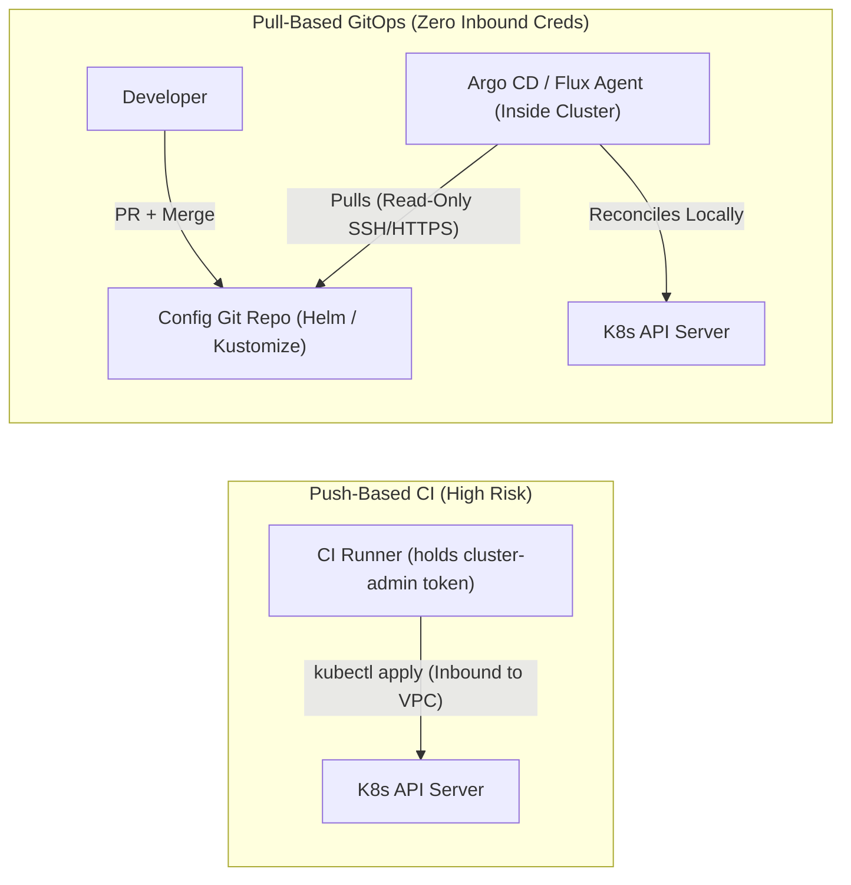
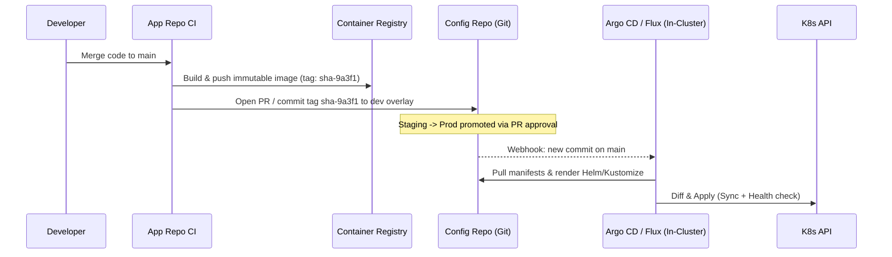
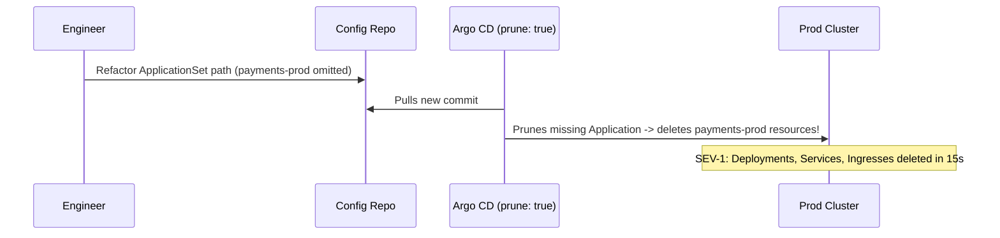

# GitOps: Pull-Based Deploys with Argo CD and Flux

> **Prerequisites:** [Lesson 11: Infrastructure as Code](../11-infrastructure-as-code/README.md).  
> **Estimated Reading Time:** 24–28 minutes  
> **Target Audience:** Backend and platform engineers designing secure, auditable Kubernetes delivery pipelines, and candidates asked "why pull-based GitOps instead of `kubectl apply` from CI?"  
> **Free PDF Notes:** [Download SD-V-012.pdf](https://backendroadmap.com/notes/system-design/SD-V-012.pdf)

> [!NOTE]
> **In one line:** **GitOps** treats a **Git repository as the single source of truth** for declarative cluster state: an **in-cluster agent** (Argo CD or Flux) continuously **pulls** manifests from Git, compares them against live Kubernetes state, and **reconciles** any drift—eliminating cluster-admin credentials from CI runners.

> [!TIP]
> **The Golden Rule:** Separate your **App repo** (source code + CI image build) from your **Config/Manifest repo** (Helm/Kustomize per environment), and let **Argo CD / Flux pull** from Git inside the cluster rather than pushing `kubectl apply` from external CI.

---

## 1. What GitOps Is, and What It Isn't

A startup runs `kubectl apply -f k8s/` directly from GitHub Actions. Every CI runner holds a long-lived `cluster-admin` kubeconfig token. When a developer runs an emergency `kubectl scale` or `kubectl edit` during an incident, GitHub Actions doesn't know—and the cluster silently drifts from Git for months until the next deploy overwrites it and breaks production.

| Term | Precise Meaning | Example |
| :--- | :--- | :--- |
| **GitOps (4 OpenGitOps Principles)** | 1. Declarative, 2. Versioned & immutable (Git), 3. Pulled automatically, 4. Continuously reconciled | Argo CD `Application`, Flux `Kustomization` |
| **Push-Based CI/CD** | External CI runner authenticates to the K8s API and pushes `kubectl apply` / `helm upgrade` | GitHub Actions $\to$ EKS API |
| **Pull-Based GitOps** | In-cluster controller pulls from Git (read-only) and applies locally inside the VPC | Argo CD / Flux inside cluster |
| **Sync Status (`Synced` / `OutOfSync`)** | Whether live cluster state matches the desired Git commit | `OutOfSync` if someone ran `kubectl edit` |
| **Self-Heal (`selfHeal: true`)** | Controller automatically reverts manual `kubectl` drift back to Git | Auto-reverts manual replica change |
| **Prune (`prune: true`)** | Controller deletes cluster resources removed from Git | Removes deleted Ingress/Service |
| **Not** | Just storing YAML in Git and running `kubectl apply` in Jenkins | That is "Push-based CI", not GitOps |

### Why It Matters
1. **Security boundary:** CI runners no longer need `cluster-admin` credentials or inbound network access to private Kubernetes API endpoints.
2. **Continuous drift reconciliation:** Unlike CI pipelines that only run on commits, GitOps agents reconcile 24/7.
3. **Instant, auditable rollbacks:** Rolling back a bad release is a `git revert`—with full Git commit history, PR approvals, and GPG signatures.

---

## 2. Anatomy: Push-Based CI vs Pull-Based GitOps



| Dimension | Push-Based CI (`kubectl apply` in CI) | Pull-Based GitOps (Argo CD / Flux) |
| :--- | :--- | :--- |
| **Cluster Credentials** | Stored in external CI (high blast radius if leaked) | Stay **inside** the cluster; CI only has Git write |
| **Private VPC Access** | Needs VPN/bastion or public K8s API endpoint | Agent pulls outbound to Git; K8s API stays private |
| **Drift Detection** | None between CI runs | Continuous (every 3 min poll + Git webhook) |
| **Multi-Cluster Fleet** | Complex CI matrix scripts | `ApplicationSet` / Flux multi-cluster controllers |
| **Rollback** | Re-run old CI job (may fail if images/deps changed) | `git revert` $\to$ agent syncs previous state |

> [!WARNING]
> **The Monorepo CI Infinite Loop & Secret-in-Git Trap:** (1) If CI commits an updated image tag back into the *same* repo without `[skip ci]` or a separate Config repo, CI triggers itself in an infinite loop. (2) **Never** commit plaintext Kubernetes `Secret` YAML to Git—encrypt them with **SealedSecrets** or **SOPS**, or fetch them at runtime via **External Secrets Operator (ESO)**.

---

## 3. Mathematical Model: Reconciliation Loop, Convergence & Blast Radius

**Convergence Time ($T_{\text{deploy}}$).** When a PR merges to the Config repo, time until the cluster begins rolling out the change is:

$$T_{\text{deploy}} = T_{\text{detect}} + T_{\text{render}} + T_{\text{apply}}$$

- With **polling only** (default Argo CD `timeout.reconciliation = 180 s`): worst-case $T_{\text{detect}} = 180\text{ s}$.
- With **Git webhooks** (push event to Argo CD/Flux): $T_{\text{detect}} \approx 1\text{–}2\text{ s}$.

**Fleet Scale Load.** With $N_{\text{apps}}$ Applications, poll interval $I$, and manifest render time $t_{\text{render}}$ (Helm/Kustomize):

$$\text{RepoServer CPU Load} \propto \frac{N_{\text{apps}} \cdot t_{\text{render}}}{I}$$

### Worked Example
A platform team manages `600` Argo CD Applications across 10 clusters with a `180 s` poll interval and `0.5 s` average Helm render time:
- Steady-state render load: $600 \times 0.5 / 180 \approx 1.67$ concurrent renders/sec.
- If a shared Helm chart in the monorepo changes and a webhook triggers all 600 apps simultaneously, the `argocd-repo-server` faces a **300 CPU-second burst** unless manifest generation is cached by Git commit SHA and `ApplicationSet` rolling syncs are rate-limited.

---

## 4. Metrics & Percentiles

| Metric | Meaning | Alert when |
| :--- | :--- | :--- |
| `argocd_app_info{sync_status="OutOfSync"}` | Apps whose live state diverges from Git | `OutOfSync` $> 15\text{ min}$ (failed sync or disabled auto-sync) |
| `argocd_app_info{health_status="Degraded"}` | Apps failing readiness/liveness after sync | $> 0$ in production |
| `argocd_git_request_duration_seconds` ($p_{99}$) | Git fetch/ls-remote latency | $> 5\text{ s}$ |
| `argocd_repo_server_request_duration_seconds` | Helm/Kustomize manifest rendering time | $> 10\text{ s}$ |
| `gotk_reconcile_condition{type="Ready",status="False"}` | Flux reconciliation errors (invalid YAML/Helm) | Any `False` $> 5\text{ min}$ |

### Worked Example (Silent `Degraded` Sync)
A developer pushes a broken `env` var to the Config repo. Argo CD syncs the Deployment (`SyncStatus: Synced`), but the new pod enters `CrashLoopBackOff` (`HealthStatus: Degraded`). Because `Synced` only means Kubernetes *accepted* the YAML, **always alert on `health_status="Degraded"`**, not just `sync_status`!

---

## 5. Compounding & Failure Modes

| Failure Mode | Mechanism | Blast Radius |
| :--- | :--- | :--- |
| **Accidental `prune: true` wipeout** | Engineer moves or deletes a directory in Git; Argo CD prunes Namespace/CRDs | Entire environment's Deployments & Services deleted in seconds |
| **Self-Heal vs Emergency Hotfix** | On-call runs `kubectl scale` during SEV-1; `selfHeal: true` reverts it 3 min later | Incident prolonged while fighting the GitOps agent |
| **Argo CD managing itself without guardrails** | Bad commit to `argocd` Application deletes Argo CD mid-sync | Control plane stranded until manual `kubectl apply` |
| **HPA + GitOps `replicas` conflict** | Deployment YAML has `replicas: 3`; HPA scales to `15`; Argo CD sees `OutOfSync` | Argo CD resets replicas back to `3` on every sync |

---

## 6. Numbers Every Engineer Must Know

| Item | Typical | Implication |
| :--- | :---: | :--- |
| Default Argo CD Git poll interval | `180 s` (3 min) | Configure Git webhooks for sub-5-second syncs |
| Default Flux `Kustomization` interval | `10 min` (configurable) | Pair with Flux Notification Controller webhooks |
| App-of-Apps / `ApplicationSet` scale | `500–2,000+ apps` | Shard `argocd-application-controller` replicas for $> 1,000$ apps |
| Rollback time via `git revert` | `5–30 s` (with webhooks) | Faster and safer than rebuilding CI pipelines |
| Secrets in Git | **0 plaintext secrets** | Always use External Secrets Operator (ESO), SOPS, or SealedSecrets |

---

## 7. Protocol Deep Dive: CI + GitOps Promotion Flow



| Question | Answer |
| :--- | :--- |
| **Argo CD vs Flux—how do they compare?** | **Argo CD** offers a rich Web UI, RBAC, SSO, and `ApplicationSet` out of the box (great for platform teams + app devs). **Flux** is a composable set of lightweight, Kubernetes-native controllers (`source-controller`, `kustomize-controller`, `helm-controller`) with zero UI overhead (great for headless automation). |
| **How do you prevent GitOps from overwriting HPA `replicas`?** | **Omit `spec.replicas`** from the Git Deployment manifest when HPA is active, or configure `ignoreDifferences` in Argo CD for `/spec/replicas`. |
| **How do you handle progressive delivery (Canary / Blue-Green) with GitOps?** | Pair Argo CD with **Argo Rollouts** (or Flux with **Flagger**): Git declares the `Rollout` strategy (`10% -> 50% -> 100%`), and the Rollouts controller shifts traffic and auto-aborts on Prometheus error-rate spikes. |
| **How do you manage secrets in GitOps?** | Never store plaintext secrets in Git. Store an `ExternalSecret` manifest in Git pointing to AWS Secrets Manager / Vault, and let **External Secrets Operator (ESO)** sync the actual Kubernetes `Secret` in-cluster. |

**When not to use GitOps:** Ephemeral local dev clusters (`kind`/`minikube` rapid inner-loop) where waiting on Git commits slows iteration—use `skaffold` or `tilt` locally and GitOps for shared `dev`/`staging`/`prod` environments.

---

## 8. Hierarchical Budgets & Design Rules

| Slice | Rule | Control |
| :--- | :--- | :--- |
| **Repo Split** | Separate App code repo from Config/Manifest repo | Prevents CI infinite loops & cleaner RBAC |
| **Immutability** | Pin container images by digest or immutable Git SHA (`sha-9a3f1`) | Never deploy `:latest` |
| **Secrets** | Zero plaintext secrets in Git | External Secrets Operator (ESO) or SOPS |
| **HPA Safety** | Omit `spec.replicas` on HPA-managed Deployments | Prevents GitOps from reverting autoscaled pods |
| **Prune Safety** | Disable `prune` on critical stateful CRDs/Namespaces or use `Prune=false` annotation | `argocd.argoproj.io/sync-options: Prune=false` |
| **Sync Waves** | Order CRDs/Namespaces $\to$ DB migrations $\to$ App Deployments | `argocd.argoproj.io/sync-wave: "-1"` |

---

## 9. Top Mitigations

1. **Separate App and Config repositories** (or use strict path filters + `[skip ci]`) to avoid CI-commit loops.
2. **Use External Secrets Operator (ESO)** or SOPS—never commit raw `Secret` manifests to Git.
3. **Omit `spec.replicas` in Git** for any Deployment managed by HPA/KEDA.
4. **Add `argocd.argoproj.io/sync-options: Prune=false`** on PVCs, Namespaces, and Database CRDs so a bad refactor cannot delete data.
5. **Configure Git webhooks** to cut sync detection from 3 minutes to `< 2 s`.
6. **Alert on `health_status="Degraded"` AND `sync_status="OutOfSync"`**, not just sync failures.
7. **Require PR reviews on `prod` environment overlays** in the Config repo (branch protection + CODEOWNERS).

---

## 10. Production Reference: The `prune: true` Namespace Wipeout

A platform engineer refactored a Kustomize directory structure in the Config repo, accidentally removing the `payments-prod` `Application` reference from an `ApplicationSet` matrix. Both `selfHeal: true` and `prune: true` were enabled.



- **Root Cause:** `prune: true` was enabled on the root `ApplicationSet` without `PreserveResourcesOnDeletion` or `Prune=false` on critical namespaces/PVCs, and no PR diff preview (`argocd app diff`) ran in CI.
- **Fix:** Added CI PR checks posting `argocd app diff` (failing if $> 5$ resources or any `Namespace`/`PVC` is marked for deletion), set `Prune=false` on stateful resources, and disabled cascading delete on the root `ApplicationSet`.

---

## 11. Multi-Language Production Code Tabs

A GitOps diff & drift-reconciliation checker simulating how an agent compares desired Git manifests against live cluster state (ignoring HPA-managed `replicas`).

````carousel
```go
// Go: GitOps reconciliation diff check ignoring HPA-managed replicas.
package main

import "fmt"

type K8sResource struct {
	Kind     string
	Name     string
	Image    string
	Replicas int
}

func NeedsSync(desired, live K8sResource, hpaManaged bool) (bool, string) {
	if desired.Image != live.Image {
		return true, fmt.Sprintf("OutOfSync: image %s -> %s", live.Image, desired.Image)
	}
	if !hpaManaged && desired.Replicas != live.Replicas {
		return true, fmt.Sprintf("OutOfSync: replicas %d -> %d", live.Replicas, desired.Replicas)
	}
	return false, "Synced"
}

func main() {
	git := K8sResource{Kind: "Deployment", Name: "api", Image: "app:sha-9a3f1", Replicas: 3}
	live := K8sResource{Kind: "Deployment", Name: "api", Image: "app:sha-9a3f1", Replicas: 12}
	fmt.Println(NeedsSync(git, live, true))  // false, Synced (HPA owns replicas)
	fmt.Println(NeedsSync(git, live, false)) // true, OutOfSync
}
```
<!-- slide -->
```typescript
// TypeScript: GitOps sync & prune safety validator.
interface ManifestDiff {
  kind: string;
  name: string;
  action: "create" | "update" | "prune";
}

const PROTECTED_PRUNE_KINDS = new Set(["Namespace", "PersistentVolumeClaim", "Cluster", "Secret"]);

export function validateSyncPlan(diffs: ManifestDiff[]): string[] {
  return diffs
    .filter((d) => d.action === "prune" && PROTECTED_PRUNE_KINDS.has(d.kind))
    .map((d) => `BLOCKED PRUNE: ${d.kind}/${d.name} requires manual approval`);
}
```
<!-- slide -->
```python
# Python: GitOps reconciliation loop simulator with self-heal & HPA ignore (stdlib only).
from dataclasses import dataclass

@dataclass
class ResourceState:
    image: str
    replicas: int

def reconcile(desired: ResourceState, live: ResourceState, hpa_managed: bool = True, self_heal: bool = True) -> dict:
    drift = []
    if desired.image != live.image:
        drift.append(f"image: {live.image} -> {desired.image}")
    if not hpa_managed and desired.replicas != live.replicas:
        drift.append(f"replicas: {live.replicas} -> {desired.replicas}")

    if not drift:
        return {"status": "Synced", "action": "none"}
    if self_heal:
        return {"status": "Synced", "action": "reconciled", "changes": drift}
    return {"status": "OutOfSync", "action": "alert_only", "changes": drift}

if __name__ == "__main__":
    print(reconcile(ResourceState("app:v2", 3), ResourceState("app:v1", 10), hpa_managed=True))
```
<!-- slide -->
```csharp
// C#: GitOps drift detector with HPA replica ignore-difference logic.
using System;

public sealed record WorkloadState(string Image, int Replicas);

public static class GitOpsReconciler
{
    public static string Evaluate(WorkloadState desired, WorkloadState live, bool hpaManaged)
    {
        if (desired.Image != live.Image)
            return $"OutOfSync: image {live.Image} != {desired.Image}";
        if (!hpaManaged && desired.Replicas != live.Replicas)
            return $"OutOfSync: replicas {live.Replicas} != {desired.Replicas}";
        return "Synced";
    }
}
```
````

---

## 12. Hands-On CLI Verification Workflows

```bash
# 1. List all Argo CD Applications, sync status, and health
argocd app list

# 2. Preview exact diff between Git and live cluster before syncing
argocd app diff payments-prod

# 3. Trigger an immediate sync or hard refresh (bypassing 3-min cache)
argocd app sync payments-prod --prune=false

# 4. Flux CLI: check all GitRepositories, Kustomizations, and HelmReleases
flux get all -A

# 5. Force Flux to reconcile immediately from Git
flux reconcile kustomization prod-apps --with-source
```

---

## 13. Common Mistakes to Avoid

1. **Calling `kubectl apply` from CI** and calling it GitOps (push-based CI exposes cluster creds).
2. **Committing plaintext Kubernetes `Secret` YAML to Git** (use ESO, SOPS, or SealedSecrets).
3. **Setting `spec.replicas` in Git while HPA is enabled**, causing Argo CD/Flux to fight the autoscaler.
4. **Enabling `prune: true` globally without `Prune=false` on PVCs/Namespaces**.
5. **Deploying `:latest` container tags**—GitOps can't detect a new image if the tag string didn't change.
6. **Putting App code and Env manifests in the same branch without CI loop guards**.
7. **Alerting only on `SyncFailed`** and missing `Synced` + `Degraded` (`CrashLoopBackOff`) deploys.

---

## 14. Key Terms Glossary

| Key Term | Definition |
| :--- | :--- |
| **GitOps** | Operational model using Git as the single source of truth with automated pull-based reconciliation. |
| **Argo CD** | Declarative GitOps continuous delivery tool for Kubernetes with UI, RBAC, and `ApplicationSet`. |
| **Flux** | CNCF GitOps toolkit of modular Kubernetes controllers (`source`, `kustomize`, `helm`). |
| **Pull vs Push Deploy** | In-cluster agent pulling from Git vs external CI pushing `kubectl apply` to the K8s API. |
| **Self-Heal** | Automatic reversion of out-of-band manual cluster changes back to Git state. |
| **Prune** | Automatic deletion of live cluster resources that were removed from Git. |
| **Sync Wave** | Ordering annotation (`argocd.argoproj.io/sync-wave`) sequencing CRDs, migrations, and apps. |
| **External Secrets Operator (ESO)** | Controller syncing secrets from Vault/AWS Secrets Manager into K8s `Secrets`. |
| **Argo Rollouts / Flagger** | Progressive delivery controllers automating Canary and Blue-Green traffic shifting. |
| **ApplicationSet** | Argo CD controller templating `Applications` across multiple clusters or environments. |

---

## 15. System Design Interview Questions & Answers

### Basic Conceptual Questions

<details>
<summary><strong>Q1: What are the four principles of GitOps (OpenGitOps)? [BASIC]</strong></summary>

**Answer:**
(1) **Declarative** system description, (2) **Versioned and immutable** storage in Git, (3) **Pulled automatically** by software agents inside the environment, and (4) **Continuously reconciled** to match the declared state.
</details>

<details>
<summary><strong>Q2: Why is pull-based GitOps more secure than push-based CI (`kubectl apply`)? [BASIC]</strong></summary>

**Answer:**
In push-based CI, external CI runners hold `cluster-admin` credentials and need network access to the Kubernetes API server. In pull-based GitOps, the agent runs *inside* the cluster, only needs **read-only** access to Git, and never exposes cluster credentials outside the VPC.
</details>

<details>
<summary><strong>Q3: How do Argo CD and Flux differ? [BASIC]</strong></summary>

**Answer:**
Argo CD provides a centralized UI, SSO/RBAC, and `ApplicationSet` management suited for teams wanting visibility and self-service. Flux is a set of lightweight, headless Kubernetes-native controllers (`source`, `kustomize`, `helm`) with minimal memory footprint and native multi-tenancy via service accounts.
</details>

<details>
<summary><strong>Q4: How do you roll back a bad deployment in GitOps? [BASIC]</strong></summary>

**Answer:**
Run `git revert <commit>` on the Config repo. The GitOps agent detects the reverted commit and reconciles the cluster back to the exact previous manifest and image SHA—preserving a full audit trail.
</details>

### Scenario-Based Architecture Questions

<details>
<summary><strong>Q5: Should you put application source code and Kubernetes manifests in the same Git repo? [SCENARIO]</strong></summary>

**Answer:**
Prefer **separate repos** (App repo + Config repo). Separate repos prevent infinite CI loops when CI updates an image tag, keep deployment audit history clean from code commits, and enforce stricter PR permissions on production manifests.
</details>

<details>
<summary><strong>Q6: Your Deployment uses HPA, and Argo CD keeps showing `OutOfSync` and resetting replicas to 3. How do you fix it? [SCENARIO]</strong></summary>

**Answer:**
Remove `spec.replicas` from the Deployment YAML in Git (so HPA owns replica count), or add `ignoreDifferences` for `group: apps, kind: Deployment, jsonPointers: [/spec/replicas]` in the Argo CD `Application` spec.
</details>

<details>
<summary><strong>Q7: How do you handle database passwords and API keys in a GitOps workflow? [SCENARIO]</strong></summary>

**Answer:**
Never commit plaintext secrets to Git. Commit an `ExternalSecret` custom resource referencing AWS Secrets Manager / HashiCorp Vault, and let **External Secrets Operator (ESO)** materialize the Kubernetes `Secret` inside the cluster (or encrypt secrets in Git with **SOPS** / **SealedSecrets**).
</details>

<details>
<summary><strong>Q8: An on-call engineer needs to scale a Deployment urgently during a SEV-1, but `selfHeal: true` keeps reverting it. What should the workflow be? [SCENARIO]</strong></summary>

**Answer:**
Make the emergency change via a **fast-track Git PR** (takes ~15 s with webhooks), or temporarily pause auto-sync (`argocd app set <app> --sync-policy none`) during the incident and immediately backport the change to Git afterward.
</details>

### Advanced & Tricky Interview Questions

<details>
<summary><strong>Q9: Why is deploying `:latest` (or mutable tags like `:prod`) an anti-pattern in GitOps? [TRICKY]</strong></summary>

**Answer:**
GitOps agents detect changes by diffing **Git commits and manifest text**. If the manifest still says `image: api:prod`, Git sees zero diff—so Argo CD/Flux won't deploy the new image, and `git revert` won't roll back to the old digest. Always use immutable SHA tags (`sha-9a3f1`) or `@sha256:...` digests.
</details>

<details>
<summary><strong>Q10: How do you run database schema migrations safely in a GitOps deploy? [TRICKY]</strong></summary>

**Answer:**
Use **Sync Waves / Resource Hooks**: tag a Kubernetes `Job` (`PreSync` hook or `sync-wave: "-1"`) to run backward-compatible migrations *before* the new app Deployment (`sync-wave: "0"`) rolls out, with `backoffLimit` and `ttlSecondsAfterFinished`.
</details>

<details>
<summary><strong>Q11: What is the "App-of-Apps" pattern vs `ApplicationSet`, and which should you choose at scale? [TRICKY]</strong></summary>

**Answer:**
App-of-Apps uses a parent `Application` pointing to a directory of child `Application` YAMLs (flexible, but verbose boilerplate). `ApplicationSet` uses generators (Git directories, cluster lists, PRs) to dynamically template `Applications` across dozens of clusters—prefer `ApplicationSet` for multi-cluster/multi-env fleets, with `preserveResourcesOnDeletion: true` for safety.
</details>

<details>
<summary><strong>Q12: How do Terraform (Lesson 11) and GitOps (Lesson 12) divide responsibilities in a production platform? [TRICKY]</strong></summary>

**Answer:**
**Terraform/OpenTofu** provisions the underlying cloud infrastructure (VPC, IAM, RDS, EKS cluster, and bootstraps Argo CD/Flux). Once the cluster is up, **Argo CD/Flux** takes over all in-cluster Kubernetes workloads, Helm charts, Ingress routes, and application releases.
</details>

---

## 16. One-Page Master Cheat Sheet

```
+---------------------------------------------------------------------------------------------------------+
|                  GITOPS (ARGO CD & FLUX) — MASTER CHEAT SHEET                                           |
+---------------------------------------------------------------------------------------------------------+
| 1. 4 PRINCIPLES: Declarative · Versioned/Immutable (Git) · Pulled automatically · Continuously reconciled|
+---------------------------------------------------------------------------------------------------------+
| 2. PULL > PUSH: Cluster creds stay inside VPC; CI only pushes image + updates Config Git repo.          |
+---------------------------------------------------------------------------------------------------------+
| 3. REPO SPLIT: App Repo (code + CI build) != Config Repo (Helm/Kustomize overlays per env).             |
+---------------------------------------------------------------------------------------------------------+
| 4. GUARDRAILS: Immutable SHA tags · Omit replicas when using HPA · Prune=false on PVCs/Namespaces.      |
+---------------------------------------------------------------------------------------------------------+
| 5. SECRETS: Zero plaintext secrets in Git -> use External Secrets Operator (ESO), SOPS, or SealedSecrets|
+---------------------------------------------------------------------------------------------------------+
| 6. DIVISION OF LABOR: Terraform owns Cloud Infra (VPC, RDS, EKS); GitOps owns K8s Apps & Add-ons.       |
+---------------------------------------------------------------------------------------------------------+
```

---

## Further Reading & Sources

- CNCF OpenGitOps Working Group, [OpenGitOps Principles](https://opengitops.dev/).
- Argo CD Documentation, [Architecture, Sync Waves & Declarative Setup](https://argo-cd.readthedocs.io/en/stable/).
- Flux CD Documentation, [Core Concepts & GitOps Toolkit](https://fluxcd.io/flux/concepts/).
- Weaveworks, *GitOps: Operations by Pull Request* (foundational pattern).

---

## Free PDF Notes

[SD-V-012.pdf](https://backendroadmap.com/notes/system-design/SD-V-012.pdf)

---

## Next

Continue with [Lesson 13: Immutable Infrastructure: Golden Images, Replace Don't Patch, No Drift](../13-immutable-infrastructure/README.md).
