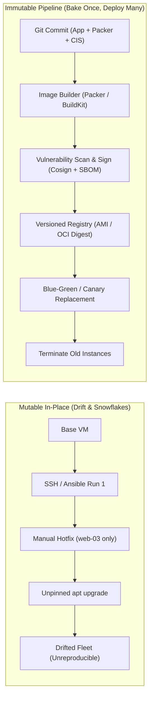
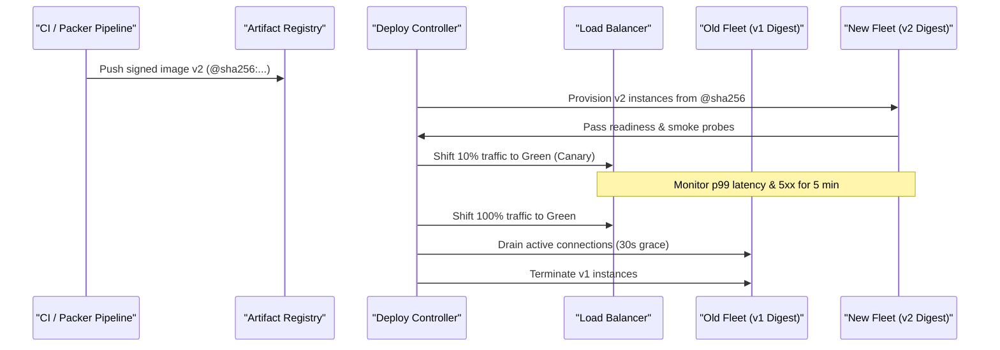
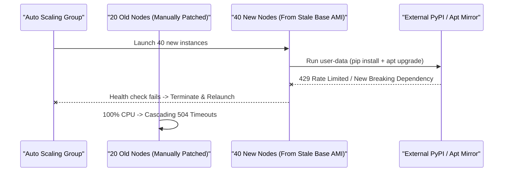

# Immutable Infrastructure: Golden Images, Replace Don't Patch, No Drift

> **Prerequisites:** [Lesson 12: GitOps](../12-gitops/README.md) · [Lesson 11: Infrastructure as Code](../11-infrastructure-as-code/README.md).  
> **Estimated Reading Time:** 22–28 minutes  
> **Target Audience:** Backend and platform engineers designing zero-downtime deployment pipelines, and candidates asked "how do you prevent configuration drift and snowflake servers at scale?"  
> **Free PDF Notes:** [Download SD-V-013.pdf](https://backendroadmap.com/notes/system-design/SD-V-013.pdf)

> [!NOTE]
> **In one line:** **Immutable infrastructure** means servers, containers, and VM images are never modified after deployment—updates, security patches, and configuration changes produce a **new versioned artifact** (a golden image or container digest) that replaces the old instance, eliminating configuration drift and "snowflake" servers.

> [!TIP]
> **The Golden Rule:** Treat servers like **cattle, not pets**—never SSH into a running production host to patch a package or edit a config file. Bake the change into an image pipeline, verify it once, and roll forward (or roll back) by replacing instances.

---

## 1. What Immutable Infrastructure Is, and What It Isn't

In a mutable infrastructure setup, an engineer launches a VM, installs packages via Ansible or SSH, applies an emergency `apt-get upgrade` during an incident, and tweaks `/etc/nginx/nginx.conf` by hand. Six months later, `web-03` has a different OpenSSL minor version and kernel sysctl than `web-01` and `web-02`. When `web-03` crashes and autoscaling replaces it from the original base image, the new instance fails because it lacks the undocumented manual hotfixes.

| Term | Precise Meaning | Example |
| :--- | :--- | :--- |
| **Immutable infrastructure** | Compute instances are never modified in place; every change creates and deploys a new image | Baking a new AWS AMI with Packer and replacing an ASG |
| **Golden image** | A pre-baked, hardened, versioned VM image or container image with OS, runtime, and dependencies | `ami-0a9f...` (Ubuntu 24.04 + CIS benchmark + Go binary) |
| **Configuration drift** | Divergence between the declared IaC state and the actual runtime state of a host | Manual SSH hotfix or unpinned `apt upgrade` on live VMs |
| **Snowflake server** | A unique, irreplaceable server whose exact state cannot be reproduced automatically | A legacy VM patched by hand over 3 years |
| **Image baking** | Building the complete artifact offline in CI before any production instance boots | Packer / Docker multi-stage build + Trivy scan |
| **Immutable tags vs digests** | Tags like `:latest` or `:v1.2` can be overwritten; content-addressed digests (`@sha256:...`) cannot | `ghcr.io/org/api@sha256:9f86d0...` |
| **Not** | Statelessness of the *entire* system; databases and object stores still hold mutable state | External RDS / EBS volumes attached to immutable compute |

### Why It Matters
1. **Reproducibility and fast recovery:** If a host dies or a region fails, autoscaling boots an identical, pre-verified artifact in seconds rather than running a 12-minute provisioning script that might fail on a downstream `apt` mirror outage.
2. **Instant, deterministic rollback:** Rolling back an in-place patch is notoriously brittle (package downgrades leave orphan files). Rolling back an immutable deployment simply shifts traffic or scales down the new ReplicaSet/ASG and restores the previous image digest.
3. **Security and compliance:** Disabling SSH/RDP in production, mounting root filesystems read-only, and signing images with SBOMs (Software Bill of Materials) shrinks the blast radius and proves exactly what code ran at any point in time.

---

## 2. Anatomy: Mutable In-Place Patching vs Immutable Replace Pipeline



In an immutable pipeline, **build time** and **boot time** are strictly separated. Heavy work—compiling binaries, installing OS packages, applying CIS security hardening, and running vulnerability scans—happens once inside the CI image builder. At runtime, instances boot directly into a ready state, pull only environment-specific secrets/config (via IAM role or KMS), and pass health checks.

| Dimension | Mutable (In-Place Config Mgmt) | Immutable (Bake & Replace) |
| :--- | :--- | :--- |
| **How updates happen** | SSH, Ansible, Chef, or Puppet mutates running hosts | Build new image, launch new instances, drain & terminate old |
| **Configuration drift** | High; accumulates over months of partial runs & hotfixes | Near zero; instances are short-lived and read-only |
| **Boot / scale-out time** | Slow (3–15 min running setup scripts per new node) | Fast (15–60 s VM boot; 1–5 s container start) |
| **Rollback reliability** | Low; downgrade scripts often fail mid-way | High; previous AMI/OCI digest is still intact |
| **External dependency risk** | High; `apt`/`npm`/`pip` outage breaks autoscaling | Zero at runtime; all dependencies are baked into the image |
| **Debugging access** | Engineers SSH in and mutate state | SSH disabled; debug via structured logs, traces, or ephemeral debug containers |

> [!WARNING]
> **Mutable image tags break immutability.** Deploying `my-app:v1.4` or `my-app:latest` allows a registry push to overwrite the tag's underlying layers silently. Two nodes booting 10 minutes apart can run different binaries under the same tag. Always pin deployments by **content-addressed SHA-256 digest** (`@sha256:...`) or immutable cloud AMI IDs.

---

## 3. Mathematical Model: Drift Probability, Rollback Time, and Boot Overhead

**Fleet Drift Probability.** Suppose a fleet of $N$ mutable hosts experiences manual hotfixes or partial configuration runs at rate $\lambda_d$ per host per day. The probability that *at least one* host in the fleet has drifted after $T$ days is:

$$P(\text{drift} \ge 1) = 1 - e^{-N \cdot \lambda_d \cdot T}$$

For $N = 100$ hosts, $\lambda_d = 0.005$ unrecorded changes/host/day (one tweak every 200 host-days), over $T = 30$ days:

$$P(\text{drift} \ge 1) = 1 - e^{-100 \times 0.005 \times 30} = 1 - e^{-15} \approx 99.99997\%$$

With immutable infrastructure where instances are replaced on every release and max instance lifetime is capped at $T_{\max} = 7$ days with $\lambda_d = 0$ (SSH disabled, read-only rootfs), fleet drift remains **0%**.

**Scale-Out & Recovery Time.** Let $t_{\text{boot}}$ be base OS boot time and $t_{\text{prov}}$ be runtime package installation time:

$$T_{\text{ready, mutable}} = t_{\text{boot}} + t_{\text{prov}}, \qquad T_{\text{ready, immutable}} = t_{\text{boot}} + t_{\text{config}}$$

If a VM boots in $t_{\text{boot}} = 35\text{ s}$, mutable provisioning takes $t_{\text{prov}} = 420\text{ s}$ (7 minutes), and immutable metadata/secret fetch takes $t_{\text{config}} = 5\text{ s}$:
- Mutable scale-out: $35 + 420 = 455\text{ s}$ (7.6 minutes—often too slow for a traffic spike).
- Immutable scale-out: $35 + 5 = 40\text{ s}$ (**11.4x faster**).

**Rolling Replacement Capacity Cost.** When replacing $N$ instances in batches of size $B$ (or max surge $S$), total replacement time $T_{\text{roll}}$ with per-batch drain + health-check time $t_{\text{batch}}$ is:

$$T_{\text{roll}} = \left\lceil \frac{N}{B} \right\rceil \cdot t_{\text{batch}}$$

For $N = 60$ instances, surge batch $B = 10$, and $t_{\text{batch}} = 90\text{ s}$ (40 s boot + 50 s connection drain), a full fleet replacement completes in $\lceil 60/10 \rceil \times 90 = 540\text{ s}$ (9 minutes) with zero downtime and at most $10 / 60 = 16.7\%$ temporary extra compute cost during the rollout window.

---

## 4. Metrics & Percentiles

| Metric | Meaning | Alert when |
| :--- | :--- | :--- |
| **Max instance age** | Age of the oldest running VM or container in production | Exceeds 7–14 days (indicates stale OS patches or failed rotation) |
| **Image bake duration $p_{95}$** | Time from Git merge to signed golden image availability | Exceeds 15 minutes (slows emergency security patches) |
| **Cold-start / ready time $p_{99}$** | Time from instance launch to passing LB readiness probe | Exceeds autoscaling target (e.g., > 60 s for VMs, > 10 s for pods) |
| **Drift detection events** | Count of hosts failing read-only/integrity checks or SSH logins | Any non-zero SSH login or unexpected file modification in prod |
| **CVE mean-time-to-remediate (MTTR)** | Time from critical CVE disclosure to 100% fleet replacement | Exceeds SLA (e.g., > 24 hours for critical CVEs) |
| **Rollback duration** | Time to restore previous image digest across 100% of traffic | Exceeds 5 minutes |

### Worked Example (Emergency OpenSSL CVE Patch)
A critical OpenSSL CVE is announced at 09:00 across a 200-node API fleet.
- **Mutable approach:** Engineers trigger an Ansible playbook across 200 hosts. 184 hosts patch cleanly in 12 minutes; 11 fail due to a stale `apt` lock; 5 hosts require manual `dpkg --configure -a` over SSH; 2 nodes silently fail to restart Nginx and continue serving the vulnerable library. Total MTTR: 3.5 hours, with uncertain fleet state.
- **Immutable approach:** CI triggers an automated Packer/BuildKit rebuild using the patched base image (bake + Trivy scan + Cosign signature: 8 minutes). The deployment controller runs a rolling replacement with batch size $B = 40$ and $t_{\text{batch}} = 60\text{ s}$: $\lceil 200/40 \rceil \times 60 = 300\text{ s}$ (5 minutes). Total MTTR: **13 minutes**, 100% verified by image digest.

---

## 5. Compounding & Failure Modes

What happens when an immutable pipeline lacks guardrails?

| Failure Mode | Mechanism | Quantitative Impact |
| :--- | :--- | :--- |
| **Image sprawl & registry bloat** | Every commit bakes a 2 GB AMI or OCI image without lifecycle/GC policies | 50 commits/day × 2 GB × 90 days = **9 TB** stored; registry pulls throttle |
| **Mutable base image drift** | `FROM ubuntu:24.04` pulls a different upstream layer each week | Builds become non-reproducible; yesterday's rebuild fails today |
| **Baked-in secrets** | Putting API keys or `.env` files inside the image layer | Secret persists in registry history even if deleted in a later `RUN` layer |
| **Stateful data loss on replace** | Storing local uploads, SQLite, or logs on ephemeral root volumes | Terminating the old instance permanently destroys customer data |
| **Thundering herd during rotation** | Replacing all $N$ instances simultaneously without surge/PDB limits | 100% cold caches + DB connection storm causes a cascading outage |

---

## 6. Numbers Every Engineer Must Know

| Item | Typical | Implication |
| :--- | :--- | :--- |
| **Distroless / Alpine container image** | 15–80 MB | Pulls in 1–3 s; minimal CVE surface |
| **Standard Ubuntu/Debian container** | 150–400 MB | Larger attack surface; slower node scale-out |
| **Hardened VM Golden Image (AMI)** | 2–8 GB | Takes 5–12 min to bake with Packer; 30–60 s to boot |
| **Container cold start (cached layer)** | 0.5–3 s | Fast enough for reactive HPA scaling |
| **VM Auto Scaling Group boot + ready** | 30–90 s | Pre-warm or use predictive scaling for spiky traffic |
| **Max recommended instance TTL** | 7–14 days | Forces regular rotation and validates replacement automation |
| **Connection drain / termination grace** | 30–60 s | Must exceed `max(request_timeout)` to prevent 502s during replacement |

---

## 7. Protocol / Mechanism Deep Dive: Blue-Green vs Canary Image Replacement



| Strategy | How It Works | Trade-off |
| :--- | :--- | :--- |
| **Blue-Green** | Provision 100% of new fleet alongside old; flip LB target group atomically | Instant rollback, zero mixed-version state; **2x compute cost** during cutover |
| **Canary** | Route 1–10% traffic to new image; promote if SLOs hold | Smallest blast radius; requires **backward-compatible schemas/APIs** |
| **Rolling Replace** | Replace $B$ instances at a time (`maxSurge` / `maxUnavailable`) | Low extra compute cost; slower rollback and mixed versions during rollout |

### When NOT to Use Immutable Replacement
- **Stateful primary databases in-place:** You do not destroy and recreate a 10 TB PostgreSQL primary data volume on every config tweak. Separate **immutable compute** (the DB binary/container) from **persistent storage** (EBS/PD volumes, managed RDS), and perform controlled failovers.
- **Ultra-low-latency bare-metal HPC/trading nodes** where rebooting physical hardware takes 5+ minutes and kernel live-patching is legally or operationally mandated.

---

## 8. Hierarchical Budgets & Design Rules

| Slice | Rule | Control |
| :--- | :--- | :--- |
| **Base OS & Runtime** | Pin base images by SHA-256 digest; use Distroless or minimal OS | Renovate / Dependabot automated PRs for base digest bumps |
| **Root Filesystem** | Mount rootfs read-only (`readOnlyRootFilesystem: true`); disable SSH | Kubernetes Pod Security Standards; AWS SSM Session Manager break-glass only |
| **Build Pipeline** | Bake once in CI; scan for Critical/High CVEs; sign with Cosign | Admission controller (Kyverno / OPA Gatekeeper) blocks unsigned images |
| **Runtime Config & Secrets** | Inject via environment, IAM roles, or KMS/Vault at boot—never bake | `trufflehog` / `gitleaks` in CI; dynamic short-lived credentials |
| **Instance Lifecycle** | Enforce max instance age (`max-instance-lifetime`); automated drain | ASG Instance Refresh / Karpenter node expiration (`expireAfter: 168h`) |
| **Artifact Retention** | Garbage-collect untagged/old images while preserving last $K$ prod releases | ECR / GAR lifecycle policies (keep last 20 tagged + active digests) |

---

## 9. Top Mitigations

1. **Pin every artifact by SHA-256 digest, never mutable tags:** Ensure `image: repo/app@sha256:...` is what production pulls so two nodes never run different bits.
2. **Separate state from compute strictly:** Store all durable data in managed databases, object storage (S3/GCS), or persistent volumes that survive instance termination.
3. **Externalize configuration and secrets:** Use runtime metadata, ConfigMaps, or secret managers (AWS Secrets Manager, Vault) so one golden image promotes identically from `staging` to `prod`.
4. **Enforce read-only root filesystems and drop Linux capabilities:** If an attacker or buggy script cannot write to `/etc` or `/usr/bin`, runtime drift is physically impossible.
5. **Automate instance rotation (Chaos / Max-TTL):** Set a 7–14 day maximum lifetime on VMs and nodes so replacement automation is continuously exercised, not tested for the first time during a SEV-1.
6. **Pre-bake dependencies; zero runtime package downloads:** Never run `apt-get`, `pip install`, or `curl | sh` in `user-data` or container entrypoints.
7. **Graceful connection draining:** Configure `preStop` hooks and LB deregistration delays longer than your longest in-flight request timeout.

---

## 10. Production Reference / War Story: The "Snowflake Hotfix" Autoscaling Collapse

**Incident:** During a peak traffic event, a payments API running on mutable EC2 instances triggered autoscaling from 20 to 60 nodes. Every new instance failed health checks within 10 seconds of booting, causing the Load Balancer to mark them unhealthy and terminate them in an infinite loop while the original 20 nodes saturated at 100% CPU.



**Root Cause:** Three months earlier, an engineer had SSH'd into the 20 running nodes to pin a Python dependency and add a kernel `sysctl` parameter. The `user-data` boot script on the base AMI was never updated, and it also ran an unpinned `pip install` at boot time that broke when an upstream package released an incompatible version.

**Fix:**
1. Replaced `user-data` runtime installation with a **Packer golden image pipeline** that baked the OS, `sysctl` config, and pinned Python wheelhouse offline in CI.
2. Disabled SSH across all production security groups and enabled `max-instance-lifetime: 7d` on the ASG.
3. Added a synthetic canary test in CI that boots the AMI in an isolated VPC with **no outbound internet access**—proving the image has zero runtime external build dependencies.

---

## 11. Multi-Language Production Code Tabs

These examples implement an **immutable artifact verification & safe rolling-replacement controller** (verifying SHA-256 digest pinning, enforcing read-only/zero-drift policy, and computing surge/drain batches).

````carousel
```go
// Go: Verify immutable OCI/AMI artifact pinning and compute safe rolling replacement batches.
package main

import (
	"errors"
	"fmt"
	"regexp"
	"strings"
)

var sha256DigestRe = regexp.MustCompile(`^.+@sha256:[a-f0-9]{64}$`)

type Artifact struct {
	URI          string
	Signed       bool
	MaxAgeDays   int
	ReadOnlyRoot bool
}

func ValidateImmutableArtifact(a Artifact) error {
	if !sha256DigestRe.MatchString(a.URI) {
		return fmt.Errorf("artifact %q must be pinned by @sha256 digest, not a mutable tag", a.URI)
	}
	if strings.HasSuffix(a.URI, ":latest") {
		return errors.New("mutable :latest tag is forbidden")
	}
	if !a.Signed {
		return errors.New("artifact signature (Cosign/SBOM) missing")
	}
	if !a.ReadOnlyRoot {
		return errors.New("root filesystem must be read-only to prevent runtime drift")
	}
	if a.MaxAgeDays > 14 {
		return fmt.Errorf("instance max age %d days exceeds 14-day rotation policy", a.MaxAgeDays)
	}
	return nil
}

func PlanBatches(totalInstances, maxSurge int) [][]int {
	if maxSurge <= 0 {
		maxSurge = 1
	}
	var batches [][]int
	for i := 0; i < totalInstances; i += maxSurge {
		end := i + maxSurge
		if end > totalInstances {
			end = totalInstances
		}
		batch := make([]int, 0, end-i)
		for j := i; j < end; j++ {
			batch = append(batch, j)
		}
		batches = append(batches, batch)
	}
	return batches
}

func main() {
	art := Artifact{
		URI:          "ghcr.io/acme/payments@sha256:" + strings.Repeat("a", 64),
		Signed:       true,
		MaxAgeDays:   7,
		ReadOnlyRoot: true,
	}
	if err := ValidateImmutableArtifact(art); err != nil {
		panic(err)
	}
	fmt.Println("Validated immutable artifact. Batches:", len(PlanBatches(60, 10)))
}
```
<!-- slide -->
```typescript
// TypeScript: Immutable deployment gate & drift-free rolling replacement planner.
export interface ImmutableArtifact {
  uri: string;
  signed: boolean;
  readOnlyRoot: boolean;
  maxInstanceAgeDays: number;
}

const DIGEST_PATTERN = /^.+@sha256:[a-f0-9]{64}$/;

export function assertImmutable(artifact: ImmutableArtifact): void {
  if (!DIGEST_PATTERN.test(artifact.uri)) {
    throw new Error(`Artifact "${artifact.uri}" must use an immutable @sha256 digest.`);
  }
  if (!artifact.signed) {
    throw new Error("Unsigned artifact rejected by admission policy.");
  }
  if (!artifact.readOnlyRoot) {
    throw new Error("Writable root filesystem violates immutability.");
  }
  if (artifact.maxInstanceAgeDays > 14) {
    throw new Error(`Max instance age ${artifact.maxInstanceAgeDays}d exceeds 14d limit.`);
  }
}

export function computeRolloutPlan(
  fleetSize: number,
  batchSize: number,
  batchDrainSeconds: number
): { batches: number; totalRolloutSeconds: number; surgePercent: number } {
  const batches = Math.ceil(fleetSize / batchSize);
  return {
    batches,
    totalRolloutSeconds: batches * batchDrainSeconds,
    surgePercent: Number(((batchSize / fleetSize) * 100).toFixed(1)),
  };
}

// Example usage
const artifact: ImmutableArtifact = {
  uri: `ghcr.io/acme/api@sha256:${"b".repeat(64)}`,
  signed: true,
  readOnlyRoot: true,
  maxInstanceAgeDays: 7,
};
assertImmutable(artifact);
console.log(computeRolloutPlan(60, 10, 90)); // { batches: 6, totalRolloutSeconds: 540, surgePercent: 16.7 }
```
<!-- slide -->
```python
# Python: Immutable fleet drift probability & rollout simulator (stdlib only).
import math
import re
from dataclasses import dataclass

DIGEST_RE = re.compile(r"^.+@sha256:[a-f0-9]{64}$")


@dataclass(frozen=True)
class DeploymentSpec:
    image_uri: str
    signed: bool
    read_only_root: bool
    max_age_days: int

    def validate(self) -> None:
        if not DIGEST_RE.match(self.image_uri):
            raise ValueError(f"Mutable image reference forbidden: {self.image_uri}")
        if not self.signed:
            raise ValueError("Image must be cryptographically signed")
        if not self.read_only_root:
            raise ValueError("Root filesystem must be read-only")
        if self.max_age_days > 14:
            raise ValueError("Max instance age cannot exceed 14 days")


def fleet_drift_probability(hosts: int, drift_rate_per_host_day: float, days: int) -> float:
    """Probability that >= 1 host has drifted in a mutable fleet."""
    return 1.0 - math.exp(-hosts * drift_rate_per_host_day * days)


def rollout_time_seconds(fleet_size: int, batch_size: int, boot_s: int, drain_s: int) -> int:
    batches = math.ceil(fleet_size / batch_size)
    return batches * (boot_s + drain_s)


if __name__ == "__main__":
    spec = DeploymentSpec(
        image_uri="ghcr.io/acme/orders@sha256:" + "c" * 64,
        signed=True,
        read_only_root=True,
        max_age_days=7,
    )
    spec.validate()
    print(f"Mutable 100-host 30d drift prob: {fleet_drift_probability(100, 0.005, 30):.6%}")
    print(f"60-node rollout (batch 10, 40s boot, 50s drain): {rollout_time_seconds(60, 10, 40, 50)}s")
```
<!-- slide -->
```csharp
// C#: Immutable image admission validator & rollout batch calculator.
using System;
using System.Text.RegularExpressions;

public sealed record ImmutableImageSpec(
    string ImageUri,
    bool IsSigned,
    bool ReadOnlyRootFs,
    int MaxInstanceAgeDays);

public static class ImmutablePolicyGate
{
    private static readonly Regex DigestRegex = new(@"^.+@sha256:[a-f0-9]{64}$", RegexOptions.Compiled);

    public static void Validate(ImmutableImageSpec spec)
    {
        if (!DigestRegex.IsMatch(spec.ImageUri))
            throw new InvalidOperationException($"Image '{spec.ImageUri}' must be pinned by @sha256 digest.");
        if (!spec.IsSigned)
            throw new InvalidOperationException("Unsigned image rejected.");
        if (!spec.ReadOnlyRootFs)
            throw new InvalidOperationException("Read-only root filesystem is required.");
        if (spec.MaxInstanceAgeDays > 14)
            throw new InvalidOperationException("Instance TTL exceeds 14-day immutability policy.");
    }

    public static int EstimateRolloutSeconds(int fleetSize, int maxSurge, int batchDurationSeconds)
    {
        int batches = (int)Math.Ceiling((double)fleetSize / maxSurge);
        return batches * batchDurationSeconds;
    }
}
```
````

---

## 12. Hands-On CLI Verification Workflows

Verify immutable image digests, signatures, read-only containers, and AWS ASG instance refresh locally or in CI:

```bash
# 1. Resolve an OCI image tag to its immutable SHA-256 digest
docker buildx imagetools inspect nginx:1.27-alpine --format '{{.Manifest.Digest}}'

# 2. Verify cryptographic signature on a container image using Cosign
cosign verify --key cosign.pub ghcr.io/acme/api@sha256:9f86d081884c7d659a2feaa0c55ad015a3bf4f1b2b0b822cd15d6c15b0f00a08

# 3. Test a container with a strictly read-only root filesystem (only /tmp writable)
docker run --rm --read-only --tmpfs /tmp:rw,noexec,nosuid nginx:1.27-alpine

# 4. Trigger an immutable rolling replacement of an AWS Auto Scaling Group
aws autoscaling start-instance-refresh \
  --auto-scaling-group-name prod-api-asg \
  --preferences '{"MinHealthyPercentage": 90, "InstanceWarmup": 60}'

# 5. Check running Kubernetes pods for mutable tags or writable root filesystems
kubectl get pods -A -o jsonpath='{range .items[*]}{.metadata.name}{"\t"}{.spec.containers[0].image}{"\t"}{.spec.containers[0].securityContext.readOnlyRootFilesystem}{"\n"}{end}'
```

---

## 13. Common Mistakes to Avoid

1. **Using mutable tags (`:latest`, `:prod`, `:v1.2`) instead of `@sha256:` digests** in Kubernetes manifests or ECS task definitions.
2. **Running `apt-get update` or `pip install` in VM `user-data` at boot**, turning autoscaling into a live build step that fails when mirrors throttle.
3. **Baking environment-specific secrets or configs into the image**, forcing separate builds per environment and leaking credentials in registry layers.
4. **Leaving SSH/RDP open in production** "just for debugging," which inevitably leads to undocumented manual hotfixes.
5. **Forgetting to externalize state** (local logs, uploaded files, SQLite) before enabling instance replacement.
6. **Rotating 100% of instances at once** without `MinHealthyPercentage` or `PodDisruptionBudget`, causing cold-cache or connection-pool outages.
7. **Never rotating long-lived instances**, letting an immutable host sit unpatched for 180 days until its replacement automation silently rots.

---

## 14. Key Terms Glossary

| Key Term | Definition |
| :--- | :--- |
| **Immutable infrastructure** | Paradigm where deployed compute artifacts are never modified in place; changes require building and deploying a replacement. |
| **Golden image** | Pre-built, hardened, tested VM or container image ready to boot with zero runtime package installation. |
| **Configuration drift** | Unintended divergence between infrastructure-as-code definitions and the actual state of live servers. |
| **Snowflake server** | A unique, manually configured server that cannot be reliably reproduced by automation. |
| **Content-addressed digest** | Cryptographic hash (`@sha256:...`) uniquely identifying an immutable artifact version. |
| **Image baking** | Offline CI process of assembling OS, dependencies, hardening, and application binary into a versioned image. |
| **Read-only rootfs** | Mounting the container/OS root filesystem read-only at runtime to physically block in-place file mutations. |
| **Blue-green deployment** | Running two identical environments (old and new) and switching load balancer traffic atomically. |
| **Instance refresh / rotation** | Automated rolling replacement of fleet instances to apply new golden images or enforce max instance age. |
| **SBOM (Software Bill of Materials)** | Machine-readable inventory of all packages and libraries baked into an image for CVE tracking. |

---

## 15. System Design Interview Questions & Answers

### Basic Conceptual Questions

<details>
<summary><strong>Q1: What is immutable infrastructure, and how does it differ from configuration management tools like Ansible or Chef? [BASIC]</strong></summary>

**Answer:**
Configuration management tools (Ansible, Chef, Puppet) typically **mutate** running servers in place by applying playbooks over SSH/agents. Over time, partial failures and manual hotfixes cause configuration drift. Immutable infrastructure forbids in-place changes: you bake a new versioned image (VM AMI or container digest) in CI, deploy new instances from it, and terminate the old ones.
</details>

<details>
<summary><strong>Q2: What is a golden image, and what belongs inside it vs outside it? [BASIC]</strong></summary>

**Answer:**
A golden image is a pre-baked, hardened, versioned artifact containing the OS, security patches, runtime, and application binary. **Inside:** OS packages, language runtime, compiled app, monitoring agents, CIS hardening. **Outside (injected at runtime):** environment-specific config (`prod` vs `staging`), secrets/API keys, and persistent user data.
</details>

<details>
<summary><strong>Q3: Why is `:latest` or `:v1.0` dangerous for immutable deployments? [BASIC]</strong></summary>

**Answer:**
Container tags are mutable pointers in a registry. Pushing a new build to `:v1.0` overwrites the pointer, meaning two instances launched 5 minutes apart can run different code under the same tag, breaking rollback and reproducibility. Pinning by `@sha256:...` digest guarantees bit-for-bit immutability.
</details>

<details>
<summary><strong>Q4: How do you debug a production issue if SSH is disabled on immutable hosts? [BASIC]</strong></summary>

**Answer:**
You rely on **externalized observability** (structured logs shipped to Loki/CloudWatch, metrics, distributed traces) and **ephemeral, read-only debug access** (e.g., `kubectl debug` with an ephemeral container, or AWS SSM Session Manager with full audit logging). If a host must be inspected deeply, you quarantine it out of the load balancer, snapshot it, and replace it.
</details>

### Scenario-Based Architecture Questions

<details>
<summary><strong>Q5: Autoscaling takes 9 minutes to bring a new EC2 instance online, causing 504 errors during traffic spikes. How do you fix this? [SCENARIO]</strong></summary>

**Answer:**
Move all `apt-get`, language runtime installs, and app compilation out of `user-data` into an offline **Packer golden image pipeline**. At boot, the instance only fetches secrets/config from KMS/SSM (~5 seconds) and starts the pre-baked service. Boot-to-ready drops from ~9 minutes to ~40 seconds, eliminating external mirror dependencies during scaling.
</details>

<details>
<summary><strong>Q6: A critical zero-day vulnerability is discovered in `glibc` across 500 microservices. How do you patch and prove 100% remediation? [SCENARIO]</strong></summary>

**Answer:**
Rebuild the shared base golden image in CI with the patched `glibc`, trigger automated downstream image rebuilds for all 500 services, scan with Trivy/Grype to verify the CVE is absent, sign with Cosign, and roll out via GitOps/ASG Instance Refresh. Prove 100% remediation by querying running pod/VM image digests against the patched SBOM inventory.
</details>

<details>
<summary><strong>Q7: How do you apply immutable infrastructure principles to a stateful PostgreSQL database? [SCENARIO]</strong></summary>

**Answer:**
Separate **compute** from **storage**. The database engine binary and OS live on an immutable image/container, while the data directory lives on a persistent volume (EBS/PersistentVolume). To upgrade or patch PostgreSQL, provision a new immutable replica from the new image, replicate WAL until caught up, promote it (controlled failover), and terminate the old primary compute.
</details>

<details>
<summary><strong>Q8: During a rolling replacement of 60 instances, your database experiences a connection spike and crashes. Why, and how do you prevent it? [SCENARIO]</strong></summary>

**Answer:**
If `maxSurge` is too high or old instances are terminated before draining, new instances open fresh connection pools while old connections are still open, doubling total DB connections. Prevent this by bounding batch size (e.g., `maxSurge: 10%`), enforcing readiness probes, using connection pooling (PgBouncer/RDS Proxy), and draining old instances gracefully before launching the next batch.
</details>

### Advanced & Tricky Interview Questions

<details>
<summary><strong>Q9: Can a Docker container built with a `Dockerfile` still suffer from non-reproducibility? How? [TRICKY]</strong></summary>

**Answer:**
Yes. If the `Dockerfile` uses `FROM ubuntu:24.04` (mutable tag) and runs `apt-get update && apt-get install -y curl` without pinned package versions or snapshot dates, running `docker build` today vs next week produces different binaries. True immutability requires pinning base images by `@sha256:` digest, locking dependency lockfiles (`go.sum`, `package-lock.json`), and caching artifacts.
</details>

<details>
<summary><strong>Q10: You deleted a secret file in layer 4 of a Dockerfile (`RUN rm /app/.env`). Is the image safe to push? [TRICKY]</strong></summary>

**Answer:**
No. OCI/Docker images are layered union filesystems. Layer 4 only adds a "whiteout" marker hiding `/app/.env`; the secret remains fully intact and extractable in layer 3. Never copy secrets into a build stage that ends up in the final image—use BuildKit `--mount=type=secret` during build or inject secrets at runtime.
</details>

<details>
<summary><strong>Q11: What is the trade-off between "bake everything into one giant AMI" vs "thin base AMI + containers"? [TRICKY]</strong></summary>

**Answer:**
Baking one giant AMI per microservice gives fast single-hop VM boot but causes **AMI sprawl** (hundreds of 4 GB images to rebuild on every OS patch) and slow CI feedback. A **thin, hardened base AMI** (running containerd/kubelet) paired with **small, immutable OCI containers** (20–80 MB) decouples OS patching from app deploys and reduces image bake/pull times by 10x.
</details>

<details>
<summary><strong>Q12: Why should an immutable infrastructure platform enforce a maximum instance age (e.g., 7–14 days) even when there are no code deploys? [TRICKY]</strong></summary>

**Answer:**
Two reasons: (1) **Security hygiene**—short-lived instances limit the persistence of memory-resident malware and ensure routine OS/kernel patches are picked up automatically; (2) **Operational muscle memory**—if a service hasn't been replaced in 6 months, its boot script, IAM permissions, or PDBs may have silently broken. Continuous rotation proves recoverability every week.
</details>

---

## 16. One-Page Master Cheat Sheet

```
+---------------------------------------------------------------------------------------------------------+
|                    IMMUTABLE INFRASTRUCTURE — MASTER CHEAT SHEET                                        |
+---------------------------------------------------------------------------------------------------------+
| 1. CORE PRINCIPLE: Never patch or SSH-mutate live hosts. Bake a new versioned artifact & replace.       |
+---------------------------------------------------------------------------------------------------------+
| 2. ARTIFACT HYGIENE: Pin by @sha256 digest (not :latest). Sign with Cosign + attach SBOM.              |
+---------------------------------------------------------------------------------------------------------+
| 3. SEPARATE CONCERNS: Bake OS + runtime + binary in CI. Inject config, secrets & persistent data        |
|    at runtime. Never run apt/pip/npm in production boot scripts.                                        |
+---------------------------------------------------------------------------------------------------------+
| 4. MATH: Mutable drift P = 1 - exp(-N * lambda * T) -> ~100% over 30d. Immutable = 0% drift.            |
|    Rollout time = ceil(N / batch_size) * (boot_time + drain_time).                                      |
+---------------------------------------------------------------------------------------------------------+
| 5. GUARDRAILS: Read-only rootfs, no SSH in prod, graceful connection drain, max instance TTL (7-14d).   |
+---------------------------------------------------------------------------------------------------------+
| 6. STATEFUL SYSTEMS: Keep compute immutable, persist data on external volumes/managed DBs.              |
+---------------------------------------------------------------------------------------------------------+
```

---

## Further Reading & Sources

- Martin Fowler, [Immutable Server](https://martinfowler.com/bliki/ImmutableServer.html) and [Snowflake Server](https://martinfowler.com/bliki/SnowflakeServer.html).
- Kief Morris, *Infrastructure as Code* (2nd ed.), O'Reilly Media — Chapters on Server Provisioning and Immutable Infrastructure.
- HashiCorp Packer & AWS Well-Architected Framework, [Operational Excellence: Make frequent, small, reversible changes](https://docs.aws.amazon.com/wellarchitected/latest/operational-excellence-pillar/welcome.html).
- Google Cloud Architecture Center, [Immutable infrastructure and container best practices](https://cloud.google.com/architecture/best-practices-for-building-containers).

---

## Free PDF Notes

[SD-V-013.pdf](https://backendroadmap.com/notes/system-design/SD-V-013.pdf)

---

## Next

Continue with [Lesson 14: Cloud Cost Optimization: Right-Sizing, Reservations, Spot, Storage Tiers](../14-cloud-cost-optimization/README.md).
