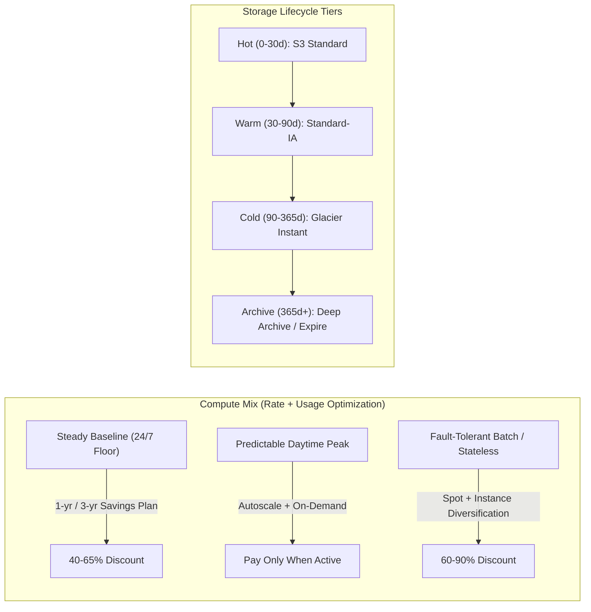
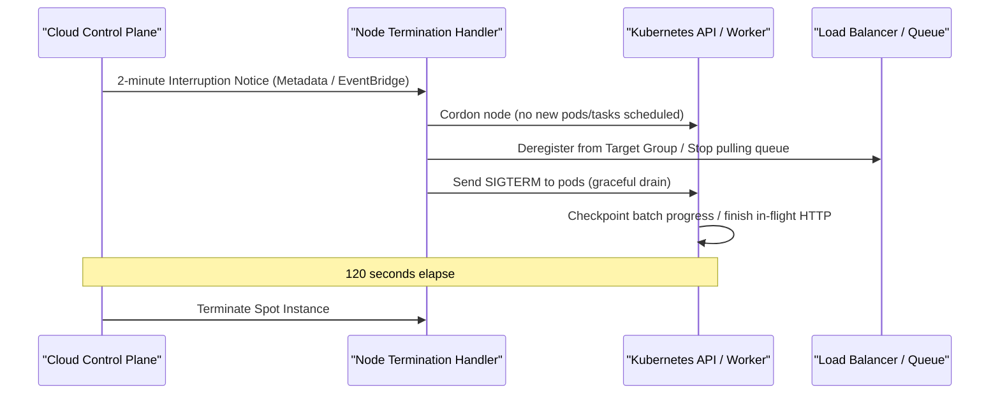
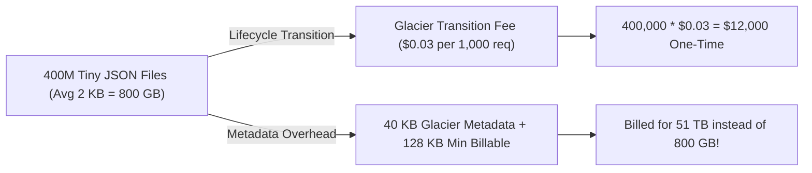

# Cloud Cost Optimization: Right-Sizing, Reservations, Spot, Storage Tiers

> **Prerequisites:** [Lesson 13: Immutable Infrastructure](../13-immutable-infrastructure/README.md) · [Lesson 08: Kubernetes Autoscaling](../08-kubernetes-autoscaling/README.md).  
> **Estimated Reading Time:** 22–28 minutes  
> **Target Audience:** Backend and platform engineers managing cloud spend (FinOps), and candidates asked "how do you cut a runaway cloud bill by 40–60% without hurting reliability?"  
> **Free PDF Notes:** [Download SD-V-014.pdf](https://backendroadmap.com/notes/system-design/SD-V-014.pdf)

> [!NOTE]
> **In one line:** **Cloud cost optimization (FinOps)** aligns cloud spend with actual business value by eliminating idle waste (**right-sizing**, **autoscaling**, **storage tiering**) and trading flexibility for steep unit-price discounts (**Reserved Instances / Savings Plans** for steady baseline, **Spot / Preemptible** for fault-tolerant bursts).

> [!TIP]
> **The Golden Rule:** **Optimize usage before you optimize rate.** Buying a 3-year Reserved Instance for an oversized, 8%-utilized VM just locks in 70% waste for 36 months. Right-size and autoscale first, then commit to Savings Plans for the steady floor.

---

## 1. What Cloud Cost Optimization Is, and What It Isn't

A startup provisions 40 `c6i.4xlarge` (16 vCPU, 32 GB RAM) VMs at launch to be "safe," runs them 24/7 on On-Demand pricing, stores 80 TB of unaccessed application logs in S3 Standard, and leaves staging clusters running all weekend. Monthly cloud bill: $48,000, while average CPU utilization sits at 9%.

| Term | Precise Meaning | Example |
| :--- | :--- | :--- |
| **Right-sizing** | Matching instance vCPU, memory, and IOPS to observed $p_{95}/p_{99}$ demand | Downsizing `m6i.4xlarge` (10% CPU) to `m6i.large` |
| **Reserved Instances (RI) / Savings Plans** | 1- or 3-year commitment to steady compute usage for 30–72% discount | 1-year Compute Savings Plan covering the 24/7 baseline |
| **Spot / Preemptible instances** | Spare cloud capacity at 60–90% discount that can be reclaimed with 30–120 s notice | Stateless batch workers, CI runners, Spark executors |
| **Storage tiering** | Moving cold data to cheaper storage classes automatically via lifecycle rules | S3 Standard ($0.023/GB) $\to$ Glacier Instant ($0.004/GB) |
| **FinOps** | Cross-functional practice of cost visibility, chargeback/showback, and unit economics | Tracking "cost per 1,000 API requests" or "cost per tenant" |
| **Scale-to-zero** | Shutting down non-prod or idle serverless/worker compute outside business hours | Stopping dev/staging EKS nodes nights & weekends (-65% hours) |
| **Not** | Blindly cutting capacity until $p_{99}$ latency degrades or error budgets burn | Removing multi-AZ redundancy to save 50% on a Tier-0 database |

### Why It Matters
1. **Cloud spend is variable COGS:** In SaaS companies, unoptimized cloud bills routinely consume 15–30% of gross revenue, directly compressing margins.
2. **Unit economics drive architecture:** Knowing that a feature costs $0.002 per user/month vs $0.45 per user/month determines whether it is viable at scale.
3. **Interview signal:** Senior/Staff interviews increasingly test whether you can balance availability SLOs against real-world compute, storage, and commitment trade-offs.

---

## 2. Anatomy: The Three-Layer Compute & Storage Optimization Stack



A well-architected fleet never runs 100% On-Demand and never runs 100% Spot. It uses a **portfolio strategy**:
1. **Baseline floor:** Covered by 1-year or 3-year Commitments (Savings Plans / Committed Use Discounts).
2. **Elastic buffer:** Covered by On-Demand autoscaling for latency-sensitive spikes when Spot pools are scarce.
3. **Interruptible/stateless overflow:** Covered by Spot instances diversified across 4+ instance families and multiple Availability Zones.

| Pricing Model | Discount vs On-Demand | Commitment | Interruption Risk | Best Workload Fit |
| :--- | :--- | :--- | :--- | :--- |
| **On-Demand** | 0% (baseline) | None (per-second) | None | Unpredictable spikes, short-lived experiments |
| **1-Yr Savings Plan** | ~30–42% | 1 year hourly spend | None | Steady-state APIs, databases, core platform |
| **3-Yr Reserved / CUD** | ~50–65% | 3 years | None | Long-lived foundational infrastructure |
| **Spot / Preemptible** | ~60–90% | None | High (30s–2min notice) | Batch jobs, ML training, stateless web overflow |

> [!WARNING]
> **Never rely on a single Spot instance type.** If you pin Spot workers to only `c6i.xlarge` in `us-east-1a`, a regional capacity crunch can reclaim 100% of your fleet simultaneously. Always diversify across at least 4–6 instance types/generations and multiple AZs using `price-capacity-optimized` allocation.

---

## 3. Mathematical Model: Blended Fleet Cost, Break-Even Utilization, and Storage Lifecycle

**Blended Compute Cost.** Suppose a cluster requires $C_{\text{base}}$ vCPUs 24/7, $C_{\text{peak}}$ additional vCPUs during business hours (fraction $f_p$ of the month), and $C_{\text{spot}}$ vCPUs for async workers. Let $r_{\text{od}}$ be the On-Demand hourly rate, $d_{\text{sp}}$ be the Savings Plan discount, and $d_{\text{spot}}$ be the Spot discount. Monthly cost ($730$ hours/month) is:

$$\text{Cost}_{\text{month}} = 730 \cdot r_{\text{od}} \cdot \left[ C_{\text{base}}(1 - d_{\text{sp}}) + C_{\text{peak}} \cdot f_p + C_{\text{spot}}(1 - d_{\text{spot}}) \right]$$

**Worked Numerical Example.** Consider a 100-vCPU workload at On-Demand rate $r_{\text{od}} = \$0.048/\text{vCPU-hr}$:
- **Unoptimized (100 vCPUs On-Demand 24/7):** $730 \times 100 \times 0.048 = \$3{,}504/\text{month}$.
- **Optimized Portfolio:** Right-size to 70 vCPUs total: $C_{\text{base}} = 30$ on 1-yr Savings Plan ($d_{\text{sp}} = 0.35$), $C_{\text{peak}} = 20$ On-Demand for 10 hrs/day ($f_p = 10/24 = 0.417$), and $C_{\text{spot}} = 20$ on Spot ($d_{\text{spot}} = 0.75$):

$$\text{Cost}_{\text{opt}} = 730 \times 0.048 \times \left[ 30(0.65) + 20(0.417) + 20(0.25) \right] = 35.04 \times (19.5 + 8.34 + 5.0) = \$1{,}150.71/\text{month}$$

That is a **67.2% cost reduction** ($3,504 $\to$ $1,151/month) with zero loss of peak capacity.

**Reservation Break-Even Point.** When is a 1-year Reservation (discount $d$) cheaper than On-Demand if the instance is only used for fraction $u$ of the year?

$$u \cdot r_{\text{od}} > (1 - d) \cdot r_{\text{od}} \implies u_{\text{break-even}} = 1 - d$$

If $d = 0.38$ (38% discount), $u_{\text{break-even}} = 62\%$ utilization (~15 hours/day). If your dev cluster only runs 40 hours/week ($40/168 = 23.8\%$), **On-Demand with night/weekend shutdown is far cheaper than a 1-year Reservation.**

---

## 4. Metrics & Percentiles

| Metric | Meaning | Alert when |
| :--- | :--- | :--- |
| **CPU / Memory utilization $p_{95}$** | Peak normal resource usage vs provisioned capacity | $p_{95} < 25\%$ (over-provisioned) or $> 85\%$ (saturation risk) |
| **Commitment coverage %** | Share of steady-state compute covered by RIs/Savings Plans | Drops below 70% or exceeds 90% (over-committed) |
| **Commitment utilization %** | Share of purchased RIs/Savings Plans actually consumed | Drops below 98% (paying for unused commitments) |
| **Spot interruption rate** | % of Spot instances reclaimed per day | Exceeds 5–10% (expand instance family diversification) |
| **Unattached / orphaned waste** | Unattached EBS volumes, idle Load Balancers, old snapshots | Any orphaned resource older than 7 days |
| **Unit cost (e.g. $/1M requests)** | Total infra cost divided by business throughput metric | Week-over-week increase > 10% without feature change |

### Worked Example (Storage Tiering Savings)
An analytics platform ingests 5 TB/month of JSON/Parquet event logs with 12-month retention (60 TB steady state).
- **All in S3 Standard ($0.023/GB-mo):** $60{,}000 \times \$0.023 = \$1{,}380/\text{month}$.
- **With Lifecycle Policy:** Month 1 (5 TB) in S3 Standard ($0.023), Months 2–3 (10 TB) in S3 Standard-IA ($0.0125), Months 4–12 (45 TB) in Glacier Instant Retrieval ($0.004):

$$(5{,}000 \times 0.023) + (10{,}000 \times 0.0125) + (45{,}000 \times 0.004) = 115 + 125 + 180 = \$420/\text{month}$$

**Savings: 69.6%** ($960/month saved) with millisecond retrieval still preserved for all 12 months.

---

## 5. Compounding & Failure Modes

| Failure Mode | Mechanism | Quantitative Impact |
| :--- | :--- | :--- |
| **Zombie / orphaned resources** | Deleted VMs leave behind unattached EBS volumes, Elastic IPs, and snapshots | 200 orphaned 500 GB gp3 volumes = **$8,000/mo** silent burn |
| **Small-object tiering penalty** | Transitioning millions of < 128 KB files to S3 Standard-IA or Glacier | Minimum 128 KB billing + $0.01–$0.03 per 1,000 transition requests **increases** the bill |
| **Spot capacity cliff** | Relying on Spot for stateful or single-family workloads without fallback | Reclaim storm drops 50% of workers; queue backs up for hours |
| **Over-committed 3-yr RIs** | Buying 3-year zonal RIs before migrating to ARM/Graviton or serverless | Locked into obsolete x86 spend for 36 months |
| **Autoscaler thrashing** | Aggressive scale-down without cooldown triggers constant cold-start rebuilds | High p99 latency + wasted boot minutes billed on every cycle |

---

## 6. Numbers Every Engineer Must Know

| Item | Typical | Implication |
| :--- | :--- | :--- |
| **On-Demand x86 vCPU (AWS/GCP)** | ~$0.04–$0.05 / vCPU-hr (~$30–$36/mo) | Baseline unit for compute sizing math |
| **ARM / Graviton instances** | ~20% cheaper, ~15–25% better perf/$ | Often a ~35% effective cost win with a recompile |
| **1-yr Compute Savings Plan** | ~30–40% off On-Demand | Flexible across instance families, OS, and regions |
| **Spot / Preemptible discount** | ~60–90% off On-Demand | Always check interruption rates (< 5% target) |
| **S3 Standard vs Glacier Deep Archive** | $0.023/GB vs $0.00099/GB (23x cheaper) | Archive compliance logs, never keep them in Hot tier |
| **EBS gp3 vs gp2** | $0.08/GB vs $0.10/GB (20% cheaper) | gp3 decouples IOPS from size—free 20% win |
| **Non-prod schedule savings** | 40 hrs/wk vs 168 hrs/wk (**76% fewer hours**) | Auto-stopping dev/staging saves more than RIs |

---

## 7. Protocol / Mechanism Deep Dive: Spot Interruption Handling



### When NOT to Optimize for Cost First
- **Pre-PMF / Early-Stage Startups:** Engineering time costs $150+/hr. Spending 2 weeks to save $300/month on Spot automation is negative ROI. Fix obvious waste (oversized DBs, zombie volumes) and ship product.
- **Tier-0 Stateful Primaries & Single-Region Quorum:** Never put primary transactional databases or ZooKeeper/etcd consensus leaders on Spot/Preemptible nodes.

---

## 8. Hierarchical Budgets & Design Rules

| Slice | Rule | Control |
| :--- | :--- | :--- |
| **Visibility & Tagging** | 100% of resources tagged with `team`, `service`, `env`, `cost-center` | Terraform/OPA policy blocks untagged resources in CI |
| **Non-Production** | Auto-suspend dev/staging outside working hours (or ephemeral PR envs) | Cloud Custodian / kube-green / scheduled ASG scaling to 0 |
| **Compute Sizing** | Right-size monthly using $p_{95}$ CPU/mem; migrate compatible services to ARM | VPA recommendations + Graviton multi-arch Docker builds |
| **Commitments** | Cover 70–80% of *post-right-sized* steady baseline with 1-yr Savings Plans | Quarterly FinOps review; avoid 3-yr zonal lock-in early |
| **Spot Compute** | Use Spot for stateless/batch with $\ge 4$ diversified instance families | Karpenter / AWS Fleet `price-capacity-optimized` + fallback to On-Demand |
| **Storage** | Compress + compact small files (> 1 MB); enforce S3/GCS lifecycle rules | Intelligent-Tiering or explicit 30d/90d/365d expiration rules |

---

## 9. Top Mitigations

1. **Right-size before committing:** Run VPA or CloudWatch/GCP Recommender for 14 days to find true $p_{95}$ usage before buying any Reservation or Savings Plan.
2. **Adopt ARM64 (Graviton / Tau T2A):** Modern Go, Python, Node, and JVM workloads run natively on ARM64 for ~20% lower hourly cost and higher throughput.
3. **Compact small objects before tiering:** Batch small logs/events into 10–100 MB Parquet/gzip files so S3 Standard-IA/Glacier minimum object-size fees (128 KB) and transition charges don't eat your savings.
4. **Automate orphan cleanup:** Schedule weekly sweeps for unattached EBS/PD disks, unused Elastic IPs, and snapshots older than retention policy.
5. **Migrate EBS `gp2` to `gp3` and delete unused NAT Gateways:** `gp3` is an immediate 20% discount with better baseline IOPS; VPC Gateway Endpoints for S3/DynamoDB eliminate NAT Gateway per-GB charges.
6. **Set hard billing anomaly alerts:** Configure cloud budget alerts at 50%, 80%, and 100% of monthly forecast plus daily anomaly detection (> 20% day-over-day spike).

---

## 10. Production Reference / War Story: The $42,000 S3 Lifecycle Mistake

**Incident:** A data engineering team enabled an S3 Lifecycle rule to transition 400 million JSON telemetry objects from S3 Standard to S3 Glacier Flexible Retrieval after 7 days, expecting to cut their $9,000/month storage bill by 80%. Instead, the next month's AWS bill spiked by **$42,000**.



**Root Cause:** Each telemetry event was written as an individual 2 KB JSON object (400 million objects = 800 GB total). Transitioning 400M objects incurred `$0.03 per 1,000` transition API calls ($12,000), and Glacier adds 32–40 KB of metadata per object billed at Standard rates plus a 90-day minimum storage duration penalty when objects were later deleted.

**Fix:**
1. Immediately disabled the per-object transition rule.
2. Inserted a Kinesis Firehose / vector batching stage that buffers events into **50 MB compressed Parquet files** (reducing 400M objects to ~16,000 objects).
3. Re-enabled lifecycle tiering on the compacted Parquet files—cutting total storage + transition cost to **$45/month**.

---

## 11. Multi-Language Production Code Tabs

These examples implement a **FinOps fleet cost & break-even calculator** plus a **Spot interruption graceful-drain handler** (handling `SIGTERM` / cloud termination notices cleanly).

````carousel
```go
// Go: FinOps blended fleet cost calculator & Spot graceful shutdown handler.
package main

import (
	"context"
	"fmt"
	"os/signal"
	"syscall"
	"time"
)

type FleetMix struct {
	BaseVCPU      float64
	PeakVCPU      float64
	PeakFraction  float64
	SpotVCPU      float64
	OnDemandRate  float64
	SavingsDisc   float64
	SpotDisc      float64
}

func MonthlyCost(f FleetMix) float64 {
	const hoursPerMonth = 730.0
	effectiveVCPU := f.BaseVCPU*(1-f.SavingsDisc) +
		f.PeakVCPU*f.PeakFraction +
		f.SpotVCPU*(1-f.SpotDisc)
	return hoursPerMonth * f.OnDemandRate * effectiveVCPU
}

func BreakEvenUtilization(discount float64) float64 {
	return 1.0 - discount
}

func RunSpotWorker(ctx context.Context) {
	sigCtx, stop := signal.NotifyContext(ctx, syscall.SIGTERM, syscall.SIGINT)
	defer stop()

	fmt.Println("Spot worker running; listening for 2-min termination notice (SIGTERM)...")
	select {
	case <-sigCtx.Done():
		fmt.Println("Interruption notice received: checkpointing state & draining...")
		time.Sleep(100 * time.Millisecond) // flush checkpoints/in-flight jobs
		fmt.Println("Graceful drain complete.")
	case <-time.After(200 * time.Millisecond):
		fmt.Println("Sample batch completed.")
	}
}

func main() {
	mix := FleetMix{
		BaseVCPU: 30, PeakVCPU: 20, PeakFraction: 10.0 / 24.0,
		SpotVCPU: 20, OnDemandRate: 0.048, SavingsDisc: 0.35, SpotDisc: 0.75,
	}
	fmt.Printf("Optimized monthly cost: $%.2f\n", MonthlyCost(mix))
	fmt.Printf("RI Break-even utilization (38%% off): %.1f%%\n", BreakEvenUtilization(0.38)*100)
	RunSpotWorker(context.Background())
}
```
<!-- slide -->
```typescript
// TypeScript: Cloud cost portfolio optimizer & S3 storage tiering estimator.
export interface StorageTierConfig {
  monthlyIngestGb: number;
  hotMonths: number;
  warmMonths: number;
  coldMonths: number;
}

export function estimateStorageMonthlyCost(cfg: StorageTierConfig): {
  unoptimizedUsd: number;
  tieredUsd: number;
  savingsPercent: number;
} {
  const totalMonths = cfg.hotMonths + cfg.warmMonths + cfg.coldMonths;
  const totalGb = cfg.monthlyIngestGb * totalMonths;

  const unoptimizedUsd = totalGb * 0.023; // All S3 Standard
  const tieredUsd =
    cfg.monthlyIngestGb * cfg.hotMonths * 0.023 +
    cfg.monthlyIngestGb * cfg.warmMonths * 0.0125 +
    cfg.monthlyIngestGb * cfg.coldMonths * 0.004;

  const savingsPercent = ((unoptimizedUsd - tieredUsd) / unoptimizedUsd) * 100;
  return {
    unoptimizedUsd: Number(unoptimizedUsd.toFixed(2)),
    tieredUsd: Number(tieredUsd.toFixed(2)),
    savingsPercent: Number(savingsPercent.toFixed(1)),
  };
}

export function shouldCompactBeforeTiering(avgObjectSizeKb: number): boolean {
  // S3 Standard-IA & Glacier bill a 128 KB minimum per object
  return avgObjectSizeKb < 128;
}

console.log(estimateStorageMonthlyCost({ monthlyIngestGb: 5000, hotMonths: 1, warmMonths: 2, coldMonths: 9 }));
console.log("Needs compaction (2 KB files):", shouldCompactBeforeTiering(2));
```
<!-- slide -->
```python
# Python: FinOps right-sizing, commitment break-even & storage tiering model (stdlib only).
from dataclasses import dataclass


@dataclass(frozen=True)
class ComputePortfolio:
    base_vcpu: float
    peak_vcpu: float
    peak_hours_per_day: float
    spot_vcpu: float
    ondemand_rate: float = 0.048
    savings_plan_discount: float = 0.35
    spot_discount: float = 0.75

    def monthly_cost(self) -> float:
        peak_fraction = self.peak_hours_per_day / 24.0
        eff_vcpu = (
            self.base_vcpu * (1.0 - self.savings_plan_discount)
            + self.peak_vcpu * peak_fraction
            + self.spot_vcpu * (1.0 - self.spot_discount)
        )
        return 730.0 * self.ondemand_rate * eff_vcpu

    def unoptimized_cost(self, total_vcpu: float) -> float:
        return 730.0 * self.ondemand_rate * total_vcpu


def ri_break_even_hours_per_week(discount: float) -> float:
    return (1.0 - discount) * 168.0


if __name__ == "__main__":
    p = ComputePortfolio(base_vcpu=30, peak_vcpu=20, peak_hours_per_day=10, spot_vcpu=20)
    print(f"Unoptimized (100 vCPU 24/7): ${p.unoptimized_cost(100):,.2f}/mo")
    print(f"Optimized portfolio:         ${p.monthly_cost():,.2f}/mo")
    print(f"Break-even for 38% RI:       {ri_break_even_hours_per_week(0.38):.1f} hrs/week")
```
<!-- slide -->
```csharp
// C#: Cloud commitment break-even & storage lifecycle cost estimator.
using System;

public static class FinOpsCalculator
{
    public static double MonthlyBlendedCost(
        double baseVcpu, double peakVcpu, double peakHoursPerDay,
        double spotVcpu, double onDemandRate = 0.048,
        double savingsDiscount = 0.35, double spotDiscount = 0.75)
    {
        double peakFraction = peakHoursPerDay / 24.0;
        double effectiveVcpu = baseVcpu * (1.0 - savingsDiscount)
                             + peakVcpu * peakFraction
                             + spotVcpu * (1.0 - spotDiscount);
        return 730.0 * onDemandRate * effectiveVcpu;
    }

    public static bool IsReservationWorthwhile(double activeHoursPerWeek, double discount)
    {
        double utilization = activeHoursPerWeek / 168.0;
        double breakEven = 1.0 - discount;
        return utilization >= breakEven;
    }
}
```
````

---

## 12. Hands-On CLI Verification Workflows

Audit idle resources, EBS `gp2` waste, S3 storage classes, and Kubernetes resource requests:

```bash
# 1. Find unattached EBS volumes (silent monthly waste)
aws ec2 describe-volumes --filters Name=status,Values=available \
  --query "Volumes[*].{ID:VolumeId,SizeGB:Size,Type:VolumeType,AZ:AvailabilityZone}" --output table

# 2. Find legacy gp2 EBS volumes eligible for a free 20% cost cut by migrating to gp3
aws ec2 describe-volumes --filters Name=volume-type,Values=gp2 \
  --query "Volumes[*].{ID:VolumeId,SizeGB:Size,State:State}" --output table

# 3. Inspect Kubernetes pods with huge CPU/memory requests vs actual usage (needs metrics-server)
kubectl top pods -A --sort-by=cpu | head -n 20

# 4. Check AWS Savings Plans utilization and coverage for the last 30 days
aws ce get-savings-plans-utilization \
  --time-period Start=$(date -d '30 days ago' +%Y-%m-%d),End=$(date +%Y-%m-%d)

# 5. Run the Python FinOps verification check
python -c "print(f'1-yr 38% RI break-even: {(1-0.38)*168:.1f} hrs/week')"
```

---

## 13. Common Mistakes to Avoid

1. **Buying Reservations/Savings Plans before right-sizing**, locking in oversized idle capacity for 1–3 years.
2. **Running non-prod environments 24/7** when simple night/weekend shutdown saves ~75% without any commitment.
3. **Putting small (< 128 KB) objects into S3 Standard-IA or Glacier**, where transition fees and minimum object sizes inflate the bill.
4. **Pinning Spot workloads to a single instance type and AZ**, guaranteeing fleet-wide outages during capacity reclaims.
5. **Forgetting orphaned storage** (unattached EBS volumes, snapshots from decommissioned DBs, idle Load Balancers).
6. **Routing S3/DynamoDB traffic through NAT Gateways** ($0.045/GB) instead of free VPC Gateway Endpoints.
7. **Optimizing infrastructure cost while ignoring architectural cost drivers** (chatty cross-AZ calls, unindexed queries, missing caches).

---

## 14. Key Terms Glossary

| Key Term | Definition |
| :--- | :--- |
| **FinOps** | Cloud financial management discipline combining engineering, finance, and product for cost accountability. |
| **Right-sizing** | Adjusting compute instance types and container requests/limits to match actual $p_{95}/p_{99}$ usage. |
| **Reserved Instance (RI)** | Capacity/billing commitment (1 or 3 years) trading flexibility for 30–65% lower hourly rates. |
| **Savings Plan** | Flexible commitment to a fixed $/hour compute spend across instance families and regions. |
| **Spot / Preemptible** | Excess cloud capacity sold at 60–90% discount that can be reclaimed with short notice. |
| **Storage tiering** | Moving data across Hot, Warm, Cold, and Archive classes based on access frequency and age. |
| **Break-even utilization** | Minimum % of time an instance must run for a Reservation to beat On-Demand ($1 - \text{discount}$). |
| **Orphaned resource** | Cloud asset (volume, IP, snapshot, LB) still incurring charges after its parent workload was deleted. |
| **Unit economics** | Cost measured per business unit (cost per order, cost per 1M API calls, cost per tenant). |
| **Scale-to-zero** | Automatically terminating all compute when demand is absent (dev environments, serverless, KEDA). |

---

## 15. System Design Interview Questions & Answers

### Basic Conceptual Questions

<details>
<summary><strong>Q1: In what order should you apply cloud cost optimization techniques? [BASIC]</strong></summary>

**Answer:**
First, **eliminate waste and right-size** (delete orphans, turn off non-prod at night, downsize over-provisioned instances, enable autoscaling). Second, **optimize architecture** (caching, ARM/Graviton, storage compaction/tiering). Third, **optimize rates** by buying 1-yr/3-yr Savings Plans for the remaining steady-state baseline and using Spot for fault-tolerant bursts.
</details>

<details>
<summary><strong>Q2: What is the difference between Reserved Instances and Savings Plans? [BASIC]</strong></summary>

**Answer:**
Standard Reserved Instances often tie your discount to a specific instance family, OS, and region (or AZ for capacity reservations). **Compute Savings Plans** commit you to a fixed dollar-per-hour spend and automatically apply discounts across instance families, sizes, regions, Fargate, and Lambda—making them much safer as architectures evolve.
</details>

<details>
<summary><strong>Q3: When is On-Demand cheaper than a 1-year Reserved Instance? [BASIC]</strong></summary>

**Answer:**
Whenever actual usage is below the break-even utilization $u = 1 - \text{discount}$. For a 38% discount, break-even is 62% (~104 hours/week). A staging environment running 45 hours/week (27% utilization) is over 2x cheaper on On-Demand with automated night/weekend shutdown than on a 1-year RI.
</details>

<details>
<summary><strong>Q4: What workloads are good vs bad fits for Spot instances? [BASIC]</strong></summary>

**Answer:**
**Good fits:** stateless HTTP workers behind a load balancer, CI/CD build runners, batch ETL, Spark executors, and checkpointed ML training. **Bad fits:** primary relational databases, single-node caches, consensus leaders (etcd/ZooKeeper), or long-running uncheckpointed jobs that lose hours of work on interruption.
</details>

### Scenario-Based Architecture Questions

<details>
<summary><strong>Q5: Your company's AWS bill jumped 40% in 3 months while user traffic only grew 10%. How do you diagnose and fix it? [SCENARIO]</strong></summary>

**Answer:**
Break down the bill by service and cost tag. Common culprits: (1) unconstrained log ingestion/retention in CloudWatch or Datadog; (2) data transfer/NAT Gateway spikes from cross-AZ or S3 traffic; (3) orphaned EBS volumes/snapshots from CI or scaling; (4) over-provisioned RDS/Elasticache instances. Fix the top 2–3 drivers by cost impact, add unit-cost dashboards ($/1M requests), and set daily anomaly alerts.
</details>

<details>
<summary><strong>Q6: How do you run a latency-sensitive web API on Spot instances without causing 502 errors during reclaims? [SCENARIO]</strong></summary>

**Answer:**
Use a **mixed fleet**: keep a baseline (e.g., 30–50%) on On-Demand/Savings Plans so a Spot reclaim never drops you below minimum capacity. Diversify Spot across 5+ instance families and multiple AZs using `price-capacity-optimized` allocation. Run a node termination handler that catches the 2-minute interruption notice, cordons the node, deregisters it from the ALB, and drains in-flight requests gracefully.
</details>

<details>
<summary><strong>Q7: You have 500 TB of compliance audit logs that must be kept for 7 years and queried once a quarter. How do you store them? [SCENARIO]</strong></summary>

**Answer:**
Batch and compress logs into 50–100 MB Parquet/gzip files, keep the last 7–30 days in S3 Standard for active debugging, and use an S3 Lifecycle rule to transition older files directly to **S3 Glacier Deep Archive** ($0.00099/GB-month—~23x cheaper than Standard). For quarterly audits, restore only the specific date partition needed and query with Athena/Trino.
</details>

<details>
<summary><strong>Q8: How do you prevent Kubernetes developers from over-requesting CPU/memory and wasting 60% of cluster capacity? [SCENARIO]</strong></summary>

**Answer:**
Deploy **Vertical Pod Autoscaler (VPA)** in recommendation mode (or Goldilocks) to surface actual $p_{95}$ usage vs requests, enforce `LimitRange` defaults, use **Karpenter** to bin-pack pods onto right-sized nodes (including Graviton/Spot), and publish weekly team **showback** reports showing idle cost per namespace.
</details>

### Advanced & Tricky Interview Questions

<details>
<summary><strong>Q9: Why can transitioning data to S3 Glacier actually *increase* your AWS bill? [TRICKY]</strong></summary>

**Answer:**
Two reasons: (1) **Per-object transition fees** ($0.01–$0.03 per 1,000 objects) explode if you have hundreds of millions of tiny files; (2) **Minimum object size & retention**: Glacier bills a minimum of 128 KB per object plus 32–40 KB metadata overhead, and charges early-deletion penalties if objects are deleted before 90–180 days. Always compact small files first.
</details>

<details>
<summary><strong>Q10: Why is 100% Savings Plan / RI coverage an anti-pattern? [TRICKY]</strong></summary>

**Answer:**
Traffic is rarely flat 24/7/365. Covering 100% of peak means you are paying for idle commitments during troughs, weekends, and after future efficiency improvements (like migrating to Graviton or caching). Target **70–80% coverage of your steady-state floor** and handle peaks with autoscaling On-Demand or Spot.
</details>

<details>
<summary><strong>Q11: How do you decide between increasing CPU utilization to save money vs keeping headroom for tail latency? [TRICKY]</strong></summary>

**Answer:**
By queueing theory ($W \propto \frac{1}{1-\rho}$), pushing CPU utilization above 80–85% causes non-linear $p_{99}$ latency spikes. For latency-sensitive user APIs, target **50–65% steady-state CPU** and rely on fast autoscaling for bursts. For latency-insensitive batch workers, target **85–95% CPU** to maximize throughput per dollar.
</details>

<details>
<summary><strong>Q12: A team proposes migrating all services to AWS Lambda to "pay only for what we use." When is Lambda *more* expensive than containers/VMs? [TRICKY]</strong></summary>

**Answer:**
At high, steady throughput. Lambda charges a premium per GB-second plus per-invocation fees. A steady 1,000 RPS workload with 50 ms duration often costs **2–4x more** on Lambda than on right-sized Savings-Plan Fargate/EKS or EC2 instances. Serverless wins on **spiky, low-utilization, or scale-to-zero** workloads; containers/VMs win on steady high-volume compute.
</details>

---

## 16. One-Page Master Cheat Sheet

```
+---------------------------------------------------------------------------------------------------------+
|                    CLOUD COST OPTIMIZATION — MASTER CHEAT SHEET                                         |
+---------------------------------------------------------------------------------------------------------+
| 1. GOLDEN ORDER: Right-size & delete waste -> Optimize architecture (ARM, cache) -> Buy Commitments.    |
+---------------------------------------------------------------------------------------------------------+
| 2. PORTFOLIO MIX: 70-80% baseline = 1-yr Savings Plan (35-40% off).                                     |
|    Peaks = On-Demand autoscale. Batch/stateless overflow = Diversified Spot (60-90% off).               |
+---------------------------------------------------------------------------------------------------------+
| 3. BREAK-EVEN MATH: RI beats On-Demand when Utilization > (1 - Discount). Stop dev at nights/weekends.  |
+---------------------------------------------------------------------------------------------------------+
| 4. STORAGE TIERING: Compact small files (> 1 MB Parquet/gzip) BEFORE tiering to IA/Glacier (128 KB min).|
+---------------------------------------------------------------------------------------------------------+
| 5. QUICK WINS: EBS gp2->gp3 (-20%), ARM/Graviton (~35% perf/$), VPC Endpoints (kill NAT data fees).     |
+---------------------------------------------------------------------------------------------------------+
| 6. FINOPS GUARDRAILS: 100% cost-allocation tags, unit cost ($/1M req), daily anomaly alerts.            |
+---------------------------------------------------------------------------------------------------------+
```

---

## Further Reading & Sources

- J.R. Storment & Mike Fuller, *Cloud FinOps* (2nd ed.), O'Reilly Media / FinOps Foundation.
- AWS Well-Architected Framework, [Cost Optimization Pillar](https://docs.aws.amazon.com/wellarchitected/latest/cost-optimization-pillar/welcome.html).
- Google Cloud Architecture Center, [Optimize compute, storage, and commitment costs](https://cloud.google.com/architecture/framework/cost-optimization).
- AWS S3 Documentation, [Transitioning objects using S3 Lifecycle (minimum size & metadata charges)](https://docs.aws.amazon.com/AmazonS3/latest/userguide/lifecycle-transition-general-considerations.html).

---

## Free PDF Notes

[SD-V-014.pdf](https://backendroadmap.com/notes/system-design/SD-V-014.pdf)

---

## Next

Continue with [Lesson 15: Cost-Aware Architecture: Egress, GPU Costs & TCO in System Design](../15-cost-aware-architecture/README.md).
