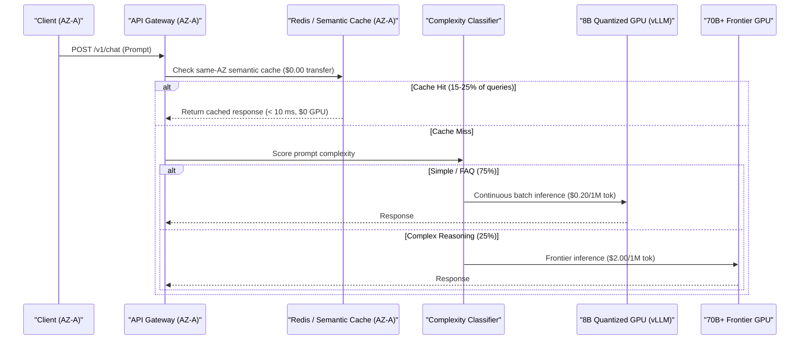
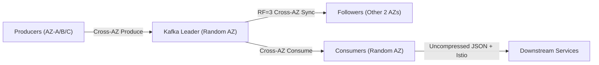

# Cost-Aware Architecture: Egress, GPU Costs & TCO in System Design

> **Prerequisites:** [Lesson 14: Cloud Cost Optimization](../14-cloud-cost-optimization/README.md) · [Lesson 02: Regions, Availability Zones & Edge](../02-regions-availability-zones-edge/README.md).  
> **Estimated Reading Time:** 24–28 minutes  
> **Target Audience:** Senior/Staff backend engineers and system designers evaluating Total Cost of Ownership (TCO), data-transfer bills, and AI/GPU serving architectures.  
> **Free PDF Notes:** [Download SD-V-015.pdf](https://backendroadmap.com/notes/system-design/SD-V-015.pdf)

> [!NOTE]
> **In one line:** **Cost-aware architecture** treats **dollars as a first-class architectural constraint** alongside latency and availability—designing topology, data placement, caching, and model routing to control hidden multipliers like **cross-AZ/internet egress**, **GPU idle time**, and **engineering TCO**.

> [!TIP]
> **The Golden Rule:** **Compute is cheap; moving bytes and keeping GPUs idle is expensive.** An architecture diagram without data-transfer arrows and Total Cost of Ownership (TCO) is incomplete—always ask *"how many bytes cross an AZ or cloud boundary per request?"*

---

## 1. What Cost-Aware Architecture Is, and What It Isn't

Two teams design the same video-and-AI analytics platform. Team A puts microservices in 3 Availability Zones with round-robin routing, sends raw 4K frames across regions for inference on dedicated H100 GPUs, and serves static assets directly from an application origin. Team B uses topology-aware AZ routing, pushes CDN caching to 95% hit ratio, compresses/downsamples frames at the edge, and routes 80% of prompts to a small distilled model. Both meet the exact same 99.95% SLO—Team A's bill is **$140,000/month**, Team B's is **$24,000/month**.

| Term | Precise Meaning | Example |
| :--- | :--- | :--- |
| **Cost-aware architecture** | Designing system topology, protocols, and data flows to minimize unit cost at a given SLO | Keeping microservice calls within the same AZ; CDN offloading |
| **Internet egress** | Outbound data transferred from cloud region to the public internet ($0.05–$0.09/GB) | Serving 500 TB/mo of video from S3 directly vs via CDN |
| **Cross-AZ / Cross-region transfer** | Data moving between Availability Zones ($0.01–$0.02/GB each way) or regions | Kafka replication or chatty gRPC across 3 AZs |
| **GPU utilization & KV-cache** | Fraction of GPU FLOPs/VRAM actively serving tokens vs sitting idle | Continuous batching (vLLM) + quantized small models |
| **TCO (Total Cost of Ownership)** | Full cost: cloud infra + third-party SaaS + engineering build/ops labor | Managed RDS ($2k/mo) vs self-hosted K8s DB ($600 infra + $15k eng time) |
| **Not** | Premature micro-optimization or sacrificing durability/security to save pennies | Skipping backups or multi-AZ on a payments ledger |

### Why It Matters
1. **Data transfer is the silent bill killer:** Unlike CPU, cross-AZ and internet egress charges scale linearly with traffic and cannot be discounted away with Savings Plans.
2. **AI/LLM workloads flip cost ratios:** A single 8x H100 node costs ~$25,000–$35,000/month On-Demand—one bad routing or batching decision burns more than an entire fleet of web servers.
3. **Build vs Buy depends on TCO, not AWS list price:** A "free" open-source tool that requires 0.5 FTE of senior SRE time costs $8,000+/month in hidden labor.

---

## 2. Anatomy: Cost Multipliers in Distributed Systems

```mermaid
flowchart LR
    User["Users (500 TB/mo)"] --> CDN["CDN Edge (95% Cache Hit, $0.008/GB)"]
    CDN -->|5% Cache Miss = 25 TB| Origin["Origin Region (us-east-1)"]
    subgraph azA["Availability Zone A (Same-AZ Free/Low-Cost)"]
        API_A["API Pod"] -->|0.00/GB Same-AZ| Cache_A["Redis Replica"]
        API_A -->|0.00/GB Same-AZ| Router["Model Router"]
        Router -->|80% Simple| SmallGPU["Small Model (L4 / T4)"]
        Router -->|20% Complex| LargeGPU["Large Model (H100 + Continuous Batch)"]
    end
    Origin --> API_A
    API_A -.->|Avoid: Cross-AZ Chatty Calls ($0.02/GB)| OtherAZ["Availability Zone B"]
```

In cloud networks (AWS, GCP, Azure), **same-AZ private IP traffic is free**, while **cross-AZ traffic costs ~$0.01/GB outbound + $0.01/GB inbound = $0.02/GB** (and **cross-region costs $0.02–$0.09/GB**). In a chatty microservice mesh or Kafka cluster with replication factor 3 across 3 AZs, every 1 MB payload can trigger 3–6 MB of cross-AZ transfer.

| Cost Driver | Hidden Multiplier | Architectural Lever |
| :--- | :--- | :--- |
| **Internet Egress** | $0.08–$0.09/GB from cloud origin | CDN caching, Brotli/Zstd compression, R2/object-store zero-egress |
| **Cross-AZ Chatty RPC** | $0.02/GB round-trip across AZs | Topology-aware routing (`trafficDistribution: PreferClose`), local read replicas |
| **NAT Gateway** | $0.045/GB processed + hourly fee | VPC Gateway Endpoints for S3/DynamoDB; private subnets without NAT |
| **GPU Inference** | $1–$4/GPU-hr (L4/A10G) to $4–$10/GPU-hr (H100) | Model routing/cascading, quantization (FP8/INT4), continuous batching |
| **Observability / Logs** | $0.50–$2.50/GB ingested + retention | Head/tail sampling, drop debug logs in prod, metrics over raw logs |
| **Engineering Ops (TCO)** | ~$150–$250k/yr per FTE | Managed services for non-differentiating infra (DBs, queues, auth) |

> [!WARNING]
> **Multi-AZ Kafka and chatty service meshes can cost more in network transfer than in compute.** A 1 GB/s Kafka stream with replication factor 3 across 3 AZs transfers ~2 GB/s cross-AZ, costing **$0.02 × 2 × 2,592,000 s ≈ $103,680/month** in network fees alone—often 3x the EC2 cost of the brokers!

---

## 3. Mathematical Model: Egress Savings, GPU Cost per Million Tokens, and TCO

**1. CDN Cache-Hit Egress Model.** Let $V$ be monthly outbound traffic (GB), $h$ be CDN cache hit ratio ($0 \le h \le 1$), $c_{\text{orig}}$ be origin internet egress ($/GB), $c_{\text{cdn}}$ be CDN egress ($/GB), and $c_{\text{cf}}$ be origin-to-CDN fill ($/GB, often $0–$0.02):

$$\text{Egress Cost} = V \cdot \left[ h \cdot c_{\text{cdn}} + (1 - h) \cdot (c_{\text{orig}} + c_{\text{cf}}) \right]$$

For $V = 500{,}000\text{ GB}$ (500 TB/mo), $c_{\text{orig}} = \$0.085/\text{GB}$, $c_{\text{cdn}} = \$0.015/\text{GB}$, $c_{\text{cf}} = \$0.00$:
- **Direct from Origin ($h = 0$):** $500{,}000 \times 0.085 = \$42{,}500/\text{month}$.
- **With CDN ($h = 0.92$):** $500{,}000 \times [0.92(0.015) + 0.08(0.085)] = 500{,}000 \times 0.0206 = \$10{,}300/\text{month}$ (**75.8% reduction**).

**2. GPU Inference Cost per 1M Tokens.** Let $P_{\text{gpu}}$ be hourly GPU node cost ($/hr), $T_{\text{sec}}$ be sustained output throughput (tokens/s) at target $p_{99}$ latency, and $u$ be average utilization ($0 < u \le 1$):

$$\text{Cost per 1M tokens} = \frac{P_{\text{gpu}}}{3600 \cdot T_{\text{sec}} \cdot u} \times 10^6$$

For an H100 node at $P_{\text{gpu}} = \$4.00/\text{hr}$ producing $T_{\text{sec}} = 1{,}200\text{ tok/s}$ under continuous batching at $u = 0.60$:

$$\text{Cost}_{\text{1M}} = \frac{4.00}{3600 \times 1200 \times 0.60} \times 10^6 = \frac{4{,}000{,}000}{2{,}592{,}000} \approx \$1.54\text{ per 1M tokens}$$

If poor batching drops utilization to $u = 0.12$, cost jumps 5x to **$7.72 per 1M tokens**.

**3. 3-Year TCO (Build vs Buy).**

$$\text{TCO}_{\text{3yr}} = 36 \cdot (\text{Infra}_{\text{mo}} + \text{License}_{\text{mo}} + \text{FTE}_{\text{ops}} \cdot \text{Salary}_{\text{mo}}) + \text{Build}_{\text{initial}}$$

---

## 4. Metrics & Percentiles

| Metric | Meaning | Alert when |
| :--- | :--- | :--- |
| **Cross-AZ bytes / request** | Average bytes crossing AZ boundaries per API call | > 10% of payload size for read-heavy paths |
| **CDN Origin Offload %** | Percentage of total egress served from edge without origin hit | Drops below 85% for static/cacheable media |
| **GPU SM / Tensor Core utilization** | Active compute time vs idle wait on GPU | < 40% during peak traffic (under-batched) |
| **Cost per 1M tokens / $p_{99}$ TTFT** | Inference unit cost alongside Time-To-First-Token $p_{99}$ | Unit cost rises > 15% or TTFT breaches SLO |
| **Observability $/GB ratio** | Logging/tracing spend as % of total compute spend | Exceeds 15–20% of compute bill |
| **Eng ops hours / month** | Time spent maintaining self-hosted stateful/platform infra | Exceeds 20% of team sprint capacity |

### Worked Example (Model Routing / Cascading)
An AI support assistant handles 100M queries/month (avg 500 output tokens = 50B tokens/mo).
- **All on Large Model ($2.00/1M tokens):** $50{,}000 \times \$2.00 = \$100{,}000/\text{month}$.
- **Cascaded Router:** A lightweight classifier routes 75% of routine FAQ queries to a fine-tuned 8B model ($0.20/1M tokens) and 25% of complex reasoning queries to the Large Model ($2.00/1M tokens):

$$(0.75 \times 50{,}000 \times 0.20) + (0.25 \times 50{,}000 \times 2.00) = 7{,}500 + 25{,}000 = \$32{,}500/\text{month}$$

**Savings: $67,500/month (67.5%)** with faster Time-To-First-Token on 75% of traffic.

---

## 5. Compounding & Failure Modes

| Failure Mode | Mechanism | Quantitative Impact |
| :--- | :--- | :--- |
| **Uncompressed JSON over cross-AZ** | Verbose JSON payloads without Zstd/Protobuf across 3 AZs | 5x payload size = 5x cross-AZ transfer fees |
| **NAT Gateway Hairpinning** | Private pods pull 100 TB/mo from S3 through a NAT Gateway | $100{,}000 \times \$0.045 = \mathbf{\$4{,}500/\text{mo}}$ wasted (vs $0 with VPC Endpoint) |
| **GPU Memory Fragmentation** | Static KV-cache allocation wastes 60–70% of VRAM | Limits batch size to 4 instead of 32; 4x higher GPU cost |
| **Logging Explosion** | Debug-level JSON logs on a 20k RPS service (2 KB/req) | $20{,}000 \times 2\text{ KB} \times 86{,}400 \approx \mathbf{3.45\text{ TB/day}}$ ($1,700+/day ingest) |
| **DIY Database Trap** | Self-hosting Kafka/Postgres to "save $1,500/mo" using 0.5 SRE FTE | $1,500 saved vs **$9,000/mo** in engineering labor + incident risk |

---

## 6. Numbers Every Engineer Must Know

| Item | Typical | Implication |
| :--- | :--- | :--- |
| **Same-AZ private traffic** | $0.00 / GB | Keep read replicas, caches, and consumers AZ-local |
| **Cross-AZ traffic (AWS/GCP)** | ~$0.02 / GB ($0.01 each way) | Avoid chatty fan-out across AZs; compress payloads |
| **Cloud Internet Egress** | ~$0.05–$0.09 / GB | Always put a CDN or zero-egress store in front of media |
| **NAT Gateway processing** | ~$0.045 / GB | Use VPC Gateway/Interface Endpoints for S3/ECR/DynamoDB |
| **Single H100 80GB GPU (On-Demand)** | ~$3.50–$5.00 / hr (~$2.5k–$3.6k/mo) | Never leave idle; use autoscaling + continuous batching |
| **Quantization (FP16 $\to$ INT4/FP8)** | ~2–4x VRAM reduction | Fits 70B models on fewer GPUs with minimal quality loss |
| **Observability ingest (SaaS)** | ~$0.50–$2.50 / GB | Sample 200 OK traces (1–5%), keep 100% of 5xx/slow traces |

---

## 7. Protocol / Mechanism Deep Dive: Topology-Aware Routing & Model Cascading



### When NOT to Prioritize Cost-Driven Architecture
- **Strict Active-Active Consistency Over Cost:** If a financial ledger requires synchronous multi-AZ quorum writes (Raft/Paxos), you *must* pay the cross-AZ network cost; never disable multi-AZ quorum to save $0.02/GB.
- **Compliance/Data Residency Constraints:** If GDPR requires keeping EU data strictly in `eu-central-1`, you cannot route it to a cheaper US GPU region.

---

## 8. Hierarchical Budgets & Design Rules

| Slice | Rule | Control |
| :--- | :--- | :--- |
| **Network Topology** | Prefer AZ-local reads (`PreferClose`); compress RPCs (> 1 KB) with Zstd/Protobuf | Kubernetes Topology Aware Routing; gRPC compression |
| **Internet Egress** | Serve all static/cacheable assets via CDN or zero-egress object store | `Cache-Control` headers + Cloudflare R2 / CloudFront |
| **NAT & Private Endpoints** | Route S3, DynamoDB, ECR, and Secrets Manager via VPC Endpoints | Terraform VPC module enforces gateway endpoints by default |
| **GPU & AI Serving** | Use continuous batching (PagedAttention), quantization, and model cascading | vLLM / TGI; semantic caching; scale-to-zero on dev GPUs |
| **Observability** | Tail-based trace sampling (100% errors, 1% healthy); drop `DEBUG` logs in prod | OpenTelemetry Collector tail-sampling processor |
| **TCO / Build vs Buy** | Buy managed services for non-differentiating infra unless scale > $20k/mo | Architecture Decision Record (ADR) requiring 3-yr TCO math |

---

## 9. Top Mitigations

1. **Enable Topology-Aware Routing in Kubernetes (`trafficDistribution: PreferClose`):** Keeps pod-to-pod and pod-to-cache traffic inside the same AZ during normal operation, cutting cross-AZ bills by 60–80% while still failing over across AZs if an AZ degrades.
2. **Deploy VPC Gateway Endpoints:** Eliminate $0.045/GB NAT Gateway charges for S3 and container registry (ECR) pulls in 5 minutes of Terraform.
3. **Put a CDN + Compression in front of every public endpoint:** Brotli/Zstd shrinks text/JSON payloads by 70–80%, and CDN caching cuts origin egress by 85–95%.
4. **Use Semantic Caching + Model Cascading for LLMs:** Cache frequent queries in Redis/pgvector and route simple prompts to small quantized models before touching expensive frontier GPUs.
5. **Sample healthy telemetry at the edge:** Keep 100% of error and slow ($> p_{95}$) traces via OpenTelemetry tail sampling, and sample healthy `200 OK` traces at 1–5%.
6. **Evaluate 3-year TCO honestly before self-hosting:** Factor in on-call rotation, upgrades, security patching, and incident risk—not just EC2 vs RDS list prices.

---

## 10. Production Reference / War Story: The $85,000 Cross-AZ Kafka & Envoy Bill

**Incident:** A fintech platform migrated to a 3-AZ Kubernetes cluster with Istio service mesh and a self-managed Kafka cluster. Compute costs were $32,000/month as expected, but the monthly AWS Data Transfer bill unexpectedly hit **$85,000/month**—more than 2.5x the entire compute fleet.



**Root Cause:**
1. Producers and consumers connected to Kafka partitions randomly across all 3 AZs, paying $0.02/GB on produce, $0.02/GB on replication, and $0.02/GB on consume.
2. Events were uncompressed JSON (~4 KB each) instead of Zstd-compressed Protobuf (~600 bytes).
3. Envoy sidecars in the service mesh routed microservice calls round-robin across all 3 AZs instead of preferring local AZ endpoints.

**Fix:**
1. Enabled **Kafka Rack-Aware Consumer Fetching** (`client.rack` = node AZ) so consumers read from the local-AZ follower replica.
2. Switched Kafka producer compression to `zstd` and Protobuf (cutting wire bytes by **85%**).
3. Enabled Istio locality-weighted load balancing (`localityLbSetting`) and Kubernetes `PreferClose`.
4. **Result:** Data transfer dropped from **$85,000/mo to $9,400/mo** (an 89% reduction).

---

## 11. Multi-Language Production Code Tabs

These examples implement a **Cost-Aware Architecture TCO & Inference Router** (computing egress savings, GPU cost per 1M tokens, 3-year Build-vs-Buy TCO, and model-cascading route selection).

````carousel
```go
// Go: Cost-aware egress, GPU token cost, and 3-year Build-vs-Buy TCO calculator.
package main

import "fmt"

func EgressMonthlyCost(volumeGB, hitRatio, cdnRate, originRate float64) float64 {
	return volumeGB * (hitRatio*cdnRate + (1.0-hitRatio)*originRate)
}

func GpuCostPerMillionTokens(gpuHourlyUSD, tokensPerSec, utilization float64) float64 {
	if tokensPerSec <= 0 || utilization <= 0 {
		return 0
	}
	return (gpuHourlyUSD / (3600.0 * tokensPerSec * utilization)) * 1_000_000.0
}

func ThreeYearTCO(monthlyInfra, monthlyLicense, fteCount, monthlyFteCost, initialBuild float64) float64 {
	return 36.0*(monthlyInfra+monthlyLicense+fteCount*monthlyFteCost) + initialBuild
}

func main() {
	cdnCost := EgressMonthlyCost(500_000, 0.92, 0.015, 0.085)
	tokCost := GpuCostPerMillionTokens(4.00, 1200, 0.60)
	diyTCO := ThreeYearTCO(1200, 0, 0.5, 16000, 25000)
	managedTCO := ThreeYearTCO(3200, 0, 0.05, 16000, 3000)

	fmt.Printf("500TB Egress w/ 92%% CDN hit: $%.2f/mo\n", cdnCost)
	fmt.Printf("H100 Cost per 1M tokens:      $%.2f\n", tokCost)
	fmt.Printf("3-yr TCO (DIY vs Managed):    $%.0f vs $%.0f\n", diyTCO, managedTCO)
}
```
<!-- slide -->
```typescript
// TypeScript: Cost-aware LLM model router + cross-AZ transfer estimator.
export type ModelTier = "cache" | "small_8b" | "large_70b";

export interface RouteDecision {
  tier: ModelTier;
  estimatedCostPer1MTokens: number;
}

export function routePrompt(
  prompt: string,
  cacheHit: boolean,
  complexityScore: number
): RouteDecision {
  if (cacheHit) {
    return { tier: "cache", estimatedCostPer1MTokens: 0.0 };
  }
  // Route routine queries (< 0.7 complexity) to distilled/quantized 8B model
  if (complexityScore < 0.7 && prompt.length < 2000) {
    return { tier: "small_8b", estimatedCostPer1MTokens: 0.2 };
  }
  return { tier: "large_70b", estimatedCostPer1MTokens: 2.0 };
}

export function monthlyCrossAzCost(
  gbPerSecond: number,
  azReplicationFactor: number,
  ratePerGb = 0.02
): number {
  const secondsPerMonth = 2_592_000;
  const crossAzGbPerSec = gbPerSecond * Math.max(0, azReplicationFactor - 1);
  return crossAzGbPerSec * secondsPerMonth * ratePerGb;
}

console.log(routePrompt("Reset my password", false, 0.2));
console.log("1 GB/s RF=3 cross-AZ cost:", monthlyCrossAzCost(1.0, 3));
```
<!-- slide -->
```python
# Python: Cost-aware architecture TCO, egress, and GPU unit-cost model (stdlib only).
def egress_monthly_cost(volume_gb: float, hit_ratio: float, cdn_rate: float, origin_rate: float) -> float:
    return volume_gb * (hit_ratio * cdn_rate + (1.0 - hit_ratio) * origin_rate)


def gpu_cost_per_1m_tokens(gpu_hourly: float, tokens_per_sec: float, utilization: float) -> float:
    return (gpu_hourly / (3600.0 * tokens_per_sec * utilization)) * 1_000_000.0


def three_year_tco(infra_mo: float, ops_fte: float, fte_cost_mo: float = 16_000.0, build_once: float = 0.0) -> float:
    return 36.0 * (infra_mo + ops_fte * fte_cost_mo) + build_once


if __name__ == "__main__":
    print(f"Egress (0% vs 92% CDN): ${egress_monthly_cost(500_000, 0, 0.015, 0.085):,.0f} vs ${egress_monthly_cost(500_000, 0.92, 0.015, 0.085):,.0f}")
    print(f"GPU $/1M tok (60% vs 12% util): ${gpu_cost_per_1m_tokens(4.0, 1200, 0.60):.2f} vs ${gpu_cost_per_1m_tokens(4.0, 1200, 0.12):.2f}")
    print(f"3-yr TCO (DIY 0.5 FTE vs Managed 0.05 FTE): ${three_year_tco(1200, 0.5, build_once=25000):,.0f} vs ${three_year_tco(3200, 0.05, build_once=3000):,.0f}")
```
<!-- slide -->
```csharp
// C#: Cost-aware egress, GPU token cost, and 3-year TCO evaluator.
using System;

public static class CostAwareModel
{
    public static double MonthlyEgressCost(double volumeGb, double cdnHitRatio, double cdnRate, double originRate)
        => volumeGb * (cdnHitRatio * cdnRate + (1.0 - cdnHitRatio) * originRate);

    public static double GpuCostPerMillionTokens(double gpuHourlyUsd, double tokensPerSec, double utilization)
        => (gpuHourlyUsd / (3600.0 * tokensPerSec * utilization)) * 1_000_000.0;

    public static double ThreeYearTco(double infraMonthly, double opsFte, double fteMonthlyCost, double initialBuild)
        => 36.0 * (infraMonthly + opsFte * fteMonthlyCost) + initialBuild;
}
```
````

---

## 12. Hands-On CLI Verification Workflows

Inspect data-transfer spend, VPC endpoints, Kubernetes AZ-local routing, and GPU utilization:

```bash
# 1. Query AWS Cost Explorer for Data Transfer costs over the last 30 days
aws ce get-cost-and-usage \
  --time-period Start=$(date -d '30 days ago' +%Y-%m-%d),End=$(date +%Y-%m-%d) \
  --granularity MONTHLY --metrics UnblendedCost \
  --filter '{"Dimensions":{"Key":"USAGE_TYPE_GROUP","Values":["EC2: Data Transfer - Inter AZ","EC2: Data Transfer - Internet (Out)"]}}'

# 2. Verify whether S3 VPC Gateway Endpoints exist (to avoid NAT Gateway $0.045/GB fees)
aws ec2 describe-vpc-endpoints --query "VpcEndpoints[*].{Service:ServiceName,Type:VpcEndpointType,State:State}" --output table

# 3. Check Kubernetes Services for AZ-local trafficDistribution
kubectl get svc -A -o jsonpath='{range .items[*]}{.metadata.namespace}/{.metadata.name}{"\t"}{.spec.trafficDistribution}{"\n"}{end}'

# 4. Monitor GPU compute and VRAM utilization on inference nodes
nvidia-smi --query-gpu=index,name,utilization.gpu,utilization.memory,memory.used,memory.total --format=csv -l 5
```

---

## 13. Common Mistakes to Avoid

1. **Ignoring cross-AZ transfer in system design estimates**, assuming internal cloud network traffic is free.
2. **Pulling S3 or container images through NAT Gateways**, paying $0.045/GB for traffic that VPC Endpoints carry for free.
3. **Comparing DIY vs Managed services on infra price alone**, omitting the $150k–$250k/yr engineering TCO of operating stateful systems.
4. **Running a single frontier LLM for every prompt** instead of cascading (cache $\to$ small quantized model $\to$ large model).
5. **Serving uncached, uncompressed media directly from cloud object storage** at $0.08–$0.09/GB egress.
6. **Logging full request/response bodies at `INFO` level** across high-RPS services, making observability cost more than compute.
7. **Allocating GPUs with naive per-request batching**, leaving Tensor Cores idle 80%+ of the time.

---

## 14. Key Terms Glossary

| Key Term | Definition |
| :--- | :--- |
| **Cost-aware architecture** | System design that treats network egress, GPU efficiency, and TCO as first-class constraints alongside latency and availability. |
| **Internet egress** | Outbound data transferred from a cloud provider to the public internet, typically billed per GB. |
| **Cross-AZ transfer** | Network traffic crossing Availability Zone boundaries within a region (~$0.02/GB round-trip). |
| **VPC Gateway Endpoint** | Private AWS route to S3/DynamoDB that bypasses NAT Gateways and eliminates per-GB processing fees. |
| **Topology-aware routing** | Keeping service-to-service and cache traffic within the same Availability Zone unless an AZ fails. |
| **Continuous batching** | LLM serving technique (e.g., vLLM) that dynamically packs incoming requests at the token level to maximize GPU utilization. |
| **Model cascading** | Routing simple queries to cheap/small models and escalating only complex queries to expensive frontier models. |
| **Semantic caching** | Caching LLM responses by embedding similarity to avoid redundant GPU inference. |
| **TCO (Total Cost of Ownership)** | Combined 3-year cost of cloud infrastructure, SaaS licenses, initial build, and ongoing engineering/SRE labor. |
| **Tail-based sampling** | Collecting full distributed traces and keeping 100% of errors/slow requests while sampling healthy requests. |

---

## 15. System Design Interview Questions & Answers

### Basic Conceptual Questions

<details>
<summary><strong>Q1: Why is cross-AZ network traffic a hidden cost trap in cloud architectures? [BASIC]</strong></summary>

**Answer:**
Same-AZ private traffic is free, but cross-AZ traffic typically costs ~$0.01/GB each way ($0.02/GB total). When microservices, caches, and Kafka clusters communicate round-robin across 3 AZs, ~67% of calls cross AZ boundaries, multiplying network bills—especially for uncompressed JSON or high-throughput streams.
</details>

<details>
<summary><strong>Q2: How do you reduce internet egress costs for a media-heavy application? [BASIC]</strong></summary>

**Answer:**
Place a **CDN** (CloudFront, Cloudflare, Fastly) in front of origin storage to achieve 85–95%+ cache hit ratios at lower per-GB edge rates, enable **Brotli/Zstd compression** and modern media codecs (WebP/AVIF), or store media in **zero-egress object storage** (e.g., Cloudflare R2).
</details>

<details>
<summary><strong>Q3: What is Total Cost of Ownership (TCO) in a Build-vs-Buy decision? [BASIC]</strong></summary>

**Answer:**
TCO includes cloud infrastructure, third-party licenses, initial build cost, and **ongoing engineering/SRE labor** (upgrades, on-call, security patching) over 3 years. A self-hosted database might save $1,500/mo on AWS list price, but if it consumes 0.5 FTE ($8,000+/mo), its 3-year TCO is dramatically higher than a managed service.
</details>

<details>
<summary><strong>Q4: Why are GPUs priced and architected differently from CPU web servers? [BASIC]</strong></summary>

**Answer:**
A single GPU node (e.g., H100) costs $2,500–$3,600+/month and is often **memory-bandwidth bound** (KV-cache) during LLM decoding. Leaving a GPU at 10% utilization wastes thousands per month, so architectures must use continuous batching, quantization, and autoscaling/scale-to-zero.
</details>

### Scenario-Based Architecture Questions

<details>
<summary><strong>Q5: You are designing a multi-AZ microservice platform handling 5 TB/hour of internal traffic. How do you minimize network costs without losing AZ fault tolerance? [SCENARIO]</strong></summary>

**Answer:**
Use **topology-aware routing** (`PreferClose` / locality-weighted LB) so API pods talk to caches, read replicas, and downstream services in the **same AZ** during normal operation ($0/GB), while automatically failing over across AZs if local endpoints are unhealthy. Compress payloads with Protobuf + Zstd to cut wire bytes by 70–85%.
</details>

<details>
<summary><strong>Q6: How do you cut the inference bill of a customer-facing LLM product by 60%+ without degrading user-perceived quality? [SCENARIO]</strong></summary>

**Answer:**
Implement a 3-tier pipeline: (1) **Semantic/exact cache** in Redis for repeated queries ($0 GPU); (2) **Model cascading**—a fast classifier routes 70–80% of routine queries to a small quantized 8B model ($0.20/1M tokens) and only complex queries to the frontier model ($2.00/1M tokens); (3) **Continuous batching (vLLM)** to push GPU utilization from ~15% to 60%+.
</details>

<details>
<summary><strong>Q7: Your EKS cluster pulls 20 TB/month of container images and S3 datasets, and your NAT Gateway bill is $1,500/month. Why, and how do you fix it? [SCENARIO]</strong></summary>

**Answer:**
Private-subnet nodes are routing S3 and ECR traffic through the NAT Gateway, paying $0.045/GB ($900+ data processing) plus hourly gateway fees. Deploy **VPC Gateway Endpoints** for S3/DynamoDB (free) and **VPC Interface Endpoints** (or local pull-through registry caches) for ECR to eliminate NAT traversal.
</details>

<details>
<summary><strong>Q8: Your observability vendor bill (Datadog/Splunk) is now 30% of your entire AWS bill. How do you bring it under 10%? [SCENARIO]</strong></summary>

**Answer:**
Drop `DEBUG` logs in production, convert high-volume access logs into aggregated **metrics/histograms**, enforce log field cardinality limits (no unbounded `user_id` tags in metrics), and deploy an **OpenTelemetry Collector with tail-based sampling**—retaining 100% of error and slow traces while sampling healthy `200 OK` traces at 1–5%.
</details>

### Advanced & Tricky Interview Questions

<details>
<summary><strong>Q9: Why does Kafka replication factor 3 across 3 AZs cost more in network fees than compute, and can you safely reduce it? [TRICKY]</strong></summary>

**Answer:**
Every produced message crosses AZ boundaries twice for replication ($0.02/GB × 2) plus cross-AZ consumer reads ($0.02/GB) if rack-awareness is off. You can cut consumer egress to $0 using **rack-aware fetching** (`client.rack`) and compress batches with **Zstd** (often 5–8x smaller). Do *not* drop RF below 3 for Tier-0 durable streams, as an AZ outage + single broker maintenance would risk data loss.
</details>

<details>
<summary><strong>Q10: In LLM serving, why does increasing batch size reduce cost per token, and where is the ceiling? [TRICKY]</strong></summary>

**Answer:**
LLM token generation (decoding) is **memory-bandwidth bound**: loading model weights from HBM into SRAM dominates time, whether you compute 1 token or 32 tokens in parallel. Batching amortizes weight reads across 32+ requests, cutting cost/token proportionally. The ceiling is **VRAM capacity for KV-cache** and **Time-Between-Tokens (TBT) $p_{99}$ latency SLO**.
</details>

<details>
<summary><strong>Q11: When does a "free" open-source self-hosted tool have a *worse* TCO than an expensive SaaS? [TRICKY]</strong></summary>

**Answer:**
When the tool is stateful or operationally complex (e.g., self-hosting multi-region Kafka, ClickHouse, or Elasticsearch) and your team is small. If 1 engineer spends 30% of their time ($4,500–$6,000/mo in loaded salary + opportunity cost) managing upgrades, disks, and 3 AM pages, a $3,000/mo managed SaaS is actually **cheaper** in TCO and lets engineers ship revenue-generating features.
</details>

<details>
<summary><strong>Q12: How do you design a multi-region active-active system when cross-region transfer is $0.09/GB? [TRICKY]</strong></summary>

**Answer:**
**Pin users/tenants to a home region** (geo-sharding) so 99% of reads, writes, and cache hits stay local to one region. Replicate only **compressed, essential state deltas** asynchronously across regions for DR or global metadata—never replicate raw high-volume telemetry, caches, or media blobs across regions synchronously.
</details>

---

## 16. One-Page Master Cheat Sheet

```
+---------------------------------------------------------------------------------------------------------+
|                    COST-AWARE ARCHITECTURE — MASTER CHEAT SHEET                                         |
+---------------------------------------------------------------------------------------------------------+
| 1. NETWORK RULE: Same-AZ = $0/GB. Cross-AZ = $0.02/GB. NAT GW = $0.045/GB. Internet = $0.05-0.09/GB.    |
+---------------------------------------------------------------------------------------------------------+
| 2. TOPOLOGY: Enable PreferClose (AZ-local routing) + Kafka rack-aware fetch + VPC Gateway Endpoints.    |
+---------------------------------------------------------------------------------------------------------+
| 3. EGRESS: CDN (90%+ hit) + Brotli/Zstd cuts origin egress 75-90%. Consider zero-egress object stores.  |
+---------------------------------------------------------------------------------------------------------+
| 4. GPU / AI: Cost/1M tok = (GPU_$/hr) / (3600 * tok/s * util) * 1M.                                     |
|    Use Semantic Cache -> Small 8B Quantized Model -> Large Frontier Model + Continuous Batching (vLLM). |
+---------------------------------------------------------------------------------------------------------+
| 5. OBSERVABILITY: Tail-sample traces (100% errors, 1-5% 200 OK). Drop prod DEBUG logs.                  |
+---------------------------------------------------------------------------------------------------------+
| 6. TCO: 3-yr TCO = 36 * (Infra + License + FTE * Salary) + Build. Buy managed unless scale justifies it.|
+---------------------------------------------------------------------------------------------------------+
```

---

## Further Reading & Sources

- Gregor Hohpe, *The Software Architect Elevator* — Chapters on Economics and Cloud Architecture.
- AWS Architecture Blog, [Overview of Data Transfer Costs for Common Architectures](https://aws.amazon.com/blogs/architecture/overview-of-data-transfer-costs-for-common-architectures/).
- Anyscale / vLLM Engineering, [Continuous Batching and PagedAttention for LLM Inference Economics](https://docs.vllm.ai/en/latest/).
- OpenTelemetry Documentation, [Tail Sampling Processor](https://opentelemetry.io/docs/collector/transforming-telemetry/).

---

## Free PDF Notes

[SD-V-015.pdf](https://backendroadmap.com/notes/system-design/SD-V-015.pdf)

---

## Next

Continue with [Lesson 16: Data Consistency Across Systems: Dual Writes, CDC & Reconciliation](../16-data-consistency-across-systems/README.md).
