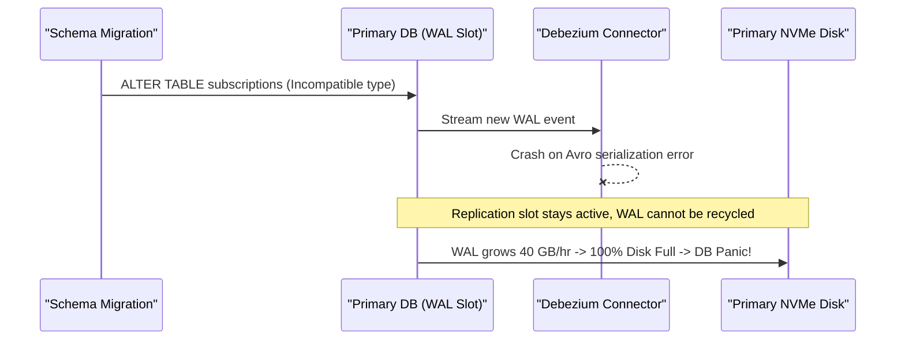

# Data Consistency Across Systems: Dual Writes, CDC & Reconciliation

> **Prerequisites:** [Lesson 15: Cost-Aware Architecture](../15-cost-aware-architecture/README.md) · [Transactional Outbox & CDC](../../09-distributed-systems/20-idempotent-consumers/README.md).  
> **Estimated Reading Time:** 24–28 minutes  
> **Target Audience:** Backend and data platform engineers keeping OLTP databases, search indexes, caches, and data warehouses in sync, and candidates asked "how do you avoid dual-write bugs across heterogenous stores?"  
> **Free PDF Notes:** [Download SD-V-016.pdf](https://backendroadmap.com/notes/system-design/SD-V-016.pdf)

> [!NOTE]
> **In one line:** Writing to two independent systems (e.g., Postgres and Elasticsearch/Kafka) in the same request (**dual writes**) inevitably causes silent divergence on partial failures or races. Reliable cross-system consistency combines **single-source-of-truth commits** (via **Transactional Outbox** or **Change Data Capture (CDC)**) with **idempotent consumers** and **automated reconciliation**.

> [!TIP]
> **The Golden Rule:** **Never dual-write across two systems without an atomic log.** Commit to one system of record, stream changes via **CDC** or an **Outbox**, make downstream consumers **idempotent**, and always run a **periodic reconciliation job**—because even CDC pipelines eventually hit bugs or schema drift.

---

## 1. What Cross-System Consistency Is, and What It Isn't

An e-commerce service updates an order status in PostgreSQL and then calls Elasticsearch to update the search index and Kafka to notify billing. Under normal load it works. During a GC pause or network blip, Postgres commits `PAID`, the Elasticsearch call times out, and the process crashes before publishing to Kafka. Now the customer's search dashboard says `PENDING`, billing never charges the card, and Postgres says `PAID`—with zero errors logged to alert anyone.

| Term | Precise Meaning | Example |
| :--- | :--- | :--- |
| **Dual write** | Application writes directly to two separate datastores in one handler without a shared transaction | `db.Save(order)` followed by `es.Index(order)` |
| **Transactional Outbox** | Writing domain state and an outbox event row inside the **same** local ACID transaction | `INSERT INTO orders` + `INSERT INTO outbox` in one `COMMIT` |
| **Change Data Capture (CDC)** | Tailing the database's Write-Ahead Log (WAL / binlog) to stream committed row changes | Debezium reading Postgres WAL $\to$ Kafka |
| **Idempotent consumer** | Downstream writer that applies an event safely even if delivered multiple times or out of order | `INSERT ... ON CONFLICT DO UPDATE WHERE version < excluded.version` |
| **Reconciliation (anti-entropy)** | Scheduled or streaming job that compares source vs target checksums/counts and repairs drift | Nightly Spark/SQL diff repairing missing Elasticsearch docs |
| **Not** | Distributed 2-Phase Commit (2PC) across Postgres, Redis, and Elasticsearch | 2PC does not work across heterogeneous non-XA stores and kills availability |

### Why It Matters
1. **Modern backends are polyglot:** Almost every non-trivial service spans an OLTP database (Postgres/MySQL), a search engine (Elasticsearch/OpenSearch), a cache (Redis), and an analytics warehouse (Snowflake/BigQuery).
2. **Silent drift destroys user trust:** A 0.01% daily divergence rate compounds into thousands of broken orders, stale search results, and billing discrepancies.
3. **Classic Senior/Staff interview staple:** "How do you keep Postgres and Elasticsearch/Kafka in sync?" is one of the top 10 distributed systems interview questions.

---

## 2. Anatomy: Dual Writes vs Log-Based CDC + Reconciliation

```mermaid
flowchart LR
    subgraph bad["Dual Writes (Silent Divergence & Race Conditions)"]
        App1["App Service"] -->|1. Commit| DB1["Postgres"]
        App1 -.->|2. Fails / Reorders| ES1["Elasticsearch"]
        App1 -.->|3. Crashes| K1["Kafka"]
    end
    subgraph good["Single-Commit + CDC + Reconciliation"]
        App2["App Service"] -->|1. Single ACID Commit| DB2["Postgres + WAL"]
        DB2 -->|2. Tail WAL (Debezium)| CDC["CDC Stream (Kafka)"]
        CDC -->|3. Idempotent Upsert| ES2["Elasticsearch"]
        CDC -->|3. Idempotent Upsert| DW["Warehouse / Cache"]
        Recon["Reconciliation Job"] -.->|4. Periodic Diff & Repair| DB2
        Recon -.->|Repair Missing/Stale| ES2
    end
```

Even without crashes, **concurrent dual writes cause permanent silent corruption** via **interleaved execution**:
- Request A updates `price = 10` in Postgres, then pauses.
- Request B updates `price = 20` in Postgres, and writes `price = 20` to Elasticsearch.
- Request A resumes and writes `price = 10` to Elasticsearch.
- **Result:** Postgres has `20`, Elasticsearch has `10` forever—even though zero network errors occurred!

| Pattern | Atomicity | Ordering | Infra Overhead | Best For |
| :--- | :--- | :--- | :--- | :--- |
| **Naive Dual Write** | None (partial failure + races) | None | Low | Never for critical/durable data |
| **Transactional Outbox** | Atomic with local DB commit | Preserved per aggregate | Low (table + poller/relay) | Domain events, clean bounded-context APIs |
| **Log-Based CDC (Debezium)** | Atomic (reads committed WAL) | Strict LSN/binlog order | Medium (Debezium + Kafka Connect) | Syncing search, caches, warehouses, legacy DBs |
| **Distributed 2PC / XA** | Atomic across XA-capable DBs | Serialized | Very high (blocks on coordinator) | Rare; only homogeneous XA databases |

> [!WARNING]
> **CDC does not guarantee exactly-once delivery to downstream sinks.** Debezium guarantees *at-least-once* delivery from the WAL. If the connector restarts before committing its Kafka offset, it will replay recent WAL events. Downstream consumers **must** be idempotent and enforce monotonic version/LSN checks so stale replays never overwrite newer state.

---

## 3. Mathematical Model: Dual-Write Drift Rate, CDC Lag, and Reconciliation Window

**1. Dual-Write Divergence Accumulation.** Suppose a service processes $R$ writes/day, and the probability of a partial failure or concurrent race between DB commit and secondary write is $p_{\text{fail}}$. Expected diverged records after $D$ days:

$$E[\text{Drift}(D)] = R \cdot p_{\text{fail}} \cdot D$$

For $R = 500{,}000$ writes/day and a seemingly tiny $p_{\text{fail}} = 0.0002$ ($0.02\%$—2 in 10,000):

$$E[\text{Drift}(30)] = 500{,}000 \times 0.0002 \times 30 = \mathbf{3{,}000\text{ corrupted records/month}}$$

**2. CDC End-to-End Replication Lag.** Total propagation delay $L_{\text{cdc}}$ from OLTP commit to search/warehouse visibility is:

$$L_{\text{cdc}} = t_{\text{wal\_flush}} + t_{\text{debezium\_poll}} + t_{\text{kafka\_transit}} + t_{\text{sink\_batch}} + t_{\text{index\_refresh}}$$

Typical values: $t_{\text{wal}} \approx 5\text{ ms}$, $t_{\text{poll}} \approx 50\text{ ms}$, $t_{\text{kafka}} \approx 20\text{ ms}$, $t_{\text{sink}} \approx 200\text{ ms}$, $t_{\text{es\_refresh}} \approx 1{,}000\text{ ms} \implies L_{\text{cdc}} \approx \mathbf{1.28\text{ s}}$.

**3. Reconciliation Window & Bandwidth.** To compare $N$ rows of average key+hash size $b$ bytes across two systems within window $T_{\text{recon}}$:

$$\text{Scan Bandwidth} = \frac{N \cdot b}{T_{\text{recon}}}$$

For $N = 100{,}000{,}000$ rows using `(id, version, updated_at)` ($b = 32\text{ bytes}$ = $3.2\text{ GB}$), scanning in $T_{\text{recon}} = 600\text{ s}$ (10 minutes) requires only **$5.33\text{ MB/s}$**—easily handled by a read replica without impacting primary traffic.

---

## 4. Metrics & Percentiles

| Metric | Meaning | Alert when |
| :--- | :--- | :--- |
| **CDC replication lag (ms / LSN bytes)** | Time/bytes between primary WAL head and Debezium offset | Lag > 10 s or WAL slot disk retention > 70% |
| **Outbox table depth** | Unpublished rows waiting in `outbox` table | Depth grows monotonically for > 2 minutes |
| **Consumer DLQ / poison-pill count** | Events failing deserialization or sink upsert | Any non-zero DLQ message |
| **Reconciliation drift count / %** | Mismatched or missing records detected by anti-entropy job | Drift > 0.01% (indicates broken CDC or manual DB edit) |
| **Stale-write rejection count** | Out-of-order replays blocked by version/LSN guard | Sudden spike (indicates consumer partition rebalance loop) |

### Worked Example (Order Search Index Sync)
An order service processes 1,000 writes/s. It writes to Postgres (`orders` table with a monotonic `version` integer column). Debezium streams WAL changes to Kafka topic `orders.cdc`. An Elasticsearch sink consumer upserts documents using optimistic concurrency (`version_type=external&version=<db_version>`). Even if Kafka redelivers an older event (`version=4`) after `version=5` was indexed, Elasticsearch rejects `version=4` with HTTP `409 Conflict`, which the consumer safely treats as a no-op ack. Every hour, a lightweight reconciliation job compares `updated_at` buckets between the Postgres read replica and Elasticsearch to catch any missed deletes or schema errors.

---

## 5. Compounding & Failure Modes

| Failure Mode | Mechanism | Quantitative Impact |
| :--- | :--- | :--- |
| **Postgres WAL slot bloat** | Debezium connector crashes; Postgres retains WAL segments for the inactive slot | At 50 MB/s write rate, 6 hours down = **1.08 TB WAL**, filling disk and crashing primary DB |
| **Non-idempotent consumer replay** | Consumer increments a counter (`balance += 100`) instead of setting state (`balance = 500`) | 2x redelivery = **$100 double-credit** |
| **Tombstone / DELETE loss** | Sink ignores Kafka `null` (tombstone) or `op: "d"` events | Deleted users/products remain searchable forever ("zombie records") |
| **Schema evolution mismatch** | Engineer adds a `NOT NULL` column or renames a field without Schema Registry compatibility | CDC consumer crashes on every new event; lag spikes to hours |
| **Reconciliation storms** | Naive recon compares live mutable rows at $T_0$ and repairs at $T_1$ while writes are in-flight | Overwrites fresh writes with stale snapshots ("false-positive repair") |

---

## 6. Numbers Every Engineer Must Know

| Item | Typical | Implication |
| :--- | :--- | :--- |
| **Dual-write failure rate in prod** | 0.01%–0.1% of requests | Unacceptable without outbox/CDC; 100s–1,000s of drifted rows/day |
| **Debezium WAL-to-Kafka latency** | 20–200 ms | Fast enough for search/cache invalidation, not read-your-own-writes |
| **Elasticsearch `refresh_interval`** | 1 s (default) | Writes via CDC are invisible to search for ~1 s after sink upsert |
| **Max safe WAL slot lag** | < 20–50 GB (or < 30% free disk) | Always set `max_slot_wal_keep_size` in Postgres to protect primary |
| **CDC throughput per Debezium task** | 10,000–50,000 events/s | Single Postgres WAL stream is sequential; partition downstream in Kafka |
| **Merkle tree / bucketed hash diff** | O(log N) network transfer | Compares 100M rows across regions by exchanging KB of hashes, not GB |

---

## 7. Protocol / Mechanism Deep Dive: Outbox + CDC + Monotonic Version Guard

```mermaid
sequenceDiagram
    participant Client as "Client"
    participant API as "Order Service"
    participant PG as "Postgres Primary (WAL)"
    participant Deb as "Debezium CDC"
    participant K as "Kafka (orders.cdc)"
    participant ES as "Elasticsearch Sink"

    Client->>API: POST /orders/123 (Pay)
    API->>PG: BEGIN; UPDATE orders SET status='PAID', ver=5; COMMIT;
    API-->>Client: 200 OK (Committed)
    PG->>Deb: Stream WAL record (ver=5)
    Deb->>K: Publish event (key=123, ver=5)
    K->>ES: Deliver event (ver=5)
    ES->>ES: Upsert doc 123 (external_version=5)
    Note over K,ES: If ver=4 is redelivered later, ES rejects 409 -> Ack & Skip!
```

### When NOT to Use CDC
- **Strict Read-Your-Own-Writes on Secondary Store:** If a user creates a post and *immediately* queries Elasticsearch 5 ms later expecting to see it, 1-second CDC + ES refresh lag will show a missing post. Either read from Postgres for that user's own recent writes or pass the created object in the UI/cache.
- **Cross-Service Bounded Context Leakage:** Exposing raw internal DB tables via CDC couples downstream teams to your internal schema. Prefer a **Transactional Outbox** publishing explicit, versioned domain events (`OrderPaidV2`).

---

## 8. Hierarchical Budgets & Design Rules

| Slice | Rule | Control |
| :--- | :--- | :--- |
| **Write Path** | Single ACID system of record; zero dual writes across independent stores | Code review + architecture lint forbidding multi-store writes in handlers |
| **Event Transport** | Use Transactional Outbox (for domain events) or CDC (for table sync) | Debezium / Outbox relay with Schema Registry (`BACKWARD` compatibility) |
| **WAL Protection** | Cap replication slot retention so a dead consumer never fills primary disk | Postgres `max_slot_wal_keep_size = 50GB` + disk alert at 70% |
| **Idempotency** | Every sink must handle duplicates and out-of-order replays safely | Monotonic `version` / `lsn` guard on all upserts + explicit delete tombstones |
| **Reconciliation** | Run automated anti-entropy diff against a read replica with grace window | Compare `(id, version)` excluding rows modified in the last 5 minutes |
| **Testing** | Chaos-test consumer crashes, duplicate deliveries, and schema changes | Jepsen-style or integration tests replaying Kafka offsets twice |

---

## 9. Top Mitigations

1. **Replace dual writes with Transactional Outbox or CDC:** Commit to one primary database and let an asynchronous relay or WAL tailer propagate changes.
2. **Use monotonic version / LSN checks in every sink:** Reject stale updates (`WHERE target.version < incoming.version`) so out-of-order retries cannot regress state.
3. **Cap Postgres `max_slot_wal_keep_size`:** Prevents a stalled Debezium connector from filling the primary database's disk and taking down production.
4. **Add a 5-minute grace window to reconciliation jobs:** Only flag or repair rows where `updated_at < NOW() - INTERVAL '5 minutes'` so in-flight CDC events aren't falsely flagged as drift.
5. **Handle deletes explicitly (Tombstones):** Ensure CDC emits `op: "d"` / tombstone events and sinks delete or soft-delete records accordingly.
6. **Enforce Schema Registry compatibility:** Prevent an upstream `ALTER TABLE` from poisoning the CDC pipeline.

---

## 10. Production Reference / War Story: The Silent Billing Drift & WAL Disk-Full Outage

**Incident:** A SaaS billing platform used dual writes to save subscription upgrades in MySQL and push usage quotas to Redis + Kafka. Over 6 months, 1,400 customers were upgraded in MySQL without their Redis quota updating. The team migrated to Debezium CDC to fix it—but two weeks later, a bad schema migration crashed the Debezium container on Friday night, and by Saturday afternoon the primary database disk hit 100%, taking down the entire platform.



**Root Cause:**
1. Phase 1 lacked atomic commits (dual writes caused the 1,400-customer drift).
2. Phase 2 added CDC without `max_slot_wal_keep_size`, without Schema Registry validation in CI, and without a reconciliation job to backfill/verify state if the slot ever invalidated.

**Fix:**
1. Set `max_slot_wal_keep_size = 50GB` on the primary DB and paged on-call if CDC lag exceeded 60 seconds.
2. Added a nightly **bucketed-checksum reconciliation job** that compares `(tenant_id, plan_tier, version)` between the DB read replica and Redis/Warehouse, auto-repairing any drift via idempotent upserts.

---

## 11. Multi-Language Production Code Tabs

These examples implement an **idempotent monotonic-version sink** (preventing stale replays from overwriting newer state) and a **grace-window reconciliation diff** between a source store and a target index.

````carousel
```go
// Go: Idempotent version-guarded sink & grace-window reconciliation diff.
package main

import (
	"fmt"
	"time"
)

type Record struct {
	ID        string
	Version   int64
	Payload   string
	UpdatedAt time.Time
}

type TargetStore struct {
	docs map[string]Record
}

// Upsert applies the event only if its monotonic version is newer than stored state.
func (s *TargetStore) Upsert(ev Record) bool {
	existing, ok := s.docs[ev.ID]
	if ok && existing.Version >= ev.Version {
		return false // stale or duplicate replay -> safe no-op
	}
	s.docs[ev.ID] = ev
	return true
}

// Reconcile finds drifted/missing records older than the in-flight CDC grace window.
func Reconcile(source map[string]Record, target *TargetStore, grace time.Duration, now time.Time) []string {
	var repaired []string
	cutoff := now.Add(-grace)
	for id, src := range source {
		if src.UpdatedAt.After(cutoff) {
			continue // skip in-flight CDC window
		}
		tgt, ok := target.docs[id]
		if !ok || tgt.Version < src.Version {
			target.Upsert(src)
			repaired = append(repaired, id)
		}
	}
	return repaired
}

func main() {
	now := time.Now()
	target := &TargetStore{docs: map[string]Record{
		"ord-1": {ID: "ord-1", Version: 5, Payload: "PAID", UpdatedAt: now.Add(-10 * time.Minute)},
	}}
	// Simulate out-of-order replay (version 4)
	applied := target.Upsert(Record{ID: "ord-1", Version: 4, Payload: "PENDING"})
	fmt.Println("Stale v4 replay applied?", applied) // false

	source := map[string]Record{
		"ord-1": {ID: "ord-1", Version: 5, Payload: "PAID", UpdatedAt: now.Add(-10 * time.Minute)},
		"ord-2": {ID: "ord-2", Version: 2, Payload: "SHIPPED", UpdatedAt: now.Add(-10 * time.Minute)},
	}
	fmt.Println("Reconciled missing/stale IDs:", Reconcile(source, target, 5*time.Minute, now))
}
```
<!-- slide -->
```typescript
// TypeScript: Idempotent CDC consumer with monotonic version guard & reconciliation.
export interface VersionedRecord {
  id: string;
  version: number;
  deleted: boolean;
  updatedAtMs: number;
  data?: Record<string, unknown>;
}

export class IdempotentIndexSink {
  private store = new Map<string, VersionedRecord>();

  applyEvent(ev: VersionedRecord): "applied" | "ignored_stale" {
    const current = this.store.get(ev.id);
    if (current && current.version >= ev.version) {
      return "ignored_stale";
    }
    this.store.set(ev.id, ev);
    return "applied";
  }

  reconcile(sourceRows: VersionedRecord[], graceMs = 300_000, nowMs = Date.now()): string[] {
    const repaired: string[] = [];
    const cutoff = nowMs - graceMs;
    for (const src of sourceRows) {
      if (src.updatedAtMs > cutoff) continue; // avoid racing with live CDC
      const tgt = this.store.get(src.id);
      if (!tgt || tgt.version < src.version) {
        this.applyEvent(src);
        repaired.push(src.id);
      }
    }
    return repaired;
  }
}

const sink = new IdempotentIndexSink();
console.log(sink.applyEvent({ id: "u1", version: 5, deleted: false, updatedAtMs: 1000 }));
console.log(sink.applyEvent({ id: "u1", version: 3, deleted: false, updatedAtMs: 900 })); // ignored_stale
```
<!-- slide -->
```python
# Python: Dual-write drift simulator + idempotent CDC sink & reconciliation (stdlib only).
from dataclasses import dataclass
from typing import Dict, List


@dataclass(frozen=True)
class CdcEvent:
    doc_id: str
    version: int
    status: str
    updated_at_s: int
    deleted: bool = False


class IdempotentSink:
    def __init__(self) -> None:
        self.docs: Dict[str, CdcEvent] = {}

    def apply(self, ev: CdcEvent) -> bool:
        cur = self.docs.get(ev.doc_id)
        if cur is not None and cur.version >= ev.version:
            return False  # stale or duplicate delivery
        self.docs[ev.doc_id] = ev
        return True

    def reconcile(self, source: Dict[str, CdcEvent], now_s: int, grace_s: int = 300) -> List[str]:
        repaired = []
        cutoff = now_s - grace_s
        for doc_id, src in source.items():
            if src.updated_at_s > cutoff:
                continue  # skip in-flight CDC window
            tgt = self.docs.get(doc_id)
            if tgt is None or tgt.version < src.version:
                self.apply(src)
                repaired.append(doc_id)
        return repaired


if __name__ == "__main__":
    sink = IdempotentSink()
    assert sink.apply(CdcEvent("ord-1", 5, "PAID", 1000)) is True
    assert sink.apply(CdcEvent("ord-1", 4, "PENDING", 900)) is False
    src = {
        "ord-1": CdcEvent("ord-1", 5, "PAID", 1000),
        "ord-2": CdcEvent("ord-2", 1, "CREATED", 1000),
    }
    print("Repaired:", sink.reconcile(src, now_s=2000))
```
<!-- slide -->
```csharp
// C#: Idempotent CDC event applier with monotonic version & reconciliation check.
using System;
using System.Collections.Generic;

public sealed record CdcDoc(string Id, long Version, string State, DateTimeOffset UpdatedAt);

public sealed class IdempotentTargetStore
{
    private readonly Dictionary<string, CdcDoc> _docs = new();

    public bool Apply(CdcDoc ev)
    {
        if (_docs.TryGetValue(ev.Id, out var existing) && existing.Version >= ev.Version)
            return false; // Duplicate or out-of-order replay

        _docs[ev.Id] = ev;
        return true;
    }

    public List<string> Reconcile(IEnumerable<CdcDoc> source, TimeSpan graceWindow, DateTimeOffset now)
    {
        var repaired = new List<string>();
        var cutoff = now - graceWindow;
        foreach (var src in source)
        {
            if (src.UpdatedAt > cutoff) continue;
            if (!_docs.TryGetValue(src.Id, out var tgt) || tgt.Version < src.Version)
            {
                Apply(src);
                repaired.Add(src.Id);
            }
        }
        return repaired;
    }
}
```
````

---

## 12. Hands-On CLI Verification Workflows

Inspect Postgres WAL replication slots, Debezium connector status, and Kafka Connect lag:

```bash
# 1. Check PostgreSQL logical replication slots and retained WAL size (watch for bloat!)
psql "$DATABASE_URL" -c "
SELECT slot_name, active,
       pg_size_pretty(pg_wal_lsn_diff(pg_current_wal_lsn(), restart_lsn)) AS retained_wal
FROM pg_replication_slots;"

# 2. Check Debezium connector status via Kafka Connect REST API
curl -s http://localhost:8083/connectors/orders-pg-cdc/status | jq .

# 3. Monitor CDC consumer group lag in Kafka
kafka-consumer-groups.sh --bootstrap-server localhost:9092 --describe --group es-orders-sink

# 4. Verify Elasticsearch external versioning rejects stale replays
curl -s -X PUT "http://localhost:9200/orders/_doc/ord-1?version=4&version_type=external" \
  -H 'Content-Type: application/json' -d '{"status":"PENDING"}'
```

---

## 13. Common Mistakes to Avoid

1. **Dual-writing directly from application handlers** (`db.Save()` then `kafka.Publish()` or `es.Index()`).
2. **Using CDC without `max_slot_wal_keep_size`**, allowing a crashed connector to fill the primary DB disk.
3. **Writing non-idempotent CDC consumers** (e.g., `+=` increments) on an at-least-once stream.
4. **Omitting a monotonic version/LSN check**, allowing out-of-order retries to overwrite newer data.
5. **Forgetting to propagate `DELETE` tombstones**, leaving deleted entities in search indexes or caches.
6. **Running reconciliation without a grace window**, causing false-positive repairs on in-flight CDC events.
7. **Coupling downstream teams to raw internal DB schemas** via CDC instead of versioned outbox contracts.

---

## 14. Key Terms Glossary

| Key Term | Definition |
| :--- | :--- |
| **Dual write** | Writing to two independent datastores in the same request without a shared atomic transaction. |
| **Transactional Outbox** | Storing domain state and outbound events in the same local DB transaction for atomic publishing. |
| **Change Data Capture (CDC)** | Streaming committed row-level changes by tailing a database's transaction log (WAL/binlog). |
| **Write-Ahead Log (WAL)** | Append-only durability log in relational databases used for crash recovery and logical replication. |
| **Idempotent consumer** | Consumer that produces the same final state whether a message is processed once or multiple times. |
| **Monotonic version guard** | Rejecting updates whose version or LSN is $\le$ the currently stored version. |
| **Tombstone event** | A null-payload / delete marker in Kafka signaling that a key was deleted in the source DB. |
| **Reconciliation (anti-entropy)** | Periodic diff-and-repair job comparing source of truth against derived stores. |
| **Grace window** | Excluding recently modified records from reconciliation so live CDC events can finish propagating. |
| **2-Phase Commit (2PC)** | Distributed atomic commit protocol that blocks on coordinator failure and fails across non-XA stores. |

---

## 15. System Design Interview Questions & Answers

### Basic Conceptual Questions

<details>
<summary><strong>Q1: Why are dual writes broken in distributed systems? [BASIC]</strong></summary>

**Answer:**
Because two separate systems (e.g., Postgres and Elasticsearch) cannot share a local ACID transaction. Even if you retry, two failure modes break consistency: (1) **partial failure**—the first write commits and the process crashes before the second; (2) **interleaved race conditions**—two concurrent requests update the two stores in opposite orders, leaving permanent silent divergence.
</details>

<details>
<summary><strong>Q2: What is Change Data Capture (CDC) and how does it solve dual writes? [BASIC]</strong></summary>

**Answer:**
CDC (e.g., Debezium) tails the primary database's Write-Ahead Log (WAL) or binlog and streams committed row changes to a broker like Kafka. Because the application only writes to **one** system (the primary DB), atomicity is guaranteed by the DB's local transaction, and derived stores consume the ordered log asynchronously.
</details>

<details>
<summary><strong>Q3: Transactional Outbox vs CDC: when do you choose each? [BASIC]</strong></summary>

**Answer:**
Use **Transactional Outbox** when publishing explicit, stable domain events (`OrderPaidV2`) across microservice boundaries—it decouples consumers from your internal table schema. Use **Log-Based CDC** when syncing full table state to a search index, cache, or analytics warehouse, or when you cannot modify legacy application code.
</details>

<details>
<summary><strong>Q4: Why do you still need reconciliation if you already use CDC? [BASIC]</strong></summary>

**Answer:**
CDC pipelines are software—bugs in sink transformations, dropped DLQ messages, manual hotfix SQL queries, or expired WAL slots can still cause drift. Reconciliation is the safety net (anti-entropy) that detects and heals any silent divergence.
</details>

### Scenario-Based Architecture Questions

<details>
<summary><strong>Q5: A user updates their profile in Postgres and immediately refreshes the page, which queries Elasticsearch—and still sees the old name. How do you handle this? [SCENARIO]</strong></summary>

**Answer:**
CDC + Elasticsearch refresh typically takes 0.5–2 seconds. To preserve **read-your-own-writes** without dual writes: (1) return the updated state directly in the `PUT` response and update client state; (2) write-through a short-TTL Redis key or session flag (`profile_updated_at`) that routes that specific user's reads to Postgres for 5 seconds while CDC catches up.
</details>

<details>
<summary><strong>Q6: Your Debezium connector was down for 12 hours and Postgres disk usage hit 95%. What happened and how do you recover? [SCENARIO]</strong></summary>

**Answer:**
Postgres retained 12 hours of WAL segments because the logical replication slot was inactive. To recover immediately without losing data consistency: (1) drop the stalled replication slot so Postgres can checkpoint and free disk; (2) fix and restart Debezium with a **consistent snapshot** (`snapshot.mode=initial` or incremental signaling snapshot) to re-sync missed changes cleanly. Prevent recurrence by setting `max_slot_wal_keep_size`.
</details>

<details>
<summary><strong>Q7: How do you design a reconciliation job for a 500-million-row table without overwhelming the production database? [SCENARIO]</strong></summary>

**Answer:**
Run reads exclusively against a **read replica**, scan in small key-range batches (`WHERE id > last_id LIMIT 10000`) using only indexed columns `(id, version, updated_at)`, exclude rows modified within the last 5 minutes (grace window), and compare **bucketed hashes** (e.g., XOR/MD5 of 1,000-row ranges) first so you only drill down into buckets that actually differ.
</details>

<details>
<summary><strong>Q8: A Kafka consumer processes a CDC event out of order during a partition rebalance. How do you prevent it from overwriting newer data in Redis or Postgres? [SCENARIO]</strong></summary>

**Answer:**
Attach a monotonic `version` (or DB `lsn` / `updated_at` + tie-breaker) to every record. In Postgres sinks, use `INSERT ... ON CONFLICT (id) DO UPDATE SET ... WHERE target.version < EXCLUDED.version`. In Redis, use a Lua script that checks `HGET key version < incoming_version` atomically before updating.
</details>

### Advanced & Tricky Interview Questions

<details>
<summary><strong>Q9: Why not just use Distributed 2-Phase Commit (2PC / XA) to keep Postgres, Kafka, and Elasticsearch consistent? [TRICKY]</strong></summary>

**Answer:**
First, Elasticsearch and Redis do not support XA/2PC transactions. Second, even between XA-capable DBs, 2PC is a **blocking protocol**: if the coordinator crashes after the Prepare phase, participants hold locks indefinitely, destroying availability and throughput. Single-commit + async CDC/Outbox gives high availability and eventual consistency.
</details>

<details>
<summary><strong>Q10: How do you handle `DELETE`s in a CDC pipeline when using Kafka log compaction? [TRICKY]</strong></summary>

**Answer:**
When a row is deleted in the source DB, Debezium emits a delete event followed by a **tombstone** (a message with the record key and `value = null`). Kafka log compaction keeps the tombstone for `delete.retention.ms` (e.g., 24 hours) so consumers see the delete before compacting the key away completely. Sinks must explicitly handle `null` payloads as deletes.
</details>

<details>
<summary><strong>Q11: What is the "Outbox + CDC" hybrid pattern, and why do high-scale systems use it instead of polling? [TRICKY]</strong></summary>

**Answer:**
Polling an `outbox` table every 100 ms puts constant `SELECT` load on the primary DB and adds latency. In the **Outbox + CDC hybrid**, the app writes to `outbox` inside its local ACID transaction, and **Debezium tails the WAL of the `outbox` table** (using Debezium's Outbox Event Router SMT). You get zero polling load, sub-50 ms latency, and clean domain event contracts.
</details>

<details>
<summary><strong>Q12: Your reconciliation job reports 50,000 drifted rows every night, yet the next night the same 50,000 rows are fine and 50,000 *new* rows are drifted. What is happening? [TRICKY]</strong></summary>

**Answer:**
You don't have actual CDC data loss—you have a **reconciliation race condition**! Your recon job is comparing rows that are actively being updated right now (missing a grace window), or comparing two stores with a timezone/precision mismatch (e.g., microsecond vs millisecond truncation in `updated_at`), causing false-positive diffs on fresh writes.
</details>

---

## 16. One-Page Master Cheat Sheet

```
+---------------------------------------------------------------------------------------------------------+
|                    DATA CONSISTENCY ACROSS SYSTEMS — MASTER CHEAT SHEET                                 |
+---------------------------------------------------------------------------------------------------------+
| 1. NEVER DUAL-WRITE: Partial failures + concurrent races guarantee silent divergence (R * p * D).       |
+---------------------------------------------------------------------------------------------------------+
| 2. SINGLE COMMIT + LOG: Commit to 1 ACID DB -> propagate via Transactional Outbox or Log-Based CDC.     |
+---------------------------------------------------------------------------------------------------------+
| 3. IDEMPOTENCY: At-least-once delivery requires monotonic version/LSN guards:                           |
|    UPDATE ... WHERE target.version < incoming.version. Handle DELETE tombstones explicitly!             |
+---------------------------------------------------------------------------------------------------------+
| 4. PROTECT THE PRIMARY: Always set max_slot_wal_keep_size so a dead CDC consumer never fills DB disk.   |
+---------------------------------------------------------------------------------------------------------+
| 5. RECONCILIATION: Run periodic anti-entropy diffs on a read replica with a 5-min grace window.         |
+---------------------------------------------------------------------------------------------------------+
| 6. READ-YOUR-OWN-WRITES: Return mutated data in API response or route user's reads to primary for 5s.   |
+---------------------------------------------------------------------------------------------------------+
```

---

## Further Reading & Sources

- Martin Kleppmann, *Designing Data-Intensive Applications*, Chapter 11 ("Stream Processing" — Change Data Capture) and Chapter 9 ("Consistency and Consensus").
- Gunnar Morling / Debezium Engineering, [Reliable Microservices Data Exchange with the Outbox Pattern](https://debezium.io/blog/2019/02/19/reliable-microservices-data-exchange-with-the-outbox-pattern/).
- Uber Engineering / Stripe Engineering, [Building Scalable Data Reconciliation and Ledger Integrity Systems](https://stripe.com/blog/ledger-stripe-system-for-tracking-and-validating-money-movement).
- PostgreSQL Documentation, [Logical Replication & `max_slot_wal_keep_size`](https://www.postgresql.org/docs/current/runtime-config-replication.html).

---

## Free PDF Notes

[SD-V-016.pdf](https://backendroadmap.com/notes/system-design/SD-V-016.pdf)

---

## Next

Continue with [Lesson 17: Privacy Engineering: PII Classification, Masking, Minimisation & Consent](../17-privacy-engineering/README.md).
