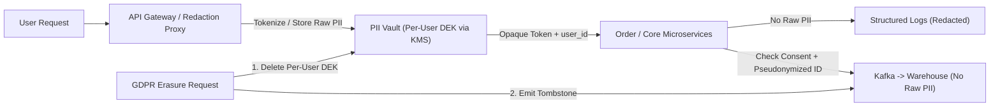
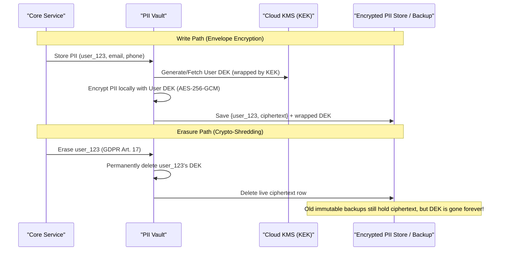
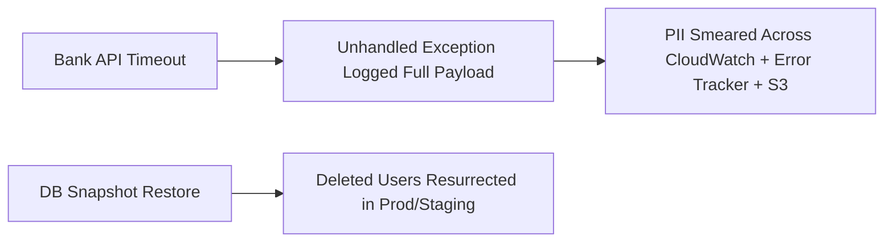

# Privacy Engineering: PII Classification, Masking, Minimisation & Consent

> **Prerequisites:** [Lesson 16: Data Consistency Across Systems](../16-data-consistency-across-systems/README.md).  
> **Estimated Reading Time:** 24–28 minutes  
> **Target Audience:** Backend, platform, and data engineers building GDPR/CCPA-compliant systems, and candidates asked "how do you design PII handling, log redaction, and Right-to-be-Forgotten across microservices and backups?"  
> **Free PDF Notes:** [Download SD-V-017.pdf](https://backendroadmap.com/notes/system-design/SD-V-017.pdf)

> [!NOTE]
> **In one line:** **Privacy engineering** embeds data protection directly into system architecture—**classifying PII** at schema/ingest time, **minimising** what is collected and retained, **masking/tokenizing** sensitive fields before they hit logs or analytics, and enforcing **verifiable consent and deletion** across every downstream store.

> [!TIP]
> **The Golden Rule:** **The safest PII is PII you never collected, never logged, and never copied.** Keep raw PII isolated in a single encrypted **PII Vault** referenced by an opaque `user_id` or token, so deletion (Crypto-Shredding) and consent enforcement happen in one place.

---

## 1. What Privacy Engineering Is, and What It Isn't

A checkout service logs the full HTTP request body on `500` errors—accidentally dumping customer emails, home addresses, and national IDs into Datadog, S3 log archives, and a Snowflake data lake. Six months later, a user submits a GDPR erasure request ("Right to be Forgotten"). Deleting the row in Postgres takes 2 milliseconds, but their PII is now smeared across 400 immutable Parquet files, 90 days of Elasticsearch logs, and 30 database snapshots.

| Term | Precise Meaning | Example |
| :--- | :--- | :--- |
| **PII (Personally Identifiable Info)** | Any data that directly or indirectly identifies an individual | Direct: email, SSN, phone. Indirect: IP + user-agent + zip |
| **Data classification** | Tagging fields by sensitivity tier (`PUBLIC`, `INTERNAL`, `CONFIDENTIAL`, `RESTRICTED_PII`) | Protobuf/JSON Schema annotations `@pii(tier="RESTRICTED")` |
| **Data minimisation** | Collecting only fields strictly required for the stated purpose, with bounded TTL | Storing `birth_year` instead of full DOB; dropping raw IP after geo-lookup |
| **Masking & tokenization** | Replacing sensitive values with redacted strings (`***@acme.com`) or opaque tokens | Vaulted `tok_9f8a2b` in analytics instead of raw email |
| **Consent enforcement** | Propagating user opt-in/opt-out flags (`marketing`, `analytics`) to every processor | Checking `consent_flags` before emitting tracking events |
| **Crypto-shredding** | Encrypting a user's PII with a per-user DEK and deleting the key to make data unrecoverable | Deleting `user_123`'s KMS key renders all backups/archives unreadable |
| **Not** | A legal privacy policy PDF or a cookie banner bolted onto an unredacted backend | Compliance theater without technical enforcement |

### Why It Matters
1. **Regulatory & financial risk:** GDPR fines reach up to 4% of global annual revenue; breach notification laws penalize unencrypted or unminimised PII exposure.
2. **Engineering velocity:** When PII is isolated in a vault and tokenized everywhere else, analytics, ML, and debugging teams can work freely on non-PII datasets without legal bottlenecks.
3. **Immutable storage reality:** You cannot easily `DELETE FROM` append-only Kafka topics, S3 Parquet lakes, or point-in-time DB backups—you must architect around this from day one.

---

## 2. Anatomy: PII Isolation Vault, Redaction Gateway & Crypto-Shredding



By placing a **PII Vault** at the boundary:
- Core microservices, caches, Kafka streams, and data warehouses operate strictly on `user_id` (UUID) or reversible/irreversible tokens.
- Structured logging middleware automatically redacts/masks fields tagged `RESTRICTED_PII` before serialization.
- When a user requests erasure, deleting their **Data Encryption Key (DEK)** inside the vault immediately renders all their encrypted blobs—even in immutable S3 archives and old DB snapshots—cryptographically unreadable (**crypto-shredding**).

| Technique | Reversible? | Preserves Joins? | Best Use Case |
| :--- | :--- | :--- | :--- |
| **Redaction / Masking** (`a***@g***.com`) | No | No | Application logs, support UIs, error traces |
| **Salted/HMAC Hashing** (`HMAC(secret, email)`) | No (without key) | Yes (exact match) | Analytics deduplication, fraud matching |
| **Tokenization (Vault)** (`tok_83fa9c`) | Yes (via Vault ACL) | Yes | Payment cards (PCI), emails needed only for sending |
| **Format-Preserving Encryption** | Yes | Yes | Legacy schemas expecting 10-digit phone/SSN format |
| **Differential Privacy / k-Anonymity** | No | Aggregate only | Public ML training, aggregate telemetry |

> [!WARNING]
> **Unsalted SHA-256 of an email or phone number is NOT anonymization.** There are only ~$10^{10}$ possible 10-digit phone numbers—an attacker can precompute the entire SHA-256 rainbow table on a single GPU in minutes. Always use **HMAC-SHA256 with a rotated secret pepper** stored in KMS, or vault-backed random tokens.

---

## 3. Mathematical Model: Re-Identification Entropy, Deletion SLA, and Key Overhead

**1. Quasi-Identifier Uniqueness ($k$-Anonymity).** Even if you remove `name` and `email`, combining indirect attributes (*ZIP code*, *birth date*, *gender*) can uniquely identify individuals. According to Latanya Sweeney's classic result, **87% of the US population** is uniquely identified by just `(5-digit ZIP, gender, full DOB)`. If a dataset has $N$ records partitioned into equivalence classes of size $k_i$, $k$-anonymity requires:

$$\min_i k_i \ge k_{\text{target}} \quad (\text{typically } k \ge 5 \text{ or } 10)$$

Generalizing `DOB` (36,500 values) $\to$ `Birth Decade` (10 values) and `5-digit ZIP` $\to$ `3-digit ZIP` increases equivalence class size $k$ by **~3,650x**, preventing linkage attacks.

**2. Crypto-Shredding Key Storage Overhead.** Storing a 256-bit (32-byte) encrypted DEK per user in a vault key-table for $U = 50{,}000{,}000$ users:

$$\text{Key Table Size} = 50{,}000{,}000 \times (16\text{ B UUID} + 32\text{ B wrapped DEK} + 16\text{ B metadata}) \approx \mathbf{3.2\text{ GB}}$$

3.2 GB fits easily in memory/SSD, while deleting 1 row (`DELETE FROM user_keys WHERE user_id = $1`) crypto-shreds **terabytes** of distributed backups and event logs in **< 5 ms**.

**3. Erasure SLA Budget.** Under GDPR Article 17, erasure must complete within **30 days** ($T_{\text{SLA}} = 30\text{ d}$). If backup retention is $T_{\text{backup}} = 35\text{ d}$:
- Without crypto-shredding: $T_{\text{backup}} > T_{\text{SLA}}$ (violation unless you rewrite 35 days of immutable snapshots).
- With crypto-shredding: Key deletion takes $< 1\text{ s}$ + cache invalidation $< 60\text{ s}$, satisfying the 30-day SLA even with 90-day immutable backups.

---

## 4. Metrics & Percentiles

| Metric | Meaning | Alert when |
| :--- | :--- | :--- |
| **Unclassified schema columns %** | DB/warehouse columns lacking a `@pii` sensitivity tag | > 0% on new PRs / migrations |
| **Log PII leak detections** | DLP/regex scanner hits for emails, SSNs, JWTs in log stream | Any non-zero detection in staging or prod |
| **DSAR / Erasure completion $p_{99}$** | Time from user deletion request to vault + downstream completion | Exceeds 24 hours (well inside 30-day legal SLA) |
| **Consent propagation lag** | Time from user opt-out to downstream ad/analytics suppression | Exceeds 5 minutes |
| **Vault read latency $p_{99}$** | Latency of detokenizing PII for email/shipping dispatch | Exceeds 20 ms |

### Worked Example (Log Redaction & Consent Gate)
A notification pipeline processes 5,000 events/s. Every event carries `user_id` (UUID) and `consent_marketing: boolean`, **never** raw `email`.
1. When an event arrives at the Email Worker, it checks `consent_marketing == true` (in-memory/Redis cache, < 0.5 ms). If `false`, the event is dropped and counted.
2. If `true`, the worker calls `PIIVault.Detokenize(user_id, purpose="transactional_email")` over mTLS.
3. The log middleware strips/masks any `email`, `authorization`, or `ssn` keys before writing to stdout—so even if the Email Worker panics and dumps its local struct, zero raw PII reaches the log aggregator.

---

## 5. Compounding & Failure Modes

| Failure Mode | Mechanism | Quantitative Impact |
| :--- | :--- | :--- |
| **PII in free-text logs & URLs** | Passing `?email=alice@acme.com` in GET query strings | Logged in ALB, CDN, browser history, and APM traces simultaneously |
| **Backup resurrection ("Zombie PII")** | User is deleted from DB; 2 weeks later a DB backup is restored | Deleted user's PII is silently restored into production |
| **Over-broad analytics access** | Dumping `SELECT *` from OLTP Postgres into Snowflake for BI | 200+ employees & BI dashboards gain access to raw PII |
| **Stale consent cache** | User opts out of marketing, but 24-hr cached user profile keeps emailing | Regulatory violation + spam complaints |
| **Linkage / re-identification** | Publishing "anonymized" trip logs with exact timestamps + GPS | Cross-referencing with public social posts re-identifies individuals |

---

## 6. Numbers Every Engineer Must Know

| Item | Typical | Implication |
| :--- | :--- | :--- |
| **GDPR Erasure (DSAR) legal SLA** | 30 days (extendable in complex cases) | Automate end-to-end deletion to complete in < 24 hours |
| **GDPR max regulatory fine** | Up to 4% global revenue or €20M | Privacy architecture is a board-level risk control |
| **Per-user DEK size (AES-256-GCM)** | 32 bytes (wrapped ~64 bytes) | Negligible storage overhead even for 100M+ users |
| **Sweeney uniqueness (ZIP+DOB+Sex)** | 87% of US population | Removing `name`/`email` alone is NOT anonymization |
| **Recommended $k$-anonymity floor** | $k \ge 5$ to $10$ | Generalize timestamps, geo, and ages in analytics exports |
| **Log retention for raw debug logs** | 7–30 days (masked) | Never retain unredacted debug logs for years |

---

## 7. Protocol / Mechanism Deep Dive: Envelope Encryption & Crypto-Shredding



### When NOT to Crypto-Shred / Delete Immediately
- **Legal Hold & Financial Audit Laws:** Tax, anti-money-laundering (AML), and invoicing regulations often *legally require* retaining transaction records for 5–7 years, overriding GDPR erasure for those specific financial fields. Isolate **marketing/profile PII** (erasable immediately) from **statutory ledger records** (retained under legal basis with strict access control).

---

## 8. Hierarchical Budgets & Design Rules

| Slice | Rule | Control |
| :--- | :--- | :--- |
| **Schema & Classification** | Every new DB column / Protobuf field must declare `@pii` sensitivity tier | CI linter (Buf / SQLFluff / dbt) blocks untagged columns |
| **Collection & Minimisation** | Never collect fields without a documented purpose & retention TTL | Privacy review gate on new API fields; auto-expire temp data |
| **Transport & URLs** | Zero PII in URL query strings, HTTP headers, or Kafka keys | API Gateway / WAF rule rejecting email/SSN patterns in URLs |
| **Logging & Tracing** | Mandatory structured log redactor + DLP scanner on log pipeline | Go/TS/Python logger middleware + Macie/Cloud DLP alerts |
| **Storage & Analytics** | Isolate raw PII in Vault; warehouse receives only tokenized/hashed IDs | Row/column-level masking in Snowflake/BigQuery |
| **Deletion & Consent** | Per-user DEK crypto-shredding + consent-check gate before processing | Automated DSAR workflow tested monthly in staging |

---

## 9. Top Mitigations

1. **Isolate PII in a dedicated Vault + Envelope Encryption:** Keep raw PII out of 95% of your microservices, caches, and analytics tables; pass opaque `user_id` tokens instead.
2. **Enforce structured log redaction in shared SDKs:** Centralize logging middleware so `email`, `phone`, `password`, `token`, and `ssn` fields are automatically masked (`***`) before leaving the process.
3. **Never put PII in URLs or Kafka message keys:** URLs end up in load balancer access logs and browser histories; Kafka keys remain visible in broker metadata.
4. **Use HMAC-SHA256 with a rotated pepper (not plain SHA-256)** when analytics needs deterministic join keys without storing raw emails.
5. **Implement Crypto-Shredding for immutable backups and data lakes:** Deleting a user's DEK solves the "how do I delete from 30-day snapshots and Parquet files?" problem cleanly.
6. **Separate statutory financial retention from erasable profile PII:** Tag fields with both sensitivity and legal retention basis so GDPR deletion doesn't break tax compliance.

---

## 10. Production Reference / War Story: The Unredacted Exception Dump & Backup Resurrection

**Incident:** A fintech startup discovered during a SOC 2 audit that (1) their Python/Node services logged full exception payloads (including customer SSNs and bank account numbers) into CloudWatch and third-party error trackers whenever a downstream bank API timed out, and (2) three previously deleted GDPR users had reappeared in staging and analytics after a database snapshot restore.



**Root Cause:**
1. Error-handling middleware serialized `req.body` into structured logs without field-level redaction.
2. Deletion only ran `DELETE FROM users WHERE id = $1` on the live primary database—leaving 30 days of RDS snapshots and S3 ETL exports intact with plaintext PII.

**Fix:**
1. Deployed a mandatory **field-redacting logger & error serializer** across all services plus a regex/entropy DLP scanner on the log pipeline.
2. Migrated sensitive PII (`ssn`, `iban`, `email`) into a **PII Vault** using per-user AES-256-GCM DEKs; erasure now deletes the user's DEK, permanently crypto-shredding all historical snapshots and S3 exports.

---

## 11. Multi-Language Production Code Tabs

These examples implement a **PII-redacting structured logger**, **HMAC-SHA256 pseudonymization**, and a **purpose-bound consent & crypto-shredding vault** (using stdlib only).

````carousel
```go
// Go: PII-redacting structured logger, HMAC pseudonymizer, and crypto-shredding vault.
package main

import (
	"crypto/aes"
	"crypto/cipher"
	"crypto/hmac"
	"crypto/rand"
	"crypto/sha256"
	"encoding/hex"
	"errors"
	"fmt"
	"io"
)

var sensitiveKeys = map[string]bool{"email": true, "ssn": true, "phone": true, "password": true}

func RedactFields(fields map[string]string) map[string]string {
	out := make(map[string]string, len(fields))
	for k, v := range fields {
		if sensitiveKeys[k] {
			out[k] = "[REDACTED]"
		} else {
			out[k] = v
		}
	}
	return out
}

func Pseudonymize(pepper []byte, value string) string {
	mac := hmac.New(sha256.New, pepper)
	mac.Write([]byte(value))
	return hex.EncodeToString(mac.Sum(nil))
}

type PIIVault struct {
	deks map[string][]byte
	data map[string][]byte
}

func (v *PIIVault) Store(userID string, plaintext []byte) error {
	key := make([]byte, 32)
	if _, err := io.ReadFull(rand.Reader, key); err != nil {
		return err
	}
	block, _ := aes.NewCipher(key)
	gcm, _ := cipher.NewGCM(block)
	nonce := make([]byte, gcm.NonceSize())
	io.ReadFull(rand.Reader, nonce)
	v.deks[userID] = key
	v.data[userID] = gcm.Seal(nonce, nonce, plaintext, nil)
	return nil
}

func (v *PIIVault) Read(userID string) ([]byte, error) {
	key, ok := v.deks[userID]
	if !ok {
		return nil, errors.New("key shredded: PII permanently unreadable")
	}
	block, _ := aes.NewCipher(key)
	gcm, _ := cipher.NewGCM(block)
	ct := v.data[userID]
	return gcm.Open(nil, ct[:gcm.NonceSize()], ct[gcm.NonceSize():], nil)
}

func (v *PIIVault) CryptoShred(userID string) {
	delete(v.deks, userID) // Ciphertext in backups is now unrecoverable
}

func main() {
	fmt.Println("Safe log:", RedactFields(map[string]string{"user_id": "u-1", "email": "a@b.com"}))
	vault := &PIIVault{deks: map[string][]byte{}, data: map[string][]byte{}}
	_ = vault.Store("u-1", []byte("alice@example.com"))
	vault.CryptoShred("u-1")
	_, err := vault.Read("u-1")
	fmt.Println("After shred:", err)
}
```
<!-- slide -->
```typescript
// TypeScript: PII field redactor, HMAC pseudonymizer, and consent gate.
import { createHmac } from "crypto";

const PII_KEYS = new Set(["email", "phone", "ssn", "password", "address"]);

export function redactLogPayload(payload: Record<string, unknown>): Record<string, unknown> {
  const safe: Record<string, unknown> = {};
  for (const [k, v] of Object.entries(payload)) {
    safe[k] = PII_KEYS.has(k.toLowerCase()) ? "[REDACTED]" : v;
  }
  return safe;
}

export function pseudonymize(pepper: string, piiValue: string): string {
  return createHmac("sha256", pepper).update(piiValue.trim().toLowerCase()).digest("hex");
}

export interface ConsentProfile {
  analytics: boolean;
  marketing: boolean;
}

export function canProcess(consent: ConsentProfile, purpose: keyof ConsentProfile): boolean {
  return Boolean(consent[purpose]);
}

console.log(redactLogPayload({ userId: "u-123", email: "alice@acme.com", action: "login" }));
console.log("Marketing allowed?", canProcess({ analytics: true, marketing: false }, "marketing"));
```
<!-- slide -->
```python
# Python: PII log redaction, salted HMAC pseudonymization & crypto-shredding vault (stdlib only).
import hashlib
import hmac
from typing import Dict

PII_FIELDS = {"email", "phone", "ssn", "password", "iban"}


def redact_dict(record: Dict[str, str]) -> Dict[str, str]:
    return {k: ("[REDACTED]" if k.lower() in PII_FIELDS else v) for k, v in record.items()}


def pseudonymize(pepper: bytes, value: str) -> str:
    return hmac.new(pepper, value.strip().lower().encode("utf-8"), hashlib.sha256).hexdigest()


class ConsentGate:
    def __init__(self, flags: Dict[str, bool]) -> None:
        self.flags = flags

    def assert_allowed(self, purpose: str) -> None:
        if not self.flags.get(purpose, False):
            raise PermissionError(f"Processing blocked: user withdrew consent for '{purpose}'")


if __name__ == "__main__":
    print(redact_dict({"user_id": "u-9", "email": "bob@acme.com", "status": "ok"}))
    print("HMAC token:", pseudonymize(b"vault-pepper-v1", "bob@acme.com")[:16])
    gate = ConsentGate({"transactional": True, "marketing": False})
    gate.assert_allowed("transactional")
```
<!-- slide -->
```csharp
// C#: PII redaction serializer & HMAC-SHA256 pseudonymizer.
using System;
using System.Collections.Generic;
using System.Security.Cryptography;
using System.Text;

public static class PrivacyGuard
{
    private static readonly HashSet<string> PiiKeys = new(StringComparer.OrdinalIgnoreCase)
    {
        "email", "phone", "ssn", "password", "iban"
    };

    public static Dictionary<string, string> Redact(IDictionary<string, string> fields)
    {
        var result = new Dictionary<string, string>(fields.Count);
        foreach (var kv in fields)
            result[kv.Key] = PiiKeys.Contains(kv.Key) ? "[REDACTED]" : kv.Value;
        return result;
    }

    public static string Pseudonymize(byte[] pepper, string value)
    {
        using var hmac = new HMACSHA256(pepper);
        var hash = hmac.ComputeHash(Encoding.UTF8.GetBytes(value.Trim().ToLowerInvariant()));
        return Convert.ToHexString(hash).ToLowerInvariant();
    }
}
```
````

---

## 12. Hands-On CLI Verification Workflows

Scan logs/repos for accidental PII leaks and verify KMS key deletion / column tagging:

```bash
# 1. Scan sample application logs for accidental email or SSN patterns
grep -E '[a-zA-Z0-9._%+-]+@[a-zA-Z0-9.-]+\.[a-zA-Z]{2,}|[0-9]{3}-[0-9]{2}-[0-9]{4}' app.log

# 2. Check PostgreSQL tables for untagged/unencrypted sensitive column names
psql "$DATABASE_URL" -c "
SELECT table_schema, table_name, column_name
FROM information_schema.columns
WHERE column_name ~* '(email|phone|ssn|passport|iban|birth)'
  AND table_schema NOT IN ('pg_catalog', 'information_schema');"

# 3. Verify AWS Macie / Cloud DLP classification job status (S3 PII discovery)
aws macie2 list-classification-jobs --filter-criteria '{"includes":[{"key":"jobStatus","comparator":"EQ","values":["RUNNING"]}]}'

# 4. Run Python HMAC pseudonymization verification
python -c "import hmac, hashlib; print(hmac.new(b'pepper', b'alice@acme.com', hashlib.sha256).hexdigest()[:16])"
```

---

## 13. Common Mistakes to Avoid

1. **Using unsalted SHA-256 on emails or phone numbers** and calling it "anonymized" (trivial rainbow-table reversal).
2. **Passing PII in GET query parameters** (`?email=...`), which leaks into CDN, ALB, and proxy access logs.
3. **Logging full request/response bodies on `500` errors** without an automatic field-redaction middleware.
4. **Deleting only from the primary DB on GDPR erasure**, leaving PII intact in Elasticsearch, Kafka, S3, and snapshots.
5. **Replicating raw `SELECT *` OLTP tables into the analytics warehouse** instead of pseudonymizing/masking at ingest.
6. **Caching consent flags with long TTLs**, continuing to email or track users hours after they opted out.
7. **Removing only `name` and `email` from exported datasets** while leaving `(ZIP, DOB, gender)` intact.

---

## 14. Key Terms Glossary

| Key Term | Definition |
| :--- | :--- |
| **PII** | Personally Identifiable Information—any data that directly or indirectly identifies a natural person. |
| **Data classification** | Labeling fields/columns by sensitivity tier (`PUBLIC`, `CONFIDENTIAL`, `RESTRICTED_PII`). |
| **Data minimisation** | Collecting and retaining only the minimum data strictly necessary for a stated purpose. |
| **Masking / Redaction** | Replacing sensitive characters (`[REDACTED]`, `***@acme.com`) irreversibly for logs and UIs. |
| **Tokenization** | Substituting sensitive PII with an opaque reference token stored in an isolated vault. |
| **Crypto-shredding** | Erasing data across immutable backups/lakes by permanently deleting its per-user encryption key. |
| **Pseudonymization** | Replacing direct identifiers with keyed/HMAC tokens while keeping linkability under strict key control. |
| **$k$-Anonymity** | Property ensuring every record in a released dataset is indistinguishable from at least $k-1$ others on quasi-identifiers. |
| **DSAR / Right to Erasure** | Data Subject Access/Deletion Request mandated by GDPR/CCPA within statutory SLAs (e.g., 30 days). |
| **Consent propagation** | Enforcing user opt-in/opt-out preferences consistently across all downstream processors. |

---

## 15. System Design Interview Questions & Answers

### Basic Conceptual Questions

<details>
<summary><strong>Q1: What is the difference between anonymization, pseudonymization, and masking? [BASIC]</strong></summary>

**Answer:**
**Masking/redaction** hides characters (`a***@b.com`) for display/logs. **Pseudonymization** replaces direct identifiers with a token or keyed HMAC (`tok_9f2a`)—it is still regulated as personal data because it can be re-linked with the key/vault. **Anonymization** irreversibly strips or aggregates data (via generalization + $k$-anonymity/differential privacy) so individuals can never be re-identified.
</details>

<details>
<summary><strong>Q2: Why is data minimisation an architectural win, not just a legal requirement? [BASIC]</strong></summary>

**Answer:**
Collecting less data shrinks storage and egress bills, reduces blast radius during breaches, lowers DSAR deletion complexity, and speeds up queries. If you only need a user's age bracket for personalization, storing `birth_decade` instead of exact `date_of_birth` eliminates a high-risk quasi-identifier.
</details>

<details>
<summary><strong>Q3: Why should raw PII never appear in URL query strings or application logs? [BASIC]</strong></summary>

**Answer:**
URLs are automatically recorded in plaintext by browser history, CDNs, WAFs, load balancers, and APM traces—systems outside your database access controls. Always send PII in `POST`/`PUT` bodies over TLS, and apply automatic field-level redaction in your logging SDK.
</details>

<details>
<summary><strong>Q4: What is a PII Vault? [BASIC]</strong></summary>

**Answer:**
A dedicated, tightly access-controlled service/database that stores raw PII (`email`, `ssn`, `address`) encrypted with per-user keys and hands out opaque `user_id` or tokens to all other microservices. This localizes compliance, auditing, and deletion to one system.
</details>

### Scenario-Based Architecture Questions

<details>
<summary><strong>Q5: A user invokes GDPR "Right to be Forgotten," but their data lives in Postgres, Kafka (7-day retention), S3 Parquet data lakes, and 30-day DB backups. How do you delete it? [SCENARIO]</strong></summary>

**Answer:**
Use **PII isolation + Crypto-shredding**. Store raw PII only in a PII Vault encrypted with a per-user Data Encryption Key (DEK); downstream Kafka topics, S3 lakes, and analytics only hold the opaque `user_id` or encrypted blob. On erasure, delete the user's DEK from the Vault/KMS (instantly rendering all S3 archives and 30-day DB snapshots unreadable) and emit a tombstone event to purge live caches/search indexes.
</details>

<details>
<summary><strong>Q6: How do you prevent developers from accidentally logging PII when adding new microservices? [SCENARIO]</strong></summary>

**Answer:**
Three layers of defense: (1) **Shared logging SDK** with an allowlist/denylist redactor that masks sensitive keys (`email`, `token`, `ssn`, `password`) and regex-strips JWTs/credit cards; (2) **Schema annotations** (`@pii`) enforced in CI; (3) **Automated DLP scanning** (AWS Macie / Cloud DLP) on the log pipeline that alerts on-call if raw PII ever lands in logs.
</details>

<details>
<summary><strong>Q7: Your analytics team needs to join user purchase events across web and mobile without accessing raw emails or phone numbers. How do you design this? [SCENARIO]</strong></summary>

**Answer:**
Compute a deterministic pseudonym using **HMAC-SHA256 with a secret pepper** stored in the PII Vault/KMS (e.g., `anon_user_id = HMAC(pepper, normalize(email))`) at ingest time. The warehouse receives `anon_user_id` and purchase amounts—allowing exact cross-channel joins without exposing raw PII or allowing rainbow-table reversal.
</details>

<details>
<summary><strong>Q8: A user opts out of marketing emails, but an async Kafka consumer still sends them an email 20 minutes later from a queued campaign. How do you fix this? [SCENARIO]</strong></summary>

**Answer:**
Never rely solely on the consent state captured at *enqueue* time. Perform a **just-in-time consent check** right before dispatch: the Email Worker checks the low-latency Consent Service (backed by Redis with invalidation on opt-out, < 1 s lag) immediately before calling the SMTP/ESP provider.
</details>

### Advanced & Tricky Interview Questions

<details>
<summary><strong>Q9: Why does deleting a row in a Postgres/MySQL database not actually erase the PII from disk, and what if crypto-shredding isn't used? [TRICKY]</strong></summary>

**Answer:**
In MVCC databases (Postgres), `DELETE` only marks a tuple dead until `VACUUM` reclaims it, and the old data remains in WAL archives, replication streams, and EBS snapshots. Without crypto-shredding, true erasure requires rewriting historical backups—which is operationally impractical—or keeping backups shorter than the 30-day DSAR SLA.
</details>

<details>
<summary><strong>Q10: A user requests GDPR deletion, but they placed an order yesterday that requires a 7-year tax invoice under local law. Who wins? [TRICKY]</strong></summary>

**Answer:**
**Statutory legal obligation overrides GDPR erasure** for the minimum data required by tax/AML law (GDPR Art. 17(3)(b)). Architecturally, separate **erasable profile/marketing PII** from **immutable statutory invoice records**, delete the profile/marketing data and keys immediately, and lock the invoice records in a restricted legal-hold store with no analytics or marketing access.
</details>

<details>
<summary><strong>Q11: What is the "key-explosion" scaling limit of per-user crypto-shredding in Cloud KMS? [TRICKY]</strong></summary>

**Answer:**
You cannot create 50 million individual **Customer Managed Keys (CMKs)** inside AWS KMS (KMS has account limits around 100k keys and charges $1/key/month). Instead, use **envelope encryption**: one KMS Master Key (KEK) per region/environment wraps 50 million per-user **Data Encryption Keys (DEKs)** stored in your own Vault database (~3.2 GB). Deleting the wrapped DEK row from the Vault DB achieves crypto-shredding at zero per-key KMS cost.
</details>

<details>
<summary><strong>Q12: How can an ML model trained on anonymized user data still leak PII? [TRICKY]</strong></summary>

**Answer:**
Through **memorization and membership inference attacks**—especially on rare outliers (e.g., a single user with a unique purchase sequence or prompt). Mitigate by deduplicating training data, scrubbing PII with NER/regex before training, and applying **Differentially Private SGD (DP-SGD)** when training on sensitive user cohorts.
</details>

---

## 16. One-Page Master Cheat Sheet

```
+---------------------------------------------------------------------------------------------------------+
|                    PRIVACY ENGINEERING — MASTER CHEAT SHEET                                             |
+---------------------------------------------------------------------------------------------------------+
| 1. GOLDEN RULE: Isolate raw PII in a single PII Vault. Downstream services/analytics use opaque tokens. |
+---------------------------------------------------------------------------------------------------------+
| 2. CLASSIFICATION & MINIMISATION: Tag every schema field (@pii). Collect minimum data + set TTLs.       |
+---------------------------------------------------------------------------------------------------------+
| 3. LOGGING & TRANSPORT: Zero PII in GET URLs or Kafka keys. Auto-redact logs in shared SDK middleware.  |
+---------------------------------------------------------------------------------------------------------+
| 4. PSEUDONYMIZATION: Never use plain SHA-256 (rainbow-table trivial). Use HMAC-SHA256 with KMS pepper.  |
+---------------------------------------------------------------------------------------------------------+
| 5. CRYPTO-SHREDDING: Encrypt PII with per-user DEK (wrapped by 1 KMS KEK). Delete DEK -> backups/lakes  |
|    become unreadable in < 5 ms without rewriting immutable Parquet/snapshots.                           |
+---------------------------------------------------------------------------------------------------------+
| 6. CONSENT & LEGAL HOLD: Check consent just-in-time before dispatch. Separate erasable PII from tax/AML.|
+---------------------------------------------------------------------------------------------------------+
```

---

## Further Reading & Sources

- NIST, [Privacy Framework & Guidelines for De-Identification of Personal Data](https://www.nist.gov/privacy-framework).
- Latanya Sweeney, *Simple Demographics Often Identify People Uniquely* (Carnegie Mellon University, 2000 — $k$-anonymity).
- Google Cloud Architecture Center, [Sensitive Data Protection, Tokenization, and De-Identification](https://cloud.google.com/sensitive-data-protection/docs/concepts-deidentification).
- OWASP, [Logging Cheat Sheet & User Privacy Protection Cheat Sheet](https://cheatsheetseries.owasp.org/cheatsheets/Logging_Cheat_Sheet.html).

---

## Free PDF Notes

[SD-V-017.pdf](https://backendroadmap.com/notes/system-design/SD-V-017.pdf)

---

## Next

Continue with [Lesson 18: Data Governance & Lineage: Catalogs, Ownership and Impact Analysis](../18-data-governance-lineage/README.md).
