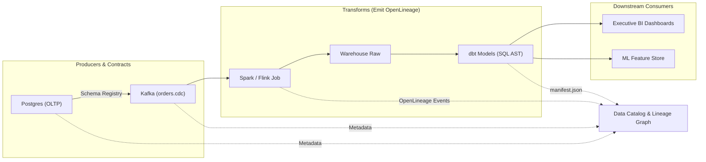
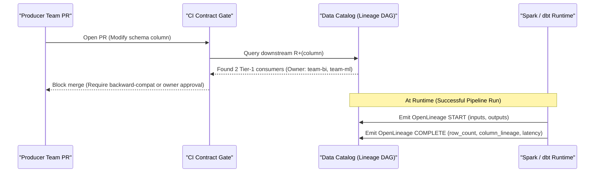
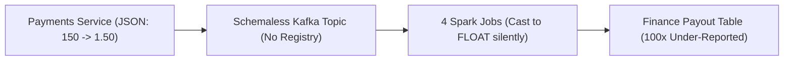

# Data Governance & Lineage: Catalogs, Ownership and Impact Analysis

> **Prerequisites:** [Lesson 17: Privacy Engineering](../17-privacy-engineering/README.md) · [Lesson 16: Data Consistency Across Systems](../16-data-consistency-across-systems/README.md).  
> **Estimated Reading Time:** 22–28 minutes  
> **Target Audience:** Backend, data platform, and staff engineers scaling multi-team data ecosystems, and candidates asked "how do you prevent breaking downstream ML/analytics pipelines when an upstream service changes its schema?"  
> **Free PDF Notes:** [Download SD-V-018.pdf](https://backendroadmap.com/notes/system-design/SD-V-018.pdf)

> [!NOTE]
> **In one line:** **Data governance & lineage** establish **who owns every dataset** (data contracts, SLAs, access control) and **how data flows and transforms end-to-end** (automated column-level lineage DAGs), enabling instant **blast-radius impact analysis** before a schema change or incident hits production.

> [!TIP]
> **The Golden Rule:** **A dataset without an owner and a data contract is technical debt waiting to break someone else's pipeline.** Automate lineage capture (OpenLineage / dbt / SQL AST parsing) so metadata stays current without manual wiki edits.

---

## 1. What Data Governance & Lineage Are, and What They Aren't

An engineer in the Checkout service renames `order_total_cents` to `gross_amount_cents` in a Kafka event. Checkout's unit tests pass. Three days later, the CFO's weekly revenue dashboard shows $0 for Tuesday, an ML fraud model silently predicts 0% risk because a feature column turned `NULL`, and nobody knows which team owns the intermediate `fct_orders_daily` warehouse table—or which 14 dashboards depend on it.

| Term | Precise Meaning | Example |
| :--- | :--- | :--- |
| **Data catalog** | Searchable inventory of tables, topics, schemas, owners, tags, and SLAs | DataHub, OpenMetadata, Amundsen, Unity Catalog |
| **Data lineage** | Directed Acyclic Graph (DAG) tracing data from source $\to$ transforms $\to$ sinks | `orders_db.orders` $\to$ `orders.cdc` $\to$ `fct_orders` $\to$ `rev_dash` |
| **Column-level lineage** | Fine-grained mapping showing which exact source columns feed each target column | `orders.total_cents` $\to$ `fct_orders.net_rev_usd` |
| **Data ownership & stewardship** | Named engineering team accountable for schema, quality, and incident response | `owner: team-checkout`, `sla: 06:00 UTC` |
| **Data contract** | Versioned, CI-enforced agreement on schema, semantics, and freshness between producer & consumers | Avro/Protobuf Schema Registry + Soda/Great Expectations checks |
| **Impact analysis** | Traversing the lineage DAG downstream to find every job/dashboard affected by a change | "Renaming `total_cents` breaks 4 dbt models and 2 ML features" |
| **Not** | A manual spreadsheet or Confluence page that goes stale the week after it's written | Static wiki docs updated once a year |

### Why It Matters
1. **Prevents silent data outages:** Schema changes and upstream bugs are caught in CI via contract checks and lineage impact analysis before merging.
2. **Accelerates incident root-cause analysis:** When a dashboard breaks, engineers trace lineage upstream in seconds to pinpoint the exact failed job or source table.
3. **Enables compliance & AI governance:** Proving where PII flows and which datasets trained a production ML model is impossible without automated lineage.

---

## 2. Anatomy: Automated Metadata & Lineage Architecture



Modern governance relies on **passive, automated metadata extraction** rather than manual documentation:
- **Producers** register schemas in a **Schema Registry** (with `BACKWARD` or `FULL` compatibility) and declare an `owner` tag.
- **Compute engines** (Spark, Flink, Airflow, dbt) emit **OpenLineage** JSON events (`START`, `COMPLETE`, `FAIL`) describing input datasets, output datasets, and column-level transformations.
- **The Data Catalog** ingests these events into a graph database, exposing search, PII tags, freshness SLAs, and one-click **upstream/downstream impact analysis**.

| Governance Layer | Manual / Ad-Hoc | Automated / Platform-Driven |
| :--- | :--- | :--- |
| **Discovery** | Ask in Slack "which `users` table is real?" | Searchable catalog with verified "Gold" badges & owners |
| **Schema changes** | Surprise breakage in downstream ETL | CI checks Schema Registry + downstream lineage blast radius |
| **Lineage** | Stale Lucidchart diagrams | Live column-level DAG from OpenLineage + SQL parsers |
| **Access control** | All-or-nothing warehouse roles | Tag-based RBAC/ABAC (`@pii` masked unless authorized) |

> [!WARNING]
> **Table-level lineage is often too noisy for impact analysis.** If a 120-column `orders` table feeds 30 downstream models, table-level lineage claims all 30 models break when you rename 1 column—causing alert fatigue. **Column-level lineage** (via SQL AST parsing or Spark/dbt metadata) pinpoints the exact 2 models that actually select that column.

---

## 3. Mathematical Model: Lineage Graph Traversal, Blast Radius, and Freshness Propagation

**1. Blast Radius (Impact Analysis).** Model the data ecosystem as a Directed Acyclic Graph $G = (V, E)$, where vertices $V$ are datasets/columns and directed edges $(u, v) \in E$ represent transformations. The **blast radius** of modifying node $u$ is the set of all reachable downstream nodes $R^+(u)$:

$$R^+(u) = \{ v \in V \mid u \leadsto v \}$$

Traversing $R^+(u)$ via Breadth-First Search takes $O(|V| + |E|)$ time—under **10 milliseconds** for a 50,000-node enterprise graph. Weighting each node $v$ by criticality $w(v)$ (e.g., Tier-0 Executive/ML = 10, Internal = 1) gives the **Impact Score**:

$$\text{Impact}(u) = \sum_{v \in R^+(u)} w(v)$$

**2. End-to-End Freshness SLA Propagation.** If a pipeline path $P = (v_1 \to v_2 \to \dots \to v_k)$ has per-stage batch/processing durations $d_i$ and schedule/wait delays $s_i$, worst-case end-to-end data latency is:

$$L_{\text{total}} = \max_{P} \sum_{i=1}^{k} (s_i + d_i)$$

For example, CDC ($d_1 = 2\text{ min}$) $\to$ hourly Spark compaction ($s_2 = 60\text{ min}, d_2 = 15\text{ min}$) $\to$ dbt daily model ($s_3 = 30\text{ min}, d_3 = 20\text{ min}$) yields $L_{\text{total}} = 2 + 75 + 50 = \mathbf{127\text{ minutes}}$. A dashboard promising a "15-minute SLA" on top of this path is mathematically impossible unless stage 2 and 3 move to streaming/micro-batch.

---

## 4. Metrics & Percentiles

| Metric | Meaning | Alert when |
| :--- | :--- | :--- |
| **Dataset ownership coverage %** | % of production tables/topics with an active team owner | Drops below 95% (orphan datasets accumulate) |
| **Freshness SLA attainment %** | % of Tier-0/Tier-1 datasets updated before their promised SLA | Falls below 99% over 7 days |
| **Unapproved breaking schema changes** | PRs modifying/dropping columns used by downstream consumers | Any PR with `Impact(u) > 0` lacking consumer sign-off |
| **Lineage coverage %** | % of warehouse tables with automated upstream & downstream edges | Drops below 85% |
| **Mean Time to Root Cause (MTTR)** | Time to identify the upstream cause of a broken dashboard/ML feature | Exceeds 15 minutes |

### Worked Example (CI Impact Gate)
A developer opens a PR removing `discount_code` from `checkout.order_created` Protobuf schema.
1. CI queries the Data Catalog's lineage graph for `checkout.order_created.discount_code`.
2. Graph traversal finds 3 downstream consumers: `stg_orders.discount_code` (dbt), `promo_roi_daily` (BI dashboard, Tier-1), and `abuse_detector_v3` (ML model, Tier-0).
3. CI posts a comment on the PR listing the 3 impacted owners and **blocks merge** until the schema change is either made additive/backward-compatible (`optional` / dual-field deprecation) or all 3 owners approve.

---

## 5. Compounding & Failure Modes

| Failure Mode | Mechanism | Quantitative Impact |
| :--- | :--- | :--- |
| **"Data Swamp" sprawl** | Everyone creates `temp_orders_v2_final` without owners or TTLs | 10,000+ undocumented tables; engineers spend 30%+ time hunting data |
| **Silent semantic drift** | Column keeps the same name (`amount`) and type (`INT`), but units change from dollars to cents | 100x revenue/billing error with zero schema-validation errors |
| **Orphaned Tier-0 dependencies** | An executive dashboard queries a team's internal staging table (`stg_raw_events`) | Upstream team refactors staging table, unknowingly breaking board metrics |
| **Shadow ETL / undocumented scripts** | Ad-hoc Python cron jobs reading production DBs without emitting OpenLineage | Invisible blind spots in impact analysis and PII tracking |
| **Stale catalog metadata** | Governance relies on manual quarterly wiki updates | Catalog accuracy decays to < 40% within 6 months; engineers stop trusting it |

---

## 6. Numbers Every Engineer Must Know

| Item | Typical | Implication |
| :--- | :--- | :--- |
| **OpenLineage event payload** | 2–10 KB JSON per job run | Negligible overhead; safe to emit from every Spark/Airflow/dbt run |
| **Enterprise lineage graph size** | 10,000–200,000 nodes (tables/cols) | Fits in memory; BFS impact analysis runs in < 10 ms |
| **Data engineer time spent finding/fixing data** | ~25–40% without governance | Automated catalogs + contracts yield massive productivity ROI |
| **Recommended deprecation window** | 14–90 days (tiered by consumers) | Never drop a column used by downstream consumers in a single deploy |
| **Data Mesh / Domain ownership ratio** | 1 domain team owns 5–30 data products | Central platform provides tooling; domain teams own quality |

---

## 7. Protocol / Mechanism Deep Dive: OpenLineage Event Lifecycle & Data Contracts



### When NOT to Over-Engineer Governance
- **Early-stage startups (< 15 engineers):** You don't need a heavy enterprise catalog cluster on day one. Start with **Git-versioned dbt models** (which generate lineage automatically via `dbt docs`), a **Schema Registry** on Kafka, and an explicit `owner` tag in YAML. Add DataHub/OpenMetadata when multi-team handoffs cause recurring breakages.

---

## 8. Hierarchical Budgets & Design Rules

| Slice | Rule | Control |
| :--- | :--- | :--- |
| **Ownership** | Every production table, topic, and dashboard must have a non-empty `owner` team | Platform linter archives/flags unowned assets after 30 days |
| **Data Contracts** | Upstream producers publish versioned schemas + quality assertions | Schema Registry (`BACKWARD`) + dbt contracts / Soda checks |
| **Lineage Capture** | All production ETL/ELT/streaming jobs must emit OpenLineage or SQL AST metadata | Platform Airflow/Spark/dbt wrappers enable OpenLineage by default |
| **Change Management** | Breaking changes require dual-write/deprecation window + downstream sign-off | CI impact-analysis bot queries lineage DAG on every schema PR |
| **Access Control** | Tag-based RBAC/ABAC (`@pii`, `@financial`) enforced uniformly | Unity Catalog / Lake Formation / Snowflake masking policies |
| **SLAs & Freshness** | Publish explicit freshness SLOs (`06:00 UTC` or `< 5 min`) on Gold datasets | Automated freshness monitors page the *producer*, not the consumer |

---

## 9. Top Mitigations

1. **Enforce Data Contracts at the boundary:** Use Avro/Protobuf Schema Registry for streams and dbt model contracts for warehouse tables so breaking changes fail in CI, not at 3 AM.
2. **Automate lineage capture with OpenLineage + SQL parsers:** Hook Spark, Airflow, Flink, and dbt into your catalog automatically—never rely on humans updating diagrams.
3. **Require `owner` and `tier` metadata on every asset:** Route data-quality alerts directly to the owning team's Slack/PagerDuty.
4. **Distinguish Bronze/Silver/Gold (or Internal vs Public) datasets:** Forbid downstream teams from querying internal `raw`/`staging` tables; expose only stable, contract-backed **Gold Data Products**.
5. **Version and deprecate columns gracefully:** Add the new column (`gross_amount_cents`), dual-populate both for 30–90 days, notify consumers via lineage, and drop the old column only when downstream query logs show 0 reads.
6. **Add semantic & value checks (not just type checks):** Assert `amount_cents >= 0` and `currency IN ('USD', 'EUR')` to catch silent unit-change bugs.

---

## 10. Production Reference / War Story: The Silent Cents-to-Dollars Schema Drift

**Incident:** A payments microservice updated an internal JSON field `fee_amount` from integer cents (`150`) to decimal dollars (`1.50`) to match a new partner API. Because the Kafka topic used schemaless JSON, no error was raised. The change flowed through 4 Spark jobs into the Finance Snowflake warehouse, corrupting 11 days of merchant payout reports and requiring a $180,000 manual accounting reconciliation.



**Root Cause:**
1. Schemaless JSON allowed a silent semantic/unit change without any contract check.
2. No column-level lineage existed between the Kafka event and the Finance payout table, so Finance didn't know their report depended on that specific service's internal event.

**Fix:**
1. Migrated event streams to **Protobuf + Confluent Schema Registry** with explicit field naming (`fee_amount_cents: int64`).
2. Enabled **OpenLineage** on all Spark and dbt jobs feeding into DataHub, giving Finance one-click visibility into upstream owners and blocking unreviewed changes to Tier-0 financial columns in CI.

---

## 11. Multi-Language Production Code Tabs

These examples implement a **Column-Level Lineage DAG**, **BFS Downstream Impact Analyzer**, and **Data Contract / Ownership Validator** (stdlib only).

````carousel
```go
// Go: Column-level lineage DAG, BFS blast-radius impact analysis & contract validator.
package main

import "fmt"

type NodeMeta struct {
	Name  string
	Owner string
	Tier  int // 0 = Critical (Exec/ML), 1 = Standard, 2 = Internal
}

type LineageGraph struct {
	nodes map[string]NodeMeta
	edges map[string][]string // upstream -> downstream
}

func NewLineageGraph() *LineageGraph {
	return &LineageGraph{
		nodes: make(map[string]NodeMeta),
		edges: make(map[string][]string),
	}
}

func (g *LineageGraph) AddNode(n NodeMeta) error {
	if n.Owner == "" {
		return fmt.Errorf("governance violation: dataset %q has no owner", n.Name)
	}
	g.nodes[n.Name] = n
	return nil
}

func (g *LineageGraph) AddEdge(src, dst string) {
	g.edges[src] = append(g.edges[src], dst)
}

func (g *LineageGraph) ImpactAnalysis(source string) []NodeMeta {
	visited := map[string]bool{source: true}
	queue := []string{source}
	var impacted []NodeMeta

	for len(queue) > 0 {
		curr := queue[0]
		queue = queue[1:]
		for _, nxt := range g.edges[curr] {
			if !visited[nxt] {
				visited[nxt] = true
				queue = append(queue, nxt)
				if meta, ok := g.nodes[nxt]; ok {
					impacted = append(impacted, meta)
				}
			}
		}
	}
	return impacted
}

func main() {
	g := NewLineageGraph()
	_ = g.AddNode(NodeMeta{"orders.total_cents", "team-checkout", 0})
	_ = g.AddNode(NodeMeta{"fct_orders.net_rev", "team-analytics", 1})
	_ = g.AddNode(NodeMeta{"exec_rev_dash.mrr", "team-bi", 0})
	_ = g.AddNode(NodeMeta{"fraud_model.amt_feat", "team-ml", 0})

	g.AddEdge("orders.total_cents", "fct_orders.net_rev")
	g.AddEdge("fct_orders.net_rev", "exec_rev_dash.mrr")
	g.AddEdge("orders.total_cents", "fraud_model.amt_feat")

	fmt.Println("Impacted by changing orders.total_cents:", g.ImpactAnalysis("orders.total_cents"))
}
```
<!-- slide -->
```typescript
// TypeScript: Lineage DAG impact analyzer & CI schema-change gate.
export interface DatasetNode {
  id: string;
  owner: string;
  tier: "tier0" | "tier1" | "internal";
}

export class LineageCatalog {
  private nodes = new Map<string, DatasetNode>();
  private downstream = new Map<string, string[]>();

  registerNode(node: DatasetNode): void {
    if (!node.owner.trim()) {
      throw new Error(`Governance error: ${node.id} must declare an owner.`);
    }
    this.nodes.set(node.id, node);
  }

  addLineage(fromId: string, toId: string): void {
    const list = this.downstream.get(fromId) ?? [];
    list.push(toId);
    this.downstream.set(fromId, list);
  }

  getBlastRadius(sourceId: string): DatasetNode[] {
    const visited = new Set<string>([sourceId]);
    const queue = [sourceId];
    const impacted: DatasetNode[] = [];

    while (queue.length > 0) {
      const curr = queue.shift()!;
      for (const nextId of this.downstream.get(curr) ?? []) {
        if (!visited.has(nextId)) {
          visited.add(nextId);
          queue.push(nextId);
          const meta = this.nodes.get(nextId);
          if (meta) impacted.push(meta);
        }
      }
    }
    return impacted;
  }
}

const cat = new LineageCatalog();
cat.registerNode({ id: "orders.total_cents", owner: "team-checkout", tier: "tier0" });
cat.registerNode({ id: "fct_orders.rev", owner: "team-data", tier: "tier1" });
cat.registerNode({ id: "cfo_dashboard", owner: "team-bi", tier: "tier0" });
cat.addLineage("orders.total_cents", "fct_orders.rev");
cat.addLineage("fct_orders.rev", "cfo_dashboard");
console.log("Blast radius:", cat.getBlastRadius("orders.total_cents"));
```
<!-- slide -->
```python
# Python: Column-level lineage DAG, BFS blast radius & OpenLineage event builder (stdlib only).
from collections import deque
from dataclasses import dataclass
from typing import Dict, List, Set


@dataclass(frozen=True)
class Asset:
    fqn: str
    owner: str
    tier: int  # 0 = Critical


class LineageGraph:
    def __init__(self) -> None:
        self.assets: Dict[str, Asset] = {}
        self.adj: Dict[str, List[str]] = {}

    def register(self, asset: Asset) -> None:
        if not asset.owner:
            raise ValueError(f"Asset {asset.fqn} missing required owner")
        self.assets[asset.fqn] = asset

    def link(self, upstream: str, downstream: str) -> None:
        self.adj.setdefault(upstream, []).append(downstream)

    def impact_analysis(self, fqn: str) -> List[Asset]:
        seen: Set[str] = {fqn}
        q = deque([fqn])
        impacted: List[Asset] = []
        while q:
            cur = q.popleft()
            for nxt in self.adj.get(cur, []):
                if nxt not in seen:
                    seen.add(nxt)
                    q.append(nxt)
                    if nxt in self.assets:
                        impacted.append(self.assets[nxt])
        return impacted


if __name__ == "__main__":
    g = LineageGraph()
    g.register(Asset("pg.orders.total_cents", "team-checkout", 0))
    g.register(Asset("wh.fct_orders.net_usd", "team-analytics", 1))
    g.register(Asset("bi.exec_mrr", "team-bi", 0))
    g.link("pg.orders.total_cents", "wh.fct_orders.net_usd")
    g.link("wh.fct_orders.net_usd", "bi.exec_mrr")
    print("Impacted:", g.impact_analysis("pg.orders.total_cents"))
```
<!-- slide -->
```csharp
// C#: Lineage DAG traversal for downstream blast-radius impact analysis.
using System;
using System.Collections.Generic;

public sealed record DataAsset(string Fqn, string Owner, int Tier);

public sealed class LineageRegistry
{
    private readonly Dictionary<string, DataAsset> _assets = new();
    private readonly Dictionary<string, List<string>> _edges = new();

    public void Register(DataAsset asset)
    {
        if (string.IsNullOrWhiteSpace(asset.Owner))
            throw new ArgumentException($"Asset '{asset.Fqn}' must have an owner.");
        _assets[asset.Fqn] = asset;
    }

    public void AddEdge(string upstream, string downstream)
    {
        if (!_edges.TryGetValue(upstream, out var list))
            _edges[upstream] = list = new List<string>();
        list.Add(downstream);
    }

    public List<DataAsset> GetImpactedDownstream(string sourceFqn)
    {
        var visited = new HashSet<string> { sourceFqn };
        var queue = new Queue<string>();
        queue.Enqueue(sourceFqn);
        var impacted = new List<DataAsset>();

        while (queue.Count > 0)
        {
            var curr = queue.Dequeue();
            if (!_edges.TryGetValue(curr, out var nexts)) continue;
            foreach (var nxt in nexts)
            {
                if (visited.Add(nxt))
                {
                    queue.Enqueue(nxt);
                    if (_assets.TryGetValue(nxt, out var meta))
                        impacted.Add(meta);
                }
            }
        }
        return impacted;
    }
}
```
````

---

## 12. Hands-On CLI Verification Workflows

Generate dbt lineage manifests, validate Kafka Schema Registry compatibility, and inspect DataHub/OpenLineage metadata:

```bash
# 1. Generate dbt catalog & manifest (automatically extracts SQL table/column lineage)
dbt docs generate --target prod

# 2. Check Kafka Schema Registry compatibility before merging a schema change
curl -s -X POST "http://localhost:8081/compatibility/subjects/orders-value/versions/latest" \
  -H "Content-Type: application/vnd.schemaregistry.v1+json" \
  -d '{"schema": "{\"type\":\"record\",\"name\":\"Order\",\"fields\":[{\"name\":\"id\",\"type\":\"string\"}]}"}'

# 3. Validate OpenLineage JSON event emission from a local Spark job
spark-submit --conf spark.extraListeners=io.openlineage.spark.agent.OpenLineageSparkListener \
  --conf spark.openlineage.transport.type=console etl_job.py

# 4. Run Python lineage blast-radius verification
python -c "print('BFS impact analysis runs in O(V+E) < 10 ms for 50k-node graphs')"
```

---

## 13. Common Mistakes to Avoid

1. **Relying on manual documentation/wikis for lineage**, which rot within weeks of the first pipeline refactor.
2. **Allowing downstream teams to query internal `staging`/`raw` tables**, creating hidden brittle dependencies.
3. **Dropping or renaming columns in a single deploy** without checking downstream lineage or running a deprecation window.
4. **Tracking only table-level lineage**, causing massive alert fatigue when unrelated columns change.
5. **Using schemaless JSON in Kafka/streams**, allowing silent type or unit changes (cents vs dollars) to corrupt warehouses.
6. **Publishing datasets without a named `owner` team**, leaving nobody paged when freshness SLAs fail.
7. **Forgetting semantic/value assertions** (`amount >= 0`, `row_count > 0`) in data contracts.

---

## 14. Key Terms Glossary

| Key Term | Definition |
| :--- | :--- |
| **Data governance** | Policies, roles, contracts, and access controls ensuring data is accurate, secure, and compliant. |
| **Data catalog** | Centralized, searchable metadata repository indexing datasets, schemas, owners, and tags. |
| **Data lineage** | Directed Acyclic Graph (DAG) tracking data origin, transformations, and downstream consumption. |
| **Column-level lineage** | Granular mapping from exact source columns to derived target columns. |
| **OpenLineage** | Open standard/API for emitting runtime lineage metadata from Spark, Airflow, Flink, and dbt. |
| **Data contract** | Versioned, CI-enforced agreement covering schema, types, semantics, and freshness SLAs. |
| **Impact analysis** | Traversing downstream lineage $R^+(u)$ to measure the blast radius of a proposed change. |
| **Data stewardship / Ownership** | Assigning a specific engineering team accountability for a dataset's quality and SLA. |
| **Bronze / Silver / Gold layers** | Medallion architecture separating raw ingestion, cleaned/joined tables, and contract-backed Gold products. |
| **Data swamp** | Ungoverned data lake full of unowned, undocumented, and untrusted datasets. |

---

## 15. System Design Interview Questions & Answers

### Basic Conceptual Questions

<details>
<summary><strong>Q1: What is data lineage, and why is automated lineage better than manual diagrams? [BASIC]</strong></summary>

**Answer:**
Data lineage is a DAG tracing where data originates, how it is transformed, and where it is consumed. Manual diagrams go stale as soon as a SQL query or Spark job changes. Automated lineage (via OpenLineage, dbt manifests, and SQL AST parsers) captures every run directly from execution engines, keeping the graph 100% accurate.
</details>

<details>
<summary><strong>Q2: What is a data contract, and what does it include beyond a JSON/Protobuf schema? [BASIC]</strong></summary>

**Answer:**
A data contract is a formal agreement between a data producer and downstream consumers. Beyond field names and types (enforced by Schema Registry), it specifies **ownership**, **semantic constraints** (e.g., `amount_cents >= 0`), **freshness SLAs** (e.g., updated within 15 minutes), **PII classification**, and **deprecation windows**.
</details>

<details>
<summary><strong>Q3: Why is column-level lineage important compared to table-level lineage? [BASIC]</strong></summary>

**Answer:**
Wide tables often have 50–200 columns. Table-level lineage flags every downstream dashboard if *any* column changes, creating noise. Column-level lineage narrows impact analysis to the exact downstream models and dashboards that actually read the modified column—and is essential for tracking where specific PII fields propagate.
</details>

<details>
<summary><strong>Q4: What does "Data Ownership" mean in a modern data platform? [BASIC]</strong></summary>

**Answer:**
Every production dataset, topic, or Gold table has an explicit **owning team** (usually the domain team producing it) responsible for schema evolution, data quality checks, PII tagging, and on-call response when freshness SLAs breach—rather than dumping responsibility on a disconnected central BI team.
</details>

### Scenario-Based Architecture Questions

<details>
<summary><strong>Q5: An upstream microservice team wants to rename a column in a Kafka event. How do you prevent it from breaking 15 downstream pipelines? [SCENARIO]</strong></summary>

**Answer:**
Enforce a **CI Schema + Lineage Gate**: (1) Schema Registry blocks non-backward-compatible changes (`BACKWARD` mode); (2) CI queries the Data Catalog's lineage graph to list all 15 downstream owners; (3) the producer follows an **expand-and-contract** migration—add the new column as optional, dual-populate both fields for 30–90 days, notify consumers, and drop the old column only after downstream usage hits zero.
</details>

<details>
<summary><strong>Q6: The CFO reports that a key revenue dashboard is showing stale numbers from 3 days ago. How do you debug this using lineage? [SCENARIO]</strong></summary>

**Answer:**
Open the dashboard in the Data Catalog and traverse **upstream lineage** ($R^-(v)$). Check each node's last OpenLineage `COMPLETE` timestamp and quality status. Within seconds you can pinpoint whether the root cause is a failed dbt model, a stalled Spark compaction job, or an upstream CDC connector lag—and page the exact owning team.
</details>

<details>
<summary><strong>Q7: How do you stop downstream teams from coupling to internal, unstable database tables? [SCENARIO]</strong></summary>

**Answer:**
Adopt a **Medallion / Data Product** boundary: lock down permissions on internal `raw`/`staging` (Bronze/Silver) schemas so only the owning team's pipelines can read them. Expose only curated, versioned **Gold Data Products** with documented SLAs and data contracts for cross-team consumption.
</details>

<details>
<summary><strong>Q8: How do you enforce column-level PII access control across a 500-person engineering org without managing thousands of individual user grants? [SCENARIO]</strong></summary>

**Answer:**
Use **Tag-Based Access Control (ABAC)** in the catalog/warehouse. Tag columns automatically during ingest/dbt (`@pii`, `@financial`). Attach dynamic masking policies to the tags (e.g., `ANALYST` role sees `NULL` or `***` on `@pii` columns, while `PRIVACY_ADMIN` sees cleartext). New tables tagged `@pii` inherit protection automatically.
</details>

### Advanced & Tricky Interview Questions

<details>
<summary><strong>Q9: A pipeline passes Schema Registry validation, yet still corrupts downstream financial reports. How? [TRICKY]</strong></summary>

**Answer:**
**Semantic drift.** Schema Registry only validates structure and types (`INT64`, `STRING`), not meaning. If a producer changes `amount` from cents to dollars (`150` $\to$ `2`), or changes timezone from UTC to local time, the schema is still valid `INT64`, but downstream math breaks. Prevent this with **semantic data contracts** (unit-explicit names like `amount_cents`, `created_at_utc`) and statistical/range assertions.
</details>

<details>
<summary><strong>Q10: How do you capture lineage for ad-hoc or dynamic SQL queries (e.g., `CREATE TABLE AS SELECT ...`) that don't use OpenLineage SDKs? [TRICKY]</strong></summary>

**Answer:**
Parse the **warehouse query audit logs** (`QUERY_HISTORY` in Snowflake, `INFORMATION_SCHEMA.JOBS` in BigQuery) using a **SQL AST parser** (such as `sqlglot` or `sqllineage`). Every `INSERT`, `MERGE`, or `CTAS` statement is parsed offline into source-to-target column edges and ingested into the Data Catalog.
</details>

<details>
<summary><strong>Q11: What is the "Data Mesh" governance paradox, and how do you solve it? [TRICKY]</strong></summary>

**Answer:**
Data Mesh decentralizes **ownership** to domain teams, which can accidentally create incompatible silos if every team invents its own formats and access rules. Solve it with **Federated Computational Governance**: domain teams own their data products, while a central platform enforces automated global standards (OpenLineage, Schema Registry, `@pii` masking, and ownership linting) in CI/CD.
</details>

<details>
<summary><strong>Q12: How do you calculate end-to-end freshness SLAs for a multi-hop DAG? [TRICKY]</strong></summary>

**Answer:**
The worst-case freshness of a leaf dataset is the **critical path** (longest weighted path) from source ingestion to final materialization, summing both **processing duration** and **schedule/cron wait intervals** at each hop. If an executive dashboard needs 15-minute freshness, every upstream hop on its critical path must run in streaming or sub-5-minute micro-batch mode—a single nightly batch hop anywhere upstream breaks the SLA.
</details>

---

## 16. One-Page Master Cheat Sheet

```
+---------------------------------------------------------------------------------------------------------+
|                    DATA GOVERNANCE & LINEAGE — MASTER CHEAT SHEET                                       |
+---------------------------------------------------------------------------------------------------------+
| 1. OWNERSHIP: Every production table, topic & dashboard needs a named owner team + freshness SLA.       |
+---------------------------------------------------------------------------------------------------------+
| 2. DATA CONTRACTS: Schema Registry (structure) + semantic/range checks (amount_cents >= 0) in CI.       |
+---------------------------------------------------------------------------------------------------------+
| 3. AUTOMATED LINEAGE: Emit OpenLineage from Spark/Airflow/dbt + SQL AST parsing on query logs.          |
+---------------------------------------------------------------------------------------------------------+
| 4. IMPACT ANALYSIS: BFS on column-level DAG O(V+E) (< 10 ms) blocks breaking PRs before merge.          |
+---------------------------------------------------------------------------------------------------------+
| 5. SAFE EVOLUTION: Expand-and-contract (add new col -> dual-populate 30-90d -> drop when 0 reads).      |
+---------------------------------------------------------------------------------------------------------+
| 6. BOUNDARIES: Expose only contract-backed Gold Data Products; lock down internal staging/raw tables.   |
+---------------------------------------------------------------------------------------------------------+
```

---

## Further Reading & Sources

- Zhamak Dehghani, *Data Mesh: Delivering Data-Driven Value at Scale*, O'Reilly Media (Federated Computational Governance).
- OpenLineage Specification, [Core Model & Spark/dbt/Airflow Integrations](https://openlineage.io/docs/).
- Chad Sanderson & Andrew Jones, *Driving Data Quality with Data Contracts*, O'Reilly Media.
- LinkedIn Engineering / DataHub, [Metadata-Driven Data Governance and Column-Level Lineage](https://datahubproject.io/docs/lineage/lineage-feature-guide/).

---

## Free PDF Notes

[SD-V-018.pdf](https://backendroadmap.com/notes/system-design/SD-V-018.pdf)

---

## Next

Continue with [Lesson 19: Edge Computing: CDN Edge Functions, Personalisation & Their Limits](../19-edge-computing/README.md).
