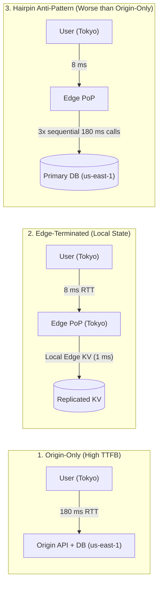
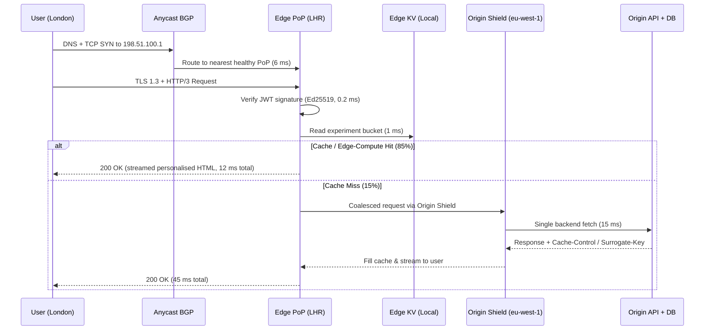
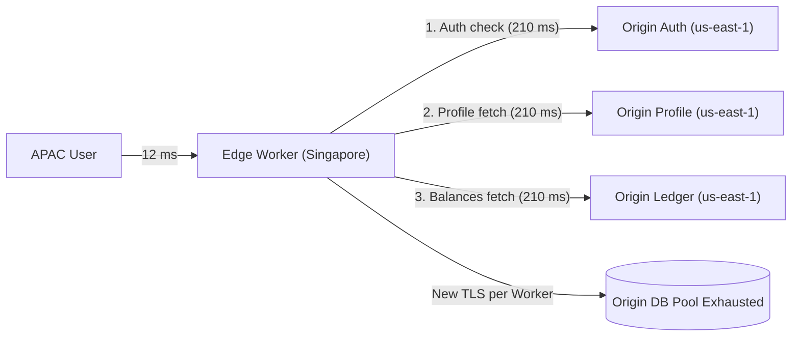

# Edge Computing: CDN Edge Functions, Personalisation & Their Limits

> **Prerequisites:** [Lesson 18: Data Governance & Lineage](../18-data-governance-lineage/README.md) · [Lesson 02: Regions, Availability Zones & Edge](../02-regions-availability-zones-edge/README.md).  
> **Estimated Reading Time:** 24–28 minutes  
> **Target Audience:** Backend and staff engineers designing low-latency global APIs, A/B testing, auth at the edge, or deciding what should run at a PoP vs an origin region.  
> **Free PDF Notes:** [Download SD-V-019.pdf](https://backendroadmap.com/notes/system-design/SD-V-019.pdf)

> [!NOTE]
> **In one line:** Edge computing runs lightweight, stateless or edge-KV-backed code in **300+ Points of Presence (PoPs)** milliseconds from the user (using V8 isolates or WebAssembly rather than heavy containers). You gain **dramatically lower TTFB, origin offload, and zero-cold-start routing/personalisation**; you pay with **strict CPU/memory budgets, eventual consistency on edge state, and a "hairpin" latency trap** if every edge request still calls a distant origin database.

> [!TIP]
> **The Golden Rule:** Run **compute that needs local or replicated data** at the edge (JWT verification, geo-routing, A/B bucketing, HTML shell streaming, bot filtering). Keep **write-heavy, strongly consistent, or origin-DB-bound logic** in the regional origin—otherwise the edge just adds a hop before the same transatlantic round trip.

---

## 1. What Edge Computing Is, and What It Isn't

A user in Tokyo opens an e-commerce site whose origin runs in `us-east-1` (Virginia). Even if static images are cached on a CDN, the HTML document and personalised banner ("Hi Kenji, 20% off in Tokyo") require a request to the origin: 180 ms fiber RTT, plus TLS handshake, plus origin rendering = 450–650 ms TTFB. Moving that personalisation and auth check to a **CDN Edge Function** in Tokyo's PoP drops the network RTT from 180 ms to 8 ms.

| Term | Precise Meaning | Example |
| :--- | :--- | :--- |
| **Point of Presence (PoP)** | A CDN edge data center peering directly with local ISPs via Anycast BGP | Cloudflare NRT, Fastly TYO, CloudFront Tokyo |
| **Edge Function (Isolate / Wasm)** | Lightweight sandboxed runtime (V8 isolate or Wasm) sharing one OS process across thousands of tenants | Cloudflare Workers, Fastly Compute, Deno Deploy |
| **Edge KV / Durable Objects** | Globally replicated eventually-consistent KV vs single-writer strongly-consistent edge actors | Cloudflare KV / Durable Objects, DynamoDB Global Tables |
| **Edge-Side Includes (ESI) / Streaming** | Caching the static HTML shell at the PoP while streaming personalised fragments | React SSR streaming at the edge + origin data |
| **Regional Compute (Origin)** | Full VMs/containers in a cloud region with co-located primary databases | EKS in `us-east-1` + Aurora PostgreSQL |
| **Not** | A replacement for your primary relational database or long-running batch jobs | Edge isolates typically cap CPU at 10–50 ms and RAM at 128 MB |

### Why It Matters
1. Speed-of-light latency cannot be engineered away at the origin: a 10,000 km fiber path has a hard physical floor of ~100 ms RTT.
2. Edge runtimes changed the economics of global compute by replacing 200 ms–2 s container cold starts with <5 ms V8 isolate startups.
3. Most edge failures in interviews and production come from **data gravity**: putting compute at the edge while leaving the database in one region.

---

## 2. Anatomy: Origin-Only vs Edge-Terminated vs Hairpin Anti-Pattern



In architecture (2), the Tokyo PoP verifies the JWT locally (Ed25519/RS256 public key cached in memory), reads the user's geo/experiment config from replicated Edge KV, and serves a personalised response in ~12 ms. In architecture (3), a developer moves a GraphQL or REST handler to the edge, but it makes three sequential queries to a primary PostgreSQL instance in `us-east-1`: $8 + 3 \times 180 = 548\text{ ms}$—slower than keeping the API co-located with the database!

| Dimension | V8 Isolate (Edge) | Serverless Container (Regional) | Kubernetes Pod (Origin) |
| :--- | :--- | :--- | :--- |
| **Cold start** | < 5 ms | 150 ms – 2 s | 0 ms (warm) / 10–40 s (autoscale) |
| **Memory limit** | 128 MB | 128 MB – 10 GB | Node-bounded (GBs) |
| **CPU budget** | 10–50 ms active CPU / req | Up to 15 min wall time | Unbounded (request-scoped) |
| **Network to user** | 5–25 ms (Anycast PoP) | 30–200 ms (Regional) | 30–200 ms (Regional) |
| **DB proximity** | Distant (unless Edge KV/replica) | Co-located (< 2 ms) | Co-located (< 2 ms) |

> [!WARNING]
> **Beware the "Edge Hairpin" trap.** If an edge function performs $k$ sequential round trips to a single-region database, total latency is $\text{RTT}_{\text{user}\to\text{edge}} + k \cdot \text{RTT}_{\text{edge}\to\text{origin}}$. Always co-locate chatty DB logic with the DB, or replicate read data to the edge.

---

## 3. Mathematical Model: Speed of Light, Hairpin Penalty & Cache Hit Ratio

**1. Physical RTT Floor in Fiber.** Light in single-mode silica fiber travels at $c_{\text{fiber}} \approx c / 1.47 \approx 204{,}000\text{ km/s}$ (~204 km/ms). For great-circle distance $d$ (with routing stretch factor $\gamma \approx 1.3$):

$$\text{RTT}_{\text{min}}(d) = \frac{2 \cdot \gamma \cdot d}{c_{\text{fiber}}}$$

For Tokyo to Virginia ($d \approx 10{,}850\text{ km}$, $\gamma = 1.3$):

$$\text{RTT}_{\text{min}} = \frac{2 \times 1.3 \times 10{,}850}{204} \approx 138.3\text{ ms}$$

Adding router queuing and TLS/TCP overhead yields ~170–185 ms in practice.

**2. Edge vs Origin Expected Latency.** Let $h$ be the edge cache/KV hit ratio (served at the PoP in $L_{\text{edge}}$), and $(1 - h)$ be misses that traverse to the origin ($L_{\text{edge}} + \text{RTT}_{\text{e}\to\text{o}} + L_{\text{origin}}$). With $k$ sequential origin calls per miss:

$$E[L] = L_{\text{edge}} + (1 - h)\left(k \cdot \text{RTT}_{\text{e}\to\text{o}} + L_{\text{origin}}\right)$$

**Worked Numerical Example.**
Suppose $L_{\text{edge}} = 10\text{ ms}$, $\text{RTT}_{\text{e}\to\text{o}} = 160\text{ ms}$, $L_{\text{origin}} = 25\text{ ms}$:
- **Good Edge Design** ($h = 0.90$, $k = 1$ on miss): $E[L] = 10 + 0.10(160 + 25) = 28.5\text{ ms}$ ($p_{50} = 10\text{ ms}$, $p_{95} = 195\text{ ms}$).
- **Hairpin Anti-Pattern** ($h = 0.00$, $k = 3$ sequential DB calls): $E[L] = 10 + 1.0(3 \times 160 + 25) = 515\text{ ms}$.
- **Regional Origin API** (all calls local to DB, user pays 1 RTT): $L = 168 + 25 = 193\text{ ms}$.

The hairpin edge deployment is **2.67x slower** than just running the API at the origin!

---

## 4. Metrics & Percentiles

| Metric | Meaning | Alert when |
| :--- | :--- | :--- |
| **Edge TTFB ($p_{50}, p_{99}$)** | Time to first byte measured from user-facing PoP | $p_{99}$ exceeds SLA (e.g., > 150 ms for cached/edge-KV routes) |
| **Origin Shield Hit Ratio** | Fraction of requests resolved at PoP + regional shield | Drops below target (e.g., < 85%), causing origin thundering herd |
| **Isolate CPU Time ($p_{99}$)** | Active CPU ms consumed per invocation (excludes I/O wait) | Approaching runtime cap (e.g., > 35 ms on a 50 ms limit) |
| **Subrequest Fan-out Count** | Outbound `fetch()` calls per edge request | > 1 origin call per request (signals hairpinning) |
| **KV Replication Lag** | Time for a config/feature-flag write to reach all PoPs | Exceeds staleness budget (e.g., > 60 s for security revocations) |
| **Isolate OOM / Wall-Timeout Rate** | Requests killed by 128 MB memory or wall-clock limits | Any non-zero spike (> 0.01%) |

### Worked Example (Global Auth & A/B Routing)
A SaaS app serves 50,000 req/s globally. Moving JWT verification, bot scoring, and A/B experiment bucketing to the edge:
- **Before:** 50,000 req/s hit `us-east-1` ALB + API pods. 18% are unauthenticated/bot requests that still consume origin pod CPU.
- **After:** The edge PoP rejects 9,000 bot/invalid-JWT req/s in 4 ms locally, serves 32,000 cached/KV-personalised req/s in 12 ms, and forwards only 9,000 authenticated cache-miss req/s over persistent pooled connections to the origin (82% origin offload).

---

## 5. Compounding & Failure Modes at Scale

Consider a global product launch with 100,000 req/s distributed across 200 PoPs, where an edge function reads a feature flag from Edge KV (TTL = 60 s) and falls back to origin on cache miss:

| Failure Mode | Mechanism | Quantitative Impact |
| :--- | :--- | :--- |
| **Cache Stampede across 200 PoPs** | Popular key expires simultaneously across PoPs | 200 PoPs × 50 concurrent workers = 10,000 simultaneous origin queries for 1 key |
| **Stale Security State** | Revoked JWT / banned user cached at PoPs for 60 s | Attacker retains access for up to 60 s across 300 PoPs unless push-purged or checked via short-lived tokens |
| **CPU Exhaustion via Regex / JSON** | Large payload parsed in 128 MB isolate | Single 20 MB JSON body triggers V8 OOM, crashing all in-flight requests sharing that isolate |
| **Origin Connection Exhaustion** | Each PoP opens fresh TLS connections to origin | 200 PoPs × 100 workers = 20,000 concurrent TLS handshakes overwhelm origin ALB/DB |

---

## 6. Numbers Every Engineer Must Know

| Item | Typical | Implication |
| :--- | :---: | :--- |
| User to nearest Edge PoP RTT | 5 – 25 ms | Feels instantaneous; ideal for TLS termination and shell streaming |
| Transoceanic fiber RTT | 130 – 200 ms | Hard physical floor; never do sequential round trips over it |
| V8 Isolate cold start | 0 – 5 ms | Eliminates regional serverless cold-start spikes |
| Edge isolate memory cap | 128 MB (typical) | Stream bodies; never buffer multi-MB payloads in RAM |
| Edge active CPU cap | 10 – 50 ms (free/std) | Avoid heavy crypto (bcrypt/argon2) or large SSR trees at the edge |
| Edge KV global propagation | 1 – 60 seconds | Eventual consistency only; never use for inventory/balances |
| Anycast BGP failover | 10 – 60 seconds | PoP outages drain via BGP route withdrawal + health checks |

---

## 7. Protocol / Mechanism Deep Dive: Anycast Routing & Edge Request Lifecycle



| Question | Answer |
| :--- | :--- |
| **How does Anycast pick the PoP?** | Multiple PoPs advertise the same IP prefix via BGP; routers pick the topologically shortest AS path. |
| **What if a PoP becomes overloaded or unhealthy?** | It withdraws its BGP announcement (or health-checked DNS/Anycast shifts traffic) in 10–60 s. |
| **How do you prevent 200 PoPs from stampeding the origin?** | Use an **Origin Shield** (a single regional tier-2 cache in front of origin) with request coalescing. |
| **How do you personalise without killing cache hit ratio?** | Cache the generic shell, vary only on coarse buckets (e.g., `country`, `ab_group`), or inject user fragments via Edge Streaming / ESI. |

**When NOT to use edge computing:**
- Write-heavy transactional workflows requiring ACID isolation across shared state (e.g., bank transfers, ticket seat locking).
- Heavy CPU workloads (image/video transcoding, PDF generation, bcrypt hashing, large ML inference).
- Workloads whose data is strictly pinned to one region and cannot be cached or replicated without violating latency or compliance.

---

## 8. Hierarchical Budgets & Design Rules

| Slice | Rule | Control |
| :--- | :--- | :--- |
| **CPU & Memory** | Keep active CPU < 15 ms and peak RAM < 64 MB per request | Stream responses (`TransformStream`); reject oversized bodies |
| **Origin Subrequests** | Max 1 origin call per edge request; zero sequential DB calls | Enforce subrequest budget in edge middleware |
| **Consistency** | Never store strongly consistent writes in Edge KV | Use regional origin or single-writer Edge Actors (Durable Objects) |
| **Cache Key Cardinality** | Never include `user_id` or raw cookies in CDN cache keys | Normalise to coarse `segment_id` / `country` headers |
| **Security & Revocation** | Short-lived JWTs (5–15 min) + edge-cached JWKS | Push-purge revocation lists for high-risk tokens |
| **Compliance / Residency** | Pin PII processing to regional PoPs when required (GDPR) | Geo-fenced edge routing + regional origin shields |

---

## 9. Top Mitigations

1. **Terminate TLS and HTTP/3 at the edge** so the 1–2 RTT handshake happens 10 ms from the user, not 180 ms away.
2. **Use Origin Shield + request coalescing** so 200 PoPs collapse into 1 origin fetch on cache miss.
3. **Cache the HTML shell and stream personalisation** (or use coarse `Vary` buckets) instead of bypassing the CDN for logged-in users.
4. **Verify JWTs at the edge** using cached public keys (JWKS) to drop unauthenticated traffic before it touches the origin.
5. **Stream request/response bodies** rather than `await response.text()`/`json()` on large payloads to stay under 128 MB isolate RAM.
6. **Co-locate read replicas or use Edge KV** for read-heavy config, feature flags, and geo-metadata; never hairpin to a distant primary DB.
7. **Set explicit timeouts and origin fallback headers** (`stale-while-revalidate`, `stale-if-error`) so origin blips don't 502 at the edge.

---

## 10. Production Reference: The "Edge GraphQL Hairpin" SEV-1

A fintech platform migrated its GraphQL BFF (Backend-for-Frontend) from `us-east-1` ECS containers to Edge Workers to "make APAC users faster." Within 10 minutes of rollout, APAC $p_{99}$ latency jumped from **320 ms to 2,400 ms**, and origin RDS CPU hit 98%.



- **Root Cause:** (1) The GraphQL resolver made 4 sequential RPCs back to `us-east-1` ($4 \times 210\text{ ms} = 840\text{ ms}$ network alone), and (2) 150 global PoPs opened unpooled connections to the origin API, exhausting connection limits and triggering retries.
- **The Fix:** Reverted the chatty GraphQL resolver back to `us-east-1` (co-located with RDS), kept only **JWT verification, rate limiting, and static/public catalog caching** at the Edge PoP, and enabled Origin Shield with persistent HTTP/2 connection pooling. APAC $p_{99}$ dropped to 240 ms on dynamic calls and 18 ms on cached catalog pages.

---

## 11. Multi-Language Production Code Tabs

An edge middleware / router pattern: verifies a signed token locally, buckets the user into an A/B cohort deterministically, serves from local edge cache if possible, and enforces a strict origin-call budget.

````carousel
```go
// Go: Edge-style request handler with local HMAC token check, deterministic A/B bucket, and stale-while-revalidate cache.
package main

import (
	"crypto/hmac"
	"crypto/sha256"
	"encoding/binary"
	"fmt"
	"net/http"
	"sync"
	"time"
)

type CacheEntry struct {
	Body      []byte
	ExpiresAt time.Time
}

type EdgeRouter struct {
	mu     sync.RWMutex
	cache  map[string]CacheEntry
	secret []byte
}

func NewEdgeRouter(secret []byte) *EdgeRouter {
	return &EdgeRouter{cache: make(map[string]CacheEntry), secret: secret}
}

func (e *EdgeRouter) Bucket(userID string) string {
	h := sha256.Sum256([]byte(userID + ":hero-v2"))
	if binary.BigEndian.Uint32(h[:4])%100 < 20 {
		return "variant-b" // 20% rollout
	}
	return "control"
}

func (e *EdgeRouter) VerifyToken(userID, sigHex string) bool {
	mac := hmac.New(sha256.New, e.secret)
	mac.Write([]byte(userID))
	expected := fmt.Sprintf("%x", mac.Sum(nil))
	return hmac.Equal([]byte(expected), []byte(sigHex))
}

func (e *EdgeRouter) ServeHTTP(w http.ResponseWriter, r *http.Request) {
	userID := r.Header.Get("X-User-ID")
	sig := r.Header.Get("X-Token-Sig")
	if userID == "" || !e.VerifyToken(userID, sig) {
		http.Error(w, "unauthorized at edge", http.StatusUnauthorized)
		return // rejected in <1ms without touching origin
	}

	bucket := e.Bucket(userID)
	cacheKey := r.URL.Path + ":" + bucket // coarse key, NOT userID!

	e.mu.RLock()
	entry, ok := e.cache[cacheKey]
	e.mu.RUnlock()

	if ok && time.Now().Before(entry.ExpiresAt) {
		w.Header().Set("X-Edge-Cache", "HIT")
		_, _ = w.Write(entry.Body)
		return
	}

	// Single origin fetch budget on miss
	body := []byte(fmt.Sprintf(`{"path":%q,"cohort":%q,"source":"origin"}`, r.URL.Path, bucket))
	e.mu.Lock()
	e.cache[cacheKey] = CacheEntry{Body: body, ExpiresAt: time.Now().Add(30 * time.Second)}
	e.mu.Unlock()

	w.Header().Set("X-Edge-Cache", "MISS")
	_, _ = w.Write(body)
}
```
<!-- slide -->
```typescript
// TypeScript: Cloudflare Workers / Web-Standard Fetch Edge Handler with coarse cache key & streaming.
export interface Env {
  EDGE_KV: { get(key: string): Promise<string | null> };
  ORIGIN_URL: string;
}

function deterministicBucket(userId: string, pct = 20): "variant-b" | "control" {
  let hash = 2166136261;
  for (let i = 0; i < userId.length; i++) {
    hash ^= userId.charCodeAt(i);
    hash = Math.imul(hash, 16777619);
  }
  return (hash >>> 0) % 100 < pct ? "variant-b" : "control";
}

export default {
  async fetch(request: Request, env: Env): Promise<Response> {
    const url = new URL(request.url);
    const userId = request.headers.get("x-user-id");
    if (!userId) {
      return new Response("Unauthorized at edge", { status: 401 });
    }

    // Read replicated config from local PoP KV (1-2 ms)
    const rolloutPct = Number((await env.EDGE_KV.get("hero_rollout_pct")) ?? "20");
    const cohort = deterministicBucket(userId, rolloutPct);

    // Coarse cache key avoids per-user cache fragmentation
    const cacheKey = new Request(`${env.ORIGIN_URL}${url.pathname}?cohort=${cohort}`);
    const originResp = await fetch(cacheKey, {
      headers: { "x-ab-cohort": cohort },
    });

    // Stream response directly without buffering in 128 MB isolate RAM
    const headers = new Headers(originResp.headers);
    headers.set("x-edge-cohort", cohort);
    headers.set("cache-control", "public, max-age=30, stale-while-revalidate=60");
    return new Response(originResp.body, { status: originResp.status, headers });
  },
};
```
<!-- slide -->
```python
# Python: Edge vs Origin latency simulator (Section 3 math, stdlib only).
def simulate_request_latency(
    user_to_pop_ms: float = 8.0,
    pop_to_origin_rtt_ms: float = 160.0,
    edge_compute_ms: float = 2.0,
    origin_compute_ms: float = 25.0,
    cache_hit_ratio: float = 0.90,
    origin_sequential_calls: int = 1,
) -> dict:
    """Computes expected latency, p50, and miss latency for edge vs hairpin vs origin-only."""
    edge_only = user_to_pop_ms + edge_compute_ms
    miss_latency = (
        user_to_pop_ms
        + edge_compute_ms
        + origin_sequential_calls * pop_to_origin_rtt_ms
        + origin_compute_ms
    )
    expected_ms = cache_hit_ratio * edge_only + (1.0 - cache_hit_ratio) * miss_latency
    origin_only_ms = (user_to_pop_ms + pop_to_origin_rtt_ms) + origin_compute_ms
    return {
        "edge_hit_ms": round(edge_only, 1),
        "edge_miss_ms": round(miss_latency, 1),
        "expected_edge_ms": round(expected_ms, 1),
        "origin_only_ms": round(origin_only_ms, 1),
    }

if __name__ == "__main__":
    print("Good edge (90% hit, 1 call):", simulate_request_latency(cache_hit_ratio=0.90, origin_sequential_calls=1))
    print("Hairpin (0% hit, 3 calls):  ", simulate_request_latency(cache_hit_ratio=0.0, origin_sequential_calls=3))
```
<!-- slide -->
```csharp
// C#: Edge-style middleware computing coarse cohort keys and enforcing origin subrequest budget.
using System.Security.Cryptography;
using System.Text;

public sealed record EdgeResult(int StatusCode, string CacheState, string Cohort, string Body);

public sealed class EdgeGateway
{
    private readonly Dictionary<string, (string Body, DateTimeOffset Expires)> _popCache = new();
    private readonly Lock _lock = new();

    public static string GetCohort(string userId, int rolloutPct = 20)
    {
        var hash = SHA256.HashData(Encoding.UTF8.GetBytes($"{userId}:hero-v2"));
        uint bucket = BitConverter.ToUInt32(hash, 0) % 100;
        return bucket < rolloutPct ? "variant-b" : "control";
    }

    public EdgeResult Handle(string path, string? userId)
    {
        if (string.IsNullOrEmpty(userId))
            return new EdgeResult(401, "BYPASS", "none", "Unauthorized at edge");

        string cohort = GetCohort(userId);
        string cacheKey = $"{path}:{cohort}";

        lock (_lock)
        {
            if (_popCache.TryGetValue(cacheKey, out var entry) && DateTimeOffset.UtcNow < entry.Expires)
                return new EdgeResult(200, "HIT", cohort, entry.Body);
        }

        // Single origin fetch on miss
        string originBody = $"{{\"path\":\"{path}\",\"cohort\":\"{cohort}\"}}";
        lock (_lock)
        {
            _popCache[cacheKey] = (originBody, DateTimeOffset.UtcNow.AddSeconds(30));
        }
        return new EdgeResult(200, "MISS", cohort, originBody);
    }
}
```
````

---

## 12. Hands-On CLI Verification Workflows

Verify the mathematical latency model in Python:

```bash
python3 -c '
def sim(hit=0.9, k=1):
    e = 10.0
    m = 10.0 + k * 160.0 + 25.0
    return {"expected_ms": round(hit*e + (1-hit)*m, 1), "miss_ms": m, "origin_only_ms": 193.0}
print("Good Edge:", sim(0.9, 1))
print("Hairpin:  ", sim(0.0, 3))
'
```

Inspect real CDN edge PoP headers, cache status, and TLS/TTFB breakdown with `curl`:

```bash
# Measure DNS, TCP, TLS, and TTFB separately to observe edge termination
curl -s -o /dev/null -w "dns=%{time_namelookup}s tcp=%{time_connect}s tls=%{time_appconnect}s ttfb=%{time_starttransfer}s total=%{time_total}s\n" \
  https://example.com/

# Check CDN PoP and cache hit/miss headers (Cloudflare / CloudFront / Fastly)
curl -sI https://example.com/ | grep -iE "cf-ray|cf-cache-status|x-cache|age|via"
```

---

## 13. Common Mistakes to Avoid

1. **Moving chatty DB-bound APIs to the edge**, creating the "hairpin" latency penalty.
2. **Putting `user_id` or raw session cookies in the CDN cache key**, collapsing cache hit ratio to ~0%.
3. **Buffering large HTTP bodies in a 128 MB V8 isolate**, causing OOM crashes across co-tenant requests.
4. **Storing strongly consistent state (inventory, balances) in eventually consistent Edge KV**.
5. **Running heavy CPU tasks (bcrypt, PDF/image rendering)** inside 10–50 ms edge CPU budgets.
6. **Forgetting Origin Shield**, allowing 200+ PoPs to stampede the origin on cache expiry.
7. **Ignoring data residency (GDPR)** when edge PoPs route or log PII outside permitted jurisdictions.

---

## 14. Key Terms Glossary

| Key Term | Definition |
| :--- | :--- |
| **Point of Presence (PoP)** | Edge data center peering with local ISPs to terminate user traffic nearby. |
| **Anycast BGP** | Routing technique where many PoPs share one IP and BGP routes users to the nearest healthy one. |
| **V8 Isolate** | Lightweight JS/Wasm execution sandbox with <5 ms startup and strict memory/CPU caps. |
| **Edge Hairpin** | Anti-pattern where an edge function makes multiple sequential round trips to a distant origin DB. |
| **Origin Shield** | Regional tier-2 cache between global PoPs and the origin that coalesces cache misses. |
| **Edge KV** | Globally replicated, eventually consistent key-value store readable in 1–2 ms at PoPs. |
| **Surrogate Key** | Tag attached to cached objects allowing instant group invalidation across all PoPs. |
| **TTFB** | Time To First Byte—network + TLS + server processing time until the first response byte arrives. |
| **Coarse Cache Key** | Caching by segment/cohort/country rather than per-user ID to preserve high hit ratios. |
| **Stale-While-Revalidate** | Serving a slightly expired edge entry immediately while refreshing it asynchronously. |

---

## 15. System Design Interview Questions & Answers

### Basic Conceptual Questions

<details>
<summary><strong>Q1: Why are V8 isolates used at the edge instead of Docker containers? [BASIC]</strong></summary>

**Answer:**
V8 isolates share a single OS process and spin up in <5 ms with ~3 MB overhead per isolate, whereas containers take hundreds of milliseconds to seconds to cold-start and require tens to hundreds of MBs of RAM. In 300+ PoPs with bursty traffic, isolates allow dense multi-tenancy and zero noticeable cold starts.
</details>

<details>
<summary><strong>Q2: What workloads belong at the edge vs the regional origin? [BASIC]</strong></summary>

**Answer:**
Edge: TLS termination, JWT verification, bot/WAF filtering, geo-routing, A/B bucketing, static/shell caching, and lightweight personalisation backed by Edge KV. Origin: write-heavy ACID transactions, multi-table joins, heavy CPU/ML inference, and stateful workflows.
</details>

<details>
<summary><strong>Q3: How does Anycast routing work for a global CDN? [BASIC]</strong></summary>

**Answer:**
Every PoP announces the same IP prefix via BGP. Internet routers naturally forward packets along the shortest Autonomous System (AS) path to the closest healthy PoP. If a PoP fails, it withdraws its BGP route and traffic shifts to the next closest PoP within 10–60 seconds.
</details>

<details>
<summary><strong>Q4: What is the difference between Edge KV and a primary relational database? [BASIC]</strong></summary>

**Answer:**
Edge KV is globally replicated for 1–2 ms local reads at every PoP, but uses eventual consistency (1–60 s propagation lag) and lacks multi-key ACID transactions. A primary RDBMS provides strong consistency and complex queries in one region, at the cost of transoceanic RTT for distant users.
</details>

### Scenario-Based Architecture Questions

<details>
<summary><strong>Q5: How do you personalise an e-commerce homepage at the edge without destroying cache hit ratio? [SCENARIO]</strong></summary>

**Answer:**
Cache the generic HTML shell at the PoP with a coarse cache key (e.g., `country` + `currency` + `ab_cohort`), and inject user-specific fragments (cart count, username) either via Edge-Side Includes / streaming HTML replacement from a lightweight edge-cached fragment or client-side hydration.
</details>

<details>
<summary><strong>Q6: After moving your API to Edge Workers, p99 latency got worse. Why? [SCENARIO]</strong></summary>

**Answer:**
Likely the **Edge Hairpin** anti-pattern: the worker is making multiple sequential queries back to a single-region database, paying $k \times \text{RTT}_{\text{edge}\to\text{origin}}$ plus unpooled TLS handshakes. Move the chatty DB logic back to the origin or replicate read data to the edge.
</details>

<details>
<summary><strong>Q7: A breaking news banner is cached at 300 PoPs, and a typo needs fixing immediately. How do you invalidate it? [SCENARIO]</strong></summary>

**Answer:**
Tag cached responses with a `Surrogate-Key` (e.g., `banner-home`) and trigger a global purge-by-tag API call (propagates in 150 ms–2 s), paired with Origin Shield so the resulting cache misses coalesce into a single origin fetch instead of 300 simultaneous hits.
</details>

<details>
<summary><strong>Q8: How do you handle JWT revocation at the edge if Edge KV takes 30 seconds to propagate? [SCENARIO]</strong></summary>

**Answer:**
Use short-lived access tokens (5 minutes) verified statelessly at the edge via cached JWKS, and handle refresh/revocation at the regional auth service. For immediate kill-switches on high-value accounts, push a compact Bloom filter or revocation list to PoPs or route sensitive endpoints (e.g., `/transfer`) directly to the origin.
</details>

### Advanced & Tricky Interview Questions

<details>
<summary><strong>Q9: How do you enforce strict global rate limiting at the edge? [TRICKY]</strong></summary>

**Answer:**
Local PoP counters are fast (0 ms) but allow a user to hit $N$ PoPs for $N \times \text{limit}$. For strict global limits, route rate-limit state for a `user_id` to a single-writer **Edge Actor** (e.g., Cloudflare Durable Object) pinned to one PoP, or use local PoP token buckets with asynchronous gossip/aggregation for approximate global enforcement.
</details>

<details>
<summary><strong>Q10: How does Origin Shield prevent a thundering herd on cache expiry? [TRICKY]</strong></summary>

**Answer:**
Without Origin Shield, 300 PoPs independently miss and send 300 requests to the origin. Origin Shield designates one regional PoP near the origin as a tier-2 cache; all 300 edge PoPs query the Shield, which performs **request coalescing** (singleflight) so only 1 request hits the origin.
</details>

<details>
<summary><strong>Q11: What happens when an edge function needs to respect EU GDPR data residency? [TRICKY]</strong></summary>

**Answer:**
Edge PoPs in non-EU countries must not process or log EU PII. Use geo-fenced routing or regional edge tiers (e.g., Cloudflare Regional Services / EU-only PoP pinning) so TLS terminates at the nearest PoP for speed, or strictly inside EU PoPs for regulated payloads, forwarding to an `eu-central-1` origin.
</details>

<details>
<summary><strong>Q12: Why can't you just use Read Replicas in 10 regions to solve edge write latency? [TRICKY]</strong></summary>

**Answer:**
Read replicas help reads, but writes still must travel to the single primary (or pay cross-region consensus RTT in distributed SQL like Spanner/CockroachDB). Plus, async read replicas introduce **read-your-own-writes** anomalies unless you track replication LSNs/session tokens and route recent writers back to the primary.
</details>

---

## 16. One-Page Master Cheat Sheet

```
+---------------------------------------------------------------------------------------------------------+
|                    EDGE COMPUTING — MASTER CHEAT SHEET                                                  |
+---------------------------------------------------------------------------------------------------------+
| 1. PHYSICS: Fiber ~204 km/ms -> 10,000 km = ~130-180 ms RTT floor. Edge PoP = 5-25 ms RTT.              |
+---------------------------------------------------------------------------------------------------------+
| 2. RUNTIME: V8 Isolates / Wasm -> <5 ms cold start, 128 MB RAM cap, 10-50 ms active CPU cap.            |
+---------------------------------------------------------------------------------------------------------+
| 3. HAIRPIN TRAP: k sequential edge->origin DB calls = k * 160 ms. Worse than origin-only!               |
+---------------------------------------------------------------------------------------------------------+
| 4. GOOD AT EDGE: TLS/HTTP3, JWT verify, bot/WAF, A/B bucketing, coarse-key caching, HTML streaming.     |
+---------------------------------------------------------------------------------------------------------+
| 5. BAD AT EDGE: ACID writes, chatty DB joins, heavy CPU (bcrypt/video), multi-MB body buffering.        |
+---------------------------------------------------------------------------------------------------------+
| 6. SCALE CONTROLS: Origin Shield (request coalescing), Surrogate-Key purge, stale-while-revalidate.     |
+---------------------------------------------------------------------------------------------------------+
```

---

## Further Reading & Sources

- Cloudflare Architecture Docs, [How Workers Work (V8 Isolates)](https://developers.cloudflare.com/workers/reference/how-workers-works/).
- Fastly Documentation, [Origin Shielding and Request Collapsing](https://docs.fastly.com/en/guides/shielding).
- Martin Kleppmann, *Designing Data-Intensive Applications*, Chapter 5 ("Replication" & read-your-writes consistency).
- High Performance Browser Networking (Ilya Grigorik), [Latency & Speed of Light in Fiber](https://hpbn.co/primer-on-latency-and-bandwidth/).

---

## Free PDF Notes

[SD-V-019.pdf](https://backendroadmap.com/notes/system-design/SD-V-019.pdf)

---

## Next

Continue with [Lesson 20: Platform Engineering: Internal Developer Platforms & Golden Paths](../20-platform-engineering/README.md).
