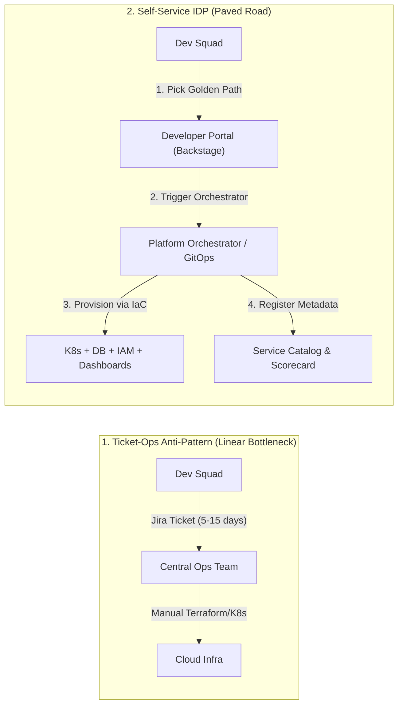
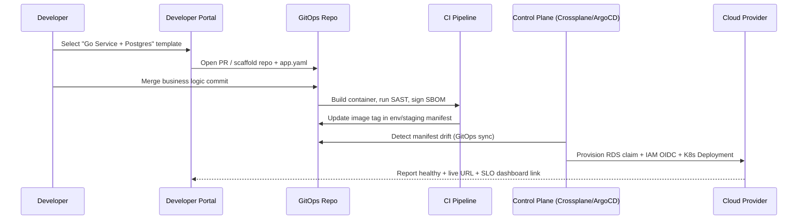
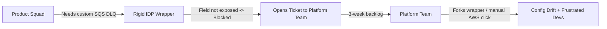

# Platform Engineering: Internal Developer Platforms & Golden Paths

> **Prerequisites:** [Lesson 19: Edge Computing: CDN Edge Functions, Personalisation & Their Limits](../19-edge-computing/README.md) · [Lesson 12: GitOps](../12-gitops/README.md).  
> **Estimated Reading Time:** 24–28 minutes  
> **Target Audience:** Staff/principal engineers and platform leads scaling engineering organisations beyond 50+ developers, and candidates asked how to reduce cognitive load without creating bottlenecks.  
> **Free PDF Notes:** [Download SD-V-020.pdf](https://backendroadmap.com/notes/system-design/SD-V-020.pdf)

> [!NOTE]
> **In one line:** Platform Engineering treats internal infrastructure as a **product** for application developers, delivering an **Internal Developer Platform (IDP)** with self-service **Golden Paths** (opinionated, paved roads with security, observability, and CI/CD baked in). You gain **faster lead time, lower cognitive load, and built-in compliance**; you pay with **platform team investment, abstraction leaks, and the risk of building a rigid "ivory tower" if developers aren't treated as customers**.

> [!TIP]
> **The Golden Rule:** Make the **secure, compliant, observable way the easiest way**—never mandatory by ticket gatekeeping alone. A Golden Path is a **paved road with guardrails**, not a locked cage; teams with valid edge cases must have an **eject/escape hatch**.

---

## 1. What Platform Engineering Is, and What It Isn't

At 15 engineers, everyone knows how to write a Dockerfile, a Terraform module, and a Helm chart. At 250 engineers across 30 squads, every team reinventing its own CI pipeline, Kubernetes manifests, IAM roles, and Prometheus alerts causes **cognitive overload**, inconsistent security postures, and 3-week wait times on a central Ops ticket queue. Platform Engineering solves this by building a self-service **Internal Developer Platform (IDP)**.

| Term | Precise Meaning | Example |
| :--- | :--- | :--- |
| **Internal Developer Platform (IDP)** | Self-service layer (portal + APIs + orchestrator) abstracting infra/CI/observability | Backstage + Crossplane + ArgoCD + Vault |
| **Golden Path (Paved Road)** | Opinionated, blessed template for a common workload with defaults baked in | "Create Go gRPC Service" -> repo, CI, Helm, SLOs in 3 min |
| **Platform as a Product** | Treating internal devs as customers with NPS, adoption metrics, and docs | Voluntary adoption >80% instead of ticket mandates |
| **Cognitive Load** | Mental effort required beyond business logic (IAM, VPCs, K8s YAML, TLS) | Extraneous load platform teams aim to eliminate |
| **Escape Hatch** | Documented way to override or bypass Golden Path defaults for special needs | Custom Terraform/Helm values with explicit security review |
| **Not** | Rebranded "Ops ticket queue" or a rigid PaaS that blocks legitimate workloads | A Jira form that pages a human to run `terraform apply` is NOT an IDP |

### Why It Matters
1. According to *Team Topologies*, stream-aligned squads ship fastest when a **platform team** absorbs extraneous infrastructure complexity behind a self-service API.
2. Security and compliance (SOC 2, PCI, least-privilege IAM, SBOMs) scale automatically when baked into Golden Path templates rather than enforced via manual PR reviews.
3. Interviewers test whether you can balance **developer velocity vs standardisation** without creating a single point of organisational bottleneck.

---

## 2. Anatomy: Ticket-Ops vs Internal Developer Platform



In the Ticket-Ops model, platform throughput scales linearly with Ops headcount—doubling product engineers doubles the queue wait time. In the IDP model, the platform team builds **automation and templates once**, and 300 developers provision compliant services in minutes via GitOps and declarative resource claims (e.g., Crossplane/Terraform modules).

| Dimension | Ad-Hoc "You Build It, You Run It" | Central Ticket-Ops | Platform Engineering (IDP) |
| :--- | :--- | :--- | :--- |
| **Time to first prod deploy** | Days–weeks (copy-paste YAML) | 1–3 weeks (ticket queue) | **< 15 minutes** (Golden Path) |
| **Cognitive load on devs** | Very High | Low (but blocked) | **Low (self-service)** |
| **Security & compliance** | Fragmented / drift-prone | Enforced manually | **Baked into templates** |
| **Scaling bottleneck** | Every squad reinvents infra | Ops team headcount | Platform product roadmap |

> [!WARNING]
> **Never confuse an IDP with a "No-Ops Ticket Portal".** If a developer clicks a button in Backstage and it just opens a Jira ticket for a human SRE to provision an RDS instance, you have built a prettier form over the same bottleneck.

---

## 3. Mathematical Model: Queueing Bottleneck, Cognitive Load & ROI

**1. Ticket-Ops Queueing Delay ($M/M/c$).** Suppose an Ops team of $c = 3$ engineers handles infra tickets at $\mu = 0.8$ tickets/day each (total capacity $c\mu = 2.4$ tickets/day). If 20 squads generate $\lambda = 2.1$ tickets/day, utilisation is $\rho = \lambda / (c\mu) = 2.1 / 2.4 = 87.5\%$. By Little's Law and $M/M/c$ queueing, average wait time explodes as $\rho \to 1$:

$$W_q \approx \frac{\rho^{\sqrt{2(c+1)}-1}}{c\mu(1 - \rho)}$$

At $\rho = 0.875$, $W_q \approx 2.6\text{ days}$ of pure waiting per ticket; if a new service needs 4 tickets (repo, IAM, DB, DNS), lead time is **>10 days** before writing business logic.

**2. Platform ROI Break-Even.** Let $N_{\text{devs}}$ be product engineers, $t_{\text{saved}}$ be hours saved per dev per month by the IDP, and $C_{\text{plat}}$ be the annual cost of the platform team (e.g., $P$ engineers). Net annual engineering capacity gained:

$$\text{Net Gain (FTE-years)} = \frac{N_{\text{devs}} \cdot t_{\text{saved}} \cdot 12}{1920} - P$$

**Worked Numerical Example.**
Suppose $N_{\text{devs}} = 120$, an IDP saves $t_{\text{saved}} = 6\text{ hours/dev/month}$ (eliminating CI debugging, Terraform boilerplate, and ticket waits), and the platform team has $P = 4$ engineers:

$$\text{Gross Saved} = \frac{120 \times 6 \times 12}{1920} = 4.5\text{ FTE-years}, \qquad \text{Net Gain} = 4.5 - 4 = +0.5\text{ FTE-years}$$

At $N_{\text{devs}} = 300$ with $P = 5$, $\text{Gross Saved} = 11.25\text{ FTE-years}$ and **Net Gain = $+6.25\text{ FTE-years}$**—which is why dedicated platform teams pay off massively above ~50–80 developers, and are often over-engineered at 10 developers.

---

## 4. Metrics & Percentiles (DORA + Platform Product Metrics)

| Metric | Meaning | Alert when |
| :--- | :--- | :--- |
| **Golden Path Adoption Rate** | % of active services using supported templates | Drops below 70% (devs are routing around the platform) |
| **Time to First Hello-World** | Minutes from "create service" to live staging URL | Exceeds 30 minutes |
| **Deployment Frequency & Lead Time** | DORA velocity metrics per squad | Lead time for changes > 1 day |
| **Change Failure Rate (CFR)** | % of deployments causing incidents/rollbacks | Exceeds 10–15% |
| **Platform Developer NPS** | Quarterly internal survey ("would you recommend the IDP?") | Score < +20 or declining trend |
| **Drift / Unmanaged Resource %** | Cloud resources created outside IDP/IaC | > 5% (shadow IT / compliance gap) |

### Worked Example (New Microservice Onboarding)
A fintech scales from 40 to 180 engineers. Before the IDP, onboarding a new Go microservice took 9.5 days (3 days Terraform/IAM copy-paste, 4 days waiting on security/DBA review, 2.5 days wiring OpenTelemetry + Datadog). After launching a Golden Path CLI/portal:
- Developer runs `idp create service --lang go --db postgres`.
- Platform scaffolds Git repo, GitHub Actions CI, OIDC-based IAM role, Crossplane `PostgresClaim`, Helm chart, and Grafana SLO dashboard in **4 minutes**.
- Adoption hits **88%** in 6 months because the Golden Path is faster and cleaner than rolling your own.

---

## 5. Compounding & Failure Modes

| Failure Mode | Mechanism | Impact at Scale |
| :--- | :--- | :--- |
| **Leaky Abstraction** | IDP hides Kubernetes/Terraform completely; devs hit cryptic error on failure | Every failure escalates back to the platform team, recreating Ticket-Ops |
| **Mandate Without Product Fit** | Leadership forces use of a buggy IDP via policy blocks | Shadow IT, morale drop, devs spend hours fighting the wrapper |
| **Template Sprawl / Bitrot** | 12 language templates created, security patches applied only to 2 | 80% of fleet runs vulnerable base images or deprecated Helm charts |
| **Blast-Radius Amplification** | Shared platform CI/CD or ingress controller has a bad config push | 100% of product squads blocked or taken down simultaneously |

---

## 6. Numbers Every Engineer Must Know

| Item | Typical | Implication |
| :--- | :---: | :--- |
| Org size where dedicated IDP pays off | 50 – 80+ engineers | Below 30 devs, use managed PaaS (Render/Fly/Cloud Run) + simple Terraform |
| Platform team ratio | 5% – 10% of engineering | e.g., 5–8 platform engineers supporting 100 product engineers |
| Target "Time to First Deploy" | < 15 minutes | Anything > 1 hour encourages copy-pasting old repos |
| Golden Path adoption target | 75% – 90% | 100% is a red flag (means no escape hatch for legitimate edge cases) |
| Golden Path template count | 3 – 5 core stacks | Too many templates = unmaintainable; standardize on 2–3 languages |

---

## 7. Protocol / Mechanism Deep Dive: Golden Path Provisioning Flow



| Question | Answer |
| :--- | :--- |
| **How do you update 200 services when a base Helm chart has a CVE?** | Keep app repos thin (`app.yaml` + image tag) and reference versioned remote Helm/Kustomize bases or Renovate/Dependabot automated PRs. |
| **How does an IDP enforce security without slowing devs down?** | Policy-as-Code (OPA/Kyverno) in CI and admission controllers validates templates automatically—zero manual security tickets for standard paths. |
| **What is the "Thinnest Viable Platform" (TVP)?** | Starting with just enough tooling (e.g., 1 CI template + 1 service template + docs) rather than spending 12 months building a custom UI before onboarding a single team. |

**When NOT to build a custom IDP:**
- Startups with <30 engineers: a managed PaaS (Cloud Run, ECS, Heroku, Fly.io) gives 90% of the benefit at 5% of the cost.
- When you haven't standardized your underlying infra yet: wrapping chaotic manual processes in a portal only automates chaos.

---

## 8. Hierarchical Budgets & Design Rules

| Slice | Rule | Control |
| :--- | :--- | :--- |
| **Abstraction Depth** | Expose underlying K8s/Terraform outputs for debugging | Never hide logs, events, or kubectl/state read access |
| **Escape Hatches** | Allow `custom_overrides` for the ~10–20% non-standard workloads | Require explicit ADR/security review only on overrides |
| **Blast Radius** | Canary platform upgrades in 1 sandbox cluster before fleet rollout | Progressive delivery of platform add-ons (Argo Rollouts) |
| **Governance** | Policy-as-Code (OPA/Kyverno) over manual ticket gates | Automated PR checks + admission webhooks |
| **Product Mindset** | Platform team embeds with a pilot squad before GA | Track adoption %, TTFHW, and quarterly Dev NPS |
| **Lifecycle / Day-2** | Golden Paths must cover upgrades, secrets rotation, and teardown | Ephemeral PR environments auto-expire after 24h |

---

## 9. Top Mitigations

1. **Build the Thinnest Viable Platform (TVP)**—adopt Backstage/CLI + existing IaC modules rather than writing a bespoke UI from scratch.
2. **Treat internal developers as customers**—run user interviews, maintain a changelog, and measure voluntary adoption.
3. **Provide an explicit escape hatch** so edge-case workloads (GPU ML, stateful brokers) aren't blocked by rigid templates.
4. **Bake Day-2 operations into the template**: OpenTelemetry tracing, structured logging, SLO alerts, and secret rotation come free on day 1.
5. **Keep templates decoupled from app business logic** via versioned platform modules + automated PR bots (Renovate).
6. **Canary platform changes** (ingress, service mesh, OPA policies) in a staging cluster before rolling out to all squads.

---

## 10. Production Reference: The "Rigid Wrapper" Rollout Failure

A 200-person SaaS company spent 9 months building a custom YAML-to-Terraform wrapper CLI that completely hid AWS and Kubernetes from developers. When a squad needed a custom SQS dead-letter redrive policy and a slightly larger pod memory limit, the wrapper didn't expose those fields.



- **Root Cause:** The platform team optimised for *hiding* infrastructure rather than *composing* it with sensible defaults, and provided no escape hatch.
- **The Fix:** Refactored the IDP into **composable Terraform/Crossplane claims with an `overrides` block**, added OPA guardrails for security invariants (e.g., encryption-at-rest required, no `0.0.0.0/0` ingress), and published transparent docs linking directly to the generated manifests. Voluntary adoption rose from 35% to 89% in two quarters.

---

## 11. Multi-Language Production Code Tabs

A minimal **Platform Golden Path Validator & Manifest Generator** (validates a developer's concise `service.yaml` against policy-as-code guardrails and emits compliant deployment + SLO metadata).

````carousel
```go
// Go: Golden Path service spec validator & manifest generator with policy guardrails.
package main

import (
	"errors"
	"fmt"
	"strings"
)

type ServiceSpec struct {
	Name       string
	OwnerTeam  string
	Tier       string // "critical" | "standard"
	Replicas   int
	Public     bool
	AllowUnauth bool
}

type GuardrailError struct{ Violations []string }

func (e GuardrailError) Error() string {
	return "policy violations: " + strings.Join(e.Violations, "; ")
}

func ValidateAndRender(s ServiceSpec) (string, error) {
	var v []string
	if s.Name == "" || s.OwnerTeam == "" {
		v = append(v, "name and owner_team are mandatory for on-call routing")
	}
	if s.Tier == "critical" && s.Replicas < 2 {
		v = append(v, "critical tier requires replicas >= 2 for HA")
	}
	if s.Public && s.AllowUnauth {
		v = append(v, "public services cannot disable authentication without security waiver")
	}
	if len(v) > 0 {
		return "", GuardrailError{Violations: v}
	}

	sloTarget := "99.9%"
	if s.Tier == "critical" {
		sloTarget = "99.99%"
	}
	return fmt.Sprintf(
		"service=%s owner=%s replicas=%d slo=%s otel=enabled",
		s.Name, s.OwnerTeam, s.Replicas, sloTarget,
	), nil
}

func main() {
	out, err := ValidateAndRender(ServiceSpec{
		Name: "payments-api", OwnerTeam: "checkout", Tier: "critical", Replicas: 3, Public: true,
	})
	if err != nil && !errors.Is(err, nil) {
		panic(err)
	}
	fmt.Println("Generated Golden Path:", out)
}
```
<!-- slide -->
```typescript
// TypeScript: Golden Path Scaffolder & Policy Guardrail Check.
export interface ServiceSpec {
  name: string;
  ownerTeam: string;
  tier: "critical" | "standard";
  replicas: number;
  publicIngress: boolean;
  escapeHatchOverride?: { justification: string; approvedBy: string };
}

export function provisionGoldenPath(spec: ServiceSpec): Record<string, unknown> {
  const errors: string[] = [];
  if (!spec.ownerTeam) errors.push("ownerTeam is required for incident ownership");
  if (spec.tier === "critical" && spec.replicas < 2 && !spec.escapeHatchOverride) {
    errors.push("critical services require >=2 replicas (or an approved escapeHatchOverride)");
  }
  if (errors.length > 0) {
    throw new Error(`Golden Path Policy Failed:\n- ${errors.join("\n- ")}`);
  }

  return {
    apiVersion: "platform.internal/v1",
    kind: "ServiceClaim",
    metadata: { name: spec.name, labels: { owner: spec.ownerTeam, tier: spec.tier } },
    spec: {
      replicas: spec.replicas,
      ingress: spec.publicIngress ? "tls-oidc-gateway" : "internal-mesh",
      observability: { otel: true, slo: spec.tier === "critical" ? 0.9999 : 0.999 },
    },
  };
}
```
<!-- slide -->
```python
# Python: Platform ROI & Ticket-Ops M/M/c Queueing Simulator (Section 3, stdlib only).
import math

def mmc_wait_days(arrival_per_day: float, service_per_day: float, ops_engineers: int) -> float:
    """Approximates average ticket wait time in days for an M/M/c Ops queue."""
    rho = arrival_per_day / (ops_engineers * service_per_day)
    if rho >= 1.0:
        return math.inf
    exp = math.sqrt(2 * (ops_engineers + 1)) - 1
    return (rho ** exp) / (ops_engineers * service_per_day * (1.0 - rho))

def platform_net_fte(num_devs: int, hours_saved_per_month: float, platform_engineers: int) -> float:
    """Computes net FTE-years gained after subtracting the platform team's headcount."""
    gross_fte = (num_devs * hours_saved_per_month * 12) / 1920.0
    return round(gross_fte - platform_engineers, 2)

if __name__ == "__main__":
    print("Ticket wait (rho=0.875):", round(mmc_wait_days(2.1, 0.8, 3), 2), "days")
    print("ROI @ 30 devs, 3 plat: ", platform_net_fte(30, 6.0, 3), "FTE-years")
    print("ROI @ 300 devs, 5 plat:", platform_net_fte(300, 6.0, 5), "FTE-years")
```
<!-- slide -->
```csharp
// C#: Golden Path Policy Validator & Service Claim Builder.
public sealed record ServiceSpec(
    string Name,
    string OwnerTeam,
    string Tier,
    int Replicas,
    bool PublicIngress,
    string? EscapeHatchJustification = null);

public static class GoldenPathEngine
{
    public static string BuildManifest(ServiceSpec spec)
    {
        var violations = new List<string>();
        if (string.IsNullOrWhiteSpace(spec.OwnerTeam))
            violations.Add("OwnerTeam is required.");
        if (spec.Tier == "critical" && spec.Replicas < 2 && spec.EscapeHatchJustification is null)
            violations.Add("Critical tier requires Replicas >= 2 unless EscapeHatchJustification is provided.");

        if (violations.Count > 0)
            throw new InvalidOperationException(string.Join(" | ", violations));

        string slo = spec.Tier == "critical" ? "99.99%" : "99.9%";
        return $"ServiceClaim({spec.Name}, owner={spec.OwnerTeam}, replicas={spec.Replicas}, slo={slo}, otel=true)";
    }
}
```
````

---

## 12. Hands-On CLI Verification Workflows

Run the ROI and Ticket-Ops queueing model in Python:

```bash
python3 -c '
import math
def wait(lam=2.1, mu=0.8, c=3):
    rho = lam/(c*mu)
    return round((rho**(math.sqrt(2*(c+1))-1))/(c*mu*(1-rho)), 2)
print("Avg ticket wait (days):", wait())
print("Net FTE @ 30 devs, 3 plat:", round((30*6*12)/1920 - 3, 2))
print("Net FTE @ 300 devs, 5 plat:", round((300*6*12)/1920 - 5, 2))
'
```

Inspect real Kubernetes Policy-as-Code (Kyverno/OPA) and Crossplane claims in a platform cluster:

```bash
# Check ClusterPolicies enforcing Golden Path defaults (e.g., required owner labels, non-root)
kubectl get clusterpolicy

# Inspect self-service Crossplane composite resource claims provisioned by product teams
kubectl get claims -A

# Verify ArgoCD GitOps sync status across platform-managed services
argocd app list -o wide
```

---

## 13. Common Mistakes to Avoid

1. **Building a "Ticket Portal" instead of true self-service automation**—a UI that files a Jira ticket is still Ticket-Ops.
2. **Mandating adoption before product-market fit**, forcing devs onto an immature platform.
3. **Zero escape hatches**, blocking legitimate special workloads (GPU jobs, custom networking).
4. **Hiding all underlying primitives** without debuggability, turning the platform team into a Tier-1 support desk.
5. **Supporting 10+ language Golden Paths** with a 4-person platform team, causing template bitrot.
6. **Ignoring Day-2 operations** (upgrades, secret rotation, cost attribution, teardown).
7. **Building a custom IDP at a 15-person startup** where managed PaaS + simple Terraform suffices.

---

## 14. Key Terms Glossary

| Key Term | Definition |
| :--- | :--- |
| **Internal Developer Platform (IDP)** | Self-service portal, APIs, and orchestrator abstracting infrastructure and CI/CD. |
| **Golden Path (Paved Road)** | Opinionated, supported template for creating and running a service with defaults baked in. |
| **Platform as a Product** | Treating internal developers as customers with feedback loops, docs, and adoption metrics. |
| **Cognitive Load** | Mental effort required to understand infra/tooling unrelated to business domain logic. |
| **Thinnest Viable Platform (TVP)** | Minimal set of shared tools/templates needed to accelerate squads without over-engineering. |
| **Escape Hatch** | Documented mechanism to override Golden Path defaults for valid edge cases. |
| **Policy-as-Code** | Automated compliance checks (OPA, Kyverno) enforced in CI or Kubernetes admission. |
| **DORA Metrics** | Deployment frequency, lead time for changes, change failure rate, and MTTR. |
| **Crossplane** | Kubernetes-native control plane allowing devs to claim cloud resources declaratively. |
| **Backstage** | Open-source developer portal framework for service catalogs and Golden Path templates. |

---

## 15. System Design Interview Questions & Answers

### Basic Conceptual Questions

<details>
<summary><strong>Q1: What is Platform Engineering, and how does it differ from traditional DevOps/Ops? [BASIC]</strong></summary>

**Answer:**
Traditional Ops often becomes a ticket-based gatekeeper; pure "you build it, you run it" DevOps can overload product squads with Kubernetes, IAM, and observability boilerplate. Platform Engineering builds a self-service **Internal Developer Platform (IDP)** as a product so squads deploy independently along **Golden Paths** with security and reliability baked in.
</details>

<details>
<summary><strong>Q2: What is a Golden Path? [BASIC]</strong></summary>

**Answer:**
An opinionated, blessed, and fully automated path for a common workload (e.g., "Go microservice + Postgres") that includes repo scaffolding, CI/CD, IaC, observability, and security policies out of the box—making the right way the easiest way.
</details>

<details>
<summary><strong>Q3: Why must a Golden Path have an escape hatch? [BASIC]</strong></summary>

**Answer:**
No template can anticipate 100% of business needs (e.g., GPU inference, custom kernel tuning, specialized compliance). Without an escape hatch, teams are either blocked or forced into shadow IT. Escape hatches let the 80–90% use the paved road while the 10–20% can override with explicit review.
</details>

<details>
<summary><strong>Q4: When should a company NOT invest in a dedicated platform team? [BASIC]</strong></summary>

**Answer:**
At small scale (<30–50 engineers), the fixed headcount cost of a platform team exceeds the time saved. Early-stage teams should use managed PaaS (Cloud Run, ECS, Fly.io) and simple shared Terraform modules instead.
</details>

### Scenario-Based Architecture Questions

<details>
<summary><strong>Q5: Product squads wait 2 weeks for Ops to provision databases and IAM roles. How do you fix this? [SCENARIO]</strong></summary>

**Answer:**
Replace manual tickets with declarative self-service claims (e.g., Crossplane or Terraform modules triggered via Backstage/GitOps) paired with Policy-as-Code (OPA/Kyverno) that enforces encryption, least-privilege IAM, and backup policies automatically in CI. Provisioning drops from 2 weeks to minutes.
</details>

<details>
<summary><strong>Q6: You built an IDP, but only 20% of teams use it. What went wrong and how do you fix it? [SCENARIO]</strong></summary>

**Answer:**
Low voluntary adoption means the IDP has poor product-market fit—likely leaky abstractions, missing Day-2 features, or slower workflows than copy-pasting old repos. Interview squads to find friction points, embed with one pilot team to fix the core workflow, and measure Time to First Hello-World and Dev NPS.
</details>

<details>
<summary><strong>Q7: How do you patch a critical CVE across 150 microservices created via Golden Paths? [SCENARIO]</strong></summary>

**Answer:**
Keep app repos thin so they reference versioned central platform modules (shared GitHub Actions workflows, base Helm charts, base container images). Bump the central module version and use automated PR bots (Renovate/Dependabot) plus admission policies to roll out the patch across all 150 services.
</details>

<details>
<summary><strong>Q8: How do you prevent developers from spinning up expensive GPU/DB instances accidentally on a self-service IDP? [SCENARIO]</strong></summary>

**Answer:**
Bake FinOps guardrails into the IDP: t-shirt sized resource tiers (`small`, `medium`, `large`), Policy-as-Code budget caps in CI, auto-expiring ephemeral PR environments (24h TTL), and cost attribution tags (`owner_team`, `service`) on every resource.
</details>

### Advanced & Tricky Interview Questions

<details>
<summary><strong>Q9: How do you avoid creating a single point of failure when centralising CI/CD and ingress in an IDP? [TRICKY]</strong></summary>

**Answer:**
Treat platform infrastructure with stricter SLOs than product services: deploy platform control-plane changes via progressive delivery (canary cluster -> 10% -> 100%), decouple runtime data planes from the developer portal (if Backstage goes down, running apps and GitOps syncs keep working), and version platform modules so squads can pin/roll back.
</details>

<details>
<summary><strong>Q10: How do you measure whether a platform team is actually succeeding? [TRICKY]</strong></summary>

**Answer:**
Combine **product metrics** (voluntary Golden Path adoption %, Developer NPS, Time to First Deploy) with **DORA outcomes** (lead time for changes, deployment frequency, change failure rate) and **platform reliability/cost** (compliance drift %, cost per service). Never measure success by "lines of YAML hidden" or "tickets closed."
</details>

<details>
<summary><strong>Q11: What is the difference between a PaaS (like Heroku) and an IDP? [TRICKY]</strong></summary>

**Answer:**
A PaaS is a rigid, one-size-fits-all runtime that hides the underlying cloud. An IDP is a **composable, extensible control plane** tailored to your organisation's specific cloud, compliance, and observability stack—offering Golden Paths for common apps while still letting teams drop down to Kubernetes/Terraform when needed.
</details>

<details>
<summary><strong>Q12: How do you balance standardisation with squad autonomy? [TRICKY]</strong></summary>

**Answer:**
Standardise the **interfaces and invariants** (OIDC auth, OpenTelemetry schema, SLO format, encryption, tagging) via Policy-as-Code, and make the Golden Path the fastest way to meet them. Allow autonomy inside the service boundary or via documented escape hatches for justified exceptions.
</details>

---

## 16. One-Page Master Cheat Sheet

```
+---------------------------------------------------------------------------------------------------------+
|                    PLATFORM ENGINEERING & GOLDEN PATHS — MASTER CHEAT SHEET                             |
+---------------------------------------------------------------------------------------------------------+
| 1. CORE IDEA: Treat internal infra as a PRODUCT. Reduce extraneous cognitive load via self-service IDP. |
+---------------------------------------------------------------------------------------------------------+
| 2. GOLDEN PATH: Paved road with CI/CD, IaC, OTel, SLOs, and security baked in. Not a locked cage.       |
+---------------------------------------------------------------------------------------------------------+
| 3. TICKET-OPS TRAP: A portal that files a Jira ticket is NOT an IDP. M/M/c queues explode as rho -> 1.  |
+---------------------------------------------------------------------------------------------------------+
| 4. ROI MATH: Pays off above ~50-80 devs. Below 30 devs, use managed PaaS + simple shared Terraform.     |
+---------------------------------------------------------------------------------------------------------+
| 5. GUARDRAILS: Policy-as-Code (OPA/Kyverno) + thin app repos + Renovate + explicit escape hatches.      |
+---------------------------------------------------------------------------------------------------------+
| 6. METRICS: Voluntary adoption (75-90%), Dev NPS, Time to First Deploy (<15m), DORA lead time & CFR.    |
+---------------------------------------------------------------------------------------------------------+
```

---

## Further Reading & Sources

- Matthew Skelton & Manuel Pais, *Team Topologies* (Platform Teams & Cognitive Load).
-CNCF Platforms Working Group, [CNCF Platforms White Paper](https://tag-app-delivery.cncf.io/whitepapers/platforms/).
- Spotify Engineering, [Golden Paths at Spotify](https://engineering.atspotify.com/2020/08/how-we-use-golden-paths-to-solve-fragmentation-in-our-software-ecosystem/).
- Nicole Forsgren, Jez Humble, Gene Kim, *Accelerate* (DORA Metrics & Software Delivery Performance).

---

## Free PDF Notes

[SD-V-020.pdf](https://backendroadmap.com/notes/system-design/SD-V-020.pdf)

---

## Next

Continue with [Lesson 21: Workflow Orchestration Engines: Durable Execution with Temporal](../21-workflow-orchestration-engines/README.md).
