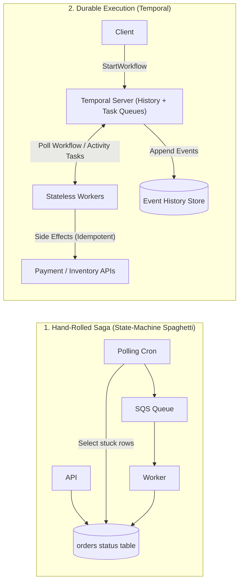
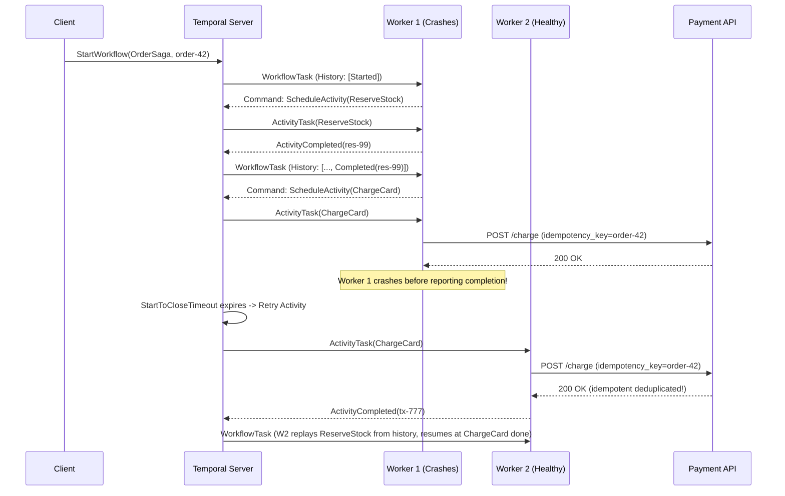
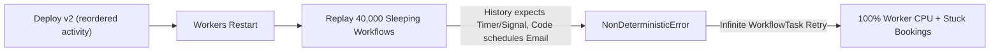

# Workflow Orchestration Engines: Durable Execution with Temporal

> **Prerequisites:** [Lesson 20: Platform Engineering: Internal Developer Platforms & Golden Paths](../20-platform-engineering/README.md) · [Lesson 16: Data Consistency Across Systems](../16-data-consistency-across-systems/README.md).  
> **Estimated Reading Time:** 24–28 minutes  
> **Target Audience:** Backend and distributed systems engineers designing multi-step sagas, payment/order lifecycles, long-running AI/ML pipelines, or human-in-the-loop approvals.  
> **Free PDF Notes:** [Download SD-V-021.pdf](https://backendroadmap.com/notes/system-design/SD-V-021.pdf)

> [!NOTE]
> **In one line:** A **Durable Execution** workflow engine (like Temporal or Restate) persists every step's outcome in an append-only **Event History**, allowing workflows to survive process crashes, server restarts, and months-long `sleep()` calls while looking like ordinary sequential code. You gain **crash-proof orchestration, built-in retries/timers, and zero manual state-machine DB boilerplate**; you pay with **strict determinism rules in workflow code, event-history size limits, and an extra stateful cluster to operate**.

> [!TIP]
> **The Golden Rule:** Keep **Workflow code 100% deterministic** (pure orchestration: branching, timers, signals) and push **every non-deterministic side effect** (HTTP calls, DB writes, `uuid()`, `time.Now()`, LLM calls) into **Activities** with idempotency keys.

---

## 1. What Durable Execution Is, and What It Isn't

Consider a 4-step order fulfillment flow: (1) Reserve inventory, (2) Charge credit card, (3) Wait up to 48 hours for warehouse packing confirmation, (4) Ship order—or compensate (refund + release stock) if any step fails. Writing this by hand with cron jobs, a `status` column in PostgreSQL, and 6 SQS queues creates brittle "state-machine spaghetti" where a crash between step 2 and writing to DB leaves money charged with no record. **Durable Execution** solves this by recording every completed side effect in an append-only log and replaying the workflow function from the top after any crash.

| Term | Precise Meaning | Example |
| :--- | :--- | :--- |
| **Workflow** | Deterministic orchestration function whose local variables & call stack survive crashes | `OrderFulfillmentWorkflow(orderID)` |
| **Activity** | A single non-deterministic step (RPC, DB write, email) executed by a worker | `ChargeCard(idempotencyKey)` |
| **Event History** | Append-only log of workflow commands and activity results stored by the server | `WorkflowStarted`, `ActivityScheduled`, `ActivityCompleted` |
| **Deterministic Replay** | Re-executing workflow code from line 1 using cached Event History results instead of re-running activities | Worker restarts -> replays 40 events in 2 ms -> resumes at step 3 |
| **Signal / Query** | Asynchronous external event sent into a running workflow / read-only inspection | `warehouse_packed` signal after 14 hours |
| **Not** | A high-throughput raw message broker (like Kafka) or a low-latency <5 ms request router | Temporal persists every state transition; use Kafka for 1M/s telemetry |

### Why It Matters
1. Multi-step business processes (payments, onboarding, infrastructure provisioning, agentic AI loops) almost always fail *between* steps—durable execution eliminates ad-hoc state tables and polling crons.
2. Long-running timers (`sleep(30 days)`) cost zero worker RAM: the workflow is evicted from memory and woken by the server's timer queue.
3. In interviews, knowing **Event Sourcing + Deterministic Replay** (and its non-determinism traps) separates senior engineers from those who just say "use a queue."

---

## 2. Anatomy: Hand-Rolled State Machine vs Durable Execution



In Temporal, workers are **stateless** and pull tasks over gRPC long-polling from **Task Queues**. If a worker crashes mid-workflow, another worker pulls the next Workflow Task, fetches the Event History, replays the workflow code up to the exact line where it left off (skipping already-completed activities by returning their recorded results), and continues seamlessly.

| Dimension | Hand-Rolled DB + Queues | AWS Step Functions / JSON DSL | Durable Execution (Temporal) |
| :--- | :--- | :--- | :--- |
| **Programming model** | Scattered handlers + status columns | JSON/YAML state machine | **Native code** (Go, TS, Python, C#, Java) |
| **Long timers (days/months)** | Custom cron + index scan | Built-in `Wait` state | **Built-in `workflow.Sleep()`** (zero worker RAM) |
| **Local unit testing** | Hard (mock queues + DB) | Slow / cloud-emulated | **Fast in-memory test server** with time-skipping |
| **Max history / payload** | DB-bounded | 25,000 events / 256 KB | **50,000 events** (use `ContinueAsNew` for loops) |
| **Versioning in-flight runs** | Manual migration scripts | Versioned state machine ARNs | **`workflow.GetVersion` / Worker Versioning** |

> [!WARNING]
> **Non-Determinism Breaks Replay.** If you call `time.Now()`, `rand.Int()`, iterate over an unsorted Go `map`, or change the order of `if/else` activity calls while workflows are in-flight, replay will produce a different command sequence than the Event History and fail with a `NonDeterministicError`.

---

## 3. Mathematical Model: Persistence Overhead, History Growth & Replay Cost

**1. Server Write Amplification per Step.** Every Activity execution in a workflow generates ~4–5 Event History records (`ActivityTaskScheduled`, `WorkflowTaskCompleted`, `ActivityTaskStarted`, `ActivityTaskCompleted`, `WorkflowTaskScheduled`). For a workflow with $S$ sequential activities and average event size $E_{\text{bytes}}$:

$$\text{History Size} \approx (2 + 4.5 \cdot S) \cdot E_{\text{bytes}}$$

And the server's database write rate (TPS) for $\lambda$ workflows/sec with $S$ steps each is:

$$\text{DB Writes/sec} \approx \lambda \cdot (2 + 3 \cdot S)$$

*(because `Scheduled` + `Completed` pairs are often batched into single shard transactions).*

**2. Replay CPU Cost.** Without sticky worker caching, a workflow of $S$ steps that wakes up $S$ times replays $1 + 2 + \dots + S = \frac{S(S+1)}{2}$ events total. With **sticky execution** (routing subsequent workflow tasks to the same worker's in-memory LRU cache), replay is $O(1)$ per step unless the worker restarts.

**Worked Numerical Example.**
Suppose an e-commerce platform runs $\lambda = 500\text{ workflows/sec}$, each with $S = 6$ activities and average event size $E_{\text{bytes}} = 512\text{ B}$:
- **History size per workflow:** $(2 + 4.5 \times 6) \times 512\text{ B} = 29 \times 512\text{ B} \approx 14.8\text{ KB}$ (well under Temporal's 50 MB / 50,000-event limit).
- **Persistence DB load:** $500 \times (2 + 3 \times 6) = 10{,}000\text{ shard transactions/sec}$—showing why Temporal shards its History service across hundreds/thousands of virtual shards (e.g., Cassandra/PostgreSQL/MySQL) rather than one DB row.
- **Unbounded Loop Trap:** A polling loop workflow running 1 activity/minute for 60 days accumulates $86{,}400 \times 4.5 = 388{,}800$ events (~199 MB) and **crashes** at the 50,000-event cap unless it calls `ContinueAsNew` every ~1,000 iterations.

---

## 4. Metrics & Percentiles

| Metric | Meaning | Alert when |
| :--- | :--- | :--- |
| **Workflow Task Schedule-to-Start ($p_{99}$)** | Time a workflow task waits in queue for a worker | > 200 ms (workers under-provisioned or sticky cache thrashing) |
| **Activity Schedule-to-Start ($p_{99}$)** | Queue wait before an activity begins | Exceeds SLA (scale activity workers) |
| **Non-Deterministic / Sticky Cache Miss Rate** | Replay failures due to bad code deploys | Any > 0 spike immediately after deployment |
| **Event History Length ($p_{99}$)** | Events per open workflow execution | > 10,000 events (missing `ContinueAsNew` in loops) |
| **History Shard Persistence Latency ($p_{99}$)** | DB write latency per state transition | > 50 ms (shard DB contention / hot shard) |
| **Pending Activities / Dead-Lettered Workflows** | Workflows stuck retrying or timed out | Growing backlog of failed/terminated workflows |

### Worked Example (Payment Saga with Compensation)
An `OrderSaga` runs: `ReserveStock` -> `ChargeCard` -> `AwaitWarehouseSignal(48h)` -> `DispatchOrder`.
- `ChargeCard` fails with HTTP 503 twice; Temporal automatically retries with exponential backoff (1s, 2s) and succeeds on attempt 3 using `idempotencyKey = workflowID + "-charge"`.
- After 48 hours, no `warehouse_packed` signal arrives. The `Selector` timer fires, and the workflow executes `RefundCard` and `ReleaseStock` in reverse order (Saga compensation), completing cleanly with full audit history.

---

## 5. Compounding & Failure Modes

| Failure Mode | Mechanism | Impact at Scale |
| :--- | :--- | :--- |
| **Unpatched Deploy (Non-Determinism)** | Developer reorders activities in `v2` while `v1` workflows are sleeping | All waking `v1` workflows fail replay in an infinite retry loop |
| **Missing `ContinueAsNew`** | Entity/cron workflow loops forever, growing Event History past 50k events | Server hard-terminates the workflow execution; state lost |
| **Large Payloads in History** | Passing 5 MB JSON/PDF blobs as activity inputs/outputs | History DB bloats, memory spikes, 2 MB payload limit exceeded |
| **Non-Idempotent Activity + Heartbeat Timeout** | Worker completes DB write, crashes before reporting `ActivityTaskCompleted` | Temporal retries activity on another worker -> duplicate charge if not idempotent |

---

## 6. Numbers Every Engineer Must Know

| Item | Typical | Implication |
| :--- | :---: | :--- |
| Max Event History count (Temporal) | 50,000 events (warn at 10k) | Use `ContinueAsNew` for long-running entity loops |
| Max single payload / History size | 2 MB / 50 MB | Store large blobs in S3; pass S3 URI in workflow |
| Sticky cache replay speed | ~10,000 events in < 10 ms | Replay is fast, but avoid >10k events per run |
| Activity heartbeat interval | 5 – 30 seconds (for long tasks) | Detects dead workers in seconds instead of waiting for 1-hour StartToClose timeout |
| History shards (prod cluster) | 512 – 16,384 shards | Fixed at cluster creation; size for 3-year peak throughput |

---

## 7. Protocol / Mechanism Deep Dive: Deterministic Replay & Saga Compensation



| Question | Answer |
| :--- | :--- |
| **How does a workflow survive a worker crash without losing local variables?** | By re-running the deterministic workflow function from the start and substituting recorded `Event History` results for every past activity/timer. |
| **Why must Activities be idempotent?** | Because Temporal guarantees **at-least-once** activity execution: if a worker crashes after calling an external API but before acking to Temporal, the activity is retried. |
| **How do you deploy code changes without breaking sleeping workflows?** | Use `workflow.GetVersion("change-id", DefaultVersion, 1)` (branching on old vs new code path) or **Worker Versioning** (pinning Build IDs to task queues). |
| **What if an activity takes 2 hours (e.g., video transcoding)?** | Send periodic **Activity Heartbeats** (`RecordHeartbeat(ctx, progress)`) with a 30s `HeartbeatTimeout` so crashes are detected in 30s and resumed from the last checkpoint. |

**When NOT to use a Workflow Orchestration Engine:**
- Ultra-low-latency synchronous request paths (< 20 ms SLA) where 3–5 persistence round trips are too slow.
- High-throughput stateless event streaming (100k–1M events/sec analytics/telemetry): use Kafka/Flink.
- Simple single-step background jobs where a standard queue (SQS/RabbitMQ) + idempotent consumer suffices.

---

## 8. Hierarchical Budgets & Design Rules

| Slice | Rule | Control |
| :--- | :--- | :--- |
| **Determinism** | Zero `time.Now()`, `rand`, global mutable state, or network I/O in workflow code | Use `workflow.Now()`, `workflow.SideEffect()`, and linter checks |
| **Idempotency** | Every mutating activity must accept a deterministic idempotency key | Derive from `WorkflowID + ActivityID` (or `RunID`) |
| **Payloads** | Keep activity inputs/outputs < 64 KB | Claim-check pattern: upload large payloads to S3, pass URI |
| **History Size** | Bound events per execution < 10,000 | Call `ContinueAsNew` in entity/polling workflows |
| **Timeouts** | Always set `StartToCloseTimeout` (and `HeartbeatTimeout` if > 1 min) | Never rely on infinite timeouts |
| **Versioning** | Never delete/reorder in-flight workflow steps directly | Wrap changes in `GetVersion` or Worker Build IDs |

---

## 9. Top Mitigations

1. **Enforce determinism via static analysis** (e.g., Temporal's `workflowcheck` in Go, deterministic sandbox in Python/TS).
2. **Use the Claim-Check pattern** (S3/GCS + URI) for any payload > 64 KB so Event History stays lean.
3. **Pass `WorkflowID + ActivityID` as the idempotency key** to every external payment, inventory, or email API.
4. **Always pair long activities with `HeartbeatTimeout`** and checkpoint progress inside the heartbeat payload.
5. **Use `ContinueAsNew`** on cron/entity workflows every 500–1,000 iterations to reset Event History size to zero.
6. **Version workflow changes** with `GetVersion` or Worker Build IDs, and test replay against exported production histories in CI (`WorkflowReplayer`).

---

## 10. Production Reference: The "Unpatched Deploy" Replay Outage

A travel-booking platform ran 40,000 in-flight `BookingWorkflow` instances sleeping for 24–72 hours before hotel check-in. An engineer added a new `SendReminderEmail` activity *before* the `AwaitCheckInSignal` step and deployed directly to the shared task queue.



- **Root Cause:** The v2 code issued a `ScheduleActivity(SendReminderEmail)` command at a history position where v1 workflows had already recorded `TimerStarted`.
- **The Fix:** Rolled back immediately to v1, then re-deployed using `workflow.GetVersion(ctx, "add-reminder-email", workflow.DefaultVersion, 1)` so existing v1 runs followed the old path while new runs executed the reminder. Added an automated **CI Replay Test** against anonymized production Event Histories to block non-deterministic PRs before merge.

---

## 11. Multi-Language Production Code Tabs

A minimal **Durable Execution Replay Engine + Order Saga** demonstrating how Event History + Deterministic Replay works under the hood (with Saga compensation on failure).

````carousel
```go
// Go: Minimal Durable Execution Replay Engine + Order Saga (stdlib only).
package main

import (
	"errors"
	"fmt"
)

type Event struct {
	StepName string
	Result   string
	Err      string
}

// WorkflowContext replays recorded events on restart instead of re-executing side effects.
type WorkflowContext struct {
	history []Event
	cursor  int
}

func (w *WorkflowContext) ExecuteActivity(name string, fn func() (string, error)) (string, error) {
	if w.cursor < len(w.history) {
		ev := w.history[w.cursor]
		if ev.StepName != name {
			return "", fmt.Errorf("NonDeterministicError: expected %s, got %s", ev.StepName, name)
		}
		w.cursor++
		fmt.Printf("  [REPLAY] %s -> cached(%s)\n", name, ev.Result)
		if ev.Err != "" {
			return "", errors.New(ev.Err)
		}
		return ev.Result, nil
	}
	res, err := fn()
	ev := Event{StepName: name, Result: res}
	if err != nil {
		ev.Err = err.Error()
	}
	w.history = append(w.history, ev)
	w.cursor++
	fmt.Printf("  [EXEC]   %s -> %s (err=%v)\n", name, res, err)
	return res, err
}

func OrderSaga(ctx *WorkflowContext, orderID string) error {
	if _, err := ctx.ExecuteActivity("ReserveStock", func() (string, error) {
		return "res-101", nil
	}); err != nil {
		return err
	}
	if _, err := ctx.ExecuteActivity("ChargeCard", func() (string, error) {
		return "", errors.New("card declined")
	}); err != nil {
		// Saga compensation in reverse order
		_, _ = ctx.ExecuteActivity("ReleaseStock", func() (string, error) { return "released", nil })
		return err
	}
	return nil
}

func main() {
	ctx := &WorkflowContext{}
	fmt.Println("Run 1 (live):")
	_ = OrderSaga(ctx, "ord-42")
	fmt.Println("Run 2 (after worker crash, replaying history):")
	ctx.cursor = 0
	_ = OrderSaga(ctx, "ord-42")
}
```
<!-- slide -->
```typescript
// TypeScript: Durable Execution Context with Deterministic Replay & Saga Compensation.
interface HistoryEvent {
  step: string;
  value?: string;
  error?: string;
}

class DurableContext {
  private cursor = 0;
  constructor(public readonly history: HistoryEvent[] = []) {}

  resetForReplay() { this.cursor = 0; }

  async activity(step: string, fn: () => Promise<string>): Promise<string> {
    if (this.cursor < this.history.length) {
      const ev = this.history[this.cursor++];
      if (ev.step !== step) {
        throw new Error(`NonDeterministicError: history=${ev.step}, code=${step}`);
      }
      if (ev.error) throw new Error(ev.error);
      return ev.value!;
    }
    try {
      const value = await fn();
      this.history.push({ step, value });
      this.cursor++;
      return value;
    } catch (e: any) {
      this.history.push({ step, error: e.message });
      this.cursor++;
      throw e;
    }
  }
}

export async function runOrderSaga(ctx: DurableContext, orderId: string): Promise<string> {
  await ctx.activity("ReserveStock", async () => `res-${orderId}`);
  try {
    await ctx.activity("ChargeCard", async () => { throw new Error("insufficient_funds"); });
    return "COMPLETED";
  } catch {
    await ctx.activity("ReleaseStock", async () => `released-${orderId}`);
    return "COMPENSATED";
  }
}
```
<!-- slide -->
```python
# Python: Durable Execution Replay Simulator + Persistence Load Calculator (stdlib only).
from dataclasses import dataclass, field
from typing import Callable, List, Optional

@dataclass
class HistoryEvent:
    step: str
    result: Optional[str] = None
    error: Optional[str] = None

@dataclass
class DurableContext:
    history: List[HistoryEvent] = field(default_factory=list)
    cursor: int = 0

    def activity(self, step: str, fn: Callable[[], str]) -> str:
        if self.cursor < len(self.history):
            ev = self.history[self.cursor]
            if ev.step != step:
                raise RuntimeError(f"NonDeterministicError: expected {ev.step}, got {step}")
            self.cursor += 1
            if ev.error:
                raise RuntimeError(ev.error)
            return ev.result or ""
        try:
            res = fn()
            self.history.append(HistoryEvent(step=step, result=res))
            self.cursor += 1
            return res
        except Exception as exc:
            self.history.append(HistoryEvent(step=step, error=str(exc)))
            self.cursor += 1
            raise

def persistence_metrics(workflows_per_sec: int, steps: int, event_bytes: int = 512) -> dict:
    events_per_wf = 2 + 4.5 * steps
    return {
        "history_kb_per_wf": round((events_per_wf * event_bytes) / 1024, 2),
        "shard_tx_per_sec": workflows_per_sec * (2 + 3 * steps),
    }

if __name__ == "__main__":
    print("500 wf/s, 6 steps:", persistence_metrics(500, 6))
```
<!-- slide -->
```csharp
// C#: Durable Execution Replay Context with Non-Determinism Guard.
public sealed record HistoryEvent(string Step, string? Value, string? Error);

public sealed class DurableContext
{
    private readonly List<HistoryEvent> _history = new();
    private int _cursor;

    public void ResetForReplay() => _cursor = 0;

    public async Task<string> ActivityAsync(string step, Func<Task<string>> fn)
    {
        if (_cursor < _history.Count)
        {
            var ev = _history[_cursor++];
            if (ev.Step != step)
                throw new InvalidOperationException($"NonDeterministicError: {ev.Step} != {step}");
            if (ev.Error is not null)
                throw new InvalidOperationException(ev.Error);
            return ev.Value!;
        }

        try
        {
            var val = await fn();
            _history.Add(new HistoryEvent(step, val, null));
            _cursor++;
            return val;
        }
        catch (Exception ex)
        {
            _history.Add(new HistoryEvent(step, null, ex.Message));
            _cursor++;
            throw;
        }
    }
}
```
````

---

## 12. Hands-On CLI Verification Workflows

Verify the persistence math and replay behavior in Python:

```bash
python3 -c '
wf_s, steps, ev_b = 500, 6, 512
hist_kb = (2 + 4.5 * steps) * ev_b / 1024
tx_s = wf_s * (2 + 3 * steps)
print(f"History/wf: {hist_kb:.2f} KB | DB shard tx/s: {tx_s}")
'
```

Inspect real Temporal workflows, event histories, and task queues using the `temporal` CLI:

```bash
# List running workflows in the default namespace
temporal workflow list --query 'ExecutionStatus="Running"'

# Inspect the full append-only Event History of a specific workflow
temporal workflow show --workflow-id order-saga-42

# Send an asynchronous signal to a sleeping workflow
temporal workflow signal --workflow-id order-saga-42 --name warehouse_packed --input '{"box_id":"B9"}'

# Check task queue pollers (verify workers are online)
temporal task-queue describe --task-queue order-fulfillment-tq
```

---

## 13. Common Mistakes to Avoid

1. **Calling `time.Now()`, `uuid.New()`, or `rand` directly inside workflow code**, causing `NonDeterministicError` on replay.
2. **Making HTTP or DB calls directly in a workflow** instead of wrapping them in an Activity.
3. **Writing non-idempotent activities**, leading to double-charges on worker crash retries.
4. **Looping indefinitely without `ContinueAsNew`**, hitting the 50,000-event history limit.
5. **Passing multi-MB payloads through workflow arguments/results** instead of using S3 claim-check URIs.
6. **Deploying reordered workflow steps without `GetVersion` or Worker Versioning**, breaking sleeping workflows.
7. **Using Temporal for 100k/sec stateless telemetry** where Kafka/queues are 100x cheaper.

---

## 14. Key Terms Glossary

| Key Term | Definition |
| :--- | :--- |
| **Durable Execution** | Execution model where code state survives process crashes via event logging and replay. |
| **Workflow** | Deterministic orchestration function defining control flow, timers, and compensations. |
| **Activity** | Isolated, retryable unit of non-deterministic work (API call, DB write). |
| **Event History** | Append-only log of every command and result in a workflow execution. |
| **Deterministic Replay** | Re-executing workflow code from the start using cached Event History outcomes. |
| **Signal / Query** | External async message into a running workflow / synchronous read-only state inspection. |
| **ContinueAsNew** | Atomically closing the current execution and starting a fresh one with carried-over state. |
| **Activity Heartbeat** | Periodic liveness + checkpoint signal from a long-running activity worker. |
| **Sticky Execution** | Routing workflow tasks to the worker that already holds its state in LRU RAM. |
| **Saga Compensation** | Rolling back earlier completed steps in reverse order when a later step fails. |

---

## 15. System Design Interview Questions & Answers

### Basic Conceptual Questions

<details>
<summary><strong>Q1: What is Durable Execution, and how does Temporal implement it? [BASIC]</strong></summary>

**Answer:**
Durable Execution guarantees that a multi-step function completes even if workers crash or sleep for weeks. Temporal implements it via **Event Sourcing + Deterministic Replay**: every activity result and timer is appended to an Event History; after a crash, a new worker replays the workflow code from the top, substituting recorded results for past steps until it reaches the point of interruption.
</details>

<details>
<summary><strong>Q2: What is the difference between a Workflow and an Activity? [BASIC]</strong></summary>

**Answer:**
A **Workflow** is pure, deterministic orchestration (branching, loops, timers, signals) that must produce the exact same command sequence on replay. An **Activity** is where non-deterministic side effects (HTTP requests, DB writes, `uuid()`, `time.Now()`) live; activities are executed at-least-once and their results are recorded in the Event History.
</details>

<details>
<summary><strong>Q3: How does Temporal handle a `sleep(30 days)` without wasting worker memory? [BASIC]</strong></summary>

**Answer:**
`workflow.Sleep(30 days)` emits a `StartTimer` command to the Temporal Server and yields. The worker evicts the workflow from memory immediately (0 MB RAM). The server persists a timer shard entry and enqueues a new WorkflowTask onto the Task Queue 30 days later.
</details>

<details>
<summary><strong>Q4: Why must workflow code be deterministic? [BASIC]</strong></summary>

**Answer:**
Because recovery works by re-running the workflow code from line 1 against the Event History. If the code takes a different branch during replay (e.g., due to `time.Now()` or unsorted map iteration), the generated commands won't match the recorded history and replay fails.
</details>

### Scenario-Based Architecture Questions

<details>
<summary><strong>Q5: Design a 4-step payment & shipping saga where step 3 waits up to 48 hours for a warehouse webhook. [SCENARIO]</strong></summary>

**Answer:**
Model it as one `OrderWorkflow`: call `ReserveInventory` activity -> `ChargeCard` activity (with `orderID` idempotency key) -> await a `warehouse_packed` Signal with a 48-hour `AwaitWithTimeout` timer. If the signal arrives, call `ShipOrder`. If the timer expires or any step fails fatally, run compensating activities (`RefundCard`, `ReleaseInventory`) in reverse order.
</details>

<details>
<summary><strong>Q6: A workflow polls an external API every minute for 6 months and crashes after 2 weeks. Why? [SCENARIO]</strong></summary>

**Answer:**
Every iteration appends ~4–5 events to the Event History. After ~10,000 iterations (~2 weeks at 1/min), it hits Temporal's 50,000-event hard limit. Fix it by calling `ContinueAsNew` every 500–1,000 iterations, passing only the minimal state forward to a fresh execution with 0 history events.
</details>

<details>
<summary><strong>Q7: How do you safely process a 50 MB PDF inside a Temporal workflow? [SCENARIO]</strong></summary>

**Answer:**
Never pass the 50 MB bytes into workflow arguments or activity return values (Temporal caps payloads at 2 MB). Use the **Claim-Check pattern**: an ingestion step uploads the PDF to S3/GCS, passes only the `s3://bucket/key` URI into the workflow, and activities stream directly from/to S3.
</details>

<details>
<summary><strong>Q8: An activity processes a 3-hour ML training job. How do you detect a worker crash in 30 seconds instead of 3 hours? [SCENARIO]</strong></summary>

**Answer:**
Configure a `HeartbeatTimeout` of 30 seconds on the activity and have the worker call `RecordHeartbeat(ctx, epochCheckpoint)` every 10 seconds. If the worker dies, Temporal detects the missed heartbeat in 30s and retries the activity on a healthy worker, which reads the last heartbeat details to resume from the saved checkpoint.
</details>

### Advanced & Tricky Interview Questions

<details>
<summary><strong>Q9: How do you deploy a breaking change to a workflow that has 100,000 instances currently sleeping? [TRICKY]</strong></summary>

**Answer:**
Either use `workflow.GetVersion` inside the code so executions started before the deploy follow the old replay path while new ones take the new path, OR use **Worker Versioning (Build IDs)** so existing executions stay pinned to `v1` workers while new executions route to `v2` workers until `v1` drains.
</details>

<details>
<summary><strong>Q10: What happens if `ChargeCard` succeeds at Stripe, but the worker crashes before reporting `ActivityCompleted` to Temporal? [TRICKY]</strong></summary>

**Answer:**
Temporal sees `StartToCloseTimeout` expire and retries `ChargeCard` on another worker (**at-least-once** activity execution). To prevent double-charging the customer, the activity must pass a deterministic idempotency key (e.g., `WorkflowID + "-charge"`) to Stripe so the retry returns the original charge result safely.
</details>

<details>
<summary><strong>Q11: Why doesn't Temporal use a single PostgreSQL table for all workflow state? [TRICKY]</strong></summary>

**Answer:**
Every workflow step generates ~3–4 persistence writes. At 1,000 workflows/sec × 6 steps, that's 20,000+ transactions/sec. Temporal partitions state across hundreds or thousands of **History Shards** (consistent-hashed by WorkflowID) so each shard handles a small fraction of writes and locks are scoped per execution.
</details>

<details>
<summary><strong>Q12: How does Orchestration (Temporal) compare to Choreography (Kafka events) for sagas? [TRICKY]</strong></summary>

**Answer:**
Choreography decouples services via pub/sub events, which is great for simple fan-out, but complex 5-step sagas with timeouts and compensations become invisible and hard to debug across 6 topics. Orchestration centralises the saga's control flow, timeouts, and compensation order in one inspectable workflow while keeping business logic in decoupled activity workers.
</details>

---

## 16. One-Page Master Cheat Sheet

```
+---------------------------------------------------------------------------------------------------------+
|                    WORKFLOW ORCHESTRATION & DURABLE EXECUTION — MASTER CHEAT SHEET                      |
+---------------------------------------------------------------------------------------------------------+
| 1. MODEL: Event Sourcing + Deterministic Replay. Workflows = pure orchestration; Activities = I/O.     |
+---------------------------------------------------------------------------------------------------------+
| 2. DETERMINISM: NO time.Now(), rand, unsorted maps, or direct HTTP in workflow code.                    |
+---------------------------------------------------------------------------------------------------------+
| 3. IDEMPOTENCY: Activities are at-least-once -> pass WorkflowID + ActivityID as idempotency key.        |
+---------------------------------------------------------------------------------------------------------+
| 4. LIMITS: 50k events / 2 MB payload -> use ContinueAsNew for loops & S3 Claim-Check for large blobs.  |
+---------------------------------------------------------------------------------------------------------+
| 5. LONG TASKS: Use HeartbeatTimeout (10-30s) + checkpoint details; sleep(30d) uses 0 worker RAM.        |
+---------------------------------------------------------------------------------------------------------+
| 6. DEPLOY SAFETY: Use GetVersion() or Worker Versioning + CI Replay Tests against prod histories.       |
+---------------------------------------------------------------------------------------------------------+
```

---

## Further Reading & Sources

- Temporal Documentation, [Understanding Temporal & Deterministic Execution](https://docs.temporal.io/temporal).
- Temporal Blog, [Designing Durable Execution at Scale](https://temporal.io/blog).
- Martin Kleppmann, *Designing Data-Intensive Applications*, Chapter 11 ("Event Sourcing" & "Stream Processing").
- Chris Richardson, *Microservices Patterns*, Chapter 4 ("Managing Transactions with Sagas").

---

## Free PDF Notes

[SD-V-021.pdf](https://backendroadmap.com/notes/system-design/SD-V-021.pdf)

---

## Next

Continue with [Lesson 22: Distributed Job Scheduling: Leader Election, Delayed Jobs & Idempotency](../22-distributed-job-scheduling/README.md).
