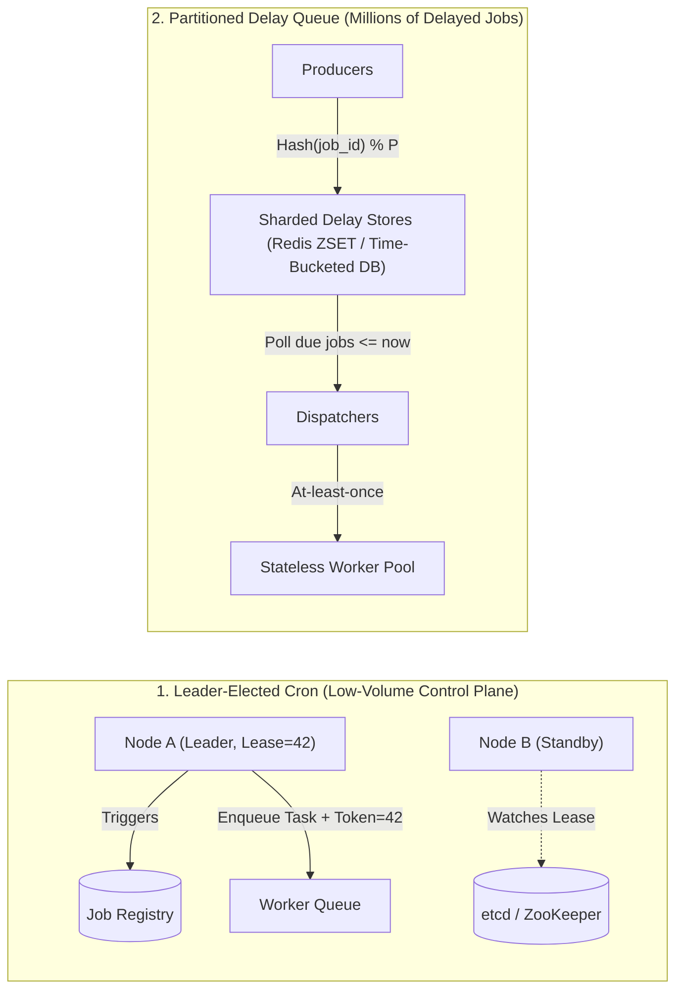
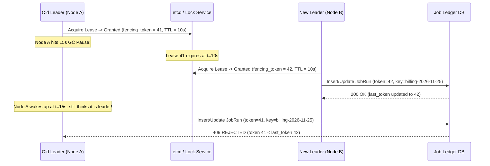
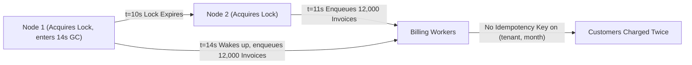

# Distributed Job Scheduling: Leader Election, Delayed Jobs & Idempotency

> **Prerequisites:** [Lesson 21: Workflow Orchestration Engines: Durable Execution with Temporal](../21-workflow-orchestration-engines/README.md) · [Lesson 09: Distributed Consensus & Leader Election](../../09-distributed-systems/README.md).  
> **Estimated Reading Time:** 24–28 minutes  
> **Target Audience:** Backend engineers designing cron-at-scale, delayed notifications/retries, billing runs, or replacing single-node cron daemons with fault-tolerant distributed schedulers.  
> **Free PDF Notes:** [Download SD-V-022.pdf](https://backendroadmap.com/notes/system-design/SD-V-022.pdf)

> [!NOTE]
> **In one line:** A **Distributed Job Scheduler** executes millions of recurring (`cron`) or one-off delayed jobs reliably across a fleet of nodes without missing runs on crash or double-firing during network partitions. You gain **high availability, horizontal worker scaling, and precise delayed execution**; you pay with **split-brain/duplicate-trigger hazards (solved via fencing tokens + idempotency) and hot-partition contention on time-ordered queues**.

> [!TIP]
> **The Golden Rule:** **Never rely on leader election alone for exactly-once job execution.** A paused GC/network partition can leave two nodes believing they are leader; always pair **lease-based locking + monotonic fencing tokens** with **idempotent job handlers** keyed by `(job_id, scheduled_fire_time)`.

---

## 1. What Distributed Job Scheduling Is, and What It Isn't

A single Linux `crontab` on one EC2 instance works until that instance reboots at 02:00 UTC and misses daily invoicing—or you scale to 5 instances and run the invoicing job 5 times concurrently. Moving to a distributed scheduler solves both **Single Point of Failure (SPOF)** and **duplicate execution**, while also handling **millions of ad-hoc delayed jobs** (e.g., "expire unpaid cart in 15 minutes", "send reminder 24 hours after signup").

| Term | Precise Meaning | Example |
| :--- | :--- | :--- |
| **Recurring (Cron) Job** | Periodic schedule evaluated on a calendar/interval rule | `0 2 * * *` (daily billing at 02:00 UTC) |
| **Delayed / One-Shot Job** | Ad-hoc task scheduled to fire at a future timestamp `run_at` | Expire reservation at `now + 15m` |
| **Leader Election + Lease** | Selecting one active scheduler coordinator using a TTL lease | etcd/ZooKeeper lease, Redis Redlock/SET NX PX, DB advisory lock |
| **Fencing Token** | Monotonically increasing epoch/term number attached to every lease | Downstream DB rejects writes with `token < last_seen_token` |
| **Timing Wheel / Redis ZSET** | Data structures for $O(1)$ or $O(\log N)$ future-timestamp scheduling | Hierarchical Timing Wheel (Kafka Purgatory), Redis `ZRANGEBYSCORE` |
| **Not** | A durable multi-step saga engine (use Temporal) or a raw streaming log (use Kafka) | Schedulers trigger work at time $T$; they don't manage complex multi-day DAGs |

### Why It Matters
1. "Design a distributed job scheduler / delayed task queue" is one of the most frequent system design interview questions.
2. Polling `SELECT * FROM jobs WHERE run_at <= NOW()` every second collapses under millions of rows and concurrent workers without `SKIP LOCKED` + time-bucketed partitioning.
3. Lease/leader split-brain is a classic distributed systems trap that tests whether you understand **fencing tokens and idempotency**.

---

## 2. Anatomy: Single-Leader Polling vs Partitioned Delay Queue



Two distinct patterns exist in production:
- **Leader-Elected Scheduler** (e.g., Kubernetes `kube-controller-manager` CronJob controller): Best for thousands of cron definitions where one active leader computes next fire times and pushes jobs to a worker queue.
- **Partitioned Delay Queue** (e.g., Uber Cherami / Redis ZSET shards / time-bucketed MySQL/Postgres): Best for **millions of one-off delayed jobs** (e.g., 50,000 timers/sec) where a single leader would be a bottleneck.

| Dimension | DB Polling (`SKIP LOCKED`) | Redis `ZSET` (Sharded) | Hierarchical Timing Wheel |
| :--- | :--- | :--- | :--- |
| **Insert / Poll complexity** | $O(\log N)$ B-tree index | $O(\log N)$ skip list | **$O(1)$** amortized |
| **Max scale** | ~5k–20k jobs/s (sharded) | ~100k+ jobs/s (sharded) | **1M+ timers/s** in RAM (Kafka) |
| **Durability** | Strong (WAL/ACID) | AOF/RDB (can lose last ms) | Volatile unless backed by WAL |
| **Best for** | Critical billing/transactional jobs | High-throughput app delays (15m cart) | Network/broker request timeouts |

> [!WARNING]
> **The "Top-of-the-Hour Thundering Herd".** If 500,000 users schedule a daily report for `09:00:00 UTC`, your workers get hit by 500,000 jobs at the exact same millisecond. Always apply **deterministic jitter** (e.g., `hash(tenant_id) % 300s`) to spread non-strict cron triggers.

---

## 3. Mathematical Model: Lease Safety, Polling Load & Shard Sizing

**1. Lease Expiry vs GC Pause (Split-Brain Condition).** Suppose Node A acquires a leader lease of duration $T_{\text{lease}}$ at time $t_0$. If Node A experiences a stop-the-world GC pause or network partition of duration $T_{\text{pause}} > T_{\text{lease}}$, Node B acquires a new lease at $t_0 + T_{\text{lease}}$:

$$\text{Overlap Window} = \max\left(0,\; T_{\text{pause}} + T_{\text{clock\_drift}} - T_{\text{lease}}\right)$$

During this overlap, **both Node A and Node B think they are leader**. Only a **fencing token** ($\text{token}_B > \text{token}_A$) checked atomically by the storage layer prevents Node A from committing stale triggers.

**2. Delay-Queue Sizing & Sharding.** Suppose producers schedule $\lambda = 20{,}000\text{ delayed jobs/sec}$ with an average delay $D = 1{,}800\text{ s}$ (30 minutes). By Little's Law, the number of active pending jobs stored simultaneously is:

$$N_{\text{pending}} = \lambda \cdot D = 20{,}000 \times 1{,}800 = 36{,}000{,}000\text{ jobs}$$

If each job entry in a Redis `ZSET` takes ~120 bytes (member ID + 8-byte float timestamp + skip-list pointers):

$$\text{RAM} = 36{,}000{,}000 \times 120\text{ B} \approx 4.32\text{ GB}$$

Sharding across $P = 16$ independent Redis/DB partitions yields **2.25M jobs (~270 MB) and 1,250 inserts/sec per shard**—comfortably within single-core limits.

---

## 4. Metrics & Percentiles

| Metric | Meaning | Alert when |
| :--- | :--- | :--- |
| **Schedule Drift ($p_{50}, p_{99}$)** | `actual_start_time - scheduled_fire_time` | $p_{99} > 5\text{ s}$ (dispatcher lag or worker starvation) |
| **Missed / Skipped Runs** | Cron windows missed due to downtime or concurrency policy | > 0 for critical jobs |
| **Duplicate Execution Rate** | Idempotency-key conflicts caught at worker/DB | Sudden spike (indicates lease thrashing / split-brain) |
| **Lease Renewal Failure Rate** | Leader failing to renew etcd/DB lease before TTL | Any renewal latency > 50% of lease TTL |
| **Dead-Lettered / Max-Retried Jobs** | Jobs failing after max backoff attempts | > 0 for billing/compliance jobs |
| **Pending Delay Queue Depth** | Total waiting jobs per shard | Unexpected monotonic growth (workers stuck) |

### Worked Example (PostgreSQL `FOR UPDATE SKIP LOCKED`)
A SaaS app runs 5,000 delayed webhook deliveries/sec using 8 time-bucketed PostgreSQL shards:
- Producers insert `(job_id, run_at, payload, state='PENDING')` hashed by `job_id`.
- 32 stateless workers poll each shard every 200 ms:
  `SELECT id, payload FROM jobs WHERE state = 'PENDING' AND run_at <= NOW() ORDER BY run_at LIMIT 100 FOR UPDATE SKIP LOCKED;`
- `SKIP LOCKED` ensures concurrent workers **never block on each other's row locks** and each row is claimed by at most one worker per poll, keeping $p_{99}$ schedule drift under 350 ms.

---

## 5. Compounding & Failure Modes

| Failure Mode | Mechanism | Impact at Scale |
| :--- | :--- | :--- |
| **Leader Split-Brain (No Fencing)** | Node A freezes for 15s (GC) > 10s lease TTL; Node B becomes leader; Node A wakes up | Both nodes trigger the same billing cron -> **double-billed customers** |
| **Hot Time-Bucket Partition** | Partitioning by `date_trunc('hour', run_at)` puts all 09:00 jobs on 1 shard | 1 shard hits 100% CPU while 15 other shards sit idle |
| **Zombie Worker / Lost Heartbeat** | Worker claims job, sets `state='RUNNING'`, then OOM-kills | Job stays `RUNNING` forever unless a `lease_until` / visibility timeout re-queues it |
| **Retry Storm on Downstream Outage** | 100k jobs fail at 09:00 and all retry at 09:01 in lockstep | Permanent self-inflicted DDoS unless exponential backoff + full jitter is applied |

---

## 6. Numbers Every Engineer Must Know

| Item | Typical | Implication |
| :--- | :---: | :--- |
| Leader lease TTL | 10 – 30 seconds | Renew every `TTL / 3` (e.g., every 5s for a 15s lease) |
| Cron resolution | 1 second – 1 minute | Sub-second precision is rarely needed; use delay queues for ms/s timers |
| `SKIP LOCKED` batch size | 50 – 500 rows/poll | Balances DB round trips vs worker memory & visibility timeout |
| Visibility timeout (in-flight) | 30 s – 5 min (or heartbeat) | Must exceed $p_{99}$ job duration or healthy jobs get double-run |
| Redis `ZSET` memory per job | ~100 – 150 bytes | 10M pending jobs $\approx$ 1.2–1.5 GB RAM |
| Max clock skew (NTP) | 10 – 100 ms | Always use server/DB `NOW()` as source of truth, never worker wall clock |

---

## 7. Protocol / Mechanism Deep Dive: Fencing Tokens & Visibility Timeouts



| Question | Answer |
| :--- | :--- |
| **Why isn't `SET NX PX` in Redis enough for mutual exclusion?** | Redis `SET NX` lacks a monotonic fencing token unless paired with `INCR` via a Lua script, and async Redis replication can lose the lock on failover. |
| **How do you handle a job that takes 20 minutes when visibility timeout is 60s?** | Either extend the visibility lease via worker **heartbeats** every 20s, or decouple triggering from execution (scheduler marks job `DISPATCHED` into a Temporal workflow). |
| **What happens if a recurring cron job takes longer than its interval (e.g., 6-min job on a 5-min cron)?** | Define an explicit **Concurrency Policy**: `Forbid` (skip next run), `Replace` (cancel old), or `Allow` (overlap)—defaulting to `Forbid` for stateful jobs. |

**When NOT to build a custom Distributed Scheduler:**
- If you already run Kubernetes and only need < 1,000 coarse cron jobs: use native Kubernetes `CronJob`.
- If jobs are multi-step workflows with branching, signals, and compensations: use **Temporal** (Lesson 21).
- If you just need simple delayed messages (< 15 min) on AWS: SQS `DelaySeconds` or EventBridge Scheduler removes all ops burden.

---

## 8. Hierarchical Budgets & Design Rules

| Slice | Rule | Control |
| :--- | :--- | :--- |
| **Fencing & Safety** | Every lease must emit a monotonic `fencing_token` checked by storage | Reject writes where `token < current_token` |
| **Idempotency** | Every job execution carries `idempotency_key = hash(job_id, fire_time)` | `INSERT ... ON CONFLICT DO NOTHING` in target DB |
| **Sharding** | Shard delay queues by `hash(job_id) % P`, NEVER by `run_at` timestamp | Prevents hot-shard meltdowns at `:00` |
| **Retries** | Exponential backoff + full jitter + max-attempt cap -> DLQ | Prevents thundering-herd retry storms |
| **Clock Source** | Use centralized DB/Redis/NTP-synced server time, not client clocks | Prevents early/late firing from local drift |
| **Thundering Herd** | Add deterministic per-tenant jitter to non-strict cron schedules | Smooths `:00` spikes across 60–300 seconds |

---

## 9. Top Mitigations

1. **Always combine lease-based leader election with fencing tokens AND idempotency keys**—assume split-brain *will* happen.
2. **Use `SELECT ... FOR UPDATE SKIP LOCKED`** (for DB-backed queues) or **atomic Lua scripts (`ZRANGEBYSCORE` + `ZREM`)** (for Redis) so two dispatchers never claim the same due job.
3. **Add a `lease_until` visibility timeout** on `RUNNING` jobs so crashed workers' jobs are automatically reclaimed.
4. **Shard by `job_id`**, not by `run_at` hour/minute, to distribute `:00` spikes evenly across all partitions.
5. **Apply deterministic jitter** (`hash(job_id) % window`) to recurring jobs that don't require exact wall-clock alignment.
6. **Monitor schedule drift ($p_{99}$)** and alert when due jobs sit unclaimed beyond your SLA.

---

## 10. Production Reference: The "Daylight Saving & GC Split-Brain" Double-Billing Incident

A B2B SaaS platform ran a monthly invoicing cron on 3 scheduler nodes using a 10-second Redis lock without fencing tokens. On a high-traffic morning, a 14-second JVM stop-the-world GC pause hit Node 1 right after it acquired the lock.



- **Root Cause:** (1) No monotonic fencing token checked by the job-run ledger, and (2) billing workers lacked a unique constraint on `(tenant_id, billing_period)`.
- **The Fix:** Added an etcd lease with a monotonic `mod_revision` fencing token, enforced a `UNIQUE (job_id, scheduled_at)` constraint in PostgreSQL before dispatching to workers, and passed `invoice-{tenant}-{YYYY-MM}` as the Stripe idempotency key.

---

## 11. Multi-Language Production Code Tabs

A **Fenced, Idempotent Delayed Job Scheduler** supporting future `run_at` scheduling, `SKIP LOCKED`-style atomic claiming, visibility-timeout recovery, and fencing-token validation.

````carousel
```go
// Go: Thread-safe Delayed Job Queue with Fencing Token + Idempotency Key + Visibility Lease.
package main

import (
	"errors"
	"fmt"
	"sync"
	"time"
)

type Job struct {
	ID             string
	IdempotencyKey string
	RunAt          time.Time
	LeaseUntil     time.Time
	Done           bool
}

type FencedScheduler struct {
	mu          sync.Mutex
	jobs        map[string]*Job
	executed    map[string]bool
	latestToken int64
}

func NewFencedScheduler() *FencedScheduler {
	return &FencedScheduler{jobs: make(map[string]*Job), executed: make(map[string]bool)}
}

func (s *FencedScheduler) Schedule(id, idemKey string, delay time.Duration) {
	s.mu.Lock()
	defer s.mu.Unlock()
	s.jobs[id] = &Job{ID: id, IdempotencyKey: idemKey, RunAt: time.Now().Add(delay)}
}

// ClaimDue atomically claims due jobs (or expired visibility leases) if fencing token is valid.
func (s *FencedScheduler) ClaimDue(token int64, visibility time.Duration) ([]*Job, error) {
	s.mu.Lock()
	defer s.mu.Unlock()
	if token < s.latestToken {
		return nil, errors.New("stale fencing token rejected")
	}
	s.latestToken = token
	now := time.Now()
	var claimed []*Job
	for _, j := range s.jobs {
		if !j.Done && !now.Before(j.RunAt) && now.After(j.LeaseUntil) {
			j.LeaseUntil = now.Add(visibility)
			claimed = append(claimed, j)
		}
	}
	return claimed, nil
}

func (s *FencedScheduler) CompleteIdempotently(j *Job) bool {
	s.mu.Lock()
	defer s.mu.Unlock()
	if s.executed[j.IdempotencyKey] {
		j.Done = true
		return false // deduplicated
	}
	s.executed[j.IdempotencyKey] = true
	j.Done = true
	return true
}

func main() {
	s := NewFencedScheduler()
	s.Schedule("j1", "bill:t1:2026-11", 0)
	due, _ := s.ClaimDue(42, 30*time.Second)
	for _, j := range due {
		fmt.Printf("Executed %s first_time=%v\n", j.ID, s.CompleteIdempotently(j))
	}
	_, err := s.ClaimDue(41, 30*time.Second) // stale leader rejected!
	fmt.Println("Stale leader check:", err)
}
```
<!-- slide -->
```typescript
// TypeScript: Sharded Delayed Job Scheduler with Fencing Token & Idempotency Guard.
interface DelayedJob {
  id: string;
  idempotencyKey: string;
  runAtMs: number;
  leaseUntilMs: number;
  done: boolean;
}

export class ShardedDelayQueue {
  private shards: Map<string, DelayedJob>[];
  private executedKeys = new Set<string>();
  private latestToken = 0;

  constructor(private shardCount = 16) {
    this.shards = Array.from({ length: shardCount }, () => new Map());
  }

  private shardFor(jobId: string): Map<string, DelayedJob> {
    let h = 0;
    for (let i = 0; i < jobId.length; i++) h = (h * 31 + jobId.charCodeAt(i)) | 0;
    return this.shards[Math.abs(h) % this.shardCount];
  }

  schedule(id: string, idempotencyKey: string, delayMs: number): void {
    const shard = this.shardFor(id);
    shard.set(id, { id, idempotencyKey, runAtMs: Date.now() + delayMs, leaseUntilMs: 0, done: false });
  }

  claimDue(shardIdx: number, fencingToken: number, visibilityMs = 30_000): DelayedJob[] {
    if (fencingToken < this.latestToken) throw new Error("Stale fencing token rejected");
    this.latestToken = fencingToken;
    const now = Date.now();
    const claimed: DelayedJob[] = [];
    for (const job of this.shards[shardIdx].values()) {
      if (!job.done && job.runAtMs <= now && job.leaseUntilMs <= now) {
        job.leaseUntilMs = now + visibilityMs;
        claimed.push(job);
      }
    }
    return claimed;
  }

  complete(job: DelayedJob): boolean {
    job.done = true;
    if (this.executedKeys.has(job.idempotencyKey)) return false;
    this.executedKeys.add(job.idempotencyKey);
    return true;
  }
}
```
<!-- slide -->
```python
# Python: Delay Queue Sizing & Lease Split-Brain Simulator (Section 3, stdlib only).
def delay_queue_footprint(jobs_per_sec: int, avg_delay_s: int, bytes_per_entry: int = 120, shards: int = 16) -> dict:
    pending = jobs_per_sec * avg_delay_s
    total_gb = (pending * bytes_per_entry) / (1024 ** 3)
    return {
        "total_pending_jobs": pending,
        "total_ram_gb": round(total_gb, 2),
        "jobs_per_shard": pending // shards,
        "inserts_per_sec_per_shard": round(jobs_per_sec / shards, 1),
    }

def lease_overlap_seconds(lease_ttl_s: float, gc_pause_s: float, clock_drift_s: float = 0.1) -> float:
    return round(max(0.0, gc_pause_s + clock_drift_s - lease_ttl_s), 2)

if __name__ == "__main__":
    print("20k jobs/s, 30m delay:", delay_queue_footprint(20_000, 1800))
    print("10s lease, 14s GC:    ", lease_overlap_seconds(10.0, 14.0), "s split-brain window")
```
<!-- slide -->
```csharp
// C#: Fenced & Idempotent Delayed Job Scheduler.
public sealed class ScheduledJob
{
    public required string Id { get; init; }
    public required string IdempotencyKey { get; init; }
    public DateTimeOffset RunAt { get; init; }
    public DateTimeOffset LeaseUntil { get; set; } = DateTimeOffset.MinValue;
    public bool Done { get; set; }
}

public sealed class FencedJobScheduler
{
    private readonly Dictionary<string, ScheduledJob> _jobs = new();
    private readonly HashSet<string> _executed = new();
    private long _latestToken;
    private readonly Lock _lock = new();

    public void Schedule(string id, string idempotencyKey, TimeSpan delay)
    {
        lock (_lock)
            _jobs[id] = new ScheduledJob { Id = id, IdempotencyKey = idempotencyKey, RunAt = DateTimeOffset.UtcNow + delay };
    }

    public List<ScheduledJob> ClaimDue(long fencingToken, TimeSpan visibilityTimeout)
    {
        lock (_lock)
        {
            if (fencingToken < _latestToken)
                throw new InvalidOperationException("Stale fencing token rejected.");
            _latestToken = fencingToken;

            var now = DateTimeOffset.UtcNow;
            var due = _jobs.Values.Where(j => !j.Done && j.RunAt <= now && j.LeaseUntil <= now).ToList();
            foreach (var j in due) j.LeaseUntil = now + visibilityTimeout;
            return due;
        }
    }

    public bool CompleteIdempotently(ScheduledJob job)
    {
        lock (_lock)
        {
            job.Done = true;
            return _executed.Add(job.IdempotencyKey);
        }
    }
}
```
````

---

## 12. Hands-On CLI Verification Workflows

Verify the delay-queue memory and split-brain overlap math in Python:

```bash
python3 -c '
pending = 20000 * 1800
print(f"Pending jobs: {pending:,} | RAM @ 120B: {pending*120/1024**3:.2f} GB | Per 16 shards: {pending//16:,}")
print(f"Split-brain overlap (10s lease, 14s GC): {max(0, 14 + 0.1 - 10):.1f}s")
'
```

Inspect real distributed locking, `SKIP LOCKED` queues, and Kubernetes CronJobs:

```bash
# Redis: Inspect due jobs in a sharded ZSET delay queue
redis-cli ZRANGEBYSCORE delay:shard:0 -inf $(date +%s) LIMIT 0 10

# PostgreSQL: Test non-blocking SKIP LOCKED job claiming
psql -c "SELECT id, run_at FROM jobs WHERE state='PENDING' AND run_at <= NOW() ORDER BY run_at LIMIT 10 FOR UPDATE SKIP LOCKED;"

# Kubernetes: Inspect CronJob concurrencyPolicy and lastScheduleTime
kubectl get cronjobs -o custom-columns=NAME:.metadata.name,SCHEDULE:.spec.schedule,CONCURRENCY:.spec.concurrencyPolicy,LAST:.status.lastScheduleTime
```

---

## 13. Common Mistakes to Avoid

1. **Relying on leader election without fencing tokens**, allowing GC-paused ex-leaders to corrupt state.
2. **Polling `SELECT * FROM jobs WHERE run_at <= NOW()` without `FOR UPDATE SKIP LOCKED`**, causing lock contention and duplicate claims.
3. **Sharding delay queues by `run_at` timestamp**, creating massive hot-shard spikes at `:00`.
4. **Ignoring clock skew**, comparing worker local `Date.now()` instead of centralized DB/Redis server time.
5. **No visibility timeout (`lease_until`) on claimed jobs**, stranding jobs forever if a worker OOM-kills.
6. **Non-idempotent job handlers**, turning at-least-once delivery into double-billing or duplicate emails.
7. **Scheduling 100k cron jobs at `00:00:00` with zero jitter**, causing self-inflicted thundering herds.

---

## 14. Key Terms Glossary

| Key Term | Definition |
| :--- | :--- |
| **Leader Election** | Protocol for choosing a single active coordinator among multiple scheduler nodes. |
| **Lease (TTL Lock)** | Time-bounded lock that auto-expires if the holder crashes or fails to renew. |
| **Fencing Token** | Monotonically increasing number issued with a lease to reject stale ex-leader writes. |
| **Split-Brain** | Failure state where two nodes simultaneously believe they hold the active leader role. |
| **Visibility Timeout** | Duration a claimed job is hidden from other workers before being re-queued on crash. |
| **`FOR UPDATE SKIP LOCKED`** | SQL clause letting workers claim distinct due rows without waiting on other workers' locks. |
| **Hierarchical Timing Wheel** | $O(1)$ circular buffer data structure for managing millions of in-memory timers. |
| **Schedule Drift** | Difference between a job's intended `run_at` time and its actual execution start time. |
| **Concurrency Policy** | Rule (`Allow`, `Forbid`, `Replace`) when a new cron trigger arrives while the prior run is active. |
| **Deterministic Jitter** | Consistent hash-based offset spreading `:00` cron triggers smoothly across a time window. |

---

## 15. System Design Interview Questions & Answers

### Basic Conceptual Questions

<details>
<summary><strong>Q1: Why isn't a single cron server sufficient in production? [BASIC]</strong></summary>

**Answer:**
A single server is a Single Point of Failure (if it reboots or crashes, scheduled jobs are missed) and cannot scale horizontally if thousands of jobs fire simultaneously. Distributed schedulers separate **coordination/dispatch** (HA via leases or sharding) from **stateless worker execution**.
</details>

<details>
<summary><strong>Q2: What is a fencing token, and why do you need it with leader leases? [BASIC]</strong></summary>

**Answer:**
A fencing token is a monotonically increasing integer issued every time a leader lease is granted. If the old leader pauses (e.g., long GC) past its lease TTL, a new leader takes over with a higher token; when the old leader wakes up, the storage layer rejects its writes because `old_token < current_token`.
</details>

<details>
<summary><strong>Q3: How do you schedule 10 million delayed one-off jobs (e.g., "expire cart in 15 min")? [BASIC]</strong></summary>

**Answer:**
A single leader doesn't scale. Use a **sharded delay queue** partitioned by `hash(job_id) % P` (e.g., sharded Redis `ZSET`s scored by `run_at` epoch, or time-bucketed DB tables with `SKIP LOCKED`), polled by stateless dispatchers that push due jobs to a worker pool.
</details>

<details>
<summary><strong>Q4: What is `FOR UPDATE SKIP LOCKED` and why is it used in DB-backed job queues? [BASIC]</strong></summary>

**Answer:**
In PostgreSQL/MySQL, `FOR UPDATE SKIP LOCKED` lets multiple workers query due jobs concurrently: any row currently locked by another worker's transaction is skipped instead of blocking, giving lock-free parallel claiming with ACID durability.
</details>

### Scenario-Based Architecture Questions

<details>
<summary><strong>Q5: Design a distributed cron service where 500,000 tenants all configure "daily report at 09:00 UTC". [SCENARIO]</strong></summary>

**Answer:**
First, apply **deterministic jitter** (`hash(tenant_id) % 300s`) if exact-second execution isn't contractual, spreading 500k jobs from 1,666/sec over 5 minutes instead of 500k in 1 second. Second, shard the schedule store by `tenant_id` (not `run_at`). Third, decouple triggering from execution via a buffered worker queue with per-tenant rate limits.
</details>

<details>
<summary><strong>Q6: A worker claims a 10-minute job and OOM-kills at minute 4. How do you ensure the job still completes? [SCENARIO]</strong></summary>

**Answer:**
Use a **visibility timeout (`lease_until`)** (e.g., 60s) paired with worker **heartbeats** every 20s that extend `lease_until`. When the worker dies at minute 4, the heartbeat stops, `lease_until` expires at minute 5, and another worker reclaims and runs the job idempotently.
</details>

<details>
<summary><strong>Q7: A monthly billing job ran twice during a network partition. What two defenses failed? [SCENARIO]</strong></summary>

**Answer:**
(1) The scheduler lacked **fencing tokens** checked atomically by the job-run ledger, allowing both the partitioned ex-leader and new leader to dispatch. (2) The billing worker lacked an **idempotency key** (e.g., `UNIQUE(tenant_id, billing_month)` in DB and Stripe `Idempotency-Key`), allowing duplicate execution to charge twice.
</details>

<details>
<summary><strong>Q8: Your Redis `ZSET` delay queue hits 100% CPU on one shard at every `:00` minute mark. Why? [SCENARIO]</strong></summary>

**Answer:**
Likely the queue was sharded by `run_at` time bucket (e.g., `minute_key`), concentrating all `:00` jobs onto a single shard. Re-shard by `hash(job_id) % P` so due jobs are evenly spread across all $P$ Redis shards, and batch-claim with a Lua script (`ZRANGEBYSCORE` + `ZREM`).
</details>

### Advanced & Tricky Interview Questions

<details>
<summary><strong>Q9: How does a Hierarchical Timing Wheel achieve $O(1)$ timer insertion compared to a $O(\log N)$ heap or ZSET? [TRICKY]</strong></summary>

**Answer:**
A Timing Wheel is a circular array of time-slot buckets (like a clock face). Inserting a timer hashes its expiration into bucket `(current + delay) % N` and appends to a doubly-linked list in $O(1)$. Hierarchical wheels stack coarse wheels (minutes, hours) above fine wheels (milliseconds) and cascade buckets down as time advances—used in Kafka's Purgatory for millions of in-flight timeouts.
</details>

<details>
<summary><strong>Q10: Can a distributed scheduler ever guarantee "exactly-once execution" in the real world? [TRICKY]</strong></summary>

**Answer:**
No—in asynchronous networks with crashes (FLP impossibility / Two Generals), a scheduler can only guarantee **at-least-once** delivery (or at-most-once). "Effectively-once" is achieved by combining **at-least-once** scheduling with **fencing tokens** and **idempotent side effects** at the destination.
</details>

<details>
<summary><strong>Q11: What happens during Daylight Saving Time (DST) transitions for cron jobs? [TRICKY]</strong></summary>

**Answer:**
In local timezones, `02:30` either **never occurs** (spring forward -> job skipped!) or **occurs twice** (fall back -> job runs twice!). Always store and evaluate internal schedules in **UTC**, and if user-facing local timezones are required, explicitly define DST skip/double-fire semantics when computing the next UTC timestamp.
</details>

<details>
<summary><strong>Q12: How do you handle a recurring cron job whose previous run is still executing when the next trigger arrives? [TRICKY]</strong></summary>

**Answer:**
Enforce a per-job **Concurrency Policy**: `Forbid` (skip or queue the new run until the active run finishes—safest for ETL/billing), `Replace` (cancel the hung run and start the new one), or `Allow` (run concurrently if stateless). Track the active `run_id` in the job registry.
</details>

---

## 16. One-Page Master Cheat Sheet

```
+---------------------------------------------------------------------------------------------------------+
|                    DISTRIBUTED JOB SCHEDULING — MASTER CHEAT SHEET                                      |
+---------------------------------------------------------------------------------------------------------+
| 1. TWO PATTERNS: Leader-elected cron (control plane) vs Sharded delay queue (millions of timers).       |
+---------------------------------------------------------------------------------------------------------+
| 2. SPLIT-BRAIN DEFENSE: Lease TTL alone fails on GC pauses -> use Monotonic Fencing Tokens + Idempotency|
+---------------------------------------------------------------------------------------------------------+
| 3. ATOMIC CLAIMING: Postgres `FOR UPDATE SKIP LOCKED` or Redis Lua `ZRANGEBYSCORE + ZREM`.              |
+---------------------------------------------------------------------------------------------------------+
| 4. SHARDING: Hash by `job_id % P`, NEVER by `run_at` timestamp (avoids :00 hot-shard meltdowns).        |
+---------------------------------------------------------------------------------------------------------+
| 5. CRASH RECOVERY: `lease_until` visibility timeout + worker heartbeats reclaim dead-worker jobs.       |
+---------------------------------------------------------------------------------------------------------+
| 6. SCALE HYGIENE: UTC internal clocks, deterministic jitter on :00 crons, exponential backoff + DLQ.    |
+---------------------------------------------------------------------------------------------------------+
```

---

## Further Reading & Sources

- Martin Kleppmann, *Designing Data-Intensive Applications*, Chapter 8 ("The Trouble with Distributed Systems" — Fencing Tokens & Leases).
- Martin Kleppmann, [How to do distributed locking](https://martin.kleppmann.com/2016/02/08/how-to-do-distributed-locking.html).
- Confluent / Apache Kafka, [Apache Kafka, Purgatory, and Hierarchical Timing Wheels](https://www.confluent.io/blog/apache-kafka-purgatory-hierarchical-timing-wheels/).
- Google SRE Book, [Distributed Periodic Scheduling with Cron](https://sre.google/sre-book/distributed-periodic-scheduling/).

---

## Free PDF Notes

[SD-V-022.pdf](https://backendroadmap.com/notes/system-design/SD-V-022.pdf)

---

## Next

Continue with [Lesson 23: Sustainability & Green Software: Carbon-Aware Computing](../23-sustainability-green-software/README.md).
